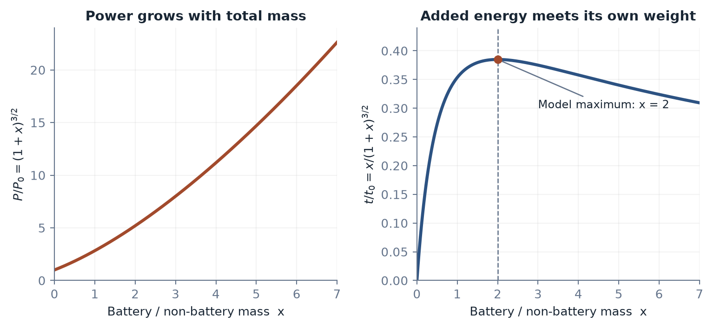

# Viscosity

**Ming-Zhe Dai**

PhD, Associate Professor, Central South University

### The Evolution of Intelligence in Bits, Atoms, and Life

**The world does not run at inference speed.**

AI can write the patch, design a molecule, and render a city. The patch still has to survive production. The molecule has to work in a body. Someone still has to dig up the street.

*Viscosity* follows intelligence across that gap.

English and Chinese editions · [中文说明](README.zh-CN.md)

The English edition is being translated from the Chinese manuscript. [Read the Chinese edition](zh/CONTENTS.md) · [Chinese PDF](zh/viscosity-zh.pdf)

A convincing output can arrive in seconds. A working system has to pass through energy, materials, time, dependencies, and consequences. As generation gets cheaper, the bottleneck moves into deployment, verification, maintenance, and the question of who answers when something goes wrong.

This book connects robotics, control theory, thermodynamics, biology, software, and human agency through **technological viscosity**: the resistance encountered when a possible change has to become an actual one.

## Start with a problem

- A database migration looks simple until the old system has to keep running.
- A robot learns a grasp, then meets a different cup.
- A generated drug candidate enters a trial whose outcomes still need time.
- An optimizer improves every local score while the network becomes harder to recover.
- A profession keeps its skills while losing the familiar evidence of its value.

What connects them? **Resources. Time. Coupling.** A change needs inputs, a process that can finish, and a connected world able to absorb it.

## A battery has to carry itself

More stored energy can eventually buy less endurance. The diagram follows a fixed-area ideal hover model; the argument carries the calculation into payload, verification, airspace, and operations. Throughout the book, diagrams expose the mechanism behind a claim.

## Inside the book

| | Chapter | What it follows |
| --- | --- | --- |
| 1 | Fast Intelligence, Slow Change | Generation, execution, and the moving bottleneck |
| 2 | The Physical Boundaries of Change | Energy, matter, process time, and inherited dependencies |
| 3 | Intelligence at the Interface | Feedback, overload, verification, and models that change their own evidence |
| 4 | Life, Bodies, and Movement | Biological intervention, embodiment, vehicles, fleets, and flight |
| 5 | Existence and Collapse | Evidence, recognition, agency, and the return path for consequences |
| 6 | Rebuilding Value in the Shear Zone | What becomes scarce when symbolic output becomes abundant |
| 7 | Freedom Inside the Constraints | Replication, practical choices, and demanding frontiers |
| A | The Framework and Its Empirical Tests | Definitions, measurement, critical paths, and testable predictions |

## Editions and sources

The English edition preserves the Chinese manuscript's content, argument, examples, equations, and figures. English is the primary language of the repository; Chinese is available alongside it.

Contemporary cases use primary sources checked through **28 October 2026**. [Edition notes](EDITION.md) describe the source and verification work.

For a correction, open an issue with the chapter, quoted passage, and supporting source.

Copyright © 2026 Ming-Zhe Dai. No open-content license has been granted.
