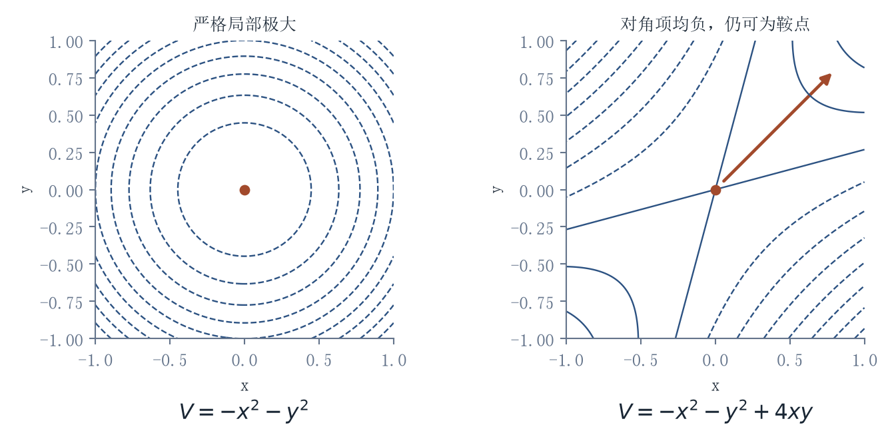

# 黏滞

### 比特、原子与生命的智能演化

**世界不会按推理速度运行。**

AI可以生成一座城市，城市仍要一条街一条街地更新。药物分子可以快速提出，人体的回答还要等待。一个动作在模型中成立，现实中的接触、磨损、配合与责任才刚刚开始。

这本书追踪的，就是从“想得到”到“做得到”的距离。

[中文目录](zh/CONTENTS.md) · [完整中文版 PDF](zh/viscosity-zh.pdf) · [Read in English](en/CONTENTS.md) · [English PDF](en/viscosity-en.pdf)

## 越过生成，进入现实

当方案变便宜，瓶颈会转向哪里？资源、过程时间与系统耦合怎样决定一种能力能否落地？为什么更快的局部，可能制造更重的整体？当机器可以提供熟悉的能力证明，人靠什么重新获得位置？

《黏滞》把热力学、控制、机器人、生命、软件与制度放进同一条转换链。三个坐标组织约束：资源势垒、时间刚性、拓扑耦合。三种介质展示差别：比特、原子与生命。最后的问题落在人身上：哪些阻力值得消除，哪些功能需要保存，谁有权决定，又由谁承担后果。

一个局部指标的改善，可以遮住另一个方向上的损失。书中的图追踪这种机制：势垒怎样降低，反馈怎样放大，电池怎样搬运自身，价值怎样被权重漏掉，关键路径怎样决定完成时间。

## 全书

本版包含前言、七章正文与理论附录。

| 章节 | 阅读入口 |
| --- | --- |
| 前言 | [问题从哪里开始](zh/preface.md) |
| 第一章 | [智能演化的悖论](zh/chapter-01.md) |
| 第二章 | [改变的物理边界](zh/chapter-02.md) |
| 第三章 | [智能进入介质](zh/chapter-03.md) |
| 第四章 | [生命、身体与位移](zh/chapter-04.md) |
| 第五章 | [存在、塌陷与承责](zh/chapter-05.md) |
| 第六章 | [价值的重建](zh/chapter-06.md) |
| 第七章 | [约束中的自由](zh/chapter-07.md) |
| 附录 | [理论框架与经验检验](zh/appendix.md) |

英文版以同一修订稿为基础重新组织表达，并采用适合英语读者的语境与例子。两种语言的44个单元按同一编号对应。

## 版本

中英同步修订版，2026年10月28日。当代案例联网核查至该日，保留统计年份、公告日期、计划目标与实际进展之间的差别。

仓库提供完整PDF、逐章网页阅读版、LaTeX源文件、参考文献与矢量图。[版本说明](EDITION.md)记录本版的修订与检查范围。

发现事实、公式或引文问题，可以提交issue，注明章节、原文与依据。

版权归作者所有，尚未授予开放内容许可。
