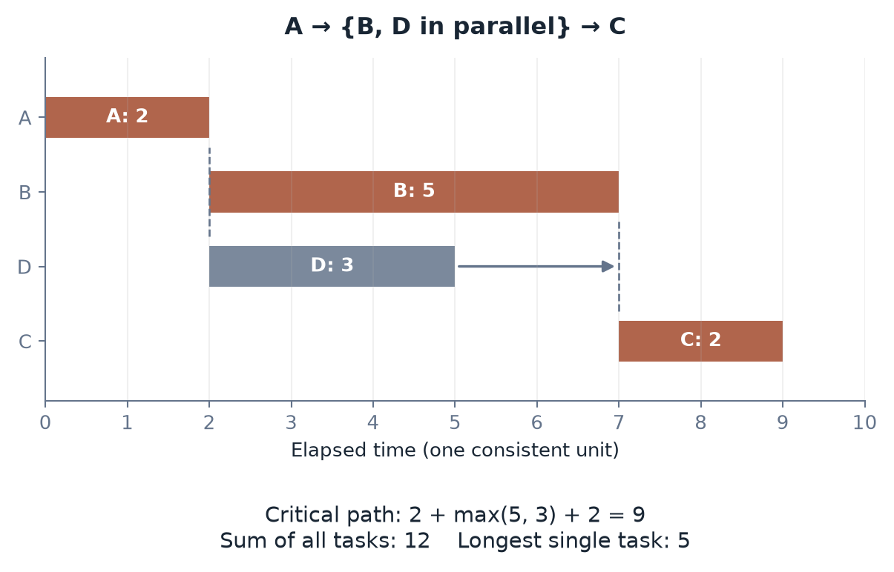

[Contents](CONTENTS.md) · [中文](../zh/CONTENTS.md) · [English](../en/CONTENTS.md)

# The Framework and Its Empirical Tests

The main text uses mechanisms to organize the gap between proposals and dependable change. This appendix specifies how to turn that organization into a measurement program.

## Intellectual Lineage and Proposed Contribution

The distinction between bits and atoms is familiar from discussions of digitization, including Negroponte's *Being Digital* [^negroponte1995being]. This book adds life as an analytical category because adaptive, self-maintaining systems can change the pathways through which an intervention acts.

Ogburn's cultural-lag account directs attention to differing rates of technical and institutional change [^ogburn1922social]. Productivity debates associated with Solow direct attention to the gap between available computation and measured economic outcomes [^solow1987watch]. Baumol and Bowen explain how productivity differences can change relative service costs [^baumol1966performing][^baumol1967macro].

These traditions contain richer arguments than any short genealogy can preserve. They identify related problems without establishing one common underlying law.

The proposed contribution is a shared diagnostic language: resource barriers $R$, temporal rigidity $T$, and topological coupling $G$. The framework follows a capability through design, execution, verification, operation, and responsibility. It asks whether identifying those constraints improves explanation and decisions across domains.

The framework has three levels. A classification organizes attention. A fitted quantitative model relates operational variables to outcomes. A normative argument concerns which results, rights, and responsibilities deserve protection. Each requires its own evidence.

A useful test is comparative. Does the framework identify a bottleneck earlier, improve prediction, reveal an omitted cost, or distinguish interventions that a simpler account treats alike? The value of the language lies in those gains.

## Three Mathematical Forms

### An Exponential Cost Model

First choose an outcome. Let $C>0$ denote cost, labor, or mean time per acceptable result for a fixed task and boundary. Choose a matching reference $C_{\mathrm{ref}}>0$, and define a dimensionless response $\eta=C/C_{\mathrm{ref}}$.

If the marginal effects of normalized constraints on log cost are approximately constant, an initial model is

$$
\eta=\eta_0\exp(\alpha R+\beta T+\gamma G).
$$

$R,T,G$ are dimensionless measurements whose definitions and baselines must be published. The coefficients describe log-cost changes per unit of those measurements. Positive signs are hypotheses for the chosen definitions.

The additive exponent gives multiplicative relative-cost factors. It does not follow merely because stages are connected in series. Serial durations can add, parallel completion can depend on a maximum, and steady pipeline capacity can depend on a bottleneck.

With constant coefficients, fixed $G$ and baseline, and $\alpha\neq0$, an equal-cost slope is

$$
\left(\frac{\partial R}{\partial T}\right)_\eta
 =-\frac{\beta}{\alpha}.
$$

This is a slope in the assumed response surface. It does not show that the project has an available intervention following that direction.

Interactions can be tested by adding terms such as $\delta RT$. Threshold, saturating, additive-cost, and nonparametric alternatives should be compared. An exponential has a smoothly increasing marginal cost; it does not by itself create a phase transition or critical threshold.

Variables must be constructed independently enough to avoid circularity. Relabeling observed completion time as “temporal rigidity” and then using it to predict completion time supplies little explanation.

Estimate on one sample, check later periods and comparable projects, and inspect residuals by task and medium. Structured residuals may reveal missing variables or a wrong form. Unstructured residuals in a small sample do not establish a mechanism.

Coefficient drift can reflect changing technology, omitted conditions, or unstable definitions. It does not by itself prove reversed causality. Record which interpretation the available evidence can distinguish.

### A Timescale Ratio

The Deborah number compares relaxation and observation or driving timescales [^reiner1964deborah]:

$$
\mathrm{De}=\frac{\tau_{\mathrm{relax}}}
                  {\tau_{\mathrm{obs}}}.
$$

Specify the mechanism. A system can have many relaxation times: equipment replacement, workforce training, inventory adjustment, and rule revision need not share a value.

In a material model, a small ratio means substantial relaxation within the chosen timescale; a large ratio means the material retains more of its unrelaxed response. Social applications require evidence for an analogous adjustment mechanism.

Changing the observation window changes the description, not the system's actual recovery capacity. Governance changes a mismatch by changing the input, response capability, coupling, or buffer.

If a single-time Maxwell material is an appropriate physical model, its loss modulus peaks near $\omega\tau=1$. A social adjustment process does not acquire the same peak simply because a timescale ratio has been assigned to it.

### A Rate-Dependent Resistance

Over a defined thickening range, a simple rheological form is

$$
\eta(\dot\gamma)=\eta_b+k\dot\gamma^n,
 \qquad k>0,\quad n>0.
$$

For dynamic viscosity in $\mathrm{Pa\,s}$ and shear rate in $\mathrm{s^{-1}}$, $k$ has units $\mathrm{Pa\,s^{n+1}}$. The expression supplies a rising branch, not a universal complete flow curve.

Biological and institutional applications must define intervention rate and effective resistance in their own units. Dose, frequency, cumulative exposure, and pace are different variables. Compensation, damage, adaptation, and recovery can generate several response shapes.

To test a power law, measure a sufficiently wide input range, repeat the measurements, and compare threshold and saturation models. With a non-negligible baseline $\eta_b$, the slope of $\ln\eta$ against $\ln\dot\gamma$ is not identically $n$. Either fit the full expression or justify a range in which the baseline can be neglected.

The physical model and its cross-domain application occupy different evidential positions. A familiar curve suggests a candidate mechanism; measurements in the target system decide whether it belongs there.

## Qualitative Use Before Calibration

The framework can guide investigation before its coefficients are known. Classify constraints using public criteria and record the evidence supporting each classification.

### Eight Regions

For a coarse view, mark each coordinate low or high under a declared scale. The three binary classifications yield eight regions.

Regions identify an investigation priority. They do not rank total cost or predict a launch date.

| $R$ | $T$ | $G$ | Initial focus | Questions to investigate |
| --- | --- | --- | --- | --- |
| Low | Low | Low | The remaining service boundary | Is demand, quality, or an omitted constraint limiting use? |
| High | Low | Low | Resource barrier | Can substitution, efficiency, or scale improve access? |
| Low | High | Low | Time | Which waiting periods supply information or complete a process? |
| Low | Low | High | Coupling | Can interfaces or dependencies be isolated? |
| High | High | Low | Resources and time | Which stages can be redesigned or parallelized? |
| High | Low | High | Resources and coupling | Can a different architecture reduce both? |
| Low | High | High | Time and coupling | Which interacting responses determine the schedule? |
| High | High | High | The full conversion chain | What phased or alternative route is feasible? |

Near a classification boundary, report the neighboring categories and the evidence that could distinguish them. The cost of coarse classification is loss of within-category detail.

### Comparison Without a Full Weight Vector

For comparable states under the exponential model,

$$
\ln\frac{\eta_a}{\eta_b}
 =\alpha\Delta R+\beta\Delta T+\gamma\Delta G.
$$

With positive coefficients and matching scales, a state no higher on any constraint and lower on at least one has a lower modeled response. This dominance relation does not require exact weights.

Mixed changes need more information. A reduction in $R$ and an increase in $G$ cannot be ranked from their signs alone. Coefficient ratios, magnitudes, and uncertainty bounds determine the result.

Ordinal grades support within-coordinate order. They do not establish equal intervals or a common scale across coordinates. Grade “four” in resources cannot be compared directly with grade “three” in time.

### Direction Over Time

With fixed baseline and coefficients,

$$
\frac{\mathrm d\ln\eta}{\mathrm dt}
 =\alpha\dot R+\beta\dot T+\gamma\dot G.
$$

Common-direction changes permit a sign judgment under positive weights. Mixed directions require bounds or estimates. If coefficients and baseline change, their derivative terms must be included.

This is enough to organize some useful questions: is the physical constraint falling while review remains unchanged? Does a new interface reduce resource use but expand dependencies? Is a reported gain a change in the task boundary?

The qualitative account should end with evidence needs. It can identify an unresolved tradeoff without inventing a numerical answer.

## Decomposition and a Usable Rating Sheet

A rating sheet makes a diagnosis inspectable. Its purpose is to connect each assessment with a task, boundary, and piece of evidence.

### Choose Units That Can Be Examined

A unit should have an output that can be checked and an internally coherent process. Large differences in response time can signal a need to split it. A starting heuristic is

$$
\frac{\max_j\tau_j}{\min_j\tau_j}\leq\Lambda,
$$

with a declared $\Lambda$, perhaps ten. This does not guarantee that another subdivision is useless. The chosen grain must still preserve the mechanism being investigated.

Distinguish conversion units from interface units. A manufacturing step produces an item for the next step. Certification, procurement, access, and public participation connect the project to other systems. Both can change through better technology and organization.

### Ordinal Anchors

The following anchors describe increasing constraint. They require task-specific criteria and evidence; they do not assign universal powers of ten.

Illustrative ordinal anchors. A grade is an evidence-backed category, not a calibrated physical quantity.

| Grade | Resources | Time | Coupling |
| --- | --- | --- | --- |
| 0 | Small marginal demand within existing capacity | Effectively immediate for the task | Local change with few dependencies |
| 1 | Available general equipment and supply | Short relative to the operating cycle | Known, standardized interfaces |
| 2 | Dedicated equipment or materials | A material part of an operating cycle | Several interfaces need adaptation |
| 3 | Significant supply, capital, or infrastructure commitments | A substantial planning or build cycle | Multiple teams or suppliers must coordinate |
| 4 | Scarce inputs or major capacity changes | Long observation, replacement, or institutional process | Multiple organizations or jurisdictions interact |
| 5 | A severe constraint under the specified boundary | Very long relative to the decision horizon | Extensive dependencies with difficult isolation |

Grade zero still consumes material resources. Grade five does not establish impossibility. A physical conservation law can constrain a task without proving that every possible design has reached its limit.

Record uncertainty as an interval of plausible grades or a statement of missing evidence. A decimal grade creates no precision unless the scale has been calibrated.

For a defined dependency closure size $d_i$, one optional count-based binning is

$$
G_i=\min\left\{5,\left\lfloor\log_{10}(1+d_i)\right\rfloor\right\}.
$$

The closure definition matters more than the bin. Graph reachability, mandatory simultaneous modification, causal influence, and administrative contact are different relationships.

### Aggregate the Quantities Before the Grades

Resources with matching units and boundaries can be added. Electricity, labor, cash, and materials need separate accounts or an explicit conversion. Averaging ordinal resource grades does not reconstruct total resource use.

Time depends on structure. For a serial chain with durations $t_i$,

$$
t_{\mathrm{serial}}=\sum_i t_i.
$$

For simultaneous tasks required before completion, elapsed time is their maximum. For a dependency graph it is the longest feasible path, under the stated resource and scheduling assumptions:

$$
t_{\mathrm{finish}}
 =\max_{p\in\mathcal P}\sum_{i\in p}t_i.
$$

A steady pipeline's throughput can be limited by its slowest stage. Throughput and first-item completion time are different quantities.

Amdahl's law supplies another conditional bound:

$$
S(n)=\frac{1}{s+(1-s)/n}\longrightarrow\frac1s,
 \qquad s\in(0,1].
$$

It assumes a fixed workload, serial fraction $s$, ideal parallelization of the remaining part, and omitted additional overhead [^amdahl1967validity]. An algorithm change can alter the workload or serial fraction.

Coupling needs a graph account. Report relevant degree and closure distributions, shared dependencies, cut sets, critical nodes, and possible cascade routes. A mean of coupling grades can conceal a decisive hub.

The familiar giant-component condition

$$
\frac{\langle k^2\rangle}{\langle k\rangle}>2
$$

belongs to a specified asymptotic random-graph setting with suitable regularity assumptions [^molloy1995critical]. It is not a universal threshold for directed, clustered, weighted industrial dependency networks. A connected component also does not imply simultaneous mandatory change.

Only after operational quantities have been defined and calibrated should they enter a quantitative model. A grade sheet remains useful without that step.

### What to Improve First

Under a calibrated exponential model, the contribution $\alpha_c c$ can identify a large modeled constraint term. Choosing an intervention also needs the feasible reduction, cost, interactions, and risk.

For a small independent change with cost per unit reduction $\mu_c>0$, the ratio $\alpha_c/\mu_c$ compares modeled marginal log-cost benefit per spending unit. It does not establish absolute net benefit or select the best finite project when interventions interact.

If time is explicitly calibrated as $T=\log_{10}(\tau/\tau_0)$, then

$$
\ln\mathrm{De}=(\ln10)T
 -\ln\frac{\tau_{\mathrm{drive}}}{\tau_0}.
$$

This identity follows from that calibration. It cannot be inferred from a qualitative time grade.

### Worked Audit: A Low-Altitude Service

Split a proposed service into cell production, pack and thermal system, airframe and rotors, flight control, terminals, operations and maintenance, airworthiness, airspace access, and the conditions under which the public will accept the service.

For each unit, collect actual durations, resource requirements, dependencies, validation evidence, and a responsible party. “Public acceptance takes ten years” is not an input one may simply declare. Identify the relevant population, decision, and observable acceptance condition.

A flight-control update can require substantial verification even when code changes quickly. Certification uses people, equipment, tests, and facilities. Airspace coordination uses infrastructure and operations. None is physically free because its output is a permission.

Create the dependency graph, then distinguish stages that run concurrently from those waiting on one another. A better battery may change aircraft performance, reserves, economics, and certification evidence together. The effect on launch time depends on the actual critical path.

If the next required authorization remains on that path, shortening an unrelated manufacturing step may not move the launch date. It can still reduce cost or improve later throughput. The method separates those outcomes.

### Five Comparison Questions

Comparable questions replace unsupported universal sector scores.

| Project | Resource and time questions | Dependency and evidence questions |
| --- | --- | --- |
| Inference service | Which capacity exists, and what does the whole request cost? | Which downstream actions can an output trigger? |
| Advanced fabrication | Which equipment, process, and yield constraints bind? | Which process changes need supplier and validation changes? |
| Low-altitude service | What mission energy, reserves, and facilities are required? | What evidence and authorizations govern the actual operation? |
| Gene-editing therapy | What delivery, production, exposure, and follow-up are required? | Which cell populations and clinical outcomes support the intended use? |
| Cement or steel decarbonization | What route, energy, feedstock, and replacement schedule are feasible? | How do plant, power, transport, product standards, and demand interact? |

The report should let another reader change an assessment by pointing to evidence. That is the rating sheet's central promise.

Figure A.1. A precedes parallel tasks B and D; C waits for both. Completion takes $2+\max(5,3)+2=9$, rather than the sum of all tasks (12) or the longest individual task (5). The critical path is A--B--C.

## Three Response Models and Their Tests

The medium suggests mechanisms to investigate. The task and data determine which response model fits.

### Approach to a Usage Plateau

For a defined digital service under sufficiently stable conditions, an illustrative model is

$$
Y_{\mathrm{bits}}(t)=Y_\infty(1-e^{-t/\tau}).
$$

The initial value is zero. The response approaches a fitted plateau $Y_\infty$ over timescale $\tau$. Demand, budgets, distribution, usefulness, and capacity can all affect the parameters.

Measure actual use or effective service, not merely generated volume. Compare the exponential approach with alternatives and re-estimate after material changes in the environment.

### A Capacity-Limited Physical Process

For fixed facilities and a consistently defined input $I$, one possible model class satisfies

$$
0\leq Y_{\mathrm{atoms}}(I)\leq\Phi_{\max}.
$$

If diminishing marginal gains are additionally proposed over the observed range,

$$
\frac{\partial^2Y_{\mathrm{atoms}}}{\partial I^2}\leq0.
$$

The upper bound and concavity are separate assumptions. New capacity, learning, complementarities, or step changes can violate the latter and change the former.

Measure design, fabrication, construction, verification, and maintenance separately. AI can improve one stage without determining the rest. Complete-task measurements are needed before comparing its effect across industries.

### An Adaptive Response

For one specified biological or adaptive process, a candidate observation is

$$
\frac{\mathrm d\langle Y\rangle}{\mathrm dP}\approx0,
 \qquad
 \frac{\mathrm d\,\operatorname{Var}(Y)}{\mathrm dP}>0,
 \quad P>P_c.
$$

Mean benefit reaches a plateau while dispersion increases beyond a fitted threshold. Other processes can improve, decline, or respond after a delay. A variance increase is not automatically an increase in harmful outcomes; the outcome definition must identify the risk.

Collect input intensity, duration, population, baseline state, repeated measurements, and follow-up. Distinguish dose from pace. Experiments or credible comparison designs must separate the intervention's effect from selection and changing conditions.

### A Common Evaluation Record

The three examples use different independent variables: time, input, and intervention intensity. Their plotted slopes are not directly comparable.

To compare a shared technology across stages or media, fix a useful task, define comparable input and outcome measures, and record the resources, elapsed time, accepted results, failures, and maintenance required. Matched projects, staged deployments, and suitable experimental designs can then test particular mechanisms.

A multistage project's total output is generally not a linear sum of these three curves. Interactions and bottlenecks require a model of the actual chain.

The empirical program succeeds when it identifies which constraint changed, what happened downstream, and whether a competing explanation accounts for the same evidence more simply.

## Standards of Evidence

The classification, mathematical forms, and normative claims should be assessed separately.

A classification earns its place by helping identify mechanisms or distinguish cases. A quantitative model needs defined variables, stable boundaries, calibrated parameters, and out-of-sample evaluation. A normative proposal needs public reasons about interests, rights, authority, and distribution.

Physical terms require a demonstrated correspondence when applied elsewhere. A biological thickening model needs an input, a response, and a mechanism. A social Deborah number needs an identifiable adjustment process and timescale. Similar language or curve shape supplies a hypothesis to investigate.

The exponential form should compete with interaction, threshold, saturation, and simpler alternatives. If adequate fit requires repeatedly changing what the coordinates mean, revisit the definitions. If several media show the same curve, inspect the mechanism before deciding what the similarity implies.

The framework's central practical claim is that proposals become dependable changes through a chain with receiving capacities, feedback, and obligations. Its usefulness can be tested by whether following that chain improves decisions.

The book's normative commitments are explicit: affected people need effective participation and remedies; consequential judgments need evidence; authority needs an accountable scope; and progress should be assessed over the relevant system and time.

Application begins with feasible paths and a full account of cost. It then considers the interests and rights involved, establishes authority and responsibility, and preserves records through which the result can continue to be challenged and improved.

## References

[^negroponte1995being]: Negroponte, Nicholas. Being Digital. 1995.
[^ogburn1922social]: Ogburn, William Fielding. Social Change with Respect to Culture and Original Nature. 1922.
[^solow1987watch]: Solow, Robert M.. We'd Better Watch Out. 1987-07-12.
[^baumol1966performing]: Baumol, William J. and Bowen, William G.. Performing Arts: The Economic Dilemma; A Study of Problems Common to Theater, Opera, Music, and Dance. 1966.
[^baumol1967macro]: Baumol, William J.. Macroeconomics of Unbalanced Growth: The Anatomy of Urban Crisis. 1967.
[^reiner1964deborah]: Reiner, Markus. [The Deborah Number](https://doi.org/10.1063/1.3051374). 1964.
[^amdahl1967validity]: Amdahl, Gene M.. [Validity of the Single Processor Approach to Achieving Large Scale Computing Capabilities](https://doi.org/10.1145/1465482.1465560). 1967.
[^molloy1995critical]: Molloy, Michael and Reed, Bruce. [A Critical Point for Random Graphs with a Given Degree Sequence](https://doi.org/10.1002/rsa.3240060204). 1995.
