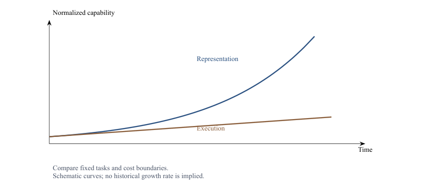
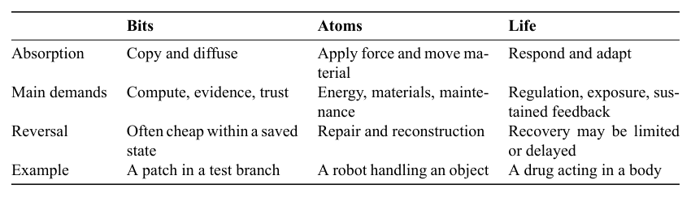
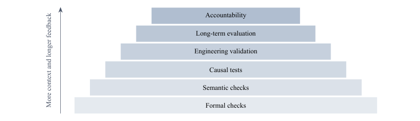
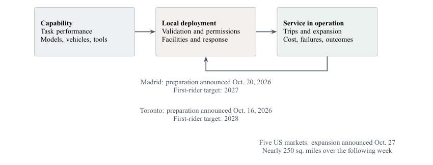
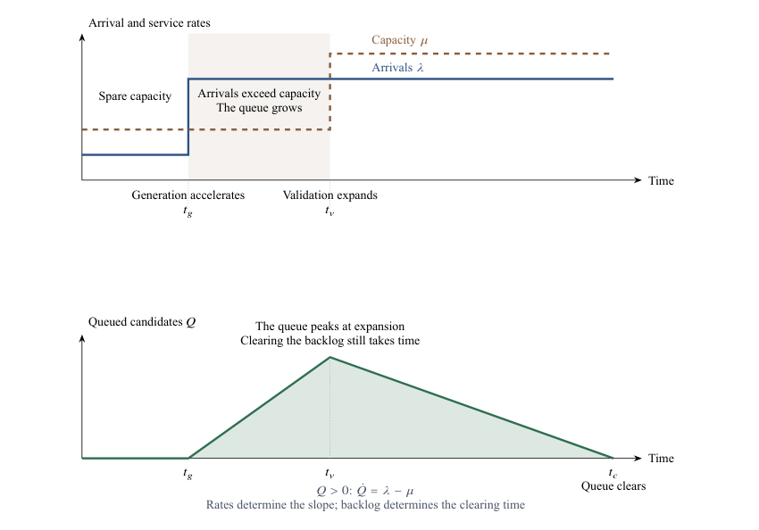

[Contents](CONTENTS.md) · [中文](../zh/CONTENTS.md) · [English](../en/CONTENTS.md)

# The Evolutionary Paradox: Fast Intelligence, Slow Change

Refresh a browser and the screen fills with something new. Look outside and the street is much as it was ten years ago. The drain still floods after heavy rain. The utility crew still has to close the road, locate the buried services, and replace the pipe. A model can render a convincing version of the entire neighborhood before the crew has opened the trench. Both activities have a speed. The trouble begins when we measure one by the other.

## The Illusion of a Single Clock

### A Mismatch in Perception

The faster a screen updates, the easier it becomes to mistake an update for a change. Forecasts about jobs, education, industry, and policy then collapse two processes into one: generating information in a space of representations, and rearranging materials, energy, bodies, and institutions. The first can expand through copying and repeated attempts. The second must pass through execution, verification, and coordination. Put both on the same clock, and the resistance between them disappears from the forecast.

#### Two speeds

Generative AI changes the speed of writing, drawing, coding, and planning. A proposal appears in seconds, and that speed is projected onto the world the proposal describes. Yet the arrival rate of candidates says little by itself about the rate at which a particular system can absorb them.

AI makes search, generation, simulation, and expression cheaper. It can propose a building, a traffic model, a molecule, a business plan, a program, or a policy. The represented world contains materials, energy, equipment, bodies, institutions, liability, and feedback. Producing a plan completes an operation in the planning system. Executing it requires a state transition in another system. The costs of finding, implementing, verifying, and accepting a route have to be counted separately.

Developers already know a small version of this distinction. Producing a patch, passing a test suite, migrating a live database, and recovering from a bad migration are different tasks. The gap widens when the proposed change reaches a power network, a hospital, or a construction site. A faster proposal does not establish that the receiving system is ready.

Digital representations encourage rapid retries. A trained model can generate another draft with another inference call. A test branch can be discarded; a saved version can be restored. This convenience depends on the operation remaining inside a recoverable boundary. A leaked secret, a completed trade, or a faulty command sent to production carries consequences that version control cannot simply reverse.

Images make the distinction particularly easy to miss. A plausible street scene can be synthesized without moving a vehicle, laying a cable, or pouring a foundation. The experience of acceleration is real. What accelerates is the production of a representation.

A simple working description uses two growth rates:

$$
u_{\mathrm{bits}}(t)=u_{\mathrm{bits}}(t_0)e^{a(t-t_0)},
\qquad
u_{\mathrm{atoms}}(t)=u_{\mathrm{atoms}}(t_0)e^{b(t-t_0)}.
$$

Here $u$ measures operations per unit cost for a fixed task; $t_0$ is the comparison date, and $a$ and $b$ are fitted rates over a specified interval. If $a>b$, the logarithm of the normalized ratio grows at rate $a-b$. The form describes a possible divergence. It does not supply the rates. A particular technology may improve exponentially, linearly, in steps, or toward saturation. Figure 1.1 illustrates the distinction without assigning historical values to it.

Figure 1.1. Two speeds. A gain in producing representations can outrun the receiving system's capacity to execute them.

#### The installed world

Moving from representation to matter introduces execution costs. A rendered vehicle follows a calculated trajectory. A real one needs energy, traction, braking, steering, sensing, and contact control. A bridge design can be revised quickly; building it requires materials, equipment, labor, and a suitable foundation. Steel strength, ground conditions, and concrete curing enter the same engineering account. The familiar 28-day concrete strength is a testing benchmark; mix, temperature, and curing methods affect the rate of strength development. Faster drawing changes one part of this chain.

The second constraint is the installed base. Software can sometimes be reorganized within a recoverable environment. Cities must be changed while people continue to live in them. Roads sit above buried services; new electrical loads connect to existing substations; a hospital's new equipment enters established clinical and maintenance routines. Upgrading a system requires a transition plan for the things that are already connected. Even a technology that needs little roadside modification must accommodate roads, users, operating rules, and liability.

A third constraint comes from operating conditions. A simulator contains the disturbances its designers have included. A deployed system encounters additional changes, failures, and participants. A road crew deals with subsidence, conflicting utility maps, access requirements, weather, and the needs of nearby residents. A driving system faces the conditions under which its sensing and control actually work. Simulation can expose many failures before deployment. Field performance still depends on the relation between the model and the operating environment.

#### The cost of reversal

Recoverability changes the price of experimentation. Restoring a simulation state can be routine. A demolished pier, an administered medicine, or a damaged battery requires a different remedy. Physical repair can be possible, but its resource cost and consequences do not disappear when a previous design file is restored. Methods developed for cheap retries must be evaluated against the failure costs of the receiving system.

Prediction and control also have different requirements. A system may predict that a falling glass will shatter. Catching it requires a sensor estimate, an actuator capable of reaching it, a suitable grip, and feedback fast enough to maintain contact without breaking it. Learned models can contribute to each part. Performance at representing an event does not establish performance at intervening in it.

As generated scenes become more convincing, the crew outside the window can seem increasingly clumsy. That comparison omits most of the crew's task. One system produces a plausible account of forces; the other must apply them under real constraints.

**A speed achieved in representation must be accounted for again at execution.** Energy, material properties, logistics, dependencies, and cooperation determine what crosses the boundary. These constraints can spread the effects of an abrupt improvement over a longer transition. They provide a buffer only when plans actually allow for them.

The difference between the screen and the street is visible. Why, then, does public judgment so often take the faster side as representative? Part of the answer lies in how technological examples are selected, displayed, and financed.

### The Technologies That Make the Demo

#### Selection by attention

Software makes an unusually good demonstration. Its output can be shown, copied, and compared immediately. The construction of the building that houses the servers is harder to display as a breakthrough. Attention selects the lightest visible layer and leaves much of its support outside the frame.

The selection process reinforces itself. A result that can be demonstrated attracts attention and investment; those resources help produce the next demonstration. Meanwhile, fabrication, power delivery, cooling, and maintenance progress through other schedules. Each can improve substantially, but its rate has to be measured on its own terms.

An audience repeatedly shown the fast cases can mistake the sample for the whole. Then medicine, education, energy, and manufacturing are all expected to follow the trajectory of a software product. Slow adoption becomes evidence that an industry lacks digitization or that a model lacks intelligence. The possibility that another part of the system is binding drops out of view.

The omitted cases cannot correct the story quickly. A planning decision, a replacement transformer, a materials qualification, or an extended field test supplies feedback over months or years. Its silence during a product launch is easily read as absence.

#### Infrastructure behind the interface

Communications provide a familiar example. A signal indicator on a phone gives no sense of the work behind coverage. Fiber installation can require access agreements, trenching or duct access, coordination with other utilities, testing, and repair. A protocol update and a physical network upgrade have different critical paths. The distinction comes from the operations required, not from a universal ratio between the speed of electrons and the speed of atoms.

Energy systems make the issue sharper. A better dispatch algorithm can improve the use of available capacity. New capacity may still require equipment, land, financing, construction, network studies, and connection work. A hypothetical doubling of a solar panel's conversion efficiency would change the area or output calculation; it would still leave panels to manufacture, transport, mount, connect, and maintain.

Berkeley Lab's 2026 queue study gives the US example a scale: more than 2,060 GW of generation and storage capacity was seeking grid connection at the end of 2025. For the regions with data, projects completed in 2025 had a median interval of more than five years from request to commercial operation. Much of the queued capacity will never be built. A submitted project and an operating power supply are different states.[^berkeley2026queues]

Precision manufacturing poses the same distinction at a different scale. A lithography system can embody extraordinary informational sophistication while still requiring demanding fabrication, assembly, transport, installation, calibration, and service. Yield improvement depends on contact with materials and process variation. Better algorithms can shorten a feedback cycle and extract more from it. Evidence from the cycle remains part of the achievement.

#### Where the cloud stands

The word *cloud* conceals an engineering site. Compute runs in buildings connected to electrical and communications networks, with servers, storage, power conversion, cooling, and staff. The IEA's October 14, 2026 report describes network capacity, connection queues, and permitting as constraints on data-center expansion.[^iea2026powering] The race for intelligence has reached the substation.

Cooling requirements depend on the architecture, location, and operating conditions. A facility may consume water directly; water use may also arise in the electricity supply chain. No single evaporation rate describes every data center. The general requirement is to carry away waste heat while keeping equipment within its operating limits.

The hardware has its own material history: mined inputs, processing, wafers, components, assembly, shipping, and replacement. Their costs can be made less visible to a user without being removed from the system.

This bias needs no coordinated deception. What can be demonstrated receives attention; what enables it is treated as background. A useful analysis must give both a place in the same account.

#### Technological viscosity

**Technological viscosity** is the generalized resistance encountered when intelligence, an algorithm, or a technical plan attempts to move a real system from state A to state B. Execution, verification, maintenance, coordination, and the handling of failure all enter it. The word borrows from fluid mechanics the idea of resistance arising within the medium. In this book, its broader use requires task-specific definitions and measurements.

Cheap generation changes the distribution of scarcity. When candidates multiply faster than reliable outcomes, trust and absorption capacity become relatively more valuable. A field once limited by its supply of possible designs may become limited by its ability to test, build, or sustain them. Candidate abundance can coexist with a shortage of results on which anyone can depend.

Three coordinates give the smallest useful starting framework: **resource barriers** ($R$), **temporal rigidity** ($T$), and **topological coupling** ($G$). Can the change be supplied with resources? Can the required processes unfold in time? Can the change propagate through the dependencies already in place? These questions recur throughout the book.

### The Material Basis of Virtual Escape

#### Moving inward

When the material world is expensive and difficult to change, moving activity into a virtual environment can be attractive. High housing costs, congestion, and limited mobility give that attraction practical force. Remote work, online communities, and virtual environments can reduce particular travel or space requirements. The proposal becomes more ambitious when it treats mediation as independence from the physical conditions that sustain it.

An old aspiration returns in a new form: keep an elaborate inner world while reducing the body's demands to a minimum. A headset offers a beach without a flight; an online meeting offers contact without a commute. Some substitutions produce real savings. Their effect must be compared with the activities displaced and the infrastructure added.

The political version appears in proposals such as Balaji Srinivasan's *The Network State*: organize online, then acquire a territorial and institutional presence. The relevant physical question is what supplies the energy, communications, transport, public health, and security on which the arrangement depends. A digital community can reorganize how these services are obtained. Independence requires an account of who actually provides them.

The same question applies to ordinary remote work. A person can leave an office while remaining dependent on a grid, a network, a supply chain, and emergency care. The visible location changes faster than the supporting system.

#### The thermodynamic account

A virtual environment is implemented by physical states: charges and voltages, magnetic or electronic storage, and optical signals. Contemporary computation and communication dissipate energy. Supplying power and removing waste heat are operating conditions of the service.

The sources and environmental effects of that electricity vary by place and time. Additional digital activity can increase demand; substitutions and efficiency improvements can reduce other demands. The net result requires a defined comparison. Virtual activity has a substrate even when it delivers a net material saving.

Spatial flexibility also requires spatial infrastructure. A remote worker's connection may run through local distribution equipment, terrestrial fiber, undersea cables, and distant data centers. Those assets require construction, protection, inspection, repair, and replacement. Redundancy and geographic recovery can make them more reliable at additional cost. Thermodynamics alone supplies no rule that a more ordered or more complex system must be more fragile.

The entropy balance for a system and its environment is

$$
\Delta S_{\mathrm{system}}+\Delta S_{\mathrm{environment}}
=\Delta S_{\mathrm{total}}\geq 0.
$$

Each term has units of joules per kelvin. If their combined boundary is isolated, a local entropy decrease must be accompanied by an equal or larger increase elsewhere. Equality is the reversible limit. Real power conversion, cooling, manufacturing, and transport include irreversible processes.

Visual tidiness and informational usefulness are different quantities from thermodynamic entropy. A clean desktop is not a measurement of $\Delta S_{\mathrm{system}}$. The balance establishes the physical terms of the computation and its support, rather than a fixed entropy price per image, insight, or neatly arranged screen. Pollution, water consumption, and electronic waste also require their own measurements; they cannot be read directly from this inequality.

Much of the apparent lightness of digital life comes from a division of work and location. An interface presents the result while the supporting machinery, maintenance, heat rejection, and waste handling occur elsewhere. Some costs fall, some move, and some new ones appear. The account has to follow all three.

#### The body remains connected

Human participation adds a biological condition. There is no demonstrated method for uploading a person's consciousness and dispensing with the living body. Ordinary digital life therefore still depends on food, temperature regulation, sleep, care, and health. A wound heals through a biological process; replacing a file does not replace that process.

An apparently frictionless service can relocate bodily work. The electrical technician who maintains the supply, the parcel driver who reaches an inaccessible entrance, and the nurse who responds when someone becomes ill handle parts of the experience hidden by the interface. Their work has not become virtual because the request arrived through an app.

Digital mediation can change how much material support an activity needs. It cannot dispense with support altogether. A serious account of virtual freedom therefore follows its dependencies into power, equipment, maintenance, and living bodies.

So far, those dependencies have appeared as obstacles. They also perform another function. The same resistance that limits a rate of change can keep a system from coming apart. To see that function, we need to examine viscosity as damping.

## Resistance as a Stabilizer

### The Physical Anchor

Computation can advance abruptly while the systems it is meant to transform remain largely recognizable. A factory, a city, and a health service all absorb change through structures that already have work to do. The gap between a new capability and a transformed world is produced inside those structures.

Two processes matter: execution and confirmation. Execution meets resources, process time, and dependencies. Confirmation meets evidence, standards, and responsibility. Together they shape the transition from a technical possibility to something on which people act.

A damped oscillator gives the simplest picture of how a system's response depends on more than the force applied:

$$
m\frac{d^2x}{dt^2}+\gamma\frac{dx}{dt}+kx=F(t),
\qquad
\zeta=\frac{\gamma}{2\sqrt{mk}},
\qquad
\tau_{\mathrm{slow}}\approx\frac{\gamma}{k}\quad(\zeta\gg1).
$$

For a mechanical displacement $x$, $m$ is mass, $\gamma$ the damping coefficient, $k$ the restoring stiffness, and $F(t)$ the driving force. Their units are kg, kg/s, kg/s$^2$, and N respectively. The damping ratio $\zeta$ is dimensionless. In the strongly overdamped regime, the slow relaxation time is approximately $\gamma/k$: more damping produces a longer transition.

As an analogy for technological change, inertia represents installed assets, damping represents resistance to transition, and restoring forces represent arrangements that maintain the existing state. For a constant input, the equilibrium displacement depends on $F/k$; the approach to it depends on the dynamic parameters. A force and a timetable are different parts of the model. Social and technical systems need their own measured variables before this analogy can yield a forecast.

Maintenance makes the distinction concrete. A body needs metabolism; a server needs power and cooling; a transport network needs inspection and repair. A building can persist for a time without an active supply, while its materials continue to age. These systems sustain order through different mechanisms and on different timescales. Work on an operating railway can be harder to schedule than work on an empty site because the railway must continue to carry people.

#### Resource barriers

Transforming matter requires a physical route. Ironmaking must reduce iron oxides. Cement manufacture must drive reactions and process material at high temperature. Furnaces, feedstocks, equipment, and heat flows belong in the account. Better chemistry and process design can lower actual energy use and sometimes alter the thermodynamic requirement by changing the route. An activation barrier, a reaction's free-energy difference, and a plant's energy consumption are distinct quantities. Computation earns its value by finding better routes through these conditions.

This is the resource barrier, $R$. A bridge requires materials and a site. A grid-control algorithm acts on a network whose generation, transmission, storage, and operating margins already exist. A robot policy runs through a battery, actuators, sensors, joints, and a maintenance system. Intelligence changes how resources are used. The resulting operation still needs resources.

Human bodies belong in the same comparison. Converting a daily food intake of 2,500 dietary kilocalories into average power gives

$$
P_{\mathrm{human}}
=\frac{E_{\mathrm{food}}}{\Delta t}
=\frac{2500\times4.18\times10^3}{86400}
\approx1.2\times10^2\ \mathrm{W}.
$$

That is about 120 W of average metabolic input over a day. It supports the whole organism, including temperature regulation, cognition, and activity. Mechanical output is a different quantity.

A comparison with a machine requires the same task, duty cycle, quality, and system boundary. If a machine consumed an average of 1--3 kW under those conditions, its input-power ratio to 120 W would be about 8--25. Those machine values are an illustration. Equipment, labor, energy prices, downtime, and service life then determine the economic comparison.

A flexible human worker can be highly economical in an irregular setting. In a standardized operation, a specialized machine may reverse the comparison. The relevant protection comes from the present cost of completing the task.

#### Temporal rigidity

Every transition needs time to unfold. Heat must move, reactions must proceed, material damage must become observable, organisms must respond, and people must coordinate. This is temporal rigidity, $T$.

A candidate molecule and evidence about its long-term effects are separated by exposures and observations. A simulated traffic flow and a functioning transport service are separated by vehicles, maintenance, users, operating permissions, and practice. An infrastructure asset may be designed for decades of use, so a replacement must fit the service it is replacing.[^miatto2017how]

Parallel construction, prefabrication, better testing, and better coordination can shorten parts of a project. The useful analysis identifies which part of the critical path actually changes. Compress a year of design work to a day while leaving a multiyear build unchanged, and the number of proposed projects can grow much faster than the number completed.

Waiting also has more than one function. A redundant approval can be removed. An observation period may reveal a delayed effect. Consultation can expose a cost that a project sponsor would otherwise impose on someone else. Calling all three “delay” conceals the work each is doing.

#### Topological coupling

A system is a network of dependencies. A local improvement must pass through equipment, people, standards, routines, interests, and feedback. This is topological coupling, $G$.

A medical model enters a hospital's diagnostic workflow, record systems, staffing, reimbursement arrangements, and responsibility for treatment. A new energy device enters a grid. A better driving policy enters a road system used by other people. A strong component can fail to transform the whole because the surrounding connections do not support the transition.

Moravec's paradox draws attention to the difficulty of ordinary embodied performance. A formally specified game can demand immense search while still supplying explicit rules and a clear account of success. A robot handling laundry must cope with uncertain shape, occlusion, contact, friction, and deformation. The environment with the more complicated rules on paper can be easier to formalize.

Discretizing $n$ degrees of freedom into $m$ values each produces

$$
N_{\mathrm{config}}=m^n,
\qquad
\ln N_{\mathrm{config}}=n\ln m.
$$

This count explains why exhaustive search rapidly becomes impractical. Geometry, learning, feedback, and passive mechanics can avoid that enumeration. The remaining difficulty depends on the task and the method. A person folding a shirt benefits from a body and a lifetime of interaction already fitted to the problem.

Standardizing the environment changes the comparison. A warehouse with regular containers, predictable shelving, and controlled access can be much easier to automate than an arbitrary home. Part of the achievement has been purchased by rebuilding the task's surroundings. Resource barriers and topological coupling move together.

#### Three media

Bits, atoms, and life absorb intelligence differently.

In the domain of **bits**, generated output can often become visible immediately. Text, images, code, data, and virtual scenes are easy to duplicate and revise within a recoverable environment. Trust imposes another threshold: reliable code, traceable knowledge, and decisions with an accountable owner require more than the arrival of an output.

In the domain of **atoms**, a prediction must become a force, a contact, a movement, or a flow. Manufacturing, construction, transport, energy, logistics, and robotics pay for mass, friction, inertia, strength, space, and maintenance. A wrongly cast component needs physical rework. An improved controller changes what machinery can do within those conditions.

In the domain of **life**, intervention changes a system that continues to respond. Cells, bodies, organisms, and ecosystems compensate, adapt, and sometimes evolve. AI can accelerate target identification, structural prediction, molecular design, and screening. Toxicology, pharmacokinetics, clinical effects, and sustained safety require evidence from the relevant biological processes. A gene's function depends on its regulatory, developmental, cellular, and ecological setting.

The basic pattern is uneven absorption. Bits support rapid diffusion, atoms require work, and life returns feedback. A model capability can move quickly through one layer and slowly through another.

Figure 1.2. Three media, three ways of absorbing an intervention. The same project can span all three columns.

Code acquires a much higher cost of failure when it controls a production system. A drug candidate enters a different timetable when it reaches a trial. The task and the consequence matter alongside the medium.

The three coordinates can trade against one another. More resources may buy time; more time may allow a lower-resource process; redundancy may improve reliability while adding equipment and maintenance. New processes can also reduce several costs together. A lighter user experience can conceal a heavier backend, while a genuine process improvement can reduce the total.

**Which resistance fell, and where did the rest go?** That question follows a technology beyond its demonstration.

### The Grounds for Relying on a Result

Execution asks how a proposal reaches the world. Confirmation asks what warrants relying on it. A well-formed statement, a supported claim, and a successful intervention require different evidence.

#### The verification pyramid

A thousand drug candidates do not create a thousand trial programs. A large library of driving policies does not establish how any one behaves on public roads. A polished policy proposal does not establish its effects on organizations or public trust. Verification consumes resources, time, and access to the system being investigated.

Six layers make the progression visible. **Formal checks** test syntax, rules, and specified logical properties. **Semantic checks** examine meaning, facts, citations, and sources. **Causal tests** examine whether an intervention produces an effect. **Engineering validation** examines operation under noise, failure, maintenance, cost, and scale. **Long-term biological and human evaluation** examines effects that need time to emerge. **Accountability** asks whether a deployed arrangement can be explained, audited, challenged, and made to answer for harm.

For candidates filtered through successive stages,

$$
N_k=N_0\prod_{i=1}^{k}p_i,
\qquad 0\leq p_i\leq1,
$$

where $p_i$ is the fraction passing stage $i$ among those that passed all earlier stages. The expression follows from conditional counting, without an independence assumption. If a stage leaves no survivors, later counts remain zero. It counts survivors; the cost and reliability of each test require separate measures.

Figure 1.3. Different questions require different evidence. The shape organizes the verification tasks; its widths are illustrative.

Tools can improve every layer, at different rates. Automatic checks may increase throughput sharply. Field exposure, long-term observation, and the resolution of disputed consequences remain tied to other processes. When candidate generation outruns them, the waiting room fills.

The upper layers also change the standard of judgment. The acceptance conditions for a formal specification can be explicit. An accountable deployment must respond to the actual distribution of risks and interests. Operational rules can encode part of that task. Treating the encoded portion as the entire objective creates a new failure mode: participants learn to optimize the measure while the purpose recedes.

#### Proof and its premises

Gödel's incompleteness theorems establish limits for consistent, effectively axiomatized formal systems strong enough to express basic arithmetic. Under the relevant hypotheses, some propositions cannot be decided within the system; the second theorem restricts its ability to prove its own consistency.[^godel1931]

An engineering example brings the practical question closer. A proof that a program satisfies a specification leaves open whether the specification captures the intended requirement. Machines can check proofs and help check specifications. Sensors, tests, and independent evidence can extend the chain. The remaining judgment concerns what errors the chain covers and what its omissions would cost.

For decisions that allocate risk and benefits, standards also need authorization. People who bear the consequences need ways to provide evidence, contest a requirement, grant permission, and appeal a decision. Formal competence and legitimate authority answer different questions.

#### A promise needs an address

Trust includes a question that an accuracy score leaves unanswered: where does the loss go when the decision fails?

Nassim Taleb's idea of *skin in the game* draws attention to the relation between decision makers and those exposed to their decisions. A person can pledge property, professional standing, and reputation. An organization can supply assets, a durable identity, insurance, and a structure for correction and compensation. These arrangements give a promise an address.

Medical and other consequential services need both reliable decisions and a workable response to failure. Records, review, suspension authority, and a responsible operator help establish that response. A human assigned to approve outputs needs the information, time, and power to intervene. A name on a form supplies little by itself.

Trust can also accumulate through a relationship. Care, counseling, and companionship involve memory, knowledge of a situation, and commitments that are kept over time. A model can generate a response. The service still has to establish continuity, crisis handling, and correction.

Evidence gives a judgment grounds; accountability gives a commitment a return path. Both can be supported by automation and institutions. Together with the conditions for execution, they stretch the transition from a new capability to a changed society.

The transition is a contested interval. Work can be reorganized on one timetable while people's account of their own worth changes on another. That mismatch is the next problem.

## The Crisis of Instrumental Value

### Replacement Runs on Different Clocks

Tasks are exposed to automation at different points in the chain. Generating routine text, summaries, code, and analysis often takes place in a low-friction environment. Repair, assembly, inspection, care, and transport require action within a setting that can be irregular, occupied, and consequential. A new model capability meets different deployment costs in each.

This creates a social split: **the body can remain in the old workplace while the evidence of professional worth has already changed.**

#### The economics of the last meter

A robot is a capital asset. Purchase, integration, depreciation, maintenance, power, supervision, and downtime enter its cost. Human labor has wages, benefits, training, safety, support, and the wider costs of developing and sustaining a person. An employer's account captures only part of the latter. A low purchase price for labor can reflect a successful transfer of costs to workers, households, or public institutions.

An introductory annual-cost comparison is

$$
C_{\mathrm{human}}=w,
\qquad
C_{\mathrm{machine}}=\frac{K}{L}+m.
$$

Here $w$ is the annual cost assigned to the human option, $K$ the machine's purchase and installation cost, $L$ its accounting life in years, and $m$ annual operating and maintenance expense. For matched output, quality, availability, and risk, a lower $K/L+m$ can favor substitution in this simplified account. Financing, utilization, transition costs, and the distribution of liability can change the result. An attractive purchase calculation still needs an executable deployment.

The last meter often carries the irregular work. Consider a parcel route. Route planning is one task; finding the correct entrance, handling a damaged package, dealing with an inaccessible building, and resolving a disputed delivery are others. A warehouse robot meets a related problem when a container deforms or an object lies outside the expected pose. Each additional condition has to be engineered into a system that remains economical and reliable.

The field is advancing, so a frozen picture of robot failure would be misleading. On October 27, 2026, Waymo announced an expansion of nearly 250 square miles across five United States markets. A week earlier it announced preparations for Madrid; its Toronto announcement set a goal of first riders in 2028.[^waymo2026expansion][^waymo2026madrid][^waymo2026toronto] Existing service, a local expansion, and a future launch target occupy different stages of the same deployment chain. Reading them all as a single capability number erases most of the engineering.

Figure 1.4. Capability, deployment, and operation are different kinds of progress. Examples follow Waymo's October 2026 announcements; targets retain their status as plans.

Substitution also has a calendar. Procurement, installation, qualification, retraining, and a new operating arrangement consume time after a machine demonstrates a task. The ratio between that interval and the time needed to generate a plan depends on the task. Cheap generation does not install a fleet.

These cost advantages move. Better machines, higher utilization, lower energy prices, and standardized environments can reverse a comparison. The buffer is an opportunity to organize a transition.

#### Useful, but no longer the author

Employment can persist while its meaning changes. A person's job may survive because the receiving system is hard to automate, even as the outputs used to recognize their expertise become easy to obtain elsewhere.

Employment statistics and professional experience then register different things. One counts whether a position exists. The other asks whether the position still conveys competence, discretion, and recognition. A worker can remain on the payroll while losing authority over the process.

Modern institutions often reward people through a functional equation: ability, output, and social standing are treated as if they rose together. Generative systems disturb the relation. A finished illustration or a plausible program no longer provides the same evidence of training and experience. Expert judgment can remain valuable while the familiar artifact becomes a weaker signal of it.

The resulting fear can exceed a fear of lost income. “Someone can still pay me to do something” does not settle “what part of this work is mine?” Where outputs once established a place, their abundance creates a demand for other forms of proof.

Algorithmic management makes this problem visible. In parcel logistics, warehouse picking, and ride-hailing, software can assign tasks, shape routes, record performance, and influence pay, while people handle the physical contact and its exceptions. The degree of autonomy depends on the power to refuse, revise, contest, or pause a task. A worker can be indispensable to execution and have little say over its terms.

Yuval Harari's phrase “useless class” points toward the anxiety, but usefulness can remain high. People may still perform necessary work while disappearing from the account of who directs and creates. The question is their recognized agency within the system.

The danger is a split between bodily usefulness and public authorship. A society may continue to depend on people for difficult material work while describing intelligence and initiative as properties of the coordinating platform. Addressing that split requires more than keeping jobs numerically intact.

### Efficiency Creates New Bottlenecks

An efficiency gain creates room for a response. That response can consume the room.

Cheap generation supplies more proposals, drafts, and code. If their arrival rate grows faster than review and maintenance capacity, work accumulates there. The person spared a first draft may inherit a queue of drafts to judge. This is a throughput mismatch; a saving can also remain a saving when the receiving system has enough capacity.

Figure 1.5. A moving bottleneck. Arrival rate $\lambda$ exceeds service capacity $\mu$ after generation accelerates. Later capacity expansion reverses the slope, but clearing the queue takes time. Schematic, with uncalibrated vertical scales.

Several familiar mechanisms expose the same pattern. Table 1.1 places them side by side.

Table 1.1 — Local improvements and the responses they can induce

| Mechanism | Local change | Response | Possible result |
| --- | --- | --- | --- |
| Jevons | Cheaper use | More uses and users | Higher total consumption |
| Braess | An added route | Drivers reroute | A worse traffic equilibrium |
| Goodhart / Campbell | A rewarded metric | Behavior targets the measure | The measure loses fidelity |
| Lucas / reflexivity | A model informs action | Participants adapt | Historical relations change |
| Risk compensation | Lower risk per exposure | More or stronger exposure | Some benefits are offset |
| Automation irony | Routine tasks disappear | People move away from practice | Harder exceptional takeovers |

The common sequence is a changed local condition, a response within the system, and a new distribution of costs. The mechanisms remain distinct. Putting them in one account helps identify what a local performance measure misses.

#### Use and equilibrium

Jevons observed that more efficient use of coal could expand the activities that consumed it.[^jevons1865coal][^allwood2012sustainable] Lower cost opens applications that were previously uneconomical. The outcome depends on how much use expands.

Let $q$ be the physical resource required per operation, $p$ the monetary price per operation, and $N(p)$ the number of operations per unit time. Under the illustrative assumption $p=\alpha q$ with fixed $\alpha$,

$$
E=qN(p),
\qquad
\varepsilon=-\frac{d\ln N}{d\ln p},
\qquad
\frac{d\ln E}{d\ln q}=1-\varepsilon.
$$

$E$ is resource use per unit time and $\varepsilon$ the demand elasticity. For $\varepsilon<1$, lower resource use per operation reduces the total. For $\varepsilon>1$, expanded demand more than offsets the saving. The price relation connects engineering efficiency to demand in this example.

The current AI industry supplies a live version of the question. In April 2026, the IEA reported a steep fall in energy use per AI task alongside a 17% increase in total data-center electricity demand during 2025. New use cases and adoption were expanding as individual tasks became more efficient.[^iea2026questions] Per-task efficiency and aggregate demand can move in opposite directions.

Generated code, content, and plans can exhibit a related throughput effect. Easier production invites more production. Review, testing, dependency management, and the disposal of bad candidates then become larger parts of the work. Whether the total burden rises is an outcome to measure.

Braess's paradox moves the issue from volume to routing. In some networks, adding an edge makes the equilibrium travel time worse because travelers adjust their routes in response.[^braess1968]

For one origin-destination pair and fixed demand, a Wardrop equilibrium requires every used route to have minimum cost:

$$
f_i>0\ \Longrightarrow\
c_i(\mathbf f)=\min_{j\in\mathcal P}c_j(\mathbf f).
$$

By contrast, a system optimum minimizes total travel time over feasible flows:

$$
\min_{\mathbf f\in\mathcal F}
\sum_{e\in E}f_e c_e(f_e).
$$

Here $f_e$ is edge flow, $c_e$ travel time on that edge, $\mathcal P$ the set of routes, and $\mathcal F$ the feasible flows satisfying demand and flow conservation. Route flow and edge flow are related by the network's incidence structure.

An added edge expands the feasible set, so it cannot worsen the system optimum when leaving the edge unused remains possible. It can worsen the equilibrium reached by independent route choice. More available options and a better collectively chosen outcome are separate properties.

Software tools can induce an analogous question: what happens when every participant adopts the locally attractive route? A tool's advantage for its first users may become a system's next queue.

#### Measures and models

Goodhart's and Campbell's observations concern measures that become targets.[^goodhart1975problems][^campbell1979assessing] Once a score governs rewards, staffing, access, or reputation, participants have a reason to reshape their behavior around it.

A test-coverage percentage can rise without covering the dangerous failures. A support team can close tickets faster while transferring unresolved work to customers. A hospital metric can change which cases receive attention. The measured variable enters the control loop.

Verification systems face the same problem. Improving the resolution of a score helps while the score remains connected to the objective. A strong incentive to optimize the proxy can make that connection weaker.

The Lucas critique asks what happens when a policy changes the behavioral relations used to predict its effects.[^lucas1976econometric] Reflexivity emphasizes how participants' beliefs and actions can help shape the object they describe.[^soros1987alchemy] A risk model can influence the positions institutions take; a public forecast can change demand; a staffing model can alter the behavior it is later asked to explain.

Once a prediction becomes an input to action, it becomes part of the next state. A useful model must therefore be evaluated in use, including the responses its use induces.

#### Risk and the work left over

Risk compensation concerns changes in exposure after a safety improvement.[^peltzman1975effects] A lower chance of failure per event can encourage more events, higher speed, more leverage, or less attention.

With exposure rate $n$, failure probability $p$, and mean loss per failure $d$,

$$
\mathcal R=pnd,
\qquad
d\mathcal R=nd\,dp+pd\,dn
\quad(d\ \mathrm{held\ constant}).
$$

For a small reduction in $p$ and increase in $n$, expected loss falls to first order when

$$
\frac{|dp|}{p}>\frac{dn}{n}.
$$

The severity $d$ and the distribution of exposure also matter. A gain for one group can be accompanied by a cost to another. Risk compensation has to be assessed in its setting.

Automation changes the distribution of tasks. Bainbridge's *Ironies of Automation* describes a persistent difficulty: routine operations disappear from human practice, while unusual failures demand a rapid and skilled takeover.[^bainbridge1983ironies]

People can perform fewer interventions and face a harder average intervention. They may have less recent experience of the process and less time to reconstruct its state. On-call engineering makes the structure familiar: an automated service can run quietly for a long time, then deliver an exceptional incident to someone who must diagnose it under pressure.

More capable AI can absorb a larger share of routine judgment. The remainder may then contain a higher concentration of ambiguous, consequential, and poorly documented cases. Deployment has to provide enough authority, information, practice, and time for the role it leaves to people.

#### Where the pressure goes

These mechanisms concern different variables: demand, route choice, incentives, expectations, exposure, and task distribution. Their shared lesson is a method of inquiry. After a local improvement, follow the system's response.

Where does the extra volume go? Which equilibrium becomes attractive? What does the metric now reward? What changes when the forecast is believed? Who takes the additional risk? Who handles the exceptional case?

Viscosity can move between locations: from energy to cooling, generation to verification, routine execution to incident handling, and local performance to coordination. Total cost can fall as well. An account that only records the improved component cannot distinguish those outcomes.

Energy supply and aging infrastructure add another constraint. Net usable energy depends on the technology, location, and boundary used to count energy invested in obtaining it. Maintenance depends on the condition of assets and the service required of them. Those costs need to be followed alongside demand.

The mature question is how the new operating arrangement performs after people and organizations have responded. The local improvement starts the analysis.

### After the Age of the Better Tool

#### Who bears the transition

Costs move unevenly. A new process can remove friction from a customer's experience while adding pressure to a driver, an operator, a clinician, or a maintainer. Whether total efficiency improves and whether the distribution is acceptable are separate judgments.

Digital payments, navigation, simulation, automated experiments, and coding tools have delivered substantial gains. Political choices, capital markets, institutional competence, and culture shape what happens to those gains. The viscosity framework follows the material and organizational passage from an available capability to an outcome people can use.

#### Three entangled paradoxes

The first is the efficiency paradox of personal value. When a person's place rests entirely on outperforming a tool, a better tool makes that place precarious. Training and expertise can remain useful while becoming a less secure basis for recognition. A person cannot obtain a durable claim to dignity by winning every future benchmark.

The second is the escape paradox. Virtual freedom still needs equipment, energy, networks, maintenance, and bodies. Moving an activity online can reduce its material demands. It also rearranges the dependencies through which that freedom is supplied.

The third is the meaning paradox. A person may lose the pride of authorship while remaining necessary to keep the physical system running. The role offers usefulness without enough control, responsibility without enough authority, or income without recognition. The space between a useful component and a free participant becomes politically important.

#### From performance to a place in the world

These problems change the question. Alongside “How can I perform this task better?” comes “What can establish my place when the output is widely available?”

Judgment, responsibility, relationships, and the power to accept or refuse consequences supply parts of an answer. Their value depends on arrangements that make those powers real. A nominal human supervisor who cannot stop a system has little authority to exercise.

The material lag provides time to build such arrangements. The window moves as machines improve, costs change, and environments become easier to automate. It offers a transition interval, with no automatic settlement at its end.

History supplies repeated migrations of the evidence of value. Writing changed the role of memory. Printing changed access to texts and the institutions of interpretation. Steam power changed the place of muscular work. Computers changed the value of executing explicit rules. Generative systems are changing the evidential role of symbolic output.

Each transition created new roles and destroyed old ones unevenly. A displaced copyist did not automatically become an editor; an artisan did not automatically become an engineer. Access to the new role had to be built and contested.

The same will be true of verification, authorization, care, and responsibility. Platforms can absorb these roles, contracts can divide them, and institutions can concentrate them. Scarcity alone gives no guarantee that people who do the work will control it or receive its value.

The practical task is to connect technical capability with reliable execution and legitimate participation. Remove wasted work. Improve evidence. Give authority to the people expected to intervene. Establish where consequences return. A society's ability to generate alternatives becomes useful when it can choose, enact, and sustain them.

One question remains underneath the account. Why did intelligence arise in a world organized by energy gradients, dissipation, and material constraint? Until that is answered, the constraints can look like an obstacle placed in its way. The next chapter starts from their role in its origins.

## Further reading

- Kurt Gödel, *On Formally Undecidable Propositions of Principia Mathematica and Related Systems*
- Hans Moravec, *Mind Children*
- W. Stanley Jevons, *The Coal Question*
- Dietrich Braess, “On a Paradox of Traffic Planning”
- Donald T. Campbell, “Assessing the Impact of Planned Social Change”
- Sam Peltzman, “The Effects of Automobile Safety Regulation”
- Lisanne Bainbridge, “Ironies of Automation”
- Nassim Nicholas Taleb, *Skin in the Game*

## References

[^berkeley2026queues]: Lawrence Berkeley National Laboratory and GridTracker. [Queued Up: 2026 Edition, Characteristics of Power Plants Seeking Transmission Interconnection as of the End of 2025](https://emp.lbl.gov/queues). 2026-06.
[^iea2026powering]: International Energy Agency. [Powering Artificial Intelligence: Strategies for Integrating Data Centres into Electricity Systems](https://www.iea.org/reports/powering-artificial-intelligence/executive-summary). 2026-10-14.
[^miatto2017how]: Miatto, Alessio and Schandl, Heinz and Tanikawa, Hiroki. [How Important Are Realistic Building Lifespan Assumptions for Material Stock and Demolition Waste Accounts?](https://doi.org/10.1016/j.resconrec.2017.01.015). 2017.
[^godel1931]: Gödel, Kurt. [Über formal unentscheidbare Sätze der Principia Mathematica und verwandter Systeme I](https://doi.org/10.1007/BF01700692). 1931.
[^waymo2026expansion]: Waymo. [From the Road: Service Expansion across Five US Markets](https://waymo.com/blog/shorts/more-places/). 2026-10-27.
[^waymo2026madrid]: Waymo. [Waymo Is Coming to Spain](https://waymo.com/blog/2026/10/waymo-in-madrid-region/). 2026-10-20.
[^waymo2026toronto]: Waymo. [Hello Toronto! Waymo Is En Route](https://waymo.com/blog/2026/10/waymo-in-toronto/). 2026-10-16.
[^jevons1865coal]: Jevons, William Stanley. The Coal Question: An Inquiry Concerning the Progress of the Nation, and the Probable Exhaustion of Our Coal-Mines. 1865.
[^allwood2012sustainable]: Allwood, Julian M. and Cullen, Jonathan M.. Sustainable Materials---With Both Eyes Open. 2012.
[^iea2026questions]: International Energy Agency. [Key Questions on Energy and AI](https://www.iea.org/reports/key-questions-on-energy-and-ai/executive-summary). 2026-04-16.
[^braess1968]: Braess, Dietrich. [Über ein Paradoxon aus der Verkehrsplanung](https://doi.org/10.1007/BF01918335). 1968.
[^goodhart1975problems]: Goodhart, Charles A. E.. Problems of Monetary Management: The U.K. Experience. 1975.
[^campbell1979assessing]: Campbell, Donald T.. [Assessing the impact of planned social change](https://doi.org/10.1016/0149-7189(79)90048-X). 1979.
[^lucas1976econometric]: Lucas, Robert E.. [Econometric policy evaluation: A critique](https://doi.org/10.1016/S0167-2231(76)80003-6). 1976.
[^soros1987alchemy]: Soros, George. The Alchemy of Finance: Reading the Mind of the Market. 1987.
[^peltzman1975effects]: Peltzman, Sam. [The Effects of Automobile Safety Regulation](https://doi.org/10.1086/260352). 1975.
[^bainbridge1983ironies]: Bainbridge, Lisanne. [Ironies of automation](https://doi.org/10.1016/0005-1098(83)90046-8). 1983.
