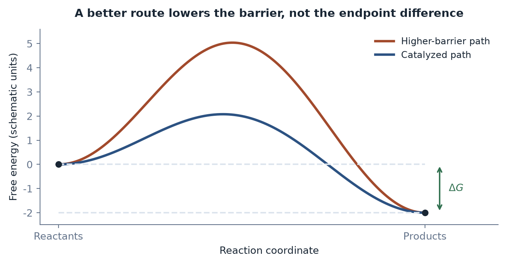

[Contents](CONTENTS.md) · [中文](../zh/CONTENTS.md) · [English](../en/CONTENTS.md)

# The Physical Boundaries of Change

Intelligence did not arrive in a weightless world and then discover that matter was inconvenient. It arose in a world where mistakes cost energy, time, injury, and lives. Its ability to rehearse an action before attempting it makes sense against that background. Resistance belongs in the explanation of intelligence's origins.

## Intelligence as a Path Selector

### Gradients, Organisms, and Possible Routes

#### Order with a supply line

A temperature difference, a chemical gradient, or a difference in pressure gives a process a direction. Open systems can use such gradients to maintain local structure while increasing entropy in their surroundings. A living organism inhabits this arrangement continuously. Stop its supply and waste removal, and its organization eventually fails.

Schrödinger's question in *What Is Life?* was how an organism avoids rapidly settling into equilibrium. His memorable language of “negative entropy” pointed toward the material exchange that makes continued organization possible.[^schrodinger1944] In contemporary terms, the organism uses available free energy and exchanges matter and heat with its environment.

Prigogine and Nicolis studied how nonlinear, open systems driven away from equilibrium can develop organized patterns.[^prigogine1977nobel][^nicolis1977] The pattern is sustained by its operation: a flow can maintain a structure that would not persist under equilibrium conditions. This supplies a physical setting for discussing life without making life a mechanical consequence of one thermodynamic formula.

Maximum-entropy-production proposals explore stronger claims about which organized states are selected. Their reach remains contested.[^martyushev2006][^bruers2007] The argument here needs the more modest result: local organization and overall dissipation can grow together. Order can organize a route by which a gradient is discharged.

#### A structure that helps make itself

Autocatalysis adds persistence. Suppose a reaction produces a component that helps the network produce more of that component. With suitable supplies and conditions, a transient arrangement can reinforce itself. Kauffman's work on autocatalytic networks asks how mutually supporting reactions can become a system rather than a succession of isolated events.[^kauffman1993]

Such a network needs more to approach life: a boundary, a way of retaining and varying information, reproduction, selection, and regulation. Work on autocatalytic sets makes these distinctions explicit.[^hordijk2018] A reaction that accelerates itself is a promising ingredient, not an organism.

The RNA-world hypothesis offers one route toward connecting information and catalysis. RNA can carry sequence information and, in some arrangements, catalyze reactions. Gilbert's proposal gave a name to a hypothetical stage in which those roles were less sharply divided than they are in modern cells.[^gilbert1986] The history remains under investigation. The structural requirement is clear: a successful lineage has to connect supply, chemistry, boundaries, and inheritance tightly enough for improvements to accumulate.

#### A landscape of possibilities

An industrial process can be represented as a trajectory through a state space. Temperature, pressure, composition, geometry, inventory, equipment condition, and delivery schedule describe different coordinates. A feedstock occupies one region, a usable product another. Process design chooses a route between them.

Mechanics supplies a famous but distinct variational description:

$$
S[q]=\int_{t_1}^{t_2}(T-V)\,dt,\qquad \delta S=0.
$$

$S$ is action in joule-seconds, $q$ denotes generalized coordinates, and $T$ and $V$ are kinetic and potential energy. Under the specified endpoint conditions, the physical path makes the action stationary. Stationarity does not always mean a minimum, and dissipation needs additional treatment.

Engineering optimization chooses an objective instead: cost, risk, energy, yield, or a combination. The two kinds of optimization must remain distinct. Physics does not guarantee that a factory, a nervous system, or an optimizer finds the cheapest possible route.

The useful image is a landscape. A route can waste fuel, overlook a catalyst, expose a worker to danger, or hold inventory that will never be used. Better information can change the route before anyone pays those costs. It changes the passage through the terrain.

### The Price of a Mistake

#### Rehearsal before collision

Evolution conducts experiments in matter. A variation changes an organism; an unsuccessful action consumes energy, loses an opportunity, or causes injury. Selection can explore over many generations, but a particular animal cannot afford to test every cliff, predator, and unfamiliar food with its body.

A nervous system makes another kind of experiment possible. It can compare likely actions internally, discard some, and attempt a smaller set in the world. Learning adds the history of previous encounters. Intelligence, in this account, shifts part of the search from costly external action into comparatively cheap internal rehearsal.

**One of intelligence's oldest jobs is to avoid expensive mistakes.** This gives prediction and reasoning their practical place. Their value comes from improving action under a limited budget, including the cost of acquiring and processing information.

#### Two meanings of entropy

Shannon entropy measures uncertainty in a specified probability distribution.[^shannon1948] Thermodynamic entropy describes physical states and their transformations. Learning can reduce an agent's uncertainty without imposing a corresponding numerical decrease in the thermodynamic entropy of the outside world. A useful prediction has to be implemented in a physical system, but its usefulness is not measured in joules per kelvin.

The brain pays a substantial energy bill. Raichle and Gusnard's account places its consumption at roughly a fifth of the body's energy use, despite its much smaller share of body mass.[^raichle2002] Its advantage is an exchange: spend resources on perception, memory, and prediction to avoid more costly actions.

Landauer's result identifies a minimum heat cost for resetting a bit under the usual thermodynamic conditions, $k_{\mathrm B}T\ln2$.[^landauer1961] Actual computation operates above that idealized limit and pays for many other operations. The result connects information processing with its physical implementation; it does not provide a direct calorie count for a thought.

Friston's free-energy principle brings perception, action, and learning into a framework for maintaining viable states.[^friston2010] Its variational free energy is an information-theoretic quantity; a shared name does not make it identical to a fuel supply or a Gibbs-energy difference. The connection relevant here is the feedback loop: organisms predict and act as part of remaining alive.

#### The route changes the barrier

Material transformation presents two bills that should be kept separate. A reaction has kinetic barriers along a route and a thermodynamic relation between its initial and final states. Catalysts alter routes and reaction rates. They do not change the equilibrium free-energy difference for unchanged states.

Ironmaking requires reduction, heat transfer, materials handling, and equipment. A blast furnace pays these costs in a particular way; another reduction route changes the account.[^babich2021blast] Cement manufacture likewise combines reaction requirements with the losses of a real kiln. Process analyses distinguish the theoretical heat requirement from actual fuel use and auxiliary demand.[^madivate1999theoretical][^madlool2011cement]

Calling every energy cost “activation energy” loses the distinction that makes engineering improvement intelligible. Catalysis can reduce a kinetic barrier. Heat recovery can reduce losses. A new feedstock can change the initial state. Each is a different way of improving the route.

#### The continuing rent

Maintenance is the other bill. Machines wear, structures corrode, organisms metabolize, and operating environments disturb the states a system needs to preserve. The book calls this continuing burden an **entropy tax**: an accounting image for the resources spent sustaining useful organization.

Different structures pay it on different schedules. A stone arch can remain standing without continuous active input. A refrigerated store cannot maintain its temperature that way. Distance from equilibrium alone does not determine the maintenance cost. Materials, disturbances, operating conditions, and the required function do.

Redundancy belongs in this account. An additional load path in a bridge may contribute only under an unusual event, yet its contribution can justify the material. A safety factor is not a universal instruction to double every component. It expresses uncertainty, design requirements, and the consequences of failure through a particular standard.

### From Representation to Transformation

#### A small signal, a large supply

Language, maps, mathematics, and simulation extend rehearsal beyond one organism. A bridge calculation can reject dangerous designs without destroying bridges. An experiment can eliminate a drug candidate before broader exposure. An organization can learn from another organization's failure.

AI increases the density of this preliminary search. It can explore many candidate routes, infer relations, and propose alternatives. The useful result remains a selected route that a receiving system can execute.

A small control signal can govern a large power flow. One can describe successive power ratios as

$$
P_k=P_0\prod_{i=1}^{k}G_i,\qquad G_i=\frac{P_i}{P_{i-1}}.
$$

The identity counts the ratios. Where a stage amplifies power, its energy comes from that stage's supply. A control signal tells an actuator what to do; a battery, fuel source, or grid supplies the work. Energy cannot be obtained by multiplying instructions.

The distinction also clarifies Maxwell's demon. Acquiring, using, and resetting information belong to the full physical cycle. The demon's discrimination cannot be removed from the account while the beneficial state change remains.

#### Four inputs with different dimensions

The ingredients of an engineered transformation can be written schematically:

$$
\begin{gathered}
\text{Information: a recipe and control}\\
\text{Matter: a suitable carrier}\\
\text{Available energy: a supply for the process}\\
\text{Time: an interval in which it unfolds}
\end{gathered}
\quad\longrightarrow\quad
\begin{gathered}
\text{A functional structure}\\
\text{Waste heat and other outputs}.
\end{gathered}
$$

This is a process account. Bits, kilograms, joules, and seconds cannot be added as one conserved quantity. Mass, energy, and entropy have their own balances, with the actual boundary and exchanges specified.

The practical point is stronger than a verbal “law of cost conservation.” A missing input can stop a correct plan. Information can reduce material waste or process time, but a recipe without an adequate carrier and an executable route remains a recipe.

#### Candidate abundance

Better search enlarges the set of proposals much faster than it necessarily expands testing and execution. A thousand building designs still compete for sites, crews, and capital. A thousand molecules compete for synthesis, assays, and evidence. A robot policy competes for hardware time and safe contact with its environment.

Computation has its own receiving system: chips, facilities, power, cooling, networks, and maintenance. Replacing an expensive physical experiment with a cheaper computational one can be an enormous gain. The gain is established by comparing complete routes.

Intelligence lets a system move some of the cost of choice ahead of the cost of action. Technological viscosity examines the rest of the journey: how a selected possibility becomes an actual, sustained change.

## Resource Barriers: Power, Matter, and Availability

A resource is matter in a usable condition. A periodic-table entry is not a supply chain. Silicon in rock is not a wafer, atmospheric nitrogen is not fertilizer, and a metal dispersed through discarded products is not a stock of qualified components.

Extraction, concentration, purification, transport, fabrication, and maintenance create availability. A technical system builds its resource base as it uses it. This makes resources historically changeable without making their conditions optional.

### Power and the Rate of Change

#### Energy needs an appointment

An energy total says little about whether a task can be done here, now, at the required rate. A process needs a form of energy it can use, delivered at a location, through equipment, within a time window. A reservoir of fuel, a charged battery, a live electrical connection, and heat at a low temperature provide different capabilities.

Kardashev's civilization types made controllable power a way of imagining technological scale.[^kardashev1964transmission] A commonly used continuous interpolation is

$$
K=\frac{\log_{10}P-6}{10},
$$

with $P$ in watts. A rise of one unit corresponds to ten orders of magnitude in power; a rise of 0.1 corresponds to one. The logarithm keeps an enormous range on one axis. It says little about what is done with the power.

The chemical and nuclear energy scales differ greatly. Chemical reactions rearrange electrons; fission and fusion alter nuclei. Nuclear electricity, hydropower, wind, and solar already show why civilization's power cannot be described as a single chemical-bond ceiling.[^jaffe2018physics][^smil2017energy] Converting a source into controlled, affordable output introduces equipment, supply, waste, and operating constraints.

Deuterium-tritium fusion releases about 17.6 MeV per reaction. Making useful power from it requires a favorable balance among heating, reaction output, confinement, material survival, and the rest of the plant.[^atzeni2004physics] High energy per event is a starting condition for an engineering program, not a deployed power station.

#### A rocket's account

Chemical propulsion supplies a sharp example of an energy route imposing a mass penalty:

$$
\Delta v=v_e\ln\frac{m_0}{m_f},
\qquad
\frac{m_0}{m_f}=\exp\left(\frac{\Delta v}{v_e}\right).
$$

$v_e$ is effective exhaust velocity, and $m_0/m_f$ the initial-to-final mass ratio. In this idealized relation, every additional $v_e$ of required velocity change multiplies the mass ratio by $e$. Real missions also encounter gravity and drag losses. Staging and other propulsion systems change the design problem; the exponential explains the severity of the chemical route's tradeoff.

The same lesson applies less dramatically to machines on Earth. A controller can know a desirable motion while the actuator lacks peak power or the energy store lacks endurance. Intelligence and available power are different entries in the account.

#### Storage, computation, and the wrong comparison

Battery specific energy and a fuel's heating value measure different parts of a working system. Electric and combustion drivetrains convert stored energy with different efficiencies; tanks, packs, motors, cooling, and operating conditions also matter.[^placke2017lithium][^ziegler2021reexamining] Quoting the ratio of two storage figures is useful only after establishing what is being compared.

Computing limits such as those studied by Bremermann and Bekenstein operate under particular physical assumptions.[^bremermann1982minimum][^bekenstein1981universal] They are not forecasts of near-term chip improvement. A very distant theoretical limit neither guarantees cheap progress toward it nor tells a robot how much power its joints require.

Four groups of conditions recur: a suitable material, an available energy supply, a controllable process, and a way to sustain the result. Material selection and thermodynamics make their interaction visible.[^callen1985thermodynamics][^georgescu1971entropy] A powerful source without suitable equipment can be unusable; an elegant process without stable feedstock can be uneconomic.

### Borrowing Structures That Nature Already Built

#### The first inventory

Wood arrives with a fibrous structure. Cotton arrives with useful cellulose. A river arrives with a flow and a drop in height. An animal arrives with metabolism, muscles, and control. Early technologies often began by selecting and arranging such structures rather than synthesizing their properties from simpler feedstocks.

This is an advantage supplied by history. Photosynthesis, evolution, and geology have already performed some of the work. The user still pays for access, processing, transport, and renewal.

As requirements grow, those inherited forms become insufficient. A natural fiber may not have the required strength; a naturally occurring material may not have the purity a device needs. The system begins to manufacture the condition it once found.

The resulting “ladder” has several axes: reaction barriers, purity, defect control, precision, equipment scale, and maintenance. Calling all of them activation energy would conceal the differences. A smaller chip can demand a larger control apparatus without its fabrication being described by one rising chemical barrier.

#### From muscle to a constrained mechanism

Mechanization separates parts of a task that a body supplies together. A cam or gear can restrict a mechanism to a repeatable motion. Water or another power source then drives it. The machine does not need to deliberate over every movement because some of the control has been built into geometry.

Textile machinery illustrates the change. A useful motion is extracted from skilled bodily coordination and organized into repeatable stages. Shafts, bearings, feedstock variation, wear, and adjustment still determine how repeatable it is. Mechanical constraint moves uncertainty into a different part of the process.

Water power also relocates production. It supplies sustained torque where a suitable flow and head can be used. Steam power later changed the geography of access to that torque. The transformation was a reorganization of energy, machinery, transport, and labor together.[^smil2017energy]

#### Flows and accumulated stocks

Solar-powered production depends on irradiance, collecting area, and conversion:

$$
P=\Phi A\eta.
$$

$\Phi$ is radiation flux density in W/m$^2$, $A$ an area, and $\eta$ the conversion factor for the chosen boundary. The solar irradiance near Earth's orbit is about 1,361 W/m$^2$ at a surface normal to the rays, outside the atmosphere.[^prsa2016nominal] A landscape's annual average includes day, night, latitude, weather, and the actual process.

Biomass, food, fiber, and fodder compete for land, water, and ecological functions. Power density helps explain the spatial reach of an energy system.[^smil2015power] A stored fuel releases energy accumulated earlier; harvesting the current year's biomass depends on a current flow.

Fossil fuels allowed industry to draw heavily on accumulated stocks. This widened the available power flow and changed location, scale, and scheduling. It also created extraction, combustion, and environmental liabilities. The resource was useful because a technical system could connect the stock to machinery.

Trade can move the land and labor burdens of production across borders. Historical imports of cotton, timber, and food supported industrial concentration elsewhere. A local balance sheet can look lighter because part of its support has moved away.

### Breaking and Re-forming Bonds

#### Nitrogen as a resource

The atmosphere contains abundant nitrogen. Agriculture needs it in chemically usable forms. The strength of the nitrogen molecule makes the conversion a kinetic challenge, while the full reaction has its own thermodynamic balance.[^erisman2008how][^jia2014mechanistic]

The Arrhenius relation gives a common account of temperature sensitivity over an appropriate range:

$$
k=A\exp\left(-\frac{E_a}{\mathcal RT}\right).
$$

$k$ is a rate constant, $A$ its pre-exponential factor, $E_a$ an activation energy in J/mol, and $\mathcal R$ the gas constant. Changing $T$ can strongly change a rate. A catalyst changes the route and its effective barrier. The activation energy of that route is not simply the isolated nitrogen bond's dissociation energy.

Ammonia synthesis combines pressure, temperature, catalysis, feedstock preparation, separation, and heat management. Its hydrogen supply can dominate important parts of the energy and emissions account. Better catalysts and a different hydrogen route therefore change more than a control setting.

An AI system can help search catalysts, infer operating windows, diagnose a plant, or schedule power. Its contribution is measured through the changed process: less energy, higher yield, safer operation, less downtime, or another specified result.

Materials selection and lifecycle analysis follow this reasoning beyond the reactor.[^ashby2012materials][^allwood2012sustainable] An excellent component can carry an expensive production history. A slightly less efficient component can sometimes outperform it over the full service life.

Figure 2.1. A catalyst changes the route and its kinetic barrier. These schematic paths have identical endpoints and the same $\Delta G$. Lower activation free energy can accelerate reaction; the endpoint difference determines equilibrium.

### The Weight of the Installed World

#### Past work made solid

Cities contain accumulated extraction, processing, transport, lifting, assembly, finance, rules, and use. Roads and pipes occupy space and connect to occupied buildings. Their durability makes them useful and makes replacement a transition problem.

Research on global material stocks traces the huge accumulation of buildings and infrastructure during industrialization.[^krausmann2017global] Work on sediment flows likewise shows how extensively human activity moves and redirects material.[^syvitski2005impact] These stocks are a physical history with current users attached.

The work required to raise a mass through height $h$ in an approximately constant gravitational field is

$$
W=mgh.
$$

For unchanged $m$ and $h$, a better drawing does not change this gravitational-energy difference. It can change the mass required, the construction route, or losses along that route. Lifting energy is one component of a building's account, often much smaller than the energy embodied in producing its materials.

The latest annual industry accounts keep the scale visible: world cement output is measured in billions of tonnes, and crude steel in roughly two billion tonnes.[^usgs2026cement][^worldsteel2026figures] The relevant numbers are production flows, with stated years, not the full installed stock.

Replacing a district requires keeping services running, accommodating ownership, moving materials, and organizing a new configuration. A design can improve the destination while leaving the transition unaffordable. The installed world resists through the relations attached to its mass.

### Small Structures, Large Backends

#### Miniaturization changes the problem

At smaller scales, mass becomes easier to move while defects, surface behavior, noise, tunneling, and heat become harder to manage. Semiconductor fabrication exposes the exchange. The product becomes small; the environment required to make it can become enormous.

The end of easy voltage and frequency scaling shifted more performance gains toward parallelism, specialized hardware, architecture, and packaging. “Dark silicon” describes a power-constrained gap between the transistors that fit on a chip and those that can operate at full activity together.[^esmaeilzadeh2011dark] Three-dimensional integration and other designs create new opportunities along with thermal and interconnect demands.

Thin barriers permit tunneling. Very small structures also turn discrete events into variability. Under a Poisson counting model,

$$
\sigma_N=\sqrt N,\qquad \frac{\sigma_N}{N}=\frac{1}{\sqrt N}.
$$

To halve relative counting noise, four times as many events are required. Lithography has more mechanisms than photon counting alone, but stochastic exposure and resist behavior matter to defect control.[^debisschop2018stochastic] A nominal pattern and a reliably manufacturable pattern are different achievements.

#### Heat has to leave

A one-dimensional conductive approximation is

$$
q''=\frac{P}{A}=-k_{\mathrm{th}}\frac{dT}{dx}.
$$

Heat flux density $q''$ has units W/m$^2$; $k_{\mathrm{th}}$ is conductivity. The sign follows the direction of decreasing temperature. Packaging adds interfaces, geometry, convection, and other heat paths. There is no universal air-cooling threshold for every device.

A facility repeats the problem at another scale. Concentrated computing needs power delivery and heat rejection. Better utilization and cooling can reduce demand per task.[^masanet2020recalibrating] Growth in tasks can still raise aggregate demand. In 2026, the IEA's account follows the network, supply, and connection constraints that accompany that growth.[^iea2026powering]

### Abundance, Concentration, and Recycling

#### Nature's inventory has a geography

Primordial nucleosynthesis produced mostly hydrogen and helium. Later stellar and other nuclear processes produced heavier elements; planetary differentiation and geology redistributed them.[^steigman2007primordial][^alpher1948origin][^rudnick2003composition] A technical system inherits that distribution.

Abundance and availability diverge through concentration, location, chemistry, refining, equipment, and organization. For a mass fraction $\theta$, recovering a target mass $m$ requires at least

$$
M=\frac{m}{\theta}
$$

of feedstock at perfect recovery. With recovery fraction $r<1$, the requirement becomes $m/(r\theta)$. Processing, energy, waste, and water demands depend on the actual ore and route, rather than only this inverse relation.

Critical-mineral studies follow the resulting concentrations in mining, refining, and supply chains.[^iea2021criticalminerals] Substitution can reduce dependence on one element while adding demands elsewhere. The useful question is which usable state the replacement requires.

#### A second route through matter

Recycling begins from a different initial state. Scrap aluminum already contains reduced metal; an ore route must perform reduction. Reuse can preserve even more of a component's fabrication history.

Collection, sorting, separation, purification, and requalification still have costs. Mixed materials, contamination, dispersion, and degradation can make a nominally recoverable stock difficult to use. The comparison is between routes, including their collection systems and the quality demanded of the result.

Across the scales, three obstacles recur: large stocks bind space and users; tiny structures magnify control demands; dispersed materials demand concentration. Intelligence can improve routes through all three. A useful route must still bring matter into the condition in which the function can exist.

## Temporal Rigidity: What Has to Unfold

Compress a job's schedule and the loads do not automatically shrink with it. Energy, material, heat, inspection, and repair must pass through a shorter window. Speed becomes a demand placed on the receiving system.

### Time as a Flow Condition

For an amount $\Delta X$ crossing area $A$ during interval $\Delta t$,

$$
J=\frac{\Delta X}{A\Delta t}.
$$

The units depend on the quantity: mass flux, heat flux, and traffic flow describe different things. With amount and area fixed, shortening the interval increases flux density. More parallel capacity can change the area or number of channels; a new process can change the required amount.

A faster charging schedule can confront transport and reaction limits in a battery. Faster concrete placement can confront heat removal and temperature gradients. Faster manufacturing can outrun inspection or logistics. The proposed clock has to be supported by all the active paths.

Some delays are queues and can be removed by coordination. Others are transport times, reactions, growth, or exposures. A network can increase bandwidth without reducing signal propagation time along an unchanged route. A faster planner does not shorten a cable.

### Power, Heat, Stress, and Repair

For fixed work,

$$
P_{\mathrm{avg}}=\frac{\Delta W}{\Delta t},
\qquad
P_{\mathrm{avg}}\propto\frac{1}{\Delta t}.
$$

This accounting relation is exact. Whether required work stays fixed under acceleration is a separate physical question. Drag, losses, operating regimes, and the route itself can change.

Four constraints often move together. A supply must deliver the power. A thermal path must remove heat. Materials and joints must tolerate loading and cycles. Inspection and repair must contain faults before they propagate. Improving only the first can produce a hotter, more fragile process.

A faster production line illustrates the coupling. Reducing one station's cycle from 60 seconds to 45 seconds raises its nominal throughput by a third. Feeding, changeovers, quality control, packaging, and dispatch have to absorb the new output. Otherwise the gain becomes inventory between stations.

The right outcome measure is useful work completed at a specified quality and total cost. A high clock rate is one means of achieving it.

#### Accelerated testing

Engineering can exchange conditions for time. Higher temperature can accelerate some degradation mechanisms; higher cycling frequency can accumulate some forms of damage faster. An extrapolation works only where the accelerated process remains informative about the service process.

Change the mechanism and the test answers another question. This is why a faster test requires a model and validation of the acceleration factor. Better measurement can reveal an early signal, while an appropriate accelerated process can genuinely shorten the time required for evidence.

Likewise, prefabrication, controlled curing, different mixes, and thermal management can alter a construction schedule. “Twenty-eight days” names a familiar concrete strength benchmark, not a universal prohibition on earlier use. The process and acceptance conditions determine what the shorter schedule establishes.

### Updates and the Bandwidth of a System

Shortening a process and sending it new instructions more often are different operations. A controller can receive frequent observations while holding an action stable long enough to evaluate its result.

A first-order response has the form

$$
\tau\dot x+x=u(t),
\qquad
H(s)=\frac{1}{1+\tau s}.
$$

For a sinusoidal input,

$$
|H(i\omega)|=\frac{1}{\sqrt{1+(\omega\tau)^2}},
\qquad
\arg H(i\omega)=-\arctan(\omega\tau).
$$

Higher-frequency inputs are attenuated and delayed. The model remains a stable low-pass response. An unstable closed loop requires an account of the controller, feedback signs, gain, delays, and actuator behavior.

Sampling faster can improve observation and control. Replanning faster can also amplify noise or repeatedly interrupt an action if the surrounding design lets it. These are design questions at the interface, not a general indictment of speed.

#### Different layers, different clocks

Electrical protection, local motor control, logistics planning, infrastructure replacement, and institutional learning run on different schedules. Fast fault isolation can be indispensable; constantly changing an organization's goals can make sustained work impossible.

The useful interface includes rate limits, buffers, holds, and hierarchy. A rate limit bounds how quickly an action changes. A buffer absorbs a fluctuation. A hold preserves a decision through an interval. Hierarchy keeps rapid local correction from repeatedly rewriting slow system objectives.

The interface also needs a record. If goals, models, instructions, and operating conditions all change between observations, learning what caused the outcome becomes difficult. A system can update constantly and complete very little.

### Biology and the Order of Events

Life gives time another role. Gene expression, development, metabolism, immune response, repair, and adaptation occur in sequences with their own feedback. A prediction of the sequence and evidence about its actual course are different resources.

Drug development makes this visible. A candidate must reach the relevant tissue, act on its intended target, survive competing effects, and produce a useful outcome in people. Exposure and follow-up help establish what a short assay cannot.

The 2026 progress of rentosertib provides a current example. Insilico announced first patient dosing in its Phase III GENESIS-IPF-3 trial in September, following earlier clinical work. The planned 52-week treatment period is part of the study's attempt to establish efficacy and safety over a longer interval.[^insilico2026phase3] Advancing to that stage is a real achievement. Its result still comes from the study.

The same structure appears beyond medicine. Material fatigue emerges through loading history. An organization responds to rules, learns how to satisfy them, and sometimes finds ways around them. An ecological intervention propagates through relationships that extend beyond the first measured effect.

Four processes recur: accumulation, thresholds, adaptation, and propagation. Evidence has to follow the one responsible for the outcome. A single early measurement may be informative about a trend and inadequate to settle the final question.

### The Information Produced by a Process

Some uncertainty can be reduced from information already available. Other uncertainty is reduced by allowing an intervention or an observation to occur. A field deployment produces information about contact with the field.

For $N$ strictly sequential physical stages, each requiring at least $\delta t$,

$$
T\geq N\delta t.
$$

The statement is conditional on the chosen dependency chain and the lower bound on its stages. It does not prove that every complex process is computationally irreducible. A better algorithm may shortcut a calculation; a different process may change a physical dependency; parallelization may remove a previous bottleneck.

The valuable question is what the claimed shortcut changes. Does it produce the required exposure faster by a validated mechanism? Infer an outcome from a well-supported surrogate? Remove a dependency? Or merely stop observing earlier?

Early signals turn waiting into directed learning. A biomarker, a change in vibration, a developing crack, or a shift in behavior can justify intervention before a final failure occurs. Their value depends on the relation established between the signal and the outcome.

AI can improve candidate selection, experimental design, monitoring, and the interpretation of those signals. It can help spend a limited evidence budget on the most informative paths. A faster guess becomes a reliable gain when the connection to the required result is established.

The next constraint survives even that achievement. A verified component must still enter a system whose other parts already depend on one another. Time produces evidence; structure determines where the evidence can be used.

## Topological Rigidity: When Connections Become Weight

A better destination can be easy to describe and difficult to reach. The difficulty may lie between the nodes: a component's dependencies, the order in which other parts must change, and the consequences of disturbing them.

### Coupling Density and Effective Mass

#### A goal needs a transition

A hospital's new diagnostic system needs records, staff, laboratory processes, purchasing, review, and responsibility to work together. A faster port process can run into rail capacity outside the gate. A software module can be technically improved and incompatible with the accounting system that pays for its operation.

These connections give a small component a large transition cost. Its physical mass may be negligible while changing it requires many other parties to move. The book calls this **effective inertia**: a structural account of resistance, rather than a new quantity of mechanical mass.

For $N$ nodes, the maximum number of undirected pairwise links is

$$
L_{\max}=\frac{N(N-1)}2.
$$

The count shows how many possible dependencies can exist. Real networks can remain sparse; links also differ in direction, strength, and function. A system's cost cannot be inferred from node count alone.

Network studies distinguish local structure, long-range paths, degree distributions, and the dynamics carried by the links.[^boccaletti2006complex][^watts1998collective] Small-world work is especially useful for seeing how a few additional links can change distances without making every pair adjacent.[^milgram1967smallworld][^travers1969experimental]

#### An improvement absorbed by the system

A local gain can be real and disappear from the aggregate result. Its output encounters another bottleneck, or its benefit is spent accommodating an existing dependency. A faster clinician's report may not change a patient's treatment date if imaging, specialist capacity, and follow-up remain binding.

The point is a diagnostic question: which relation converts the component gain into a service gain? A benchmark evaluates one part of that relation. Deployment evaluates the chain.

Technologies that change interfaces can therefore have effects larger than a component's nominal improvement. Containerization changed how ships, trucks, cranes, ports, and paperwork could connect; its effects depended on a network of complementary investments.[^bernhofen2016estimating] Standards can remove repeated translation work and make rearrangement easier.

They also establish a new installed base. A successful interface becomes something other parties expect to remain stable. An improvement produces a fresh history.

### Percolation and the Solidification of a Network

#### A local failure gains a route

Percolation models examine when occupied sites or links form connected structures over large distances.[^broadbent1957][^erdos1959] Below a threshold, disturbances may remain in small clusters. Above it, the same kind of local event may have a path across much of the system.

The threshold depends on the model and topology. A square lattice, a random graph, and a heterogeneous infrastructure network do not share one critical percentage. The useful question is what can now propagate.

The metaphor of **gelation** emphasizes a change in freedom of motion. Parts that once moved separately become constrained by a spanning web. In an organization, adding dependencies can make a change require coordinated movement. The resemblance helps formulate the mechanism; actual organizational coupling needs evidence about its links.

Interdependent networks can fail in cascades because one network's functioning nodes rely on the other.[^buldyrev2010] A local reliability score then misses a dependency failure. The distinction between random loss and targeted failure also matters in heterogeneous networks.[^albert2000error]

#### Cascades with names and dates

Historical infrastructure failures make the structure concrete. The 2003 North American blackout involved interacting equipment, operating conditions, awareness, and protection across a connected power system.[^uscanada2004] Treating each part's normal performance as an adequate description of the whole would omit the event.

The 2010 Flash Crash and Knight Capital's 2012 trading failure provide different financial mechanisms: rapid interaction among market behavior, automation, deployment, and controls.[^sec2010findings][^sec2013knight] Their common feature is a fast propagation path. Their causes should not be collapsed into a single story about “too much intelligence.”

The 1999 Mars Climate Orbiter loss concerned an interface and unit mismatch within an organizational and technical process.[^nasa1999mishap] Aviation reviews of the 737 MAX likewise examine interacting design assumptions, human roles, integration, and certification rather than only the performance of an isolated function.[^jatr2019boeing]

These are historical cases. Their value is the failure mechanism documented in the investigation, not an implication that today's systems are unchanged.

#### Why a pilot scales badly

A pilot can select its users, concentrate expert attention, isolate a workflow, and provide exceptional support. Scaling reconnects what the pilot temporarily separated. Data formats, staffing, interfaces, maintenance, finance, and responsibility return at the boundary.

Simon called attention to nearly decomposable systems: strong local organization with more manageable interaction between subsystems.[^simon1962] Modularity can preserve a local failure boundary and let different parts evolve on different schedules.[^baldwin2000design]

An AI pilot that needs continuous exceptional care may be demonstrating the capability of a temporary organization, as well as a model. Scaling requires a repeatable organization for the surrounding work.

### Hysteresis and Structural Memory

#### History changes the next choice

An installed road alters land use. A standard changes equipment purchases. A workflow shapes training and expectations. Later decisions begin from the world those decisions produced.

Path dependence describes how earlier choices alter later costs and options.[^david1985clio] Hysteresis describes a response that depends on the path taken, so reversing a control variable does not retrace the original state trajectory.

Material fatigue, magnetic hysteresis, organizational habits, and software dependencies have different mechanisms. In each, an adequate state description includes something carried forward from history.

#### The freedom already committed

An interface adopted by many organizations can freeze a choice into an obligation. Its continued use may be locally economical even when another arrangement would be better from a clean start. This is the difference between designing a new system and migrating a live one.

Compatibility can protect past investments. It can also preserve duplicated work and old limitations. Retiring the old route requires a plan for the parties whose functions depend on it.

Infrastructure studies examine the invisible installed base through which a new facility becomes usable.[^star1999layers] Conway's observation links software structure to communication within the organization that builds it.[^conway1968how] The code and the institution can carry the same history.

#### What survives a change of scale

Physics offers the language of coarse-graining: some microscopic variations disappear at a larger scale, while others remain relevant.[^wilson1971renormalization] The comparable organizational question is which local changes can affect the aggregate outcome.

A good tool can be absorbed by a procurement rule or a payment system. A new measurement can be absorbed by the incentives it creates. Measures used to allocate rewards invite the responses discussed by Goodhart and Campbell.[^goodhart1975problems][^campbell1979assessing]

A removed tool also leaves effects. Users have learned, data have moved, expectations have changed, and contracts have been signed. A rollback plan must specify which state it can recover. Restoring software may leave the surrounding consequences untouched.

#### Making history editable

A transition architecture includes compatibility, parallel operation, staged cutovers, migration of records, and a credible retirement point. Without retirement, each improvement can become one more permanent layer.

Banking migrations demonstrate the stakes of cutover and service continuity. The TSB migration and regulatory investigation document a transition failure with consequences for access, customers, and operations.[^tsb2019migration] A payment process also depends on settlement and trust arrangements beyond the speed of its message.[^kahn2009why]

The objective is to make an installed system changeable while it remains in use. That is a capability of the structure.

### Reachability and the Equilibrium People Choose

#### Possible is larger than reachable

A generated plan describes a destination. A reachable destination requires a permitted path from the current state, the resources and time to take it, and conditions under which the result can persist.

There can be many physically feasible paths and a narrow set of socially maintained ones. People respond to prices, rules, expectations, and one another. The equilibrium reached through their choices may be poor even when a better feasible arrangement exists.

Wardrop's traffic framework and work on the cost of uncoordinated routing formalize this distinction in a defined setting.[^wardrop1952some][^roughgarden2002how] Adding a path expands the feasible set, yet independent users can move to a worse equilibrium. The available capacity and the way it is used require separate analysis.

Road construction can also change demand. Evidence on induced travel examines a further response beyond fixed-demand routing.[^duranton2011fundamental] More attractive supply can draw additional use into the system.

#### The option that survives collective use

AI expands the supply of strategies, recommendations, and entry points. A strategy's effect at low adoption may differ from its effect when many agents use it. A market signal can crowd a trade; a common recommendation can crowd a route; a generated workflow can crowd a shared reviewer.

Evaluating this outcome requires a model of the users' response. The number of alternatives generated is not a measure of the alternatives that remain serviceable under simultaneous use.

Governance can change those responses through pricing, scheduling, access rules, and coordination. The desired state needs a route and an arrangement that keeps it viable.

#### Slack and plasticity

High utilization can make a normal period look efficient while leaving few options when conditions change. Alternative suppliers, buffers, repair capacity, and isolation can preserve useful routes under disturbance.

Work on highly optimized tolerance describes systems that are efficient for anticipated conditions and vulnerable outside them.[^carlson1999highly] Robustness has a distribution: strong protection in one direction can coexist with a weakness in another.

**Plasticity** is the capacity to change structure while maintaining enough function to continue. Too little coupling prevents cooperation; too much compulsory coupling prevents adaptation. A durable system needs both useful commitments and places where commitments can be revised.

### Dependency Surface, Synchronization, and Rollback

#### Three sources of effective inertia

The **dependency surface** asks how many relationships a change touches, and how consequential those relationships are. The **synchronization cost** asks which of them must move together. The **rollback cost** asks what can be recovered after failure.

A personal script may have a small dependency surface. A module connected to payroll, inventory, invoicing, compliance, and customer access has a larger one. A compatible update can permit gradual migration; a format change that every participant must adopt at once creates a coordination problem.

Splitting software into services can isolate work and support independent change. It can also introduce distributed state, observability, versioning, and operational dependencies. Research on microservice migration records such tradeoffs.[^taibi2018architectural] The number of modules alone measures neither freedom nor complexity.

#### The external links

Power and logistics show how dependencies extend beyond one operator. A fuel interruption can affect electricity supply; transport policies and routes influence what can arrive; a blocked canal can redistribute shipping flows.[^morison2004power][^nzmfat2021][^suez2021] These cases require different explanations, while revealing a common need to trace the links outside an organization's diagram.

Recent work on operational systems likewise treats deployment as an interaction among tools, operators, and the processes surrounding them.[^dong2022operational] The question for an AI application is where it sits within that structure.

A modest tool with a small dependency surface may spread rapidly. A more capable tool at a critical interface may remain difficult to deploy. Matching intelligence to a structure requires an input boundary, an output boundary, a failure plan, and a responsible operator.

Connections produce both capability and weight. The engineering task is to keep the former while making the latter manageable.

## The R--T--G Framework

Resources, process time, and dependencies describe different conditions of a transition. Fix the task, outcome, accounting boundary, and horizon before comparing them. Otherwise a cheap first attempt can be mistaken for a cheap completed result.

#### Coordinates and a response

Let $(R,T,G)$ describe resource barriers, temporal rigidity, and topological coupling. Let $\eta$ measure the transition cost relative to a stated reference:

$$
\eta=f(R,T,G).
$$

The coordinates describe sources of difficulty; $\eta$ is a response to be observed. Their units and normalization depend on the operational definitions.

A working model is

$$
\eta=\eta_0\exp(\alpha R+\beta T+\gamma G).
$$

Here $\eta_0$ is a reference value. The exponent must be dimensionless. With normalized coordinates, the coefficients describe marginal changes in log-cost over the range being studied. Interactions and changing coefficients can be added when the data justify them.

Table 2.1 — Three coordinates, three deployment questions

|  | Question | Typical evidence | What an intervention may change |
| --- | --- | --- | --- |
| $R$ | Can the change be supplied? | Material, energy, equipment, capital | Resource use, capacity, maintenance |
| $T$ | Can the process fit the window? | Dependencies, exposure, testing, coordination | Critical path, parallel work, risk |
| $G$ | Can the connected system absorb it? | Interfaces, synchronization, recovery | Isolation, migration, accountability |

More equipment may relieve a deadline and increase capital cost. Standardization may reduce both coordination effort and waste. A safety process may add time while reducing later losses. Those directions are measured outcomes, rather than rules requiring every saving to be charged elsewhere.

#### Tradeoffs have a feasible set

At constant $\eta$, with coefficients held fixed,

$$
\alpha\,dR+\beta\,dT+\gamma\,dG=0,
\qquad
\left.\frac{dR}{dT}\right|_{\eta,G}=-\frac{\beta}{\alpha}.
$$

The relation describes an iso-cost surface of the model. A real process can move along it only where a feasible engineering or institutional route exists. Different normalizations change the coefficient ratios; different tasks can change the model.

This distinction prevents a common misuse: a mathematical compensation is not a purchasable substitution. A larger budget cannot always buy the required exposure period. A long schedule cannot supply a missing element. A new interface can sometimes remove a synchronization requirement that was previously expensive.

#### Thermodynamic limits

For a closed reaction system coupled to a reservoir at fixed temperature $T_0$ and pressure $p_0$, with the stated initial and final states, the reversible minimum net non-volume work input is

$$
W_{\min}=\Delta G=G_{\mathrm f}-G_{\mathrm i}.
$$

Under the corresponding boundary and exchange assumptions, irreversibility adds a term related to entropy production:

$$
W_{\mathrm{in}}=\Delta G+T_0S_{\mathrm{gen}},
\qquad S_{\mathrm{gen}}\geq0.
$$

Other heat exchanges, material flows, or constraints require the appropriate exergy account. A theoretical minimum and a plant's actual total consumption answer different questions.

Aluminum makes the initial-state issue visible. Producing metal from alumina and remelting suitable aluminum scrap start from different states. The latter retains part of the work performed earlier and can therefore require much less energy.[^quinkertz2001scenario] Calling one route more intelligent cannot explain the difference by itself.

#### Structural bookkeeping

With a consistent complexity measure and boundary,

$$
\Delta C_{\mathrm{tot}}=
\Delta C_{\mathrm{local}}+\Delta C_{\mathrm{rest}}.
$$

The identity tracks redistribution. Total complexity can rise, stay constant, or fall. Removing redundant interfaces can reduce it; automating one operation while building a large support system can increase it.

The same separation applies to risk and responsibility. A local operator's workload may fall while a customer or another institution inherits the difficult remainder. The total and its allocation belong in different columns of the account.

#### How to use the framework

Fusion provides a demanding resource-and-time combination. A representative deuterium-tritium criterion is commonly expressed through density, temperature, and energy-confinement time:

$$
nT\tau_E\gtrsim
3\times10^{21}\ \mathrm{keV\,s\,m^{-3}},
$$

for stated plasma assumptions near the relevant operating region.[^lawson1957some] The exact threshold depends on the criterion and regime. A power plant must also close its engineering and economic balances.

At another extreme, a generated draft can appear cheaply and quickly while its use remains blocked by evidence or authorization. In one case the apparatus and physical process dominate; in the other, generation can be easy and the receiving interface difficult.

The framework directs attention to the bottleneck and to the proposed intervention's actual effect. It is used qualitatively with explicit criteria where calibration is unavailable. Quantitative prediction needs defined variables, fitted coefficients, uncertainty, and tests against alternatives. The appendix develops that route.

The next chapter follows the transition itself. Once intelligence reaches an interface, what does the medium do with the input?

## References

[^schrodinger1944]: Schrödinger, Erwin. What Is Life? The Physical Aspect of the Living Cell. 1944.
[^prigogine1977nobel]: Prigogine, Ilya. Time, Structure and Fluctuations. 1977.
[^nicolis1977]: Nicolis, Gregoire and Prigogine, Ilya. Self-Organization in Nonequilibrium Systems: From Dissipative Structures to Order through Fluctuations. 1977.
[^martyushev2006]: Martyushev, L. M. and Seleznev, V. D.. [Maximum entropy production principle in physics, chemistry and biology](https://doi.org/10.1016/j.physrep.2005.12.001). 2006.
[^bruers2007]: Bruers, Stijn. [A discussion on maximum entropy production and information theory](https://doi.org/10.1088/1751-8113/40/27/003). 2007.
[^kauffman1993]: Kauffman, Stuart A.. [The Origins of Order: Self-Organization and Selection in Evolution](https://doi.org/10.1093/oso/9780195079517.001.0001). 1993.
[^hordijk2018]: Hordijk, Wim and Steel, Mike. [Autocatalytic Networks at the Basis of Life's Origin and Organization](https://doi.org/10.3390/life8040062). 2018.
[^gilbert1986]: Gilbert, Walter. [Origin of life: The RNA world](https://doi.org/10.1038/319618a0). 1986.
[^shannon1948]: Shannon, Claude E.. [A Mathematical Theory of Communication](https://doi.org/10.1002/j.1538-7305.1948.tb01338.x). 1948.
[^raichle2002]: Raichle, Marcus E. and Gusnard, Debra A.. [Appraising the brain's energy budget](https://doi.org/10.1073/pnas.172399499). 2002.
[^landauer1961]: Landauer, Rolf. [Irreversibility and Heat Generation in the Computing Process](https://doi.org/10.1147/rd.53.0183). 1961.
[^friston2010]: Friston, Karl. [The free-energy principle: a unified brain theory?](https://doi.org/10.1038/nrn2787). 2010.
[^babich2021blast]: Babich, Alexander. [Blast Furnace Injection for Minimizing the Coke Rate and CO2 Emissions](https://doi.org/10.1080/03019233.2021.1900037). 2021.
[^madivate1999theoretical]: Madivate, Carvalho M.. [Theoretical Energy Requirement for Burning Clinker](https://doi.org/10.1016/S0008-8846(99)00029-0). 1999.
[^madlool2011cement]: Madlool, N. A. and Saidur, R. and Hossain, M. S. and Rahim, N. A.. [A Critical Review on Energy Use and Savings in the Cement Industries](https://doi.org/10.1016/j.rser.2011.01.005). 2011.
[^kardashev1964transmission]: Kardashev, Nikolai S.. Transmission of Information by Extraterrestrial Civilizations. 1964.
[^jaffe2018physics]: Jaffe, Robert L. and Taylor, Washington. [The Physics of Energy](https://doi.org/10.1017/9781139061292). 2018.
[^smil2017energy]: Smil, Vaclav. Energy and Civilization: A History. 2017.
[^atzeni2004physics]: Atzeni, Stefano and Meyer-ter-Vehn, Jürgen. [The Physics of Inertial Fusion: Beam Plasma Interaction, Hydrodynamics, Hot Dense Matter](https://doi.org/10.1093/acprof:oso/9780198562641.001.0001). 2004.
[^placke2017lithium]: Placke, Tobias and Kloepsch, Richard and Dühnen, Simon and Winter, Martin. [Lithium Ion, Lithium Metal, and Alternative Rechargeable Battery Technologies: The Odyssey for High Energy Density](https://doi.org/10.1007/s10008-017-3610-7). 2017.
[^ziegler2021reexamining]: Ziegler, Micah S. and Trancik, Jessika E.. [Re-examining Rates of Lithium-Ion Battery Technology Improvement and Cost Decline](https://doi.org/10.1039/D0EE02681F). 2021.
[^bremermann1982minimum]: Bremermann, Hans J.. [Minimum Energy Requirements of Information Transfer and Computing](https://doi.org/10.1007/BF01857726). 1982.
[^bekenstein1981universal]: Bekenstein, Jacob D.. [Universal Upper Bound on the Entropy-to-Energy Ratio for Bounded Systems](https://doi.org/10.1103/PhysRevD.23.287). 1981.
[^callen1985thermodynamics]: Callen, Herbert B.. Thermodynamics and an Introduction to Thermostatistics. 1985.
[^georgescu1971entropy]: Georgescu-Roegen, Nicholas. The Entropy Law and the Economic Process. 1971.
[^prsa2016nominal]: Pr\vsa, Andrej and Harmanec, Petr and Torres, Guillermo and Mamajek, Eric and Asplund, Martin and Capitaine, Nicole and Christensen-Dalsgaard, J\orgen and Depagne, \'Eric and others. [Nominal Values for Selected Solar and Planetary Quantities: IAU 2015 Resolution B3](https://doi.org/10.3847/0004-6256/152/2/41). 2016.
[^smil2015power]: Smil, Vaclav. [Power Density: A Key to Understanding Energy Sources and Uses](https://doi.org/10.7551/mitpress/10046.001.0001). 2015.
[^erisman2008how]: Erisman, Jan Willem and Sutton, Mark A. and Galloway, James and Klimont, Zbigniew and Winiwarter, Wilfried. [How a Century of Ammonia Synthesis Changed the World](https://doi.org/10.1038/ngeo325). 2008.
[^jia2014mechanistic]: Jia, Hong-Peng and Quadrelli, Elsje Alessandra. [Mechanistic Aspects of Dinitrogen Cleavage and Hydrogenation to Produce Ammonia in Catalysis and Organometallic Chemistry: Relevance of Metal Hydride Bonds and Dihydrogen](https://doi.org/10.1039/C3CS60206K). 2014.
[^ashby2012materials]: Ashby, Michael F.. Materials and the Environment: Eco-informed Material Choice. 2012.
[^allwood2012sustainable]: Allwood, Julian M. and Cullen, Jonathan M.. Sustainable Materials---With Both Eyes Open. 2012.
[^krausmann2017global]: Krausmann, Fridolin and Wiedenhofer, Dominik and Lauk, Christian and Haas, Willi and Tanikawa, Hiroki and Fishman, Tomer and Miatto, Alessio and Schandl, Heinz and Haberl, Helmut. [Global socioeconomic material stocks rise 23-fold over the 20th century and require half of annual resource use](https://doi.org/10.1073/pnas.1613773114). 2017.
[^syvitski2005impact]: Syvitski, James P. M. and Vörösmarty, Charles J. and Kettner, Albert J. and Green, Pamela. [Impact of Humans on the Flux of Terrestrial Sediment to the Global Coastal Ocean](https://doi.org/10.1126/science.1109454). 2005.
[^usgs2026cement]: U.S. Geological Survey. [Mineral Commodity Summaries 2026: Cement](https://pubs.usgs.gov/periodicals/mcs2026/mcs2026.pdf). 2026.
[^worldsteel2026figures]: World Steel Association. [World Steel in Figures 2026](https://worldsteel.org/data/world-steel-in-figures/world-steel-in-figures-2026/). 2026.
[^esmaeilzadeh2011dark]: Esmaeilzadeh, Hadi and Blem, Emily and St. Amant, Renee and Sankaralingam, Karthikeyan and Burger, Doug. [Dark Silicon and the End of Multicore Scaling](https://doi.org/10.1145/2000064.2000108). 2011.
[^debisschop2018stochastic]: De Bisschop, Peter and Hendrickx, Eric. [Stochastic Effects in EUV Lithography](https://doi.org/10.1117/12.2300541). 2018.
[^masanet2020recalibrating]: Masanet, Eric and Shehabi, Arman and Lei, Nuoa and Smith, Sarah and Koomey, Jonathan. [Recalibrating global data center energy-use estimates](https://doi.org/10.1126/science.aba3758). 2020.
[^iea2026powering]: International Energy Agency. [Powering Artificial Intelligence: Strategies for Integrating Data Centres into Electricity Systems](https://www.iea.org/reports/powering-artificial-intelligence/executive-summary). 2026-10-14.
[^steigman2007primordial]: Steigman, Gary. [Primordial Nucleosynthesis in the Precision Cosmology Era](https://doi.org/10.1146/annurev.nucl.56.080805.140437). 2007.
[^alpher1948origin]: Alpher, R. A. and Bethe, H. and Gamow, G.. [The Origin of Chemical Elements](https://doi.org/10.1103/PhysRev.73.803). 1948.
[^rudnick2003composition]: Rudnick, Roberta L. and Gao, Shan. [Composition of the Continental Crust](https://doi.org/10.1016/B0-08-043751-6/03016-4). 2003.
[^iea2021criticalminerals]: International Energy Agency. [The Role of Critical Minerals in Clean Energy Transitions](https://doi.org/10.1787/f262b91c-en). 2021.
[^insilico2026phase3]: Insilico Medicine. [Insilico Medicine Doses First Patient in GENESIS-IPF-3](https://insilico.com/news/isn1009261-insilico-medicine-doses-first-patient-genesis-ipf-3). 2026-09-10.
[^boccaletti2006complex]: Boccaletti, Stefano and Latora, Vito and Moreno, Yamir and Ch\'avez, Mario and Hwang, Dong-Uk. [Complex Networks: Structure and Dynamics](https://doi.org/10.1016/j.physrep.2005.10.009). 2006.
[^watts1998collective]: Watts, Duncan J. and Strogatz, Steven H.. [Collective Dynamics of `Small-World' Networks](https://doi.org/10.1038/30918). 1998.
[^milgram1967smallworld]: Milgram, Stanley. [The Small-World Problem](https://doi.org/10.1037/e400002009-005). 1967.
[^travers1969experimental]: Travers, Jeffrey and Milgram, Stanley. [An Experimental Study of the Small World Problem](https://doi.org/10.2307/2786545). 1969.
[^bernhofen2016estimating]: Bernhofen, Daniel M. and El-Sahli, Zouheir and Kneller, Richard. [Estimating the Effects of the Container Revolution on World Trade](https://doi.org/10.1016/j.jinteco.2015.09.001). 2016.
[^broadbent1957]: Broadbent, S. R. and Hammersley, J. M.. [Percolation processes: I. Crystals and mazes](https://doi.org/10.1017/S0305004100032680). 1957.
[^erdos1959]: Erd\Hos, Paul and Rényi, Alfréd. [On random graphs. I](https://doi.org/10.5486/PMD.1959.6.3-4.12). 1959.
[^buldyrev2010]: Buldyrev, Sergey V. and Parshani, Roni and Paul, Gerald and Stanley, H. Eugene and Havlin, Shlomo. [Catastrophic cascade of failures in interdependent networks](https://doi.org/10.1038/nature08932). 2010.
[^albert2000error]: Albert, Réka and Jeong, Hawoong and Barab\'asi, Albert-L\'aszl\'o. [Error and Attack Tolerance of Complex Networks](https://doi.org/10.1038/35019019). 2000.
[^uscanada2004]: U.S.-Canada Power System Outage Task Force. Final Report on the August 14, 2003 Blackout in the United States and Canada: Causes and Recommendations. 2004.
[^sec2010findings]: U.S. Securities and Exchange Commission and Commodity Futures Trading Commission. [Findings Regarding the Market Events of May 6, 2010](https://www.sec.gov/files/marketevents-report.pdf). 2010.
[^sec2013knight]: U.S. Securities and Exchange Commission. SEC Charges Knight Capital With Violations of Market Access Rule. 2013.
[^nasa1999mishap]: NASA. [Mars Climate Orbiter Mishap Investigation Board: Phase I Report](https://llis.nasa.gov/lesson/641). 1999.
[^jatr2019boeing]: Joint Authorities Technical Review. [Boeing 737 MAX Flight Control System Joint Authorities Technical Review](https://www.faa.gov/news/media/attachments/Final_JATR_Submittal_to_FAA_Oct_2019.pdf). 2019.
[^simon1962]: Simon, Herbert A.. The Architecture of Complexity. 1962.
[^baldwin2000design]: Baldwin, Carliss Y. and Clark, Kim B.. Design Rules, Volume 1: The Power of Modularity. 2000.
[^david1985clio]: David, Paul A.. Clio and the Economics of QWERTY. 1985.
[^star1999layers]: Star, Susan Leigh and Strauss, Anselm. [Layers of Silence, Arenas of Voice: The Ecology of Visible and Invisible Work](https://doi.org/10.1023/A:1008651105359). 1999.
[^conway1968how]: Conway, Melvin E.. How Do Committees Invent?. 1968.
[^wilson1971renormalization]: Wilson, Kenneth G.. [Renormalization Group and Critical Phenomena. I. Renormalization Group and the Kadanoff Scaling Picture](https://doi.org/10.1103/PhysRevB.4.3174). 1971.
[^goodhart1975problems]: Goodhart, Charles A. E.. Problems of Monetary Management: The U.K. Experience. 1975.
[^campbell1979assessing]: Campbell, Donald T.. [Assessing the impact of planned social change](https://doi.org/10.1016/0149-7189(79)90048-X). 1979.
[^tsb2019migration]: TSB Bank. [TSB Board Publishes Independent Review of 2018 IT Migration](https://www.tsb.co.uk/news-releases/slaughter-and-may.html). 2019.
[^kahn2009why]: Kahn, Charles M. and Roberds, William. [Why Pay? An Introduction to Payments Economics](https://doi.org/10.1016/j.jfi.2008.09.001). 2009.
[^wardrop1952some]: Wardrop, John Glen. [Road Paper. Some Theoretical Aspects of Road Traffic Research](https://doi.org/10.1680/ipeds.1952.11259). 1952.
[^roughgarden2002how]: Roughgarden, Tim and Tardos, Éva. [How bad is selfish routing?](https://doi.org/10.1145/506147.506153). 2002.
[^duranton2011fundamental]: Duranton, Gilles and Turner, Matthew A.. [The Fundamental Law of Road Congestion: Evidence from US Cities](https://doi.org/10.1257/aer.101.6.2616). 2011.
[^carlson1999highly]: Carlson, J. M. and Doyle, John. [Highly optimized tolerance: A mechanism for power laws in designed systems](https://doi.org/10.1103/PhysRevE.60.1412). 1999.
[^taibi2018architectural]: Taibi, Davide and Lenarduzzi, Valentina and Pahl, Claus. [Architectural Patterns for Microservices: A Systematic Mapping Study](https://doi.org/10.5220/0006798302210232). 2018.
[^morison2004power]: Morison, K. and Wang, L. and Kundur, P.. [Power System Security Assessment](https://doi.org/10.1109/MPAE.2004.1338120). 2004.
[^nzmfat2021]: New Zealand Ministry of Foreign Affairs and Trade. The Importance of the Suez Canal to Global Trade. 2021.
[^suez2021]: Suez Canal Authority. Navigation and Vessel Backlog Following the Ever Given Grounding [press briefing; translated description]. 2021.
[^dong2022operational]: Dong, X. F. and Zulli, P. and Tsalapatis, J. and Middleton, M.. [Operational Application of Numerical Modelling for Evaluation of Hearth Condition over a Blast Furnace Campaign: Whyalla No. 2 Blast Furnace 4th Campaign](https://doi.org/10.1080/03019233.2022.2065105). 2022.
[^quinkertz2001scenario]: Quinkertz, R. and Rombach, G. and Liebig, D.. [A Scenario to Optimise the Energy Demand of Aluminium Production Depending on the Recycling Quota](https://doi.org/10.1016/S0921-3449(01)00086-6). 2001.
[^lawson1957some]: Lawson, J. D.. [Some Criteria for a Power Producing Thermonuclear Reactor](https://doi.org/10.1088/0370-1301/70/1/303). 1957.
