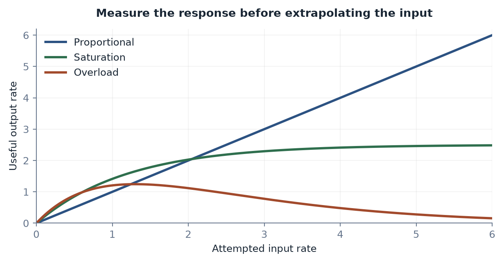
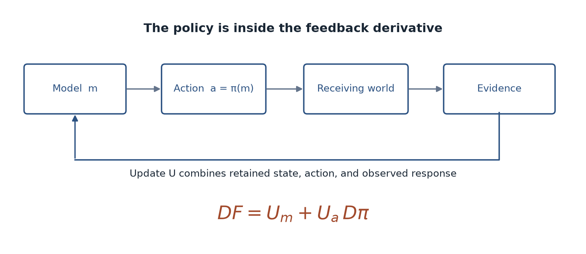

[Contents](CONTENTS.md) · [中文](../zh/CONTENTS.md) · [English](../en/CONTENTS.md)

# Intelligence at the Interface

The previous chapter described resistance. This chapter follows the disturbance that meets it. When a model begins to send commands, allocate work, or initiate actions, its outputs become inputs to a system with dynamics of its own.

A sentence can be evaluated as a sentence. A command must also be evaluated through the movement, load, feedback, and consequences it produces. The interface changes the task.

## From Solver to Driver

### A Different Position in the Loop

#### A solution that has to act

A solver compares possibilities and returns a candidate. A driver participates in changing the state of the world. It sends a signal through an actuator or an organization, observes a result, and helps determine the next action.

The phrase “phase change” describes this shift in role. The new system is evaluated on whether the transition occurs, remains stable, and can be recovered from when it goes wrong.

Ashby's law of requisite variety gives an early account of why the shift matters.[^ashby1956cybernetics] A regulator needs enough available distinctions and responses to counter the disturbances relevant to its task. Many words about a disturbance do not necessarily supply an actuator that can correct it.

A robot may describe a dropped object without being able to reach it in time. A logistics system may identify a delay without having a spare vehicle. Control authority has to exist at the location and time where the correction is needed.

#### The answer becomes part of a cycle

In a closed loop, the sequence is observation, decision, action, response, and a new observation. Each has latency and error. The model acts on an estimate of a state that may already have changed.

Wiener's work grew from precisely such prediction-and-action problems.[^wiener1948] Modern control theory evaluates a controller together with the plant, sensing, delay, and disturbance.[^astrom2008] The quality of a stand-alone forecast is one part of the result.

Supply-chain experiments show how people can also destabilize delayed feedback through their ordering decisions.[^sterman1989][^lee1997] A system that reacts vigorously to a lagging signal can amplify the condition it is trying to correct.

Faster observation and computation can improve control. Their effect depends on the loop into which they enter. The gain has to be placed where the receiving process can use it.

### Four Conditions of Executability

#### Power, bandwidth, error, and safety

An executable plan must fit four kinds of constraint.

First, the action needs adequate power and force at the relevant scale. Second, the receiving medium must be able to respond over the required bandwidth. Third, estimation, prediction, and execution errors must remain within the task's tolerances. Fourth, the failure modes must fit a defensible safety arrangement.

These conditions interact. A lighter actuator may move faster and tolerate less load. A higher gain may improve nominal tracking and excite an unmodeled mode. More sensors can improve observability while adding communications and maintenance requirements.

Safety engineering examines the interaction among components, people, organizations, and operating conditions.[^perrow1984][^leveson2011] A component's success rate cannot establish the safety of every system into which it can be connected.

#### Why the chosen path bends

A shortest route on a map can have poor traction, a closed gate, an unsafe crossing, or an inaccessible entrance. A nominally optimal manufacturing schedule can eliminate the time needed for cleaning or repair. The path bends around conditions omitted from the first optimization.

The useful objective becomes a route that can be sustained at an acceptable total cost. It can include redundancy, staged release, human review, or spare capacity. These are design variables with measurable functions.

The receiving organization matters as much as the actuator. A clinical recommendation must enter a workflow with the information, authority, staffing, and follow-up necessary to act on it. An instruction no one can safely carry out remains an instruction.

#### Embodiment as integration

Brooks and later work on embodiment emphasized that useful behavior depends on the coupled body and environment.[^brooks1991][^pfeifer2006] Sensors, morphology, compliance, feedback, and physical contact can perform work that a detached planner would otherwise have to specify.

Vision-language-action models extend this integration. RT-2 connected web-scale visual and language representations with robot action data.[^zitkovich2023] Its significance is the attempt to carry knowledge into action, where trajectories and outcomes impose another test.

Contemporary deployment shows the surrounding work. GXO's October 26, 2026 announcement expanded its relationship with Agility Robotics from an earlier live warehouse deployment and described planned additional sites.[^gxo2026digit] The relevant unit of progress is a robot within a workflow, with material handoffs, uptime, service, and supervision attached.

Autonomous-driving validation studies similarly examine the distance between observed operation and a sufficiently strong safety claim.[^kalra2016][^koopman2016] Rare events, scenario coverage, operational limits, and the evidence supporting a release all matter.

A usable driver is an arrangement of model, body or tools, environment, and organization. Its capability is distributed across that arrangement.

## How a Medium Absorbs Intelligence

The same output rate can mean abundance in one setting and overload in another. The difference lies in what must happen after the output arrives.

### Three Response Patterns

#### Bits: diffusion and replication

Digital output can be copied and transmitted with little additional handling per recipient. A patch, image, or document can therefore spread rapidly. Once it enters a shared state, a production process, or a decision, its failure costs change.

Digital traffic can also outrun a channel. Congestion-control work treats the network's capacity and feedback as part of the sending problem.[^jacobson1988] A sender that can create more packets has not established that more packets will arrive usefully.

Generated material introduces an evidential version of the same issue. More records can make source tracking and quality control harder. Research on recursive training with generated data identifies conditions under which a distribution can deteriorate; it does not establish that every use of synthetic data must fail.[^shumailov2024ai]

#### Atoms: work and sequential operations

A manufactured output has to pass through actual operations. Some are parallelizable, others form a critical path. Adding plans does not automatically add machines, crews, feedstock, or a heat-removal path.

A production line can respond with an initial delay followed by a limited rate of output. Once a demand fits its capacity, a more intelligent schedule can help. Above capacity, priorities, queues, rejection, and investment determine what happens next.

#### Life: response to an intervention

A living system responds through regulation, compensation, adaptation, and multiple timescales. A dose changes concentrations, which change interactions, which can alter the subsequent response. The action enters a system already maintaining itself.

Shear thickening in suspensions provides a physical image of resistance that can rise with the rate of imposed deformation.[^brown2014shear] Biological and social resistance need their own mechanisms and measurements. The image directs attention toward a rate-dependent response.

Three elementary curves illustrate possible response shapes:

$$
\begin{aligned}
y_b(t)&=y_\infty(1-e^{-t/\tau_b}),\\
y_a(t)&=y_\infty\min\left\{\frac{(t-t_d)_+}{\tau_a},1\right\},\\
y_l(t)&=y_\infty\left[1-e^{-\zeta\omega_n t}
\left(\cos\omega_dt+\frac{\zeta}{\sqrt{1-\zeta^2}}\sin\omega_dt\right)\right],

\end{aligned}
$$

where $\omega_d=\omega_n\sqrt{1-\zeta^2}$ and $0<\zeta<1$ for the third curve. The first is a first-order approach, the second a delayed rate-limited completion, and the third an underdamped second-order response.

They are worked examples, with parameters to be fitted for a chosen process. A digital migration can be slow, a physical relay very fast, and a biological response overdamped. The medium suggests questions about the mechanism; it does not assign the curve.

### Mismatch at the Interface

#### A useful signal needs a receiving capacity

Electrical engineering gives a precise case of mismatch. For a lossless line of real positive characteristic impedance $Z_0$ terminated by a load $Z_L$,

$$
\Gamma=\frac{Z_L-Z_0}{Z_L+Z_0},
\qquad
\frac{P_{\mathrm{refl}}}{P_{\mathrm{in}}}=|\Gamma|^2.
$$

Matching removes reflection under the stated conditions. An AI interface has different variables, so its wasted outputs cannot simply be assigned this electrical coefficient. Their measurable forms include discarded work, waiting, repeated replanning, and damage.

Let $r=v_{\mathrm{in}}/v_{\mathrm{abs}}$ compare an arrival rate with absorption capacity in the same units. An illustrative effective-progress response is

$$
u(r)=
\begin{cases}
r,&0\leq r\leq1,\\
1-\kappa(r-1)^m,&r>1,
\end{cases}
\qquad \kappa>0,\quad m>0.
$$

Below capacity, added input can increase progress. Above it, an overload penalty can offset the gain and, if damage is included in net progress, make it negative. The curve proposes a response to test. A pure queue with no damage instead produces waiting and a saturated service rate.

#### Fit the interface to the task

The practical choices are selective admission, buffering, a stable command interval, parallel receiving capacity, and a route for feedback. Their value depends on the process.

A contact controller needs fast local sensing and correction. A high-level language model can choose a task while a local policy maintains a grip. A laboratory system can generate candidates freely while admitting only a funded and informative selection to experiments.

The interface decides how intelligence becomes load. Designing it is part of building an intelligent system.

Figure 3.1. Useful output can scale with input, saturate, or fall under overload. These are illustrative response forms; measurements determine the form and parameters of a particular system.

## Overlays and the Complexity Ratchet

### Why New Systems Grow on Old Ones

#### Three bills for reconstruction

Replacing a live system presents three bills. Its material assets have to be changed. Service has to continue through the transition. Its participants have to coordinate around new rules and interfaces.

An overlay can avoid paying all three immediately. Navigation uses existing roads. A hospital assistant uses existing records and staff. A sensor layer observes an existing factory. New capability attaches to the installed base.

The strategy is often rational. Its apparent lightness can conceal work needed to translate between layers, maintain consistency, and recover when the overlay fails.

#### The price of leaving the environment alone

Moravec's contrast between formal intellectual tasks and everyday sensorimotor competence helps explain why a computer-centered route initially spreads unevenly.[^moravec1988] Standardizing a task can remove difficulties that a more general machine would have to handle.

Autonomous driving takes one version of the choice. A heavily controlled route can simplify operation; public mixed traffic requires the vehicle and service to accommodate a much larger range of conditions. Evidence about operational safety has to match the chosen domain.[^kalra2016]

The vehicle carries some complexity because the surrounding world remains available to many kinds of user. This can be a good social and engineering choice. Its costs belong in the vehicle, operating service, and governance account.

### What Accumulates Between Layers

#### A model of a ratchet

Suppose adding a layer contributes $c$ units of maintenance complexity and causes existing complexity to grow by fraction $\alpha$:

$$
C_{n+1}=(1+\alpha)C_n+c.
$$

For constant $\alpha>0$,

$$
C_n=(1+\alpha)^nC_0+
\frac{c}{\alpha}\big[(1+\alpha)^n-1\big].
$$

For $\alpha=0$, the result is $C_0+nc$. Positive proportional interaction produces exponential growth in this model. Real systems can consolidate, standardize, retire components, and remove dependencies; their growth need not follow the recurrence.

The ratchet appears when removing a layer leaves obligations behind. Upstream systems now expect its data; downstream workers expect its decisions; exception procedures depend on its presence. Another arrangement must assume those functions before removal is complete.

A residual model $C_n^{\mathrm{res}}=\beta_n C_n$ records a fraction that remains after a specified removal, with $\beta_n$ to be measured. It is a description of the chosen transition, rather than a universal lower bound.

#### Compatibility and deployment costs

Compatibility work preserves relations between versions, formats, interfaces, and operating practices. Deployment work establishes a service in actual use: integration, testing, monitoring, support, incident response, and responsibility.

Under a particular additive removal protocol, one may define an index

$$
K_n=\sum_{k=1}^n\big(C_k-C_k^{\mathrm{res}}\big).
$$

Counting this as labor or money requires cost weights and a check that the same work is not counted twice. The useful empirical question is how much work it takes to release the dependencies, not how large an index can be made.

An overlay earns its place when its total benefit exceeds these costs. Its risk is institutional permanence by default: each new layer is temporary until someone asks what removal would require.

#### Designing an exit

A credible overlay has an exit condition. It may be retired after a migration, consolidated into a stable module, or replaced by a simpler underlying process. Parallel operation should have a purpose and a horizon.

Some interfaces deserve long lives. Others continue because no one owns the cleanup. The complexity ratchet is strongest where benefit belongs to the builder and maintenance belongs to someone else.

The next section follows what happens when input keeps arriving faster than the system can be rebuilt.

## What the System Does with More Intelligence

An input does not acquire priority because it came from an intelligent machine. Once it enters a factory, a market, or an organization, the receiving system decides what happens next. Some inputs find a better route. Some accumulate. Some help drive the system unstable. These are different mechanisms, and they require different remedies.

### Rerouting: Moving Some of the Trial and Error

The direct route is often the expensive route. A desired molecule is easy to describe and hard to synthesize. A production target is easy to enter into a spreadsheet and hard to reach with the equipment already installed. A search algorithm earns its keep when it discovers a path that asks less of the costly medium.

Call this a *probabilistic shortcut*: spend computation to improve the odds of the next expensive intervention. Screen candidate compounds before synthesizing them. Simulate a warehouse layout before moving the racks. Search a design space before cutting metal. The saving comes from changing which physical trials are attempted, how they are ordered, and how much each trial teaches.

Monte Carlo methods made a related trade long before deep learning. Sampling replaces certain difficult calculations with estimates whose precision depends on the sampling scheme and budget. It does not make every estimate cheap or every rare event visible. It gives engineers a different way to buy an answer. In games, systems such as AlphaGo could search within rules that were already executable, with outcomes that could be obtained without building a physical board or waiting for a human opponent [^silver2016mastering]. The search environment supplied an unusually inexpensive judge.

The judge becomes more costly outside games. A predicted protein structure may narrow an experiment, suggest a mechanism, or support a screening workflow. The experimental question then matters: determining a structure, establishing binding, measuring activity, and demonstrating a therapeutic benefit are different tasks. A prediction need not be remeasured in every downstream use to be useful, but its uncertainty must be compatible with that use. Cheap structure proposals do not turn every biological claim into an established result.

Semiconductor fabrication illustrates another form of rerouting. When a direct scaling path becomes difficult, progress can continue through new materials, transistor structures, packaging, architecture, and specialized computation. Each route changes the cost distribution. More elaborate fabrication may buy performance at the price of more process steps, tighter tolerances, and expensive equipment. The result can be a real improvement without being a disappearance of resistance.

The same test applies to simulation. A simulator can fail a thousand times without breaking a gripper. Yet someone must establish which failures and successes transfer to the actual gripper. Domain randomization can improve transfer by exposing a policy to varied conditions; the range of variation remains a modeling decision [^tobin2017domain]. A shortcut pays when the physical trials it avoids cost more than the computation, modeling, and additional uncertainty it introduces.

The useful question is therefore concrete: *which part of the real trial has been removed, which part has been moved, and which part still has to happen?* A project that cannot answer this may have relocated its bottleneck while mistaking the relocation for a breakthrough.

### Accumulation: Intelligence Becomes Inventory

Consider an engineering team whose assistants can generate a hundred plausible patches a day. Its reviewers can investigate ten. Its test infrastructure can run more tests than before, but production incidents still require experienced staff. The organization now has a larger candidate inventory. Whether it has more reliable software depends on the receiving process.

For a queue with arrival rate $I(t)$ and absorption rate $A(S)$,

$$
\frac{\mathrm{d}S}{\mathrm{d}t}=I(t)-A(S),
 \qquad 0\leq A(S)\leq A_{\max}.
$$

$S$ counts unfinished items. The rates count items per unit time. At an empty queue, departures cannot exceed available work; a more detailed model would also include rejection, abandonment, rework, and different classes of item. The accounting point survives: sustained arrivals above effective service capacity create a growing backlog.

A backlog is stored time. It can be useful. Hospitals hold spare supplies, cloud systems buffer bursts, and laboratories retain promising candidates until an instrument becomes available. Inventory becomes a problem when it conceals an absorption limit. A long list of unreviewed proposals may look like a rich pipeline while making urgent work harder to identify.

Even stable queues can have long delays when utilization is high and arrivals or service times vary. Spare capacity buys something that an average throughput chart can hide: the ability to absorb a surprise. Running every expert, machine, and approval channel at nominal capacity leaves little room to recover from an exception.

Accumulation also moves upstream. If an experimental facility is booked months ahead, researchers change what they propose. If deployment review becomes the bottleneck, developers optimize for the review process. The downstream constraint starts shaping the supposedly unconstrained search space.

Supply chains show how this can become oscillation. Demand signals pass through ordering policies, inventory targets, production schedules, and delivery delays. Local adjustments can amplify a small change in final demand into much larger upstream orders: the bullwhip effect [^lee1997information]. Better information can help, but information alone does not remove lead times or correct a badly tuned replenishment rule.

There is no universal clock assigning short cycles to light assets and long cycles to heavy ones. Nevertheless, adjustment times matter. Clearing a content queue and rebuilding a power plant operate on different clocks. A decision that was appropriate when initiated may reach completion in a changed environment. Heavy commitments preserve old expectations in physical form.

Reducing arrivals can relieve a queue; increasing service capacity can raise its sustainable throughput. Improving candidate quality can do both by reducing rework and increasing the useful output of each review. These are distinct interventions. Generating more candidates addresses none of them by itself.

### Instability: Correction Becomes a Disturbance

Oscillation is not the inevitable outcome of fast computation. A well-designed controller can use rapid measurements to stabilize a slow plant. The danger is a control policy whose gain, delay, and model do not fit the plant it is controlling.

An operator sees a shortfall and orders more capacity. Before the capacity arrives, the shortfall persists, so the operator orders still more. When the first expansion comes online, the later orders remain in motion. The controller has interpreted the absence of an immediate response as evidence that its previous action was too weak.

This is how a sensible local instruction can create a damaging global rhythm. A warehouse keeps rerouting staff before any team has settled into its new task. A company changes quarterly objectives before the previous reorganization has produced interpretable evidence. An automated market strategy reacts to liquidity that disappears as other strategies react to it.

The official investigation of the May 2010 US market disruption documented interactions among a large sell program, changing liquidity, and trading behavior [^sec2010findings]. It is a historical case of interacting mechanisms, rather than proof that trading speed alone causes crashes. A fast system needs an account of what its own action does to the signals it will read next.

Protective devices enter that same loop. A trading halt can create time for liquidity and information to recover. A known threshold can also alter behavior before the halt: participants may trade earlier because they expect access to close. Theoretical work on price limits describes such a magnet effect [^subrahmanyam1994]. A threshold must be evaluated with the behavior it induces.

In physical control, inertia, damping, and active compensation have distinct roles. Inertia slows a change in velocity or frequency; damping dissipates an oscillation; a controller can supply a response that depends on its design and available energy. Calling all three “friction” obscures the engineering. Their common relevance here is that rapid decisions need a receiving system capable of turning them into a stable trajectory.

Three questions separate the interventions. Can search identify a route that needs fewer costly trials? Can the receiving process absorb the proposed work? Does the feedback policy remain stable with actual delays and disturbances? The corresponding investments are better validation, better absorption, and better control.

More intelligence can improve all three. It can also flood a review queue, accelerate a badly chosen intervention, or exploit a shortcut that works only inside the model. The difference lies in what becomes of the input after it crosses the interface.

## When a Generated Answer Becomes a Result

A fabricated reference can have a convincing title, plausible authors, and the right journal style. An invalid proof can have lemmas, notation, and impeccable transitions. A patch can look clean while calling an interface that does not exist. In each case, the output possesses a recognizable form. What it lacks is a completed route from that form to a dependable result.

Language models have made this separation industrially important. Candidate production can run ahead of candidate confirmation. The question is no longer simply where an answer came from. It is what has established the answer, at which level, and for which use.

### The Two Jobs of Form

Form is a transferable constraint. A proof rule limits which steps may follow. A function signature limits which calls are well formed. A narrative structure limits what a reader expects next. Their constraints differ in strength and purpose, but each allows something learned in one setting to carry into another.

Formal logic isolates an especially powerful case. A valid inference preserves its validity when suitable contents are substituted into its structure. The achievement is compression: one rule can govern indefinitely many instances. The rule does not need to retain every instance separately.

The history from axiomatized geometry to symbolic logic made this power explicit. It also raised a harder ambition: could a sufficiently complete formal system settle every question in its domain and establish its own reliability from within?

The limits have precise statements. A consistent, effectively axiomatized theory strong enough for elementary arithmetic is incomplete. Under the usual conditions of the second incompleteness theorem, it cannot prove its own formalized consistency [^godel1931]. The halting problem rules out one algorithm deciding whether every arbitrary program halts [^turing1936]. Algorithmic information theory establishes that some finite strings have no substantially shorter description in a chosen universal description language [^chaitin1987].

These results concern different objects. They do not show that every particular proof needs an unprovable assumption, that every program is beyond analysis, or that fluent language is inherently unreliable. What they prohibit are specific forms of universal closure. Engineers still prove particular properties of particular programs, using explicit assumptions and a specified logic.

Deployment adds a separate boundary: the correspondence between the formal object and the thing being built. A verified controller can satisfy a specification whose sensor model is wrong. A correct compiler can preserve the semantics of a program that expresses the wrong requirement. A sound proof checker can accept a theorem that is weaker than the informal claim used to advertise it.

The seL4 verification demonstrated a machine-checked refinement from an abstract specification to a C implementation, with explicit assumptions and exclusions [^klein2009sel4]. CompCert established semantic preservation for a substantial compiler, again within a defined account of source and target behavior [^leroy2009compcert]. These achievements make the boundary inspectable. They also show the work involved in connecting a claim to an implementation.

A result is valuable partly because one can say exactly what was established. “Verified” without the property, assumptions, and implementation boundary leaves the central question unanswered.

### How Prediction Learns Structure

Earlier symbolic systems relied heavily on people writing rules. Learned models obtain much of their structure from records: language, code, diagrams, demonstrations, experimental reports, and the traces of other people's reasoning.

These records are highly patterned. Variable binding, references, function calls, nested expressions, and relations between goals and actions reduce uncertainty across many contexts. A model that represents such regularities can predict better than one that memorizes isolated fragments. Prediction can therefore create an incentive to learn useful abstract structure. Which structures it learns, and how reliably it uses them, remain empirical questions.

The physical process matters too. Training consumes electricity, moves data, changes stored states, and rejects heat. For an idealized reset of an unbiased bit, coupled to a thermal environment at temperature $T$, Landauer's bound is

$$
Q_{\min}=k_{\mathrm B}T\ln 2.
$$

At about $300\,\mathrm{K}$ this is roughly $2.9\times10^{-21}\,\mathrm{J}$ per bit reset. The bound concerns logically irreversible information erasure under the stated conditions; it is not a universal invoice attached to every arithmetic operation or memory write. Real hardware operates with additional device, communication, memory, and cooling costs.

Energy permits the computation. Structured data supplies learnable regularity. The objective and optimization process favor some representations over others. These roles cannot be collapsed into the claim that dissipation produces intelligence. A resistor dissipates energy without learning a grammar.

One can picture training as carving channels through a landscape: repeated data and error signals make some continuations easier than others. The image explains why widely recurring structures may become accessible together. It supplies no theorem that the resulting channels track truth.

The training objective rewards an operational target. In a prediction task, that target is predictive performance on a distribution of records. A true statement can be surprising in that distribution. A false statement can be conventional. A model can learn useful reasoning procedures and still apply them incorrectly to a particular case.

The GPT-4 technical report is a historical example of this coexistence: substantial capability accompanied by factual and reasoning failures [^openai2023gpt4]. It is evidence about a particular generation of systems, rather than a current frontier benchmark. The general engineering question persists as systems improve: what evidence connects this output to the object, rule, or environment on which it makes a claim?

Hallucinations have multiple sources, including data quality, objectives, retrieval failures, decoding, and reasoning errors [^huang2023hallucination]. Treating them as a single irreducible price of creativity would overstate the case. Individual error classes can be reduced, detected, or excluded by design. The harder problem is establishing reliability across the full range of uses advertised for a system.

### Three Places Where Confirmation Happens

A bibliographic reference needs an identifiable source. A mathematical derivation needs valid inference. A warehouse plan needs an executable and acceptable intervention. These are three useful places to inspect a confirmation chain.

 
-  **Reference.** Does the representation point to the claimed object? A paper title, API name, data field, or quoted finding must be traceable to something that supports its use.
 
-  **Inference and execution.** Do the transformations obey the relevant rules? A proof, calculation, program, or causal argument needs the kind of check appropriate to its claim.
 
-  **Action.** Does the proposal work in the receiving environment, with its resources, permissions, disturbances, and consequences?

These checks can overlap and recur. They are not a mandatory chronology for every task. A program may run before anyone notices that it solves the wrong problem. An experiment may force revision of the representation used to design it.

AlphaGeometry offered an instructive architecture: a neural component proposed useful constructions and a symbolic engine performed geometric deduction [^trinh2024alphageometry]. Its published 2024 evaluation is a historical benchmark, not an assertion about the best available mathematics system in 2026. The interesting point is architectural: search and checking can have different mechanisms and different costs.

Software issue resolution offers a second judge. SWE-bench and its curated variants place a proposed change into a repository with an issue, dependencies, and tests [^swebench2024]. Passing the evaluation establishes something more specific than “can write code.” It still leaves questions about test coverage, security, maintainability, and production behavior.

Causal claims need another distinction. A relationship in observational data does not by itself specify the result of an intervention. Causal analysis makes assumptions about interventions and counterfactuals explicit [^pearl2009causality]. A persuasive causal story becomes actionable only when the assumptions and evidence support the proposed change.

The cost of traversing a chain can be expressed with conditional pass rates. If $p_i$ is the probability of passing stage $i$ *conditional on having passed the preceding stages*, then

$$
p_{\mathrm{all}}=\prod_{i=1}^{k}p_i,
 \qquad
 N_{\mathrm{cand}}\approx
 \frac{M_{\mathrm{use}}}{\prod_{i=1}^{k}p_i}.
$$

The second expression is an expectation or planning approximation under stable, comparable trials. It does not guarantee a particular number of successes. Conditional pass rates require no independence assumption. If only unconditional rates are available, multiplying them requires additional justification.

The expression explains one possible migration of cost. Making proposals cheaper may leave experiments, trials, integration, and review as the expensive part of producing a usable result. Better models can improve those stages too: they can raise pass rates, design more informative tests, or reduce rework. Whether the total bill falls is a question about the entire chain.

Tools add confirmation interfaces. Retrieval can locate a source; an interpreter can execute a calculation; a proof assistant can check a formal derivation; a sensor can report a response. Each interface has a contract of its own. A search result may be stale. A test may miss the failure mode. A formally correct theorem may omit a necessary premise.

Reliability therefore belongs to the assembled system. A model that calls tools, reads results, revises its plan, and stops when evidence is inadequate has a different capability from the same model producing one unchecked response. The tools do not merely decorate its intelligence; they can supply part of the intelligence's working structure.

What remains costly varies by medium. A text can often be revised cheaply. A production migration needs monitoring and recovery. A medical intervention can require long follow-up, and an ecological intervention may have consequences that cannot be recalled. The verification ladder becomes heavier as the claim reaches deeper into the world.

Form makes knowledge portable. Confirmation determines where that portability can be trusted. A capable system needs both a way to generate candidates and a route by which a candidate becomes an established result.

## A World Model Must Survive Its Own Actions

A map is useful because it leaves things out. A road map omits the grain of the asphalt. A robot's contact model may omit the building's architecture. A clinician's model of an intervention cannot track every molecule in a patient's body. The question is which omissions remain harmless when someone acts on the model.

A world model earns its name through the expectations it makes available: what is likely to happen, which action may change it, what evidence should be collected next, and when the model has ceased to be adequate. It need not be a miniature universe inside a machine.

### Building the Model While Using It

A demand for complete understanding before useful action would stop nearly every practical learner. People learn a tool while using it. A mobile robot can estimate its position while constructing a map. An agent can discover a software environment by inspecting files, running commands, and interpreting the results.

This is a bootstrapping problem. The provisional model guides an action; the action produces evidence; the evidence revises the model. The quality of the loop matters more than the completeness of the initial representation.

The difficulty of hand-building comprehensive representations was already visible in ambitious knowledge-based computing programs. Japan's Fifth Generation Computer Systems project pursued parallel inference and logic programming, producing research and working systems without establishing the broad industrial transformation its most expansive expectations anticipated [^aiso1988fifth][^feigenbaum1993japanese]. A useful historical lesson is the cost of maintaining explicit knowledge as coverage expands. Its useful legacy is the question of how representations stay current as coverage expands.

Contemporary digital agents distribute the burden. The model supplies hypotheses and plans. A repository supplies persistent state. Logs supply memory of what occurred. Tools supply exact calculations and executable observations. A test suite supplies a partial judge. Some of what an agent “knows” lives in its ability to recover the right external state when needed.

Embodied systems face the same architecture with a heavier interface. Touch, force, position, contact history, wear, and time enter the loop. A cup does not interpret a robot's intentions. It does retain the consequences of being pushed. The next action meets the cup where the previous action left it.

Planning systems can operate above fast local controllers. A high-level model may choose a grasp or a route while lower-level loops manage forces and motion. The necessary rates depend on the hardware and task. Classic force-control research documents how sensing, mechanical dynamics, and unmodeled modes constrain useful feedback bandwidth [^eppinger1987]. A broad claim that “the robot runs at a kilohertz” can conceal several nested loops with different jobs.

By July 2026, Google's Gemini Robotics 2 work explicitly brought high-level embodied capabilities together with whole-body control and robot action [^geminirobotics2026]. The relevant advance is the connection among perception, planning, and execution. A demonstration still has a task distribution, hardware configuration, and recovery policy. Those determine what the demonstrated capability can support.

### Three Strengths of Coupling

The cost of an inadequate model depends on how tightly its outputs are coupled to consequences.

In a loosely coupled task, a draft can be inspected before use. A translator can revise a paragraph. A developer can reject a patch. The external state need not change every time the model proposes something.

In a strong physical loop, each action changes the state encountered by the next action. A slight slip changes the grip. A delayed correction changes the contact force. Errors may persist and interact rather than reset between steps.

In a reflexive loop, other agents interpret the intervention and change strategy. A trader responds to a forecast that other traders also read. A platform's ranking rule changes the behavior of those being ranked. A policy changes the incentives under which its own evidence will be generated.

These are coupling regimes, not species of intelligence. Software can be tightly coupled to consequential infrastructure. A physical inspection can remain advisory. Social systems can have stable equilibria, unstable dynamics, or both under different conditions. Reflexivity removes the convenience of treating the observed distribution as independent of the observer's deployed policy.

One can write a simple model--action update as

$$
a_t=\pi(m_t),\qquad
 m_{t+1}=U(m_t,a_t)=F(m_t).
$$

Here $m_t$ denotes the current model state and $a_t$ the chosen action. The feedback derivative is the derivative of the *composite* map:

$$
DF(m)=
 \frac{\partial U}{\partial m}
 +\frac{\partial U}{\partial a}D\pi(m).
$$

Ignoring the second term ignores the fact that changing the model changes the action used to update it.

If $F$ maps a complete invariant domain into itself and is uniformly contractive there, a fixed point exists, is unique in that domain, and iteration converges to it. A derivative smaller than one at an isolated point establishes much less; noise, delay, a changing environment, and an unmodeled state can alter the conclusion. The stability argument therefore has to cover the whole update map, its domain, and the receiving environment.

Simultaneous localization and mapping makes bootstrapping tangible. It also makes the assumptions visible: sensor geometry, observability, motion, and the treatment of moving objects affect whether a map and position estimate remain useful. A robot manipulating an object faces an additional burden because its actions deliberately change the scene. A strategic agent adds another because the scene's other occupants respond to its policy.

Across these settings, an important capability is continuity after an error. Can the system observe the new state, recover what matters, and choose another safe action? A beautiful prediction with no recovery route may be less useful than a rougher model embedded in a resilient loop.

Figure 3.2. The model changes the action, which changes the evidence used in the next update. $U$ combines retained state, action, and environmental response. The derivative of the composite map contains both the direct term and the path through the policy.

### Compression That Supports Intervention

Call a representation *intervention-ready compression* when it preserves enough structure to guide a specified class of actions within stated error and risk tolerances. The phrase names a practical requirement. Causal inference already supplies rigorous distinctions among observation, intervention, and counterfactual reasoning [^pearl2009causality].

Records can contain evidence about all three. Text is not confined to surface correlation: it can describe experiments, mechanisms, and failed interventions. A learner can recover causal structure from such records when the data and assumptions permit it. Nevertheless, accurate prediction of records alone does not certify a particular intervention model.

The transition to action asks a different question. If the system changes this variable, with these constraints and this history, how does the distribution of later states change? A drug may alter the probability of an outcome without determining every patient's response. A control signal may shift a trajectory distribution without producing identical motion on every attempt. Actionable causality does not require determinism.

Which variables must be retained? A local sensitivity screen offers one limited answer:

$$
\left|\frac{\partial f}{\partial x_i}\right|\sigma_i>\theta.
$$

For a scalar state-transition quantity $f$, the left side estimates the effect of uncertainty $\sigma_i$ in variable $x_i$. The threshold $\theta$ must use the same units as that effect. A variable whose estimated effect exceeds the task's tolerance deserves attention.

This is a first-order approximation. Interactions, correlated uncertainties, discontinuities, and rare severe events can defeat it. A variable can have a small local derivative and still determine whether a system crosses a catastrophic boundary. Selecting a model therefore requires more than ranking ordinary sensitivities.

Scale matters for the same reason. At one scale, friction can be represented by an effective coefficient. At another, surface texture, deformation, temperature, and contact history may have to reappear. The right representation is the one that remains useful under the interventions actually contemplated.

Simulation buys controlled variation. Real feedback tests transfer. Domain randomization, demonstrations, online learning, and model-based planning arrange this exchange differently [^tobin2017domain]. Their common bill includes observations of how the receiving world responds.

Those observations can be expensive and slow. In drug development, a historical estimate based on selected company data included both unsuccessful projects and the financing cost of time [^dimasi2016]. Such estimates are sensitive to sample and accounting choices; no single figure is the timeless price of discovering a drug. The robust point is that copying a report and obtaining a new clinical response draw on different resources.

The 2026 rentosertib program makes the distinction current. An AI-associated discovery and development process had reached a Phase III program, with the first patient announced in September [^insilico2026phase3]. Enrolling a trial creates a route to evidence. Its announced follow-up period is still time that has to pass. The label “AI-discovered” cannot supply the missing outcomes.

Resource barriers determine how much a real observation costs. Temporal rigidity determines when it becomes available. Topological coupling determines where an intervention's effects travel. A world model operates inside these constraints, using a limited budget of responses to improve future decisions.

Reversibility changes the budget. A discarded software hypothesis can often be recovered from a log. An unnecessary physical collision may destroy the state needed to try again. In a clinical or ecological setting, some uncertainty cannot be resolved by unrestricted experimentation. The model must then support conservative margins, staged interventions, and explicit decisions about which uncertainty remains.

Other agents complicate the target further. Once a model is deployed, people can adapt to it, exploit its categories, or withhold the evidence it expects. The representation that worked before deployment may become inadequate because deployment succeeded in changing behavior. Monitoring must therefore ask whether the transition rule itself is drifting.

Failure reveals an omission, but not every failure identifies it uniquely. A missed grasp can reflect perception, calibration, mechanics, or planning. A weak treatment response can have several explanations. Learning requires experiments and diagnostics that distinguish among them. More failed actions without better attribution can consume the feedback budget without improving the model.

The ambition is demanding and concrete: use finite, costly, noisy responses to build a representation that continues to support action after action has changed the world. A model needs to retain what the next consequential intervention will make matter.

That requirement leads directly to the body. Some of the variables a model could track are handled instead by elasticity, geometry, reflex, and metabolism. The next chapter examines this older form of compression, built into matter and paid for through evolution, development, and maintenance.

## References

[^ashby1956cybernetics]: Ashby, W. Ross. An Introduction to Cybernetics. 1956.
[^wiener1948]: Wiener, Norbert. Cybernetics: Or Control and Communication in the Animal and the Machine. 1948.
[^astrom2008]: \AAström, Karl Johan and Murray, Richard M.. [Feedback Systems: An Introduction for Scientists and Engineers](https://doi.org/10.1515/9781400828739). 2008.
[^sterman1989]: Sterman, John D.. [Misperceptions of feedback in dynamic decision making](https://doi.org/10.1016/0749-5978(89)90041-1). 1989.
[^lee1997]: Lee, Hau L. and Padmanabhan, V. and Whang, Seungjin. The Bullwhip Effect in Supply Chains. 1997.
[^perrow1984]: Perrow, Charles. Normal Accidents: Living with High-Risk Technologies. 1984.
[^leveson2011]: Leveson, Nancy G.. [Engineering a Safer World: Systems Thinking Applied to Safety](https://doi.org/10.7551/mitpress/8179.001.0001). 2011.
[^brooks1991]: Brooks, Rodney A.. [Intelligence without representation](https://doi.org/10.1016/0004-3702(91)90053-M). 1991.
[^pfeifer2006]: Pfeifer, Rolf and Bongard, Josh. [How the Body Shapes the Way We Think: A New View of Intelligence](https://doi.org/10.7551/mitpress/3585.001.0001). 2006.
[^zitkovich2023]: Zitkovich, Brianna and Yu, Tianhe and Xu, Sichun and Xu, Peng and Xiao, Ted and Xia, Fei and others. RT-2: Vision-Language-Action Models Transfer Web Knowledge to Robotic Control. 2023.
[^gxo2026digit]: GXO Logistics. [GXO and Agility Robotics Expand Partnership to Accelerate Deployment of Humanoids in U.S. Operations](https://gxo.com/news_article/gxo-and-agility-robotics-expand-partnership-to-accelerate-deployment-of-humanoids-in-u-s-operations/). 2026-10-26.
[^kalra2016]: Kalra, Nidhi and Paddock, Susan M.. [Driving to Safety: How Many Miles of Driving Would It Take to Demonstrate Autonomous Vehicle Reliability?](https://doi.org/10.7249/RR1478). 2016.
[^koopman2016]: Koopman, Philip and Wagner, Michael. [Challenges in Autonomous Vehicle Testing and Validation](https://doi.org/10.4271/2016-01-0128). 2016.
[^jacobson1988]: Jacobson, Van and Karels, Michael J.. [Congestion Avoidance and Control](https://doi.org/10.1145/52325.52356). 1988.
[^shumailov2024ai]: Shumailov, Ilia and Shumaylov, Zakhar and Zhao, Yiren and Papernot, Nicolas and Anderson, Ross and Gal, Yarin. [AI models collapse when trained on recursively generated data](https://doi.org/10.1038/s41586-024-07566-y). 2024.
[^brown2014shear]: Brown, Eric and Jaeger, Heinrich M.. [Shear Thickening in Concentrated Suspensions: Phenomenology, Mechanisms and Relations to Jamming](https://doi.org/10.1088/0034-4885/77/4/046602). 2014.
[^moravec1988]: Moravec, Hans. Mind Children: The Future of Robot and Human Intelligence. 1988.
[^silver2016mastering]: Silver, David and Huang, Aja and Maddison, Chris J. and Guez, Arthur and Sifre, Laurent and van den Driessche, George and Schrittwieser, Julian and Antonoglou, Ioannis and Panneershelvam, Veda and Lanctot, Marc and Dieleman, Sander and Grewe, Dominik and Nham, John and Kalchbrenner, Nal and Sutskever, Ilya and Lillicrap, Timothy and Leach, Madeleine and Kavukcuoglu, Koray and Graepel, Thore and Hassabis, Demis. [Mastering the game of Go with deep neural networks and tree search](https://doi.org/10.1038/nature16961). 2016.
[^tobin2017domain]: Tobin, Josh and Fong, Rachel and Ray, Alex and Schneider, Jonas and Zaremba, Wojciech and Abbeel, Pieter. [Domain Randomization for Transferring Deep Neural Networks from Simulation to the Real World](https://doi.org/10.1109/IROS.2017.8202133). 2017.
[^lee1997information]: Lee, Hau L. and Padmanabhan, V. and Whang, Seungjin. [Information Distortion in a Supply Chain: The Bullwhip Effect](https://doi.org/10.1287/mnsc.43.4.546). 1997.
[^sec2010findings]: U.S. Securities and Exchange Commission and Commodity Futures Trading Commission. [Findings Regarding the Market Events of May 6, 2010](https://www.sec.gov/files/marketevents-report.pdf). 2010.
[^subrahmanyam1994]: Subrahmanyam, Avanidhar. [Circuit Breakers and Market Volatility: A Theoretical Perspective](https://doi.org/10.1111/j.1540-6261.1994.tb04427.x). 1994.
[^godel1931]: Gödel, Kurt. [Über formal unentscheidbare Sätze der Principia Mathematica und verwandter Systeme I](https://doi.org/10.1007/BF01700692). 1931.
[^turing1936]: Turing, Alan M.. [On Computable Numbers, with an Application to the Entscheidungsproblem](https://doi.org/10.1112/plms/s2-42.1.230). 1936.
[^chaitin1987]: Chaitin, Gregory J.. [Algorithmic Information Theory](https://doi.org/10.1017/CBO9780511608858). 1987.
[^klein2009sel4]: Klein, Gerwin and Elphinstone, Kevin and Heiser, Gernot and Andronick, June and Cock, David and Derrin, Philip and Elkaduwe, Dhammika and Engelhardt, Kai and Kolanski, Rafal and Norrish, Michael and Sewell, Thomas and Tuch, Harvey and Winwood, Simon. [seL4: Formal Verification of an OS Kernel](https://doi.org/10.1145/1629575.1629596). 2009.
[^leroy2009compcert]: Leroy, Xavier. [Formal Verification of a Realistic Compiler](https://doi.org/10.1145/1538788.1538814). 2009.
[^openai2023gpt4]: OpenAI. [GPT-4 Technical Report](https://doi.org/10.48550/arXiv.2303.08774). 2023.
[^huang2023hallucination]: Huang, Lei and Yu, Weijiang and Ma, Weitao and Zhong, Weihong and Feng, Zhangyin and Wang, Haotian and others. [A Survey on Hallucination in Large Language Models: Principles, Taxonomy, Challenges, and Open Questions](https://doi.org/10.48550/arXiv.2311.05232). 2023.
[^trinh2024alphageometry]: Trinh, Trieu H. and Wu, Yuhuai and Le, Quoc V. and He, He and Luong, Thang. [Solving olympiad geometry without human demonstrations](https://doi.org/10.1038/s41586-023-06747-5). 2024.
[^swebench2024]: Jimenez, Carlos E. and Yang, John and Wettig, Alexander and Yao, Shunyu and Pei, Kexin and Press, Ofir and Narasimhan, Karthik. [SWE-bench: Can Language Models Resolve Real-World GitHub Issues?](https://doi.org/10.48550/arXiv.2310.06770). 2023.
[^pearl2009causality]: Pearl, Judea. [Causality: Models, Reasoning and Inference](https://doi.org/10.1017/CBO9780511803161). 2009.
[^aiso1988fifth]: Aiso, Hideo. [The Fifth Generation Computer Systems Project](https://doi.org/10.1016/0167-739X(88)90001-5). 1988.
[^feigenbaum1993japanese]: Feigenbaum, Edward and Shrobe, Howard. [The Japanese national Fifth Generation project: Introduction, survey, and evaluation](https://doi.org/10.1016/0167-739X(93)90003-8). 1993.
[^eppinger1987]: Eppinger, Steven D. and Seering, Warren P.. [Understanding Bandwidth Limitations in Robot Force Control](https://doi.org/10.1109/ROBOT.1987.1087932). 1987.
[^geminirobotics2026]: Google DeepMind. [Gemini Robotics 2 Brings Whole-Body Intelligence to Robots](https://deepmind.google/blog/gemini-robotics-2-brings-whole-body-intelligence-to-robots/). 2026-07-30.
[^dimasi2016]: DiMasi, Joseph A. and Grabowski, Henry G. and Hansen, Ronald W.. [Innovation in the Pharmaceutical Industry: New Estimates of R&D Costs](https://doi.org/10.1016/j.jhealeco.2016.01.012). 2016.
[^insilico2026phase3]: Insilico Medicine. [Insilico Medicine Doses First Patient in GENESIS-IPF-3](https://insilico.com/news/isn1009261-insilico-medicine-doses-first-patient-genesis-ipf-3). 2026-09-10.
