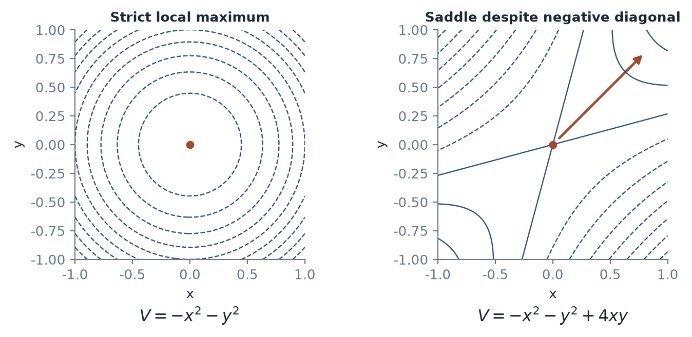
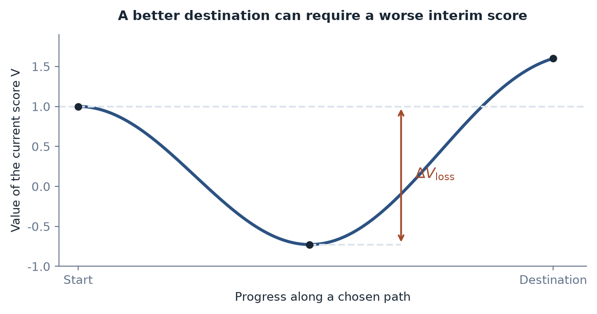
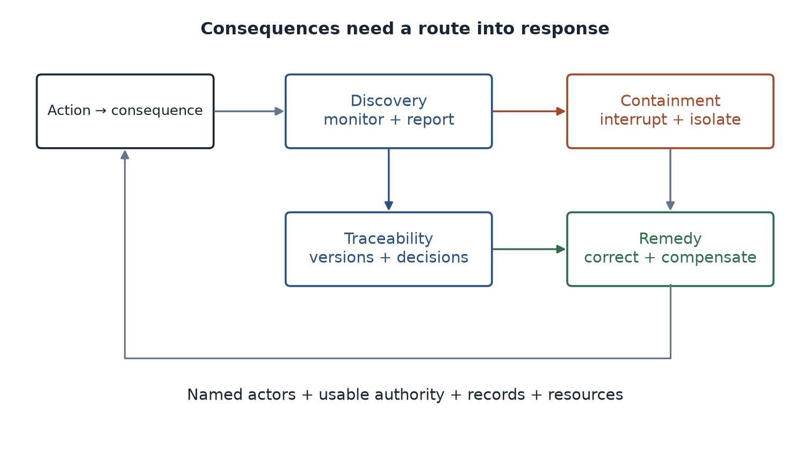

[Contents](CONTENTS.md) · [中文](../zh/CONTENTS.md) · [English](../en/CONTENTS.md)

# Existence and Collapse

A generated city can be beautiful before it has a site. A proposed molecule can be elegant before it has been synthesized. A machine persona can be persuasive before anyone knows what obligations attach to it. Their immediate existence is easy to establish: there is an image, a structure, an interaction. Their claims on the rest of the world require a different account.

This chapter follows three separations. Existence differs from evidence. Evidence differs from authorization. The power to cause a consequence differs from the capacity and obligation to answer for it.

## What Exists, What Holds Up, and What May Act

### The Weight of an Existence

A rock, an organism, a corporation, and a generated character persist in different ways. A rock can remain stable without a continual supply of work. An organism maintains a far-from-equilibrium state through metabolism and repair. A corporation depends on records, assets, people, and legal recognition. A generated character can persist as data while depending on an operator for any continuing interaction.

The word “weight” has two uses here. Physical mass belongs to the material account. *Consequential weight* concerns what it takes to establish, maintain, withdraw, and answer for something. A debt has little physical bulk as a database entry and substantial force in a person's life. Institutional recognition and enforcement connect the entry to that force [^searle1995construction].

Consequential weight is best inspected as a profile:

$$
\mathbf w=
 (w_{\mathrm{establish}},w_{\mathrm{maintain}},
  w_{\mathrm{reverse}},w_{\mathrm{spillover}},
  w_{\mathrm{account}}).
$$

The components may use different units and need not be added. A weighted index is possible only after choosing a common scale and weights. A line of text and a bridge cannot be ranked by a universal number obtained from the word “weight.”

The profile nevertheless changes the questions one asks. What keeps the object available? What can undo its effects? Who pays for an error? Which effects outlive the carrier that initiated them?

Human representations have long created such connections. A map guides travel. A contract binds later conduct. A diagram precedes construction. Computation lets representations be transformed and tested before much of the physical commitment occurs.

Machine generation increases the volume and accessibility of these intermediate objects. The generated city exists as an image or plan. The proposed molecule exists as a specified candidate. The simulated robot action exists as a trajectory in a model. Each can be useful at that level.

The interesting question is which transition follows. A plan enters permitting and construction. A candidate enters synthesis and testing. A trajectory enters an actuator. A persona enters someone's decisions and relationships.

These are *conversion edges*: routes by which a representation gains effects in another layer. Some go through heavy physical work. Others are light enough to traverse almost instantly. A fabricated message can change a person's judgment before anyone checks its origin. A generated command can reach equipment through an API. A score can alter a person's access to a job or loan.

The new asymmetry is the separation of cheap access from heavy consequence. A carrier may be easy to create and delete while its effects are difficult to recall. Erasing a false image does not erase every belief it helped produce. Reverting software does not reverse every transaction it authorized.

This is older than AI. Rumors, propaganda, fraud, and remote commands already exploited light carriers. Generation and automated execution change the scale, speed, variety, and number of pathways available. The receiving structures have to adapt to that change.

Representation can also become a source for further representation. Generated content enters public records, training sets, summaries, and subsequent decisions. Research on recursively trained models demonstrates degradation under particular synthetic-data arrangements [^shumailov2024ai]. The relevant issue is the information retained and refreshed across the loop, rather than whether any item has a synthetic origin.

An engineered sequence introduces another kind of edge if it is taken up by a biological process. Being writable, synthesizable, functional, heritable, and ecologically persistent are different properties. Each transition has its own constraints. The consequential weight appears where a process can continue beyond the designer's immediate control.

The map of existence therefore needs layers and edges. Layers describe what supports a thing. Edges describe what it can cause elsewhere. Accountability asks where the bill arrives after the edge has been crossed.

### After the Candidate Comes the Warrant

A statement exists when it has been written. That fact supplies no evidence for its content.

Knowledge relevant to action needs a warrant: a reason the judgment can be relied upon for the use in question. A proof, calibrated measurement, replicated experiment, documented observation, and validated engineering model supply different kinds of warrant.

The distinction between representation and object is old [^ogden1923meaning]. Scientific practice makes it productive by building opportunities for claims to fail: tests, criticism, replication, prediction, and exposure to contrary evidence [^popper1934logik]. The method's strength lies partly in keeping a route open by which the world can reject an attractive account.

A warrant has two connected layers. One concerns how the claim was formed: source, instrument, data, method, and inference. The other concerns how it may be used: population, operating conditions, scale, uncertainty, and the consequences of error.

A laboratory result may be sound and still fail to support an advertised clinical use. A simulation may reproduce one condition and mislead outside it. A source can exist and be quoted accurately while being irrelevant to the decision at hand.

Machine systems can help build warrants. They can retrieve records, check calculations, produce proofs, propose discriminating experiments, and monitor outcomes. Their contribution should be evaluated at those interfaces. A generated answer does not have to remain a mere candidate if the system actually establishes the claim.

The pressure appears when candidate volume grows faster than confirmation capacity. For an illustrative queue,

$$
\dot Q=\lambda_{\mathrm{in}}
        -\lambda_{\mathrm{confirmed}}
        -\lambda_{\mathrm{rejected}}.
$$

All rates count candidates per unit time and use the same boundary. Confirmation and rejection both remove items from the unexamined stock. Some candidates can also be superseded or abandoned; a complete account includes those exits.

The backlog is not inevitable. Better filters, reusable evidence, and better candidates can increase effective capacity. The equation identifies where to look when a flood of plausible output fails to become a comparable increase in established results.

Fluency used to carry more information about the labor behind a statement. Producing a polished technical explanation often required training, sustained attention, and access to a professional setting. Models have made much of that surface cheaper. Readers therefore need signals attached to the warrant itself.

Traceable sources, executable calculations, identifiable assumptions, and independent checks can serve that role. Surface polish remains useful for communication. It has less power to certify the process that produced the claim.

The verification budget is finite. A society cannot investigate every generated suggestion at equal depth. Priority should depend on expected value, uncertainty, reversibility, exposure, and severity of plausible harm. Some claims need immediate checking; others can remain explicitly exploratory.

This is an allocation problem as well as an epistemological one. Who receives access to experiments? Which populations appear in a dataset? Which failures are counted? Which long-term effects receive a funded observer? The available warrants reflect those choices.

The most useful system makes its claims inspectable and revisable. It preserves the route from output to evidence and leaves a place where contrary evidence can enter.

### A Warrant Is Not a Permission

A technically effective intervention can still be unauthorized. A correct prediction about a person does not grant the predictor unrestricted power over that person's opportunities. A feasible operation may impose costs on people who have no reason to accept them.

Knowledge answers what the evidence supports. Authorization answers who may do what, under which conditions, to whom.

The distinction becomes urgent with agents. A model connected to tools can move from describing a possibility to changing files, placing orders, sending information, or controlling equipment. Permissions and workflow determine the radius of effect.

Traditional accounts of action examine intention, reasons, and attribution [^anscombe1957intention][^davidson1963actions]. An engineering account can begin earlier: regardless of how one interprets the machine's intention, a particular interface can trigger a particular state change.

Action commits a system to a path. Money is spent. A body is exposed. Equipment moves. An opportunity is granted or denied. Some parts can be reversed, while time, disclosure, trust, and other effects remain.

The residual uncertainty moves from the representation into the receiving system. A responsible authorization specifies how that uncertainty will be contained and who can answer for what follows.

Five functions make the connection concrete. Evidence identifies relevant failure modes. Limits contain the permitted action. Monitoring makes departures visible. Interruption and recovery restrict continuing harm. A responsibility structure connects remaining losses to identifiable obligations and resources.

These functions scale with the action. A private draft needs a different arrangement from an automated medical intervention. A reversible file edit and a public communication cross different boundaries even when the same model produces both.

Nominal human confirmation is weak when the person lacks information, time, competence, or authority. Meaningful control requires conditions under which a person can understand the relevant reasons, change the path, and interrupt it [^santoni2018meaningful]. Otherwise the confirmation button can turn an operator into an absorber of liability.

Authorization also changes over a system's life. A tool begins as optional advice, becomes the default, and eventually becomes infrastructure. A model update changes behavior. A new connector expands access. A workflow quietly removes the last review step. Each can enlarge the conversion edge without a single dramatic launch.

Continuous operation therefore needs continuing admission conditions. Scope, update policy, monitoring, incident handling, and revocation must remain attached to the deployed system. The authority to start is not an unlimited authority to continue under every future condition.

Existence supplies the object. Evidence supplies a warrant. Authorization supplies a legitimate route into action. Keeping these relations visible is the first defense against light carriers acquiring heavy consequences without a receiving structure prepared to bear them.

## Where the Consequences Return

A robot can avoid a collision, detect damage, and request maintenance. A model can revise an answer after criticism. These are feedback capabilities. Accountability asks a further question: whose continuing position is changed by what happened?

### Body, Embodiment, and Answerability

A body supplies a material boundary. Embodiment connects perception and action through that boundary. Answerability connects an action to continuing obligations, exposure, and response.

The distinctions matter because a machine's physical trace can be mistaken for a complete responsibility structure. A scratched casing is evidence of contact. A log is evidence that a record was made. Neither determines who compensates an injured person, investigates the incident, or carries the duty to prevent recurrence.

Self-repair can make the machine more capable [^terryn2017self]. It does not settle those questions. A tire bears friction; a deployer may bear the repair bill; a pedestrian may bear an injury. Several boundaries receive different consequences from one event.

The book uses *consequence closure* for the degree to which action remains connected to a persistent, answerable boundary. This is a framework for practical agency and accountability. Conscious experience, moral standing, and legal personality require additional arguments; they cannot be measured by a repair log.

For a defined, finite, nonempty set of consequence items $C(a)$, one can illustrate return coverage by

$$
\kappa(B,a)=
 \frac{\left|\{c\in C(a):\rho_a(c)=B\}\right|}
      {|C(a)|}.
$$

$B$ is the boundary being inspected and $\rho_a$ assigns an item to its ultimate bearer in this simplified account. The result lies between zero and one.

The counting scheme matters. Dividing one injury into ten entries changes an unweighted ratio. Real consequences can be shared, uncertain, continuous, or incommensurable. A weighted or distributed assignment may be more useful in a particular investigation. The expression is an illustration of attribution, rather than a numerical test for personhood.

Complete return would also be a poor universal social goal. A driver cannot personally absorb every consequence of a collision; insurance pools some losses, emergency services provide support, and public rules distribute obligations. The aim is a justified and effective assignment, rather than forcing every effect back onto one individual.

For a living person, injury, memory, dependence, relations, and finite time connect action to an unusually persistent history. A replacement body is not an ordinary maintenance option. This gives human exposure a characteristic weight. It does not make people equally powerful, equally responsible, or equally able to escape a cost.

Machines can possess persistent identities and histories too, if an architecture maintains them. Replaceable components do not logically preclude continuity: corporations replace staff and hardware while retaining obligations. The practical issue is which boundary preserves the relevant identity and what binds it across replacement.

### The Corporation as an Engineered Boundary

A corporation has no biological pain, yet it can own assets, undertake obligations, and face legal consequences. Law constructs a boundary through records, governance, representation, assets, and recognized continuity [^dewey1926historic].

The analogy is powerful because it shows that answerability is partly an institutional achievement. Four features make the structure operational:

 
-  An identifiable pool of resources and obligations.
 
-  An identity that persists across relevant changes.
 
-  Consequences that alter the boundary's future possibilities.
 
-  A traceable arrangement of authority and duty.

Actual corporate law varies, and actual corporations can externalize harm or leave victims uncompensated. Limited liability and insolvency can expose gaps. The structure supplies instruments for responsibility; its existence does not guarantee that the instruments distribute losses fairly.

An ordinary deployed model is usually a component inside such arrangements. Fining a provider affects the provider. Retraining changes the model's behavior. Withdrawing a service affects users and operators. Calling all of these “punishing the AI” conceals which boundary actually receives the consequence.

Versions need not destroy accountability. A record can preserve which version acted and a legal entity can retain obligations after changing its system. Conversely, keeping the same model name does not guarantee continuity if records and duties disappear.

The engineering and institutional jobs are complementary. Stable identifiers, versioned records, reproducible configurations, permissions, and operational logs make events investigable. Contracts, regulation, courts, insurance, and governance decide obligations and remedies.

### Distributed Action Needs Distributed Responsibility

An output can pass through a foundation-model provider, adapter, application developer, platform, integrator, deploying organization, and end user. The contribution of each may depend on the others. A failure can arise from a combination no single component displays alone.

Many-hands problems predate AI [^nissenbaum1996accountability][^floridi2013distributed]. Machine systems expand their speed and reach while making some causal contributions harder to inspect.

A schematic retention model writes

$$
R_n=R_0\prod_{i=1}^{n}\alpha_i,
 \qquad 0\leq\alpha_i\leq1,
$$

where $\alpha_i$ represents the share of a defined traceability measure retained at each handoff. It describes possible erosion when handoffs lose records or obligations. A well-designed handoff can preserve or improve the evidence, so attenuation must be established rather than assumed.

The policy question is where to attach duties. One approach identifies a party facing the affected user. Another follows control over the relevant risk. Another allocates duties across the chain and adjusts access to evidence. Their merits depend on the domain and legal setting.

Three separations are particularly dangerous: the party choosing the action differs from the party benefiting, the party holding the evidence differs from the party seeking redress, and the party assigned nominal responsibility lacks the power to change the process.

Accountability requires reconnecting these positions. A front-line employee should not become the default absorber for a system whose assumptions, update cycle, and permissions are controlled elsewhere.

The continuity that matters belongs wherever the duties can remain enforceable. It may sit with a provider, operator, professional, public body, or several of them. The model's output is the start of the inquiry, not its final answer.

This brings the problem back to people. As machines take over more production and institutions absorb more formal responsibility, the old connection between a person's skill, output, recognized position, and self-respect can loosen. The next three sections examine different ways that connection can fail.

## First Collapse: A Skill Loses Its Social Position

A person can remain employed while the meaning of the job changes beneath them. The organization still wants a name on the workflow. It needs less of the craft through which that person learned to justify the name.

The first collapse is a loosening of the connection among capability, output, recognition, and position.

### The Interface Changes Before the Job Disappears

A professional report once signaled more than a collection of sentences. It suggested access to information, trained judgment, command of a field, and time spent on the work. When a similar-looking report becomes cheap to produce, the signal changes.

The output may improve. The person's actual competence may remain. What weakens is the output's ability to distinguish the person who produced it.

A simple signal-detection expression makes the idea visible. For two Gaussian signal distributions with equal standard deviation $\sigma$,

$$
d'=\frac{\mu_1-\mu_0}{\sigma}.
$$

If the relevant distributions overlap more, discrimination becomes harder. This is an analogy for changing professional signals, not an estimate of AI's labor-market effect. A polished document now needs other evidence if it is meant to certify individual judgment.

Education has encountered related positional dynamics. Collins's account of credential competition examines how qualifications can become thresholds when their supply expands faster than the positions they distinguish [^collins1979credential]. The knowledge can remain useful while its exchange value changes.

Machine assistance can also complement a skill and raise its return. A capable accountant may serve more clients. An engineer may investigate designs previously beyond the budget. A novice may learn faster. The question is which complementary positions organizations actually create and who can reach them.

The familiar ATM case shows why task substitution and employment are different variables. Bessen's historical analysis describes how automation reduced teller work per branch while changes in branch networks and customer-facing work supported other demand [^bessen2015learning]. It supplies a mechanism, rather than a guarantee that each new automation wave will reproduce the same result.

Current evidence also needs this separation. The Stanford Digital Economy Lab's August 2026 revision, using payroll data through June, reports no widespread economy-wide displacement while documenting a substantial divergence for younger workers in exposed occupations [^brynjolfsson2026canaries]. The authors treat the findings as descriptive indicators, with reduced hiring an important channel. Aggregate stability can coexist with a difficult entry path.

That entry path matters beyond the immediate job count. Routine junior work can be part of how people acquire judgment. If automation removes the practice while retaining a demand for experienced reviewers, organizations need another way to produce the experience.

### Having the Result and Having Done the Work

The second separation is personal. Receiving a finished result differs from participating in the process that made it possible.

Arendt distinguished labor, work, and action: recurring life-maintenance, durable making, and activity among plural people in a public world [^arendt1958human]. The distinction explains why a job can provide several kinds of attachment at once. It supplies income, an object produced, and a recognizable place among others.

Automating production can loosen those attachments together. Telling someone to “learn the tool” may solve the immediate delivery problem while leaving the question of recognition unanswered.

Kaczynski's account of a “power process” describes satisfaction through forming a goal, exerting effort, overcoming resistance, and achieving it [^kaczynski1995industrial]. The sequence is useful as a description of experienced agency. His larger claims about technological inevitability require their own arguments. The local mechanism does not establish a necessary political or historical endpoint.

In the book's coordinates, delegated work can make the user's immediate $R_p$, $T_p$, and $G_p$ small:

$$
\eta_p=\eta_0
 \exp(\alpha R_p+\beta T_p+\gamma G_p)
 \longrightarrow\eta_0
 \quad\text{as }(R_p,T_p,G_p)\to(0,0,0).
$$

The limit is the baseline $\eta_0$. More importantly, it concerns the user's experienced portion of a task. The provider and receiving world still have bills. This illustrative index does not quantify fulfillment.

The distinction is familiar outside AI. Paying for a meal and learning to cook both meet a need, but they produce different capabilities. Delegation can free time for something more meaningful. It can also remove an activity through which someone maintained confidence and competence. The resulting life depends on what fills the space.

Learned-helplessness research concerns controllability under specific experimental conditions [^seligman1967failure][^maier2016learned]. It offers a useful question about whether action changes outcomes. It cannot be transferred wholesale into a diagnosis of people who use automated tools.

The stronger social question is whether people retain places where their judgments have intelligible effects. An environment that supplies endless results while rarely needing a person's sustained contribution can weaken that connection, even when its products are excellent.

### Demand Can Exist Without a Funded Position

Care, education, repair, public service, and community life contain abundant unmet needs. Those needs do not automatically create paid roles. Budgets, procurement, professional rules, bargaining power, and institutions connect a useful activity to a livelihood.

Baumol's analysis explains how differing productivity growth can raise the relative cost of labor-intensive services [^baumol1967macro]. A society can become more productive overall while struggling to finance activities that still need time and presence.

This is why “people will move to more human work” is incomplete. The work needs an organization able and willing to pay, train, authorize, and retain the people doing it.

Arendt's analysis of superfluousness addresses a much heavier historical and political setting [^arendt1951origins]. The structural echo is the loss of an effective place in a shared world. It should sharpen attention to institutions, rather than turn ordinary workplace change into an automatic analogy with totalitarianism.

A person who loses an old occupational signal has not lost human worth. The economic interface has changed. Treating this solely as a motivation problem asks an individual to repair a relation that the surrounding system no longer offers on the old terms.

The first collapse can therefore occur without a layoff notice. People may still produce more, earn a salary, and use increasingly capable tools while becoming less certain where their judgment enters. A new position requires a real connection among contribution, learning, recognition, and authority.

When those connections remain weak, immediate feedback elsewhere becomes more attractive. That opens the second route of the chapter.

## Second Collapse: Feedback Stops Testing the Claim

An image arrives before the user has learned to draw. A conversation offers attention without requiring another person's time. A game supplies a contest with carefully managed stakes. These experiences can be enjoyable, useful, and educational. Their effects depend on which feedback they preserve.

### A Feeling and the Process That Once Produced It

Technical systems can separate a reward from some of the effort, uncertainty, or obligation that previously accompanied it. A finished artifact can arrive without practice in making it. An agreeable interaction can arrive without the negotiation of a reciprocal relationship.

The feeling is real. The question is what else develops with it.

A drawing tool can teach composition when the user compares, revises, and learns. It can also deliver an image while leaving those skills unchanged. A conversational system can support a person through a difficult moment. It can also occupy time that would otherwise sustain mutual obligations. The interface alone does not determine the result.

Fiction and play have always offered experience at a distance from its full consequences. Their value includes precisely that distance: one can explore a dangerous choice without living its worst outcome. Training simulators turn the same separation into a practical instrument.

The crucial connection is transfer. Which judgment is being trained, by which feedback, and against what independent standard? A simulator can alter a person's skills even though its aircraft is virtual. A system can produce intense feedback while teaching little about the world outside itself.

The second collapse occurs when the feedback ceases to test the claim for which it is being used. Enjoyment is used as evidence of competence. Reassurance is used as evidence of a relationship's reciprocity. A convincing explanation is used as evidence of a mechanism.

### Can Reality Interrupt the Representation?

Baudrillard's account of simulacra follows changing relations between signs and what they purport to represent [^baudrillard1981simulacres]. Borges's map as large as the territory provides a related image of representation overwhelming its referent [^borges1946rigor].

For this book, the operational test is straightforward: what can interrupt the representation?

An experiment can contradict an explanation. A load test can defeat a design. A source record can disprove a citation. A user can reject a proposed interpretation of their life. These are points at which the generating system does not control the answer.

Surface quality and external support can vary independently. A rough field note can preserve excellent evidence. A polished generated report can have none. There is no general law that signs become more convincing as their reality connection weakens; that combination is a dangerous possibility, not a mandatory sequence.

Goodhart and Campbell identify related problems when feedback becomes a target [^goodhart1975problems][^campbell1979assessing]. A department learns to improve the reported measure. A researcher learns the benchmark. A platform learns which response receives a favorable rating. Each can increase the score while weakening its connection to the intended outcome.

The same issue appears inside machine learning. Training on evaluation items can inflate apparent generalization [^sainz2023nlp]. Recursively reusing model outputs can reduce information about less common patterns under particular conditions [^shumailov2024ai]. Carefully selected synthetic data can also be useful. The causal variables include quality, diversity, coverage, filtering, and access to fresh evidence.

Provenance tools supply one concrete response. C2PA's version 2.4 specification provides mechanisms for associating signed claims and content history with an asset [^c2pa2026spec]. Its validation concerns the provenance assertions and their integrity. It does not certify the truth of every depicted event or the honesty of a signer.

That distinction is an example of a healthy interface. A technical standard says which claim its check supports. Users then know which additional checks remain necessary.

The problem becomes severe when a representation environment insulates itself from contrary evidence. A ranking supplies the examples used to judge the ranking. A model supplies the explanation used to excuse its errors. An organization evaluates its performance using reports generated entirely inside the same reward structure.

An independent interruption point keeps such a system learnable. It can be a physical measurement, a fresh test, an external source, an appeal, or a person with authority to say that the representation has missed what matters.

### Who Arranges the Things We Want?

Feedback changes desires as well as beliefs. Girard's triangular account places a mediator between subject and object: people often learn what to want by observing what others want [^girard1961mensonge]. Rivalry can intensify when model and observer compete in the same field [^girard1972violence].

Digital platforms change the available mediators. A feed selects which lives, achievements, bodies, purchases, and opinions appear nearby. It can omit the preparation, financing, failure, and selection that produced the display. Viewers encounter a result without its cost structure.

Social-comparison research provides a narrower empirical framework [^festinger1954theory]. Studies of passive browsing and well-being investigate effects that differ by behavior, person, and setting [^verduyn2015passive]. More mediators do not automatically make everyone want the same thing. They can diversify aspirations, intensify local competition, or do both.

The pertinent design question is how selection changes the distribution of apparent possibilities. Which alternatives become visible? Which are rewarded? Which costs disappear from view? A person's choice occurs inside that presentation.

The temptation to treat material life as a dispensable inconvenience then has a long intellectual echo. Some ancient Gnostic traditions described a damaged material world and a route of escape through special knowledge. The analogy here concerns a preference for representation over the burden of living its counterpart. The historical traditions were diverse; a modern screen habit is not their direct continuation.

The stronger claim is practical. If a service supplies an attractive experience more cheaply than the activity it resembles, people have reason to shift time toward the service. Whether that shift enriches or narrows a life depends on learning, relationships, health, opportunity, and the alternatives actually available.

The test of authenticity is therefore not how painful an experience was, how many materials it consumed, or whether a computer participated. It is whether the claim made for the experience remains connected to something capable of correcting it.

When an experience is sold as competence, test transfer. When it is sold as evidence, inspect the source. When it is sold as a relationship, inspect the obligations and control. The surface can remain delightful while those questions stay open.

## Third Collapse: A Boundary Stops Being Used

A platform learns what keeps a person engaged. It reduces pauses, removes difficult steps, and selects material likely to satisfy. Each improvement can be welcome. Together they can change how often a person has to formulate a preference, encounter disagreement, or decide to stop.

The third collapse concerns the exercise of agency: the capacity to form, revise, and act on a position of one's own.

### The Practical Meaning of “No”

Choice among supplied options is one expression of agency. Refusing the menu, challenging a premise, and maintaining an obligation are others.

Marcuse's account of one-dimensional society asks how satisfaction can absorb opposition [^marcuse1964onedimensional]. The contemporary version is less a single hidden controller than an arrangement of defaults, incentives, dependencies, and personalized responses.

Removing an unnecessary wait gives a person time back. Removing every natural stopping point can extend an activity beyond the person's reflective intention. A simpler payment process can improve access. The same simplicity can conceal the difference between a trivial click and a consequential commitment.

The design question is which decision the friction served. Some steps are waste. Some supply information, reflection, protection, or an opportunity to refuse. Their function determines whether removal increases agency.

Dependence can also make exit costly. Contacts, work records, subscriptions, reputation, and tools accumulate inside a platform. Many small dependencies can become a substantial total burden:

$$
G=\sum_{i=1}^{N}w_i.
$$

For this illustrative index, $w_i$ represents a consistently scaled dependency weight. Interactions and duplication require separate treatment; a raw sum of unlike costs would be meaningless.

Applied to refusal, the exponential viscosity model describes how resource, time, and dependency costs might combine. It is a proposed form to test, not a reason to treat every inconvenience as a loss of freedom.

A costly refusal can reveal commitment when cheap talk would not. A free refusal can also express a clear boundary. Consent does not become less valid because withdrawal is easy. Protecting agency requires keeping exit, objection, and appeal usable, while preserving opportunities for voluntary commitments that matter.

In a specific signaling situation one might identify an interval

$$
c_{\min}<c<c_{\max},
$$

within which a cost distinguishes commitment yet remains affordable. The bounds depend on resources and circumstances. The interval applies to that signaling mechanism; agency also needs an affordable, effective way to refuse.

The more important protection is a meaningful alternative. A person needs some place to submit a judgment, obtain a response, and see that the response can change what happens.

### A Comfortable Local Optimum

The endpoint of a narrowing environment need not be spectacular collapse. It can be a well-running service whose metrics improve while a capability outside those metrics receives less exercise.

Let $V(x)$ be a smooth score over system configurations. At an unconstrained interior stationary point,

$$
\nabla V(x^\ast)=0.
$$

A sufficient second-order condition for a strict local maximum is

$$
H_V(x^\ast)\prec0,
$$

meaning the full Hessian is negative definite. Negative diagonal second derivatives alone do not exclude a saddle because mixed terms can dominate some directions.

Figure 5.1. Both Hessians have diagonal entries $-2$. The left Hessian is negative definite. The mixed term on the right creates eigenvalues of both signs, so the origin is a saddle and the red direction increases the score.

If $V$ measures immediate satisfaction and retention, the system can reach a strong local position on those measures. Whether the position is good for users over time depends on what the objective includes and omits.

Nietzsche's “last man” supplies a literary image of satisfaction without aspiration [^nietzsche1883zarathustra]. The engineering account asks a different question: which valued dimensions can deteriorate without changing the score? Health, independent skill, reciprocal relationships, and public participation can all be weakly represented in a short feedback window.

Leaving a strict local maximum along a chosen path may require an initial score decline. Define the depth of that decline as

$$
\Delta V_{\mathrm{loss}}
 =V(x^\ast)-\min_{s\in\mathrm{path}}V(s)\geq0.
$$

The path includes the starting point. A larger value means a deeper temporary loss on that path. A universal escape barrier would additionally require optimization over admissible paths and a specified destination.

Who bears the interim loss? A service that reduces an engagement metric may lose revenue before a long-term benefit becomes measurable. A person practicing an old skill may produce less today while preserving a capability needed later. The immediate cost and delayed benefit appear on different schedules.

Changing the objective, adding constraints, creating competing services, or financing the transition can alter the path. Local optimality describes the geometry of the chosen score. Changing that score can change the way out.

Figure 5.2. The temporary score loss on one chosen path is the starting value minus the minimum along that path. Including the start makes the loss nonnegative. A different objective, constraint, or feasible path can change it.

### Diversity as a Recovery Resource

Many similar decisions can create a common exposure. Financial institutions using correlated models and funding structures can amplify a shock together [^haldane2011systemic]. Infrastructure needs alternatives that remain available after a failure; contingency standards are one way to preserve them [^morison2004power].

Cultural and cognitive diversity are harder to measure but share one practical function: an alternative method can remain available when the dominant method fails. Preserving several routes consumes resources before the moment at which their value is obvious.

Recommendation systems can narrow or diversify exposure. User choices and network composition also matter. Research on cross-cutting information in Facebook showed that several mechanisms contributed, with effects that cannot be reduced to ranking alone [^bakshy2015exposure]. A claim about today's systems needs present measurements of today's design and use.

At the political level, Arendt's analysis emphasizes the danger of atomized people losing meaningful attachments in a common world [^arendt1951origins]. The useful implication is to preserve institutions in which people can participate, disagree, and obtain an answer. A platform's convenience cannot substitute for every such institution.

Automation can reduce the burden of judgment. It can also erode the practice needed for effective oversight when users become unable to evaluate a recommendation [^parasuraman1997humans]. The appropriate response supplies intelligible evidence, maintained skills, time, and real decision rights.

Agency survives through use and support. It needs occasions on which a person's reasons affect a process, relations in which commitments have reciprocal force, and institutions that keep objection possible. Convenience can support those conditions. Its quality should be judged by whether it does.

## Reconnecting the Loop

The three collapses can reinforce one another. A weakened professional position makes immediate recognition elsewhere more attractive. A feedback environment that rarely tests judgment supplies less practice in calibration. Reduced confidence and fewer usable alternatives can make it harder to regain an effective position.

This is a possible reinforcing loop, with identifiable mechanisms and points of intervention. The book's diagnosis becomes useful when each connection can be investigated separately.

### Three Clocks, Several Interventions

Job structures can change over years. Interfaces can change within weeks. Skills, habits, and relationships develop on varied timescales and can continue changing throughout adult life. Assigning agency recovery an immutable generational clock would obscure opportunities to improve it now.

A simple recurrence can illustrate declining entry costs into a replacement experience:

$$
c_{n+1}=Gc_n,\qquad
 G=g_1g_2g_3.
$$

If the $g_i$ are positive cost multipliers below one, the modeled cost decreases over repeated cycles. The recurrence describes its defined cost. It does not establish the stability, speed, or inevitability of the entire social loop.

A fuller account would need separate state variables for position, feedback, and agency, as well as delays and outside inputs. Evidence must show that one change actually strengthens the next. Those tests turn a suggestive diagram into an investigated mechanism.

Measurements can begin with narrower questions. Has entry into a profession become harder? Does assistance improve independently tested skill or only immediate output? Can users identify and challenge a consequential error? Do appeals change decisions? Are alternatives affordable and usable?

No single dashboard answers them all. Quantitative measures can be combined with longitudinal studies, task tests, institutional records, and specific cases. The possibility of gaming a measure is a reason to design review, rather than abandon measurement altogether.

### Four Functions of an Accountability System

Consequences need a route into response. Four functions supply it:

**Discovery.** A system needs ways to detect harm, near misses, and material departures from expected behavior. Users and affected people need a reporting channel as well as operators' monitoring.

**Traceability.** Investigators need enough information to connect an event to relevant decisions, versions, configurations, and tool actions. Records should be proportionate, secure, and governed by privacy and access rules.

**Loss containment.** Someone must have usable authority to interrupt, isolate, recall, or otherwise limit continuing damage. Emergency containment may precede a full causal explanation.

**Remedy.** An affected person needs a practical route to correction, compensation where appropriate, and prevention of recurrence. Financial capacity matters because an obligation with no resources behind it may offer little relief.

These functions interact and can run concurrently. They are more demanding than a list of promised safeguards because each requires an actor, resources, and an operational interface.

Figure 5.3. Accountability needs named actors, usable authority, records, and resources. Discovery, traceability, containment, and remedy can proceed concurrently, with their results feeding back into action.

Civil aviation is a familiar architecture in which design assurance, production controls, maintenance, operational authority, reporting, and investigation combine. Its reliability comes from aircraft and institutions together. Different domains need their own arrangements rather than a copied checklist.

Machine systems need the same clarity at their own interfaces. Which entity controls the update? Who can suspend access? Which records survive a service shutdown? Who can contest a model-based decision? Which party can fund a remedy?

Allocation can follow control, contractual role, statutory duty, or other legally established criteria. Insurance and compensation funds can pool some losses. Independent investigation can help distinguish learning from immediate fault allocation. None of these mechanisms works automatically; incentives and enforcement determine whether the promised function exists in practice.

The policy cost is visible now. The avoided harm is uncertain and later. Institutions are needed partly because the party paying for a safeguard may capture only a fraction of its benefit.

Accountability can also expand deployment. A risk with identified controls, records, and remedies is easier to evaluate than a risk that vanishes into a chain of disclaimers. Some uncertainty becomes manageable because the system now knows what it will do when uncertainty becomes consequence.

### Judgment Needs Standing

Three decisions remain central: which consequences are acceptable, how much evidence is enough to proceed, and who may impose a cost on whom.

Models can inform all three. They can estimate outcomes, compare options, reveal inconsistencies, and help people articulate positions. Technical competence alone does not supply the right to decide.

The normative principle advanced here is that people bearing consequences must retain effective voice, representation, and access to challenge. Direct exposure is one source of standing; lawful delegation, professional duty, democratic authorization, and protections for absent or vulnerable parties are others.

A judge's, clinician's, or juror's authority depends on an institutional role and duties owed to others. The responsibility of a professional and the bodily risk borne by a patient remain distinct.

Jury systems illustrate one institutional choice about participation and judgment [^kalven1966american]. Their justification rests on the role, procedure, and distribution of public power. Medical consent illustrates another: expertise informs the options while the patient retains rights over exposure. Aviation assigns operational authority through defined roles, competence, and duties.

The common achievement is a decision with an intelligible basis, a recognized scope, and a place where it can be questioned. An opaque recommendation becomes a legitimate decision only through such an arrangement.

### A Person's Worth Survives a Falling Production Cost

A society that values people only through scarce output becomes vulnerable when output becomes abundant. It needs a richer account of participation, care, relationship, judgment, and finite life.

The fact that a consequence happens to fall on someone does not justify making them bear it. Exposure creates a claim to protection and voice, rather than a duty to suffer for meaning. Responsibility should follow a justified allocation of authority and control.

Some parts of life remain personal in a direct sense. Another person can advise, work, or decide on one's behalf. They cannot thereby live the same finite life or occupy the same relation. Assistance changes what a person can do; it does not make the person's stake disappear.

The chapter's repair is therefore structural and concrete. Rebuild routes into useful contribution. Preserve feedback that can correct a claim. Keep exit, objection, and meaningful commitments available. Attach consequential action to people and institutions able to answer for it.

These choices create costs. The next chapter asks how to distinguish the costs that merely obstruct from those that preserve the conditions under which progress remains worth having.

## References

[^searle1995construction]: Searle, John R.. The Construction of Social Reality. 1995.
[^shumailov2024ai]: Shumailov, Ilia and Shumaylov, Zakhar and Zhao, Yiren and Papernot, Nicolas and Anderson, Ross and Gal, Yarin. [AI models collapse when trained on recursively generated data](https://doi.org/10.1038/s41586-024-07566-y). 2024.
[^ogden1923meaning]: Ogden, Charles K. and Richards, Ivor A.. The Meaning of Meaning: A Study of the Influence of Language upon Thought and of the Science of Symbolism. 1923.
[^popper1934logik]: Popper, Karl R.. Logik der Forschung. 1934.
[^anscombe1957intention]: Anscombe, G. E. M.. Intention. 1957.
[^davidson1963actions]: Davidson, Donald. [Actions, Reasons, and Causes](https://doi.org/10.2307/2023177). 1963.
[^santoni2018meaningful]: Santoni de Sio, Filippo and van den Hoven, Jeroen. [Meaningful Human Control over Autonomous Systems: A Philosophical Account](https://doi.org/10.3389/frobt.2018.00015). 2018.
[^terryn2017self]: Terryn, Seppe and Brancart, Joost and Lefeber, Dirk and Van Assche, Guy and Vanderborght, Bram. [Self-Healing Soft Pneumatic Robots](https://doi.org/10.1126/scirobotics.aan4268). 2017.
[^dewey1926historic]: Dewey, John. [The Historic Background of Corporate Legal Personality](https://doi.org/10.2307/788782). 1926.
[^nissenbaum1996accountability]: Nissenbaum, Helen. [Accountability in a computerized society](https://doi.org/10.1007/BF02639315). 1996.
[^floridi2013distributed]: Floridi, Luciano. [Distributed Morality in an Information Society](https://doi.org/10.1007/s11948-012-9413-4). 2013.
[^collins1979credential]: Collins, Randall. The Credential Society: An Historical Sociology of Education and Stratification. 1979.
[^bessen2015learning]: Bessen, James. Learning by Doing: The Real Connection between Innovation, Wages, and Wealth. 2015.
[^brynjolfsson2026canaries]: Brynjolfsson, Erik and Chandar, Bharat and Chen, Ruyu. [Canaries in the Coal Mine? Six Facts about the Recent Employment Effects of Artificial Intelligence](https://digitaleconomy.stanford.edu/publication/canaries-in-the-coal-mine-six-facts-about-the-recent-employment-effects-of-artificial-intelligence/). 2026-08-12.
[^arendt1958human]: Arendt, Hannah. The Human Condition. 1958.
[^kaczynski1995industrial]: Kaczynski, Theodore John. Industrial Society and Its Future. 1995-09-19.
[^seligman1967failure]: Seligman, Martin E. and Maier, Steven F.. [Failure to escape traumatic shock.](https://doi.org/10.1037/h0024514). 1967.
[^maier2016learned]: Maier, Steven F. and Seligman, Martin E. P.. [Learned helplessness at fifty: Insights from neuroscience.](https://doi.org/10.1037/rev0000033). 2016.
[^baumol1967macro]: Baumol, William J.. Macroeconomics of Unbalanced Growth: The Anatomy of Urban Crisis. 1967.
[^arendt1951origins]: Arendt, Hannah. The Origins of Totalitarianism. 1951.
[^baudrillard1981simulacres]: Baudrillard, Jean. Simulacres et simulation. 1981.
[^borges1946rigor]: Borges, Jorge Luis. Del rigor en la ciencia. 1960.
[^goodhart1975problems]: Goodhart, Charles A. E.. Problems of Monetary Management: The U.K. Experience. 1975.
[^campbell1979assessing]: Campbell, Donald T.. [Assessing the impact of planned social change](https://doi.org/10.1016/0149-7189(79)90048-X). 1979.
[^sainz2023nlp]: Sainz, Oscar and Campos, Jon and García-Ferrero, Iker and Etxaniz, Julen and de Lacalle, Oier Lopez and Agirre, Eneko. [NLP Evaluation in trouble: On the Need to Measure LLM Data Contamination for each Benchmark](https://doi.org/10.18653/v1/2023.findings-emnlp.722). 2023.
[^c2pa2026spec]: Coalition for Content Provenance and Authenticity. [Content Credentials: C2PA Technical Specification, Version 2.4](https://spec.c2pa.org/specifications/specifications/2.4/specs/C2PA_Specification.html). 2026-04.
[^girard1961mensonge]: Girard, Ren'e. Mensonge romantique et v'erit'e romanesque. 1961.
[^girard1972violence]: Girard, Ren'e. La Violence et le sacr'e. 1972.
[^festinger1954theory]: Festinger, Leon. [A Theory of Social Comparison Processes](https://doi.org/10.1177/001872675400700202). 1954.
[^verduyn2015passive]: Verduyn, Philippe and Lee, David Seungjae and Park, Jiyoung and Shablack, Holly and Orvell, Ariana and Bayer, Joseph and Ybarra, Oscar and Jonides, John and Kross, Ethan. [Passive Facebook usage undermines affective well-being: Experimental and longitudinal evidence.](https://doi.org/10.1037/xge0000057). 2015.
[^marcuse1964onedimensional]: Marcuse, Herbert. One-Dimensional Man: Studies in the Ideology of Advanced Industrial Society. 1964.
[^nietzsche1883zarathustra]: Nietzsche, Friedrich. Also sprach Zarathustra: Ein Buch für Alle und Keinen. 1883.
[^haldane2011systemic]: Haldane, Andrew G. and May, Robert M.. [Systemic Risk in Banking Ecosystems](https://doi.org/10.1038/nature09659). 2011.
[^morison2004power]: Morison, K. and Wang, L. and Kundur, P.. [Power System Security Assessment](https://doi.org/10.1109/MPAE.2004.1338120). 2004.
[^bakshy2015exposure]: Bakshy, Eytan and Messing, Solomon and Adamic, Lada A.. [Exposure to ideologically diverse news and opinion on Facebook](https://doi.org/10.1126/science.aaa1160). 2015.
[^parasuraman1997humans]: Parasuraman, Raja and Riley, Victor. [Humans and Automation: Use, Misuse, Disuse, Abuse](https://doi.org/10.1518/001872097778543886). 1997.
[^kalven1966american]: Kalven, Harry and Zeisel, Hans. The American Jury. 1966.
