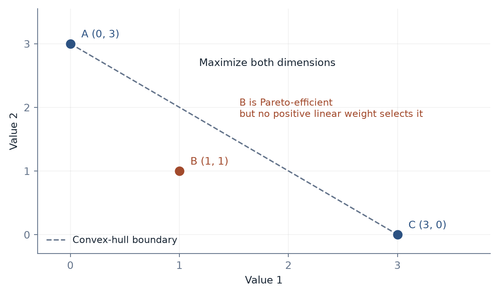

[Contents](CONTENTS.md) · [中文](../zh/CONTENTS.md) · [English](../en/CONTENTS.md)

# Rebuilding Value in the Shear Zone

When a capability becomes cheap to obtain, the social position once attached to it can move. The destination depends on demand, ownership, bargaining power, and public institutions. Three things must be kept distinct: a function's social necessity, the reward given to whoever performs it, and the dignity of the person involved.

Verification, care, sustained relationships, and responsibility can become relatively scarce in a world of abundant generation. Turning that scarcity into support and recognition requires arrangements that can pay for it.

## A History of Capabilities Leaving the Body

### Writing Changed What Memory Proved

In Plato's account, Socrates worries that writing can supply the appearance of wisdom without its internal possession. A stored statement can be consulted without the learner acquiring the judgment behind it.

The concern identifies a recurring distinction. External storage changes what a person's immediate performance demonstrates. It also creates new kinds of thought: a written proof can be paused, checked, and challenged by someone who never met its author.

Oral tradition itself was more inventive than a storage metaphor suggests. Parry and Lord's work on epic singers described composition through reusable patterns and formulas, with performances varying rather than reproducing one fixed text [^parry1971making][^parry1960singer]. Writing changes a practice of memory and composition, not merely the location of a recording.

Modern experiments on expected access to information show another reallocation: remembering where to retrieve material can improve while memory for the material changes [^sparrow2011google]. External memory can support a stronger system when the person retains enough internal knowledge to recognize relevance, error, and missing context.

The migration is from holding every item to knowing how to use and assess what remains accessible. Access itself still depends on records, preservation, tools, and institutions.

### Cheap Copies Changed Authority

Printing lowered the cost of reproducing texts and helped reorganize correction, comparison, distribution, and controversy [^eisenstein1979printing]. It expanded audiences and created work around editions, interpretation, and trust.

The history is uneven across regions and technologies. Movable type in Europe was one important transformation within a much longer history of writing and printing. The point is the changing relation between possession and authority.

When access to a text becomes easier, ownership of a copy supplies less distinction. A dependable edition, a persuasive interpretation, or a trusted publisher can become more valuable. Cheap copying can spread errors along with corrections.

Computer systems extended the movement to rule execution. Calculation, sorting, accounts, retrieval, and repeatable workflows moved into machinery. A professional's position could shift toward choosing the model, interpreting exceptions, checking the result, and assuming a defined responsibility.

Such shifts create winners, losses, and new dependencies. They do not conserve the number of jobs or the value of every old skill. Institutions help determine whether the increased productive capacity becomes broadly shared benefit.

### Clocks and Engines Reorganized the Operator

A mechanical clock made intervals publicly comparable and helped support schedules that could be imposed across workers and machines. The resulting coordination expanded productive possibilities while changing control over the working day.

Steam power moved large quantities of work into fuel, engines, factories, and transport networks [^landes1969unbound]. Human muscle remained necessary in many tasks, yet it was no longer the only scalable source of industrial power.

The operator's problem changed. Keeping machines, fuel, schedules, and people coordinated could become more important than supplying the direct force. The new positions depended on access to capital, education, authority, and organization.

These histories expose a repeated pattern: technology changes which evidence a society uses to recognize competence, and which institution controls the next scarce interface.

### Formal Discovery Is Moving Too

Machine learning has reached language, code, design, scientific hypotheses, and mathematical search. The artifact once treated as evidence of years of preparation can now be produced through a different route.

Mathematics is a demanding case because discovery and checking can be distinguished sharply. AlphaGeometry's 2024 work combined neural proposals with symbolic deduction [^trinh2024alphageometry]. In May 2026, an OpenAI-generated construction challenged the conjectured near-linear exponent for the planar unit-distance problem; a group of mathematicians supplied a concise exposition and analysis [^alon2026remarks].

The intellectual contribution is substantial. It changes which problems are worth asking and which techniques can be combined. The knowledge still includes the precise statement, its proof, its relation to earlier work, and the consequences other researchers can extract.

September's OpenAI announcement on Navier--Stokes went further, presenting a smooth-forcing finite-time singularity construction and a Lean formalization [^openai2026navierstokes]. The theorem's domain, force assumptions, and correspondence to the stated problem are central parts of evaluating it. “The model solved fluids” would discard the very content that makes the result mathematical.

The current lesson is that verification itself can accelerate. Formal tools can check derivations cheaply once an adequate statement and proof exist. The remaining human and institutional work includes specification, understanding, review, priority, pedagogy, and choosing what deserves attention.

Tao's evolving account of AI-assisted mathematics emphasizes these distinctions between candidate production, independent checking, formalization, and understanding [^tao2026aiviews]. The scarce interface can move again when a previously laborious checking step becomes automated.

An illustrative capacity ratio is

$$
\rho=\min\left\{1,\frac{d}{g}\right\},
$$

where $g$ is candidate production and $d$ comparable digestion or review capacity, in matching units. In the unsaturated region $0<d/g<1$, $\rho$ falls when $g$ grows proportionally faster than $d$. At the capped value one, the same strict derivative statement need not hold.

The quantity is useful only after defining what counts as a candidate and what digestion requires. Reviewing a formal proof, understanding it, and integrating it into a research field are different activities.

### Capability, Qualification, and Permission

Embodied action and biological intervention extend the same change into heavier media. A generated policy needs an actuator and an operating domain. A proposed sequence needs a biological process capable of using it. A demonstrated capability needs an account of where it can be relied upon.

Traditional qualifications bundled several signals: preparation, experience, exclusivity, and responsibility. Spence's signaling framework helps explain how some qualifications communicate information under particular incentive conditions [^spence1973job]. Machine assistance can loosen the bundle.

The response should inspect each function. Does the assessment establish the skill needed? Does the trainee still obtain the experience needed for later judgment? Does the professional have authority matching their duty? Does the user know which part of a result was actually checked?

The history offers no automatic promise that value migrates fairly. It offers a practical method: identify the capability being externalized, the old signal losing force, and the new interface on which reliable performance depends.

The next four principles ask how those interfaces should be maintained.

## First Principle: Keep the Feedback That Gives a Boundary Shape

A boundary is useful when it permits the right exchanges and resists the wrong ones. A cell membrane, a professional role, and a person's commitments differ greatly, yet each depends on a distinction that has to survive contact.

The chapter calls this a *damping ontology*: understand a practical boundary partly through how it receives, limits, and answers disturbance. The phrase brings attention to interaction. It supplies no single physical law for membranes, identities, and institutions.

### A Boundary Has to Be Maintained

An illustrative balance writes

$$
\dot B=-\frac{B}{\tau}+P.
$$

$B$ is a defined measure of a maintained capability or boundary, $\tau$ its decay timescale in this model, and $P$ the supporting input per unit time. With constant $P$ and positive $\tau$, the balance tends toward $B^\ast=P\tau$.

The equation describes a mechanism to test. Some boundaries persist passively; others need substantial continuing work. Psychological or institutional variables must be defined and measured before this model can explain their change.

Living systems offer a concrete maintenance account. Recognition, tolerance, repair, and controlled exchange preserve an organism's functioning [^burnet1959clonal]. An immune system's distinction is more elaborate than a simple self/nonself label, and neither all mistakes nor all changes are fatal.

Human boundaries develop through relationships, action, learning, and institutions. A disagreement can make a preference explicit. Keeping a promise can establish reliability. A usable right of refusal can keep a relation voluntary. These interactions need continuity and response.

The functional aim is selective exchange. A sealed wall and an unprotected opening are both poor models of a capable living boundary.

### Why Some Signals Need a Stake

Zahavi's handicap account and later signaling models explain how different costs can support honest distinctions [^zahavi1975mate][^grafen1990biological]. A simple separating case is

$$
c(q_{\mathrm{low}})>b>c(q_{\mathrm{high}}),
$$

where $b$ is a benefit and $c(q)$ the cost of sending a signal for type $q$. Under the model's incentive assumptions, the higher type benefits from signaling while the lower type does not.

The relation between cost, benefit, type, and possible deception does the work. A signal need not always impose a large equilibrium cost to remain informative; direct indices, aligned interests, enforcement, and differential incentives can also sustain honesty.

This precision matters when AI makes polished artifacts cheap. An article, portfolio, or résumé may reveal less about an individual's unaided production skill. It can still reveal choice, judgment, taste, or effective use of a tool if the assessment is designed around those properties.

Three kinds of evidence deserve particular attention. A traceable history can be harder to fabricate than a claim about history. Task-specific demonstration can establish a capability more directly than an attractive sample. An enforceable stake can give an assertion consequences for the party making it.

Time contributes when the property itself develops or is observed over time. Sustained reliability requires repeated opportunities to behave reliably. Skill formation may require practice and recovery. Better training can reduce unnecessary delay, so “it takes time” should identify the relevant learning or biological process.

An expensive ordeal that measures little is a poor signal. A cheap test that directly establishes the desired capability can be an improvement.

### Formation and Maintenance Are Different Bills

A skill must be acquired and then preserved. A record must be created and then kept readable. A relationship must begin and then continue. Creation cost and maintenance cost can move independently.

Thermodynamics gives a precise balance for a physical open system:

$$
\frac{\mathrm d S_{\mathrm{sys}}}{\mathrm dt}
 =\dot S_{\mathrm{prod}}+\dot S_{\mathrm{flow}},
 \qquad \dot S_{\mathrm{prod}}\geq0.
$$

Entropy has units $\mathrm{J\,K^{-1}}$ and the rates $\mathrm{J\,K^{-1}\,s^{-1}}$. A steady internal entropy requires outward entropy flow to balance internal production under the specified boundary and sign convention.

Schrödinger's discussion of life and the work on dissipative structures make the physical maintenance problem vivid [^schrodinger1944][^nicolis1977][^prigogine1977nobel]. A social practice also needs a maintenance account, but its trust or meaning cannot simply be inserted as thermodynamic entropy.

A library survives through storage, cataloging, migration, interpretation, and use. A standard survives through implementation, revision, and institutions willing to resolve disputes. The important commonality is a continuing chain of support.

Artificial tools can lower both formation and maintenance costs. They can recover a damaged text, translate it, check references, and help new readers enter a field. The result depends on whether the necessary functions remain funded and performed.

Cost does not determine worth. A costly institution can preserve something harmful; a nearly effortless act can matter deeply. The normative question is what should be maintained, for whom, and at whose expense.

The first principle is consequently functional: preserve feedback, practice, records, and enforceable commitments where they sustain a valued capability or boundary. Improve the means whenever the same function can be supplied at lower cost.

## Second Principle: Keep the Standard Open to Correction

An optimizer needs a way to compare alternatives. Choosing that comparison already makes decisions about value.

### A Score Contains a Settlement

Suppose a proposal $\mathbf x$ has normalized evaluations $v_j(\mathbf x)$ on $m$ dimensions. A weighted score is

$$
U(\mathbf x)=\sum_{j=1}^{m}w_jv_j(\mathbf x),
 \qquad w_j\geq0,\quad\sum_jw_j=1.
$$

The score makes a tradeoff operational. It also places part of the dispute inside the weights, normalization, and functional form.

Two proposals can have the same score and quite different effects. A dimension with zero weight can change without affecting the objective. A weighted sum allows some losses to be offset by gains elsewhere. Hard constraints, priorities, or other decision rules may be more appropriate for requirements that should not be traded that way.

In a nonconvex multiobjective problem, varying positive linear weights can miss unsupported Pareto-efficient points [^das1997closer]. The chosen scalarization therefore affects which alternatives can emerge from the search. Keeping the original dimensions visible allows reviewers to inspect the omission.

Figure 6.1. The feasible set is $A=(0,3)$, $B=(1,1)$, and $C=(3,0)$, with both dimensions maximized. $B$ is nondominated. Yet $\max\{3w,3(1-w)\}\geq1.5>1$ for $0\leq w\leq1$, so no linear weighting selects $B$.

Social aggregation adds another set of conditions. Arrow's theorem identifies incompatible requirements for a social ordering under an unrestricted preference domain with at least three alternatives [^arrow1951social]. Gibbard and Satterthwaite identify strong restrictions on deterministic strategy-proof choice under their respective assumptions [^gibbard1973manipulation][^satterthwaite1975strategy].

The theorems clarify tradeoffs in institutional design. They leave room for restricted domains, other information, different procedures, and explicit compromises. Their assumptions identify which institutional tradeoffs must be made explicit.

No-free-lunch results likewise concern averaging over specified spaces of objective functions [^wolpert1997no]. Real systems succeed by exploiting structure in particular task distributions. Representation, data, and objectives carry those commitments into deployment.

When a proxy becomes a target, optimization can exploit the gap. A game agent can collect reward without completing the intended task [^amodei2016concrete]. An organization can improve reported output while weakening the service the report was meant to describe.

The response is to expose the settlement: retain underlying measures, investigate gaming, permit challenge, and revise the objective when the proxy fails.

### What Formal Limits Establish

Gödel's incompleteness theorems, Turing's undecidability result, Tarski's undefinability result, and Rice's theorem locate different boundaries [^godel1931][^turing1936][^tarski1936wahrheitsbegriff][^rice1953classes]. They are strong precisely because their objects and conditions are explicit.

A sufficiently strong, consistent, effectively axiomatized arithmetic theory has undecidable sentences. Under the usual conditions it cannot establish its own formalized consistency. A universal program cannot decide the halting of every arbitrary program. A suitable arithmetic language cannot define its own complete truth predicate in the required sense. Nontrivial extensional properties of partial computable functions are undecidable in general.

Arguments about human cognition and machine authority require additional premises. Lucas and Penrose's arguments about minds and formal systems involve additional assumptions about human and machine reasoning [^lucas1961minds][^penrose1989emperor].

The relevant engineering practice is to state which assumptions a guarantee uses. A proof connects an implementation to a formal specification. Requirement analysis and evidence connect that specification to a desired use. Authority and rights connect the use to an acceptable decision.

The seL4 work made important parts of the first relation machine-checkable while listing what remained assumed [^klein2009sel4]. A smaller trusted base improves inspectability. Questions beyond the formal specification still need their own evidence and judgment.

Static analysis illustrates the choice. Let $B$ be programs with a target property and $L$ programs reported by a tool. Then

$$
B\subseteq L\quad\text{means no missed positives},
 \qquad
 L\subseteq B\quad\text{means no false positives}.
$$

A terminating universal tool satisfying both for a Rice-type property would be a forbidden general decision procedure. Restricting the language or property can permit exact decisions; sound approximation, runtime monitoring, and review offer other useful arrangements.

Specific progress remains possible within general limits. The 2024 busy-beaver project established the five-state value $47{,}176{,}870$ through collaborative computation and proof work [^bbchallenge2024]. Undecidability of the unrestricted function did not settle that particular case.

### Evidence, Authority, and Revision

A standard can be proposed by a person or machine, tested by software, challenged by evidence, and authorized through an institution. The legitimacy of adopting it depends on the relevant rights and procedures.

The normative requirement advanced here is openness to correction. People affected by a consequential decision need a way to learn its basis, challenge a relevant error, and seek a remedy. Experts need ways to revise a standard when the world exposes a failure.

The stakes and distribution of power supply the case for this principle. Its justification belongs in the open, alongside the technical evidence.

### Where Scarcity May Move

If routine production becomes cheaper, some complementary functions can become more important: reliable verification, well-supported care, field judgment, long-term education, and institutions able to resolve consequential disputes.

Each has a different constraint. Verification needs evidence appropriate to a claim. Care needs time, skill, access, and sometimes a particular relationship. Field judgment needs information and an effective action position. Education needs a path by which learners develop capabilities rather than merely submit outputs.

These functions offer candidates for investment. Parts of each function can improve through tools. The useful criterion is which necessary function remains difficult to supply at the required quality.

Scarcity also fails to guarantee high pay. A caregiver's bargaining power, a public budget, or a family's income can matter more than the activity's necessity. Productivity differences can raise relative service costs without automatically raising the worker's reward.

The second principle therefore has two parts. Keep the chosen standard open to evidence and challenge. Then examine whether the people maintaining its necessary functions actually receive the resources and authority the function requires.

## Third Principle: Divide the Work Without Hiding the Bill

A powerful search system can move quickly through possibilities. A trusted professional role takes time and institutions to establish. One is a readily callable capability; the other is a position from which a judgment can carry authority and obligation.

The book's kinetic--potential image distinguishes movement from position. It is a metaphor for complementary functions, not a conversion between computational ability and moral energy.

### Fast Capability, Slowly Formed Standing

Lifting one kilogram by one meter near Earth's surface increases gravitational potential energy by about $9.8\,\mathrm J$. Doing it faster changes the power needed. The destination and the rate of getting there are different properties.

For comparison, an idealized unbiased bit reset near room temperature has a Landauer bound of about $2.9\times10^{-21}\,\mathrm J$. Their ratio is on the order of $3\times10^{21}$. This compares one macroscopic lift with one ideal bit reset. Actual inference contains many operations and substantial hardware overhead; the ratio cannot price an AI task.

The valid lesson is the separate ledger. Symbol processing and physical work can have very different marginal costs, while both remain physical. A model can propose thousands of paths without lifting the load along each one.

Standing has another preparation. A judge's office, a clinician's responsibilities, or a laboratory's recognized competence exists through qualifications, records, procedures, and authority. A model can improve the judgment made there. Its speed does not automatically confer the role.

The division need not remain fixed. Some routine decisions can be delegated through established rules. Some checking can become fully automatic. The authority to delegate, the conditions of delegation, and responsibility for its effects must still be identified.

### The Objective Is Part of the Design

An optimization can be written

$$
x^\ast\in\arg\max_{x\in\mathcal X} f(x).
$$

Using membership allows multiple maximizers; in some problems the maximum is not attained. The feasible set $\mathcal X$ and objective $f$ carry choices about what counts and what is permitted.

A search engine can help inspect and revise both. It can reveal an inconsistency, estimate a consequence, or identify an alternative. The social decision is which constraints and priorities have a legitimate claim on the resulting action.

This is the practical content of symbiosis. Human and machine functions connect through explicit standards, evidence, and authority. Capability expands the available routes; institutions determine which routes may impose which burdens.

The arrangement can fail in either direction. A capable system can be blocked by rules that protect no useful function. A weak decision structure can give an optimizer broad authority without an adequate account of whose objective it is advancing.

The design task is to improve the whole route from problem to consequence.

### Which Friction Earns Its Place?

Friction should be evaluated by what it produces.

Some friction is pure process loss: duplicate entry, incompatible formats, unnecessary waiting, avoidable transport, or a requirement whose original purpose has disappeared.

Some forms a capability: practice, repeated observation, recovery, and the experience needed to distinguish ordinary cases from exceptions.

Some protects an interest: consent, independent verification, a safe operating limit, an appeal, or an opportunity to stop before an irreversible step.

Some extracts a rent: an artificial bottleneck, an exclusionary credential, or complexity maintained because someone profits from being the only interpreter.

The categories require investigation. An approval may protect a real interest and still have an inefficient procedure. A credential may establish competence and also exclude people unfairly. Improving the mechanism can preserve the function while reducing cost.

The function of a delay or barrier matters more than its size.

| Friction | What to ask | Productive response |
| --- | --- | --- |
| Process loss | Which valued result would disappear if this step vanished? | Remove or simplify the step when no result depends on it. |
| Capability formation | What learning or recovery occurs here? | Improve practice and test transfer. |
| Protection | Whose interest does this preserve, and does it work? | Keep the function; compare cheaper implementations. |
| Rent or exclusion | Who benefits from the barrier itself? | Challenge the allocation and redesign access. |

A useful refusal, a well-designed test, and an effective consent process often make later action easier by making it defensible. Their costs belong in the project's enabling infrastructure.

The third principle is to use automation to remove losses and strengthen necessary functions. The point of preserving a boundary is that more can safely and legitimately pass through it.

## Fourth Principle: Revise the Loop That Revises the Work

A decision changes the environment. New evidence changes the standard. A changed standard alters the next decision. Improvement therefore includes the procedure used to judge improvement.

### A Recursive Process Can Learn or Drift

For a scalar iteration,

$$
x_{n+1}=g(x_n),
$$

a continuously differentiable map with a fixed point $x^\ast$ is locally attracting when $|g'(x^\ast)|<1$. In several dimensions, the Jacobian's eigenvalues govern the corresponding local result under the usual regularity assumptions.

An institution updating its evaluation rules is more complicated. Objectives, participants, evidence, and external conditions can all change. The equation supplies a reason to inspect the update rule, rather than a promise of convergence.

The useful question is whether a revision preserves learning. Can errors be identified? Can affected people challenge the interpretation? Is there enough continuity to distinguish a better rule from a lucky outcome?

### Keep Some Practice Inside the Person

Assistance can make a task cheaper while moving practice elsewhere. A person who wants to retain a capability needs some occasions to exercise it and obtain interpretable feedback.

Choose the capability first. Someone preserving spatial judgment might sometimes navigate without turn-by-turn instructions. Someone learning a language might draft a passage before requesting corrections. Someone responsible for code should retain the ability to read, test, and explain the parts they will maintain.

The useful unit is the learning loop, rather than unaided effort for its own sake. A good tutor, simulator, or assistant can improve that loop. Deliberately withholding an effective aid is worthwhile only when it serves a defined purpose.

Defaults can protect practice without requiring a fresh contest of will at every moment. A regular session, a shared commitment, or a tool configuration can make a desired activity ordinary. Waiting can preserve a decision point; feedback can be delayed when immediate scoring distorts the activity.

Different people have different resources. Time, disability, care responsibilities, money, and fatigue change which arrangements are feasible. Assistance often expands agency most for people facing the highest barriers. Preserving a skill should not become a demand that everyone accept the same avoidable burden.

Organizations influence the available choices. A worker cannot preserve every valuable learning process in unpaid hours while being evaluated only on immediate output. Training, staffing, and assessment have to carry part of the cost.

### Build Organizations That Produce Warrants

A laboratory, hospital, engineering firm, court, auditor, or certification body can produce a judgment that others are entitled to rely on. Its product is partly a warrant: a result connected to evidence, procedure, expertise, and responsibility.

The name alone supplies none of this. An approval chain can generate signatures without generating confidence. An audit can become a ritual. A university can reward output volume while neglecting understanding.

Three conditions make checking substantive. Reviewers need access to relevant original evidence. Their incentives must allow an unfavorable finding. Their authority must be strong enough to change the proposed action.

Tools can accelerate each part. They can organize evidence, check consistency, reproduce calculations, and highlight anomalies. A trustworthy organization captures those gains while examining the new failure modes introduced by the tools.

Four slow assets deserve deliberate support: informative exposure over time, a record of trustworthy behavior, a clear distribution of duties, and the independence needed to challenge a profitable error.

The timescales vary. Some checks can be automated almost completely. Some clinical or material observations require time to pass. An organization should distinguish a queue caused by poor administration from a follow-up period that supplies necessary information.

Markets can reward dependable judgment, but information asymmetry, delayed consequences, and shared benefits can leave safeguards underprovided. Public standards, professional norms, procurement, liability, and independent institutions can change those incentives.

An organization that invests in reliability may also save money by preventing rework and incidents. The cost is not necessarily a permanent handicap. The comparison must include the losses the faster-looking arrangement produces later.

Records connect the periods. A finding should remain traceable after staff turnover or a model update. A failed prediction should enter the next review rather than disappear behind a new version.

### A Life Has More Than One Axis

Output is measurable and often useful. It is an incomplete account of a person's life.

National accounts measure defined economic aggregates. They do not claim to measure every form of worth. Trouble begins when a convenient output measure becomes the sole basis for recognizing activity.

AARP's March 2026 report estimates that unpaid adult caregiving in the United States supplied 49.5 billion hours in 2024, with an imputed economic value of about $1.01 trillion [^aarp2026valuing]. The valuation uses a method and wage assumptions; it is not money actually paid. The report also changed aspects of its method, so simple comparisons with older headline totals can mislead.

The estimate makes visible work already occurring. It also exposes the difference between being socially necessary and having a funded position.

Function and experience are separate evaluative dimensions. A highly productive activity can leave a person depleted. An activity with modest market output can sustain a valuable relationship or a meaningful experience. Calling the dimensions separate does not establish statistical independence between them.

The same person can value both. Automation can free time, improve access, and remove drudgery. The benefit becomes part of a good life through what the person can then do, experience, and sustain.

This is why productivity need not be defended by finding ever more output to assign to everyone. A society can use increased capacity to support care, education, leisure, participation, and a more secure floor beneath choice.

The fourth principle is to keep revising the arrangement by its actual consequences. Preserve learning, use tools to improve evidence, fund the necessary slow work, and evaluate lives on more than one axis.

## A Constitution for a More Capable Civilization

The four principles concern boundaries, correction, division of work, and continuing revision. At a larger scale, they ask where a civilization will direct the capacity it has gained.

### Keep a Frontier That Answers Back

Some problems compel sustained contact with material limits: deep-space missions, ocean engineering, ecological restoration, fundamental experiments, infrastructure renewal, and the formation of capable people.

They demand resources, time, and coordination. A useful shorthand for projects with high requirements on all three coordinates is

$$
\mathcal F=
 \{(R,T,G):R\geq R_\ast,\ T\geq T_\ast,\ G\geq G_\ast\}.
$$

This defines the intersection chosen by those thresholds. A broader class of difficult projects may be high in only one or two coordinates.

What makes such projects worth doing is their benefit, knowledge, or protection of future possibilities. Their resistance ensures that a convincing description cannot substitute for the required result.

A spacecraft needs an actual trajectory and reliable systems. An ocean instrument needs to survive pressure and corrosion. An ecosystem intervention needs observations through changing seasons and responses. A new scientific claim may need an instrument that does not yet exist.

Feedback is often costly and delayed in these settings. That can make evidence sparse rather than unusually dense. A well-designed program buys discriminating tests, preserves failure records, and stages commitments so uncertainty can be reduced before the largest exposures.

AI can improve design, analysis, and coordination across these frontiers. The ambition is to obtain more knowledge and service from each costly contact. Calling a problem “physical” does not make its current method optimal.

Long projects need a public account of opportunity cost. Resources directed toward a mission are unavailable elsewhere. Current decision-makers must explain what future benefit they expect, who bears the interim burden, and how later participants can revise the commitment.

Some benefits are shared or delayed enough that individual investors will not fund the socially useful amount. Public institutions, cooperative arrangements, and long-lived funds can carry the account across those periods.

### Life, Mind, and Trust as Areas of Growing Demand

Three domains concentrate needs that cheap generation alone does not meet: maintaining bodies, supporting mental and relational life, and establishing dependable judgments.

Biotechnology can change what is treatable. Programmable genome editing supplied a major mechanism [^jinek2012programmable]. Clinical delivery, safety, access, and long-term evidence determine which benefits reach people. The 2026 Casgevy record is one current example of progress joined to continued obligations [^fda2026casgevy].

Mental health requires similarly careful boundaries. WHO's updated 2025 report describes more than a billion people living with mental disorders and substantial gaps in services [^who2025mental]. A conversational interface may provide useful support. Clinical effectiveness, safety, escalation, privacy, and access need evidence appropriate to the service advertised.

Trust becomes a technical and institutional product when convincing signals are cheap. Provenance, secure identity, independent checking, and enforceable responsibility can help reconnect claims to their origins and consequences. C2PA illustrates a defined technical contribution, with its validation scope made explicit [^c2pa2026spec].

These needs can expand industries. They can also remain poorly paid or unavailable to people who need them most. A demand forecast does not supply a distribution system.

Baumol's mechanism clarifies one possible relative-price pressure [^baumol1967macro]. If the progressive sector's productivity grows at constant rate $r$, the slower sector's does not, and wages move together under the model, then a relative unit-cost index can evolve as

$$
\frac{C_{\mathrm{slow}}(t)}{C_{\mathrm{fast}}(t)}
 =
 \frac{C_{\mathrm{slow}}(0)}{C_{\mathrm{fast}}(0)}
 e^{rt}.
$$

The sector outputs must be consistently indexed; they are not literally the same product. Different productivity, wage, capital, and service-quality paths change the result.

Rising relative costs can generate investment, shortages, unpaid family burdens, or exclusion. Public payment, insurance, labor institutions, and service design influence which outcome occurs.

### The Gaia Hypothesis as a Design Question

A more speculative possibility follows from coupling industrial and biological systems: could a civilization develop stronger capacities to maintain, repair, and reproduce its material basis?

Von Neumann's self-reproducing automata separated a description from machinery able to use and copy it within a formal construction [^vonneumann1966theory]. Biological replication adds actual materials, energy, error correction, and selection. Engineering reproduction depends on supply chains whose independence has to be demonstrated.

Self-maintenance, reproduction, and heritable variation are useful properties to inspect. Their presence at some scale does not establish that the entire planet is one organism or that an industrial network can reproduce autonomously from raw resources.

Copy fidelity gives one measurable constraint. With independent per-site error probability $\nu$ over length $\lambda$,

$$
Q=(1-\nu)^\lambda\approx e^{-\nu\lambda}.
$$

The approximation requires small per-site error, with accumulated higher-order terms negligible at the desired accuracy. Selection, repair, redundancy, and the effects of particular mutations determine what information persists [^kunkel2000dna][^gilbert1986].

Circular material use provides another measure. For a defined material, boundary, and period,

$$
\kappa_{\mathrm{mat}}=
 \frac{\dot m_{\mathrm{returned\ to\ usable\ supply}}}
      {\dot m_{\mathrm{total\ usable\ input}}}.
$$

The numerator must be part of the denominator for the fraction to lie between zero and one. Stocks, delays, material quality, and repeated counting need explicit treatment.

A high recycling share can reduce demand for new extraction. It does not establish energetic self-sufficiency, complete reproduction, or ecological stability. Recycling uses energy, loses or disperses some material, and may change quality. An open system still needs energy throughput and entropy export.

“Gaia” is useful here as a question about coupled self-maintenance. It provides no guarantee that the maintained state would favor humans. A stable planetary process can be hostile to a particular species.

The engineering frontier is consequently specific: improve repair, circularity, resource resilience, and compatible ecological relations while preserving control over the consequences. A self-maintaining subsystem may be easier to sustain and harder to stop once dispersed. Both belong in its evaluation.

### Four Commitments

A practical constitution for this setting can begin with four commitments.

**Keep correction possible.** Evidence, appeal, revision, and interruption must remain available as capability grows.

**Give affected people a voice in the cost.** Exposure should bring information, representation, and remedies, especially where burdens can be exported.

**Preserve necessary functions while improving their means.** Learning, verification, consent, recovery, and responsibility should survive the removal of waste.

**Evaluate the whole consequence over the relevant time.** A fast interface should not claim a gain whose bill sits in an unobserved body, network, or future.

Silicon--carbon symbiosis names one possible arrangement of these commitments. It is a shorthand for complementary capabilities and stakes, not a permanent division based on the periodic table. Digital systems remain material; living people also learn, compute, copy, and delegate.

The desired arrangement lets powerful tools expand human and ecological possibilities while keeping the consequences governable. It has to be built through standards, incentives, evidence, rights, and resources.

The final chapter tests the framework against two extremes: systems that reproduce their own physical basis, and systems that seem to replace physical life with representation. Both return to the same question: what must keep running for the possibility to remain real?

## References

[^parry1971making]: Parry, Milman. The Making of Homeric Verse: The Collected Papers of Milman Parry. 1971.
[^parry1960singer]: Lord, Albert B.. The Singer of Tales. 1960.
[^sparrow2011google]: Sparrow, Betsy and Liu, Jenny and Wegner, Daniel M.. [Google Effects on Memory: Cognitive Consequences of Having Information at Our Fingertips](https://doi.org/10.1126/science.1207745). 2011.
[^eisenstein1979printing]: Eisenstein, Elizabeth L.. The Printing Press as an Agent of Change: Communications and Cultural Transformations in Early-Modern Europe. 1979.
[^landes1969unbound]: Landes, David S.. The Unbound Prometheus: Technological Change and Industrial Development in Western Europe from 1750 to the Present. 1969.
[^trinh2024alphageometry]: Trinh, Trieu H. and Wu, Yuhuai and Le, Quoc V. and He, He and Luong, Thang. [Solving olympiad geometry without human demonstrations](https://doi.org/10.1038/s41586-023-06747-5). 2024.
[^alon2026remarks]: Alon, Noga and Bloom, Thomas F. and Gowers, W. T. and Litt, Daniel and Sawin, Will and Shankar, Arul and Tsimerman, Jacob and Wang, Victor and Matchett Wood, Melanie. [Remarks on the disproof of the unit distance conjecture](https://doi.org/10.48550/arXiv.2605.20695). 2026.
[^openai2026navierstokes]: OpenAI. [On the Navier--Stokes Millennium Prize Problem](https://openai.com/index/navier-stokes-solution/). 2026.
[^tao2026aiviews]: Tao, Terence. [Terence Tao on AI in mathematics (and beyond): a living summary](https://teorth.github.io/tao-web/ai-views.html). 2026.
[^spence1973job]: Spence, Michael. [Job Market Signaling](https://doi.org/10.2307/1882010). 1973.
[^burnet1959clonal]: Burnet, Frank Macfarlane. The Clonal Selection Theory of Acquired Immunity. 1959.
[^zahavi1975mate]: Zahavi, Amotz. [Mate selection---A selection for a handicap](https://doi.org/10.1016/0022-5193(75)90111-3). 1975.
[^grafen1990biological]: Grafen, Alan. [Biological signals as handicaps](https://doi.org/10.1016/S0022-5193(05)80088-8). 1990.
[^schrodinger1944]: Schrödinger, Erwin. What Is Life? The Physical Aspect of the Living Cell. 1944.
[^nicolis1977]: Nicolis, Gregoire and Prigogine, Ilya. Self-Organization in Nonequilibrium Systems: From Dissipative Structures to Order through Fluctuations. 1977.
[^prigogine1977nobel]: Prigogine, Ilya. Time, Structure and Fluctuations. 1977.
[^das1997closer]: Das, I. and Dennis, J. E.. [A closer look at drawbacks of minimizing weighted sums of objectives for Pareto set generation in multicriteria optimization problems](https://doi.org/10.1007/bf01197559). 1997.
[^arrow1951social]: Arrow, Kenneth J.. Social Choice and Individual Values. 1951.
[^gibbard1973manipulation]: Gibbard, Allan. [Manipulation of Voting Schemes: A General Result](https://doi.org/10.2307/1914083). 1973.
[^satterthwaite1975strategy]: Satterthwaite, Mark Allen. [Strategy-proofness and Arrow's conditions: Existence and correspondence theorems for voting procedures and social welfare functions](https://doi.org/10.1016/0022-0531(75)90050-2). 1975.
[^wolpert1997no]: Wolpert, D.H. and Macready, W.G.. [No free lunch theorems for optimization](https://doi.org/10.1109/4235.585893). 1997.
[^amodei2016concrete]: Amodei, Dario and Olah, Chris and others. [Concrete Problems in AI Safety](https://arxiv.org/abs/1606.06565). 2016.
[^godel1931]: Gödel, Kurt. [Über formal unentscheidbare Sätze der Principia Mathematica und verwandter Systeme I](https://doi.org/10.1007/BF01700692). 1931.
[^turing1936]: Turing, Alan M.. [On Computable Numbers, with an Application to the Entscheidungsproblem](https://doi.org/10.1112/plms/s2-42.1.230). 1936.
[^tarski1936wahrheitsbegriff]: Tarski, Alfred. Der Wahrheitsbegriff in den formalisierten Sprachen. 1936.
[^rice1953classes]: Rice, H. G.. [Classes of recursively enumerable sets and their decision problems](https://doi.org/10.1090/s0002-9947-1953-0053041-6). 1953.
[^lucas1961minds]: Lucas, J. R.. [Minds, Machines and Gödel](https://doi.org/10.1017/S0031819100057983). 1961.
[^penrose1989emperor]: Penrose, Roger. The Emperor's New Mind: Concerning Computers, Minds, and the Laws of Physics. 1989.
[^klein2009sel4]: Klein, Gerwin and Elphinstone, Kevin and Heiser, Gernot and Andronick, June and Cock, David and Derrin, Philip and Elkaduwe, Dhammika and Engelhardt, Kai and Kolanski, Rafal and Norrish, Michael and Sewell, Thomas and Tuch, Harvey and Winwood, Simon. [seL4: Formal Verification of an OS Kernel](https://doi.org/10.1145/1629575.1629596). 2009.
[^bbchallenge2024]: bbchallenge Collaboration. [BB(5) = 47,176,870: Formal Verification of the Fifth Busy Beaver Value](https://bbchallenge.org/). 2024.
[^aarp2026valuing]: Houser, Ari and Caldera, Selena and Flinn, Brendan and Choula, Rita. [Valuing the Invaluable 2026: Family Caregivers' Contribution Reaches $1 Trillion](https://www.aarp.org/pri/topics/ltss/family-caregiving/valuing-the-invaluable-2026-update/). 2026-03-26.
[^jinek2012programmable]: Jinek, Martin and Chylinski, Krzysztof and Fonfara, Ines and Hauer, Michael and Doudna, Jennifer A. and Charpentier, Emmanuelle. [A Programmable Dual-RNA–Guided DNA Endonuclease in Adaptive Bacterial Immunity](https://doi.org/10.1126/science.1225829). 2012.
[^fda2026casgevy]: U.S. Food and Drug Administration. [CASGEVY: Product Information and Approval Documents](https://www.fda.gov/vaccines-blood-biologics/casgevy). 2026.
[^who2025mental]: World Health Organization. [World Mental Health Today: Latest Data](https://www.who.int/publications/i/item/9789240113817). 2025-09-02.
[^c2pa2026spec]: Coalition for Content Provenance and Authenticity. [Content Credentials: C2PA Technical Specification, Version 2.4](https://spec.c2pa.org/specifications/specifications/2.4/specs/C2PA_Specification.html). 2026-04.
[^baumol1967macro]: Baumol, William J.. Macroeconomics of Unbalanced Growth: The Anatomy of Urban Crisis. 1967.
[^vonneumann1966theory]: von Neumann, John. Theory of Self-Reproducing Automata. 1966.
[^kunkel2000dna]: Kunkel, Thomas A. and Bebenek, Katarzyna. [DNA Replication Fidelity](https://doi.org/10.1146/annurev.biochem.69.1.497). 2000.
[^gilbert1986]: Gilbert, Walter. [Origin of life: The RNA world](https://doi.org/10.1038/319618a0). 1986.
