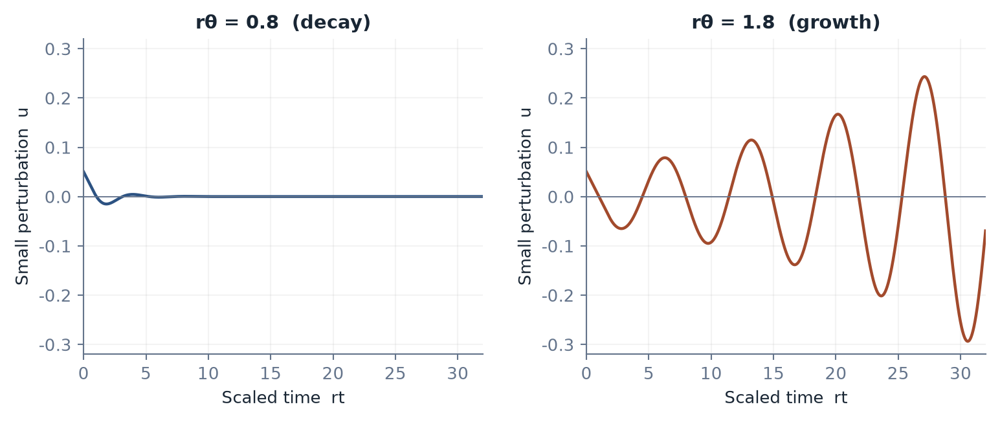

[Contents](CONTENTS.md) · [中文](../zh/CONTENTS.md) · [English](../en/CONTENTS.md)

# Freedom Inside the Constraints

A system that builds the next instance of itself seems to offer a way around the manufacturing bottleneck. A simulated world seems to offer a way around the burden of physical experience. Both are useful stress tests for the book's argument. Where do resources, time, and coupling go when the apparent route becomes so much lighter?

## Replication, Irreversibility, and the Substrate

### What Self-Replication Changes

Compare a fixed production line with an idealized population that doubles at a constant interval:

$$
N_{\mathrm{line}}(t)=1+\frac{t}{\tau_{\mathrm{line}}},
 \qquad
 N_{\mathrm{rep}}(t)=2^{t/\tau_{\mathrm{rep}}}.
$$

The quantities are unit counts relative to the stated starting condition. The first assumes fixed capacity; the second assumes adequate inputs and an unchanged doubling time. A manufacturing system can add capacity, and a replicating system can encounter limits. The assumptions define the comparison.

Replication can distribute construction. It still needs feedstock, energy, space, transport, error control, and waste handling. The next producer is also something that must be built and maintained.

The resource barrier becomes an uptake problem: what can be extracted or obtained from the environment at the required rate? The temporal constraint includes the cycle of acquisition, construction, maturation, and copying. The topology includes access to suitable environments and pathways of spread.

None of these is intrinsically faster than every manufacturing process. Biological replication can be fast for a microbe and slow for a tree. An engineered replicator's rate would depend on what it must reproduce and the environment it assumes.

Von Neumann's formal construction demonstrated a way to separate a description, its copying, and its use by a constructor [^vonneumann1966theory]. Physical implementation adds a full industrial and thermodynamic account. A printer making one of its own parts is a useful step toward automation; it is not yet an autonomous system rebuilding its entire supply basis.

The governance problem changes when production is dispersed beyond a few facilities. Monitoring spread, limiting access to necessary conditions, and preserving effective intervention points can become more important. Their effectiveness must be established for the particular system.

The ratio

$$
\chi=\frac{\tau_{\mathrm{assessment}}}
            {\tau_{\mathrm{doubling}}}
$$

identifies one timing pressure. Under continued ideal doubling, assessment lasting $\chi$ doubling times permits a factor $2^\chi$ increase before completion. A large ratio can make delayed recognition costly. Containment, access, detection quality, and intervention strength still determine whether control is possible.

### Growth Can Settle, Oscillate, or Overshoot

Exponential growth cannot continue indefinitely in a finite environment. Its eventual form depends on the feedback.

A delayed logistic model illustrates the difference:

$$
\frac{\mathrm dN}{\mathrm dt}
 =rN(t)\left(1-\frac{N(t-\theta)}{K}\right).
$$

$r>0$ is a growth rate, $K>0$ a fixed capacity, and $\theta$ a feedback delay. The state requires an initial history over the delay interval.

Linearizing around the positive equilibrium $N=K$ gives

$$
\dot u(t)=-r\,u(t-\theta).
$$

For this model, the equilibrium is locally asymptotically stable when $r\theta<\pi/2$, with the first stability boundary at $r\theta=\pi/2$. Beyond that boundary, the local equilibrium loses stability. The full nonlinear behavior requires further analysis.

Figure 7.1. Linearization of the delayed logistic model near its positive equilibrium gives $\dot u=-ru(t-\theta)$. Numerical illustrations start from a small constant history. Perturbations decay at $r\theta=0.8$ and grow at $r\theta=1.8$; the first local stability boundary is $\pi/2$. These are local linear dynamics.

Regulated growth can settle. Delays can create oscillation. Environmental damage can reduce capacity. A richer model may need resource and waste variables as well as population.

The physical challenge is to design and maintain effective feedback before the receiving environment has changed too much. The same concern appears in ordinary manufacturing, though replication can distribute and amplify it differently.

Self-replication relocates a bottleneck toward ecological relations. It keeps the resource, time, and network questions alive.

### Consequential Weight Depends on the Task

A reversible operation can be physically real. A draft can be deleted and still have consumed energy, time, and attention. Irreversibility therefore measures aspects of consequence; it is not a complete test for existence.

The practical question is which history remains relevant to later action. A version-controlled file can be restored. A disclosure to another person cannot be fully recalled. A simulation can reset its internal state while its user's learning persists.

The same representation can cross several boundaries. A fictional story may change a relationship. A simulated experiment may guide a real intervention. The carrier's reversibility does not settle the reversibility of its effects.

This is why a useful account specifies scale, boundary, and horizon. It asks what the project can actually recover, rather than sorting everything into “virtual” and “real.”

### The Brain in a Vat Still Needs a Plant Room

The familiar philosophical experiment supplies a brain with artificial experience. Its epistemological question is whether the subject could distinguish the arrangement from ordinary life.

The engineering question begins outside the experience: what keeps the brain functioning?

A living brain requires a carefully maintained environment with suitable supply, waste removal, temperature, chemistry, and physiological regulation. The power level of ordinary brain metabolism is on the order of tens of watts [^raichle2002]. An artificial support system would have its own additional bill.

Actual perfusion and preservation research investigates parts of the problem under specific conditions. It does not establish that a conscious human brain can be maintained indefinitely outside its body. Organ preservation, temporary support, restored cellular activity, and sustained personal experience are distinct endpoints.

A simple delivery relation can show the kind of constraint involved. For one supplied substance at a time,

$$
\dot Q\,\Delta C\geq\dot m,
$$

where $\dot Q$ is volume flow per unit time, $\Delta C$ usable concentration difference, and $\dot m$ consumption in matching mass or molar units. A separate linear hydraulic approximation gives

$$
\dot Q\leq\frac{\Delta p_{\max}}{R_{\mathrm h}}.
$$

The relations illustrate a possible supply-and-pressure window. Real cerebral circulation includes regulation, changing resistance, diffusion, tissue state, and multiple substances. They are not a clinical operating formula.

Heat also needs a destination. An operating biological or computational system must remain within the conditions its substrate tolerates. Better algorithms and cooling can reduce the burden, while thermodynamics still requires an adequate heat and entropy account.

The write-in interface adds another constraint. Electrode number, coding, correlation, noise, tissue response, and long-term stability affect what signals can be delivered or read. Research on implanted interfaces documents biological responses that influence performance [^polikov2005response].

For $n$ ideal independent Gaussian channels of equal bandwidth $B$, a schematic capacity is

$$
C(t)=nB\log_2\left(1+\frac{S}{N(t)}\right).
$$

The result is bits per second. Actual neural interfaces do not automatically satisfy the assumptions, and useful experience cannot be inferred directly from a Shannon bit rate. Noise may change over time in either direction as tissue and hardware change.

Mapping a circuit is another achievement with its own boundary. The October 2026 connectome-based fly-model preprint couples a large measured wiring graph to a simulated body and tests sensorimotor behavior [^minnick2026sensorimotor]. It provides a current example of wiring, dynamics, and embodied feedback being studied together. A transferred human mind would require evidence of a different order.

The distinction becomes still sharper for a proposed substitution of biological neurons with artificial components. Functional equivalence, practical replaceability, preservation of continuity, and consciousness would each need evidence or a separate argument. The engineering operation is hypothetical.

Even a successful substitution would change the substrate rather than abolish it. The new system would have some requirements for energy, temperature, communication, maintenance, and repair.

Call this *substrate inescapability*: every implemented process has a material support, and the support's properties enter what the process can sustain. The claim favors no particular material.

### The Outside Remains Part of the System

A digital environment may permit resets while its servers age, its power supply depends on a grid, and its maintenance relies on people. A biological support system may create a carefully controlled interior while shifting complexity into pumps, chemistry, redundancy, and operations.

The interior's apparent simplicity can be a real benefit. The full comparison asks whether the external support costs are lower than the alternatives and how reliably they can be carried.

The same accounting applies to ordinary remote work and automated services. Removing a commute can save real resources. A data center, network, and maintenance organization add other requirements. Counting both reveals a possible net gain rather than assuming either a miracle or an exact transfer.

The two extremes converge on a concrete conclusion. Replication can distribute construction. Simulation can reorganize experience. Each still needs a working relation with a material environment.

Locating that relation gives design more freedom. It shows which conditions can be improved, which can be delegated, and which must remain protected for the process to continue.

## A Method for the Next Decision

The book began with a mismatch: proposals appear at inference speed while the world changes through many clocks. The answer is a way to inspect the route between them.

### Ask What the Capability Establishes

A convincing interface can establish useful substitutability for a specified task. It does not settle every question about the systems behind it.

Turing's behavioral approach helped make machine intelligence an operational subject. A test's result still belongs to its test conditions. Producing an answer, maintaining a safe service, possessing a right, and bearing an obligation use different criteria.

A person's worth consequently cannot be reduced to the current scarcity of a particular output. Capabilities matter because they expand what a person and society can do. Their changing market price does not exhaust the value of a life.

Experience, relationship, participation, care, and judgment remain dimensions on which a society can choose to use its growing capacity. They need institutions and resources, rather than a promise that displaced output will automatically reappear in a higher form.

### Recalculate the Scarce Interface

When a new tool lowers a cost, inspect what becomes scarce next.

Candidate production may give way to review. Review may improve through automatic checking and reveal a specification bottleneck. Deployment may reveal maintenance. Widely trusted service may reveal an access or distribution problem.

The movement has no fixed occupational destination. A slow activity can be improved. A trusted institution can become ceremonial. A supposedly protected skill can become easy to assess or automate.

The enduring questions concern the function. What result does this position establish? Which evidence supports it? Could another arrangement supply the same function better? Who controls access to that arrangement?

The relative importance of a function does not guarantee a good livelihood for its worker. Pay, training access, ownership, and bargaining power need their own account. Otherwise a prediction about growing care needs becomes merely a prediction about growing unpaid work.

### Three Questions Before Removing Friction

**What does the change actually remove?** Specify the task, baseline, quality, time, and system boundary. A lower drafting time is a real gain, while a lower time to a dependable decision is a different claim.

**What happens elsewhere?** Examine review, rework, energy, infrastructure, support, exposure, and recovery. Some costs move; some fall; some appear for the first time. Measure the net result instead of assuming conservation.

**Who receives the benefit and the remaining bill?** Identify users, workers, operators, affected third parties, and future obligations. A cheaper interface can have an unequal distribution of gains even when total cost falls.

For a software team, these questions connect generation to review, regression risk, and maintenance. For a clinical service, they connect a model's measured performance to intended use, professional duties, patient rights, and follow-up. For a fleet, they connect vehicle efficiency to empty miles, coverage, infrastructure, and accident response.

The answers should be concrete enough to change the proposal. If the project discovers an overloaded review stage, it can improve selection or capacity. If a failure cannot be contained, it can narrow scope or redesign recovery. If the bill has no responsible bearer, it needs a responsibility arrangement before broad deployment.

### Keep a Few Capabilities in Practice

At the individual level, preserve the abilities on which your own judgment depends. Let the tool handle what it does well; retain enough direct work to understand, inspect, and revise the result you rely on.

The amount differs by task. An occasional practice session can preserve one skill. Another requires continued supervised exposure. Good assistance can make both more effective.

At the organizational level, maintain the ability to reconstruct a decision. Keep proportionate records, competent reviewers, independent challenge, and usable authority to stop or correct the process.

These functions need a budget and a role. An instruction to “be careful” cannot substitute for time, access, training, and power.

Revisit retained friction too. A manual step once needed for safety may become replaceable by a better check. A learning exercise may cease to teach. Preserving the purpose requires changing the method when evidence supports change.

### Protect Choice Where Costs Are Imposed

People affected by a decision need information and effective representation. Some can consent directly. Others require professional duties, public procedures, guardianship, or protections for interests that cannot speak for themselves.

Authority should fit competence and control, while remedies should remain usable by those carrying the loss. These are design criteria for a legitimate arrangement, not a claim that every affected person must personally operate every system.

The method can be repeated as capability grows. Identify the receiving medium. Separate the constraints. Trace the conversion into action. Examine the feedback and the bill.

A better tool changes the answers. It does not make the questions obsolete.

## The Negentropy Expedition

The next machine can make an answer easier to obtain. Civilization still has to choose what to maintain, what to discover, and what costs it is prepared to impose.

The word *negentropy* recalls a physical achievement: living and engineered systems can maintain local organization by using resources and exporting entropy. Its human meaning is an analogy. Thermodynamics cannot decide which organized state is worth preserving.

### Order Has a Formation Bill and a Maintenance Bill

Copying makes the distinction visible. Let $\varepsilon_0$ be a baseline per-site error rate and $f_{\mathrm{proof}}$, $f_{\mathrm{repair}}$ illustrative residual-error factors. If their conditional effects can be combined multiplicatively,

$$
\varepsilon_{\mathrm{total}}
 =\varepsilon_0f_{\mathrm{proof}}f_{\mathrm{repair}},
 \qquad
 \mathbb E[M]=\varepsilon_{\mathrm{total}}L.
$$

$M$ counts errors in length $L$. Expected count and the probability of at least one error are different quantities. Copying fidelity depends on mechanism, context, dependencies, and repair [^kunkel2000dna].

The calculation asks which processes preserve a usable structure across repetition. Biological proofreading, software checks, records, and institutional review do different work. Each deserves an account of cost and effectiveness.

Maxwell's demon sharpened the relation between information and physical entropy. Information can guide an action, but a complete cyclic account includes measurement, memory, and reset. Landauer's bound concerns the reset under specified physical conditions [^landauer1961][^bennett1982thermodynamics].

The demon is a useful warning against incomplete boundaries. A clever operation can appear free when the memory or heat sink sits outside the drawing.

The warning applies to this book's central interface. A generated proposal can be extraordinarily cheap because preparation has been amortized, the candidate is reversible, or checking happens elsewhere. Those are real technical advantages. Their value is established by the complete process they enable.

### Abundance Enlarges the Choice

A capable civilization could use intelligence to improve health, infrastructure, education, discovery, and environmental stewardship. It could also use it to intensify competition over attention or perfect services whose goals are narrow.

The choice is not predetermined by computation. Ownership, incentives, institutions, public priorities, and individual projects influence where capacity goes.

Comfort deserves a place in that choice. Relief from pain, drudgery, exclusion, and needless delay is progress. A life also needs room for relations, curiosity, self-directed effort, and participation in something that answers back.

High-resistance frontiers supply some of those encounters. So do a difficult experiment, a maintained public service, an ecosystem patiently restored, a child educated, a relationship sustained, and a craft learned well enough to judge its tools.

They differ in scale. They share a route through consequences that cannot be established by describing the desired result alone.

### Freedom Through Better Constraints

Freedom does not require a world without resistance. It requires usable possibilities, an understanding of relevant limits, and enough authority and support to choose among them.

Good engineering expands those possibilities. It can reduce a resource barrier, shorten a process, isolate a dependency, improve a measurement, or create a recovery path. Good institutions decide how the gains and remaining costs are shared.

The scale of intelligence makes this task more urgent. Cheap candidates increase the value of good selection. Fast action increases the value of compatible feedback. Broad reach increases the need for legitimate authority and a durable responsibility structure.

The expedition is the work of turning new possibility into a world worth sustaining. It needs powerful search, bodies and machines that can act, evidence that can interrupt a claim, and people and institutions willing to carry the long account.

Intelligence finds paths. A civilization is shaped by the paths it builds, the consequences it keeps in view, and the lives those paths make possible.

## References

[^vonneumann1966theory]: von Neumann, John. Theory of Self-Reproducing Automata. 1966.
[^raichle2002]: Raichle, Marcus E. and Gusnard, Debra A.. [Appraising the brain's energy budget](https://doi.org/10.1073/pnas.172399499). 2002.
[^polikov2005response]: Polikov, Vadim S. and Tresco, Patrick A. and Reichert, William M.. [Response of brain tissue to chronically implanted neural electrodes](https://doi.org/10.1016/j.jneumeth.2005.08.015). 2005.
[^minnick2026sensorimotor]: Minnick, John R. and Gonzalez-Ferrer, Jesus and Geng, Jinghui and Eshraghian, Jason K. and Mostajo-Radji, Mohammed A. and Haussler, David and Teodorescu, Mircea. [Sensorimotor Behaviour from an Untrained Brain-and-Nerve-Cord Connectome](https://arxiv.org/abs/2610.33881). 2026-10-24.
[^kunkel2000dna]: Kunkel, Thomas A. and Bebenek, Katarzyna. [DNA Replication Fidelity](https://doi.org/10.1146/annurev.biochem.69.1.497). 2000.
[^landauer1961]: Landauer, Rolf. [Irreversibility and Heat Generation in the Computing Process](https://doi.org/10.1147/rd.53.0183). 1961.
[^bennett1982thermodynamics]: Bennett, Charles H.. [The Thermodynamics of Computation: A Review](https://doi.org/10.1007/BF02084158). 1982.
