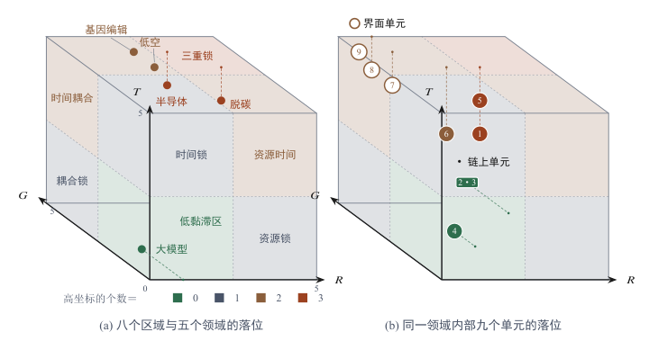
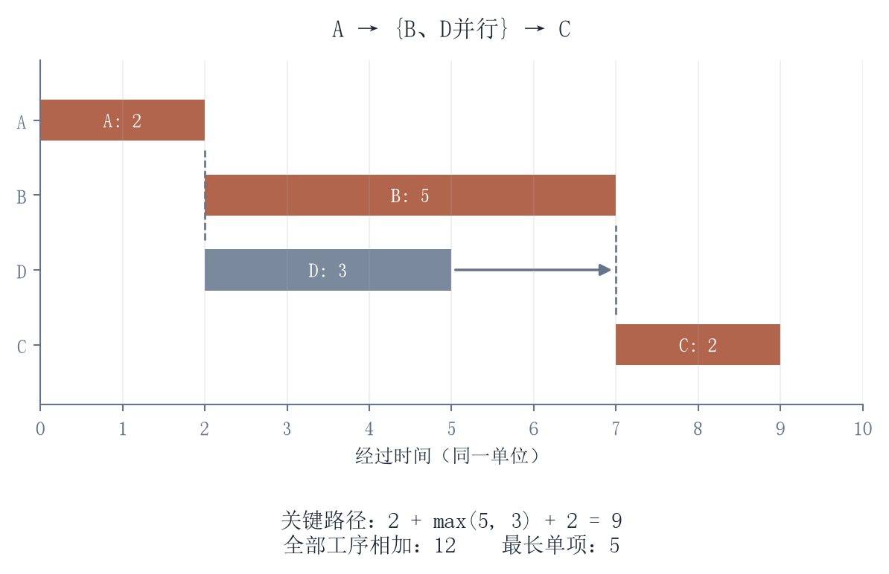
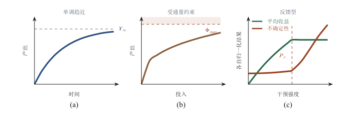

[目录](CONTENTS.md) · [English](../en/CONTENTS.md)

# 理论引擎：广义黏滞的物理基础与实证路线

本书正文以机制叙述为主，公式只在必要处出现。这个附录把散在各章的物理依据集中起来，交代它们的学术来源、数学形式、可检验的推论和适用限度。它的目的是让前面那些看起来像是类比的表述，落回到可以被检查和被反驳的位置上。

## 学术谱系与理论增量

先说清楚本书的想法从哪里来，以及相对于已有论述增加了什么。关于技术与社会之间速度不匹配的判断并不新，它有一批各自独立、只在局部重叠的来源，本书的贡献不在于提出这个现象，而在于把它统一到一组可以参数化的约束上。

第一条来源是比特与原子的区分。Nicholas Negroponte 在《数字化生存》里用 bit 和 atom 的对立来描述数字化的边界，指出可以被数字化的东西和必须保持物质形态的东西遵循不同的规律。这个区分被广泛引用，但在他那里主要用于描述商业形态的变化，没有给出两种介质为什么不同的机制说明。[^negroponte1995being] 本书把它推进了一步：比特、原子与生命的差别不是形态差别，而是吸收机制差别：信息被转译为扩散，物质被转译为做功，生命被转译为反馈。三种介质的中文名称与英文对照为比特（Bits）、原子（Atoms）、生命（Gene），最后一个取遗传信息之意，而不指细胞里那段具体的遗传物质。这个推进带来一个可检验的推论：同一项智能技术进入三种介质时，其效果的时间曲线形状不同，扩散型是单调趋近，做功型受通量上限约束，反馈型会出现非线性甚至反向。

第二条来源是文化滞后。William F. Ogburn 在 1922 年提出，社会的物质文化变化快于非物质文化，两者之间的时间差造成失调，他把这个现象称为文化滞后。[^ogburn1922social] 这个概念抓住了问题的形状，但缺乏度量：什么是“快”，什么是“慢”，差别多大会产生失调，都没有给出可操作的量。本书用时间刚性 $T$ 给出度量，把“滞后”还原为两个过程的弛豫时间之比，从而把定性的判断变成可以比较的量。

第三条来源是生产率悖论。Robert Solow 在 1987 年的一句话被反复引用：计算机时代无处不在，唯独在生产率统计里看不到。[^solow1987watch] 此后三十年的研究大致收敛到一个结论：信息技术确实提高了生产率，但存在显著的滞后，而且滞后的长短取决于组织是否完成了配套的流程重组。这个结论与本书的拓扑耦合 $G$ 是同一件事的两种说法：技术进入系统后，产出不会立刻变化，因为系统需要重新布线，而重新布线的速度由组织结构和制度安排决定，不由技术本身决定。

第四条来源是成本病。Baumol 和 Bowen 在 1966 年对表演艺术的研究是这一说法的来源：在这类活动上，产出受制于现场的人力投入，效率提升的空间有限，当其他部门的工资随生产率上升时，它们的单位成本会被动抬高；这个概念后来被推广到教育、医疗与照护等同样难以提速的领域。[^baumol1966performing] 它抓住的是价格信号，不匹配会以相对价格分化的形式被经济系统记录下来，而这一点可以直接从产业统计里观察到。本书接上的是它没有回答的那一环：这些位置为什么难以被其他机制替换。答案是时间刚性与拓扑耦合，它们不随算力下降，因此这类相对价格不会因为生成能力普及而回落。两种判断落在同一批对象上，依据不同，合起来比单独使用更可靠。

这些来源分别处理数字化、时间差、组织互补和相对成本，已有各自的度量与模型。这里提出的工作，是用资源、时间与耦合组织同一条现实转换链，继续把验证和责任列入比较。评价标准是它能否增加解释、区分方案并改善决定。

相对于这四条来源，本书的理论增量可以归结为三点。一是把三种阻力统一成一组参数 $(R, T, G)$，使不同类型的黏滞可以在同一个框架下比较和置换。二是给出介质的分类，说明同样是智能输入，进入不同介质后被吸收的方式不同，因此不能用同一套加速逻辑处理。三是把验证与承责纳入约束，作为与物理阻力并列的一类黏滞。第三点是本书与前人差别最大的地方，也是最需要被检验的地方。

这四条来源各自还带着一层本书没有采纳的判断，把它们分清楚可以避免误读。文化滞后理论在提出者那里常常带有对传统的肯定意味，而本书只取其中的时间差结构，不取任何关于快慢孰优的结论；成本病理论常被用来论证某些部门效率低下，而本书只取相对价格上升的机制，不取对部门本身的评价；生产率悖论在早期被当作技术无效的证据，后来被当作滞后即将结束的乐观预期，本书对两种读法都不采纳，只保留技术效果需要配套重组这一条；比特与原子的区分常被用来判断哪些行业会被数字化，本书不取这一层预测用法，只取两种介质吸收机制不同这一条。做这样的切割是有代价的：能说的话变少了，能被误用的地方也变少了，而一个框架的可信度主要取决于后一条。

需要补一句关于增量的性质的话。这三点都属于形式上的统一，不属于新机制的发现：参数化的价值在于让不同领域的观察可以在同一张表上比较，而不在于提出了某个此前无人知道的机制。因此对本书的评价标准也应当相应调整：不应当问它是否发现了新的物理，而应当问它给出的这组参数是否真的能区分不同的情形，以及用它做出的推论是否可以被证伪。

## 广义黏滞方程的数学架构

正文第二章给出了广义黏滞系数 $\eta = f(R,T,G)$，并在第 2.5 节末写出了指数形式 $\eta=\eta_0\exp(\alpha R+\beta T+\gamma G)$ 与三个系数各自的含义；那里没有展开的，是这个形式为什么取指数、三项为什么可乘、以及它落到可检验命题上还缺什么。这一节补的正是这三件事，同时说明这个形式的地位：它是一组待检验的假设形式，不是已经被确证的关系。

### 内禀黏滞指数法则

假设在固定任务与测量口径下，三类约束对对数转移代价的边际影响近似恒定，且暂不计入交互项，那么总黏滞系数可以写成

$$
\eta = \eta_0 \exp\left(\alpha R + \beta T + \gamma G\right)
$$

式中 $\eta_0$ 是基准黏滞系数，取值取决于所讨论的环节本身，与三类约束无关；$R$、$T$、$G$ 分别是资源势垒、时间刚性和拓扑耦合的归一化度量，量纲为一；$\alpha$、$\beta$、$\gamma$ 是三个常数，表示各类约束的相对权重，其数值需由实证确定，预期均为正。指数形式的来源是：如果每一类约束按比例降低通过速率，而多类约束同时作用时降低倍率相乘，则总倍率的对数等于各类约束的线性叠加。这个形式与阿伦尼乌斯方程中速率常数对活化能的指数依赖属于同一族，其共同点是处理“需要通过一个障碍”的过程，而不是处理“在平坦空间中移动”的过程。

指数中的可加性，等价于相对代价倍率可乘。它要求$\partial\ln\eta/\partial R=\alpha$等边际关系在考察区间内近似不变。物理串联过程的历时可以相加，稳态管线的吞吐也可能由最慢环节限制，不能仅凭“串联”推出倍率相乘。出现交互作用时，可检验$\delta RT$等扩展项；采用哪种形式，要比较解释与样本外表现。

测量先固定一个结果口径。$\eta=C/C_{\mathrm{ref}}$中的$C$可以取费用、总工时或单位合格结果的平均通过时间，$C_{\mathrm{ref}}>0$取同任务的公开参照。成功率与代价的方向相反，若采用成功率作代理，需要先规定相应变换。测量基准确定以后，$\alpha$才可读为资源约束增加一单位时对数代价的边际变化。不同研究的变量、边界和参照一致，系数才有可比性。

三个自变量需要各自公开定义、基准与取值方式。归一化可以采用同类需求与可用能力的比值，或采用可重复的连续指标；0到5级的等级表则先用于序数判断。自变量应尽量由转移前的条件或独立资料构造，避免把待解释的费用与历时换名后再次作为解释变量。跨研究合并前先核对任务、刻度和边界，再比较系数与残差。

这个形式可以提出三类检查：残差是否仍按任务或介质呈现结构，参数能否在可比样本中复现，交互与阈值形式能否更好地解释观察。指数函数的边际支出平滑增长，并不自动产生相变或突变阈值。模型形状与具体临界机制需要分别建立。

等黏滞面上的置换比可以写成，

$$
\left(\frac{\partial R}{\partial T}\right)_{\eta}=-\frac{\beta}{\alpha}
$$

式中，$R$ 为资源势垒的归一化度量，$T$ 为时间刚性的归一化度量，两者量纲为一；$\alpha$ 与 $\beta$ 分别为 $\ln\eta$ 对 $R$ 与对 $T$ 的偏导数，量纲为一；下标 $\eta$ 表示在黏滞系数保持不变的条件下取值。这个式子的含义是：要让黏滞保持不变，资源约束每放松一个单位，时间约束沿等值面收紧$\alpha/\beta$个单位，反之亦然，这正是正文所说的三组约束可以相互置换的定量形式，即压缩时间要投入更多资源、节省资源要拉长时间。适用条件必须写明：$\alpha$、$\beta$ 的数值须由实证确定，本式只给出置换比的结构；它成立的前提是可乘假设；一旦这个前提失效，就需要在指数上补一个交叉项，置换比随之不再是一个常数。

三条含义中，第一条最容易被误读。残差没有结构是模型成立的必要条件，不是充分条件：一个错误的模型也可能在小样本上给出无结构的残差。因此这条检验必须以介质为分组单元来做，而不是把不同介质的数据混在一起拟合；混在一起时，介质的差异会被吸收进残差，看起来像噪声，实际上是被忽略的变量。这一点决定了附录第三节的检验路线为什么必须按介质分别设计。

参数的跨期稳定性需要样本外检查。漂移可能来自技术变化、边界改变、变量定义或遗漏条件，不能据此直接判定因果方向反转。应保留定义与版本，比较替代解释，并说明模型在什么区间仍有预测能力。

还有一点关于自变量的写法需要交代。三类约束各自内部可能包含若干不同的成分，例如资源约束里既有材料的可得性也有资金的可得性，而公式里只允许出现一个数。把多维的约束压成一个标量，意味着研究者要先确定用什么方式汇总，例如取各项的最大值，或者按某个权重求和，而这个汇总方式与三个系数一样需要写明。汇总方式选得不好，误差会进入残差并被当成噪声；如果选得好，残差应当回到随机水平。这条要求不增加新的假设，它只是承认一件本来就必须回答的事：任何一个只允许输入一个数的形式，都要先交代这个数是怎么来的。

### 社会技术德博拉数

第二组形式处理的是“同一个系统在不同观测尺度上表现为固体还是流体”的问题。德博拉数来自流变学，由 Markus Reiner 在 1964 年提出，定义为材料的弛豫时间与观测时间尺度之比。[^reiner1964deborah]

$$
\mathrm{De} = \frac{\tau_{\text{relax}}}{\tau_{\text{obs}}}
$$

$\tau_{\text{relax}}$ 是系统内部结构重新调整所需的时间，$\tau_{\text{obs}}$ 是观察者关心这件事的时间尺度，两者同量纲，因此 $\mathrm{De}$ 无量纲。$\mathrm{De} \ll 1$ 时，系统在观测尺度内完成调整，表现为可以流动的流体；$\mathrm{De} \gg 1$ 时，系统来不及调整，表现为固体的弹性响应。用一个具体例子说明它的用法：一项技术对就业的影响，如果以季度为观测尺度（$\tau_{\text{obs}}$ 小），则 $\mathrm{De}$ 很大，系统表现为刚性，短期内劳动者无法转岗；如果以二十年为观测尺度，则 $\mathrm{De}$ 变小，同一系统的流动性显现出来。两种判断都不错，它们描述的是同一个系统在不同尺度上的行为，而争论常常发生在双方使用了不同的 $\tau_{\text{obs}}$ 却没有说明。

若系统近似满足单弛豫时间的Maxwell响应，周期输入下的损耗模量在角频率与弛豫时间之积接近1时达到峰值。将这种判断用于组织，需要先识别相应的周期输入与恢复机制。季度和二十年的观察窗可以改变对调整快慢的描述，本身不会改变系统的实际吸收成本。治理若要降低失配，应改变响应能力、输入频率或缓冲结构；延长统计窗口只改变观察口径。

这个名字的来源值得一提，因为它点出了这个量的适用范围。Reiner 取自《士师记》中底波拉之歌的一句“山在耶和华面前流动”，用来说明同一物质在足够长的时间尺度上可以表现出流动，而在短尺度上表现出固体。这个出处说明德博拉数从一开始就是一个关于尺度对比的量，而不是关于材料类别的量；它不把系统分成刚性的和流动的两类，只回答“在当前的观测窗里，它来得及调整吗”。因此它在本书里的用法也应当照此理解：给某个社会技术系统贴上“刚性”或“有弹性”的标签是没有意义的，有意义的说法是指明观测窗。

这个量在本书中有一个直接的用处：它把“技术性失业是短期的还是长期的”这类争论还原为一个可计算的问题：$\tau_{\text{relax}}$（劳动力市场的重组时间）与 $\tau_{\text{obs}}$（政策关心的时间窗）的比值。争议因此不再关于立场，而关于两个可以被测量的时间常数。同样的还原可以用在其他争论上：关于某项技术“来不及治理”的判断，实际上是说 $\tau_{\text{relax}}$ 大于治理机制的响应时间；关于某项制度“很有韧性”的判断，实际上是说它的响应时间短于它需要吸收的扰动的周期。两种说法都可以被具体的测量替代，而一旦被替代，争论就从立场转到数据。

$\tau_{\text{relax}}$ 在社会系统里同样需要一个可测的代理量，而这个代理量往往就是一个物理的周期。职业结构的重组速度受制于培养周期，一个需要十年上下才能完成训练并独立执业的职业，其人员存量不可能在一两年内改变，因此 $\tau_{\text{relax}}$ 至少是培养周期的量级。设备和基础设施的更新速度受制于折旧年限与建设周期，制度安排的调整速度受制于立法与复议的周期，这些都可以从公开文件里读出具体年数。把这几项里最长的一项当作 $\tau_{\text{relax}}$ 的下界估计，是一个粗糙但可用的起点，因为它只用到可以直接查证的年限，不需要对行为做假设。粗略估计已经足以支撑一类判断：当政策关心的时间窗短于这个下界时，任何关于结构已经调整完毕的结论都不成立，无论数据看上去多么支持它。

观测窗的选择本身带有立场成分，这一点需要承认而不是回避。同一项变化，以季度为窗口会得到需要立即干预的结论，以代际为窗口会得到属于正常调整的结论，而两种窗口都可以被论证为合理。承认这一点不会使这个量失效，原因在于 $\tau_{\text{relax}}$ 与窗口无关：它由系统的结构决定，不由观察者决定，因此争论可以收窄为窗口选择的问题，而窗口选择是可以被公开讨论和检查的。可操作的规范是：给出结论时同时写明所用的窗口，并说明在这个窗口下被略过了什么。做到这一条，不同窗口下的判断可以并存而不互相取消，它们各自指明了在自己那段时间尺度上必须处理的问题。

用这个量的时候还有一点容易被忽略：弛豫时间不是一个系统只有一个，而是一个机制对应一个。劳动力市场的重组、供应链的重建、法规的修订、设备存量的更新，各有自己的时间常数，彼此可以相差很多，因此说某个系统的德博拉数是多少，必须连同机制一起说明。在实践里可以这样做：把关心的问题拆到具体机制上，为每一项给出自己的时间常数，再判断哪一项与观测窗最接近。与观测窗最接近的那一项，通常就是决定结论的那一项。同一件事在不同研究里会得到不同的判断，因为它们关心的机制不同。

### 剪切增稠

第三组形式处理的是“施加得越快，系统越硬”的现象。正文第四章讨论生物干预时使用了这一形式，其一般表达为幂律

$$
\eta(\dot\gamma) = \eta_b + k\,\dot\gamma^{\,n},\qquad n > 0
$$

其中 $\dot\gamma$ 是剪切速率，量纲为时间的倒数，在这里对应干预施加的速率；$\eta_b$ 是零剪切黏滞，对应系统在缓慢干预下的响应，记作 $\eta_b$ 是为了与本附录前一节广义黏滞式里的基准黏滞系数 $\eta_0$ 区分开；$k$ 是增稠系数，$n$ 是幂指数。$n > 0$ 表示施加越快、等效黏滞越高，即系统以更强的抵抗回应更快的干预，$n$ 越大上升越陡。这个形式对生物系统特别适用，因为活系统有主动的代偿机制：干预速率超过代偿响应速率时，系统不会被动接受，而会启动反向调节，表现为表观阻力上升。

与它相对的是剪切变稀，即幂指数取负值或使用饱和形式的情形：施加越快，系统越容易流动。两种行为在流变学里都被研究得很清楚，区别在于系统的微观结构在剪切下是被拆散还是被组织起来。把这两个方向都写出来，可以避免一种常见的误读，即把“阻力随速率上升”当成所有复杂系统的普遍规律。真实的情形是按速率分段的：在低速区系统可能有足够时间重组，表现为剪切变稀；超过某个速率之后代偿跟不上，转变为剪切增稠。第四章讨论的干预强度阈值，对应的正是这个转折点。

按速率分段这件事有一个可以指认的机制：代偿需要时间，代偿机制的响应速率决定了转折点的位置。干预速率低于代偿速率时，系统来得及把扰动吸收掉，表现为阻力不随速率上升甚至下降；干预速率超过代偿速率时，代偿本身开始被扰动打乱，系统只能用更强的抵抗回应，表观黏滞转为上升。所以转折点不是某个固定的阈值，而是 $1/\tau_{\text{compensation}}$ 量级的速率，其中 $\tau_{\text{compensation}}$ 是该系统代偿环节的响应时间。这个读法把剪切变稀与剪切增稠统一成同一个系统在不同速率下的两种表现，而不是两类不同的系统，它与德博拉数处理尺度问题的思路一致：一个量比值决定看到哪一种行为。它同时给出一个可检验的推论：如果人为延长某个系统的代偿时间，例如削弱其调节能力，那么转折点应当向更低的干预速率移动，曲线的低速率段也会相应缩短。这个推论在细胞、组织和社会组织三个层次上都可以设计实验来检验，检验的结果决定这一节的形式还能不能继续外推。

流变学里这类行为之所以可以被当作定律使用，是因为它的机制被查清过。以高浓度颗粒悬浮液为例，剪切速率提高到一定程度后，颗粒来不及沿流线重新排列，被迫形成瞬时的聚集结构，流动阻力随之跳升，玉米淀粉浆在快速搅动下变硬就是这一机制的直接表现。这里的关键不在于现象引人注意，而在于现象的来源可以被独立验证：通过流变测量与散射实验能够确认聚集结构的存在，因此幂律中的指数与起始速率都可以被赋予机制上的解释。本书把这个形式移到生物与制度系统时，缺少的正是这一步独立验证，现有的依据是形状相似，而形状相似本身不足以支撑借用。所以这一节的地位必须写明：它给出的是一个待检验的外推，检验的标准是能否在目标系统里指出与聚集结构相对应的机制。

如果要在生物与制度系统里找这个形状的候选，判断的线索是：系统是否有一个需要时间的调节回路，以及这个回路是否会在输入过快时被自身打乱。抗生素使用强度上升与耐药率上升之间的关系、耕作强度上升与地力下降之间的关系、考核频次上升与被考核行为失真之间的关系，都属于这一形状的候选，它们的共同点是调节机制在高强度输入下反而成为扰动的一部分[^laxminarayan2013antibiotic]。列出这些候选不等于确认它们，每一例都需要单独的实证工作：测量起始强度、测量曲线的斜率、确认调节回路的存在。把候选与结论分开写，是为了避免一种常见的错误，即用一个领域里已经成立的机制，去为另一个领域里仅仅形状相似的曲线提供担保。

速率继续上升以后，系统可能饱和、失稳、损伤或堵塞，转折由具体机制决定。幂律只描述测量覆盖的区间。报告需要列出速率跨度、重复测量与转折迹象，并比较幂律、阈值或饱和形式在更宽区间的表现。高剪切率行为不能由拟合区间内的指数单独决定。

辨识幂律需要足够宽的输入区间和重复测量。基准项$\eta_b$不可忽略时，$\ln\eta$对$\ln\dot\gamma$的斜率不恒等于$n$，应拟合完整表达式，或说明在哪个区间可以忽略基准。还应比较阈值与饱和形式，并报告区间外转折。

三组形式的地位并不相同。指数法则和德博拉数是描述性的工作假设，其形式由机制的类比推得，参数需要实证确定；剪切增稠幂律在流变学中有扎实的实验基础，本书把它移到生物和制度系统上是一个有待检验的外推。把三者的地位分清，是为了避免一种常见的错误：把一个在一个领域内被验证过的形式，当作在所有领域内都成立的定律来使用。

## 定性判据：无参数条件下的使用方式

参数尚未标定时，框架先用于定位约束、进行有条件的比较和选择需要测量的环节。定性判断依靠公开证据与明确的序关系。能够判断的方向直接报告，存在权衡而证据不足的情形则保留为待比较的方案。

#### 定位：把对象放进三个坐标

把一个对象放进 $(R,\,T,\,G)$ 三个坐标里，得到的不是一组数值，而是一个位置：它在三个维度上分别处在低、中、高哪一档。这一档的判断通常不需要测量，只需要回答表 2.1 列出的三个问题：推得动推不动、来得及来不及、传得开传不开。做完之后，对象就被分到了介质梯度的某一级上。

这种分类的操作性在于判据是公开的。两个人对同一个对象给出不同的档位，可以直接检查各自依据的是哪一条证据，而不必先争论一个数字谁更准。相比之下，“这项技术的黏滞系数是 3.7”这样的陈述无法被追究，因为没有人能说清 3.7 是从哪一步来的。模糊的档位在这件事上反而更硬：它逼着每一个判断落到一条可以指出来的证据上。

#### 分区：八个区域与各自的处理方式

三个坐标各有 0 到 5 级，以中点 2.5 级为界，0 到 2 级记低，3 到 5 级记高。三个坐标各自或低或高，空间就被切成八个区域；判断一个对象落在哪一区，只需要回答三个是否：资源势垒是否过了中点，时间刚性是否过了中点，拓扑耦合是否过了中点。这个判断比定级更粗，因而也更稳，两个人即使在同一坐标上相差一级，只要没有跨过中点，得到的区域仍然相同。

区域的命名由高的坐标拼成。只有一个坐标高，就以它命名：资源高叫资源锁，时间高叫时间锁，耦合高叫耦合锁。两个坐标高，把两个名字连起来：资源与时间高叫资源时间，时间与耦合高叫时间耦合，资源与耦合高叫资源耦合。三个都高叫三重锁，三个都低叫低黏滞区。第六章按字面用过“低黏滞区”这个词，这里给它一个确切的边界。

图 A.1. 三个坐标与八个区域。图中点位为分类方式的示意，展示单元与区域怎样对应；它们不构成实测行业评分、总体黏滞排序或投运时间预测。具体项目应按表A.4的问题取证，并在同一判据下重新定位。

区域名中的“锁”表示当前任务面临的高约束，类别由所采用的量表确定。高约束是否可以放松，需要继续查明可替代资源、过程改造和结构重组的条件。分区先标出检查重点，处理方案再按证据选择。

低黏滞区的三个坐标均低，通常较少遇到这三类障碍。实际扩张仍取决于需求、可靠性和组织能力，分区本身不提供增长速度。

单锁区先检查主导约束：能否通过替代资源、改变过程或缩小依赖面来降低它。绕行是一种候选策略，其代价和可行性须与直接改造比较。

双锁区需要同时检查两项约束及其联动。两个坐标都高，不排除某项改进同时降低两者；改造节奏由可行路径、投入和验证要求决定。等值面斜率只描述给定模型中的代价组合。

三重锁区提示资源、时间和结构都需要重点核查。分阶段投入、重新定义任务或基础设施改造，都可能改变坐标组合。能否推进，需要检查项目的可行集合，不能由三项评分直接判定。

分区与定级是同一件事的两种精度。定级给出三个档次，分区给出一个格子；格子丢掉的是内部的差别，换来的是边界的稳定。代价也说清楚：靠近中点的对象会在两个区域之间摇摆，一次赋值的小改动就足以让它换区。这种摇摆不是缺陷，它对应现实中确实含混的情形，一项技术刚刚跨过中点时，说它“开始被卡住”和说它“还没被卡住”都不算错。

定位先定级、再定区，给出位置与需要优先核查的约束。下一节的量表把八个区域落到具体技术上。

#### 比较：共同改善与跨维权衡

定位之后，两个对象的相对黏滞可以在不给权重数值的条件下比较出来。设两个状态 $a$、$b$ 在三个坐标上的差为 $\Delta R=R_{a}-R_{b}$、$\Delta T$、$\Delta G$，由内禀黏滞的指数形式两边取对数得

$$
\ln\frac{\eta_{a}}{\eta_{b}}
=\alpha\,\Delta R+\beta\,\Delta T+\gamma\,\Delta G
$$

在参照与刻度一致、权重为正的条件下，若$a$的三个约束均不高于$b$，且至少一项更低，模型给出$\eta_a<\eta_b$。这是一种支配关系。若一项下降而另一项上升，只知道权重次序和变化符号通常不足以确定总效果，还需要权重比与变化幅度的界限。0到5级量表提供的是序数，代入指数模型之前，还须建立有意义的数量刻度。

#### 判方向：只需要导数的符号

趋势判断需要的信息更少，只需要导数符号。对上式求时间导数，

$$
\operatorname{sgn}\!\left(\frac{d\ln\eta}{dt}\right)
=\operatorname{sgn}\!\left(\alpha\dot{R}+\beta\dot{T}+\gamma\dot{G}\right)
$$

三个坐标同向变化且权重为正时，可以判断模型中的代价变化方向。不同方向同时出现，则需要比较加权幅度。系数随时间变化时，导数还包含$\dot\alpha R+\dot\beta T+\dot\gamma G$与基准变化项。生成成本下降与验证时间稳定，需要对各自环节测量，不能单由约束名称读出。

#### 模糊、开放、有弹性

定性用法需要公开判据、记录不确定性并允许证据修正。

它是模糊的。档位之间的边界由判据给出，不由测量给出，因此一个对象可以同时符合相邻两档的描述。这种含混在证据不充分时，比一个精确但无根据的数字更接近实情。

判据与权重需要接受新证据。后续结果可能要求修改赋值、重新归一化、调整系数，也可能表明三维分类遗漏了机制。修订应按证据影响的范围进行，并留下对应记录。

判断可以随证据更新。一次赋值错误，需要复核相邻档位、跨区结论和依赖该赋值的推论；量化模型的参数也可以重新估计。修订范围由错误影响的链条决定。每一项判断都应能回到相应证据。

#### 限度

定性用法回答不了三件事：多与少的差距有多大，快与慢的差距有多久，以及临界点落在哪里。上一节写下的 $r\theta$、正文用到的德博拉数与各章的阈值条件，都属于必须要有数值才能回答的问题，因此它们在本书里只以条件的形式出现，落不到具体对象上。

定性分析与定量分析的关系因此不是粗略与精确的关系，而是两组不同问题的关系：前者回答往哪个方向、在哪一档、谁更高，后者回答差多少、多久、何时越过。把前者当作后者的近似来用，会得到一个看起来有结论而实际无法检验的判断，这正是本书要避免的。反过来说，因为拿不到数值就放弃定性判断，同样是错的，那等于把三件本来能做对的事一起让掉。

## 技术拆解与黏滞度量表

量表要把一句“这项技术卡住了”，拆成可以逐格检查的判断：任务是什么，哪一段需要什么资源，反馈要等多久，改动会牵连谁，依据来自哪里。量表先提供约束画像；经过标定的数量模型再估计总体代价。

### 拆解：找到可以独立检查的单元

一个单元应当有可检查的输出，内部过程也应当具有相对一致的时间尺度。若同一单元同时容纳毫秒级计算与多年随访，平均值会遮住真正的约束。可以先用时间尺度的跨度辅助拆分：

$$
\frac{\max_j\tau_j}{\min_j\tau_j}\leq\Lambda .
$$

$\tau_j$为子过程的特征时间，$\Lambda$为公开选定的拆解阈值。取$\Lambda$约为10，可以作为起点；是否继续拆分，还要看能否辨认新的机制，不能由一个数量级的界限直接决定。

单元分为两类。链上单元直接产生下一段使用的结果，例如制造电芯、完成试验、交付软件。界面单元连接外部系统，例如适航审定、采购接入、空域协调和服务接受。两类单元都可能因技术、组织与制度改进而变快，具体哪些部分能够提速，需要逐项查明。

### 定级：先使用序数，再建立数量刻度

表A.1给出零到五级的示意锚点。级别表示同一坐标内约束由低到高，采用前应为具体任务确定判据，并附上证据。

表 A.1 — 三个坐标的序数锚点

| 等级 | 资源势垒$R$ | 时间刚性$T$ | 拓扑耦合$G$ |
| --- | --- | --- | --- |
| 0 | 现有能力内的较小边际投入 | 相对任务可视为即时 | 局部改动，依赖很少 |
| 1 | 通用设备与常规供应可支持 | 短于主要运营周期 | 接口已知且较标准化 |
| 2 | 需要专用设备或材料 | 占用明显的运营时间 | 若干接口需要适配 |
| 3 | 需要显著资本、供应或基础设施投入 | 跨越重要计划或建设周期 | 多团队或供应商需要协调 |
| 4 | 关键投入稀缺，或须重大扩容 | 较长观察、更新或制度过程 | 多组织、标准或辖区相互影响 |
| 5 | 在所定边界内面临严重约束 | 远长于当前决策窗口 | 依赖广泛且难以隔离 |

零级仍然消耗能量与材料，五级也不直接表示不可能。守恒律可以约束一项任务，却不能单独证明所有可选设计都已达到极限。表中的类别没有等距保证：时间差一级不自动等于十倍，资源差两级也不能直接换算成费用倍数。

若确有适当数据，可以另建连续刻度。例如明确规定

$$
T=\log_{10}(\tau/\tau_0),
\qquad
\tau_{k+1}/\tau_k=10
$$

时，级差才与时间数量级对应。这里的$\tau_0$是给定参照，不由序数表自动产生。资源也要选择同口径的实测量另行标定。

不确定性用相邻档位、置信区间或缺失证据报告。若仅能判断第$k$档与第$k+1$档之间尚不明确，就记录

$$
R_i\in\{k,k+1\},
$$

并说明什么证据可以消除分歧。小数不能替代这份证据。

对有明确定义的依赖闭包规模$d_i$，可以采用一种计数分档：

$$
G_i=\min\!\left\{5,\left\lfloor\log_{10}(1+d_i)\right\rfloor\right\}.
$$

图上可达、因果上受影响、必须同步修改、需要行政协调，是四种不同关系。闭包采用哪一种，必须先写清。计数也不能替代连接强度、关键节点与故障传播方式。

### 合成：先合成实际量，再判断等级

资源量在单位与边界一致时可以相加：

$$
P_{\text{总}}=\sum_i P_i .
$$

电力、材料、工时与资金各有账本；跨单位合成，需要公开的折算。对资源等级取加权平均，只会得到一个按所选规则形成的描述指数，不能据此恢复总资源需求。

时间必须按任务结构计算。严格串行的历时相加；同时开始且都须完成的任务取最大历时；依赖图的完成时间则由关键路径决定：

$$
t_{\text{串行}}=\sum_i t_i,
\qquad
t_{\text{完成}}=\max_{p\in\mathcal P}\sum_{i\in p}t_i .
$$

$\mathcal P$为允许的依赖路径集合。资源争用、返工与开始时刻不同，还需要相应的调度模型。稳态流水线的吞吐可能受最慢工位限制，这与首个产品通过全链的时间不同。

可并行部分的提速，可以用Amdahl关系说明：

$$
S(n)=\frac{1}{s+(1-s)/n}\longrightarrow\frac1s,\qquad s\in(0,1].
$$

这里固定工作量，不可并行份额为$s$，其余部分理想并行，附加开销暂不计入。[^amdahl1967validity] 改变算法与任务安排可能改变$s$；这个上限属于给定分解。

耦合应先报告依赖图及其分布：闭包、共同依赖、关键节点、可隔离边界与替代路径。若要报告平均等级，可以定义

$$
\bar G=\frac1N\sum_iG_i,
$$

但必须同时保留分布和关键节点。均值可能把少数决定性依赖淹没。

常见的巨分量判据

$$
\frac{\langle k^2\rangle}{\langle k\rangle}>2
$$

来自满足相应正则条件的渐近随机图模型。[^molloy1995critical] 它不能直接判定有方向、权重、聚团和制度关系的实际依赖网络。图上连通，也不等于所有节点必须同时改动。

连续变量经过定义、归一化与标定以后，才进入数量模型：

$$
\ln\frac{\eta}{\eta_0}=\alpha R+\beta T+\gamma G .
$$

序数画像与拟合变量须分开列示。已有参数时，可以比较预测与样本外结果；参数未知时，先报告约束、支配关系与未决权衡。

若时间坐标确实采用式(A.8)的对数刻度，德博拉数与它的关系为

$$
\ln\mathrm{De}=(\ln10)T-\ln\frac{\tau_{\text{驱动}}}{\tau_0}.
$$

这个恒等关系来自刻度的定义。改变观察窗会改变比值，不会自动改变实际调整能力。

图 A.2. A先执行，B与D随后并行，两项都完成后C才能开始。总历时为$2+\max(5,3)+2=9$，既不等于所有工序相加的12，也不等于最长单项的5。关键路径为A、B、C。

### 定位：大项与可改进项分别检查

权重已知且刻度可比时，模型中较大的贡献项可以写为

$$
c^\ast\in\operatorname*{arg\,max}_{c\in\{R,T,G\}}\alpha_c c,
\qquad(\alpha_R,\alpha_T,\alpha_G)=(\alpha,\beta,\gamma).
$$

未知权重时，不能仅凭哪个坐标的级数最大就宣布它主导总体黏滞。最大贡献项也未必是最值得优先改造的项，还要考察可行余量、成本、风险和相互作用。

在小幅、独立、边际成本近似固定的条件下，若压低一单位坐标$c$的成本为$\mu_c>0$，则

$$
\frac{\alpha_c}{\mu_c}
$$

比较的是每单位支出带来的模型内对数代价下降。它不是绝对净收益，也不处理跨维联动、有限预算、门槛与风险。有限项目仍须比较完整方案。

表 A.2 — 从约束画像到改造选择

| 情形 | 要补的证据 | 可比较的行动 |
| --- | --- | --- |
| 主要约束可以低成本改善 | 改善幅度与全部成本 | 直接投入，并核验下游效果 |
| 改善会明显增加其他支出 | 联动幅度、承受者与风险 | 比较净效果及分配，重新设计接口 |
| 当前难改，但存在替代路径 | 替代任务、路线与结果标准 | 绕行、分阶段或缩小范围 |
| 多项约束同时偏高 | 全部可行路径与投入条件 | 重组方案，保留必要的等待与检验 |

### 示范一：低空服务的九个单元

低空项目可以先拆成表A.3的九个单元。表中列的是应当查明的条件，具体等级要由选定机型、地区、运营范围与证据决定。

表 A.3 — 低空服务：单元、约束与取证

| 单元 | 主要检查内容 | 应取得的证据 |
| --- | --- | --- |
| 电芯制造 | 配方、供给、良率与产能 | 产品规格、供应与生产记录 |
| 成组及热管理 | 系统质量、散热、故障隔离 | 包级测试与任务工况 |
| 机体及旋翼 | 材料、结构、制造与寿命 | 试验、工艺及维护依据 |
| 飞控与航电 | 功能、时延、失效与版本 | 需求、测试及审定记录 |
| 起降设施 | 场地、电力、接驳与备用 | 建设条件、接入与规划 |
| 运营维护 | 排班、备件、维修及恢复 | 运营设计与实测支持成本 |
| 适航审定 | 设计符合性与验证范围 | 对应辖区、型号与阶段文件 |
| 空域航路 | 运行边界、间隔与应急 | 适用规则及实际许可 |
| 服务接受 | 价格、噪声、可靠性与权益 | 对应人群的调查及运营反馈 |

审定消耗人员、设备、试验与设施；协调和信任也需要物质载体与持续工作。不能因为输出是一份许可，就把资源记为零。公众接受需要定义人群和接受条件，不能先指定一个十年周期再据此预测落地。

把九个单元画成依赖图，区分可以并行的任务和必须等待的任务，再计算关键路径。电池改进可能同时改变载荷、备降裕量、经济性与审定证据；软件改进也可能减少试验负担。哪个环节控制投运时间，由项目的实际路径决定。

若许可仍在关键路径上，缩短不在该路径上的某道工序，可能不改变首次投运时间，却仍能降低费用或改善后续吞吐。把这几种结果分开，才能辨认改进究竟落在哪里。

### 示范二：五类项目的比较入口

表 A.4 — 五类项目应分别核查的问题

| 项目 | 资源与时间 | 依赖与确认 |
| --- | --- | --- |
| 大模型推理服务 | 现有容量、完整请求成本及扩容 | 输出触发什么下游行动 |
| 先进制程制造 | 设备、工序、良率与交付周期 | 哪些改动需要供应商与验证协同 |
| 低空服务 | 任务能耗、备份与设施条件 | 对应机型、空域和运营的证据 |
| 基因编辑治疗 | 递送、制造、观察与随访 | 细胞群体、临床终点与适用人群 |
| 水泥钢铁脱碳 | 工艺、能源、原料与更替周期 | 厂区、电力、运输、产品标准及需求 |

同属一类项目，也可能采用不同技术路线和责任结构。基因编辑治疗不等于生殖系编辑，脱碳路线也不等于一种统一成熟工艺。先固定对象，再赋值与比较，行业名称只提供检索入口。

量表最终应当让争议落到具体证据上：哪个单元的什么条件改变了，依据是什么，哪些推论需要重算。能做到这一点，它就把总体判断变成了一份可复核的约束地图。

## 三类响应模型与检验路线

通量限制、需求吸收和适应性反馈，可以产生不同的响应形态。本节列出三种待检验模型，并给出相应数据口径。选取哪种形式，取决于具体任务的机制与观察；介质分类为选择提供线索。

数字服务的一种情形，是在需求与分发条件相对稳定时，实际使用率向平台趋近。平台可以受到注意力、预算、供给和产品适配等因素影响。单位生成成本与实际使用率需要分别测量，快速扩张的候选并不自动转成使用。

这条曲线的形状可以写成，

$$
Y_{\text{比特}}(t)=Y_{\infty}\left(1-e^{-t/\tau_{\text{趋近}}}\right)
$$

$Y_{\text{比特}}$表示选定服务的使用率或有效处理率，$Y_\infty$为同口径的平台值，$\tau_{\text{趋近}}$为时间常数。式中初始值取零，早期近似线性上升，随后以指数衰减的偏差接近平台。平台位置和趋近速度须由数据估计，需求或供给变化以后可采用新的参数或形式。

固定设备、空间与能源供应，可能形成单位时间的实物产出上限。投入接近这套设施的能力时，增加投入的收益可以递减；新增设备、改变工艺或扩建网络，则可能改变上限。检验可以分别比较设计、制造、施工与维护的投入和产出，辨认AI究竟改善了哪些环节。

这条曲线的两个特征可以写成一组条件，

$$
0\le Y_{\text{原子}}(I)\le \Phi_{\max},\qquad \frac{\partial^{2}Y_{\text{原子}}}{\partial I^{2}}\le0\quad(\text{饱和近似})
$$

$Y_{\text{原子}}$为实物产出率，$\Phi_{\max}$为给定设施条件下的最大可持续产出率，两者采用相同单位；$I$为统一口径的投入。第一项表达能力上界，第二项另加了饱和区间的凹性近似。阶跃扩产、学习效应或互补投入可能不满足凹性，需按观察选择其他形式。

能量比较也须固定任务。擦除一个比特、断开一个化学键和抬升一个宏观物体，分别选择了不同操作单位；它们的绝对值不能决定各产业的增长率。对一项完整任务，应核算所需操作次数、实际耗散、设备能力与有效产出，再比较设计改进和执行改进带来的收益。

适应性反馈可以改变剂量与效果的关系。一个可检验情形是：超过某个强度以后，平均收益趋于平台，而结果的离散程度继续增加。也可能观察到收益持续改善、作用下降或迟发响应。实验需要同时记录强度、作用时间、群体差异与后续观察，依据数据辨认具体反馈。

把这条检验路线写成判据就是，

$$
\left.\frac{d\langle Y_{\text{生命}}\rangle}{dP}\right|_{P>P_{c}}\approx0,\qquad \left.\frac{d\,\mathrm{Var}(Y_{\text{生命}})}{dP}\right|_{P>P_{c}}>0
$$

$Y_{\text{生命}}$为选定结果指标，$P$为采用固定单位的干预强度，$P_c$为待估计的转折位置。均值与方差采用各自单位。式中的两个条件共同描述这一组平台与风险扩大的观察，其他反馈形态需要另外的函数。比较时须保留群体、观察时长和重复测量信息。

这三个示例分别选取时间、投入和干预强度作自变量，因而不能直接比较图上的斜率。要比较同一项智能技术在不同环节的效果，应先统一任务、投入与结果口径，再分别控制过程时间和环境条件。图形的差别来自机制假设，是否对应实际领域差异，仍由这种比较检验。

图 A.3. 三个响应模型的概念示意。(a) 使用率随时间趋近平台，(b) 给定设施内产出率随投入饱和，(c) 平均收益趋平而结果方差增加。各纵轴独立归一化，尤其(c)的均值与方差不共用物理单位；线条高度及交点不供跨指标比较。

把三条曲线并排列出，差别落在四列上。

表 A.5 — 三条演化曲线的自变量、判据与可用的检验数据

| 曲线 | 自变量 | 判据 | 可用的检验数据 |
| --- | --- | --- | --- |
| 比特：单调趋近 | 时间 | $Y_{\text{比特}}\to Y_{\infty}$，平台与时间常数由任务数据估计 | 文本、图像、代码生成的单位成本时间序列，以及这些产出的实际使用率，而非产出量 |
| 原子：受通量约束 | 投入 $I$ | $Y_{\text{原子}}\le\Phi_{\max}$，饱和区间另检验$\partial^{2}Y_{\text{原子}}/\partial I^{2}\le0$ | 建筑业劳动生产率、采矿与冶炼的能耗强度、半导体制造的单位投资；同一项目在设计阶段与施工阶段的工期压缩比 |
| 生命：反馈型 | 干预强度 $P$ | 在 $P>P_{c}$ 上 $d\langle Y_{\text{生命}}\rangle/dP\approx0$，且 $d\,\mathrm{Var}(Y_{\text{生命}})/dP>0$ | 药物剂量、疗效与副作用的配对测量；编辑强度与脱靶率的配对测量 |

表 A.5 的四列里，只有第三列可以脱离本书的术语使用：判据一栏写的是可以直接从数据里取到的条件，不要求读者先接受 $\eta$、$De$ 或三类介质的分类。这是这张表与全书其余部分的关系：分类是本书提出的，检验不是。三条曲线的判据彼此独立，任何一条被观测否定，对应的那条曲线就要改写，另外两条不受影响，因为它们各自的自变量与判据都是分开写出来的。

同一技术通常穿过多个环节，结果还受到相互作用影响。总产出未必是三条曲线的线性叠加。可行的起点，是选择边界稳定的任务，分别记录设计、执行、验证与维护的时间和成本，再用对照、分阶段部署或可比较项目检查机制。整体效果的解释，要在这些环节关系得到支持以后推进。

## 认识论边界

框架的评价分成三层：约束分类能否帮助辨认机制，数量模型能否解释并区分观察结果，规范主张能否给出公开理由。三者采用各自的证据，修订也应回到相应层面。

第一，分类框架组织问题，经过标定的数量模型才承担具体预测。预测需要固定任务、变量、基准与参数，并检验样本外表现。仅凭区域名称或未标定公式，可以列出要检查的约束，不能确定某项技术的部署年份、增长速度或临界点。

第二，物理形式进入社会技术分析，需要明确机制对应。借用剪切增稠形式时，要指出干预速率怎样引发代偿或结构变化；借用德博拉数时，要测量响应与输入的时间尺度。结构对应得到支持，模型才有解释力；对应不成立，就要更换形式。词汇相似不能代替这种检查。

第三，分类与函数形式分别接受检验。对数线性形式要与交互、阈值和其他候选形式比较，并在独立数据上检查误差；介质分类要检验是否增加了机制解释与样本外区分能力。若模型依赖反复改动变量含义才能拟合，就要重审定义。不同介质出现相似曲线，要求回到机制和任务尺度判断，曲线相似本身既不证实也不推翻整个框架。

第四，约束分析说明哪些条件影响转移代价，价值论证说明为什么某些结果、权利和责任值得被保护。本书主张让受影响者能够参与、让判断保留证据、让决定接受追责。支持这些主张，需要公开伦理理由、程序与分配安排；物理下限不替这些理由作决定。

第七章据此提出选择、分配与承担黏滞的实践主张。应用到具体决定时，先查清可行路径与成本分布，再比较结果涉及的利益和权利，最后确定授权与责任。数据支持可行性判断，规范理由支持取舍，实施记录让判断继续接受检验。

## 参考文献

[^negroponte1995being]: Negroponte, Nicholas. Being Digital. 1995.
[^ogburn1922social]: Ogburn, William Fielding. Social Change with Respect to Culture and Original Nature. 1922.
[^solow1987watch]: Solow, Robert M.. We'd Better Watch Out. 1987-07-12.
[^baumol1966performing]: Baumol, William J. and Bowen, William G.. Performing Arts: The Economic Dilemma; A Study of Problems Common to Theater, Opera, Music, and Dance. 1966.
[^reiner1964deborah]: Reiner, Markus. [The Deborah Number](https://doi.org/10.1063/1.3051374). 1964.
[^laxminarayan2013antibiotic]: Laxminarayan, Ramanan and Duse, Adriano and Wattal, Chand and Zaidi, Anita K M and Wertheim, Heiman F L and Sumpradit, Nithima and Vlieghe, Erika and Hara, Gabriel Levy and Gould, Ian M and Goossens, Herman and Greko, Christina and So, Anthony D and Bigdeli, Maryam and Tomson, Göran and Woodhouse, Will and Ombaka, Eva and Peralta, Arturo Quizhpe and Qamar, Farah Naz and Mir, Fatima and Kariuki, Sam and Bhutta, Zulfiqar A and Coates, Anthony and Bergstrom, Richard and Wright, Gerard D and Brown, Eric D and Cars, Otto. [Antibiotic resistance—the need for global solutions](https://doi.org/10.1016/S1473-3099(13)70318-9). 2013.
[^amdahl1967validity]: Amdahl, Gene M.. [Validity of the Single Processor Approach to Achieving Large Scale Computing Capabilities](https://doi.org/10.1145/1465482.1465560). 1967.
[^molloy1995critical]: Molloy, Michael and Reed, Bruce. [A Critical Point for Random Graphs with a Given Degree Sequence](https://doi.org/10.1002/rsa.3240060204). 1995.
