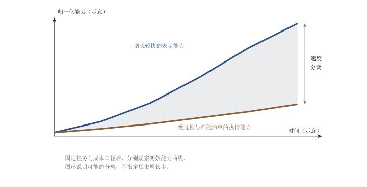
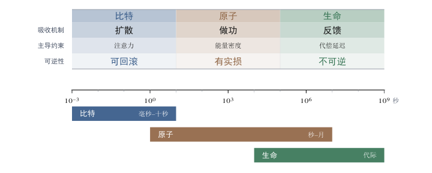
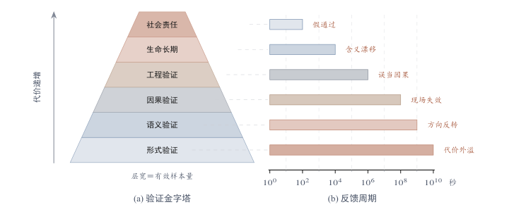
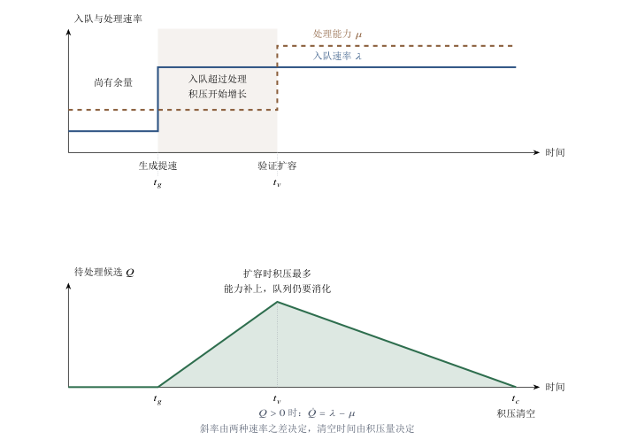

[目录](CONTENTS.md) · [English](../en/CONTENTS.md)

# 演化悖论：技术加速与物理约束的鸿沟

打开手机，屏幕里的内容一天换一轮；推开窗户，楼下的街道十年不动。暴雨之后的老旧管网照样积水，早高峰的高架桥照样堵，一份外卖照样要一个骑手顶着雨骑上半小时。生成式模型可以在六十秒内算出一段以假乱真的街头视频，却没法替人下楼取一次快递。两种速度都在跑，问题出在它们常常被当成同一个速度。

## 技术加速的折叠幻觉与黏滞状态

### 认知的错位

屏幕里的内容更新得越快，人越容易把更新的速度当成改变的速度。就业、教育、产业和政策的判断因此常把两个过程混在一起：信息在表示空间里被生成，材料、能量和生命在现实中被重新安排。前者可以依靠复制和重试迅速扩张，后者还要穿过执行、验证和协调。两种时钟被强行对齐，阻力便从判断中消失了。

#### 两种速度

生成式人工智能带来的震动，来自写作、绘图、编程和规划的速度变化。一份方案可以在几秒钟内出现，人们便容易把这种变化外推到方案所描述的世界。比特速度与现实速度在这里被混为一谈。前者显示候选出现得多快，后者还取决于候选能否穿过具体系统。

AI 确实极大降低了搜索、生成、模拟和表达成本。它可以快速提出建筑方案、交通模型、药物候选、商业计划、代码和政策文本。但现实不是一段可以直接改写的文本，也不是一张可以随时重绘的图片。现实由材料、能量、身体、时间、设备、制度、责任和复杂反馈构成。一个方案被生成，不等于它已经被执行；一个模型给出答案，不等于现实系统已经完成状态转移。AI 可以让“找到可能解”变得便宜，却不能自动让“把解变成现实”同等便宜。换言之，AI 的本质能力是更快地发现、生成和筛选路径，而不是取消路径被执行、验证和承担的现实代价。

这种错位有一种通俗的测量方式。大众认知的时钟被拨到了 22 世纪，物理世界的时钟还停在牛顿力学的轨道上，某些基础设施领域，比如老旧的电网和排水系统，甚至保持着 19 世纪的节奏。心理预期与物理现实之间的裂痕没有因为算法的进步而弥合，反而在拉大。差距本身不产生危险，危险来自对它失去感知，而失去感知的第一步，是把屏幕里的经验直接当成世界的经验。要看清这个误读是怎么发生的，需要分别看两边。

数字表示具有低复制成本、低传播成本和便于恢复的工作状态。模型训练完成后，新增一次生成主要消耗推理所需的计算资源；草稿和测试版本可以被替换，代码也可以退回先前保存的状态。使用者因此获得了快速重试的条件。这种便利取决于操作尚未触发外部后果：已经泄露的信息、执行的交易和进入生产系统的错误，都有各自的恢复成本。

具体的例子比属性更有说服力。一段光影正确、物理看似合理的城市街景视频，可以在六十秒内被算出来，而它调动的只是电子在硅晶片上的微观跃迁。一次翻译、一次摘要、一次代码补全，背后是同样的跃迁，代价按厘计费。于是在很短时间内，写作、翻译、摘要、搜索、客服、编程和图像生成这些活动，被从“需要训练的能力”改写成“需要调用的接口”。人感受到的速度提升是真实的，问题在于，被提升的只是这条链上的第一段。

两个域的差别可以写成两个指数项不同的增长律，

$$
u_{\text{比特}}(t)=u_{\text{比特}}(t_{0})\,e^{a(t-t_{0})},
\qquad
u_{\text{原子}}(t)=u_{\text{原子}}(t_{0})\,e^{b(t-t_{0})}
$$

式中$u_{\text{比特}}$与$u_{\text{原子}}$分别代表选定任务在单位成本下的操作量，$t_0$为比较起点，$a$、$b$为给定区间内拟合的增长率。若$a>b$，两者归一化比值的对数以$a-b$增长。这是一种描述速度分离的工作形式。算力、能源转换和物质吞吐各有统计口径，增长率须由各自数据确定；图1.1用示意曲线说明差别。具体系统可能呈现指数、线性、阶跃或饱和增长，曲线形状由技术与过程共同决定。

图 1.1. 两种速度的概念示意。横轴与纵轴采用示意刻度；曲线说明表示能力与执行能力可能以不同速度改善。具体增长率须按固定任务和成本口径测量，曲线间距不等于广义黏滞系数。

#### 窗外的 20 世纪：被质量与熵增锁死

这种能力进入物质过程时，要重新支付执行的代价。视频中的交通流由计算生成，现实中的车辆则要由能源驱动，经过制动、转向和接触控制。跨海大桥的图纸可以快速修改，施工仍要组织材料、设备和人员。钢材强度、混凝土强度发展和地基条件进入的是同一个工程账本。混凝土的28天强度是常用检验指标，配合比、温度和养护方式可以改变强度发展的速率；图纸生成得更快，只改变了这条链的设计环节。

第二重约束是存量。城市建立在过去规划的道路网之上，地下管线穿过已经有人生活的街区。自动驾驶和城市智能系统需要多少设施改造，取决于技术路线；有的尽量复用道路，有的增加感知、通信和电力设施。无论采用哪一条路线，车辆、道路使用者、维护体系和责任安排都要衔接。不能像删除代码一样删除一条老旧街道，因为那里住着真实的人，流着真实的物资。现实中的更新，首先是一场保持系统继续运转的切换。

第三重约束是熵。模拟器的规则和边界由设计者规定；现实环境还包含未建模的扰动、状态变化和参与者。AI 可以在模拟器里跑出一亿公里无事故的驾驶记录，现实中一个乱穿马路的行人、一场突如其来的暴雨、一块被遮挡的路牌，都可能让系统停下。物理世界的混乱程度远超数字逻辑的覆盖范围。修路队面对的也不只是铺路，还有地质沉降、管线冲突、周边居民投诉和行政协调。算法可以模拟秩序，无法瞬间消弭现实中的熵增。

#### 模拟与现实的范畴错误

三个属性当中，可逆性最容易被误用。数字孪生中的时间有某种可逆性，回滚一次只需要一条命令，这鼓励了激进的迭代，因为失败的惩罚趋近于零。原子世界没有这条退路。拆掉的桥墩不能回滚，误服的药不能撤销，报废的电池不能重生成。可逆与不可逆的差别不是程度差别，而是类型差别：它决定了试错成本函数长什么样。在可逆系统里长出来的一套方法论，直接搬到不可逆系统里，得到的往往不是更快，而是更贵。

更隐蔽的一步，是把预测能力直接当成干预能力。模型可以从数据中学到杯子下落与破碎之间的关系，机器人要接住杯子，却还需要估计瞬时位置、输出合适的力矩、建立接触，并根据反馈修正动作。学习模型可以参与每一步，前一步的成绩仍然不能替后一步交卷。生成视频越流畅，窗外的施工队就越显得笨拙；这种比较漏掉了施工队真正需要完成的大部分工作。

公共讨论里的“接管”推论，经常把这段距离省掉：模拟已经逼真，执行便只剩时间问题。实际需要跨过的是传感、执行器、能量、接触与反馈。像素收敛了，力矩还要重新控制；图纸通过了，构件还要经受载荷。问题的关键，正是这两张成绩单之间的空白。

因此这一节的核心判断可以压成一句话：**在表示空间里成立的速度，到了现实空间要重新计账。**物理世界有很高的黏滞，它由能源成本、材料属性、物流半径和社会协作的复杂度共同构成。这层黏滞吸收了 AI 指数级增长的冲击波，也构成了对抗技术狂热的第一道防线，它客观上延缓了算法对实体经济的冲刷速度，为人类留出了喘息和转型的时间。这不是坏事，但它有一个容易滑过去的前提：黏滞只有在被承认的时候才是缓冲，如果它被当作不存在的噪声，人就不会为它留出任何冗余。

到这里可以回答开头那个问题。屏幕里的内容一天换一轮，街道十年不动，两种速度的差距本身就是事实，不需要额外的解释。需要解释的是另一件事：为什么在差距如此明显的情况下，公共判断仍然持续偏向快的那一侧。答案不在物理世界，而在信息如何被筛选、放大和定价。这个机制有一个已经用了很多年的名字。

### 媒体的幸存者偏差

#### 注意力如何被筛选

这种错位有它的来源。最轻、最快、最适合演示的技术，占据了最多注意力。视频生成可以当场展示，给服务器供电的变电站却很少进入镜头。芯片制造、电力传输、冷却、采矿和施工各有自己的进步速度，不能从聊天窗口的更新频率推出来。被展示的是界面，被省略的是支撑界面的世界。

筛选机制并不神秘。媒体和资本市场奖励的是能在短时间内被展示、被复制、被估值的对象；一座数据中心的混凝土浇筑过程没有传播价值，一段能生成视频的模型有。结果是可展示的部分获得了完整的叙事，不可展示的部分连名字都没有。这种不对称会自我强化：越是被讲述的东西越容易获得资源和关注，越容易获得资源的东西越容易被继续讲述。几十年下来，公众拿到的样本已经被筛选过一遍，而人用这个样本来推断整体的性质。

偏差还有一个心理学版本。人脑对指数增长的曲线有天然的偏好，对线性增长的曲线缺乏耐心。软件故事讲的正好是指数曲线：用户数在几个月里翻十倍，估值在两年里翻几十倍。物理世界的故事是线性曲线：基站一座一座建，光缆一米一米铺，良率一个点一个点爬。前者适合传播，后者只适合执行。于是归纳谬误出现了：我们误以为整个世界都已经轻量化了。

这个谬误一旦成立，推论就走得很远。所有产业，无论医疗、教育、能源还是制造，都被期待遵循摩尔定律的曲线跃升；任何行业的落后，都被归因于不够数字化或者 AI 不够聪明。它会导向一个具体的预判：只要模型的大脑足够强，它就能像接管聊天窗口一样接管每一条流水线和每一辆重型卡车。人们记住了代码的轻盈，遗忘了重力的刚性。而这类误判最难纠正的地方在于，它在被证伪之前，一直是自我印证着的：被筛选掉的样本从不开口。

#### 沉默的基座：遵循热力学的原子世界

被这套叙事折叠掉的部分要庞大得多。能源开采、重型物流、基础设施建设、精密制造、农业生产，这些不在头条里的产业构成全球实体经济的绝大部分，它们遵循的不是摩尔定律，而是热力学定律。在这个角落里，效率提升不靠复制粘贴，靠对物理世界硬碰硬的改造；没有零边际成本的奇迹，只有每一份做功都必须支付能量的铁律。误判之所以能持续，是因为这一侧的反馈很慢，慢到不足以打断另一侧的叙事。

通信行业是最清楚的例子。手机上的信号格给人一种瞬时覆盖的印象，背后却有管道、光缆、机房、铁塔与检修。铺设光纤要协调道路和地下管线，设备升级要安排供电、运输、安装和测试。协议更新与实体网络更新，关键路径各不相同。差别来自要完成的操作，而不是某个“原子天然比电子慢”的普遍倍数。

能源产业把这段距离放得更大。调度算法可以改善既有容量的使用，新增容量仍要经过设备、土地、融资、施工与接网。伯克利实验室2026年版《Queued Up》统计，截至2025年底，美国约有2060吉瓦发电和储能容量在排队接入；在有数据的地区，2025年建成项目从申请接网到商业运行的中位时长超过五年。[^berkeley2026queues] 队列里包含最终会退出的项目，排队容量不能直接算成未来供给。一个电源被设计出来、一份接网申请被提交、电力真正送到负荷端，是三件事。

精密制造的对比更加刺眼。光刻设备内部凝结着高度复杂的知识，制造、装配、运输、安装与校准却一步也不能停在知识里。良率爬坡来自工程师与材料误差、工艺波动之间的持续交手。算法可以缩短反馈周期，也可以让每轮试验更有价值；设备仍要经历这一轮反馈。

#### 云端的真相：地球上最沉重的实体

幸存者偏差最极致的体现，是对“云”这个词的集体误读。在公众想象里，云是轻盈的、去物质化的：数据上传之后似乎脱离了地球引力，进入一个纯粹的比特天堂，似乎只要生活在云端，就不再受物理资源的限制。从物理上看，云很可能是地球上最重、最依赖物理资源的实体之一。所谓的云端不在天上，它躺在地上，是坐落在荒漠、深山或者海底的超大型数据中心，由钢筋混凝土包裹，为周边的供电、散热和安防配套一整套工程。

算力的物理底座，如今已经挤进了电网规划。国际能源署2026年10月14日发布的《Powering Artificial Intelligence》把可用网络容量、接网队列和许可周期列为数据中心建设的约束。[^iea2026powering] 芯片、机架、电力设备、铜缆与光纤，各有供应链；冷却方式、气候和负载共同决定水与电的需求。云端每增加一份能力，地面就要回答它放在哪里、怎样供电、热排到哪里。

回看传播规律，这套偏差并不需要谁去刻意制造。可展示的部分自动获得注意力，不可展示的部分自动失去注意力，两者叠加就得到了一个重量被系统性低估的世界图景。这也解释了一个反常现象：关于 AI 的讨论越热烈，关于电力、冷却、矿产和供应链的讨论反而越少，因为后者不进镜头。要给这个偏差纠偏，需要的不是更多报道，而是一个能同时容纳两边的概念。

#### 给阻力起一个名字：技术黏滞

本章用**技术黏滞**描述这种差异。所谓技术黏滞，是指智能、算法或技术方案推动现实系统从状态 A 转移到状态 B 时，遭遇的广义阻尼。它不是简单地说现实变化缓慢，而是强调：现实改变不只取决于是否存在一个解，还取决于这个解能否被执行、被验证、被维护、被协调，并在失败时被承担后果。AI 的核心优势在于降低搜索成本，但现实状态转移还要支付执行成本、验证成本、维护成本、协调成本和责任成本。这里的关键词是“广义”。黏滞在物理学里指流体内部阻碍相对运动的性质，本书借用的正是这层含义：阻力不来自某个外部障碍，而来自介质本身的内部结构。现实系统的介质属性，才是智能进入时真正遇到的东西。

由此可以推出一个反直觉但重要的推论：**生成越便宜，可信结果反而越稀缺；方案越丰富，现实吸收能力越成为瓶颈。**在稀缺结构发生变化的地方，竞争结构也会变化。过去，许多领域稀缺的是生成能力：能不能写出文本，能不能画出图像，能不能找到分子，能不能提出方案，能不能生成代码。现在，生成能力迅速膨胀，候选方案急剧增加，信息空间开始出现通胀。问题不再是没有方案，而是方案太多；不再是没有答案，而是答案太便宜；不再是缺少表达，而是缺少可信表达。未来的瓶颈将越来越从生成转向验证，从创造转向确证，从可能性转向可承担性。

任何现实状态转移，都至少要穿过三类约束。要有足够资源推动，要有足够时间展开，要能在既有结构中传导。为了分析这种阻尼，可以提出一个最小模型：RTG，即**资源势垒**（$R$）、**时间刚性**（$T$）和**拓扑耦合**（$G$）。资源势垒回答一个改变是否推得动，时间刚性回答一个改变是否来得及，拓扑耦合回答局部改变能否传导为系统改变。三者共同决定智能进入现实系统时的黏滞程度，这三类约束也构成理解全书的最小框架。

### 虚拟逃逸论的物质依附

#### 向内坍缩

既然现实这一侧又重又慢，最省力的反应就是绕开它。于是产生了一种逃逸倾向：面对沉重的物理世界，技术想象不断向去实体化方向移动，试图在纯符号层面寻找自由。这种逃逸有一个内在悖论，虚拟世界越繁荣，对高能耗物理基座的依赖越深。试图脱离引力，却必须消耗更多燃料。

这种倾向在最近十年获得了一个更完整的形式，可以称为虚拟逃逸论。它的前提是一组真实的挫败感：摩天大楼的房价高不可攀，城市交通的拥堵积重难返，通过物理迁移改变处境的通道在收窄。一个文明能够支配的功率总量是有限的，物理世界的重构因此既慢又贵。既然在原子世界里争取一个物理坐标的成本如此之高，不如把生活的重心整体移到比特世界。它在更深一层呼应着一种古老的冲动：通过纯粹的知识摆脱物质枷锁，把肉身当作需要卸下的负担。硅谷在这里扮演了新的布道者角色，代码被许诺为通向自由形态的路径。

核心变化是价值排序。实体世界在逃逸者眼中正在失去吸引力，甚至变成需要被超越的累赘。传统的衣食住行被降格为维持生命体征的底线需求，一种肉体极简、灵魂极繁的生存策略开始流行。戴上头显设备就能置身海滩，为什么还要背三十年的房贷去争一个市中心的位置；工作可以远程完成，社交可以在虚拟空间进行，聚会可以在数字场景里举办，那么大排量汽车和早高峰拥堵就失去了意义。这是一种主动的空间退却：把生存空间从广袤的地理坐标，压缩到一个光纤接口上。

与这种生活方式配套的，是一种政治想象。以 Balaji Srinivasan 为代表的一批硅谷思想家提出过“网络国家”的概念，主张云端先行、落地在后，用软件的灵活性规避传统国家的僵化。从物理第一性原理看，这类构想有一个共同的漏洞：它们寄生在既有国家的物理基座之上。分散在巴厘岛或者里斯本的数字游民既不生产电力，也不铺设海底光缆，更不具备维护航道安全或者处理大规模传染病的能力。他们依附于那个由钢铁和化石能源构成的、被他们试图逃离的母体文明。任何无法解决独立能源与物质闭环的数字乌托邦，只能是依附于实体经济的俱乐部，而不是一种独立的文明形态。

#### 热力学的账单

这套构想包含一个被技术光环掩盖的物理悖论。虚拟世界并不独立存在，它只是物理世界的一种排列形式：在微观层面，它是硅晶片上受控运动的电子，是硬盘磁头上精准的翻转，是光纤中全反射的光信号。维持一个高度有序的虚拟世界，必须以物理世界的高熵增和大量能量耗散为代价。这是热力学第二定律开出的账单，没有逃单的路径。

每一次推理、渲染和通信，都由具体的电路与设备完成。电力来自哪里的哪一种电源，取决于地点、时段和采购安排。把活动移到线上，可能节省交通和空间，也会增加计算、通信与设备需求。净效应要把被替代的活动和新建的设施一起核算。虚拟世界可以改变账单，无法脱离开账单的地方。

去空间化的生存，依赖极高成本的空间基础设施。一个人可以躲进深山当数字游民，前提是深山里必须有稳定的电力供应、高带宽的通信基站，以及能在一小时内送达急救药物的物流网络。云端不是飘在天上的云，而是躺在地上、由数万吨钢筋混凝土包裹的超大型数据中心；这些建筑需要防震、防火、防潮，需要庞大的冷却系统带走算力排出的废热。服务器、芯片、光纤、铜缆全部是物理实体，它们的开采、冶炼、制造和运输遵循最传统的重工业逻辑。虚拟世界的每一秒轻盈，都以原子世界更深重的负重为代价。

数字系统的连续运行依赖一组可失效的条件。海底光缆、供电、底层依赖与维护团队，各自连接不同的故障路径。系统可以通过冗余、异地恢复和隔离提高可靠性，也会为此增加资源支出。维护成本与鲁棒性需要按具体架构比较，热力学并不规定有序度越高就越脆弱。虚拟生活的物理条件，需要在这些设施与工作中核算。

还有一笔账被转移到了地理上。界面把结果留在眼前，把供电、散热、维修和废弃物处理放到别处。屏幕上的整洁不是热力学熵；要说明物理代价，需要考察执行这些操作的设备与环境。对一个与环境合起来构成孤立整体的系统，第二定律写成，

$$
\Delta S_{\text{局部}}+\Delta S_{\text{环境}}=\Delta S_{\text{总}}\ge 0
$$

式中三个熵变的单位均为焦耳每开尔文。若局部熵减少，环境熵至少增加同样大小，等号对应理想可逆过程。电力转换、冷却、制造和运输包含不可逆过程，真实成本还取决于具体路线。这个总账约束物理过程，不能给每张图像、每份知识或每一寸整洁屏幕标出固定的熵价。水耗、污染与电子废物也要分别测量。

#### 生命的锚点：不可上传的肉身

除能源与基建之外，还有一个更基础的约束：生命本身。只要意识还锚定在神经网络中无法上传，只要生老病死这套生物过程还没有被破解，人就没有办法彻底离开这个黏滞的世界。肉身受制于极严苛的物理常数：它需要 37 摄氏度的恒温，需要精准的生化反馈，会因为几摄氏度的体温波动或者微量细菌入侵而崩溃。这种生物性的脆弱是演化写定的。软件可以瞬间升级，伤口不能瞬间愈合，大脑发育的周期也不能压缩。这种时间上的不可压缩性，构成生命最本质的黏滞。

所谓轻量化的生活，实质上是一场关于秩序与混乱的置换。当一个人沉浸在零摩擦的虚拟体验中，这种顺滑并非凭空产生，它通过复杂的社会分工，把物理负担转嫁给了底层的原子系统。数字生活的每一次轻盈，都在物理底层结算为更深的磨损：维护服务器的电工、风雨中的骑手、排出废热的冷却塔。虚拟层面的每一寸整洁，最终都由物理世界的耗散来代偿。

因此不存在所谓的逃逸。虚拟逃逸论是面对物理壁垒时的一种认知撤退，它试图在比特世界寻找廉价捷径，结果陷入更深的基质依赖。这揭示了一个反向关系：**屏幕里的每一寸整洁，都在屏幕外结算为耗散。**越是想在比特世界飞升，就越需要往原子世界扎根。没有热力学底座，就没有虚拟的幻梦；没有健康的生物载体，就没有意识的栖息。那些看上去过时的重资产行业，修路、采矿、发电、种粮，因为它们支撑着数字世界的运转，反而成为文明中最难撼动的一部分。

这也把问题推向一个更基本的位置。物理约束在这里一直以阻碍的形式出现：它让方案落不了地，让逃逸者被拽回来，让加速的承诺打折。但如果把观察的尺度放大，同一批约束还有另一副面孔。它们不只是让变化变慢的东西，也是让系统不至于散架的东西。要看清这一面，需要把黏滞从阻力改读为阻尼。

## 黏滞双重性：作为系统稳定器的阻尼

### 物理锚点：耗散结构的稳定性

先看一个反常的事实。如果智能的扩张真如最激进的预测那样，是一场指数级爆发的海啸，那么在算力跨过某个临界点之后，物质世界应该已经被吞没。实际发生的是：比特领域的能力在飞速膨胀，而文明的物理实体与社会结构保持着惊人的黏滞。这种平静不能归因于人类拥有某种特权，也不能归因于技术停滞，原因更简单：文明的演进从来不在光滑的真空里进行。在比特世界的指数增长与原子世界的线性更新之间，立着两道阻尼。

这里需要区分执行与确认。执行受到资源、过程时间和既有结构约束，确认则依赖规则、对象证据与责任安排。两者共同影响技术部署的速度，也都可能被工程改进改变。由此形成的缓冲有多长，需要对具体系统判断。先用一个阻尼振子说明：外部驱动相同，惯性、阻尼与回复作用不同，响应就会不同。

$$
m\frac{d^{2}x}{dt^{2}}+\gamma\frac{dx}{dt}+kx=F(t),
\qquad
\zeta=\frac{\gamma}{2\sqrt{mk}},
\qquad
\tau\approx\frac{\gamma}{k}\quad(\zeta\gg1)
$$

$x$ 为现实系统偏离原状态的程度，$m$、$\gamma$、$k$ 都是等效参量，若把 $x$ 取作长度，则 $m$ 为等效惯性，对应已固化的质量与沉没资本，单位千克；$\gamma$ 为等效阻尼系数，对应本书所说的资源、时间和结构三类黏滞，单位千克每秒；$k$ 为等效回复刚度，代表系统自我维持的能力，单位千克每二次方秒；$F(t)$ 为外部驱动力，即技术冲击，单位牛顿；$\zeta$ 为阻尼比，无量纲；$\tau$ 为过阻尼条件下的恢复时间，单位秒。当 $\zeta\gg1$ 时系统不产生振荡，而是以时间常数 $\tau\approx\gamma/k$ 单调趋近新的平衡，阻尼越大，恢复越慢。冲击的高度由 $F$ 决定，过渡的长度由 $\gamma/k$ 决定，两者可以分开计算：突变被拉成过渡期，不是因为冲击变小，而是因为阻尼变大。它的适用边界必须说清：这是一个线性、常系数的二阶模型，只用来给出阻尼与响应时间的方向关系；现实中的三类黏滞不是常数，它们会随技术输入重新分布，因此 $\tau$ 只能读成量级估计，不能用来预测具体的年份或进度。

维持运转需要持续付费。身体靠代谢，服务器靠供电与冷却，交通网靠巡检和维修；建筑可以在无人照料时保持相当长时间，也会在材料老化中逐步失去性能。这些结构的维持机制和时间尺度各不相同。一条旧路常常比一处空地难施工，因为它在被修补时还要承担交通。维护，是系统继续存在于使用之中的代价。

#### 资源势垒：必须支付的物理账单

第一笔支出发生在物质转化的路径上。炼铁需要还原氧化铁，水泥制造需要驱动反应并处理高温物料。燃料、设备、反应与热流都要入账。活化势垒、反应自由能差和工厂实际能耗，是三种不同的量；催化、工艺和能源路线可以改变后两者的实现方式。智能的作用，正是在这些条件里找到更好的路，而每条路都要真的走过。

要有足够资源推动，这是资源势垒（$R$）。资源势垒指现实状态转移必须支付的能量、材料、设备、资本、空间、供应链和维护成本。信息可以描述一座桥，但桥本身必须由钢材、水泥、机械、土地和劳动建成；算法可以优化电网调度，但电力仍需要发电、输送、储能和调峰；AI 可以生成机器人动作策略，但机器人必须依靠电池、电机、传感器、关节、材料和维修体系行动。AI 可以降低设计成本，却不能取消物理账单。所谓“云”并不轻盈，它只是把原子负担隐藏在用户界面之后。越是走向大规模智能化，越依赖芯片、电力、数据中心、冷却系统、制造能力和基础设施。

人的身体也在这张账单上。每天摄入2500大卡，折算的全天平均代谢输入约为120瓦，要同时维持温控、认知、运动与修复。机器人与人比较，必须选相同任务、负载、工作质量和占空比，量出各自的平均输入。灵活的人在杂乱现场可能很经济，专用机器在标准化工序里也可能远远胜出。差别需要测量，不能从“碳基”或“硅基”直接读出。

这个换算本身就是那笔账单的算法，

$$
P_{\text{人}}=\frac{E_{\text{食物}}}{\Delta t}
=\frac{2500\times4.18\times10^{3}}{86400}\approx1.2\times10^{2}\ \text{W},
\qquad
\frac{P_{\text{机}}}{P_{\text{人}}}=\frac{(1\text{--}3)\times10^{3}}{1.2\times10^{2}}\approx8\text{--}25
$$

$P_{\text{人}}$是摄入食物能折算的平均代谢功率，单位为瓦，$E_{\text{食物}}$是一天的食物能，$\Delta t$为一天的时长。以2500大卡计，平均功率约为120瓦，机械输出还要按活动与效率另算。$P_{\text{机}}$应采用同一任务下的实测平均输入功率；式中1到3千瓦只是比较示例，相应比值约为10到25。能量价格、设备成本与工作质量另行计入经济账本。

这个剪刀差还有一个容易被忽略的性质：它只规定价格，不规定方向。它保护的是劳动的相对成本优势，不是某项技能本身。一旦某个环节的任务被充分结构化，把人的那部分动作拆成一组可枚举的步骤，能耗优势就不再是决定性的，因为此时被比较的不再是通用智能和专用智能，而是两台专用设备。资源势垒的厚度在不同场景里差别很大，这正是它需要逐案计算而不能整段引用的原因。

#### 时间刚性：不可压缩的过程

要有足够时间展开，这是时间刚性（$T$）。时间刚性指现实系统中不能任意压缩的过程时间。AI 可以瞬间生成建筑图纸，却不能让混凝土瞬间完成养护；可以快速设计分子，却不能让人体瞬间呈现长期副作用；可以模拟交通流，却不能让道路、车辆、法规、保险和驾驶习惯同步改变。物理系统有传热、扩散、疲劳和磨损；生命系统有生长、代谢、免疫和长期反馈；工程系统有测试、调试、认证和可靠性积累；制度系统有协商、合法化和行为适应。时间不是单纯的低效，有些慢是冗余，有些慢则是安全、信任和责任的边界。压缩时间往往不是免费加速，而是把风险推向未来。

时间刚性落在具体过程上。混凝土强度发展受配合比和养护条件影响；作物生长受品种、光照、温度和生理过程制约；核电站与高铁建设还要经过土地、环境、供应链和施工协调。基础设施的使用寿命也在规定更新节奏：住房和桥梁按几十年的周期设计[^miatto2017how]，改造必须与既有使用相衔接。并行施工、预制和更好的试验设计可以缩短部分周期，材料成熟、损伤暴露和利益协调则各有必要条件。时间刚性需要逐环节辨认。

这种脱节有一个直接的后果。AI 也许能把设计环节从一年压缩到一天，很难把施工环节从三年压缩到三个月。于是在相当长的时间里，人的头脑生活在 AI 编织的未来里，身体还寄居在缓慢更新的旧外壳中。制度层面的情况类似：一项技术的合法性来自协商和试错，而协商的时长不由技术效率决定，反而常常由需要被说服的人数决定。把时间刚性误读为低效，会导向一个反复出现的判断错误：以为把工具换得更快，整个流程就会跟着变快。真正会变快的是方案的数量，不是落地的速度。

#### 拓扑耦合：嵌入既有结构

要能在既有结构中传导，这是拓扑耦合（$G$）。拓扑耦合指系统内部要素之间的连接方式、相互依赖、反馈回路，以及过去的选择对当前可选范围造成的限制。现实系统不是孤立变量的集合，而是由设备、人员、制度、习惯、标准、利益和环境构成的复杂网络。一个更聪明的自动驾驶算法，不等于交通系统自动优化；一个更好的医疗模型，不等于医院流程、医生责任、患者信任、医保支付和法律制度同步调整；一个更优的能源设备，不等于电网、储能、土地、资本和政策结构立刻适配。很多技术失败，不是因为单点能力不够，而是因为它无法嵌入既有系统的结构。

Moravec悖论把这种困难照得很清楚。规则明确的棋类可以拥有巨大的搜索空间，却仍然把状态、规则和胜负条件交代清楚。机器人处理一堆衣物，要同时应对遮挡、形变、接触与摩擦。人轻易完成的动作，背后已有一副适应环境的身体和长期形成的感觉运动能力。困难来自环境与任务的结构，不能单凭“高熵”两个字代替分析。

这个“指数级”有确切的来源，它来自构型空间的维度，

$$
N_{\text{构型}}=m^{\,n},
\qquad
\ln N_{\text{构型}}=n\ln m
$$

式中$N_{\text{构型}}$是对$n$个自由度各取$m$个离散状态后得到的构型数，$n$、$m$和$N_{\text{构型}}$均为计数。构型数随自由度指数增长，说明逐点穷举很快会失去可行性。实际控制可以利用几何结构、学习、反馈和身体的被动力学缩小搜索范围，计算代价取决于采用的方法。抓取的困难还来自接触位置、摩擦和物体形变的不确定性。状态空间大小提供了一项困难来源，Moravec悖论的解释还需要演化经验、感知与控制机制。

物理世界的混乱确实保护了人，但它保护的是可被容忍的模糊性，不是所有劳动。现场判断之所以昂贵，是因为它必须在信息不完整的条件下做决定并承担后果，而不是因为它需要动手。一旦某个高熵场景被充分结构化，比如仓库被改造成标准货架，保护就随之下滑。这也说明 R、T、G 三者不是三面独立的墙：把一个场景整理干净，降低的是拓扑耦合，同时也在把这项劳动从资源势垒的保护下移出去。

#### 三种介质：比特、原子、生命

不同介质对 AI 的吸收能力并不相同。比特、原子和生命，可以视为 AI 进入现实世界时面对的三种典型介质。三者不是静态分类，而是智能进入现实时逐级加重的介质梯度：比特更容易生成和回滚，原子必须承受材料、能量和维护，生命则进一步牵涉生长、代偿、长期后果和不可轻易撤销的干预。要看清梯度是怎么加重的，需要逐个看它们的吸收机制。

比特域包括文本、图像、代码、数据、模型和虚拟空间。它具有低复制成本、低传播成本、低修改成本和低回滚成本，因此最先被生成式 AI 改造。写作、翻译、摘要、搜索、客服、编程和图像生成之所以迅速爆发，是因为它们处在低 RTG 环境中。AI 的搜索与生成能力几乎可以直接转化为可见产出。但比特域并非零黏滞。它的低黏滞主要发生在生成层面，而不是可信层面。AI 可以低成本生成文本、图像、视频和代码，但社会真正需要的是可靠代码、真实图像、可验证知识和可追责判断。生成不是问题之后，验证成为问题；表达不是问题之后，判断成为问题；信息不是问题之后，信任成为问题。

原子域包括制造、建筑、交通、能源、物流、机器人、芯片、城市和基础设施。它必须面对质量、能量、摩擦、惯性、材料强度、空间约束和维护成本。原子世界不能像文本一样复制、删除、重写和回滚。AI 可以优化设计、调度和控制，却不能取消施工、运输、装配、调试、损耗和责任。具身智能正是原子域黏滞的集中体现。普通生成式 AI 主要在表示空间中运行，错误可以重生成；机器人则必须把表示变成行动，把预测变成控制，把目标变成受力、接触、运动和反馈。文本里的错误可以重生成，浇筑进构件里的错误只能凿掉重来。因此，聊天机器人可以迅速进入屏幕，而通用机器人、自动驾驶和智能基础设施进入现实的速度远慢于舆论想象。

生命域包括身体、细胞、药物、遗传、生态和生物反馈。它比一般原子系统更复杂，因为生命不是静态材料，而是会响应、代偿、适应、反弹甚至演化的复杂系统。AI 可以加速靶点发现、蛋白质预测、分子设计和实验筛选，但不能同步压缩毒理、药代、临床试验、长期安全性和个体差异观察。DNA 可以被写成序列，但基因功能并不等于文本意义；它必须在细胞环境、发育阶段、调控网络和外部生态中实现。生命不是软件，不能像软件一样轻易回滚。发现可以加速，验证却具有更强的时间刚性和非线性风险。

因此，AI 时代的基本图景不是均匀加速，而是不均匀吸收。比特流动，原子抵抗，生命反馈。AI 在低黏滞领域迅速扩散，在高黏滞领域缓慢嵌入，在生命和社会系统中则遭遇更强的验证、责任和信任约束。所谓“AI 改变世界”，并不是智能以同一速度穿透所有介质，而是智能在不同介质中被不同程度地吸收、阻滞、放大、扭曲和重新分配。

图 1.2. 三种介质的吸收机制与黏滞来源。比特域的低黏滞集中在生成层，可信层仍然昂贵；原子域每个环节都要支付物质与能量；生命域则把后果展开到时间与代际中。

三者的高低不是固定的，介质的性质会随条件变化。文本一旦被用于决策就会带上责任，代码一旦进入生产系统就会带上回滚成本，药物候选一旦进入临床就会带上时间刚性。介质决定的是初始黏滞的等级，不是最终黏滞的数值。这也是为什么同一个模型能力，在不同场景里产生的震荡幅度差别极大。

R、T、G 三者并非孤立，而是相互置换。为了压缩时间，往往需要投入更多资源；为了节省资源，往往需要拉长时间；为了降低局部摩擦，往往需要增加接口、标准、冗余、监控、审计和合规结构。这个置换关系值得停一下。它意味着技术进步并不总是消灭阻力，更多时候是在资源、时间和结构之间重新分配阻力。一个系统在用户端变得轻盈，可能意味着后台变得更重；一个流程在表面上自动化，可能意味着整体结构更难维护。所以，**真正的问题不是某项技术是否“加速”，而是它降低了哪一类黏滞，又把黏滞转移到了哪里。**用高能耗换时间，用长时间换安全，用复杂度换局部效率，用冗余换可靠性，每一次置换都有代价，代价只是换了一个地方落地。

资源、时间和结构共同规定了现实改变的条件。技术可以降低总成本，也可以把某一环节的负担转到别处，两种结果需要分别核算。物理约束给出过程的下限，工程和制度决定实际代价如何发生、如何分担。执行条件得到满足之后，还有一个问题：生成出来的判断，凭什么可以被依赖。

### 语义锚点：不完备性与系统的开放需求

执行条件回答的是方案怎样进入现实，确认条件回答的是方案凭什么被依赖。格式完整、推演流畅和对象真实，分别要求不同的检验。模型可以参与这些检验，检验所依据的规则、资料、实验和责任安排也必须进入考察。验证的成本，正是在这些位置上分开。

#### 验证金字塔

验证之所以成为瓶颈，是因为生成发生在表示空间，验证必须返回现实空间。现实空间有材料、能量、时间、噪声、复杂反馈和不可回滚后果。AI 可以生成一千个药物候选，但实验、临床和长期观察不能同等扩张；AI 可以提出无数驾驶策略，但真实道路中的天气、行人、施工、责任和长尾风险不能被一次模拟穷尽；AI 可以生成大量政策方案，但制度效果必须在组织、行为和公共信任中展开。验证不是单纯的认知审核，而是 RTG 的集中表现：验证需要资源，需要时间，需要覆盖复杂结构。

验证也不是一个单点动作，而是从形式正确到长期可承担的连续爬坡。可以把验证理解为一个金字塔。底层是形式验证，判断格式、语法、规则和局部逻辑是否成立，主要发生在比特域，黏滞较低。第二层是语义验证，判断含义、事实、引用和知识关系是否正确，开始涉及知识系统和来源追踪。第三层是因果验证，判断方案是否真的导致预期结果，而不只是看起来相关。第四层是工程验证，判断系统能否在真实噪声、故障、维护、成本和规模化条件下稳定运行。第五层是生命长期验证，判断药物、基因治疗、生态、教育或心理干预的长期后果是否可接受。最高层是社会责任验证，判断系统能否被解释、审计、追责、补偿并获得公共信任。把金字塔的形状写成数值，

$$
N_{k}=N_{0}\prod_{i=1}^{k}p_{i},
\qquad
0\le p_{i}\le 1
$$

这里$N_0$为初始候选数，$p_i$为已通过前$i-1$层的候选在第$i$层的通过比例，$N_k$为通过前$k$层的候选数。连乘来自条件计数，不要求独立；若某层筛空，后续候选数保持为零。数量之外，每层还要支付检验成本。上层能接住多少候选，由这些成本与实际能力共同决定。

图 1.3. 验证金字塔：从形式、语义、因果、工程、生命长期到社会责任，越往上越难自动化。

形式检查、来源核对、实验和长期观察，可以以不同速度改进。自动检查工具降低了一部分验证成本，临床暴露、现场运行和责任处理仍要占用时间与资源。生成能力增长快于这些环节时，待验证候选会积压。瓶颈的位置由各层吞吐决定，验证金字塔把需要分别投资的环节列了出来。

金字塔的形状还会被另一种力量改变。越靠上的层，判断标准越依赖具体情境和承担主体，越难被写成一条可执行规则。形式验证可以定义成一套语法检查，语义验证可以定义成一套来源对照，社会责任验证却无法定义成任何一套静态规则，因为它的内容随制度、受害方和后果分布变化。把上层验证改写成下层可计算的问题，是工程上的常见做法，也是常见的失败方式：一旦某个指标被用来代替目标，被测对象就会围绕指标重新组织行为。测量本身进入了系统，这是后面要单独处理的问题。

#### 形式证明与确认依据

形式系统能够证明什么，取决于它的公理与推理规则。哥德尔不完备性定理指出，一致、可有效公理化且足以表达基本算术的系统，存在自身无法判定的命题；在通常的可证明性条件下，它也不能在内部证明自身的一致性。[^godel1931] 定理描述了形式证明的边界。神经网络的学习与经验判断，还涉及数据、训练和对象反馈，需要按相应机制考察。

工程验证提供了一个更直接的区分：证明程序满足规范，仍要核对规范是否表达了实际要求。形式检查可以由机器完成，规范、传感器与测试场景也可以继续接受其他工具的检查；整条确认链最终依赖被选定的证据与标准。判断这条链是否足够，需要查明它覆盖了哪些错误，遗漏会造成什么后果。

人的位置由此进入制度层面。涉及利益和风险的标准，需要承受后果的人获得表达、授权和申诉的通道。人可以借助机器形成判断，判断的正当性还要由证据、程序和责任支持。形式能力与社会授权分别回答两个问题，这一区分将贯穿后面的主体与承责讨论。

#### 信任的锚点：可被惩罚的担保

信任还依赖担保。Nassim Taleb以“切肤之痛”强调，决策者与后果承担者之间的利益关系会改变判断的可信程度。自然人可以用财产、职业和信誉承诺，组织也可以通过资产、身份和责任安排提供担保。需要检查的是：决定错误以后，损失能否回到作出决定的边界，纠正与赔偿能否实际发生。

医疗、法律和其他高后果决定，需要同时建立可靠性与追责机制。专业复核、记录、暂停权和责任安排，使决定可以被检查，也使错误有人处理。人工参与要配有真实权限和必要信息，自动执行则需要可追索的部署与担保结构。准确性与可追责性各有作用，不能以其中一项替代另一项。

信任还来自共同经历与持续关系。咨询、照护和陪伴中的理解，包含记忆、处境判断与承诺兑现。一次回应可以由模型生成，关系能否持续、危机由谁处理、错误如何纠正，则取决于服务背后的具体安排。真人参与的价值，需要在这些可辨认的关系和行动中说明。

确认与信任在这里汇合。一个判断需要可以追溯的依据，一项承诺需要能够被追责的承担者。验证可以自动化，担保可以制度化；两者都要有稳定的身份、记录和后果回流路径。人的身体、经历和有限性提供了具体的承受条件，制度则决定这些条件怎样进入判断与责任。

两道阻尼合起来，把原本可能瞬间发生的断裂拉伸成了一段过渡期。过渡期不是安稳地带。当两套时间表同时运行，最先出问题的不是设备，而是人对自身位置的判断：劳动市场按一种速度重排，自我评价按另一种速度塌陷。这种分裂不是心理问题，它有明确的结构，可以从替代发生的位置开始追。

## 演化临界点：工具理性的危机

### 替代的非同步性

把介质分析和验证结构放在一起，可以得到一个关于就业的直接推论，而且这个推论和流行叙事恰好相反。物理层面的黏滞延缓了 AI 对实体劳动的替代进程。搬砖、装配、维修、护理、驾驶、巡检这些工作，处在原子域，受质量、能量、摩擦和现场不可预测性保护，短期内难以被低成本替代。逻辑层面的低黏滞则加速了 AI 对认知劳动的替代。写作、翻译、整理、初级编程、常规分析、标准文档处理，处在比特域，恰好是生成式 AI 最擅长的区域。这种非同步性造成了一种社会性分离：**肉身还留在旧世界，职业尊严和智力上的自我评价已经被提前改写。**

#### 物理防线：能效剪刀差与容错性

这道防线首先是成本曲线。部署机器人要支付采购、集成、折旧、维修、电力、监督与停机成本。雇佣人也有工资、福利、培训和安全支出；人的成长与维持成本，有些由家庭、社会和本人承担，没有进入雇主账本。低工资可能来自成本转移。一个岗位暂时保留下来，说明此刻的部署比较还没有翻转，不能据此认定人天然便宜。

最后一米常常聚集最不规则的工作。包裹路线可以排好，入口却可能找错，门禁可能失灵，收件人可能不在；仓库里的容器会变形，物体会偏离预定姿态。自动化正在吞下越来越多这样的情况，每增加一种，都要让工程可靠性和运营账本一起成立。用一幅永远失败的机器人漫画解释今天，和用一次演示宣布全面替代，是同一种偷懒。

最新进展恰好把两种时钟放在同一家公司里。Waymo在2026年10月27日宣布，接下来一周将在五个美国市场合计扩展近250平方英里的服务区域；10月20日公布的马德里计划仍从人工驾驶和当地技术验证开始，目标是2027年迎接首批乘客；10月16日公布的多伦多计划，则把首批乘客目标放在2028年。[^waymo2026expansion][^waymo2026madrid][^waymo2026toronto] 已有运营的扩区、当地验证与未来上线目标，不能折叠成同一项能力指标。图1.4把这几种状态放在一起。

图 1.4. 能力、部署与运营，是三种不同的进展。Waymo案例来自2026年10月公告；扩区与上线年份分别按当时公布的计划记录，箭头表示需要衔接的工作。

把两边的成本写成两条曲线，替代发生的条件就是这两条曲线的交点，

$$
C_{\text{人}}=w,
\qquad
C_{\text{机}}=\frac{K}{L}+m
$$

式中$w$为分配到人力方案上的年化成本，$K$为机器采购与安装投入，$L$为折旧年限，$m$为年度运行维护支出。在产出、质量、可用性与风险相当的前提下，较低的年化成本会推动替代。融资、利用率、切换支出与责任分配还要另行计入。账上更划算之后，采购、安装、认证和人员转岗仍要一项项发生。

这道防线有明确的边界。剪刀差保护的是劳动的相对价格，不是劳动本身。一旦电力成本出现数量级下降，比如可控核聚变真正落地，100 瓦对 3000 瓦的比较就会改变；一旦机器人的产量上来，资本支出也会被摊薄；一旦某个场景被充分结构化，容错性的溢价同样会消失。保护人类岗位的是两套成本曲线的相对位置，而不是某条不可逾越的物理定律。这一点必须说清楚，否则物理保护会被误读成永久豁免。

#### 心理崩塌：从万物之灵到廉价接口

物理上的安全没有带来安心，反而制造了新的问题。这解释了一种普遍的困惑。许多人没有失业，却已经开始怀疑自己工作的意义。他们的岗位还在，是因为所在系统的高黏滞保护了它；但他们的技能被定价的方式，已经被低黏滞领域的生成能力改写。危险不是立刻发生的替代，而是价值证明接口的提前失效。

这里有一个容易混淆的地方。非同步性并不意味着认知劳动会先消失，而是意味着它的证明方式先失效。工作还在，定价方式变了；岗位还在，但进入这个岗位所需要的训练不再自动换回位置。把这两件事分开，才能理解为什么失业率这类数据往往看不出这场变化，而从业者的感受却很剧烈。数据统计的是岗位的有无，感受衡量的是位置是否还被承认。

要理解这种失效，需要回到旧的价值公式。自启蒙运动和工业革命以来，现代文明的价值观建立在一个等式上：人的价值等于人的社会功能，等于人掌握的技能。教育强调学好数理化，职场鼓励提升专业度，社会地位按产出效率分配。这套排序默认，越需要复杂脑力的工作越高等，越纯粹的体力工作越低等。大模型对这一排序的冲击是釜底抽薪。逻辑推理、编程、写作、绘画、法律咨询，这些曾被视为智慧领域的能力，变成了可以按量购买的廉价商品。画师磨练十年的光影技巧，生成模型一秒就能给出；程序员积累五年的架构经验，补全工具瞬间就能产出。

技能贬值的后果与收入无关。这种贬值带来的恐惧不是“我没饭吃了”，因为送外卖仍然可以糊口，而是“我没用了”。对中产和知识工作者而言，智力自尊被剥夺比收入下降更难承受。过去，一个人会写、会算、会总结，本身就说明他受过训练、接触过对象、在共同体中有位置；现在，这些能力被外部系统复制、放大和自动化，能力本身不再自动证明价值。技术外化的不是某一项孤立能力，而是旧社会用来识别训练、经验、资格和责任的接口；接口一旦被接管，人就必须迁移到别的接口上去证明自己。

在物理不失业和心理失能的夹缝里，一种新的工作形态已经成形。既然智能有清晰的规划能力却没有灵活的手，最高效的系统架构就是把规划交给算法，把动作交给人。外卖骑手和网约车司机是这个架构的早期样本：算法决定路线、定价、时间和奖惩，人负责拧动油门、爬楼梯、把餐送到门口、承受客户的情绪。人处理的是物理世界最后一段摩擦力。这种工作能带来收入，甚至不算低，但它不提供主体性。人不再是通过劳动创造价值的主体，而是被算法调用的一个部件，暂时比机械臂便宜；相比之下，工业时代的工人还是操作机器的主人。

Yuval Harari 提出过“无用阶级”的概念。在这个框架里它需要一处修正：问题不是经济上无用，事实上人仍然很实用，而是叙事上无用。文明的核心叙事一直是人类主导的探索、创造、征服；当最前沿的科学发现可以由系统完成，最复杂的调度由系统决策，人就成了旁观者。如果我看过的书系统都看过而且记得更牢，如果我写出的诗系统都能模仿而且韵律更准，如果我做出的决策系统都能优化而且更稳，那么我是谁，我存在的必要性在哪里。这种恐惧不像饥饿那样剧烈，但它持续，并且穿透力强。而它的现实后果，往往不是失业，而是一整代人撤离了攀登技能树这件事。

这一节给出的图景有两个面。物理正面，熵增定律和高黏滞把人暂时安全地留在搬运原子、对抗摩擦、伺候肉身的高熵劳动里。心理背面，比特世界的光速迭代抽掉了对自身位置的旧解释。两句话可以概括：不会失业，但会失魂。肉体被固定在旧世界的现场，精神却漂泊在被算法接管的地方。这比单纯的生计问题更难处理，因为它没有一个可以直接对应的补偿方案，也因为它发生在一个更大的系统变化里：效率的提升本身正在制造新的稀缺。

### 效率通货膨胀与发展的结构性瓶颈

效率提升释放的空间，很快可能被新的需求填满。生成变便宜，方案、代码和草稿一起涌来；审核与维护若跟不上，人就从起草者变成排队处理候选的审核员。工作并非依守恒定律注定回来，而是到达速率超过了接收能力。真正要追的是：省下来的那一步，给下一步增加了多少东西。

图 1.5. 瓶颈怎样移动。图中$\lambda$是进入指定验证队列的候选速率，$\mu$是同口径的处理能力。生成提速后$\lambda>\mu$，候选积压；验证扩容后$\mu>\lambda$，队列逐步消化。曲线为示意，纵轴不表示实测值。排队数量服从流量收支，社会劳动总量不由这个式子决定。

技术进步常常从一个局部降阻开始。一条路变短，一个设备变高效，一个模型变便宜，一个流程被自动化，一个指标变清楚，一个风险被安全装置压低。直觉上，局部阻力下降，整体系统应该变好。成本降低，效率提高，选择增多，风险减少，控制增强。但复杂系统经常给出相反结果。多一条路，交通可能更堵；效率提高，总消耗可能上升；安全增强，行为可能更冒险；指标更明确，真实目标可能被腐蚀；模型越被相信，被预测对象越可能改变；自动化减少常规任务，却把人推向更稀有、更困难、更高责任的异常场景。这些现象有不同名字。

#### 局部降阻与主体响应

这些现象有不同的名字，分布在能源、交通、管理、预测、安全和自动化六个互不相干的领域。把它们并排放在一起，共享的结构会自己显示出来。

表 1.1 — 六类悖论共享的结构：局部降阻、主体响应、全局重排

| 悖论 | 局部降阻 | 主体响应 | 全局结果 |
| --- | --- | --- | --- |
| 杰文斯 | 单位使用成本下降 | 更多场景接入，使用次数上升 | 总消耗不降反升 |
| 布雷斯 | 新增一条可用路径 | 每个出行者按局部最优改道 | 均衡落点变差，全网通行时间上升 |
| 古德哈特与坎贝尔 | 指标变得清晰可测 | 被测方围绕指标重组行为 | 指标脱离原目标，测量失效 |
| 卢卡斯与反身性 | 模型给出更准的预测 | 被预测方依据模型调整自身 | 原关系失效，系统轨道改变 |
| 佩尔兹曼 | 单次失效概率下降 | 主体提高速度、频率或杠杆 | 总风险暴露扩张，净收益被抵消 |
| 自动化悖论 | 常规操作被自动接管 | 人退守到稀有的异常场景 | 剩余任务更难，责任更集中 |

表 1.1 里六行的第二列各不相同，第四列却落在同一类后果上，这不是巧合。每一行都可以读成同一个三步过程：某个局部条件被改变，处在系统里的主体按自己的利益重新选择，总量在新的均衡上重排。六行后面逐个处理；需要先记住的是第三列：技术改变的是主体的选择场，不是主体的行为规则，而前者一变，后者就必然跟着变。这也解释了为什么这类悖论总是出现在“局部指标改善”和“整体状况恶化”同时为真的报告里：两者测的不是同一层的量，把两层混在一起看，得到的只会是矛盾。

技术不是简单从系统中减去一块阻力。它更像改变了系统的成本地形。某个局部势垒被削低之后，主体不会静止不动，而会重新选择路径。主体重新选择之后，流量场、风险场、指标场、任务分布和责任分布都会重排。系统最后不是停在原状态上享受局部收益，而是在新的边界条件下形成新的均衡。悖论出现于这里：局部势垒下降了，但新均衡下的总黏滞更高。

所以，技术效果不能只看局部参数。一个局部更快、更省、更准、更安全，并不自动推出整体更快、更省、更准、更安全。复杂系统的全局代价不是局部收益的线性相加，而是主体响应之后，由流量、瓶颈、风险、验证和责任共同生成的结果。可以把这个统一框架概括为：局部降阻改变成本地形，主体响应重排系统分布，系统进入新均衡，隐性瓶颈在新位置展现。

沿着这个框架往下看，六类悖论可以分成三组。第一类，是杰文斯悖论：低阻膨胀。杰文斯悖论最初讨论能源效率。一个设备更省煤、更省油、更省电，直觉上应该减少总消耗。但当效率提高降低了单次使用成本，更多人会使用，更多场景会接入，更多需求会被释放，最后总消耗可能不降反升。[^jevons1865coal][^allwood2012sustainable]

这不是能源史中的特殊反直觉，而是通量反弹。一个通道的阻力下降后，系统中会有更多流量被吸引过来。原来因为贵而不做的事，现在会被大量做；原来因为慢而慎用的能力，现在会变成常规调用；原来因为稀缺而受到约束的资源，现在会被嵌入更多场景。

效率降低的是单位阻力，放大的可能是总通量。AI 时代，杰文斯悖论更加明显。生成更便宜，于是内容更多；代码更容易生产，于是软件复杂度和维护负担增加；方案更容易生成，于是验证压力上升；算力更容易调用，于是总算力需求继续膨胀。技术降低了单次操作的阻力，却让更多操作穿过系统。因此，效率不是总成本的自动反面。一个系统是否真正减负，不取决于单次操作是否更便宜，而取决于总通量扩大之后，能源、散热、验证、维护、责任和吸收能力是否仍然承受得住。杰文斯悖论在技术黏滞中的位置，就是说明：局部黏滞下降，可能诱发全局通量上升。把单位成本与使用总量之间的关系写成弹性形式，

$$
E=q\,N(p),\qquad p=\alpha q,
\qquad
\varepsilon\equiv-\frac{d\ln N}{d\ln p},
\qquad
\frac{d\ln E}{d\ln q}=1-\varepsilon
$$

式中$q$为单次操作的物理消耗，$p$为单价，$N(p)$为单位时间的操作次数；这里用固定$α$把两者联系，$E$是单位时间总消耗。弹性$ε<1$时，效率改进降低总消耗；$ε>1$时，新增需求超过单次节省。2026年4月，国际能源署同时记录了单项AI任务能效的显著改善和2025年数据中心总用电17%的增长。[^iea2026questions] 单次更省与总量上升可以并存；具体反弹幅度仍须由需求数据识别。

第二类，是布雷斯悖论：新路径坏均衡。布雷斯悖论说明，在某些交通网络中，多修一条路反而会让所有人的通行时间变长。问题不在于那条路本身有害，而在于它改变了每个司机的选择场。每个人按局部最优重新选择路线，流量重新分布，最后系统落入更差均衡。[^braess1968]

这不是交通系统的特殊现象，而是拓扑耦合的普遍问题。路径成本不是路径本身的静态属性，而是流量加载之后生成的属性。一条路在少数人使用时可能低阻，在所有人涌入后就可能成为新的拥堵点。把每个出行者的最小化和整个系统的最小化并排写出，

$$
f_i>0\ \Longrightarrow\ c_i(\mathbf f)=\min_{j\in\mathcal P}c_j(\mathbf f);
\qquad
\min_{\mathbf f}\sum_{e\in E}f_{e}\,c_{e}(f_{e})
$$

式中$f_e$为路段流量，$c_e(f_e)$为对应通行时间，$\mathcal P$为同一起终点的路线集合，路线成本由沿途路段相加。固定需求下，用户均衡要求每条被使用的路线都达到当前最小成本；系统最优则最小化全网总通行时间。新增道路扩大可行集合，允许不用新路时，系统最优不会变差；独立选择形成的新均衡却可能更差。布雷斯悖论发生在这两者的缝隙里：选项增加了，协调并没有随之完成。

一个工具在少数人使用时是优势，被集体复制后却可能成为新的瓶颈。新增道路扩大物理上的可达集合，使用者共同选择之后形成什么流量，则是另一回事。技术提供路径，主体选择路径，压力在选择之后重新分布。软件和组织系统也值得追问这个问题，具体结果由各自机制决定。

#### 测量与模型

通量与路径的重排发生在物质流动层面，而这些重排要被主体感知、比较和选择，还必须经过信息层，信息层本身也会被这一轮重排改写。第三类，是古德哈特定律与坎贝尔定律：指标腐蚀。古德哈特定律通常被概括为：当一个指标成为目标，它就不再是好指标。[^goodhart1975problems] 坎贝尔定律也指出，社会指标越被用于决策，越容易被腐蚀，并扭曲它本来要监测的过程。[^campbell1979assessing]

这类悖论的根源，是测量进入了系统。指标本来像观测量，用来近似描述某个复杂真实。但当它进入奖惩、资源分配和组织控制之后，它就不再只是观测量，而变成控制量。被测对象会学习指标、迎合指标、套利指标，甚至牺牲真实目标来优化指标。于是，指标与目标之间的关系被行为反馈改写。学校围绕排名调整教学，医院围绕绩效调整服务，平台创作者围绕推荐算法调整内容，企业围绕 KPI 调整行动。指标越重要，行为越围绕指标重组；行为越围绕指标重组，指标越可能脱离原本要衡量的真实目标。

从物理机制上看，指标不是无扰动测量。它一旦接入激励结构，就改变了系统的自由度分布。它把复杂真实压缩成少数可优化变量，同时诱导主体把行动集中到这些变量上。指标越强，真实越可能被指标重新塑形。

因此，验证系统本身也会制造黏滞。真正成熟的验证，不只是提高测量精度，还要防止测量通道被行为反向占用。否则，指标越清楚，系统越可能围绕指标形成新的低阻路径，而真实目标反而被屏蔽。古德哈特定律和坎贝尔定律出现在测量这一侧：局部测量清晰，可能诱发全局目标腐蚀。

第四类，是卢卡斯批判与反身性：模型进入系统后改变对象。卢卡斯批判指出，用过去行为关系建立的模型，一旦被用于政策，主体会调整行为，原来的关系就可能失效。[^lucas1976econometric] 反身性理论则强调，在市场、组织和社会系统中，参与者的认知和行动会改变被认知对象本身。[^soros1987alchemy]

这类问题的根源，是模型进入行动回路。模型本来用来描述系统，但当模型被用来决策，系统中的主体会根据模型改变行为。市场预测会影响交易者行为，风险模型会影响金融机构策略，政策模型会影响企业和公众预期，组织诊断会影响组织成员反应。模型一旦进入系统，就不再只是外部表征，而成为系统内部变量。

这和物理对象不同。杯子不会因为你建模它而主动改变自身；但市场、组织、舆论和谈判对手会。它们会理解、适应、反制和利用模型。模型越被相信，越可能改变它预测的对象；预测越广泛进入行动，系统越不再沿原来的轨道演化。这类系统的困难，不在于模型不够准确，而在于模型输出会改变边界条件。原来模型面对的是某个状态下的系统；模型被使用后，系统已经不再是原来的系统。

预测进入行动回路之后，会成为新的扰动源。它可能引发自我实现，也可能引发自我挫败。所以，高耦合系统中的模型不能只追求静态准确。它还必须追问：模型被使用之后，会怎样改变系统自身？模型不是只在系统外画图，它会进入流场，改变下一轮流向。卢卡斯批判和反身性把问题推进到预测层面：局部预测能力提升，可能诱发被预测对象的重构。

#### 风险与任务分布

测量与模型被改写之后，主体对世界的判断会变，判断变了，行动方式本身也会变。第五类，是佩尔兹曼效应：风险补偿。佩尔兹曼效应说明，安全技术降低局部风险之后，主体可能采取更冒险行为，抵消一部分安全收益。道路更安全，驾驶者可能更快；辅助驾驶更强，驾驶者可能更分心；金融风控更细，机构可能更激进；平台审核更自动化，用户可能更频繁地测试边界。[^peltzman1975effects]

这不是说安全无用，而是说风险不是静态物质。风险是技术、主体和环境共同生成的分布。安全装置降低了某个局部失效概率，但主体会根据新的安全边界重新调整暴露量、频率和冒险强度。单次风险下降，总风险未必同比下降。

这里的关键是边界外扩。系统获得更多安全余量后，主体可能把这部分余量转化为更高速度、更高频率、更高杠杆、更低注意力或更激进行为。安全降低了局部势垒，却也改变了行动空间。最终总风险是否下降，取决于局部风险压低的幅度，是否大于行为边界外扩带来的新增暴露。所以，风险治理不能只计算单次失效概率，还要计算主体响应后的总暴露。否则，安全系统会高估自己的净收益。降低风险不等于消灭风险；它可能改变风险被使用的方式。佩尔兹曼效应是这套逻辑在风险领域的版本：局部安全性提高，可能诱发全局风险暴露扩张。把这次比较写成式子是直接的，

$$
R=p\,n\,d,
\qquad
\Delta R\approx n\,d\,\Delta p+p\,d\,\Delta n,
\qquad
\Delta R<0\ \Longleftrightarrow\ \frac{|\Delta p|}{p}>\frac{\Delta n}{n}
$$

$R$ 为单位时间内的期望损失，单位是损失每单位时间，例如事故数每年；$p$ 为单次暴露发生失效的概率，无量纲；$n$ 为单位时间内的暴露次数，单位是次每年；$d$ 为单次失效的平均损失，单位是损失每次。安全装置使 $p$ 下降（$\Delta p<0$），主体响应使暴露量上升（$\Delta n>0$），一阶近似下两者对 $R$ 的作用方向相反，总风险下降的条件是相对减小的幅度大于相对增加的幅度。正文所说的“局部风险压低的幅度”对应 $|\Delta p|/p$，“行为边界外扩带来的新增暴露”对应 $\Delta n/n$：压低的幅度必须大于外扩的幅度，安全才有净收益，这也是风险治理不能只计算单次失效概率的原因。它的适用边界是：一阶近似只在两个相对变化都较小时成立，当主体响应是离散的（干脆关闭安全装置，或者退出这类活动），或者单次损失 $d$ 本身随暴露强度变化时，这个线性分解就失效。这个式子还只回答总风险的升降，不回答风险在人群中的分布。安全装置常常只对其中一部分人有效，外扩后的暴露由另一部分人承担。

第六类，是自动化悖论：残差集中。自动化悖论，也常被称为自动化的反讽，指的是：自动化减少了常规操作，却可能让人类在异常时更难接管。机器处理常规流程，人类远离过程细节；一旦异常出现，人类既缺少连续参与，又必须快速判断。常规负担下降，剩余负担却更高密度、更难形式化、更难追责。[^bainbridge1983ironies]

这不是负担消失，而是任务分布改变。自动化通常先吸收高频、规则化、可重复的部分，把低频、边缘、模糊、责任重的部分留给人。于是，人类不再承担连续操作负担，却承担尾部残差负担。任务数量减少，任务密度上升；日常负担下降，异常责任上升。系统看起来更自动化，人的角色却被推向更难的位置。

AI 越强，这个问题越突出。模型可以处理大量常规判断，但剩下的问题往往更难验证、更难解释、更难负责。自动化降低了前台操作黏滞，却把残差集中到异常、验证和责任环节。它不是把人从系统中完全释放出来，而是重新安排人类在系统中的位置。自动化悖论在技术黏滞中的位置，就是说明：局部任务自动化，可能诱发残差负担向尾部集中。

#### 阻力场的重分布

这些悖论名称不同，场景不同，但底层结构相同。杰文斯悖论是通量响应。布雷斯悖论是路径响应。古德哈特定律和坎贝尔定律是指标响应。卢卡斯批判和反身性是模型响应。佩尔兹曼效应是风险响应。自动化悖论是任务分布响应。

它们共同构成一种技术悖论范式：技术先降低局部势垒；主体根据新的势垒重新行动；行动改变流量场、风险场、测量场、任务分布和责任分布；系统在新的边界条件下形成新均衡。悖论出现于：新均衡中的总代价，超过了局部降阻带来的收益。这不是创造新的悖论名称，而是把已有悖论放进同一个机制框架。

因此，判断一项技术是否真正降低系统黏滞，不能只看局部效率、局部成本、局部速度、局部安全或局部准确率。必须看它进入系统后，是否改变了总通量、均衡状态、指标行为、模型反身性、风险暴露、验证压力和责任结构。技术悖论不是反技术。它只是提醒我们：**局部优化不是系统优化。**开放系统不会被动接受收益，它会响应收益、放大收益、套利收益，并把收益重新转化为新的压力。一个技术越有效，越可能诱发行为重分布；一个低阻路径越好，越可能吸引更多流量；一个指标越有用，越可能被围绕它优化；一个模型越被相信，它预测的对象就越会因被预测而改变。技术黏滞的深层意义也在这里。

黏滞不是一堵固定的墙，而是一种会随技术输入重新分布的阻力场。技术降低一个位置的阻力，系统可能在另一个位置展现新的阻力。阻力可以从能源转移到散热，从生成转移到验证，从路径转移到均衡，从安全转移到行为，从自动化转移到残差，从模型转移到责任。

真正成熟的技术判断，不是问“这个局部是否更快、更省、更准、更安全”，而是问：这个局部降阻之后，成本地形如何改变？主体会怎样重新行动？流量会推向哪里？瓶颈会在哪里重新展现？风险和责任会由谁承担？系统会进入什么新均衡？总黏滞到底下降了，还是只是换了位置？

能源与基础设施还在给这场重排设定条件。获取能源需要投入能源，净剩余取决于技术路线、地点与核算边界；材料会老化，维护支出取决于资产状态和服务要求。不能用一条笼统的历史下降曲线替所有能源技术判定未来。算力许诺的扩张，仍要落到具体的电源、设备和维护能力上。

技术悖论的共同形式，正是局部降阻之后的全局重结算。局部降阻不是终点。新均衡才是答案。

但这一步目前还只是定性的。六类悖论各有自己的术语、场景和文献传统，它们能被放进同一个框架，是因为底层结构相同，而不是因为它们已经由同一组变量描述。局部降阻之后，代价落在通量、均衡、测量、风险还是任务分布上，在现有表述里仍然只能逐案回答。如果这个共同形式是成立的，那么阻力的转移、通量的响应和新均衡的形成之间，就应当存在一组可以被重复使用的量，而不只是名词上的归类。这一点还没有被写出来。

### 终极追问：后工具时代的悖论

上一节把阻力场的重分布讲成了一件纯结构的事，但阻力落到人身上从来不平均。降低的那部分阻力从某些岗位上被抽走，新增的那部分阻力被压到另一些岗位上。谁承担转移后的黏滞，是分配问题，不是效率问题；而在讨论分配之前，需要先把这类判断的边界说清，否则技术黏滞论很容易被读成另一种情绪。

#### 技术效果的总账

数字支付、导航、工业仿真、自动化实验和代码工具，都在不同环节降低了转移成本。评价这些改进，需要同时考察输出、执行、验证、维护与失败处理。哪些成本减少，哪些负担转移，哪些风险尚未暴露，应按系统边界分别记录。

它也不是万能解释。现实技术落地还受到政治、文化、资本周期、商业模式、组织能力、利益结构和社会心理影响。技术黏滞不是要把一切社会问题还原为资源、时间和拓扑，而是提供一个底层视角：当智能试图从表示空间进入现实系统时，它必然遇到介质阻力。这个阻力不是偶然噪声，而是现实系统本身的结构属性。AI 时代最重要的能力，因而不只是更强的生成能力，而是把生成结果转化为可执行、可验证、可维护、可担责现实改变的能力。未来的竞争也不只是模型能力之争，而是验证体系、工程体系、组织体系、基础设施和责任制度的竞争。谁能更好地管理黏滞，谁就能更有效地把智能转化为现实生产力。

#### 三重悖论

边界说清之后，可以把本章的推演收成三个互相咬合的悖论。第一个是效率悖论。人曾经通过变得更快、更准、更强来证明价值，而这个方向的尽头是工具人自身的消亡：人越是在逻辑、计算和执行层面优化自己，就越逼近碳基大脑的生物极限，同时硅基系统在同一条赛道上以指数速度前进。在这条赛道上，终点线就是淘汰线。这不是能力的差距，是赛道的选择。

第二个是逃逸悖论。人试图通过虚拟化逃离物质世界的重量，结果是虚拟世界的自由度越高，对物理世界的依赖越深。越渴望零摩擦的体验，就越需要在原子世界里建设高能耗、高熵增的基础设施来支撑它。试图切断对物理现实的依赖，结果只是让依赖变得更硬。想飞升，反而加剧了坠落。

第三个是意义悖论，它是前两个叠加的结果。现代人的意义感建立在被需要之上，也就是工具价值。当效率悖论宣布人作为智能工具不再被需要，而逃逸悖论宣布无处可逃，意义的空位就出现了。人既失去了作为生产者的骄傲，又无法像古代贵族那样心安理得地只做体验者，因为物理基座仍然需要有人维护。人卡在有用的机器和自由的主体之间，两边都进不去。

#### 从怎么做转向是什么

这三个悖论有一个共同前提：它们都假定问题出在能力上，只要跑得更快就能解开。如果这个前提不成立，那么技术层面的再技能化和经济层面的补偿都只是止痛，不是解法。当成为更好的工具这条路走到尽头，而逃往无重力的虚拟在物理上不可能，问题就必须换一个提法。原来的问题是：我们如何做得比机器更好。答案是不能。换过之后的问题是：当作的能力被外包给机器，是的内容是什么。

这里需要一次转向，而且这次转向不发生在技术层面。以效率为唯一坐标的那段历史，把人的位置定义在功能上；功能一旦可被廉价复制，位置就悬空了。新的位置不在功能里，而在别的地方：在能承受、能判断、能把后果接住这些事情上。这些能力不像算力那样可以集中采购，它们只能在具体的人身上、通过具体的时间积累出来。人类文明以模仿机器、打磨技能、追求效率来换取生存权的那段时间已经结束，接下来的问题不是在这张旧试卷上考得更高，而是重新定义考题。

这里有一个时间上的限定必须讲清楚。物理世界的滞后不是因为人不够努力，而是一段窗口期。在这段窗口里，人既要接受在效率上被机器超越，又要守住不被机器定义的底线。窗口不会一直开着，因为前面几节讲的三本账都在移动：能源成本可能下降，机器人的资本支出会被摊薄，高熵场景会被逐块结构化。缓冲的价值在于给了转向的时间，而不在于承诺了转向的结果。

转向的方向可以从历史里读出来。技术每外化一种能力，都会切断能力与价值之间的旧绑定。文字让记忆变轻，价值从背诵迁移到理解；印刷让复制变轻，价值从拥有文本迁移到解释和组织信任；蒸汽机让肌肉变轻，价值从做功迁移到控制、维护和调度；计算机让规则执行变轻，价值从执行迁移到问题定义；大模型让符号生成变轻，价值必须迁移到验证、准入和承受。每一次都是同一种结构：能力被外部系统接管，人退到更难伪造的位置。而这条线也说明，迁移从来不是自动发生的。文字出现之后，不是每个记忆者都自然成为解释者；印刷术出现之后，不是每个抄写者都自然进入出版制度；蒸汽机出现之后，也不是每个手工业者都自然变成工程师。迁移需要新的接口、新的制度，以及围绕这些接口的持续争取。

这条线还有一层限定，第六章会展开。迁移不是一条温和的上升曲线，而是一场博弈，高黏滞的位置并不天然属于人：今天被当作人的价值凭据的那些接口，同样可以被平台收编、被资本定价、被合同切割，也可以在专家系统和制度机器之间被重新分配。如果这些接口被少数机构垄断，人不会自动升格，只会从生产者变成被分类、被评分、被调参的对象。迁移也不可能只靠个人努力完成，它需要新的通道，让更多人能够表达真实经验、拒绝错误目标、参与后果的分配。

技术进步不会让世界变成无摩擦的信息空间。它会让某些环节变轻，同时让另一些环节变重；让某些过程加速，同时把瓶颈转移到验证、维护和责任；让表示空间迅速膨胀，同时迫使现实系统重新分配资源、时间和结构。理解 AI 时代，不能只看智能有多强，还要看智能如何穿过现实。真正持续有效的技术路径，属于那些能够识别黏滞、分配黏滞、降低不必要黏滞、保留必要黏滞，并在黏滞条件下完成可靠状态转移的人和制度。真正的未来，不属于无阻力的幻想。

但智能本身为什么会遇到这些阻力，还没有回答。要回答它，需要先问一个更早的问题：在一个由能量梯度驱动、由耗散维持的世界里，智能这种东西为什么会出现。这个问题不解决，前面所有的账目都只是一份清单。

## 延伸阅读

- Kurt Gödel，*Über formal unentscheidbare Sätze der Principia Mathematica und verwandter Systeme I*
- Hans Moravec，*Mind Children*
- W. Stanley Jevons，*The Coal Question*
- Dietrich Braess，“Über ein Paradoxon aus der Verkehrsplanung”
- Donald T. Campbell，“Assessing the Impact of Planned Social Change”
- Sam Peltzman，“The Effects of Automobile Safety Regulation”
- Lisanne Bainbridge，“Ironies of Automation”
- Nassim Nicholas Taleb，*Skin in the Game*

## 参考文献

[^berkeley2026queues]: Lawrence Berkeley National Laboratory and GridTracker. [Queued Up: 2026 Edition, Characteristics of Power Plants Seeking Transmission Interconnection as of the End of 2025](https://emp.lbl.gov/queues). 2026-06.
[^iea2026powering]: International Energy Agency. [Powering Artificial Intelligence: Strategies for Integrating Data Centres into Electricity Systems](https://www.iea.org/reports/powering-artificial-intelligence/executive-summary). 2026-10-14.
[^miatto2017how]: Miatto, Alessio and Schandl, Heinz and Tanikawa, Hiroki. [How Important Are Realistic Building Lifespan Assumptions for Material Stock and Demolition Waste Accounts?](https://doi.org/10.1016/j.resconrec.2017.01.015). 2017.
[^godel1931]: Gödel, Kurt. [Über formal unentscheidbare Sätze der Principia Mathematica und verwandter Systeme I](https://doi.org/10.1007/BF01700692). 1931.
[^waymo2026expansion]: Waymo. [From the Road: Service Expansion across Five US Markets](https://waymo.com/blog/shorts/more-places/). 2026-10-27.
[^waymo2026madrid]: Waymo. [Waymo Is Coming to Spain](https://waymo.com/blog/2026/10/waymo-in-madrid-region/). 2026-10-20.
[^waymo2026toronto]: Waymo. [Hello Toronto! Waymo Is En Route](https://waymo.com/blog/2026/10/waymo-in-toronto/). 2026-10-16.
[^jevons1865coal]: Jevons, William Stanley. The Coal Question: An Inquiry Concerning the Progress of the Nation, and the Probable Exhaustion of Our Coal-Mines. 1865.
[^allwood2012sustainable]: Allwood, Julian M. and Cullen, Jonathan M.. Sustainable Materials---With Both Eyes Open. 2012.
[^iea2026questions]: International Energy Agency. [Key Questions on Energy and AI](https://www.iea.org/reports/key-questions-on-energy-and-ai/executive-summary). 2026-04-16.
[^braess1968]: Braess, Dietrich. [Über ein Paradoxon aus der Verkehrsplanung](https://doi.org/10.1007/BF01918335). 1968.
[^goodhart1975problems]: Goodhart, Charles A. E.. Problems of Monetary Management: The U.K. Experience. 1975.
[^campbell1979assessing]: Campbell, Donald T.. [Assessing the impact of planned social change](https://doi.org/10.1016/0149-7189(79)90048-X). 1979.
[^lucas1976econometric]: Lucas, Robert E.. [Econometric policy evaluation: A critique](https://doi.org/10.1016/S0167-2231(76)80003-6). 1976.
[^soros1987alchemy]: Soros, George. The Alchemy of Finance: Reading the Mind of the Market. 1987.
[^peltzman1975effects]: Peltzman, Sam. [The Effects of Automobile Safety Regulation](https://doi.org/10.1086/260352). 1975.
[^bainbridge1983ironies]: Bainbridge, Lisanne. [Ironies of automation](https://doi.org/10.1016/0005-1098(83)90046-8). 1983.
