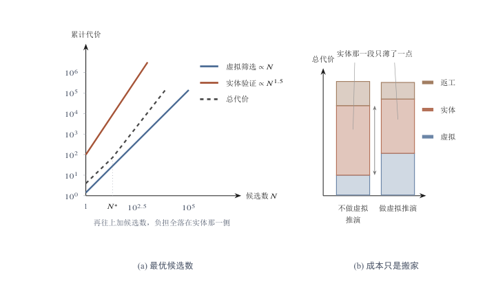
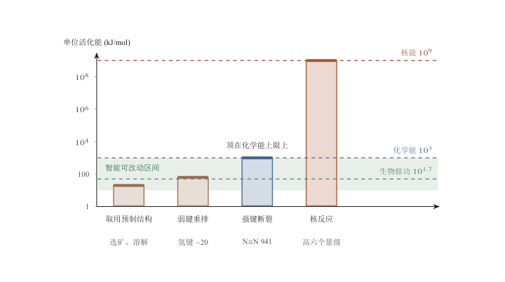
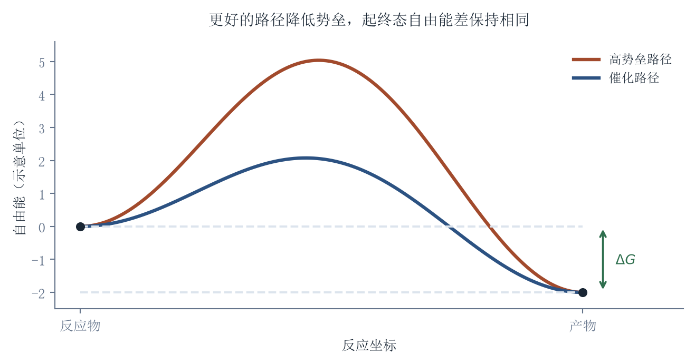
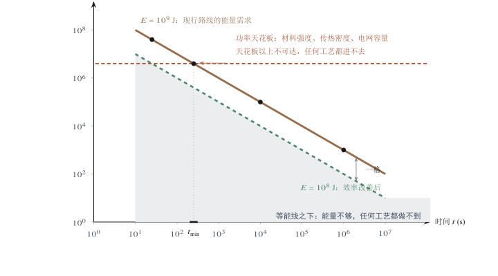
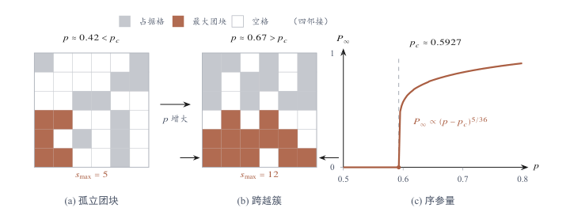
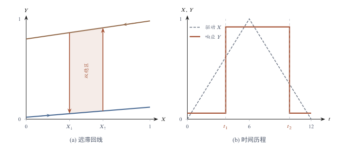
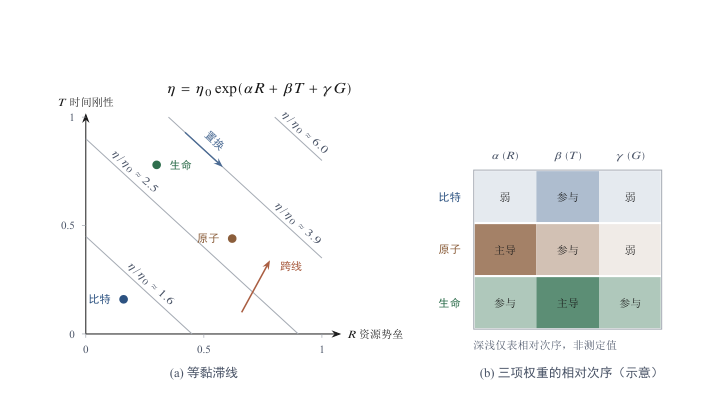

[目录](CONTENTS.md) · [English](../en/CONTENTS.md)

# 物质重构的物理疆界：基本力约束与广义黏滞模型

第一章最后停在了一个更早的问题上：在一个由能量梯度驱动、由耗散维持的世界里，智能这种东西为什么会出现。这个问题不回答，后面所有关于资源、时间和结构的约束都只能被读成外部障碍，仿佛智能本来可以轻盈地穿过物质世界，只是碰巧遇到了阻力。真实的情形正好相反：阻力不是智能的外在障碍，它来自智能的起源方式。

智能不是从虚无中降临的奇迹，也不是生命偶然获得的一种装饰性能力，它更像是热力学世界在长期演化中生成的一种路径选择机制。要理解智能为什么出现，以及它为什么会遇到资源、时间和结构的约束，不能只从大脑、语言或计算机开始，而要从更深的地方开始：从能量梯度、耗散结构、自催化网络、实体试错和虚拟推演开始。

## 智能与物质重构：优化算法的物理局限

### 最小作用量原理与路径选择器

#### 能量梯度中的耗散结构

宇宙并不静止。只要存在温差、势差、浓度差和化学能差，物质就会流动、碰撞、重组和耗散。孤立系统趋向熵增，但开放系统可以在持续能量和物质通量中形成局部有序结构。风暴、细胞、生命体、城市和机器，都不是熵增的反面，而是在更大范围熵增中形成的局部通道。它们维持秩序，不是因为逃离了热力学，而是因为吸收自由能、重组物质、排出废热，并以自身结构参与更大的能量释放过程。

这类局部秩序靠什么维持，需要一个更明确的机制说明。薛定谔在《生命是什么》中提出一个影响深远的问题：生命体如何避免迅速滑向热平衡？他的回答是，生命通过从环境中摄取“负熵”来维持自身秩序。[^schrodinger1944] 用今天更稳妥的说法，生命不是违背热力学第二定律，而是开放系统在持续输入低熵资源、输出高熵废物和废热的过程中维持局部有序。生命的秩序不是免费获得的，它必须不断支付代价。

Prigogine 的**耗散结构**理论把这个问题进一步推进。远离平衡态的开放系统，在持续通量和非线性相互作用下，可能形成新的有序结构。[^prigogine1977nobel][^nicolis1977] 这种有序不是静止晶体式的封闭秩序，而是依赖输入和输出的动态秩序。它只要停止获得能量和物质流，就会瓦解、冷却、死亡或回到更接近平衡的状态。生命正是这种动态有序的极端形式之一：它不是热力学之外的例外，而是热力学内部一种复杂、持久、可复制、可演化的耗散结构。最大熵产生原理可以作为一种启发性图像：在一些远离平衡的开放系统中，能够稳定组织通量的结构，可能更容易被维持和放大。[^martyushev2006] 风暴组织热量与动量流，生物体捕获并转化化学能或太阳能，生态系统和城市则在更大尺度上重组能量、物质和信息流。

但这里必须谨慎：最大熵产生原理不是一个无争议、可直接套用到所有生命和智能演化的普遍定律。[^bruers2007] 本章只把它作为图像，而不是证明。它帮助我们看见一种可能：**秩序并不必然意味着对熵增的抵抗；很多时候，秩序本身就是更复杂、更稳定、更持久的耗散通道。**

#### 自催化与条件的耦合

局部有序一旦形成，接下来要解决的是延续问题。从普通化学反应到生命，中间需要一些关键过渡，其中最重要的一类，是自催化。在原始海洋、热泉、矿物表面或小尺度化学环境中，分子会因为热运动、随机涨落和局部浓度差形成短暂的小序。大多数小序很快解散，重新回到无序分布。但总会有一些结构比较特殊：它们不仅存在，而且会促进自身形成。A 和 B 反应生成 C，而 C 又促进 A 和 B 继续反应，这就是自催化。自催化把偶然出现的小序放大，使短暂结构获得自我强化的能力。

自催化网络之所以重要，是因为它把“偶然结构”变成了“可延续结构”。它不只是一次化学反应，而是一个正反馈网络。只要有持续的能量和原料输入，这种网络就可能扩展、复制、竞争和分化。它吸收自由能，维持局部秩序，同时向外排放热量和废物。更复杂的结构能够更有效处理物质流和能量流，也更容易在竞争中留下来。Kauffman 关于自组织和自催化集合的工作，正是试图说明生命起源不能只从外部选择来理解，还要理解化学网络内部如何自发形成可维持、可扩展的结构。[^kauffman1993]

这里也不能把问题说得过满。自催化网络不是生命起源的完整答案。Hordijk 等人讨论自催化集合时也强调，自催化集合是类生命行为的重要条件，但并不足以单独构成完整生命。[^hordijk2018] 一个自我强化的反应网络，还需要边界、信息保存、变异、复制、选择和内部调节，才可能接近生命。自催化提供的是从偶然小序走向可延续结构的一条路径，而不是把生命起源一次性解释完毕。

缺的那几项条件各有来源，其中被讨论最多的是信息载体。RNA 世界假说在这里提供了另一条重要线索。RNA 的特殊性在于，它既可以承载序列信息，又在某些情形下具有催化功能。Walter Gilbert 在 1986 年用“RNA world”这一说法描述一种假想阶段：在 DNA 和蛋白质主导的现代生命之前，RNA 可能曾同时承担信息保存和催化功能。[^gilbert1986] 这个假说并不等于生命起源已经被解决，但它说明一个关键点：生命的出现需要把信息、反应和复制逐渐扣在一起。只有能量流，没有信息，结构很难积累历史；只有信息，没有反应和能量，结构无法维持；只有反应，没有边界，局部秩序又难以集中和继承。

因此，耗散结构、自催化网络、RNA、脂质膜和原始代谢，不应被理解为一条已经被完全证明的单线历史，而是几类必须逐渐耦合的条件：能量通量、边界、信息保存、复制、变异、选择和内部调节。膜把系统与环境区分开来，RNA 或其他信息载体保存可继承的结构，自催化网络把能量流和物质流组织起来。原始生命不是突然出现的灵魂，而是某些耗散结构在长期选择中获得边界、复制和内部调节能力的结果。

#### 相空间中的测地线

耗散结构和自催化网络说明了局部有序如何出现、如何延续，但没有说明智能在这套图景中占据什么位置。要回答这个问题，需要换一种描述方式：把一次制造活动看成系统状态在一个高维空间中的移动。

日常所说的空间只有长、宽、高三个维度，一个单摆的状态只需要位置和动量两个维度就能确定。而一座化工厂或一条总装线的状态，要用成千上万个独立变量才说得清：反应温度、压力、催化剂浓度、材料强度、物流距离、库存周期、设备折旧率、资金成本，每一项都是一个维度。原材料是其中一个坐标点，成品是另一个坐标点，生产过程就是状态点在两者之间画出的轨迹。所谓工艺改进，在这个描述里就是轨迹的重新选择。

在状态空间里，工程优化是在约束下比较路径：同一个目标，能否用更少材料、更低能耗、更短工期或更小风险达到。物理学中的驻作用量原理提供另一种严格的路径表述。它从规定的拉格朗日量与边界条件导出运动方程，不能直接等同于经济成本最小化。两种表述都关注路径，却采用不同的量与判据。

$$
S[q]=\int_{t_{1}}^{t_{2}}\left(T-V\right)dt,
\qquad
\delta S=0
$$

$S$为作用量，单位为焦耳秒；$q$为广义坐标，$T$与$V$分别为动能和势能；$\delta S=0$表示真实轨迹在规定端点条件下使作用量取驻值。驻值可以是极小值，也可以有其他性质。摩擦等非保守作用需要相应的广义力或耗散描述。这个原理提供运动方程，智能如何形成选择、记忆和学习，还需要另作机制说明。

工业中的浪费有具体来源：需求预测不准形成库存，工况控制不足增加损耗，路线安排不良造成重复运输。AI可以通过搜索、建模与控制减少这些支出。改进的大小，应在相同任务、质量和系统边界下测量，不能用“额外作用量”代替能耗、费用与时间各自的账本。

智能在这里是一种**路径选择器**。它在目标、可用资源与反馈条件下比较行动，寻找成功率更高、代价更可承受的路线。这个选择可以改变材料、工艺与初始状态，也可以改变实际损失；具体下限则要随任务和物理边界重新计算。

路径选择把一部分昂贵试错提前放进模型。比较本身有成本，所选路径也要在现实中执行。接下来需要分清三笔账：反应的热力学净代价、反应速率所受的势垒，以及设备和结构的运行维护。三者相互影响，却不是同一笔能量。

### 两笔刚性支出：活化能与熵税

改变与维持受不同条件约束。活化势垒主要影响反应速率，自由能差约束给定条件下的净功交换，维护则涉及损伤、扰动与功能持续。晶体等稳定结构可以被动维持，生命与持续运行的设备通常需要通量支持。把它们分开，才看得清智能能改进哪一段。

#### 实体试错的热力学瓶颈

但生命一旦出现，就面对一个更严酷的问题：如何在复杂环境中找到更好的路径。最初的生命系统主要依赖**实体试错**。突变、复制、竞争、淘汰和死亡，构成最古老的搜索机制。它有效，因为现实会筛选；但它极其昂贵，因为每一次失败都在真实世界中结算。一次错误突变不是修改一行代码，而是改变一个身体；一次错误行动不是改正一个答案，而是消耗能量、暴露风险、丧失繁殖机会，甚至死亡。自然选择的计算发生在真实环境中，它的代价由物质、时间和生命支付。

这就是实体试错的热力学瓶颈。环境越复杂，可能路径越多，纯粹依靠现实碰撞来筛选路径就越昂贵。演化可以用海量个体和漫长时间进行搜索，但对每个具体生命体来说，现实试错太慢、太重、太危险。一个个体不能每次都用身体去验证悬崖能不能跳、火能不能靠近、陌生动物会不会攻击、腐坏食物能不能吃。现实会给出答案，但答案常常来得太晚。

智能正是在这个瓶颈中出现的。神经系统的意义，不只是让生命感知世界，而是在身体内部建立一个低成本的环境模型。动物不必把每一种可能行动都拿到现实中试一遍，而可以先在内部预演：哪里可能有食物，哪里可能有危险，哪条路线更省力，哪个动作更可能成功，哪个对象值得接近，哪个信号必须回避。智能把一部分外部碰撞转移到内部，把一部分实体试错转化为**虚拟推演**。

这是一场深刻的成本置换。现实中的试错需要位移、受伤、能量消耗、材料损耗甚至死亡；内部推演需要神经信号、记忆、注意力和计算。二者都不是免费的，但数量级不同。智能使系统能够在做功之前先选择，在行动之前先比较，在暴露于风险之前先排除错误。它不取消物理代价，而是减少盲目支付物理代价的次数。

从生命演化和行动系统的角度看，**智能的第一性功能不是抽象思考，而是少犯昂贵的错误。**这个判断听起来不像传统哲学中对智能的赞美，却更接近生命的处境。一个生命体必须在有限能量、有限时间、有限身体和有限信息中行动。它不需要知道宇宙真理才算智能；它首先需要在行动前压缩风险，在接触前判断对象，在消耗前选择路径，在失败前排除明显错误。智能不是抽象心灵的豪华能力，而是身体在沉重世界中延续自身的路径选择机制。

#### 信息中枢与两类熵

这个机制一旦运转，就会遇到一个更细的问题：它压缩的究竟是什么。智能通过内部模型降低主体对相关环境状态和行动后果的不确定性，也就是降低行动者内部的信息熵。但这里需要区分两类熵。热力学熵描述能量耗散和不可逆过程；信息熵描述系统对状态的不确定性。Shannon 建立信息论时，把不确定性形式化为信息熵。[^shannon1948]

智能降低的不是外部世界本身的热力学熵，而是主体对环境和行动后果的无知程度，使系统更清楚地判断路径；而这种信息熵的降低，必须以真实物理过程为载体。大脑需要葡萄糖和氧气，神经信号需要电化学过程，记忆和学习需要物质结构变化。智能不是无成本的精神活动，而是开放系统内部一种高度组织化的耗散过程。

人脑本身就是一个清楚的事实锚点。Raichle 和 Gusnard 在讨论脑能量预算时指出，人脑消耗约占身体氧气和热量消耗的 20%，尽管它只占身体质量的一小部分。[^raichle2002] 这个比例本身就说明，智能不是免费的。大脑之所以昂贵，是因为它把大量环境信息、身体状态、记忆、预测和行动选择压缩在一个高耗能系统中。生命愿意为大脑支付高代价，恰恰说明内部推演能够节省更昂贵的外部试错。

兰道尔原理（Landauer）也提醒我们，信息处理不能脱离物理成本。他在 1961 年指出，逻辑不可逆操作中的信息擦除会伴随热量产生。[^landauer1961] 这个原则不能被粗暴地用来计算所有思考或所有 AI 训练的能耗，但它足以说明一个基本事实：信息不是脱离物质世界的幽灵。信息的记录、擦除、传输和计算都需要物理基座。智能降低不确定性，但不脱离热力学；智能节省错误行动的代价，但自身仍然要消耗能量。

生命体内部也因此逐渐发生功能分化。一个复杂生命系统需要能量系统、信息系统和做功系统。能量系统负责摄取、转化和供应自由能；做功系统负责移动、捕食、建造、逃避和改变环境；信息系统负责感知、记忆、预测和选择路径。细胞中有能量代谢、遗传信息和蛋白质机器；多细胞生物中有消化、循环、神经和运动系统；人类文明中则有能源基础设施、生产体系、知识体系和计算系统。智能就是耗散结构中的信息中枢。它自己不直接替代能量，也不直接替代做功，但它决定能量和做功投向哪里。大脑之所以昂贵，是因为它压缩了大量环境信息；文明之所以发展出语言、文字、数学和科学，是因为这些系统能把分散经验压缩成可传递、可推演、可复用的路径选择能力。信息越复杂，压缩越高级，系统越能减少盲目试错。

Friston 的自由能原则与这个方向有某种相通之处。自由能原则试图把感知、行动和学习放进一个统一框架：有机体通过降低预测误差或惊讶来维持自身状态。[^friston2010] 本章并不把智能简单等同于自由能最小化，也不把一个宏大理论直接套进所有智能现象。这里要借用的只是其中一个深层直觉：生命不是被动接收世界，而是不断预测、行动、修正，以维持自身在可生存范围内。智能不是在世界之外旁观，而是在身体和环境的闭环中不断选择路径。

#### 启动势垒：断裂化学键的代价

物质重构要经过实际反应路径。反应物与产物的自由能差，决定给定条件下净变化的热力学方向；活化自由能则影响跨越过渡态的速率。断开旧键需要能量，形成新键也会释放能量，净账不能只加断键支出。制造并不总把物质推向更高能状态，工艺的意义在于让目标状态以可行速率、纯度与收率出现。

在恒温恒压及相应反应条件下，吉布斯自由能变化可写成$\Delta G=\Delta H-T\Delta S$。负的反应自由能变化说明给定状态下的自发方向，却不提供速率。反应商、压力、温度与组分改变以后，方向与平衡位置也会变化。催化剂改变路径和速率，不改变同一初末状态的自由能差。

炼铁要把氧从含铁原料转移到其他物质中。高炉中的碳和一氧化碳参与还原，焦炭还提供热量并支撑料柱；能耗取决于原料、还原路线、温度、传热与设备。[^babich2021blast] 算法可以改善配料、流动和控制，替代还原剂与工艺路线也可能改变整套支出。单个铁氧键的键能不能直接当作每吨铁的最低能源账单。

水泥熟料生产包含碳酸盐分解与后续矿物形成。碳酸钙分解吸热，平衡还受二氧化碳分压影响；熟料烧成则需要规定的温度与停留条件。文献给出的约$1.7\,\mathrm{GJ/t}$理论热耗，是特定熟料组成与边界下的过程估算，实际热耗还包括传热、废气与设备损失。[^madivate1999theoretical][^madlool2011cement] 改变熟料比例、原料或胶凝材料路线，比较基准也随之变化。

高温同时影响平衡、反应速率与传递过程。提高温度能加快某些步骤，也可能增加损失或损害产物；催化与路线重设计则可能在较低温度下实现同一目标。需要区分的是给定初末状态的热力学约束、所选路径的动力学障碍和实际设备的损耗。智能可以帮助改变后两者，也可以帮助寻找新的初始状态与目标组合。

#### 熵税：维持秩序与对抗随机性

“熵税”在这里指维持功能所需的持续支出。生命依靠代谢、修复与调节，运行中的设备需要供能、散热与保养。建筑、晶体与被动储存结构则有不同的稳定机制，并非每一份有序都需要持续外部做功。维护成本应从具体损伤和扰动机制估计。

农业把光、水、营养、土地与生物过程组织成可收获的产出。育种可以改变收获指数，也可以改善抗病、光合、根系与资源利用。产量和投入不是固定总额下的单纯重新分配：它们会随品种、环境与管理共同改变。应当分别核算太阳能通量、外部投入、土地占用和收获结果。

建筑安全需要处理荷载、材料、施工与模型的不确定性。安全系数和分项系数按规范、失效模式与构件确定，不能统一解释成“理想一吨、现实两吨”。冗余材料也可能参与承载与耗能。智能设计的目标是满足可靠度要求下减少不必要支出，同时保留经得起扰动的结构。

兰道尔界限给出一种明确的微观账本：在相应热环境与信息条件下，将一个无偏比特复位，最低排热为$k_{\mathrm B}T\ln2$。室温下约为$2.9\times10^{-21}$焦耳。把一千克物体抬升一米约需9.8焦耳，两者选择了完全不同的操作单位；这个比值不能估算完整推理与完整制造任务的成本。比较完整任务，还要计入操作次数、实际器件、通信、设备及辅助系统。

### 物质重构的守恒方程

#### 虚拟推演的放大

人类文明延续并放大了这条路线。语言把个体经验压缩成群体记忆，地图把空间试错提前为路径表示，数学把关系压缩成可推演形式，科学理论把分散经验组织成可检验模型，工程仿真把昂贵实验提前到表示空间。文明的许多发明，本质上都是把实体试错提前为符号试错、模型试错和计算试错。人不必真的走遍每条路，地图可以提前筛掉坏路径；工程师不必让每座桥都塌一次，力学模型可以提前筛掉危险结构；医生不必把所有治疗方案直接施加到病人身上，实验、动物模型、临床试验和统计分析共同压缩错误空间。

人工智能进一步提高了虚拟推演的密度。它能在巨大的可能空间中搜索候选方案，发现隐含结构，生成模型，预测结果，并在真实行动发生之前进行大规模筛选。AI 不是脱离热力学的超物理智能，而是这条演化路线的新阶段。大脑用神经信号模拟世界，科学用方程和实验体系模拟世界，工程用计算机仿真模拟世界，AI 用高维统计模型和生成系统模拟世界。它们的共同功能都是：在真正支付物理代价之前，先压缩错误、筛选路径、降低盲目性。

虚拟推演把选择和执行分开了，这个分开之处可以用一个经典的思想实验说明。麦克斯韦设想有一个守在容器阀门边的小妖，能看清每个分子的速度，只放快分子通过、拦住慢分子，从而在不消耗能量的情况下制造温差。Leo Szilard 和兰道尔后来证明，妖的测量和记忆要付出信息代价，这部分上一节已经算过；更关键的是，妖没有手。它能决定谁通过，却不能推动一个分子，更不能推动一扇有质量的阀门。工业系统里的人工智能处在这个小妖的位置上：它拥有极低的信息熵，可以看清高炉里的气流涡旋、物流网络里的车辆轨迹、电网里的频率波动；它不产生力，所有对原子状态的改变都要通过执行器完成，而执行器的运转依靠电流、液压和燃烧。从控制论的角度看，工业文明是一条功率放大链：纳瓦级的神经电信号控制瓦级的肌肉，瓦级的肌肉控制千瓦级的汽车，千瓦级的汽车控制兆瓦级的工厂。智能位于这条链的最顶端，也就是能级最低的信息控制层。控制信号不等于功率流，一道逻辑门可以决定水坝闸门是开还是关，却提供不了提起闸门所需的机械能；能源不足时，无论指令多么正确、多么及时，闸门都不会动。这条链条的功率关系可以写成连乘，

$$
P_{k}=P_{0}\prod_{i=1}^{k}G_{i},
\qquad
G_{i}=\frac{P_{i}}{P_{i-1}}\gg 1
$$

式中 $P_{0}$ 为链条起点的控制信号功率，单位瓦；$P_{k}$ 为末级执行功率，单位瓦；$G_{i}$ 为第 $i$ 级的功率增益，无量纲；$k$ 为级数，正文给出的链条是纳瓦级的神经电信号、瓦级的肌肉、千瓦级的汽车、兆瓦级的工厂。每一级都不把上一级的信号当作能源，只把它当作开关，功率由本级自带的能源系统提供，所以整条链的功率从纳瓦级延伸到兆瓦级，靠逐级相乘完成。$G_{i}\gg1$ 还说明另一件事：信号层携带的功率与执行层相比可以忽略，因此“指令正确”与“能够动作”是两个彼此独立的条件。开关可以决定谁通过，却不能推动一个分子；上面这条连乘关系就是这个区别的算术形式。它的适用边界是：连乘只在每一级都配备独立功率源时才成立；任何一级缺少能量或执行机构，$G_{i}$ 降到 1 以下，链条就在该处中断，上游再高的计算精度也无法补偿。

#### 虚拟推演及其边界

但虚拟推演不是现实本身。智能可以选择路径，不能替代路径；可以调度能量，不能取消能量；可以减少无效耗散，不能让物质重构不再耗散。它不是力，而是对力的安排；不是能量，而是能量使用方向的选择机制。智能的本质不是让世界变轻，而是在世界依然沉重的前提下，减少错误搬动世界的次数。

AI 可以设计一座更省材料的桥，却不能取消钢材的质量、重力势能和连接强度；可以优化机器人动作，却不能替电机输出力矩、替关节承受磨损、替传感器处理噪声；可以筛选药物候选，却不能替人体完成代谢、毒理、临床验证和长期反馈。**智能可以逼近物理效率的下限，却不能把物理下限归零。**它可以减少错误路径，不能取消路径本身；可以减少无效实验，不能取消验证；可以减少浪费，不能取消做功。

物质重构需要把描述、投入、过程与结果接起来，可以先写成一条核算关系：

$$
\text{信息（配方）}+\text{物质（载体）}+\text{自由能（做功）}+\text{时间（过程）}\longrightarrow \text{有序结构}+\text{废热}
$$

式中的四项输入各自对应一类不可替代的条件。信息是配方，量纲上表现为比特，它决定了结构该长成什么样，但本身不改变任何原子的位置；物质是载体，单位是千克，它提供最终结构所需要的原子；自由能是做功项，单位是焦耳，它提供把原子从低能态搬到高能态所需的能量；时间是过程项，单位是秒，因为状态转移必须沿一条真实的时间轨迹展开，不能只在表示空间中跳跃。右侧的两项是结果：有序结构是被固定下来的低熵状态，废热是过程无法避免的熵增输出。这个关系成立的条件是系统对外开放，允许自由能注入和废热排出；对一个封闭系统，右侧的废热项会吞掉全部输入，有序结构无法积累。它不是会计意义上的平衡式，而是过程意义上的单向条件：只有信息，没有物质，结果不会出现；只有物质，没有自由能，状态不会改变；只有能量，没有时间，过程不能展开；只有局部有序，没有外部熵增，系统不能维持。智能能改变的是选择，不是存在条件；能优化的是路径，不是现实的物理账本。

图 2.1. 虚拟推演没有取消试错成本，只是把它从实体一侧移到了虚拟一侧。(a) 虚拟筛选的代价与候选数成正比，实体验证的单位成本高两个量级且斜率更陡，两者相加给出最优候选数 $N^*$。(b) 把同一笔账按环节分摊开：两段的相对厚度变了，柱子的总高几乎没动。

#### 候选膨胀与代价重现

这正是 AI 时代最容易被误解的地方。AI 降低的是找到可能路径的成本，而不是自动降低完成状态转移的全部成本。它可以生成一千种建筑方案，但建筑仍要施工；可以提出一万个分子候选，但实验和临床不能同步扩张；可以模拟无数机器人动作，但真实机器人仍要面对摩擦、碰撞、电池、关节和维护。搜索空间可以快速膨胀，验证和执行仍要回到物理世界。

更进一步，AI 本身也有热力学成本。模型训练和推理需要芯片、电力、数据中心、冷却系统、供应链和维护体系。所谓云端并不轻盈，它只是把材料、能耗和废热隐藏在界面之后。AI 内部表现为信息压缩和路径搜索，外部表现为高密度耗散结构。它把一部分实体试错转化为计算试错，但计算试错仍然需要物理基座。用比特替代一部分原子试错，并不等于没有原子；用计算替代一部分实验，并不等于没有能耗；用模型筛选路径，并不等于路径已经完成。

智能越强，现实越不会自动变轻。智能首先扩展的是候选空间。过去只能尝试十种方案，现在可以生成一万种；过去只能模拟少数条件，现在可以探索巨大参数空间；过去只能依赖少数专家直觉，现在可以让模型压缩海量经验。这当然是进步。但候选变多，也会把压力推向验证、执行和承受。智能降低了搜索成本，却可能提高筛选负担；降低了提出方案的门槛，却提高了确认方案的要求；降低了比特空间中的试错成本，却把原子和生命空间中的验证瓶颈显影出来。

智能形成内部表示，使一部分昂贵试错可以先在模型中进行。技术黏滞考察的是筛选之后的路径如何进入现实。两者在代价问题上相接：计算与学习可以降低某些执行成本，也可能增加新的数据、验证和维护支出。改变是否值得，需要比较整条路径，而不是只计算候选出现的速度。

从比特、原子和生命三个介质看，这一点尤其清楚。比特空间中，路径搜索可以极快：文本、代码、图像、方案和模拟可以高速生成、修改、复制和撤回。原子空间中，路径选择必须落到材料、能量、位置、摩擦、热、力和维护上；错误不能像文本一样轻易撤销。生命空间中，路径选择更重，因为生命过程具有发育、代谢、免疫、繁殖和长期反馈；一个看似有利的干预，可能在更长时间尺度上显现代价。智能越深入这些介质，越需要承认：路径可以提前筛选，但状态转移仍要支付现实成本。

路径被选中之后，还要由材料、能源和执行结构实现。计算可以帮助减少这笔支出，却不能代替实际过程。下一步需要把资源条件展开，考察哪些支出来自初末状态，哪些来自工艺与损失。

## 资源势垒：功率通量、结合能与物质丰度

智能在表示空间中把路径选出来之后，代价要在介质里结算，而介质的第一道账就是资源账。三类约束中，资源势垒最容易被误判。讨论智能的能力时，限制条件通常被设在信息一侧：模型够不够强，数据够不够多，算法够不够好，这些条件确实在快速改善，改善的幅度也可以测量。但一个方案要从描述变成事实，还要通过另一套判据完全不同的检查：材料能否取得，能量能否以需要的功率注入，过程能否在可接受的时间内完成，形成的结构能否被长期维持。物质世界不会因为一个方案被提出就自动改变。图纸可以瞬间生成，路线可以快速优化，模型可以在屏幕上推演无数可能，但只要一个方案要进入现实，它就必须回答更古老的问题：材料从哪里来，能量如何注入，过程如何展开，结构如何稳定，损耗如何处理，秩序如何维持。这就是资源势垒。

资源势垒不是简单的“缺资源”，也不是某种暂时性的供应不足，而是任何物质重构都必须穿过的状态转移条件。现实系统从状态A变成状态B，不是符号排列的变化，而是物质位置、能量分布、结构关系和时间过程的重新配置。信息可以提供配方，智能可以选择路径，组织可以协调行动，但物质本身不会因为算法更优而自动重排。资源也不是自然界中孤立存在的“东西”：它不是元素表上的名称，也不是地壳里的总储量，而是物质处在可提取、可分离、可加工、可运输、可控制、可维护的状态中。资源不是原子本身，而是物质、可用能、位置、结构、纯度、接口和可用性的组合。没有可用状态，存在不等于资源；没有进入技术系统的通道，储量不等于能力。所以，资源势垒的第一性问题不是“有没有”，而是“能不能把它带入可用状态”。

铁、硅、氮、锂、铜、铝都可以在自然中找到，但自然存在并不自动等于技术可用。物质要进入技术系统，必须经过提取、分离、提纯、运输、加工、稳定和维护。每一步都需要可用能，每一步都会产生损耗，每一步都要依赖设备、组织和时间。可用性因此不是物质的属性，而是技术系统的工作结果，这一点反过来解释了为什么同一片土地在不同技术水平下承载的人口和产业相差极大，也解释了为什么资源统计总是滞后于技术能力的变化。所谓资源，是技术系统在自然物质中制造出来的可用性。

### 功率通量限制与卡尔达肖夫标度

#### 可用能的能级

这里的“可用能约束”不是把某一种热力学势函数直接套用于所有技术系统，而是泛指能够推动状态转移、维持局部有序并被技术系统实际调用的能量条件。对一个工程系统来说，关键不只是能量总量，而是能量能否以合适的形式、功率、位置、时间窗口和控制精度进入过程。热量、燃料、电力、机械功、化学势和位势都可能参与现实改变，但它们只有在可被技术系统调度、转换和约束时，才真正成为能力。可用能的形式也不止一种：城市和基础设施把大量材料抬升、固定、连接起来，本质上是把可用能以重力位势的形式存入结构，这笔势能只有在拆除和搬运时才会被重新取出，浓度、位置和纯度与能量一样构成状态转移的前置条件。

那么，一种可用能究竟能支撑起多大的重构能力，这一点取决于它处在哪一个能级上。1964年，卡尔达肖夫提出用文明能够支配的功率来划分文明等级[^kardashev1964transmission]，该标度通常写成

$$
K=\frac{\log_{10}P-6}{10},
$$

这里$K$为文明等级，无量纲；$P$为该文明能够支配的总功率，单位瓦特；分母10的含义是指数每变化0.1，对应功率提高1个数量级，$K$每增加1，对应功率提高10个数量级。按这个标度，1级对应$10^{16}$瓦；人类目前的功率消耗大约在$2\times10^{13}$瓦量级，即20太瓦，代入得$K\approx0.73$，与1.0之间相差约2.7个数量级。[^smil2017energy]文献中常引用的另一种口径把地球接收到的全部太阳辐射（约$1.7\times10^{17}$瓦）算作1级，按本式它对应$K\approx1.12$；两种口径的差别只是零点不同，不影响下面的结论。在这个坐标系里，0.73与1.0之间不是27%的差距。

化学反应与核反应具有不同的单次能量尺度，核裂变已经是现实电力来源，太阳能、水电与风电也不以人类燃烧化学燃料为前提。[^jaffe2018physics] 能量来源的微观尺度，不能直接决定一座工厂可获得的宏观功率。工业过程还受能量转换、输送、设备、材料和控制条件约束。

不过，这个标度容易被误读成一条单维排名。功率总量只是文明能力的一个坐标，同样的功率，以什么形式、在什么位置、用多高的控制精度释放，结果差别很大；反过来，一个功率总量不高但调度能力很强的系统，可以在特定领域完成功率更大的系统做不到的状态转移。卡尔达肖夫指数回答的是上限问题，不是全部问题，把$K$值当成文明评分，会漏掉可用能形式、释放位置和控制窗口这三个变量。

从这个角度看，技术的第一性对象不是信息，而是由物质、能量和约束共同维持的局部有序结构。桥梁、芯片、电池、药物、工厂、城市、数据中心，都不是单纯的“物体”。它们是物质被能量推离分散、无序或不可用状态之后形成的功能结构。它们要被制造出来，要在扰动中保持功能，还要不断对抗磨损、腐蚀、热、噪声、老化和故障。技术不是把想法变成现实这么简单，而是把可用能转化为可控、稳定、可维护的局部秩序，热力学和能源史反复说明，文明不是脱离能量的符号系统，而是依赖能量转换、物质组织和废热排出的开放过程。[^smil2017energy][^callen1985thermodynamics]

#### 化学能之上的台阶

核裂变通过核燃料、反应堆与热力循环提供功率，同时带来燃料供给、材料、废物与安全治理要求。它能否长期扩大使用，要比较资源路线、技术、成本和制度条件，不能仅由天然铀235丰度或废物存在直接判定。化学、核与其他能源各自的约束，应在完整系统上核算。

氘氚聚变单次释放约17.6兆电子伏特。实现有用净能量还需要满足等离子体约束、材料、氚循环、排热和设备运行条件。[^atzeni2004physics] 聚变若形成成熟能源系统，可能扩大供给选择；在此之前，工业能力仍可通过现有能源、转换与工艺继续改进，并不被统一锁在一种价电子能级上。

火箭方程显示，给定有效排气速度时，较大的速度增量需要迅速上升的质量比。化学推进具有实际性能范围，约每秒4.5公里是高性能化学发动机的代表量级，并非所有设计共享的严格上限。任务还可采用分级、引力辅助或其他推进方式。约束的力量在于可以逐项计算，而不是直接从单次反应能量宣布活动半径。

$$
\Delta v=v_{e}\,\ln\frac{m_{0}}{m_{f}},
\qquad
\frac{m_{0}}{m_{f}}=\exp\!\left(\frac{\Delta v}{v_{e}}\right)
$$

式中 $\Delta v$ 为火箭获得的速度增量，单位米每秒；$v_{e}$ 为有效排气速度，单位米每秒，它的上限由反应热给出，正文给出的量级是每秒 4.5 公里；$m_{0}$ 为起飞质量，$m_{f}$ 为推进剂耗尽之后的质量，单位千克；两者之比称为质量比，无量纲。对数是这个式子的全部要害：速度增量每增加一个 $v_{e}$，质量比就乘一次 $e$，想要的速度增量越大，必须留给燃料的质量比例越高，而 $v_{e}$ 的上限由化学键能级设定，所以这不是发动机设计的问题。正文所说“绝大部分起飞质量必须留给燃料、人类的活动半径因此被锁在地球附近”，写出来就是质量比随 $\Delta v/v_{e}$ 指数上升。它的适用边界是：这里给出的是理想速度增量，忽略空气阻力与重力损失，真实任务所需的推进剂比它算出的更多；本书不代入具体任务的目标 $\Delta v$，因为那取决于任务本身，这个式子在这里的作用只是说明 $v_{e}$ 的量级如何限定宏观迁移成本。

#### 计算速率与功率速率的失配

计算、储能与执行器的改进路径不同。电池的比能量、比功率、寿命、安全与成本要同时权衡；电芯、包级系统与理论材料值也须分开。比较燃料与电池，还要计入发动机和电机效率及任务质量。历史年改善率不是永恒常数，按百分比复合增长也不是线性增长。[^ziegler2021reexamining][^viswanathan2022challenges]

布雷默曼与贝肯斯坦一类理论界限，分别讨论特定假设下的信息处理或信息容量。[^bremermann1982minimum][^bekenstein1981universal] 它们不能用来推算商用芯片还有多少年可按当前速度改进。设备的可用进步还受材料、互连、存储、散热和制造经济性限制；机器人行动则要另算执行器与储能的功率账。

#### 四组条件

把技术看作局部有序结构的生成过程，物质重构要穿过的条件就可以逐项列出。第一组是材料条件：现实改变需要载体，桥梁需要钢材和混凝土，电池需要金属、隔膜和电解质，芯片需要高纯材料，药物需要可合成、可稳定、可进入身体的分子。没有载体，信息只是描述；载体不合适，方案就无法进入世界。很多技术不是败给想象力，而是败给材料形态、纯度、技术链条、寿命和长期稳定性。第二组是可用能条件：材料从一种状态进入另一种状态，通常要跨越势垒，矿石要还原，分子键要断裂，晶格要重组，物体要搬运，结构要抬升，设备要驱动。能量不是附加因素，而是状态转移的条件，没有足够可调用、可控制、可集中释放的可用能，物质不会因为人类更聪明就自动形成新的秩序，经济过程中的生产、转化和废弃，也不能脱离熵增、耗散和不可逆性。[^georgescu1971entropy]

第三组是过程条件，它的特点是过程的速度对温度高度敏感。现实改变不是瞬间发生的，钢铁要冶炼，水泥要煅烧，药物要合成和验证，芯片要经历多道工艺，建筑要施工、养护、检查和交付；过程需要设备、时序、环境、人员和稳定条件，许多物理过程不能像软件一样复制、回滚或重启，过程越精密，对温度、压力、纯度、时机和环境的要求越苛刻。这种敏感性有确定的物理形式，反应速率与温度之间的关系由阿伦尼乌斯关系描述，它的表达式和适用条件在处理强共价键断裂时给出。这里先记住它的结论：活化能越高，温度对速率的影响越剧烈，温度在高温工艺里不是线性放大器，而是越过势垒的开关。

第四组是维持条件，它把前三组的账目从一次性投入变成长周期支出。一个有序结构不是建成之后就永久存在，机器会磨损，建筑会老化，管道会腐蚀，材料会疲劳，数据中心要冷却，基础设施要维护，药物体系要监管，局部有序结构不是一次性成果，而是持续抵抗耗散的状态，维持秩序本身，就是资源势垒的一部分。这四组条件构成了物质重构的底层关系：信息提供配方，材料提供载体，可用能完成做功，过程展开结构，维持机制抵抗耗散。这个关系里没有任何一项可以被信息完全替代，只有配方，没有载体，结果不会出现；只有载体，没有可用能，状态不会改变；只有能量，没有过程，结构不会稳定；只有局部有序，没有持续维护，系统无法长期存在。

这四组条件的清单容易被读成一张审批表，似乎逐项通过就能进入现实。实际的情形不是这样，四项必须同时在场，任何一项接近于零，其余三项的投入都无法结算：材料短缺会让可用能空转，可用能不足会让过程停在半途，过程失控会让维持成本超过结构本身的价值。资源势垒的核心含义正在这里：**现实不是由可能性组成，而是由可执行状态组成。**可能性可以无限生成，可执行状态必须满足物质条件。一个方案成立，不等于材料已经到位；材料存在，不等于可用能已经注入；能量足够，不等于过程已经稳定；过程完成，不等于结构可以长期维持，真正的现实改变，必须穿过从材料到可用能、从工艺到维护、从局部状态到长期秩序的完整链条。

这四组条件在历史的每个阶段并不以同样的强度生效。技术系统曾经长期绕开其中最昂贵的一项：它并不自己制造所需的低熵结构，而是直接取用自然过程已经完成的产物。木材有强度，纤维有韧性，河流有落差，煤炭有化学能，在那种起点上，材料条件、过程条件和维持条件的账目要轻得多。取用自然预制结构的代价，是把技术系统的规模上限交给了自然过程的产出速率；一旦需求超过这个速率，四组条件就会同时以完整强度回到账面上。这种取用能持续多久，决定了资源势垒此后以什么样的形式重新出现。

### 低活化能物质利用与物理形态重构

技术史的起点不是制造物质，而是挑选物质。人类最早使用的材料和动力，几乎都不是自己合成的，它们是被光合作用、地质过程和演化过程提前制造好的结构。理解这种取用的性质，才能理解早期技术为什么显得轻巧，以及这种轻巧为什么不可持续。

最早的技术，并不是制造世界，而是利用世界已经制造好的部分。木材、棉花、兽皮、骨骼、水流、风力、动物肌肉、煤炭和石油，都不是人类从零创造的资源。它们是自然过程已经组织好的结构，或者已经积累好的能量形态。树木把阳光、二氧化碳和水转化成纤维，植物和动物把环境中的物质组织成身体，河流和风场把能量流排列成方向，化石燃料把远古生命捕获的太阳能封存在化学键中。早期技术之所以显得轻巧，不是因为它摆脱了物理，而是因为它调用了自然已经完成的工作，这就是低垂果实的真正含义。

#### 自然预制结构的取用

低垂不是低级，而是自然已经预付了一部分账单。人不需要自己合成木材，不需要自己设计棉纤维，不需要自己即时制造煤炭中的化学能，自然已经替技术系统预付了能量、结构和时间，技术只是在这些预制结构上切割、搬运、编织、燃烧、驯化和重排。换言之，低垂果实不是容易的果实，而是自然已经完成低熵结构生成的地方。木头已有强度，石头已有硬度，纤维已有韧性，肌肉已有机械功，河流已有落差，煤炭已有化学能，早期技术沿着自然给出的低阻路径前进，它主要改变形态，而不是重写物质本身；主要调用已有秩序，而不是从无序中制造秩序。这也解释了为什么很多早期技术看起来格外“自然”：风车不是制造风，而是拦截风；水车不是制造落差，而是利用落差；木屋不是制造纤维素结构，而是切割树木；驯化动物不是制造肌肉，而是组织动物已有的代谢和运动能力。技术并不是没有成本，而是大量成本已经被地质、生命和气候过程提前摊销。

棉花把自然形成的纤维素结构带入纺织加工。植物已完成材料合成，纺织机械主要组织牵伸、加捻与卷绕。[^klemm2005cellulose] 这一形态适配是机械化的重要条件，工业革命的发生还涉及能源、贸易、资本、劳动与制度，不能由“当时没有断开强化学键的能量密度”单独解释。

能适应早期粗糙机械加工的，不只有化学上的低活化能，还有微观形态上的适配。棉纤维沿轴向分布着天然转曲，这不是随机缺陷，而是细胞壁在脱水过程中因层积差异形成的螺旋状扭曲：棉铃成熟开裂、水分蒸发之后，原本圆柱形的细胞塌陷，形成带物理咬合点的三维形态。纤维之间的摩擦因此被显著放大，纺纱机只需施加较小的加捻力矩，就能在纤维间产生很大的法向压力，把松散的短纤维抱合成连续纱线。羊毛表面有鳞片，摩擦系数不小却容易毡化纠缠，难以适应高速机械梳理；亚麻表面平直光滑，抱合力差，必须借助高能耗的湿纺。棉花正好落在无需化学粘合、仅靠机械力学就能完成重构的区间，所以早期纺纱机可以用极低的功率驱动。标准化是另一半原因。羊毛受个体差异、生长部位和环境波动影响，直径、长度和卷曲度都呈离散分布，处理这种原料需要人的手和眼进行实时反馈，这超出了刚性机械的能力。棉花是种子纤维，细度、长度和成熟度受基因表达和种植条件严格约束，方差很小。水力纺纱机不需要视觉识别，也不需要触觉反馈，它只需要重复执行牵伸、加捻、卷绕这套固定动作，因为输入端的变异已经被生物学规律限制在可控范围内。

但低垂果实不会无限延伸。随着需求扩大，技术系统不再满足于自然给出的形态：木材不够坚硬，需要钢铁；天然肥力不够稳定，需要化肥；自然纤维不够多样，需要合成材料；自然晶体不够精密，需要半导体；普通燃烧不够可控，需要电力系统；自然药物不够精确，需要合成分子和靶向干预。技术开始从调用已有结构，转向主动制造结构。

#### 活化能阶梯

从调用已有形态转向主动制造，工艺条件通常更复杂。本书把这种变化称为“活化能阶梯”，指向提纯、反应、晶格、缺陷与界面控制等门槛。各工艺的活化能具有明确物理含义，整座工厂的资本和维护负担则没有一个统一的活化能数值。二者需要分开测量。

技术可用性取决于材料是否达到需要的纯度、形态、浓度与位置。沙子不是晶圆，矿石不是钢材，地层中的锂也不是电池。形成可用状态需要提取、运输、加工、反应与质量控制，其成本既包括热力学和动力学条件，也包括设备与组织。

精密制造常需要更严格的洁净、缺陷、测量与过程窗口。芯片缩小以后，某些控制任务会更难，同时也可能通过工艺创新降低单位功能成本。需要核算的是具体步骤的能耗、良率、资本与维护，不能把所有控制难度都归入一个逐级升高的活化能。

启动与维持应放进同一生命周期。更精细的结构可能增加控制与维护要求，也可能以更少材料、更低能耗完成同一功能。技术深入物质底层，并不保证总成本单向上升；它要求核算从发现、制造到长期运行的完整路径。

图 2.2. 活化能的阶梯与三类能源的供给上限。四档重构任务的需求依次抬高，第三档（强共价键断裂）落在化学能可支付区间的边缘：合成氨与炼铁之所以昂贵，不是因为工艺不巧，而是因为要断的键与能支付的能处在同一量级。智能能改变的是选哪条路径，不是台阶的高度。

#### 生物动力向机械动力的转换

门槛之外还有动力形式的更替，这一层变化发生在做功方式上，而不发生在物质内部。机械化普及之前，生产动力主要来自生物体的骨骼肌收缩，人体或役畜本质上是一台把化学能转化为机械能的发动机。肌肉在微观层面的转化效率很高，但作为工业动力源有几个无法克服的缺陷。一个健康成年男性在持续体力劳动中的稳定输出功率约为75瓦，这一数值由基础代谢率和散热能力共同决定；试图提高输出，肌肉就进入无氧呼吸，乳酸堆积使收缩功能迅速衰竭，动力源必须按昼夜节律停机维护。在时间维度上，生物动力的利用率因此被限制在三成到五成之间。输出的一致性同样成问题：生物运动由神经系统控制，生理性震颤、注意力涣散和情绪波动都会在输出端引入随机误差，每一根手工纱线的捻度和强度都呈正态分布，难以满足标准化织造对均一性的要求。依赖生物动力的生产系统，被锁死在低功率、间歇性和高方差的状态里。

早期纺织机械的意义，在于把这套生物力学过程拆成了刚体运动。手工纺纱需要同时协调手指开合、手腕旋转和手臂牵拉，是一个多自由度的非线性动作；引入刚性连杆、凸轮和齿轮之后，系统的自由度被限制，只保留必要的旋转与往复运动。运动轨迹由几何约束唯一确定，只要输入恒定，罗拉转速和锭子捻度就是严格恒定的；动力源与控制系统也随之解耦，水轮只负责提供扭矩，控制逻辑由传动比固化在结构里。机器不需要“知道”如何纺纱，它被物理结构限制在只能执行纺纱动作的轨迹上，这种确定性是规模化生产的物理前提。

真正推动早期纺织工业的动力并非热能，而是重力势能，即水力。水轮机利用流体的落差直接输出连续旋转扭矩，功率由流量、落差和效率决定，一条中小河流的落差与流量所蕴含的功率可以轻易达到数十千瓦，相当于数百名工人的瞬时输出总和，而且可以集中在一根传动轴上输出，驱动庞大的多轴联动机械。河流不需要睡眠，也不产生乳酸，只要水文条件允许就能连续运转，资本设备的利用率因此从生物极限的三成提升到接近满负荷。这一阶段的技术史还有一个容易被跳过的细节：纽科门蒸汽机在瓦特改良之前就已经在使用，它的热效率只有0.5%到1%，受当时气缸材料和加工精度限制，蒸汽无法维持高温高压，温差很小，大量热能被冷凝水带走。它之所以仍然被采用，是因为它解决了能量的空间分布问题：水力受制于地理和季节，工厂主用低效的蒸汽机把下游的水抽回上游水库，人为制造落差，再用水轮机高效地转化为机械动能。这条迂回路径说明，在材料科学尚未突破之前，机械结构的刚性和运动的连续性比能源的转换效率更关键。

#### 预制结构的供给上限

自然预付的那部分之所以有限，原因在供给侧的几何条件。地表生物质能的总量由恒星辐射决定，太阳表面的发射功率约为$3.8\times10^{26}$瓦，经过约1.5亿公里的空间扩散，到达地球大气层上界的能量密度只有约1361瓦每平方米，这一数值称为太阳常数。[^prsa2016nominal]经过大气吸收、散射和云层反射，再加上昼夜交替与纬度倾角带来的几何折减，中纬度地区可用的年平均地表辐射通量还要低得多。植物的转化效率进一步压缩了这个额度：光合作用只利用波长400纳米到700纳米之间的光子，这部分光合有效辐射约占总辐射的43%，受光化学反应的量子需求限制，C3植物的理论最大转化效率约为4.6%，C4植物约为6.0%。[^zhu2008what]在真实的农业和林业生产中，受水分、温度、养分和生长季节影响，实际光能利用率通常低于1%。这决定了生物质能的功率密度被锁在一个很低的水平：要获得1瓦的持续生物化学功率，大约需要2.5平方米的土地持续接收阳光。[^smil2015power]把这三个因子写成乘积，

$$
P=\Phi\,A\,\eta
$$

式中，$P$ 为持续获得的生物化学功率，单位瓦；$\Phi$ 为到达受光表面的辐射通量密度，单位瓦每平方米，正文给出的太阳常数约 1361 瓦每平方米是它在大气层上界的取值；$A$ 为持续接收阳光的面积，单位平方米；$\eta$ 为从入射辐射到可用生物化学功率的总转化效率，无量纲，其中包含大气吸收与散射、昼夜交替与纬度倾角带来的几何折减、光合有效辐射的波段占比，以及光化学反应的量子需求。写成乘积之后，正文的两个判断都成为它的推论：效率项 $\eta$ 可以靠育种、灌溉和农艺改善，但受光化学上限约束，正文给出的 C3、C4 植物理论最大转化效率分别为 4.6% 与 6.0%；面积项 $A$ 只能铺在地表，因为阳光不能被堆叠，这就是资本可以三维堆叠、驱动资本的能量却只能在地表二维采集的数量来源。它的适用边界是：这是稳态平均功率的关系，不描述储能、输运和季节性波动，也不计入土地在水资源、肥力和生态方面的其他占用；把 $\eta$ 按理论上限代入会高估实际供给，因为真实农田的光能利用率低于正文所说的 1%。

这种面积约束塑造了前工业社会的空间安排。农业、林业和牧业分别供应口粮、纤维、燃料、木材与畜力，许多需求竞争同一片土地。役用马能够提供高于人的持续机械输出，却也需要饲料与草场。[^smil2015power] 能源流量与土地利用因此紧密相连，贸易、产权和劳动组织又决定了约束怎样分配。

这套计算衡量的是流量，也就是每年重新接收的阳光，而不是自然界已经积累的存量，界限正在这里。木材、纤维和畜力都属于流量型能源，一旦可以被地质时间积累下来的存量替代，同样一片土地就能支撑高得多的功率，这正是后来化石能源改变整个局面的原因。不过在存量被大规模调用之前，上述上限对任何依赖当年光合产出的系统都成立，马尔萨斯式的停滞因此不是农业技术不够好，而是低功率密度能源系统在有限二维平面上的必然饱和。

突破这个上限的早期办法不是提高效率，而是把约束转移到别的土地上。羊毛是次级产品，太阳能先被牧草捕获，再经过羊的代谢转化，生产1000磅羊毛需要50到100英亩草场；棉花是初级产品，太阳能直接被转化为纤维素，同样的产量在光热充足的低纬度地区只需要1到2英亩。1830年前后的英国纺织业如果改用本土羊毛替代进口棉花，仅原料一项就要占用超过全国的可耕地。进口棉花、蔗糖和木材，在物理上等于在海外租用土地进行光合作用，把人力的口粮、工业的原料和部分生物动能转移到别人的太阳底下。殖民地同时承担两个角色：低熵物质的来源和高熵废物的去向，本地环境的改善以异地生态的退化为代价。约束没有消失，它只是换了一个地方出现，这是本书后面会反复遇到的同一种操作。

如果用技术史来概括，这不是简单从“低级”走向“高级”，而是从调用自然预制结构，走向人工制造低熵结构。早期文明主要使用自然已经浓缩好的能量和形态，工业文明开始大规模重排宏观物质，现代制造进一步控制化学、晶体和微观结构，更深层的技术则开始介入生命网络、复杂材料和行星级循环。这条路的本质始终没有变：**技术越想摆脱自然给定的形态，越要自己支付形态生成的成本。**所谓文明能力，不只是调用更多能量，而是把自由能注入更难控制的结构中，并让它们稳定运行。总能量多，不等于技术能力强；能否在正确地点、正确时间、正确尺度，以足够功率密度和足够控制精度释放能量，并处理废热、副产物、故障和维护，才决定能量能否成为现实结构。文明不是一团更大的火，而是一套更精细的自由能组织机制。

实验室结果变成产品，需要原料、纯度、合成条件、良率、稳定性、规模化与废物处理同时配合。催化剂、电池与新材料的突破，可能改写整条流程；是否做到，要在相同产出与边界下测量。单点结果提供入口，全流程才决定可用性。

#### 低能态存量的耗尽

流量型能源的通量上限之所以致命，是因为它把工业规模的扩张速度交给了当年的日照和降水。当森林的再生速率赶不上冶金的消耗速率，系统就碰到了通量天花板：地表生态系统无法实时捕获足够的太阳能来喂养工业机器。可选的路只剩两条，或者退回低能耗的农业社会，或者找到一种能量密度更高、不受实时光照限制的能源。煤炭提供的就是后一条路。燃烧一吨煤，释放的是植物遗骸在地质压力下经过亿万年碳化积累下来的太阳能，等于把数千万年的时间存量压缩进几分钟的功率流量。

存量替代流量带来的不只是总量变化，还有能级变化。木材燃烧的火焰温度通常在700到900摄氏度之间波动，难以稳定维持金属冶炼所需的高温；焦炭燃烧可以轻易超过1500摄氏度。高温在这里不只是热量，它同时是化学势：只有把温度推到这个区间，碳原子才获得足够的动能去撕裂铁与氧之间的离子键。从木材到煤炭的转型，因此标志着工业文明从利用物理属性进入改变化学属性，从加工自然合成的分子转向重排原子的排列。人类不再满足于捡取生物合成的高分子，而是开始动用地质存量，去支付活化能阶梯上更高一级的门票。

#### 智能能改动的部分

智能可以搜索新结构、预测性质、寻找催化路径、缩小实验盲区并改进维护。更好的路径既能减少试错，也能改变生产过程本身。评价它的贡献，要同时记录节省了什么、增加了什么，以及形成的新结构能够维持多久。

需要补一句的是，智能带来的改善在阶梯各层之间并不均匀。在表示空间里，搜索、筛选和优化的收益随候选数量增长得很快，几乎不受物理速率限制；在必须物理执行的层上，收益受制于实验装置、材料批次、工时和环境控制，增长要慢得多。把前者的改善速度外推到后者，是这类判断最常见的一种错误，也是新方案规模化时反复出现的落差来源。

从取用自然形态到主动构造功能，技术逐渐承担更多结构生成任务。过去昂贵的功能仍可能因新原理、新材料与规模化变得便宜。资源分析的用途，在于找出当下哪项条件控制成本，以及哪种改进真正改变了这项条件。

这条阶梯也不只在纵向上加高。向物质底层深入的技术，会同时进入几种性质不同的边界：有的来自已被固定的巨大质量，有的来自热噪声和缺陷，有的来自元素在世界上的分布方式。它们要求的代价形式并不相同，也不接受同一种解法，把其中任意一种当成全部，都会得出错误的成本判断。只有把它们分开处理，才能判断哪一项阻力是可以压缩的，哪一项只能如实支付。

### 强共价键断裂与化石能源的物质转化

从木材到煤炭解决了高温的来源，但高温只是支付手段，真正被购买的是断裂强化学键的能力。地质存量被调用之后，文明第一次可以在工程时间内拆开那些在生物代谢能力之外的键，其中最具决定性的一个，是氮气分子里的三键。氮是蛋白质和核酸的骨架元素，而自然界中的氮几乎全部被锁在惰性的双原子分子里，前工业时代的人口上限因此被可利用氮的极低通量锁住。把煤和气变成粮食，是一条从地质存量到生物存量的转译路径，它的物理机制是把高温高压环境当作撬棒。

#### 有解与可用之间

这条完整链条解释了为什么很多技术看起来已经“有解”，却很难迅速改变现实。新能源设备在模型中高效，不等于电网、储能、土地、调度、维护和替换周期已经配套。机器人动作在仿真中可行，不等于电机、关节、传感器、摩擦、碰撞和安全边界已经解决。材料选择、材料效率和生命周期分析之所以重要，正是因为物质系统的约束不只在“有没有材料”，还在材料如何被取得、加工、使用、维护、回收和替代。[^ashby2012materials][^allwood2012sustainable]

**资源势垒不是技术落后的偶然结果，而是物质世界的边界条件。**所有现实系统都必须回答同一组问题：能否取得足够材料，能否以足够功率改变状态，能否在可接受时间内完成过程，能否处理副产物和废热，能否长期维护形成的秩序。一个方案如果不能回答这些问题，就仍然只是信息空间中的方案，还不是现实空间中的能力。这也是为什么文明能力不能只用“拥有多少信息”来衡量，甚至不能只用“调用多少能量”来衡量，真正关键的是能否把可用能以足够功率密度、足够控制精度、足够低损耗，注入正确的物质结构，并把废热、损耗和维护问题处理掉，能量总量只是条件之一，可用形式、释放位置、控制窗口和维持能力，才决定能量能否成为现实改变。这个区分可以换一组更具体的对照来看：一堆煤不是工业文明，能够把化学能稳定转化为机械功、电力、运输、冶炼和工厂体系，才是工业文明；阳光照射地球不是光伏系统，能够把分散能流收集、转换、储存、调度并接入电网，才是能源技术；硅元素普遍存在不是信息文明，能够把硅带入高纯、可加工、可运行的技术链条，才是芯片能力。

到这里要防止一种误读。资源势垒不是资源有限论，也不是技术悲观主义，它描述的是条件，不是天花板的高度。如果一项技术确实找到了更短的链条，用更少的材料、更低的温度、更短的流程完成同一个状态转移，势垒的位置就移动了，这正是过去两个世纪反复发生的事情。资源势垒反对的不是绕过某一道障碍，而是把移位置当成取消条件：把消耗转移到更深的技术链条、更远的产地或更晚的维护周期上，条件并没有消失，它只是换了一个地方出现。

所以，“资源”从来不是自然给定的静态物品，而是技术系统制造出来的可用状态。越是高级技术，越少是在直接使用天然资源，越多是在制造资源：制造高纯材料，制造稳定功率，制造洁净环境，制造精密接口，制造可维护结构。资源势垒不是横在技术前方的一堵墙，而是技术自身必须不断承担的生成条件，全球物质存量和关键矿物研究都显示，现代技术系统越复杂，越依赖大规模材料流、长期基础设施存量和特定矿物的开采、精炼、运输与加工能力。[^krausmann2017global][^iea2021criticalminerals]

#### 跨越势垒：合成氨

反应能否发生和反应有多快是两个不同的问题，前者由自由能判定，后者由动力学决定，而后者的表达式就是前面延后给出的那一个。反应速率与温度的关系通常由阿伦尼乌斯关系描述：

$$
k=A\exp\!\left(-\frac{E_a}{RT}\right),
$$

$k$为反应速率常数，单位随反应级数而定；$A$为指前因子，与碰撞频率和取向有关；$E_a$为活化能，单位焦耳每摩尔；$R$为气体常数，约8.314焦耳每摩尔开尔文；$T$为绝对温度，单位开尔文。这个关系成立的前提是反应由单一主导势垒控制，且温度区间内$E_a$近似不变。$E_a$出现在指数上，意味着活化能越高，温度对速率的影响越剧烈，把温度提高一倍不是把速率提高一倍，而是让速率跨越数量级。炼钢、煅烧和合成氨必须维持高温高压，原因就在这里：不是工艺偏好，而是只有在这种条件下势垒才可能被穿过。催化剂走的是另一条路，它降低 $E_a$ 的数值，从而在同样温度下把速率抬上去，但它改变的是路径的高度，不是键能本身。

合成氨把这个机制推到了极端。氮气占大气体积的78%，是地球上最丰富的元素资源之一，但两个氮原子之间由一个σ键和两个π键组成的三键紧密结合，键能约945千焦每摩尔，键长仅0.109纳米，这使氮分子几乎不与其他物质反应。前工业时代能够固氮的路径只有两条：闪电在数万开尔文的等离子体中把氮和氧强行结合，随雨水落下；少数原核生物用固氮酶在常温常压下缓慢还原氮气，而每固定一个氮分子要消耗至少16个ATP，考虑副反应和细胞维持，实际成本往往在20到30个ATP。两条路径的产出通量都很有限，前工业时代全球陆地生态系统的自然固氮总量在每年100到140太克氮的量级，这就是生物圈能够获得的氮预算上限。耕地上的作物产量因此不再取决于阳光、水或二氧化碳，而是被土壤中稀缺的活性氮锁住，李比希的最小因子定律在这里显示出它的物理约束力。

哈伯-博施法打破了这道锁，代价是把反应放进一个极端物理场。合成氨的反应本身是放热的，常温下速率却几乎为零，因为要跨越氮氮三键的活化能壁垒。温度必须维持在400到500摄氏度，这是一个热力学的妥协：高温按勒夏特列原理会把平衡推向逆反应、降低单程产率，但只有高温才能让速率进入工业可用的区间。压力同时要加到150到200个大气压，用来对抗高温带来的平衡移动，并提高气体分子的碰撞密度。氢气的来源本身就消耗大量能量，工业上通常采用甲烷蒸汽重整，那是一个强吸热反应，需要燃烧天然气来驱动。把整条链条合起来看，现代农业的产出不是自然的馈赠：它用地质历史中封存的化石能源，通过高温高压拆开微观世界最顽固的键，把地质存量转译成生物存量。催化剂可以降低对温度和压力的要求，材料筛选可以找到更高效的铁系或钌系催化剂，但只要目标是把惰性的氮转化为活性的氨，键的断裂与重组就无法省略。[^erisman2008how]

图 2.3. 催化改变路径与动力学势垒。图中的两条示意路径有相同起终态，$\Delta G$保持相同；降低活化自由能有助于加快速率，反应平衡由起终态决定。

#### 智能在这条链上的位置

智能可以筛选催化剂、寻找新反应路线、优化工艺窗口、调度能源并预测故障。催化会改变反应路径与速率，工艺整合也能回收热量、减少分离支出。改进应通过整个过程的能耗、良率、产能、安全与停机时间来衡量。

更麻烦的是，智能系统自身也在资源势垒之内。数据中心可以通过硬件、冷却和利用率提升显著改善能效，但“效率提高”不等于“物理基础消失”，大规模计算仍然要占用设备、土地、电力、冷却系统、技术链条和维护能力。[^masanet2020recalibrating]信息处理本身也不是脱离物理的幽灵，兰道尔原理至少提醒我们，信息擦除和逻辑不可逆操作存在热力学下限，尽管这一原理不能被粗暴地直接换算成所有现实计算系统的总能耗。[^landauer1961]

因此，判断一项技术是否真正降低现实代价，不能只看它在信息空间中生成了多少方案，而要看它是否减少了现实中的材料消耗、能量损耗、工艺步骤、维护负担和长期不可逆后果。如果一个方案只是把消耗转移到更深的技术链条、能源系统、算力后台或维护结构中，它没有突破资源势垒，只是改变了资源势垒的位置。真正可靠的技术进步，不是用比特逃离原子，而是在原子的硬约束中，用更好的路径完成不可豁免的状态转移，现实改变的本质，不是让可能性出现，而是让物质在可用能推动下，进入一个可维持的新秩序。

### 宏观质量堆积与重力势能库的建立

技术系统向物质底层推进时，遇到的边界形式取决于尺度。改动的对象越大、越小、越分散，阻挡它的东西就越不是同一类东西；上一段说的那三种边界因此会在不同的尺度上轮流成为主导项，而哪一项主导，决定了这一层的成本该往哪里记。

物质重构最常见的误判，是把原子世界想象成一种可以任意缩放、任意编辑、任意循环的软件空间。宏观上，似乎只要有更好的规划，就能改写城市和基础设施；微观上，似乎只要技术继续进步，就能无限缩小、无限精密；资源上，似乎只要回收体系足够完善，物质就可以被无限循环。现实并不是这样。原子世界有尺度，尺度一变，阻力的形态就会改变：宏观尺度上，阻力表现为质量、惯性和沉没结构；微观尺度上，阻力表现为热噪声、缺陷、量子效应和散热压力；元素尺度上，阻力表现为丰度、分布、提纯和循环不可逆。物质重构不是在一个均匀平面上移动符号，而是在不同尺度中穿过不同的物理边界，可以把它压缩为一句话：**宏观世界太重，微观世界太吵，元素世界太散。**

#### 质量与惯性

先看宏观尺度，它的第一性约束是质量。质量不是单纯的重量，而是过去做功的沉积，凡是已经被开采、运输、抬升、固定、连接和维护的东西，都不只是物体，而是材料、能量、土地、劳动、制度和时间共同凝结成的结构，建筑、道路、桥梁、地铁、电网、管网、港口和厂房，都是过去投入在现实中的物理记忆。城市尤其如此，城市不是地图上的区域，也不是经济活动的抽象容器，而是亿万吨钢筋、水泥、玻璃、沥青、铜缆、管道和设备被抬升、固定、连接之后形成的高势能系统。建筑抵抗重力，桥梁跨越空间，地铁穿透地层，电网输送功率，管网维持流动，道路组织人和物的运动，城市是固化的能量，也是凝固的历史做功。

这类堆积的规模可以用物质流来衡量。水泥、钢铁、砂石等建筑材料构成了现代社会的物质存量主体，二十世纪全球社会经济物质存量增长了二十余倍，其中建筑和基础设施占绝大部分；[^krausmann2017global]人类每年搬运的土石方和沉积物总量已经与全球河流的自然输沙量相当甚至更高，在部分流域，人类搬运量超过自然侵蚀量。[^syvitski2005impact]城市就是这些流量的最终沉淀形式，这也正是原子世界更新缓慢的原因：旧建筑不是可以删除的文件，旧道路不是可以回滚的版本，旧管网不是可以重绘的图层，它们占据空间，绑定生活，牵连产权、金融、法规、习惯和日常路线。重构一片城区，不只是生成更好的方案，而是废弃已经固化的材料和势能，再支付拆除、运输、污染、替代、施工和社会协调成本。

到这里可以回答一个合理的反驳：如果质量是主要阻力，那么单位成本更低的方案应该自动胜出，为什么实际不是这样。原因是质量约束并不只体现在造价上，它通过产权、管网接口、施工窗口、生活习惯和既有路线把替换成本分散到很长时间里，单个决策者看到的往往只是其中一小段，于是更优方案在局部账面上划算，在整体账面上不划算。质量带来的这种性质有两面：一面是可靠，另一面是难改。桥梁之所以可用，是因为它足够坚固；城市之所以难改，也是因为它足够沉重。基础设施之所以能长期服务，是因为它把物质固定在稳定结构中；基础设施之所以难以快速迭代，也是因为这种稳定结构已经嵌入现实生活，宏观世界的阻力不是偶然阻力，而是过去成功建造所留下的惯性。

所以，许多技术落地不是败给观念保守，而是败给质量堆积：一个更优的交通方案，不能自动搬走旧道路；一个更好的能源系统，不能瞬间替换电网；一个更聪明的城市算法，不能让楼宇、管网、停车场、地铁线路和土地格局同步重排。宏观尺度的重构，本质上是在已经存在的重量中改写重量。这也是为什么数字技术进入原子世界时，常常先选择覆盖，而不是重建：给旧道路加导航，给旧工厂加传感器，给旧医院加AI分诊，给旧城市加监控平台，比推倒重构底层结构便宜得多。先覆盖而不是重建，不是偶然选择，而是宏观质量惯性下的现实路径：旧世界太重，新技术只能先附着在旧世界表面。

#### 重力势能库

把建筑材料抬高，会增加重力势能。对给定质量与平均抬升高度，理想净功为

$$
W=m\,g\,h
$$

$W$为重力势能增量，$m$为质量，$g$为当地重力加速度，$h$为平均抬升高度。以$m=10^8$千克、$h=250$米计算，$W$约为$2.45\times10^{11}$焦耳。设计能够改变用料、结构与高度；给定这些量，抬升账目才固定下来。施工中的耗散、材料制造与其他能耗另计。拆除释放的势能通常会耗散，能够回收多少取决于实际装置。城市更新还受拆解、运输、基础设施、产权与持续服务约束，储存的势能只占其中一项。

年度材料流显示另一种规模。2026年出版的USGS与worldsteel资料分别汇总2025年水泥与钢铁产量，前者在40亿吨量级，后者接近20亿吨。[^usgs2026cement][^worldsteel2026figures] 水泥不等于熟料，理论反应热不等于全流程实际能耗，核算时须分别采用对应产量与工艺。矿山、加工、运输与施工共同构成一条持续运行的物质通道，城市是这条通道长期积累的结果。

势能库建成之后，它的约束方式与流量型能源不同。木材和畜力的约束是通量，只要当年产出不够，系统就停止扩张；固化质量的约束是存量，它不限制继续堆叠，却把改变的成本抬高到必须在很长时间里摊销。一座城市的重心、管网走向、道路格局和土地权属会同时约束此后几十年的所有改造方案，新的方案只能在既定几何中寻找缝隙。宏观尺度的阻力因此有一个反直觉的性质：它并不妨碍建造，它妨碍的是重新建造。

### 微观尺度缩微的量子效应与热流密度极限

把尺度缩小，情况并没有变简单。宏观尺度上，物体越大越难搬动；微观尺度上，结构越小越难控制，而且控制的对象从位置变成了概率。缩微在物理上从来不是简单的比例缩小，尺寸每下降一个量级，起作用的物理机制就会换一批。芯片是这条路径上被走得最远的一个例子，它同时也把缩微的两类极限暴露得最清楚：一类来自量子力学，一类来自热力学。

#### 噪声与热

人们常以为小意味着轻，轻意味着便宜，但越接近原子、电子和量子尺度，世界越不再像宏观物体那样稳定可控，热噪声、表面效应、缺陷概率、量子隧穿、材料涨落、测量扰动和散热密度开始变得不可忽略。微观世界的阻力不是搬不动，而是控不稳；不是质量太大，而是扰动太多。芯片是最典型的例子：比特看似轻盈，软件看似可以无限复制，但制造比特的物理底座极其沉重。要让电子在纳米尺度按人类意图稳定运动，需要高纯材料、洁净室、真空环境、精密光刻、温度控制、化学处理、缺陷检测和全球供应链。芯片越小，制造它所需的环境控制系统越大；电子路径越短，支撑它的秩序密度要求越高，微观世界不是越轻越便宜，而是越精密越依赖庞大的后台工程。

微观缩小并不是简单比例缩小。宏观加工可以容忍粗糙，微观制造必须压低杂质、振动、热扰动和缺陷：一个肉眼不可见的颗粒，可能毁掉一片复杂结构；一个微小工艺漂移，可能影响大量器件性能；一个局部热点，可能限制整个系统的功率密度。越小的结构，越依赖更大的环境控制系统，小不是无重量，而是把重量转化为秩序密度。工程史给出了这条路径的终点：晶体管尺寸在几十年里持续缩小的时候，功耗密度还能按比例下降，频率可以不断提高，这一趋势在2005年前后停止，此后时钟频率长期停留在数吉赫兹量级，芯片性能的提升越来越依靠并行和专用结构，而不是继续提高单核频率。[^esmaeilzadeh2011dark]随之出现的问题是暗硅：受功率密度和散热能力限制，芯片上大部分晶体管在同一时刻无法同时以最高频率工作，一部分面积必须在任意时刻保持低功耗状态。[^esmaeilzadeh2011dark]

这条路径并没有被完全堵死，但绕开的办法只是把约束换了位置。三维堆叠、专用加速器和先进封装确实把一部分压力从尺寸转移出去，代价是散热通道变得更长、互连更复杂、良率更敏感，原来落在晶体管上的限制改由热流密度和封装工艺承担。这就是微观尺度的悖论：产品越轻，制造条件越重；单个元件越小，系统后台越大；信息越便宜，信息底座越昂贵。先进制造并不是物质性消失，而是物质性被压入更深的工艺、设备、能源和环境控制之中。

#### 量子效应：隧穿与统计涨落

量子效应进入制造流程的方式，先是隧穿，然后是统计涨落。芯片上控制电流通断的栅极靠一层极薄的绝缘层隔开沟道，这层氧化物的厚度在持续缩微中降到了1.2到1.5纳米，也就是五六个原子层的量级。在这个厚度上，电子不再被势垒完全挡住，它有确定的概率直接穿过绝缘层，形成隧穿漏电流。漏电流随厚度指数上升，一旦它超过开关本身所需的电荷，继续减薄绝缘层就不再带来收益，只能改用高介电常数材料去换回等效的厚度。这是量子力学直接进入工艺决策的一个例子：不是工艺做不到更薄，而是更薄之后器件不再按电路设计的规则工作。

统计涨落来自同一个方向。器件沟道里参与导电的掺杂原子数目随体积缩小而下降，当数目降到几十个量级时，原子个数的随机波动直接转化为器件参数（如阈值电压）的器件间差异，同一批芯片上相邻的两个晶体管可能表现出明显不同的特性。这条约束无法靠提高加工精度消除，因为它的来源是掺杂原子的离散性和泊松统计，而不是机器的定位误差。类似的涨落还出现在制造工艺的上游：光刻使用的极紫外光波长13.5纳米，单个光子能量约92电子伏特，是深紫外光子的十多倍，在相同曝光剂量下到达晶圆的光子数目只有后者的十几分之一。光子到达服从泊松分布，落入一个小面积区域的光子数目的相对涨落随数目的平方根下降，特征尺寸缩小、区域面积减小时，光子数急剧下降，相对涨落急剧上升，本该平直的线条边缘因此变成锯齿状。要让涨落减半，曝光剂量必须提高到四倍。把这条统计关系写成式子是直接的，

$$
\sigma_{N}=\sqrt{N},
\qquad
\frac{\sigma_{N}}{N}=\frac{1}{\sqrt{N}}
$$

式中 $N$ 为落入某一小面积区域的光子数，无量纲计数，也可以换成其他相互独立、随机到达的事件的计数；$\sigma_{N}$ 为它的标准差，量纲与 $N$ 相同；$\sigma_{N}/N$ 为相对涨落，无量纲。第二式说明相对涨落随计数按平方根下降：要让涨落减半，$N$ 必须增大到四倍。这正是特征尺寸缩小之后曝光剂量必须急剧上升的原因，也是极紫外光刻必须以二十千瓦级的激光输入换取二百五十瓦级曝光功率的原因之一。它的适用边界是：平方根关系只对相互独立、平均到达率稳定的泊松过程成立；若光源强度本身漂移，或者相邻区域的曝光存在关联，实际涨落会偏离 $1/\sqrt{N}$，所需剂量必须实测，不能按这个式子外推。为了在硅片上得到一条确定的线，上游必须投入远高于此的能量，量产极紫外光刻机的能量转换效率因此长期低于2%：输入二十千瓦级的激光功率，最终可用于曝光的极紫外光只有二百五十瓦量级，其余都变成废热、碎片和动能冲击。[^debisschop2018stochastic]这里出现的不是工艺粗糙，而是确定性本身的代价：在原子尺度的加工区域里，每一次曝光只涉及有限个光子，统计规律就必然在成品上留下痕迹。

#### 热流密度墙

热也是微观边界的一部分，计算、通信、制造和控制都要耗能，耗能就要散热，微观结构可以提高密度，却不能取消热流。器件越密集，功率越集中，散热越成为限制，很多时候限制系统继续前进的不是逻辑设计，而是热如何排出、噪声如何压低、缺陷如何控制。散热能力由材料导热、界面热阻和冷却介质共同决定，通道越窄，单位面积能带走的热流越难提高，风冷能够稳定处理的热流密度被限制在每平方厘米百瓦量级，超过这个水平就必须引入液冷、相变或更复杂的封装结构。把这个约束写成式子是直接的，

$$
q=\frac{P}{A}=-k\,\frac{\Delta T}{L}
$$

$q$ 为热流密度，单位瓦每平方米，正文中风冷的上限用每平方厘米百瓦表示，合 $10^{6}$ 瓦每平方米量级；$P$ 为需要排出的功率，单位瓦；$A$ 为散热面积，单位平方米；$k$ 为材料的导热系数，单位瓦每米开尔文；$\Delta T$ 为沿散热路径的温差，单位开尔文；$L$ 为散热路径长度，单位米；负号表示热流方向沿着温度下降的方向。等号右边的三个量各有各的上限：$\Delta T$ 受器件工作温度与外部环境的夹逼，$k$ 由材料决定，$L$ 在三维堆叠中只会变长。通道变窄之后单位面积能带走的热流更难提高，对应的就是 $L$ 增大而 $q$ 下降；而功率密度的上升速度快于这几项的改善速度，差额就落在频率停滞和暗硅上。它的适用边界是：这是稳态、单一导热机制下的线性关系，相变、对流与辐射不遵从这一形式；真实封装中的界面热阻往往比材料本身更限制 $q$，所以这个式子给出的是量级判断，不是封装设计公式。功率密度的上升速度却比散热能力的改善快得多，两者之间的差额就表现为频率停滞和暗硅。

把这条约束放大到设施尺度，形状是一样的。数据中心把计算集中到少数几个地点，散热、供电和土地随之集中，冷却系统的规模成为选址与扩容的前置条件，能效改善可以把单位算力的能耗压下去，却压不掉热流本身。信息系统越往微观深入，它的上游越依赖一套宏大的宏观工程，而宏观工程的散热能力有上限。芯片越先进，这个上限越紧。**信息系统的尽头，仍然是热力学系统。**

### 宇宙元素丰度与物质循环的热力学约束

如果说宏观尺度的阻力来自质量，微观尺度的阻力来自噪声，那么元素尺度的阻力则来自丰度和分布。元素的多寡不由需求决定，而由核合成和行星分异决定，技术可以改变提取效率，不能改变分布本身。这一层的约束方式与前两层不同：质量可以被搬动，噪声可以被隔离，元素的分布只能被接受，然后靠更大的处理量、更长的流程和更高的能耗去迁就它。也正因为如此，元素层面的约束最难被工程手段绕过，最容易在供应紧张时以价格和工期的方式显形。

#### 丰度与熵税

元素不是均匀摆放在地球表面的材料库，它们来自宇宙核合成、行星形成、地质分异、矿化过程和漫长地球历史，碳、氧、硅、铁、铝、铜、锂、镍、钴、稀土、铂族元素，并不是以人类需要的方式均匀存在。宇宙中有某种元素，不等于地球上有足够可用储量；地壳中存在，不等于形成了可开采矿床；产品中含有，不等于能够低成本回收。地壳的元素分布本身就是高度不均匀的：氧和硅两种元素合计约占地壳质量的四分之三，铝和铁各占百分之几，而铜的平均丰度在百万分之六十量级，锂在百万分之二十量级，稀土元素合计在百万分之一百至两百量级，铂族元素则低到十亿分之一量级。[^rudnick2003composition]这些比例由恒星核合成和行星分异过程决定，不受需求影响，技术可以提高提取效率，可以寻找替代材料，但不能让某种元素在世界上变得更常见。

由此推出的判断与上两节一致：资源问题的关键，不是“有没有某种元素”，而是它是否以足够浓度、足够规模、足够稳定、足够低成本的方式处在可用状态中。低品位矿不是没有资源，而是资源过于分散，需要更高能耗和更大处理量才能利用；稀有元素也不是完全不存在，而是浓度低、分布不均、提取复杂、伴生关系强，并常常受到地理和产业链约束。这使得物质循环不可能成为热力学意义上的免费过程：回收不是把物质重新拿回来这么简单，而是把已经分散、混合、污染、降级和嵌入复杂产品中的物质重新带回可用状态，它需要收集、拆解、分离、提纯、再加工和质量控制。循环可以降低原生开采压力，但循环本身也消耗能量、设备和时间。

回收需要收集、拆解、分离与再加工。这些步骤消耗资源，也可能比原生开采与冶炼节约大量能量。要比较的是同一材料、同等品质与同一边界下的全流程：产品中的浓度、污染、拆解设计与运输距离，都可能改变结果。循环的价值来自实际减少的新开采、能耗与废弃负担。

这可以称为元素层面的熵税。只要物质被分散、混合、污染和降级，重新集中它、分离它、提纯它，就必须付出新的能量、设备和时间，技术可以降低这笔税，不能让这笔税归零。分散的物质不会免费回到高浓度状态，混合的材料不会免费拆分成纯净组分，循环本身不是逃离熵增，而是在熵增之后重新支付秩序恢复成本。因此，元素尺度提醒我们：物质世界不是无限可调的库存，而是由丰度、位置、浓度、化学状态和循环损耗共同构成的约束场。技术可以提高提取效率，改善替代材料，优化回收流程，但不能让宇宙元素丰度重新洗牌，不能让分散物质无成本集中，不能让混合物无能耗分离，不能让循环没有熵税。

#### 元素从哪里来

元素供给带着宇宙与地质历史。大爆炸核合成主要形成氢、氦，恒星内部反应与后续演化产生许多更重元素。铁峰附近之后的合成包含恒星中的慢中子俘获，以及中子星并合等环境中的快中子俘获等路线。[^steigman2007primordial][^kobayashi2020origin] 地球上的可用矿床还要经过行星分异、岩浆、热液与风化富集。工程面对的是这些过程留下的浓度、位置与化学状态。

行星形成和地质分异又对这份清单做了一次重新分配。地球形成时的分异过程把亲铁元素带进地核，把亲石元素留在幔壳，地壳中的可用矿床再经过数十亿年的岩浆活动、热液迁移和风化富集才形成。这意味着两件事：一是元素的绝对数量由宇宙和行星过程给定，二是这些元素在地表是否集中成矿，取决于后来的地质历史。人类可以开采的部分，只是这两个过程叠加之后留下的少数异常富集区。技术能改变的是对富集区的要求，品位可以从百分之几降到百万分之几，但每降一个量级，处理量、能耗和废物就要上一个台阶，熵税的斜率不会变。把处理量与品位之间的关系写成式子是直接的，

$$
M=\frac{m}{\theta}
$$

这里 $M$ 为获取给定目标元素所必须处理的原矿质量，单位千克或吨；$m$ 为其中目标元素的质量，单位与 $M$ 相同；$\theta$ 为品位，即目标元素在原矿中所占的质量分数，无量纲，工业上常用百分比或百万分之一表示。反比关系给出那句判断的全部内容：品位每下降一个数量级，为了得到同样多的目标元素，需要开采、破碎、浸出和处理的物料就上升一个数量级，能耗、试剂与废物同步上升，熵税的斜率就是这条反比关系。它的边界有两处：一是这里只算物料量，不含提取率，实际回采与选冶的回收率都小于 1，真实处理量比 $M$ 更大；二是当矿物相复杂、多元素伴生时，能耗随品位下降常常比 $1/\theta$ 更快，因为磨矿要更细、分离步骤要更多。因此在真实矿山上，这个式子是乐观下限，不是预测。

#### 三种尺度的共同含义

把三个尺度放在一起，它们共同说明：原子世界不能像软件一样任意重写。宏观上，质量留下惯性；微观上，噪声限制控制；元素层面，丰度和分布约束可用性。每一层都有自己的边界，每一层都要求不同形式的代价，物质重构不是一场在抽象空间中的优化，而是在不同尺度上制造和维持结构的过程。这也意味着，物质重构的难点不只是“能不能设计出来”：设计发生在表示空间，尺度边界发生在现实空间，一个更好的城市规划必须穿过宏观质量惯性，一个更先进的芯片设计必须穿过微观制造极限，一个更理想的能源方案必须穿过元素丰度、矿产分布和循环热力学。方案可以轻盈，尺度不会轻盈。

三个尺度上的边界形态不同，指向的却是同一件事：物质重构必须在尺度中发生。它可以优化城市更新路径，减少拆除浪费；可以改进芯片设计和制造控制，降低缺陷率；可以寻找替代材料，提高资源循环效率；可以在复杂供应链中减少无效消耗。这些都做得到，但穿越尺度边界时的浪费减少了，尺度边界本身不会消失。尺度边界的意义，不是说技术无法进步，而是提醒我们技术进步必须在尺度中发生，真正成熟的物质重构，不是幻想把世界压成可编辑的平面，而是理解不同尺度上的阻力形态：在宏观上尊重惯性，在微观上管理噪声，在元素层面承认可用性的稀缺。原子世界不是慢版软件，它有重量，有热，有噪声，有丰度，有历史，它的更新缓慢，不只是因为人类组织低效，而是因为物质本身在不同尺度上保留了自身的抵抗。**世界可以被改变，但不能被任意改写。**

以上三种边界都是关于空间和物质的：多大的质量被固定，多小的结构被维持，多稀的元素被集中。它们回答的是物质在尺度上如何抵抗重构，没有回答时间被压缩时会发生什么。而时间压缩不会改变这些边界，只会把它们重新组织一遍：同样多的质量、同样多的热、同样多的缺陷，被要求在同一条更短的窗口里通过系统。通量一旦成为主要约束，尺度上的三重边界就会以另一种形式重新出现。

## 时间的刚性：不可压缩的过程

### 物理过程的非零时长属性

资源的账本回答的是物质从哪里来，还没有回答它要多久才能就位。加速不减少任何载荷，它只改变载荷通过系统的速率。同一份材料、同一份能量、同一份热和同一份误差，被要求在同一条更短的窗口里通过系统。当时间成为约束，空间的三种边界不再分头出现，而是转换成同一个量：单位时间内的负荷。

把时间当作可以压缩的资源，是智能时代最普遍的假设。这个假设在信息侧确实成立：等待可以被消除，重试可以被并行，搜索可以被剪枝，一个环节的延迟不会自动传递给下一个环节。但在物质侧，同一个状态转移，占用的材料、注入的能量、产生的热、积累的损伤和维护需求都要在更短的窗口里被处理完。

AI时代最容易产生的错觉，是把速度等同于效率。模型可以快速生成答案，系统可以快速响应信号，平台可以快速分发内容，组织可以快速获得指标，于是人们很自然地认为越快越好，只要把过程压缩，把等待消除，把反馈拉高频，现实系统就会变得更有效率。但时间不是一个可以任意删除的空白。在现实系统中，一个状态转移总要穿过材料、能量、设备、身体、组织和环境，把同一个状态转移压进更短时间，并不只是“少花时间”，而是提高单位时间内穿过系统的通量。时间越短，系统必须在同一窗口内处理更多能量、更多物质、更多热、更多误差和更多风险，加速的本质，不是速度本身，而是通量密度上升。

反应、扩散、养护、生长与服役各有时间尺度。计算可以帮助改变配方、设备、温度、顺序与并行方式，从而缩短其中一些过程；某些长期结果仍须通过足够暴露才能确认。设计速度、制造速度与获得证据的速度，需要分别记录。

#### 通量密度

通量密度可以用一个简单的量描述：

$$
J=\frac{\Delta X}{A\,\Delta t},
$$

其中$J$为通量密度，表示单位截面上单位时间内通过的载荷量；$\Delta X$为这次状态转移需要穿过的载荷总量，按对象不同可以是能量、物质、热量、误差或需要承接的后果，量纲随对象而定；$A$为系统的通量截面，即系统在单位时间内能够承受该载荷的有效截面积；$\Delta t$为完成这次转移所允许的时间窗口，单位秒。这个关系成立的前提是系统处在同一工作区间内，即截面$A$不随负荷提高而自动扩大。它给出的是一个比例判断：在$\Delta X$和$A$不变时，把$\Delta t$缩小到原来的十分之一，$J$就上升到十倍，而系统能否承受十倍的通量密度，与$J$的升高无关，只由$A$决定。同样一件事，用十天完成和用一天完成，系统面对的不是同一个过程：能量要更集中地注入，废热要更快排出，设备要承受更高负荷，人员要减少修正时间，错误会更快扩散，失败也更少有机会被早期截断。时间被压缩之后，并不会消失，而会以功率、热流、应力、检测压力和修复压力的形式重新出现。

因此，加速能否成立，不取决于目标时间能否写进计划，而取决于系统是否有足够的通量截面。所谓通量截面，是系统承受单位时间流量的能力，它包括供能截面、散热截面、承载截面、检测截面、修复截面和责任截面。供能截面不足，过程无法驱动；散热截面不足，系统会升温；承载截面不足，结构会疲劳；检测截面不足，缺陷会穿过系统；修复截面不足，小错误会被复制成大故障；责任截面不足，快速行动后的后果无人承接。这比“速度有代价”更根本，问题不是快本身，而是快把原本分散在时间里的负荷压缩到了更窄的窗口。时间原本承担了一部分缓冲功能，它让热有时间扩散，让材料有时间释放应力，让人员有时间检查，让组织有时间协调，让错误有时间显影。加速切掉这些缓冲，就必须用更强的结构、更高的冗余、更快的检测和更大的维护能力来替代。

这里有一种常见的辩解：既然缓冲可以用技术替代，加速的极限就只是投入多少的问题，而不是原理问题。这个说法在单个环节上常常成立，放到系统上却不成立，因为六类截面并不彼此独立。加厚结构能提高承载截面，同时增加质量和热容；提高刷新率能扩大检测截面，同时增加能耗和误报；增加冗余能提高修复截面，同时提高协调成本；把决策交给自动过程能加快责任截面的通过速度，同时削弱责任归属。加宽一个截面往往压缩另一个截面，所以加速不是一次可以买断的投资，而是必须持续维持的结构代价。这也是为什么加速不是线性的：把十天压缩到五天，可能只是减少等待、优化排程、削掉返工；把五天压缩到一天，可能就需要更多设备、更强并行、更高库存、更密集检查；把一天压缩到一小时，可能已经触及散热、可靠性、安全边界和责任承载。越接近系统极限，时间每缩短一分，后台强度往往不止增加一分，边际加速阻抗会迅速上升。

混凝土的强度随水化发展，28天是常用检验龄期，实际养护要求则随材料和工程条件确定。大体积浇筑还要控制水化热与温差，施工分层、冷却和保温都在改变可行的节奏。锂离子电池的高倍率充电则可能受到传输、嵌入和析锂等机制限制。加速这些过程，需要改变材料、温度、结构或操作方式，再检验相应的成本与寿命。

通信和计算提供了另外两个界。光纤中的光速只有真空中的约三分之二，跨洋通信的单程延迟因此在几十毫秒的量级；增加波长、提高功率、加密中继都能扩大带宽，却不能让信号提前到达，带宽是可以扩的截面，延迟不是。单核时钟频率在 2005 年前后停在了数 GHz 量级，继续提高频率会让功耗密度超过散热能力，算力的增长因此转向多核并行。并行能够摊销的只是彼此独立的步子，不能减少一条依赖链上的步数，这条界线在后面的讨论中还要反复用到。

### 功率与时间的互斥方程

通量密度上升还只是一个描述，没有说明负荷落到哪些量上。把同一件事压进更短的时间窗口，时间挤出来的负荷会依次出现在几个可以分别考察的地方，它们的次序不是随意的，前一个量决定了后一个量的规模。

图 2.4. 功率与时间的互斥。固定能量需求对应等能线 $P\cdot t=E$，沿同一条线只能以功率换时间；整条线平移一格才叫效率改善，斜率不变。水平虚线是若干物理上限共同设定的功率天花板（其来源已在图内标出），它与等能线的交点给出最短时间 $t_{\min}$，这才是时间压不下去的原因。

#### 四层阻抗

第一层阻抗是功率。现实改变需要做功，搬动物体、驱动设备、压缩流程、提高产量、加快运输，本质上都要在单位时间内完成更多状态转移。能量除以时间就是功率：

$$
P=\frac{\Delta W}{\Delta t},\qquad \Delta W\ \text{固定时}\ P\propto\frac{1}{t},
$$

其中，$P$为功率，单位瓦特，即焦耳每秒；$\Delta W$为完成这次状态转移所需的功，单位焦耳；$\Delta t$为所用时间，单位秒。它成立的条件是功总量不因加快而减少，也就是路径、工艺和材料都没有变化，只是把同一件事做得更快；如果加快同时改变了工艺并降低了$\Delta W$，这个反比关系就要重新计算。由这个关系可以直接读出结论：时间减半意味着功率加倍，时间压缩一个数量级意味着功率上升一个数量级。相同能量消耗被压缩到更短时间，就要求更高功率输入，系统如果没有对应的供能、传输和控制能力，加速就会表现为过载。工业生产最容易看见这一点，产线提速不只是机器转得更快，还意味着供料、加工、检测、包装、物流和维护都要同步承受更高节奏，任何一个环节的功率截面不足，都会成为瓶颈，一个环节被强行加速，另一个环节就会堆积，速度不是在单点上发生的，而是在整条链上结算。

电力系统把这条反比关系写进了设备选型。要把功率的调整做得更快，靠的不是把同一台机组开得更猛，而是换成爬坡能力不同的设备：燃煤机组的出力调整通常在每分钟百分之几额定容量的量级，燃气机组明显更快，电池储能的响应落在毫秒到秒的量级，而它们的单位容量成本依次上升。一个电网能够承受的风光波动幅度，最终由这套设备的爬坡能力决定。同样的道理出现在制造与运输上，把交付周期从六周压到一周，通常不是让同一批设备连轴转，而是把一部分零件改成空运、把一部分工序改成并行、把一部分库存前置，省下的时间用更高的单位成本买回来。时间与功率之间的这条交换关系是连续的，压缩越到后面，需要的功率裕度越不成比例。

功率之外，第二层阻抗是热。任何真实过程都有损耗，计算有热，机械运动有摩擦，电力传输有损耗，化学反应有副产物，生产过程有废料，速度越高，单位时间内排出的废热越多。散热不是附属问题，而是加速的核心边界之一，很多系统不是不能更快计算、更快传输、更快制造，而是不能把热、损耗和副产物以同样速度排出去。数据中心、芯片、发动机、电池、工厂和城市交通都受这一点限制：能量可以更快注入，但废热也必须更快离开，输入通量提高，而排出通量不足，系统就会升温、降频、老化或失效。热告诉我们，加速不是只看能量能不能进来，还要看无用能量能不能出去。

功率和热之外，第三层阻抗是应力。物理对象不是理想符号，材料承受力，结构承受振动，设备承受磨损，连接件承受冲击，供应链承受波动，一个系统被更快推动时，内部薄弱点会更快暴露。机器加速会增加摩擦和疲劳，施工加速会增加质量控制压力，物流加速会减少缓冲空间，组织加速会减少沟通和修复时间。应力的危险在于，它往往不立即表现为失败，而是以微损伤形式累积，疲劳、磨损、松动、裂纹、质量波动，不一定来自一次大冲击，而来自高频负荷下的长期运行，加速让系统更快接近极限，也更快积累损伤。

还剩下最容易被忽略的一层，第四层阻抗是检测与修复。越快的系统，越需要更快发现错误：慢系统中，一个错误可能有时间暴露、定位、隔离和修复；快系统中，一个小错误可能在被发现前已经复制、扩散和放大。产线速度越快，检测窗口越短；金融交易越快，错误订单传播越快；内容生成越快，审核压力越集中；科研候选越多，验证瓶颈越重。检测和修复之所以是独立的截面，是因为它们的成本不随速度线性下降：把检测频率提高一倍，往往意味着设备、人员、标准和组织流程都要同步加密，而修复能力受制于现实中的定位时间和返工周期。

四层相加之后，得到一个与直觉相反的结论：快不一定是效率。效率是以较低总代价完成有效状态转移，速度只是单位时间内完成状态转移的程度，一个系统可以很快，但能耗高、热负荷大、损耗大、错误扩散快、维护困难；也可以较慢，但稳定、低耗、可修复。真正的问题不是能不能更快，而是更快之后，系统总账是否下降。

#### 速度与效率

加速试验是工程上把时间换掉的正式做法，它的边界说明了这种交换能走多远。材料与器件的寿命评估普遍采用提高温度的办法加快反应速率，再按阿伦尼乌斯关系外推常温下的使用寿命，一项原本要跑几年的试验因此可以在几个月内完成。这类方法有一个硬条件：外推必须落在同一个失效机理之内，温度高到一定程度就会出现新的反应路径、新的应力状态或新的失效模式，此时外推出来的寿命不再是原来那个过程的寿命，而是另一个过程的寿命。试验的时间被压缩了，被试验的过程并没有被压缩，两者只在机理不变的区间里等价。这一类条件在加速的每一个应用场景里都会重演，凡是把时间参数直接调小的做法，都要先证明调小之后走的还是同一条路径。

混凝土的养护给出了同一条关系的正面用法。自然养护下强度按 28 天龄期发展，若把构件放进蒸压釜，在高压饱和蒸汽中养护十几个小时，就能达到接近自然养护 28 天的强度，预制管桩和高强构件走的正是这条路。省下的二十多天不是凭空消失的，它变成了蒸压釜、锅炉、耐压模具和持续供汽的能耗，并且只适用于能在密闭容器中处理的构件尺寸。同一份混凝土，用时间还是用能量把强度换出来，取决于现场更缺哪一个。

AI在这里尤其容易制造错觉。AI极大降低了搜索、表达、生成和初步筛选的时间，这种速度真实存在，也很有价值，它可以减少无效等待，减少盲目试错，缩小候选范围，提高早期判断效率。但当 AI 输出进入现实，它面对的不是同样可压缩的信息空间，而是材料、设备、身体、工艺、实验、组织和责任，前端生成越快，后端执行、验证和维护越可能成为通量瓶颈。把一万个候选筛到一百个可以很快，但把一百个候选变成可靠结论，需要实验、测试、重复、环境暴露和长期反馈，生成方案可以高频，现实验证不能无限高频，前端越快，后端越需要足够的验证截面，否则速度只是把压力从生成端转移到验证端。

后端自动化可以扩大并行度、减少等待，也可以通过改进路线减少步骤。剩下的限制要具体说明：哪些步骤确实必须依次完成，每步在当前条件下至少需要多久，哪些后果只有经过暴露才可观察。只有在这些条件固定时，链条才有相应的历时下限。

把加速的账本摊开看，收益与代价并不落在同一本账上。一个车间把节拍从 60 秒压到 45 秒，产出在纸面上提高了三分之一，但上料、换型、检测、包装和物流必须按新节拍重排，任何一环跟不上，多出来的半成品就会堆在工序之间，占用场地、资金和后续的返工时间。设备那一侧的账更直白：提高转速意味着更高的磨损速率和更短的检修间隔，装置利用率上升的部分，要从停机检修的时间里扣回来。速度在一个环节被兑现，在另一个环节被没收，加速不是把成本消灭，而是把成本从时间账挪到设备账和维护账上。

所以，加速不是一条单向通往效率的道路。真正有效的加速，是减少无效等待、减少返工、减少无意义摩擦，让系统以更低总代价完成同样状态转移；无效加速，则只是提高通量密度，把功率、热、应力、错误和维护压到后台。成熟系统不应盲目追求最短时间，而应寻找可承受速度区间，这个区间由供能、散热、承载、检测、修复和责任共同决定：低于这个区间，系统浪费时间；高于这个区间，系统消耗结构。真正的效率，不是把时间压到最短，而是在通量截面可以承受的范围内完成状态转移。加速的阻抗，就是时间压缩后的通量账本。时间不能被简单删除，它要么被浪费，要么被用于缓冲、散热、检测、修复和显影，AI可以帮助我们减少浪费的时间，但不能免费取消承载过程所需的时间，信息可以先到，现实还必须穿过通量截面。物理世界不是拒绝速度，它只是要求速度被系统承受。

以上讨论的都是同一种加速：把一个过程压进更短的时间窗口。还有另一种加速没有被触及，它不是压缩某个过程的持续时间，而是提高对同一个系统施加更新的频率。这两件事受不同的条件限制：前者取决于通量截面是否够大，后者取决于系统完成一次完整更新需要多久。如果一个输入的间隔短于系统吸收它的时间，系统就不是在加速，而是在被打断。

### 计算不可约性：物理演化的步骤刚性

时间刚性不只是过程不能任意压缩。它还有另一种更隐蔽的形式：现实系统不能被任意频率更新。AI很容易制造一种错觉，只要模型能够更快生成、预测和调度，现实系统也应当随之更快变化：模型可以每秒输出新判断，平台可以实时刷新数据，传感器可以连续采集信号，组织可以随时更新指标，算法可以不断重算方案，于是速度被误认为智能本身，实时被误认为效率本身。但现实系统不是屏幕，不是任何输入一到就完成状态改变，一个真实系统接受变化之后，还要经历传递、执行、反馈、修正和重新稳定，只有这些过程完成，系统才真正完成了一次更新。这就是时间的带宽。

#### 带宽与时间尺度

对象的响应带宽说明输入变化有多少能够在输出中体现。材料、执行器、采购与组织各有动态过程，高频信号可能被衰减，也可能通过控制结构引发不同响应。新输入早于上一轮完成，并不自动构成失稳；需要检查输入、状态和闭环如何叠加。

$$
\frac{\mathrm{d}x}{\mathrm{d}t}=\frac{u-x}{\tau},
$$

$x$和$u$采用相同状态单位，$\tau>0$为时间常数。输入固定时，偏差按指数衰减，一个时间常数后约剩37%。输入持续变化时，系统表现为稳定的一阶低通，响应有幅值衰减与相位滞后。闭环振荡需要加入控制器、延迟等结构后另作分析。

$$
f_c=\frac{1}{2\pi\tau},
$$

$f_c$为一阶系统的截止频率，单位为赫兹。正弦输入频率为$f$时，稳态幅值比为$[1+(2\pi f\tau)^2]^{-1/2}$；$f=f_c$时降到低频值的$1/\sqrt2$。高频响应因此受到衰减，但这个方程本身仍是稳定的一阶跟随系统。需要更多跟随带宽时，要改变对象或控制结构。

采样频率与对象跟随输入的能力是两个设计问题。较快采样可以提供更多状态信息，控制器还需结合延迟、噪声、增益和执行器限制来选择更新方式。一阶低通系统对高频输入的响应幅度减小；闭环是否振荡，则要检查控制器与对象共同形成的环路。采样快本身既不保证稳定，也不必然引起失稳。

部分过程可以通过更快的执行器、较短的协调链和更高的传感带宽缩短响应时间；另一些过程要改变材料或结构，才能改变其时间尺度。保护动作还要区分测量、判断与执行：快速测量配合滤波和阈值，可以同时保持响应与抗扰。免疫调节、断路保护和质量检查各有机制，所需节奏须按被识别的信号与错误后果设计。

因此，现实不是低速系统，而是多时间尺度系统。越接近接触、保护、平衡、故障隔离和瞬时安全，系统越需要快速反应；越接近目标、意义、制度、信任和长期结构，系统越需要保持稳定。中间还有计划、调度、库存、维护、协调和资源配置，它们既不能太慢，也不能被高频信号直接驱动。成熟系统不是让一个中心智能以同一种频率控制全部，而是在不同层级之间分配更新时间。

电力系统的分层是这一原则的成熟形态。故障发生后的最初几十毫秒由继电保护处理，它只做一件事：把故障设备从网络中切除，动作以毫秒计；随后的秒级到分钟级由安全稳定控制与调度处理，调整出力、切负荷、隔离区域，允许的时间尺度长得多；再往上是日前与中长期的市场、检修和规划，周期以天、月、年计。每一层的权限、动作速度和判断依据都不相同，越靠近物理极限的层越不允许人参与，越靠近目标的层越不允许自动接管。这套分层不是保守的产物，而是反复事故之后被写进导则的结构，其存在的理由正是任何单一时间尺度都无法同时应付故障和规划。

具身智能最能说明这一点。机器人不能把大模型直接接到每个电机上，身体不是屏幕，动作不是文字。语言理解可以较慢，视觉更新需要更快，运动规划需要把目标转化为轨迹，底层控制必须高速处理平衡、力、摩擦、滑移和误差。一个系统可以慢慢判断“这是杯子”，但手指接触杯子的瞬间，必须快速修正压力和姿态，语义正确不能替代力反馈。高层智能负责意义和目标，低层回路负责稳定和安全，中间必须有时间尺度转换，否则智能越强，身体越乱。电网也不是一个可以被任意实时重写的对象。故障保护必须极快，频率调节要快，负荷预测可以稍慢，市场调度更慢，电源结构和电网规划更慢。AI可以高频预测负荷，却不能高频重写整个电网，保护太慢会造成事故，规划太快会制造混乱，电网稳定依靠的不是无限实时，而是不同层级的更新时间各在其位。

#### 频率错配的形态

供应链同样如此。需求信号可以实时跳动，产能、采购、库存、运输和质检却有周期，高频需求如果不加过滤地进入生产端，系统不会自动变得敏捷，反而会把短期波动转化为库存积压、缺货、返工和排程内耗。一个销售端的微小波动，在采购、生产和物流层层传递后，可能被放大成整条链的震荡，问题不在于需求信号太多，而在于慢系统被迫响应了不该响应的快波动。组织系统更典型：数据可以实时刷新，指标可以天天更新，AI可以不断提出建议，但人的信任、能力、协作习惯和责任关系不能每天重写。一个团队需要时间理解目标，需要时间形成节奏，需要时间把责任关系稳定下来，如果每天都有新重点，每周都有新目标，每次模型更新都有新建议，组织表面上更敏捷，实际却可能失去连续性，注意力被打碎，责任边界被冲淡，执行者不断切换方向，系统能量消耗在响应变化上，而不是完成任务上。

高频智能的真正危险，不是快，而是未完成即更新。上一轮变化还没有被系统吸收，下一轮变化已经到来；上一个指标还没有形成行为反馈，下一个指标已经替换；上一套方案还没有暴露后果，下一套方案已经下发。此时系统不再积累能力，而是在未结算的变化之间来回切换，它看起来一直在更新，实际上没有完成更新；看起来一直在响应，实际上没有形成稳定控制。频率错配通常有几种形态：第一是噪声化，输入太密，系统来不及区分真实变化和短期扰动，更多信息没有带来更多行动，只带来更多筛选、解释和协调；第二是打断化，高频建议不断切入低频流程，执行者不断重新理解、重新对齐、重新排序，系统的时间被切成无法完成工作的碎片；第三是振荡化，反馈存在延迟，调节却过于频繁，系统总是在追逐过去的误差；第四是责任漂移，自动建议越来越快，确认、追踪和承责却跟不上，失败后很难说清哪一次输出、哪一个接口、哪一个人或组织真正改变了系统状态。

把这四种形态放在一起，容易得出一个只往一个方向看的结论，似乎频率错配总是快扰动冲击慢系统。反方向的不匹配同样存在，而且后果更直接：需要快速响应的层级一旦慢下来，得到的不是低效，而是事故。故障保护迟了会烧毁设备，避障迟了会撞上行人，临床抢救迟了会失去窗口，反应时间在这里不是可以交换的成本，而是功能本身。所以时间尺度的问题从来不是快与慢哪一边更好，而是每一层的时间常数是否与它要处理的事情匹配，错配在两个方向上都会造成损失，只是损失的形式不同。

#### 更新时间接口

因此，高频智能进入现实，不能只靠更快输出，而要靠更新时间接口。这个接口至少包括四类结构：限速、缓冲、保持和分层。限速不是压制智能，而是防止低频结构被高频输入反复重写；缓冲不是拖延，而是让短期波动不直接冲击慢系统；保持不是僵化，而是让一个决策有足够时间完成执行、反馈和修正；分层不是割裂，而是让快反馈留在局部，让慢判断留在结构层，让不同时间尺度不互相破坏。责任也是时间接口的一部分，现实系统不是纯粹信号系统，一个高频建议能否自动执行，不只取决于系统能否响应，还取决于失败后由谁承受。没有责任接口，高频智能越强，越可能把决策推向无人完整承接的自动过程，系统越实时，越需要清楚哪些变化可以自动执行，哪些必须等待确认，哪些只能作为提示，哪些不得进入行动。以此类推，“端到端”不能被简单理解为一个模型控制全部：端到端可以减少人工规则，也可以学习复杂映射，但现实执行仍然需要层级、限速和责任边界。真正的风险不只是黑箱，而是时间接口被黑箱化，一旦看不见哪些层在快，哪些层在慢，哪些反馈被过滤，哪些指令被保持，哪些失败由谁承受，系统就可能在表面一体化中失去稳定结构。

接口的建立还有一层容易被弄反的地方，它常被理解成给系统装一个减速器，仿佛把更新频率统一压低就安全了。实际要求不是慢，而是分层匹配：该快的层必须足够快，该慢的层不允许被催。AI的价值不在于让现实跟上模型速度。它可以高频观察，但不必高频干预；可以持续预测，但不必持续改变；可以快速生成方案，但必须稳定下发；可以增强决策，但不能替代现实系统自己的更新时间。成熟智能不是把世界推到模型频率，而是把模型能力嵌入世界的时间结构。实时也不是越快越好，而是在正确层级上及时：故障保护需要实时，战略规划不需要实时；接触反馈需要实时，组织文化不需要实时；交通避障需要实时，城市更新不需要实时。把不该实时的东西实时化，不是进步，而是把低频系统暴露在高频扰动中。

时间的带宽提醒我们：现实不是因为缺少智能才慢，而是任何持续系统都必须在变化和稳定之间分配时间。一个变化必须被传递、吸收、修正和稳定，才算真正完成，智能越快，越不能把输出频率误认为现实更新频率。高频智能不能直接等于高频现实，它必须知道哪些层可以快，哪些层必须慢，哪些变化必须被限速、缓冲、保持和分层。世界不是不能被智能驱动，而是不能被同一种时间尺度驱动。

接口能把更新频率安排到各层可以承受的区间，它改变不了另一件事：有些结果只有在过程走完之后才存在。对这类问题，提高刷新率不起作用，因为被等待的不是一个已经写好的答案，而是答案的形成。频率的边界之外，还立着另一层属于过程本身的边界。

### 生命系统的时序依赖

限速和缓冲处理的是更新频率，它们保证系统不被过快的变化打断，却没有解释另一种时间为什么会显得不可压缩。有些变化之所以不能被跳过，不是因为系统来不及吸收，而是因为它的结果在过程跑完之前并不存在。疲劳要在循环中累积，副作用要在代谢中显现，制度效果要在执行中暴露，生态后果要在网络中传播，这些事实不是预先存放在起点的答案，等待被更快地读出来，它们是过程本身的产物。

#### 材料、工程与生命

材料世界最清楚地说明这一点。一个材料在实验室初测中表现良好，不等于它能在长期使用中保持稳定，疲劳需要循环，应力需要积累，腐蚀需要暴露，老化需要时间。很多失败不是在第一天出现，而是在长期微损伤中逐步形成，短期测试可以筛掉明显错误，却不能完全替代长期服役，时间不是等材料给出答案，而是材料在负荷、温度、水分、氧化、振动和维护条件中把隐藏缺陷展现出来的过程。石棉提供了一个极端的尺度：从吸入纤维到出现间皮瘤或肺纤维化，潜伏期通常在二十到四十年，任何把暴露与结果放在同一年里比较的评估方法都会给出错误的答案。

工程系统也一样。一个设计可以通过仿真，一个设备可以通过初测，一个系统可以在理想环境中运行，但可靠性要在噪声、故障、维护、规模化、边缘场景和用户行为中形成。很多问题不是设计者完全没有想到，而是只有当系统进入长期运行、被不同人使用、承受不同负载时才出现，可靠性不是图纸属性，而是过程属性。一个系统是否可靠，不只取决于它如何被设计，还取决于它如何老化、如何被维护、如何被误用、如何在故障中退化。检验环节安排了多长时间，本身就说明了这件事：半导体器件的寿命试验要在高温偏置下连续运行上千小时，全尺寸结构要做完设计寿命对应的循环次数，整车道路试验要跑完十几万公里，这些数字不是流程上的保守，而是让隐藏缺陷显形所必需的过程长度。

生命不是代码运行，而是物质过程按时序展开：基因表达有先后，蛋白合成、折叠、修饰、转运和降解都有速率，细胞分裂有周期，免疫反应有启动、放大、调节和消退，组织修复有阶段，发育和衰老本身就是长期过程。生命系统的真实不在序列本身，而在序列被细胞、组织、环境和时间逐步解释的过程中。这就是为什么药物研发不能因为AI加速分子发现而取消临床时间。AI可以更快找到候选分子，更快预测结构，更快筛选靶点，但候选物进入身体后，仍要面对吸收、分布、代谢、排泄、毒性、免疫反应、剂量、个体差异和长期反馈，短期有效不等于长期安全，局部靶点正确不等于全身网络可承受，动物模型有效不等于人群长期有效，生命系统不是静态容器，而是会响应、代偿、反弹和演化的复杂过程。这里的时间不是监管拖延，而是生物真实性的一部分：人体需要时间展现副作用，疾病需要时间展现进程，免疫系统需要时间展现反应，群体差异需要时间展现分布，一个药物真正进入现实，不是因为它在模型中看起来合理，而是因为它经受了生命过程的检验。

药物安全需要让作用在合适的人群、观察期与测量中显现。rentosertib在2026年9月到达三期首位患者给药阶段，是发现与开发链条上的新进展。[^insilico2026phase3] 它也显示，候选生成、进入临床与建立长期获益证据是不同里程碑。试验设计和监管能力可以改进，尚未发生的随访结果仍不能提前填入。

需要补一句的是，生命系统的时间并非全部不可压缩。筛查可以提前，生物标志物可以让损伤更早显形，适应性试验设计可以减少无效入组，剂量爬坡可以从更少的受试者中得到更可靠的起点，这些改进真实地缩短了个体差异被识别出来的时间。但它们压缩的是观测和筛选，不是暴露本身：药物在体内的代谢、组织在长期负荷下的累积、群体在真实使用中的分布，仍然要走完各自的步数。把可压缩的观测环节和不可压缩的暴露环节分开，才能判断一项加速究竟缩短了进程，还是只是把观测提前到了终点之前。验证不是附加环节，而是生命系统把候选转化为事实的方式。

#### 组织与社会

组织和社会系统也有时间证明。一个制度设计可以在纸面上合理，一个政策模型可以在模拟中有效，一个管理方案可以在逻辑上清楚，但它进入组织后，会遇到激励、信任、习惯、解释、抵抗和套利，人不会像变量一样被直接赋值。制度效果要在执行中展现，信任要在重复互动中形成，责任要在事件中被确认，组织能力要在长期协作中积累，社会事实不是方案的静态推论，而是人群反应在时间中形成的结果。很多改革初期看起来成功，后来才暴露代价；很多平台机制一开始提高效率，后来才出现滥用、内卷和系统脆弱；很多教育、医疗、城市治理方案短期指标改善，长期后果却复杂得多。一个制度不是因为逻辑完整就已经成立，而是要看它如何被人理解、利用、绕行和反制，社会系统会学习，也会变形；会适应，也会反作用，时间不是外在等待，而是社会后果形成的空间。

生态系统则把这种结构推到更长尺度。一个化学品、一个外来物种、一种土地利用方式、一项水利工程，短期可以有明确收益，长期却可能通过食物链、水循环、土壤、物种关系和气候反馈展现不同后果。生态不是线性机器，而是多重反馈网络，局部改变可以沿关系链传播，短期收益可以在长期中转化为系统代价，生态后果之所以难以完全提前证明，不是因为人不够聪明，而是因为后果要在开放网络中运行后才形成。这类过程的时间尺度往往以十年计：表层土壤的形成以每厘米数百年计，被采伐的森林恢复到原有结构与物种组成通常需要几十年以上，湖泊在营养盐停止输入之后仍会在沉积物中缓慢释放磷，水质改善滞后于减排若干年。想在这些系统里提前拿到结论，需要的是观测序列，不是更快的推理。

这些例子背后有几种更基本的过程。第一是累积，微损伤、毒性、信任损耗、生态压力，不一定一次出现，而是在重复循环中增加。第二是阈值，系统可以长期看似稳定，直到某个边界被越过，失效突然发生。第三是适应，生命、组织、市场和制度会对干预作出代偿、绕行和反制。第四是扩散，局部后果会沿材料裂纹、代谢网络、社会关系和生态链条传播。时间证明不是单一等待，而是这些过程把不可见状态变成可观察事实。

不过，社会过程和材料过程之间有一处关键差别，它使前者比后者更难收敛。材料在负荷下如何失效，不会因为被观测而改变；人和组织会。政策一旦公布，预期就重新形成；指标一旦进入考核，行为就围绕指标重组；监督一旦加强，被监督的部分就向未被监督的部分转移。于是同一个干预在不同时间点测得的效应并不稳定，过程不是一条固定的轨迹，而是随观测和规则一起变化的轨迹。正因如此，社会领域里“再跑一遍就知道结果”的做法常常失效：第一次运行的结果已经改变了第二次运行的初始条件。社会事实因此既需要时间才能形成，又不能在形成之后被当作一次性的定论。

### 时间的证明：过程作为信息的来源

智能时代最容易被低估的，不是生成能力，而是某些事实形成所需要的时间。模型可以快速生成答案、设计、分子、策略和预测，它可以在表示空间中压缩搜索，把许多过去需要长期尝试的可能性提前呈现出来。但现实问题不只是在可能性空间中找到一个看似合理的解，很多真实结果不是预先完整藏在起点里的答案，而是在材料、生命、组织和生态的运行过程中逐步形成、暴露并固定下来，它们不能被一次推理完全替代，也不能被一个静态指标直接证明。这就是时间的证明。

#### 过程作为信息的来源

时间证明不是简单等待，也不是对智能不足的补偿。它是让候选进入过程，让系统在循环、暴露、代谢、使用、扩散和反作用中把隐藏后果变成事实。一个候选方案在表示空间中可以已经完整，但它在现实中是否成立，要看它进入材料后如何承受循环，进入身体后如何被代谢，进入组织后如何被理解和反制，进入生态后如何沿网络扩散，时间不是验证之外的空耗，而是某些事实形成和展现的条件。这可以借用计算不可约作为启发，但不能把它粗暴理解为“复杂系统都不可预测”。很多系统可以被模拟，可以被粗粒度预测，可以用代理指标提前判断方向，真正关键的是区分两类东西：一类可以通过计算、推理和仿真提前压缩，另一类必须由过程运行来给出。

所谓后者，指的是那些结果由过程本身携带的东西：材料的疲劳史、人体的代谢反应、组织的适应路径、生态的长期反馈，都不是静态候选的简单标签，而是系统在时间中与环境相互作用后形成的事实。这类过程的时长有一个下界：

$$
T\;\ge\;N\,\delta t,
$$

其中$T$为过程完成所需的总时间，单位秒；$N$为该过程必须依次完成的演化步数，无量纲；$\delta t$为单步所需的最短时间，单位秒，由该步对应的物理过程决定，例如一次疲劳循环、一轮代谢、一个繁殖世代或一段暴露期。两侧量纲一致，都是时间，这个关系成立的条件是步与步之间存在依赖：后一步的初始状态由前一步的结果决定，因此不能并行，也不能跳过。如果过程可以被分解为互不依赖的子过程，$N$可以被并行度分摊，这个下界就不再收紧。计算不可约的含义正在这里：对这类过程，不存在一个更聪明的算法把$N$压缩成远小于原值的数，你只能把同样的步数走完，能改变的只是每一步的$\delta t$，而$\delta t$由物理过程的速率常数决定，不由推理速度决定。

下界的形式简单，但它的两个量都不容易确定，判断一项加速是否真的缩短了过程，难处正在这里。$N$不是过程本身的固有属性，它取决于把什么算作一步：材料疲劳可以按一次应力循环计，也可以按一段裂纹扩展的阶段计，切分尺度不同，$N$就差出几个数量级，而粗粒化不能改变$T$本身，只能改变我们数出来的步数。$\delta t$也不总是可以由参数直接读出，同一轮代谢在不同个体身上快慢不同，同一段暴露期在不同气候和负荷下长短不同。把这两个量分开看，可以得到一条实用的判据：压缩$\delta t$的技术进步是真实的，它改的是过程速率；把$N$改小的说法需要额外证明，因为只有在依赖结构真的被拆开时，$N$才会下降，否则减少的只是被记录下来的步数，过程本身仍然要跑完。

不过，这条区分有一种对称的误用。既然有些事实只能由过程给出，就容易被推广成一切长期判断都不必提前做，一切预测都不可信，只能等结果自己出现。这同样不成立，因为过程不可跳过，不等于过程不能被打断、不能被提前识别、不能在中途被重新定向：失效的早期信号、代谢的中间产物、组织的态度变化、生态的指示物种，都是在过程尚未跑完时就出现的信息，它们不给出终局结论，却能把验证从盲目等待变成有方向的观测。真正需要区分的是终局事实和过程信号：前者必须走完全程，后者可以在中途采集，把两者混在一起，就会在应该继续观测的时候提前下结论，或者在应该等完的时候反复要求结论。

过程信号的价值可以从几个具体指标上看到。糖化血红蛋白反映的是红细胞寿命期内、也就是约两到三个月的平均血糖水平，单次血糖测量只给出一个时点，它给出的是这段时间里累积暴露的结果，因此它比瞬时指标更适合判断长期控制状况，但也因此无法回答今天早上发生了什么。金属结构内部的裂纹在扩展到临界尺寸之前会发出声发射信号，监测这些信号可以在结构失效之前给出方向，却不能在第一步循环里就给出寿命。这类信号都遵守同一条分工：它们把不可见过程的一部分提前暴露出来，让观测有方向，但不替代过程本身走完。

#### 可压缩与不可压缩

AI的作用仍然非常重要。它可以减少候选空间，发现更可能的路径，提前识别风险，设计更好的实验，模拟更多场景，寻找早期信号，压缩无效试错，它能让验证更聪明、更有方向、更少浪费。但AI不能取消现实验证本身，它能减少要等待的对象，不能取消等待的必要性；能提高预测能力，不能让过程完全跳步；能提前发现许多错误，不能让世界无需亲自运行。因此，成熟判断不在于否认AI的速度，而在于区分两种时间：搜索时间可以被压缩，候选生成时间可以被压缩，形式推演时间可以被压缩，但事实形成的时间不能被随意取消。把可以计算的部分拖慢，是低效；把必须由过程给出的部分跳过，是危险。真正的技术进步，不是把所有时间都视为浪费，而是识别哪些时间是无效等待，哪些时间是现实给出事实的必要过程。

这也是为什么生成越便宜，时间证明反而越重要。一个模型可以生成一千个药物候选、工程方案、商业策略或政策文本，但现实不能同等速度扩大临床、长期试验、工程服役、组织反馈和生态观察，信息空间膨胀之后，稀缺不再只是想法，而是能够让少数关键候选穿过真实过程的验证能力。AI降低的是提出可能性的成本，时间证明承担的是把可能性转化为可信事实的成本。有些过程不能被一个简单捷径完整压缩，因为过程本身会产生新的约束、新的状态和新的反馈：你可以预测轨迹，但轨迹仍要被走过；你可以模拟风险，但风险仍要被现实检验；你可以压缩搜索，但不能取消过程提供的信息。现实不是一张可以提前填完的表，而是一条必须展开的过程。

结果是否能被快速求出，取决于问题结构、算法、所需精度与信息来源。初始条件完整，不保证存在快捷算法；过程逐步展开，也不保证任何近似或重设计都无效。只有在必须经历的顺序步骤、单步条件与观察要求得到说明后，才能把$T\geq N\delta t$用于给定过程。计算不可约性不替每一项工程等待提供证明。

这不是技术悲观主义。真正成熟的技术应当尊重时间证明，并让它更有效率：更好的传感器可以更早发现疲劳，更好的生物标志物可以缩短临床判断，更好的数字孪生可以减少实体试错，更好的统计设计可以提高实验效率，更好的AI可以帮助选择最值得验证的路径。技术的任务不是否认时间，而是减少无效等待，放大有效反馈。关键在于边界：哪些结果可以由计算提前给出，哪些结果只能由过程给出；哪些风险可以通过模型排除，哪些风险必须由暴露、使用和长期反馈展现；哪些候选已经足以进入下一步，哪些候选必须停在表示空间。智能时代最重要的判断力之一，就是区分“可以提前压缩的时间”和“必须保留的时间”。时间的证明提醒我们：真实不是所有时候都以答案形式预先存在，有些真实要经过疲劳、代谢、免疫反应、组织适应、生态反馈和长期使用，才会形成可依赖事实，它们不是没有被聪明人想到，而是必须由世界运行出来。AI可以压缩寻找答案的时间，但不能取消答案成为事实的时间，有些事实，只能由过程给出。

过程给出事实之后，还有一道关口。一个候选通过了验证，只说明它在自己的尺度上成立，不说明它能嵌入既有的系统。现实系统由相互依赖的设备、人员、制度、习惯和利益构成，改动一个节点的实际代价，取决于这个节点在结构中的位置和它与多少其他部分相连。同样一项通过验证的技术，装在不同位置，遇到的阻力可以相差一个数量级。

## 拓扑的刚性：耦合密度、相变与结构记忆

### 网络耦合密度与虚拟质量

有些事实只能由过程给出，这一点在时间维度上已经清楚：候选要进入材料、身体和组织，隐藏的后果才会逐步显现。但过程有一个前提：候选必须能被送入过程，目标必须能被系统接住。资源势垒讨论的是改变现实需要付出什么代价，时间刚性讨论的是现实过程不能被任意压缩，拓扑耦合讨论的则是另一个更深的问题：即使一个目标状态已经被找到，即使资源和时间也可以投入，系统是否存在一条能够抵达这个目标状态的路径？这就是拓扑耦合要处理的问题。

#### 从目标到路径

要看清这个问题，先要改变对系统的描述方式。现实系统不是一组孤立变量的集合，而是由变量之间的关系构成的网络。道路与道路相连，设备与设备相连，部门与部门相连，规则与规则相连，人的行为与制度预期相连，技术接口与历史系统相连。一个元素的意义，不只由它自身决定，也由它所在的位置决定；改变一个元素，也不只是改变它自身，而是在改变它与周围结构的关系。因此，在复杂系统中，“局部变好”和“系统变好”之间没有必然通道。一个局部节点可以被优化，一个局部流程可以被加速，一个局部模型可以更准确，但这些改进能否传导为系统状态改变，取决于它们在网络中的位置、连接方式和边界条件。局部优化是点上的改进，系统改变是路径上的转移。二者之间隔着拓扑结构。

连接密度的作用可以先从记账方式上看。一个节点自身的规模决定了改动它本身需要多少工作量，这是它自己的部分；而改动它时必须一起调整的关系集合，构成了附加在它上面的另一部分。耦合密度上升，附加部分就变大，节点在行为上越来越不像一个可以单独推动的物体，而越来越像一个带着额外负载的物体：同样的推动力，得到的位移越来越小。把这部分附加的改动成本单独记账，可以把它称为节点在这个网络中的虚拟质量。这个量不是物理质量，它没有固定的单位，只能在同一系统的不同位置之间比较，它的用处是回答一个具体问题：为什么同一个改动，在这个位置是一天的工作量，在另一个位置是半年的项目。

这个量在网络科学里有对应的结构。随机图与规则格点给出的是度分布很窄的网络，节点之间的连接数差别不大；而真实的技术网络、组织网络和交通网络往往是度分布很宽的，少数节点承载了大量连接。Stanley Milgram 在 1967 年做的传递信件实验发现，任意两个美国人之间的中介链长度大约在六步以内[^milgram1967smallworld][^travers1969experimental]，Duncan Watts 和 Steven Strogatz 在 1998 年给出了这种短路径与高聚集系数可以共存的网络模型[^watts1998collective]。这些结果说明两件事：其一，路径很短，任何局部扰动都能在很少的跳数内到达远处；其二，连接不是均匀分布的，改动代价集中在少数度很高的位置上。虚拟质量大的节点，正是那些度很高的节点，它们自身可能只是一个字段、一个接口、一张表，但它们连着的是整片系统。

技术接口与组织接口之间还存在一种对应关系，这一点在软件工程里被反复观察到：设计系统的组织结构，最终会以接口的形式复刻到系统结构里，不同团队之间的沟通边界往往会成为模块边界[^conway1968how]。这条经验在现实系统中表现为一种双重耦合，技术上的依赖关系和组织上的协调关系互相加强：一个接口之所以难以改动，不只是因为下游系统多，也因为改动它需要跨过若干部门的职责边界。判断一个节点的虚拟质量，因此不能只看它的连接条数，还要看这些连接是否跨越了组织边界、是否涉及外部承诺、是否已经写进了合同和考核。

#### 目标状态与状态转移

路径是否存在，先要看被提出的那个状态是在什么空间里成立的。AI很擅长生成目标状态：它可以提出一个更高效的城市交通方案，一个更优的医院分诊流程，一个更低库存的供应链结构，一个更精准的教学评价模型，一个更自动化的工厂调度系统。可是，模型中生成的目标状态，只说明这个状态在表示空间中可以被描述，并不说明现实系统能够以低成本、低风险、稳定的方式抵达它。目标状态可描述，不等于状态转移可完成。

很多技术乐观主义的错误，正来自这里。它把“知道更优状态”误认为“系统能够进入更优状态”。但现实系统从来不是任意可改的。城市已经有道路、地铁、楼宇、管网、产权、居民习惯和财政约束；医院已经有科室结构、病历系统、医保支付、医生责任和患者信任；企业已经有旧软件、旧流程、部门利益、绩效体系和数据格式；教育系统已经有考试、升学、教师评价、家庭预期和社会筛选功能。一个方案进入这些系统时，不是在空白平面上画线，而是在已经存在的拓扑结构中寻找通道。所以，拓扑耦合的第一性含义是：现实系统的状态空间不是均匀开放的。某些状态虽然可以被想象，却没有可承受路径；某些方案虽然局部有效，却不能穿过系统接口；某些改进虽然在模型中成立，却会在真实结构中被吸收、延迟、扭曲或反向放大。技术落地的难点，不只是有没有一个好解，而是现实系统是否允许这个解成为可达状态。

这可以解释许多常见现象。一个AI诊断模型在测试集上准确率很高，但进入医院之后，它面对的不是抽象图像，而是医生工作流、患者病史、设备差异、医保规则、误诊责任和临床信任，模型的局部性能并不能直接改写医疗系统。一个交通优化算法在仿真中降低拥堵，但真实城市中，司机会调整路径，商圈会改变流量，施工会打断计划，执法方式会影响行为，公共交通和私人出行会相互反馈，一个看似更优的交通状态在系统中不一定有稳定路径。

#### 被系统吸收的改进

路径不稳定，最常见的表现是改进在系统内部被吸收。一个企业引入AI助手，可能让每个员工生成文档更快，但组织整体未必更有效率。因为组织效率不只由文档生成速度决定，还由判断质量、沟通链条、审批结构、责任分配和目标一致性决定。如果每个人都更快地产生材料，而审核、协调和决策机制没有改变，系统可能只是从“生成瓶颈”转向“筛选瓶颈”。局部速度提高，整体状态未必改善。

**系统改变不是局部能力的简单求和。**一个复杂系统的整体状态，往往由关系结构决定，而不是由单个部件的性能决定[^boccaletti2006complex]。就像一张网，某个节点变得更强，并不意味着整张网能移动到新的形状；它必须通过线与其他节点传递力量，如果连接方式不允许，局部力量会被分散、抵消或锁住。更麻烦的是，这类阻力经常被误读为人的保守或对变化的反对。拓扑耦合给出的解释不同：现实系统中的许多阻力不是来自“反对变化”，而是来自“关系不能立即重排”。一项技术进入系统后，往往会改变谁负责、谁受益、谁承担风险、谁需要学习、谁的流程被打断、谁的权力被重分配。技术看似是工具，实际会触碰结构；结构越复杂，技术越不可能只是一个中性插件。

这类吸收有一个可以被观察到的形状：改进越靠下游，越容易被上游的固定节奏压平。一个车间把单件加工时间压缩了三分之一，如果装配线的节拍、物料的到货周期和检验的批次规则都没有变化，压缩出来的时间只会变成工序之间的等待，产出并不会等比上升。反过来，一项改进如果落在决定节拍的那一环上，即使幅度不大，也会整条链传导下去。判断一项改进能否成为系统改变，可以先找系统的节拍源在哪里，再看这项改进是否触及了它。

#### 结构位置与黏滞分布

同一项技术在不同的位置上会有完全不同的命运。很多AI应用会经历“演示容易，部署困难；试点顺利，规模化缓慢”的路径。演示通常发生在低耦合环境中：任务明确，输入干净，接口预设，责任悬置，失败可以忽略；试点也常常选择最配合、最标准、最容易成功的局部场景。但规模化部署必须面对真实系统的异质性：不同机构的数据结构不同，人员能力不同，流程不同，利益结构不同，合规要求不同，责任边界不同，技术从样板进入系统时，拓扑成本才真正显现。

因此，判断一项AI技术的现实潜力，不能只问它能不能完成任务，还要问它嵌入什么结构。低耦合位置更容易自动化，高耦合位置更容易被限制。一个广告文案生成器、一个会议纪要工具、一个客服初筛系统，通常比医疗诊断、自动驾驶、教育评价、司法裁判、能源调度更容易落地，并不是因为前者的模型必然更强，而是因为前者所处的结构位置更轻，责任后果更小，失败更容易回滚。同一种能力，在不同结构位置上会表现出不同黏滞。同样是文本生成，用于营销草稿时，它主要连接传播效果；用于病历报告时，它连接诊疗责任；用于法律裁判时，它连接权利、义务和强制力。任务形式相似，拓扑位置不同，现实阻力也完全不同。

位置的差别还可以从接口数量上看出规模。一个只被内部少数脚本调用的函数，改动风险由作者自己承担；一个被上百个下游系统按固定格式调用的接口，改动风险由所有调用方共同承担，任何一次字段含义的调整都要走完通知、兼容、并行运行和旧版本退场的全过程。前者的改动以小时计，后者的改动以季度计。同样是几行代码，虚拟质量相差几个数量级，差别不在代码，而在它连着多少东西。

#### 改变连接方式的技术

如果阻力来自位置，那么改变的入口就不在能力本身。真正改变系统的技术，往往不是单点能力最强的技术，而是能够改变连接方式的技术。智能手机改变世界，不只是因为硬件强，而是因为它重组了移动网络、应用商店、支付系统、开发者生态和用户行为；电动车扩散，不只是因为电机效率高，而是因为电池供应链、充电网络、政策、维修体系和消费认知逐渐成形。一个技术能否成为系统力量，取决于它能否找到或创造自己的生态位。所以，技术落地并不是把一个工具塞进现实，而是让现实系统为这个工具形成新的接口。接口清楚，责任明确，反馈闭合，失败可控，技术就容易进入；接口混乱，责任不清，反馈延迟，失败不可回滚，技术就会停留在演示和试点。拓扑耦合不是说系统不能被改变，它说的是系统改变需要结构通道：路径不是由目标状态自动给出的，而是由连接结构、历史路径、制度接口和行为模式共同打开或关闭的；一个技术能否进入现实，不只取决于答案是否清楚，还取决于答案是否能在系统中找到承接位置。

到这里可以回答开头那个问题：路径是否存在，取决于结构通道，而不取决于目标是否清楚。资源势垒告诉我们，现实改变需要支付物理账本；时间刚性告诉我们，现实改变需要经历过程；拓扑耦合告诉我们，现实改变需要穿过结构。没有资源，系统推不动；没有时间，过程展不开；没有路径，目标到不了。技术落地不是把答案放进现实，而是让答案找到结构通道。

但一条通道被打开，只是第一步。沿一条通道改变一个节点时，被牵动的往往不只是一处：接口、数据、权限、培训、责任和预期都要跟着移动，其中一部分必须同步移动，失败之后不一定能退回。这些成本决定了同样的改进为什么在不同的系统里快慢悬殊，也决定了一项技术进入系统之后，究竟会被吸收为局部效率，还是会把整个依赖网络一起拖入调整。

### 拓扑相变：渗流阈值与凝胶化

协同移动成本上升到某个区域之后，系统的响应方式会改变。复杂系统的困难，常常不是逐渐增加的，而是在某个区域突然改变性质。一个系统增加少量连接，可能只是提高协同；再增加一些连接，可能只是提高协调成本。但当连接密度、反馈回路和依赖范围达到某个临界区域之后，系统会表现出一种新的状态：它不再像松散部件那样可以局部调整，而更像一张贯通整体的网络。局部变化不再停留在局部，而会沿着连接传到远处；局部错误也不再容易隔离，而可能进入全系统的反馈回路。这就是“凝胶化系统”的基本含义。

这里的凝胶化不是严格的物理等同，而是一种结构类比。真正的凝胶化发生在聚合物、胶体、材料网络中：分散的单元在某个条件下突然形成贯通结构，系统从可以流动的状态变成带有整体支撑的状态。本章借用这一图像，不是要把社会系统、组织系统、交通系统和智能系统硬套成材料物理，而是要说明一种共同机制：**连接一旦越过某个区域，系统不再只是“复杂一点”，而会改变扰动传播的相态。**它从局部可吸收，变成全局可贯通；从局部可调整，变成整体性牵连；从柔软的试错空间，变成一张绷紧的网。

真实的凝胶化过程本身也有值得对照的地方，因为这个类比的来源并不是隐喻。高分子溶液在交联度上升时，黏度会先缓慢增加，随后在某个交联密度附近急剧上升，溶胶部分失去流动性，形成贯穿整个体系的网络；材料学把这个位置称为凝胶点，它对应的不是某个局部变硬，而是连通性第一次贯通到整个样品。凝胶点的位置可以用官能度与反应程度估算，而不是靠观察变得多稠来判断，这与后面要讨论的渗流阈值是同一类数学结构。真正需要记住的是这个位置的性质：在它之前，体系可以被局部搅动；在它之后，任何一次局部扰动都要由整个网络分担。

#### 渗流阈值与相互依赖

这个区域有多宽，阈值在哪里，是可以用模型算出来的。渗流理论提供了一个朴素而有力的图像：一个网络在连接较少时，节点之间只是形成许多小的连通团簇，扰动很难跨越整个系统；当连接密度接近临界阈值时，小团簇开始合并；一旦越过阈值，网络中会出现巨连通分量，局部扰动就有可能穿过系统[^broadbent1957][^erdos1959]。这一图像的价值不在于把现实世界简化为随机图，而在于提醒我们：连接增加带来的不是线性变化，而可能是相变。系统不是“越来越复杂一点”，而是从一种扰动传播机制跳到另一种扰动传播机制。

阈值本身可以用平均度写出。设 $\langle k\rangle$ 为网络的平均度，即每个节点平均拥有的连接数，则巨连通分量出现的条件是

$$
\langle k\rangle_c = 1 .
$$

对Erd\H{o}s--R\'enyi随机图，平均度越过1时出现巨分量的渐近阈值。这里涉及随机分支的扩展，而非“每个节点都有一个连接就一定贯通”。$G(n,p)$的平均度为$(n-1)p$，对应的阈值密度约为$1/n$。实际依赖网络需要检查方向、相关性、权重与聚团。

在普通渗流的相应无限系统极限中，序参量可以在阈值以上连续地从零增长。有限网络表现为跨越概率和团簇规模的变化。设$p$为占据概率，$p_c$为阈值，$P_\infty$为巨分量中的比例，阈值附近可出现如下尺度形式：

$$
P_\infty(p)\ \propto\ (p-p_c)^{\beta},\qquad p\to p_c^{+},
$$

这里 $\beta$ 是临界指数，$P_\infty$ 的取值在0与1之间，这个式子只在系统规模趋于无限时成立。$p_c$ 的取值依赖网络类型与维度：二维方格上的点渗流阈值约为 $p_c\approx 0.5927$，即每个格点被随机占据的比例要超过约59%才会出现贯通分量；同一方格上的键渗流阈值是0.5；一维链上 $p_c=1$，必须全部占满才可能贯通。有限系统里没有精确的开关点，只有在阈值附近迅速变陡的过渡区，系统规模越小，过渡区越宽。

阈值的具体数值对网络类型很敏感，这一点在讨论现实系统时比 $0.5927$ 本身更重要。二维方格的坐标数是4，三维简单立方格子的点渗流阈值约为0.31，配位数越高、维度越大，贯通所需的占据比例越低；而在度分布很宽的网络上，如果存在少数度极高的节点，随机移除节点的阈值会趋近于零，也就是说，只要枢纽节点还在，随机损失大量普通节点也难以破坏整体连通[^albert2000error]。同一个网络对随机扰动的耐受和对蓄意攻击的脆弱并存，破坏它的方式不是均匀地增加压力，而是准确移除少数关键位置。渗流模型在这里给出的判断是分层的：阈值的高低取决于结构的形状，而不只是一个连接总数。

图 2.5. 渗流阈值附近的相变。占据比例低于阈值时，系统里只有彼此分离的小团块，扰动无法跨越；越过阈值后出现贯通整体的跨越簇，行为性质随之改变。右下角的序参量 $P_\infty$ 在阈值附近迅速上升，过渡区的宽窄由系统规模决定。

这件事在数学模型里可以很干净，在现实系统中却总是混杂发生。真实组织不是随机图，城市交通不是静态网络，供应链不是只由节点和边组成，金融系统也不只是交易关系的集合。现实系统中还有时间延迟、激励结构、权力分布、标准接口、责任边界、信息不对称和人的预期。正因为如此，现实中的凝胶化常常更难被看见：它不是在某一天明确跨过一个可测阈值，而是在连接、标准、流程、平台、指标、权限和自动化不断叠加之后，突然让人发现这个系统已经不能局部改了。低耦合状态下，一个变化可以被隔离，一个失败可以被局部修复，一个新技术可以小范围试验，系统有空隙，有缓冲，有局部自由度；高耦合状态下，连接贯通之后，局部变化会进入全局通道，一个接口改变，会影响上下游系统，一个指标调整，会改变多个主体的行为，一个模型接入，会牵动数据、审核、执行、合规和责任链条。系统不再允许局部随意流动，而表现出整体性的硬化。这种硬化不是来自某个节点本身，而是来自贯通结构：一张松散的网可以拉动其中一小段，一张绷紧的网则不同，一个点被拉动，整张网都会响应。复杂系统一旦越过某种连接阈值，局部自由度就会被整体结构接管，一个部门想快，必须让其他部门吸收，一个模块想升级，必须让接口、数据、权限、培训和责任一起更新，一个技术想部署，必须同时改变流程、标准、激励和风险分配。

所以，连接越多，并不必然意味着系统越灵活。连接提高协同，也提高牵连；连接提高效率，也提高传播风险；连接减少局部摩擦，也可能增加系统摩擦。一个系统越能无缝协同，越可能在出错时无缝传播冲击。流动性和脆弱性，常常来自同一张连接网络。这个判断反直觉，因为现代化通常把连接看成进步：信息系统要连接，供应链要连接，城市要连接，金融要连接，组织要打通数据孤岛，AI要接入流程、接口、工具和执行系统。连接带来效率，这是事实，没有连接，系统只是分散的部件，无法协同，无法规模化，无法产生复杂功能。但连接也会改变失败的性质：低连接系统的失败常常是局部坏掉，高连接系统的失败可能是级联、放大、同步和全局停摆。系统不是因为连接而天然更强，而是因为连接而获得了更强的传播能力，传播能力既能传递协同，也能传递错误。

相互依赖网络研究把这个问题推得更清楚。Buldyrev等人在关于相互依赖网络的研究中指出，一个网络中的节点失效可能引发另一个网络中依赖节点失效，这种失效可以递归传播，导致级联；在某些条件下，去除很小一部分节点就可能造成相互依赖网络的巨大破碎[^buldyrev2010]。这不是要说所有现实系统都会这样崩溃，而是说明一个重要机制：当网络不是单层的，而是由电力、通信、金融、物流、组织和信息系统彼此支撑时，脆弱性不只来自每一层内部，还来自层与层之间的依赖关系。独立网络中可以承受的冲击，进入相互依赖网络后，可能变成跨层级联。层间依赖的耦合强度决定了级联的规模，如果一层对另一层的依赖是单向的，冲击的传播方向也随之固定，这让级联的路径可以被预测，也让薄弱环节可以被定位。

#### 级联的实例与代价

复杂系统中的风险常常被低估。评估习惯是分别检查节点是否可靠、模块是否稳定、流程是否合规、模型是否准确，却容易忽略它们连接后的整体相态。一个模块在局部测试中可靠，不等于它在全系统中可靠；一个模型在离线指标中准确，不等于它在组织流程中可靠；一个策略在单点实验中有效，不等于它在多人响应、反馈延迟和激励改变之后仍然有效。凝胶化系统的风险不在部件单独坏，而在部件之间的牵连方式改变了错误传播。

大型组织最容易显示这种凝胶化。一个小团队更换工具，可能只需要几次沟通；一个大型组织更换同样工具，却会牵动权限、数据、安全、预算、培训、审计、绩效和合规。工具本身没有变复杂，但它进入的网络已经不同。低耦合环境中的工具选择，到了高耦合组织中，会变成结构迁移。很多组织数字化失败，不是因为软件不好，而是因为软件触动了已经凝胶化的流程网络：每个节点都同意提高效率，但没有哪个节点愿意单独承担接口变化、责任重分配和旧流程失效带来的风险。

城市交通也是如此。一个路口的信号灯优化，在低密度区域可能直接改善通行；在高密度城市网络中，一个路口变快，可能只是把车辆更快送到下一个堵点，局部速度提高，未必带来全局速度提高。第一章讲过的布雷斯悖论是这件事的极端形式：增加一条道路，在某些网络条件下反而使整体交通变差，而原因不在道路本身，在于个体路径选择和网络均衡会重新分配流量。交通不是管道，而是带有策略主体的网络，一个连接的增加，会改变许多人的行为：连接改变结构，结构改变行为，行为再反过来改变系统状态。

供应链中的凝胶化更直接。在低耦合供应链中，一个零件延迟可能只是局部延迟；在高度精益、低库存、全球分工和标准化接口密集的供应链中，一个小零件短缺就可能让整条生产线停摆。系统在正常状态下非常高效，因为冗余被压缩，连接被强化，库存被降低；但也正因为如此，局部冲击更容易贯通全局。效率和脆弱性不是相反物，而可能是同一个结构的两面。

苏伊士运河的堵塞就是一个直观案例。2021年Ever Given搁浅使苏伊士运河受阻近一周，后续共有422艘等待通行的船只通过后才清空积压[^suez2021]。这条航道平时显得像全球贸易的效率通道，因为它缩短了亚欧航线，减少时间和燃料；但当它被一艘船阻断时，全球物流就突然显露出高耦合网络的另一面。新西兰外交贸易部的报告称，约12%的全球贸易和约30%的全球集装箱运输量经过苏伊士运河[^nzmfat2021]。这个案例的意义不在于夸大一次事故，而在于说明：高效通道本身就是结构性依赖，平时它减少摩擦，危机时它放大堵塞。

电力系统提供了更严肃的级联图像。2003年8月14日，美国东北部和加拿大安大略发生大停电，官方报告称影响区域估计涉及5000万人和61800兆瓦电力负荷，部分地区停电持续到4天[^uscanada2004]。更关键的是，这不是单一设备坏掉造成的简单事故，而是保护、调度、信息显示、植被管理、系统监控和区域协调共同失效后的级联事件。报告还指出，在某个关键线路跳闸之后，级联进入多个州和省份，后续扩散在数分钟内完成，其中大部分事件发生在级联最后的极短时间窗口内[^uscanada2004]。电网平时作为高度互联结构提高供电可靠性和资源调度能力，但当系统进入不安全状态，互联也会成为故障扩散通道。

金融系统同样如此。金融连接让资本流动更快，资产定价更连续，风险转移更灵活，但当银行、基金、保险、衍生品、抵押品、评级、算法交易和市场预期彼此绑定，一个局部价格下跌就可能触发保证金追加、强制平仓、流动性收缩、恐慌抛售和监管反应。平稳时期，连接让系统像液体一样流动；危机时期，同一张连接网络会让系统像凝胶一样整体收缩。2010年5月6日，美国股市在几分钟内出现盘中暴跌，道琼斯指数一度下跌近千点，随后又迅速回弹，美国证券交易委员会与商品期货交易委员会在联合报告中指出，自动交易系统在流动性突然枯竭时执行的大额卖出指令，与高频做市商的快速退出共同放大了这次波动[^sec2010findings]。价格在几分钟内被推离基本面又被拉回，损失与收益却已经在真实账户中完成结算，这正是一个局部指令在高耦合网络中变成系统事件的形状。

Knight Capital的交易事故显示了自动化系统在高耦合金融环境中的速度：美国证券交易委员会披露，2012年8月1日，Knight Capital的自动化交易路由器在开盘后45分钟内向市场发送了超过400万个错误订单，试图执行仅212个客户订单，交易超过3.97亿股，获得数十亿美元非预期头寸，并最终造成超过4.6亿美元损失[^sec2013knight]。这不是一般意义上的“一个程序出错”，它说明在高频、自动化、市场接入和实时执行耦合在一起的系统中，软件缺陷可以迅速转化为市场行为、资产头寸和公司生存危机。比特错误一旦接入金融执行网络，就不再只是比特错误。

供应链的级联在近年的芯片短缺中又一次显形。汽车行业长期按零库存方式组织生产，芯片以长周期、低价值的形式分散在几十个控制单元里，当晶圆产能被其他用途挤占之后，缺少的往往不是最贵的那颗芯片，而是几美元的车身控制模块，缺少一个模块足以让整车无法下线。产能恢复本身需要时间，晶圆厂的扩产以年计，而需求端的重启要快得多，两端的时间尺度差把短缺拉长到了几个季度。这个案例把凝胶化的两个特征同时展示出来：断点在价值最低的位置，恢复时间由最慢的那一层决定。

教育系统也有这种结构，只是它的级联不表现为停摆，而表现为行为重排。一个评价指标改变，可能不只是改变学校内部管理，还会改变教师教学、学生策略、家长投入、培训机构、学校排名和地方政策。指标一旦进入高耦合网络，就不再是测量工具，而成为行为牵引器，它改变的是一整套行为场。很多改革在局部看是合理的：更清晰的指标、更透明的排名、更精细的评价、更频繁的数据反馈。但如果这些指标进入一个由升学、资源分配、声誉竞争和家长期待构成的凝胶化系统，它就会改变系统的策略结构，测量越密，行为越围绕测量组织，评价越频繁，真实目标越容易被指标替代[^goodhart1975problems][^campbell1979assessing]。

#### AI的三种局部结果

AI进入这些系统时，面对的不是单个任务，而是已经接近凝胶化的网络。AI在低耦合场景中表现轻盈：写文案、生成摘要、辅助检索、补全代码、制作草图，这些任务失败可隔离，输出可回滚，责任范围有限。但当AI进入医疗、金融、交通、教育、能源和公共治理，它的输出会立刻接入数据、流程、审核、执行、责任和人的行为，它不再只是一个工具，而成为网络中的扰动源。这也是为什么大模型在比特空间中显得异常快，而进入现实系统后速度会突然下降：比特任务往往允许高频试错，错了可以重写，结果可以撤回，版本可以更新，候选可以并行生成；高耦合系统则不同，医疗建议会影响检查、治疗、保险和法律责任，交通调度会影响车辆、道路、乘客、事故和公共秩序，金融决策会影响资产、风险敞口、监管和市场预期，教育评价会影响家庭投入、学校行为和学生的路径选择。AI输出一旦接入这些系统，就从“候选生成”变成“结构扰动”。这时，真正的瓶颈不是模型能否生成，而是系统能否吸收。

在凝胶化系统中，AI的局部优化可能出现三种结果。第一，它被吸收：系统原有结构不改变，AI只是成为边缘辅助工具，提高局部效率，但不改变整体状态，比如自动生成会议纪要、辅助起草邮件、初步分类材料，这些应用可以被原有流程吸收，它们改善局部体验，却不触动责任结构、权力结构和行动链条。第二，它被抵消：一个环节因为AI变快，另一个环节成为瓶颈。报告生成更快，审核更慢；方案更多，决策更难；预测更频繁，执行能力跟不上；客服回复更快，复杂投诉升级更多；代码候选更多，测试、集成和安全审查压力更大。系统总速度没有提高，只是堵点换了位置，低耦合任务中局部加速就近似等于收益，凝胶化系统中局部加速常常变成队列迁移。第三，它被放大为新问题：自动化提高局部效率，却降低异常恢复能力；推荐系统提高点击率，却放大情绪传播；高频算法提高交易速度，却增加市场震荡；教育评价系统提高测量频率，却放大应试行为；医疗分诊模型提高处理速度，却可能把偏差嵌入更大流程。AI不只是替换某个动作，而可能改变系统响应方式，它让某种行为更便宜，也让这种行为更容易规模化和制度化。

三种结果的分界不在模型能力上，而在系统是否保留了吸收新输入的余地。同样的模型放进两种环境，结果可以完全相反：在责任可以隔离、失败可以回滚的位置，它表现为效率提升；在责任无法隔离、失败无法回滚的位置，它表现为风险转移。判断落在哪一边，要看改动是否触及节拍源、是否跨过组织边界、是否让某一层的输入频率超过了它的更新时间。这三条检查做完，一项应用会被吸收还是会被放大，通常已经可以判断。

因此，在凝胶化系统中，技术评估不能只看局部性能，真正的问题是系统如何吸收这个性能。一个工具进入低耦合场景，像水流进入河道；进入凝胶化系统，则像外力作用在一张绷紧的网，输入相同，响应完全不同。模型准确率、任务完成率、响应速度、用户满意度，都只是局部指标。系统级问题是：错误如何传播？异常如何停止？责任如何回流？瓶颈是否迁移？人是否改变策略？旧流程是否被迫重排？系统有没有足够的缓冲和隔离，让试错不直接贯通全局？

#### 规模化与近可分解

很多技术试点容易、规模化困难。试点通常发生在局部团簇中，系统连接被人为切断，失败影响被隔离，参与者被选择，资源被特别配置，组织注意力高度集中。可一旦扩展到全系统，连接重新接通，隐藏耦合就会出现：数据标准不同，流程不同，责任边界不同，人的接受度不同，监管要求不同，旧系统接口不同。规模化不是把试点复制很多次，而是让试点穿过一个更大的网络。很多技术不是在功能上失败，而是在贯通网络时变硬。

企业数字化、智慧城市、智能医疗和AI政务都常遇到这个问题。一个部门试点顺利，不代表跨部门运行顺利；一个医院科室验证有效，不代表全院流程能接住；一个城市路段算法优化，不代表全城交通改善；一个审批环节自动化，不代表整个公共服务链条变快。试点把系统切薄了，规模化把系统重新接厚了。凝胶化系统的阻力，往往就在这个“重新接厚”的过程中显影。

这里要特别警惕一种工程幻想：只要连接更多数据、打通更多接口、接入更多模型，系统就会自动变聪明。现实恰好相反。连接越多，系统可能越能感知，也可能越难改变；越能自动响应，也可能越难停下；越能全局协同，也可能越容易全局共振。一个高度互联的系统，不一定更有智慧，它只是更少隔离，它可以更快发现问题，也可以更快传播错误，可以更快优化，也可以更快失稳。

凝胶化系统提醒我们，更多连接并不总是更好。连接过少，系统无法协同；连接过密，系统失去弹性。好的结构不是连接最多的结构，而是在连通性与隔离性之间保持张力：它既允许信息、资源和行动传递，也允许局部错误被限制，局部试验不牵动全局，失败有缓冲带。这正是模块化、冗余、沙盒、分层接口、灰度部署和断路器的价值，它们的共同作用不是追求更多连接，而是控制连接的贯通方式，让必要的协同发生，同时让试验、错误和异常不至于直接穿透全系统。它们不是保守设计，而是复杂系统保持可塑性的条件，一个没有隔离结构的系统，短期看顺滑，长期看脆弱；一个保留冗余和模块边界的系统，短期看低效，长期看反而更能吸收变化。

这种思想和Herbert Simon所说的**近可分解**系统相通。复杂系统之所以能够演化和管理，往往不是因为所有部分完全打通，而是因为系统存在层级、模块和相对独立的子结构[^simon1962]。子系统之间有连接，但连接不是无边界贯通，局部变化可以先在子系统内部被吸收、测试和修正，再通过接口影响更大系统。没有这种近可分解性，系统每一次局部调整都会变成整体重排，演化就会极端昂贵。AI进入现实系统，也必须遵守这种结构逻辑：低风险比特任务可以快速试错，高耦合系统需要分层验证、局部隔离、失败回滚和责任缓冲。医疗、交通、金融、电网、教育和公共治理需要的不只是更强模型，还需要防止模型输出直接贯通全系统的结构设计，否则，比特层的高频输入会冲击低频结构，造成堆积、震荡和系统性风险。

#### 介质梯度与技术黏滞

这里与技术黏滞的主线直接相接。技术黏滞不是系统不愿意进步，也不是人类保守，而是智能输出进入现实系统后，必须面对资源、时间和结构耦合的阻尼。凝胶化系统显示的是结构维度的非线性：连接一旦贯通，局部能力不再按局部收益结算，而要按系统后果结算，一个AI模型在单任务上提升20%，并不意味着系统效率提升20%。它可能被吸收，可能被抵消，也可能触发新的协调、验证和责任成本。

从比特、原子和生命三个介质看，凝胶化程度也不同。比特空间最容易快速连接，接口、协议、API、数据库和模型调用可以迅速形成高频网络，因此它也最容易发生信息级联、推荐共振、舆论放大和软件级事故。原子空间连接较慢，但一旦进入交通、电网、制造、物流和城市基础设施，错误更难回滚，恢复需要材料、能量、维修和时间。生命介质更重，因为生命过程具有发育、代谢、免疫、繁殖和生态耦合，一个干预进入生命网络，可能不是单点效果，而是长期路径改变。介质越重，凝胶化后的代价越难撤回。

复杂网络不是平滑可改的。它可能在低耦合区柔软，在高耦合区突然变硬。技术进入这样的系统时，不能只问局部能力是否足够，还要问系统是否已经越过某种连接阈值：局部变化还能否被局部吸收？错误还能否被隔离？新方案还能否渐进接入？反馈还能否稳定返回？如果这些问题没有回答，所谓部署只是把局部能力推入一张已经绷紧的网。高耦合系统的阻力不是逐渐增加的，而可能在某个临界区域之后突然变硬，连接一旦贯通，局部变化就不再是局部变化。

因此，技术进入高耦合系统时，真正需要处理的并不只是阻力大小，而是连接结构本身。连接一旦贯通，局部变化就会获得系统后果，系统也会从可局部调整，转向整体性硬化。智能时代最危险的误判，是把局部能力当成系统能力，把连接当成灵活，把自动化当成可控，把试点成功当成规模化成功。凝胶化系统要求我们反过来思考：不是先问技术能做什么，而是先问系统是否还有足够的空隙、缓冲和边界，允许这个技术以可吸收、可回滚、可承责的方式进入。

系统一旦越过阈值，它的状态就不再只由当前连接决定。此前已经投入的资产、已经采用的接口、已经形成的习惯和已经被改变的行为，都留在结构里，并不会随着目标的更换而消失。为什么这些残余不能在技术撤回时一起清除，决定了一个高耦合系统还有没有恢复的余地。

### 迟滞效应与结构记忆

系统变硬之后，局部调整的代价上升，但变化并没有停止。已经完成的投资、已经采用的接口、已经形成的习惯，仍然在系统内部起作用，它们不会因为当前目标改变而消失。现实系统有记忆。这不是修辞，而是系统演化中的真实机制。一个系统不是每一刻都从零开始选择最优状态，它的当前形态，是过去投资、过去制度、过去接口、过去错误、过去妥协和过去习惯沉积下来的结果。道路、医院、学校、企业、软件、产业链、法律制度和城市空间，都不是抽象设计的结果，而是历史路径逐层叠加的结果。

#### 物理残余

但结构记忆不是“历史包袱”这么简单。**结构记忆**是过去在系统中留下的物理残余：它改变了路径代价，改变了接口形态，改变了连接强度，改变了尺度传导，改变了回退方向，改变了系统后来能够如何被改变。过去之所以没有消失，不是因为系统记得它，而是因为系统已经被它改过了。一条道路修成之后，留下的不只是道路本身，它会改变土地价值、居住分布、商业位置、通勤习惯和后续基础设施；一个软件接口被采用之后，留下的不只是技术选择，它会改变数据格式、开发流程、兼容要求和后续系统的设计边界；一个评价指标被长期使用之后，留下的不只是一个数字，它会改变人的努力方向、组织的资源分配和后来评价新方案的标准。这些东西共同说明：时间会把选择变成结构，把结构变成惯性。

“物理残余”这个说法在这里是字面意义上的。铁路的轨距一旦铺定，车辆、站台、隧道断面、维修设备和调度规则都围绕它定型，之后的变更成本不再由钢轨本身决定，而由整套附属设施决定。1435 毫米的标准轨之所以成为标准，是历史竞争的结果，而不是几何上的必然；采用 1520 毫米的独联体国家、采用 1676 毫米的印度和采用 1668 毫米的西班牙，都保留了自己的制式，并在边境上依靠变轨装置或换装作业来对接。制式之间的差别只有几百毫米，转换代价却以十亿计。电网的电压等级与频率、家用电器的额定电压、螺栓的螺纹标准、集装箱的尺寸，都有同样的性质：它们最初可能是任意选定的，一旦被大规模生产、认证和培训体系采纳，就从选择变成了环境。

#### 路径依赖与迟滞

惯性的第一层结果，是前进方向被已经走过的路约束。这也是**路径依赖**的基本含义。现实系统不是沿着抽象最优路径运动，而是在已经形成的路径上继续前进，过去的选择改变了未来可选项[^david1985clio]。一个系统曾经为了某个目标建立了标准、接口、资产和习惯，这些东西后来就不再只是工具，而变成未来选择的边界，它们会让某些改变更容易，让另一些改变更昂贵。所以，路径依赖不是“人们习惯走老路”。它的第一性含义是：走过的路会改变后来的路。系统从A走向B，并不是把自身从一个点搬到另一个点，这个过程会改变系统本身：人员被重新训练，资产被重新配置，接口被重新设计，数据被重新格式化，责任被重新划分，利益被重新分配。系统进入B之后，原来的A也不再存在，此时如果想回到过去状态，往往不能沿原路返回。

这就是**迟滞**。迟滞意味着，变化路径具有方向性：从A到B的代价，不等于从B回到A的代价。一个企业迁移到新的软件系统，可能花费多年清理数据、重建流程、培训员工、适配接口；一旦迁移完成，再回到旧系统并不是简单卸载新系统，因为旧人员、旧流程、旧数据习惯和旧供应商关系已经改变。一个城市形成某种道路和住宅格局之后，即使后来发现更优规划，也不能像修改图纸一样回到早期状态，已有建筑、土地权属、居民生活和基础设施，会把过去选择固化在空间中。不可逆并不总是绝对不能回退，而是回退本身已经成为新的工程。系统走过一条路之后，路会改变系统，回退不是倒放，而是在被改变后的系统里重新改变：名义上回到A，结构上已经不是原来的A，材料、接口、习惯、信任和责任都已经留下残余。

迟滞在物理测量里有严格的形式，这有助于看清它不是拖延。铁磁材料在外加磁场下磁化，撤去外场后磁化强度并不回到零，保留下来的部分称为剩磁；要让磁化归零，必须施加一个反向磁场，其大小称为矫顽力。把磁化强度随外场变化的曲线画出来，得到一个闭合的回线，回线的面积对应每循环一次所耗散的能量，这就是变压器和电机铁芯发热的来源。整个过程里，材料当前的状态不是外场当前值的函数，而是外场走过的整段历史的函数，同一条外场路径走回去，走的是另一条曲线。任何具有这种回线特征的系统，其状态都不能由当前输入单独读出，撤去输入也不意味着回到原点。

图 2.6. 迟滞：状态由路径决定，而不由瞬时输入决定。左侧的输入-状态回线上，同一个输入值对应两个不同的状态；右侧把输入与响应的变化放在同一条时间轴上，撤去输入之后状态停在新的位置，要回到起点必须付出反向的代价。

#### 冻结的自由度

这使结构记忆具有物理意味。材料经过反复受力，会留下疲劳和残余应力；磁性材料经过外场，会出现磁滞；玻璃冷却时，会冻结部分无序结构；复杂网络经过长期使用，会形成高权重边、关键接口和低阻路径。不同系统的材料不同，但机制相似：过去改变了内部自由度的组织方式，使系统不再像初始状态那样可任意重排。**结构记忆，就是冻结下来的自由度。**一个系统一开始可能有许多可能连接、许多可能标准、许多可能路径，但一旦某些连接被反复使用，某些接口被大量兼容，某些标准被广泛采用，某些资产被长期投入，系统的自由度就会减少。不是所有方向都还同样可行，不是所有路径都还同样便宜，历史把一部分可能性转化为低阻路径，也把另一部分可能性推成高阻边界。

玻璃的冷却过程给出了这个机制最干净的版本。液态时原子可以相对自由地重新排列，体系有大量可能的构型；温度下降时，重新排列所需的时间按指数增长，到某个温度以下，原子已经来不及在可观测的时间内完成重排，构型就被冻结在当时的无序状态里。若冷却得慢，体系能落到更低的能量状态；若冷却得快，则停在更高的能量状态，形成玻璃。两者成分完全相同，性质却不同，差别只在经过的路径。结构记忆的强度因此取决于两件事：当时的自由度有多少，以及变化发生得有多快。

旧系统如此顽固，症结就在这里。旧软件不好用，但所有数据、权限、报表和人员训练都围绕它；旧标准不完美，但设备、供应商、认证和客户关系都围绕它；旧制度有缺陷，但资源分配、晋升路径和风险责任都围绕它。它们不是最优，却已经成为低阻路径；低阻路径长期被使用，就会继续吸引投资、训练、接口和预期，最后把自己加固成结构。局部最优不是点的性质，而是周围能量地形的性质。系统停在一个地方，不一定因为那里最好，而是因为离开它需要同时改变太多耦合：接口要改，标准要改，数据要改，流程要改，习惯要改，责任要改。每一条边都增加一点代价，合起来就形成一个稳定盆地，系统不是不知道别处更好，而是从当前盆地爬出去太重。

#### 尺度过滤与结构屏蔽

结构记忆并不只发生在单一尺度上。复杂系统通常由个体、流程、组织、制度、产业和社会环境组成，一个变化在低层发生，并不意味着它会原样传到高层。上层结构会过滤、吸收、改写或屏蔽下层变化，只让与自身逻辑兼容的部分继续扩散，很多微观变化是真实的，但它们没有成为宏观变量。这里可以借用重整化群的直觉：重整化群在物理学中的一个重要启发是，当我们从微观尺度观察宏观行为时，许多微观细节会被粗粒化掉，只有少数对宏观状态真正起决定作用的变量保留下来。不是每一个微观扰动都能改变宏观相态，大量局部差异会在尺度转换中被平均、过滤或屏蔽[^wilson1971renormalization]。

这套方法在临界现象里的用法值得留意。系统处在相变点附近时，不同尺度的涨落呈现相似的结构，把尺度放大若干倍之后，统计特征保持不变，物理量随尺度的变化因此可以被写成幂律，少数几个临界指数就足以刻画整个宏观行为，具体材料的微观细节反而不进入结果。由此可以理解，不同的物理系统在临界点附近会表现出相同的指数：微观差别在尺度变换中被抹掉了。把这个直觉搬到社会技术系统里需要谨慎，因为它不是严格模型，但它提示了一个方向：宏观行为由少数在尺度变换下仍然有效的变量决定，而这些变量往往不是最容易观察到的那些。

社会技术系统中也有类似现象。一个教师用AI改善备课，当然可能提高个人效率，但如果课程标准、考试制度、学校评价、升学竞争和资源分配不变，这种微观改良很难改变教育系统的宏观状态；一个医生用AI提高某类判断效率，也不等于医院整体效率提升，如果科室结构、医保支付、病历流程、法律责任和患者流转机制不变，局部效率会在系统尺度上被吸收；一个车间完成局部自动化，也不等于产业链升级，如果订单结构、供应商能力、物流系统、质量标准和资本投入没有改变，微观优化很难越过宏观瓶颈。重整化群在这里不是严格数学模型，而是一种尺度转换直觉：技术改良要成为系统改变，必须改变那些在宏观尺度上仍然有效的结构变量；否则，局部变化会被系统粗粒化掉，成为个人经验、局部样板或短期项目，而不是整体状态转移。这就是**结构屏蔽**。系统不是否定微观创新，而是把微观创新过滤成与自身结构兼容的形状，很多改革之所以“局部有用，整体无感”，并不是局部实践没有价值，而是它没有穿过跨尺度过滤，没有进入评价机制、资源配置、责任边界和制度流程，它没有成为宏观变量。

AI在这里特别容易制造错觉。它让个体能力突然增强：一个人可以更快写作、检索、编程、设计、总结和分析，于是人们容易认为组织、行业和制度也会同步增强。但个体增强不等于结构改变，系统是否改变，取决于这些能力是否被重新接入流程、评价、资源和责任结构；如果没有穿过这些层级，它们就会被宏观结构吸收为局部经验。节点变强，不等于网络改变。一个模型让个人更快完成原有任务，提升的是节点性能；只有当它改变流程接口、责任分布、资源配置和组织边界时，它才改变结构。高耦合系统的瓶颈不一定在节点能力，而在边的组织方式：接口不变，流程不变，权责不变，评价不变，旧结构就会吸收新的局部能力。这也是很多AI应用的真实边界，AI可以制造大量微观扰动，更多方案、更多文本、更多分析、更多自动化脚本、更多局部效率，可是这些扰动能否成为结构变化，取决于它们是否改变了系统的有效耦合；没有改变接口、标准、流程、激励和责任结构的技术，常常只能成为经验、补丁、试点、外挂或报告，而不是系统变革。

判断一项改良有没有穿过尺度过滤，可以看它是否进入了三类变量：评价什么、分配什么、由谁承担。这三类变量在尺度变换下的存活率最高，也最不容易被平均掉。一项技术如果只改变了做事的速度，而没有改变任何一类变量的取值，它在个人层面是真实的效率提升，在系统层面几乎必然被吸收。反过来，一项技术即使幅度不大，只要改变了评价口径或责任归属，就会在更高尺度上留下痕迹，并因此引发一系列后续调整。

#### 撤回不等于恢复

结构记忆还意味着，撤回不等于恢复。一个新基础设施会改变土地使用，一个新平台会改变用户习惯，一个新标准会改变供应链，一个新算法会改变人的预期，一个新制度会改变利益分配。即使后来撤回技术，系统也不会完全回到原状：人已经学习了新方式，组织已经围绕新工具调整，资本已经投入，竞争者已经跟进，用户已经形成新期待。所以，技术治理不能只问“出了问题能不能撤”。在高耦合、高后果系统中，撤回并不等于恢复。一个错误的教育评价系统可能已经影响学生路径；一个错误的金融模型可能已经改变资产配置；一个错误的推荐机制可能已经改变公共讨论结构；一个仓促部署的医疗AI可能已经改变医生和患者之间的信任。系统改变以后，会留下记忆。

这种不可逆性不只是物理不可逆，也包括制度不可逆、行为不可逆、认知不可逆和信任不可逆。桥梁倒塌不可逆，药物副作用不可逆，这些很容易理解；但信任受损、标准锁定、路径依赖、组织惯性，也具有不可逆或半不可逆性质。它们未必违反物理意义上的可回退，却会让社会意义上的恢复极其困难。高后果系统需要更谨慎的技术接入。不是因为技术不能试错，而是因为有些试错会改变系统记忆：低风险比特任务可以快速重试，因为错误容易清除；高风险制度系统不能无限高频试错，因为错误会沉积为新的结构。医疗、教育、金融、法律、交通、能源和公共治理，都需要在试验与不可逆后果之间保持边界。

基础设施的电动化给出了这类不可逆的规模。把一支车队从燃油换成电动，表面上是换车，实际上要同时改造停车场供电、配电容量、消防规范、维修体系、电池回收链条和保险条款；一旦改造完成，逆向切换并不只是把车换回来，因为配电容量、场地布局和维修能力已经按新用途定型。这类改造的时间尺度由施工能力和社会协调速度决定，而不由车辆技术决定，因此它的推进是线性的、可预测的，也很难被一次决策整体加速。

#### 整理历史

结构记忆也提示我们，真正的技术进步不是简单替换旧系统，而是处理旧系统。一个新技术如果不能兼容历史路径，就会遭遇强阻力；如果只是完全服从旧路径，又会被旧结构驯化，无法产生真正改变。成熟的技术变革往往发生在两者之间：既理解旧结构为什么存在，又设计新的迁移路径；既不幻想一键重构，也不放弃重构可能。这需要渐进接口、过渡结构、并行系统、数据迁移、人员再训练、责任重新划分和旧制度的退场机制。技术变革最难的地方，往往不是发明新东西，而是让旧东西有秩序地退出。没有退出机制，新技术只能叠加在旧系统上，系统会越来越厚；有了退出机制，技术才可能真正改变结构，而不是制造更多层级。

结构记忆并不只是负担。没有结构记忆，系统就没有稳定性。医院流程、法律制度、工程标准、交通规则、金融信用、科学共同体规范，都依靠记忆维持可预期性，过去经验被固化为制度，系统才能减少重复试错。问题在于，记忆既保存经验，也保存错误；既提供稳定，也限制变化。它让系统能够运行，也让系统不容易重新开始。成熟系统不是没有历史，而是能够整理历史：它知道哪些旧接口应该保留，哪些旧标准必须退出；哪些经验是安全边界，哪些经验只是过时习惯；哪些沉没结构必须维护，哪些沉没结构应该逐步松动。一个完全失忆的系统没有稳定性，一个无法整理记忆的系统没有可塑性。

AI时代尤其需要这种意识。AI很擅长生成未来方案，却不能自动消除历史负债：它可以告诉我们一个系统应该如何运行，却不能替我们清理旧数据、旧标准、旧利益、旧习惯、旧责任和旧信任结构。未来不是从空白处开始的，每一个新系统，都必须进入一个已经被过去写满的现实。复杂系统有记忆，它不是沿着抽象最优路径运动，而是沿着已经被历史投资、制度接口和行为习惯塑形的路径运动。AI可以生成未来状态，但未来必须穿过过去留下的结构。结构记忆不是过去的记录，它是过去留在系统中的残余、迟滞和不可逆。

结构记忆解释了系统为什么不能从零点出发，也解释了为什么回退本身是一项工程。它还留下一个更基本的问题：在一个已经被历史写过的系统里，究竟哪些状态是真正可以抵达并维持的？记忆让一部分方向变便宜，也让一部分方向变昂贵，可达范围由此被压缩。哪些状态还能到达，答案不在表示空间里。

### 可达空间：局部最优与布雷斯悖论

AI可以扩展可想象空间，但现实系统真正需要的是可达空间。前面几节讨论了连接、耦合密度、阈值、历史和层级过滤如何限制系统改变，它们最终指向同一个结论：现实系统的状态空间不是完全开放的，一个目标可以被想象、计算、模拟和优化，但它未必能够被系统稳定抵达。这里必须区分两个概念：可想象状态和可达空间。

#### 可想象状态与可达状态

可想象状态，是表示空间中的状态，它可以是一张规划图，一个最优解，一个模型输出，一个制度设计，一个工程方案，一个未来蓝图；AI极大扩展了这种空间，它可以同时生成许多路线、许多结构、许多分子、许多流程、许多组织方案，它让“还有没有别的可能”变得更容易回答。可达状态，则是现实系统在给定约束下真正能够抵达并维持的状态，目标本身成立只是必要条件，此外还要从当前状态出发，存在一条资源可承受、时间可展开、结构可吸收、风险可控制、失败可处理的路径。可想象状态关心终点能不能被描述；可达状态关心从这里到那里能不能走过去。

**技术乐观主义最常见的误判，是把可想象状态误认为可达状态。**它看到AI能生成更优目标，就以为现实会自然向那个目标移动。但现实系统不是在空白状态空间中自由漂移，它像一个带有坡度、沟壑、旧路、桥梁、断崖和沉没结构的地形：目标可以在地图上标出，真正困难的是有没有路，路是否太陡，桥是否承重，途中是否有补给，失败后能否撤回。可想象状态的数量由生成能力决定，可达状态的数量由介质、结构和历史共同决定，表示空间中的完备并不等于现实中的可达。

技术落地的关键不是目标本身，而是中间态。很多方案之所以悬浮，不是因为终点错误，而是因为它没有设计中间态：它告诉系统应该成为B，却没有说明系统如何从A走向B。现实改变很少是一次跳跃，而是一串连续或半连续的过渡，旧结构不能瞬间消失，新结构不能瞬间承担全部功能，系统需要并行期、试验区、兼容层、缓冲带、替代路径和退出机制；没有这些中间态，目标越完美，越像悬在空中的图像。可达空间会被多种因素压缩：资源限制决定哪些状态承担不起，时间限制决定哪些路径来不及，耦合限制决定哪些局部变化无法单独发生，历史限制决定系统不能从零点出发，风险边界则排除那些失败后果不可接受的路径。现实系统真正能够选择的，不是所有可能状态，而是被这些条件共同筛选后的少数路径。

中间态的设计有它自己的检验标准：它必须让系统在过渡期内保持可以运行，也必须让过渡期本身有退出的方式。并行运行两套系统要付出双份维护成本，过渡期越长，成本越高；过渡期太短，旧流程尚未完成交接，新流程就会出现功能缺口。可行的设计通常把过渡期按功能切段，让每一段都能独立验收和独立回退，而不是把整个系统当成一个开关。把可达性当成路径问题来处理，就会得到这类具体的设计问题；把它当成目标问题来处理，只会得到越来越多的方案。

#### 布雷斯悖论与多主体均衡

可行路径与实际均衡需要分开。允许忽略新道路时，新增道路不会缩小原来的可行路径集合；但它可能改变司机的选择，令用户均衡中的总通行时间上升。布雷斯悖论处理的正是这种偏离。新增工具、指标和模型是否产生类似效果，要说明相应行动者与成本结构。

布雷斯悖论的意义不在交通，而在可达性的定义。它说明，路径成本不是路径本身的静态属性，而是所有主体共同使用之后生成的结果；路径不是单纯的几何通道，而是拓扑结构、成本函数、主体选择和流量分布共同形成的动态关系。新增连接改变的不是地图上的一条线，而是系统中的成本地形；成本地形一变，行为分布就会重排；行为分布一重排，那条看似更短的路就可能变成新的拥堵源。因此，可达性不是单主体属性，而是多主体均衡属性。

这个性质可以用用户均衡条件写出来。设 $\mathcal{P}_w$ 为起讫对 $w$ 之间所有可行路径的集合，$x_f$ 为路径 $f$ 上的流量，$\mathbf{x}$ 为全体路径流量构成的分布，$c_f(\mathbf{x})$ 为路径 $f$ 的通行成本，其数值由全体流量共同决定，单位是时间。用户均衡是这样一种分布 $\mathbf{x}^{*}$：对每一对起讫 $w$，凡是流量为正的路径，其成本都不高于同一对之间任何其他路径的成本，

$$
c_f(\mathbf{x}^{*}) \le c_g(\mathbf{x}^{*}),
\qquad \forall f\in\mathcal{P}_w \text{ 且 } x_f^{*}>0,\ \forall g\in\mathcal{P}_w .
$$

这个条件刻画的是个体最优与系统最优的偏离：每个司机只比较自己的成本，没有人对系统总成本负责，因此均衡可以停在一个所有人都想离开、但没有人能单独改善的状态。条件成立的前提是出行者信息充分、路径可以自由选择，并且只按自身通行时间决策；一旦收费、限行或信息干预介入，均衡位置就会移动。一个人可以走通，不代表系统可以走通；一条路对个人是低阻，不代表对系统是低阻；一个方案对局部是更优，不代表在共同使用之后仍然更优。复杂系统的可达空间，不能只看“有哪些路径”，还要看这些路径被所有主体同时使用后，系统会落到什么状态[^wardrop1952some]。

个体最优与系统最优之间的差距可以被量化，结果比直觉更严重。在延迟随流量线性上升的网络里，自私路由所形成的均衡，其总通行时间最多是系统最优解的三分之二到四分之三区间内的某个倍数，也就是说，即使所有出行者都做出了对自己最优的选择，系统整体的时间损失也有一个不到 1.4 倍的确定上界，而某些网络上这个上界会被真正达到[^roughgarden2002how]。更值得注意的经验证据来自道路供给本身：对美国城市数据的研究发现，一个地区的高速公路车道里程增加约 10%，长期看车辆行驶里程也会增加约 10%，通行时间的改善远小于按静态流量估算的结果[^duranton2011fundamental]。新增容量改变了出行者的选择，包括路径、出行时段和居住地点的选择，车流因此不是被消化，而是被重新生成。

#### 路径膨胀与均衡检验

这对AI时代尤其重要。AI会不断增加“路径”：更多推荐路线，更多生成方案，更多组织工具，更多评价指标，更多自动化决策，更多低成本入口，它会让许多原本昂贵、低频、谨慎使用的选择变得便宜、高频、普遍。但一条低阻路径一旦被大规模使用，就不再只是低阻路径，它会吸引流量，诱导模仿，制造拥堵，产生套利，推动同质化，最后改变系统均衡。导航可以让所有人涌向同一条小路，推荐算法可以让创作者集体迎合相同信号，科研工具可以让大量研究同时挤向同一批候选方向，组织指标可以让不同部门围绕同一套数字变形；局部看，每个主体都在走更优路径，整体看，系统可能进入更窄、更拥挤、更脆弱的状态。可达空间不是路径数量，而是路径被共同使用后仍能维持的状态集合。

这也要求重新理解冗余、备用路径和缓冲。冗余不是随意增加连接，备用路径也不是路径数量越多越好。布雷斯悖论提醒我们，某些新增连接会诱导坏均衡；真正有价值的冗余，是能增加系统的可选择性、可隔离性、可恢复性和可回滚性的结构。它不是让所有主体同时涌向同一条新捷径，而是在扰动出现时提供分流、隔离、等待、撤回和重组的余地。换言之，扩大可达空间的不是任意路径，而是**可治理路径**。可治理路径有几个特征：它不会把所有流量吸向同一瓶颈；它能在异常时分担压力；它能隔离局部失败；它能保留回滚余地；它不会把系统推入更差的均衡。相反，那些看似低阻、实际会诱导所有主体同步涌入的捷径，可能不是冗余，而是新的拥堵入口。

电力系统把冗余写成了一条明确的准则。规划与运行中普遍采用的做法是，在任一主要元件故障退出之后，系统仍要保持稳定运行并不损失负荷，重要断面还要在此基础上再承受一次故障，这就是通常所说的 N-1 与 N-2 检验[^morison2004power]。这条准则的代价是实打实的：需要预留备用容量、保留输电走廊、维持一定数量的机组处于可调状态，日常运行的经济性因此低于理论最优。它之所以被长期保留，是因为电网的失败后果不可回滚，备用容量买的不是效率，而是系统在扰动之后仍然能回到安全状态的能力。这正是可治理冗余与拥堵入口的分界：前者在异常时才被使用，在常态下不改变主体的选择；后者在常态下就吸引所有流量，把系统推向更窄的均衡。

#### 局部最优与可治理路径

可治理路径之所以难以打开，是因为系统往往停在局部最优。所谓局部最优，不是一个系统真的达到了最好状态，而是它停在了附近最容易维持的状态。这个状态可能低效，可能笨重，可能不公平，可能已经过时，但它稳定。稳定本身就是一种力量：一个流程一旦被组织适应，一个标准一旦被产业采用，一个评价体系一旦被行为围绕，一个城市格局一旦被生活嵌入，它就不再只是一个选择，而变成了环境。局部最优的本质，不是“最好”，而是“离开它很难”。很多系统不是不知道更优方案，而是无法承受离开当前状态的代价。一个旧软件系统不好用，但所有数据、权限、流程和培训都围绕它展开；一个评价机制有缺陷，但学校、教师、学生和资源分配已经围绕它运行；一种行业标准并不完美，但供应商、设备、认证和客户都依赖它。它们不是全局最优，却是可维持的局部盆地。

AI会让这个问题更加明显。它可以揭示更多可能的高处，也可以让人更清楚地看到当前系统的不完美。但看见高处，不等于拥有上山的路；没有路径设计的智能，只会制造更清楚的焦虑：知道哪里更好，却不知道怎么过去。所以，AI在复杂系统中的高阶价值，不只是生成目标，而是帮助发现可达路径，它应该帮助系统识别哪些路径可以分阶段推进，哪些接口需要先改，哪些旧结构必须暂时保留，哪些节点可以先试验，哪些风险必须隔离，哪些失败必须可回滚。但路径设计不能只问单个路径是否更短，还要问路径开放之后会改变什么均衡。一个新通道如果只是降低局部成本，却诱导所有主体涌向同一处，它可能缩小系统可达空间；一个新工具如果只是让所有人追逐同一个指标，它可能强化局部最优；一个新模型如果只是让所有决策趋向同质化，它可能提高短期效率，却降低系统适应性。路径设计真正要处理的，不是“有没有路”，而是“这条路被使用之后，会不会把系统推向更窄的状态”。

#### 效率与鲁棒性

可达空间还涉及鲁棒性。除了均衡，它还取决于系统在扰动出现时能否继续维持这些路径可用。很多系统为了追求效率，会不断减少冗余、压缩缓冲、提高利用率、细化控制、增加连接、消除备用路径。短期看，这会让系统更快、更便宜、更精确；长期看，它会缩小可达空间。一个没有冗余的系统，在正常条件下可能表现优异，但遇到扰动时缺少替代路径，它能沿着既定轨道高速运行，却很难切换轨道[^carlson1999highly]。效率关注在已知环境下把资源用到极致，鲁棒性关注环境变化时系统能否不崩溃；效率常常要求减少闲置，鲁棒性常常要求保留余量；效率喜欢紧密连接，鲁棒性需要隔离和缓冲。效率最大化的系统，在正常时期可能非常漂亮，但一旦外部条件改变，就会暴露出路径贫乏的问题。

医院排班如果被优化到极限，平时利用率很高，但突发事件来临时缺少缓冲；电网调度如果只追求短期成本最小，面对极端天气和负荷波动时可能缺少弹性；平台算法如果只追求点击率，可能牺牲长期信任和公共讨论质量；组织如果只追求即时产出，可能没有时间学习、修复和转型。冗余不是简单浪费，缓冲不是简单低效，备用路径不是落后。它们都是可达空间的一部分：没有冗余，系统只有一条路；没有缓冲，系统无法等待；没有备用路径，系统无法绕行；没有回滚机制，系统不敢试验。一个完全被压缩到极致效率的系统，往往也是最难改变、最难恢复、最难吸收新技术的系统。但冗余必须是可治理冗余，它不是盲目增加连接，也不是无限增加选项。真正的冗余，是在异常时打开，在常态下不破坏系统均衡的余地；它不是让系统永远更复杂，而是让系统在关键时刻不被单一路径锁死。这里的判断标准仍然是均衡：一项冗余如果只是给所有主体提供了一条共同的新捷径，它就不是冗余，而是新的拥堵入口。

#### 可塑性

因此，可塑性比效率更接近长期生命力。系统可塑性，是一个系统在不崩溃的前提下改变自身结构的能力，它不是松散，也不是混乱，而是保留调整余地。一个系统如果太松散，就不能形成有效功能；如果太紧密，就不能适应新环境。真正成熟的结构，应该既能运行，又能改造；既有秩序，又有余地；既能利用局部优化，又不被局部优化锁死。

从这个角度看，技术进步不只是让系统更快抵达某个目标，而是扩大系统的可达空间：降低资源成本，可以扩大可达空间；缩短必要过程，能让更多路径来得及被走到；减少不必要耦合，把可达域向外推；处理历史负债，让原本走不通的路径变得可行；建立沙盒、缓冲和回滚机制，也可以扩大可达空间。但所有这些都必须接受均衡检验：它们是否真的增加可承受路径，还是只是制造新的低阻拥堵点。这也是前面几节的讨论最终指向的含义：局部优化不等于系统改变，因为系统需要路径；耦合密度会让节点变重，因为连接会降低自由度；凝胶化会让系统突然变硬，因为连接越过阈值后局部扰动会贯通全局；结构记忆会让系统不可任意重置，因为过去会塑造未来；布雷斯悖论进一步说明，新增路径本身也可能改变均衡，使可达空间反而收缩。

AI可以在表示空间中打开极大的可能性。但如果现实系统的可达空间没有扩大，大量可能性就会停留在模型、报告、试点、规划和愿景中，它们存在于可想象空间，却不能成为系统状态。所以，未来真正稀缺的不是目标，而是路径；不是想象力，而是可达性；不是全局最优的图像，而是从局部最优走出去的通道。管理黏滞，最终就是管理可达空间：它不是否认目标，也不是放弃优化，而是把目标放回现实路径中考察，哪些阻力可以降低，哪些连接可以松动，哪些新增路径会诱发坏均衡，哪些冗余必须保留，哪些中间态必须设计，哪些试验必须隔离，哪些失败必须可回滚，哪些旧结构必须有秩序地退出。AI扩展的是可能性的边界；现实需要的是路径的打开。但路径不是越多越好，真正的可达空间，不是地图上画出了多少路，而是系统在所有主体共同选择之后，仍然能够稳定抵达并维持多少状态。

到这里，可达空间一直被当作结构问题来处理：连接方式、历史残余和均衡分布决定哪些状态可以被抵达。但还差一层没有计入。一条路径能不能走通，不只取决于它在地形上的位置，也不只取决于有多少主体同时使用它，还取决于路径两端各挂着多少关系。同一个改动，落在一个孤立节点上只是一次改动，落在一个被依赖网络包围的节点上，就变成一次结构移动。

### 结构的重量：依赖面、同步成本与等效惯性

路径能不能走通，只回答了系统可以到达哪里，没有回答移动的代价从哪里来。同样是替换一个部件，有的系统里它是一次维护，有的系统里它是一次重新设计；同样是上线一个模型，有的场景里它是一次试验，有的场景里它是一次责任重组。这个差别不能由路径长度、连接数量或均衡位置单独解释。把这种依赖拆开，需要三个可以分别丈量的变量：一个改变会牵动多少关系，这些关系是否必须同时移动，失败之后能不能退回。三者同时上升时，系统表现出来的就是**等效惯性**。

#### 等效惯性

但移动的代价不只取决于路径的长短。一个孤立部件很容易移动；一个嵌入网络的部件，即使自身很小，也可能很难移动，因为改变它，不只是改变它本身，还要改变它与周围节点之间的关系。一个独立脚本可以很快修改，一个接入财务、客户、库存、审批和合规流程的软件模块就很难修改；一个实验室模型可以快速更新，一个进入医院、银行、电网或交通系统的模型就不能随意更新，它不再只是模型，而是系统关系中的一个节点。

这就是结构的重量。前面讲网络耦合密度时，把附加在节点上的改动成本记作虚拟质量，那里只算了一项：改动会牵动多少关系；把同步要求和回滚代价一并计入，同一个量才展开成完整的三项。**结构的重量不是物理质量，而是关系赋予系统的等效惯性。**一个节点连接越多，它的变化越不再属于自己：它必须同时满足更多接口、更多规则、更多上下游依赖和更多责任边界；它看起来只是一个点，实际拖着一片结构。更准确地说，结构重量来自协同移动成本。改变一个节点时，有多少关系必须一起调整，这些关系是否必须同步调整，调整失败后能否局部回滚，这三件事决定了一个结构的等效惯性。部件本身可能很轻，但它的依赖面越大，同步要求越高，回滚越困难，它就越重。

三个变量很少各自单独起作用。它们同时上升的时候，代价不是三份，而是一次整体移动：依赖面决定了要动谁，同步成本决定了能不能分开动，回滚代价决定了动了之后还退不退得回来。写一个内部数据处理脚本，改一行、当天上线、出错就恢复，三个变量都接近于零；换掉医院里一条计价规则，要同时改动收费系统、医嘱系统、医保接口、对账流程和患者告知，任何一个环节没跟上，账目就对不上。同一个技术能力，装在前一个位置上是工具，装在后一个位置上是一项工程。这也解释了为什么同一个团队在两种位置上会表现出完全不同的效率：能力没有变化，被拖动的结构变了。

#### 依赖面

三个变量当中，最容易度量的是依赖面。**依赖面**，是一个改变会牵动多少关系。在低依赖面场景中，局部改变可以保持局部性：改一段个人笔记，换一张广告图，修改一个独立脚本，通常不会牵动复杂关系；失败可以回滚，成本可以隔离，责任也相对简单。这样的场景对AI很友好，因为模型输出可以快速试错，局部效果几乎可以直接转化为实际效果。在高依赖面场景中，局部改变不再局部：医院里的一个诊断模型，会牵动医生流程、病人信任、医保支付、责任认定和监管规则；银行里的一个风控模型，会影响客户授信、资金配置、合规审查和风险暴露；电网里的一个调度系统，会连接发电、负荷、储能、安全和事故后果。它们不是单点工具，而是依赖网络中的节点。

反过来看，技术对象自身可能很轻，但它所拖动的结构很重。一个模型文件可以快速替换，但如果它已经嵌入业务规则、人员分工、客户承诺、合规流程和责任体系，它就不能像文件一样自由替换；一个界面按钮可以瞬间改变，但如果它改变用户行为、交易路径和风险分布，它就具有结构后果。依赖面不是抽象的规模，它可以直接换算成可替换性：能单独替换的对象才算轻，必须连带替换的对象就变重了。

依赖面在工程上有可以数出来的对应物：一次改动要触及多少份接口文档，经过多少个审批环节，涉及多少个责任主体，牵动多少家外部供应商。工业系统里有一个物理版本。一座大型高炉从点火到停炉大修，炉役通常在十五到二十年之间，期间不能停机，任何涉及炉体、送风、冷却和原料系统的改造，都必须安排在短暂的休风窗口内完成[^dong2022operational]。这不是技术难度的问题，而是依赖面的问题：一座高炉连着一整条钢铁流程的物流、能源和订单，它不是一个可以随时替换的模块。同样地，一条城市主干道、一座变电站、一段铁轨，它们自身的建设周期并不离谱，真正长的是它们所嵌入的既有网络完成重新适配所需的时间。

#### 同步成本与回滚代价

依赖面之外，还有第二个变量：这些关系是否必须同时移动。**同步成本**，是这些依赖关系是否必须同时移动。有些系统可以分段更新，局部试验，逐步迁移，它们的同步成本低：一个模块可以先替换，一个接口可以先兼容，一个新流程可以先在边缘场景运行；即使失败，影响也被限制在局部。这样的系统更容易吸收新技术。另一些系统必须整体协同：标准要一致，数据要同步，责任要重新划分，人员要一起培训，旧系统和新系统要并行兼容。一个环节改了，其他环节不改，系统就出现断裂。同步成本越高，结构越重。很多技术不是不能用，而是不能被系统同时挪动。

第三个变量是失败之后的退路。**回滚代价**，是调整失败后能否退回。低回滚代价的系统，可以大胆试：软件功能、内容推荐、局部流程、低风险辅助工具，都可以灰度、沙盒、回滚。高回滚代价的系统，则不能轻易试。医疗诊断、金融风控、交通调度、电力控制、公共治理，一旦改变流程和责任，失败就不是简单恢复旧版本。人已经学习新方式，组织已经调整资源，用户已经形成预期，风险已经发生转移。依赖面、同步成本和回滚代价叠加起来，就形成等效惯性。

同步成本有一个古老而干净的版本，出现在度量单位上。1999 年，火星气候探测者在进入火星大气时失联，事后调查认定，地面导航软件的一组推力数据以磅力秒为单位输出，而探测器上的推进系统按牛顿秒解释，两条链路各自内部一致，接口处却缺少共同单位，误差在长时间的轨道修正中累积成一次不可逆的进入角偏差[^nasa1999mishap]。失效的原因不在某一层算错了，而在两层没有在同一时刻使用同一套约定。单位、字段、时间戳、坐标约定、状态定义，这些看起来琐碎的约定，恰恰是依赖面最小的接口；它们的数量随系统复杂度增长，任何一个没对齐，同步成本就会在联调阶段集中暴露，而联调阶段通常已经无法回退到设计阶段。

回滚代价最容易被低估的地方在于，有些中间状态根本无法保存。银行核心账务系统的迁移是典型场景。2018 年英国 TSB 银行把客户数据迁移到新平台，迁移过程中出现大规模账户访问故障，约一百九十万客户受影响，故障持续数周，事后成本超过三亿英镑[^tsb2019migration]。麻烦在于，数据一旦写入新系统并产生新的交易，旧系统就不再持有完整状态，回退只能靠第二次迁移完成，而第二次迁移面对的是一个已经改变的数据集。这也是高回滚代价系统的常见做法：把新方案先放在旁路位置，先并行、再切换，切换点之前的每一步都可撤，切换点之后的每一步都不可撤。

耦合还有第三种后果：单条输入可能直接获得系统权限。波音 737 MAX 的机动特性增强系统只依据单个迎角传感器的读数触发，在两起事故中，传感器读数异常时系统反复压低机头，2018 年和 2019 年的两起坠机造成 346 人遇难，全球机队停飞接近二十个月[^jatr2019boeing]。事后改动的方向说明了问题所在：改的不是算法的聪明程度，而是让判断依赖两个传感器的比较，并在不一致时把控制权交还飞行员。冗余在这里划出的是一条权限边界：哪些输入可以直接获得执行权限，哪些必须经过比较和确认。依赖面、同步成本、回滚代价三者都可以被设计改变，但改变它们的手段通常不是更强的算法，而是结构上的隔离、并行与可撤销。

#### 扩散差异与隐藏的重量

一个反复出现的格局是：某些看似强大的AI应用长期停留在试点，而某些看似普通的AI应用反而迅速扩散。文档处理、客服初筛、代码补全、合同条款抽取、局部质检、图像标注，往往更容易落地。它们不是最宏大的应用，但边界清楚，输入输出明确，失败容易隔离，责任相对可控；它们嵌入位置轻，所以扩散快。相反，进入核心流程的AI更难。它可能更有价值，却拖着更大的依赖面：人员分工、系统接口、合规要求、责任归属、用户信任、长期维护。技术能力只是其中一部分，真正困难的是让整个依赖网络一起移动。

这条规律在企业统计里也能看到形状。AI应用往往先在文本和图像的边缘位置聚集：合同条款抽取、工单分类、代码补全、巡检图像标注，这些位置的共同点是输入输出可以写成一张明确的清单，错误可以被下游的人工复核接住。一旦进入授信、诊断、调度、定价这类位置，同样的模型就要接入责任链条，需要回答它依据什么、由谁复核、出错由谁承担，落地周期随之从月变成年。位置决定了落地速度，而位置可以在部署之前被选择，这是少数可以由技术团队自主决定的变量。

更麻烦的是，结构重量常常隐藏在顺滑体验背后。用户端越顺滑，后台往往越复杂。一次点击背后，可能是支付系统、身份认证、风控模型、物流网络、客服体系、数据合规和平台规则的协同。用户看到的是低摩擦界面，系统承担的是高耦合维护。技术把摩擦从显眼处移走，却不一定让摩擦消失；它可能只是把摩擦转移到后台结构中[^star1999layers]。衡量一个系统是否容易被改造，不能看它暴露给用户的界面，而要看它背后有多少条依赖必须同时成立。

支付清算给出了一个具体的形状。每天交易结束后，系统必须在夜间的一个固定窗口内完成对账、差错处理与资金归集，白天的业务才能在新的余额上开始；这个窗口对用户完全不可见，却限制了白天哪些参数不能随意改动，也限制了任何一个上游系统的发布时间[^kahn2009why]。用户端的顺滑与后台窗口的刚性同时存在，只是后者不进入任何一份产品说明。评估一项改动的真实代价，必须把这类不进入界面、但决定发布时间表的环节算进来。

#### 连接的双重代价与模块化

因此，连接不是单纯的好事。连接让系统能够协同，也让系统获得惯性。没有连接，系统只是松散部件，无法形成复杂功能；连接太密，系统又会变得沉重，局部调整很难不牵动全局。现代社会的效率，很大程度上来自高度耦合：电网、金融网络、医疗体系、供应链、互联网平台、交通系统和科研体系，都依靠密集连接获得规模、速度和协同。但同样因为密集连接，它们也失去了许多局部自由。

这是一种基本交换：系统用自由度换取协同能力。好的结构不是连接最多的结构，而是连接被恰当地组织。关键部分需要稳定连接，非关键部分需要保持可替换；模块内部可以紧密耦合，模块之间要有清晰接口；系统可以提高效率，但必须保留缓冲、冗余和回滚空间。结构不是越紧越好，也不是越松越好，真正重要的是控制耦合的位置和强度[^boccaletti2006complex]。

模块化的意义就在这里。模块化不是把系统机械拆碎，而是控制依赖面。它让局部变化不必无限扩散，让失败可以被隔离，让新技术有可插入的位置。标准化接口、清晰输入输出、责任边界、沙盒环境、灰度部署、可回滚机制，都是降低等效惯性的方式。它们不是让系统无结构，而是让结构可管理[^baldwin2000design]。这也区分了结构重量与拓扑耦合：拓扑耦合说明局部为什么会牵动全局，结构重量说明被牵动的全局为什么难以移动。

模块化在产业史上有过一次彻底的示范。集装箱出现之前，货物靠人力逐件搬运，一艘货轮的装卸以周计，港口费用在运输成本中占很高比例；标准化的钢制箱体把装卸变成吊装，货物在工厂装进箱子，中途不再拆开，运费结构随之改变[^bernhofen2016estimating]。这件事的技术含量不高，它的作用是切断了货物与船舶之间的依赖面：箱子承担适配，船和货不再互相牵制。标准化的作用是把变化集中到一个可以单独替换的层上，箱体承担适配，船舶与货物各自演化。

模块化也有失败的方向。把单体系统拆成微服务，接口数量随服务数量增长，一次业务改动需要多个服务同时发布；如果拆分只发生在代码层面，而没有把数据、事务和发布节奏一起切开，耦合就从系统内部搬到了网络接口上，运维成本反而上升，工程界给这类结构起了一个名字，叫分布式单体[^taibi2018architectural]。模块化成不成功，判据是依赖面有没有真的变小：如果一次改动仍然要求多个部分同时上线，拆分只是换了耦合的位置，没有改变结构重量。

#### 智能与结构的匹配

AI要真正进入现实系统，必须面对这种结构重量。一个AI工具如果没有清晰输入、清晰输出、适用边界、失败处理和责任归属，就很难规模化部署。不是因为模型不够聪明，而是因为它进入了高依赖面、高同步成本、高回滚代价的位置。相反，一个边界清楚、风险可隔离、失败可回滚的场景，即使不够宏大，也更容易成为真实能力。技术落地不是单纯比较智能水平，而是比较智能与结构的匹配程度。

匹配可以写得更具体。同样的模型能力，放在辅助位置上，输出由人复核，错误可以被拦截，依赖面小；放在决策位置上，输出直接进入执行，错误沿依赖网络传播，依赖面大。前一种位置的成功经验不能直接搬到后一种位置，结构位置不同，同一套输出进入的后果链条也不同。选择部署位置时要回答的是三个问题：这个输出会触发哪些动作，这些动作能否被隔离，被隔离之后系统能否继续运行。

反过来看，AI可以让一个节点更聪明，但如果这个节点拖着整张网络，它仍然移动得很慢。结构的重量，不在节点本身，而在节点必须一起带动的关系。改变一个点很容易，改变一个被关系包围的点很难。结构越重，技术越不能只问“能不能做”，还要问：依赖面多大，同步成本多高，失败能不能退回。

依赖面、同步成本和回滚代价可以逐个丈量，但它们的叠加并不总是平滑累积。这些成本同时上升之后，系统先失去的是局部性：一个环节的调整会把整片结构一起拉进来，一个失败不再容易被隔离在发生地。到这一步，问题已经从“有多重”变成“是什么状态”，而后者不是靠逐个丈量能够回答的。三个变量的叠加还会改变介质的响应方式：同样的扰动，落在低耦合结构上会被吸收，落在高耦合结构上会被放大。要描述这种差别，需要的不再是一组独立的成本项，而是一个能同时容纳资源、时间和结构的位置坐标。

## 广义黏滞框架：R-T-G 权衡模型

物质与能量的势垒、过程占用的时间、连接结构带来的牵连，共同影响一次状态转移的代价。比较之前，需要固定任务、结果标准、系统边界和考察期限。本书用$(R,T,G)$描述这三类约束，用广义黏滞系数$\eta$记录选定口径下的相对转移代价。坐标描述阻力来自哪里，系数描述转移有多难。

#### 从三个观察到一组参数

转移代价与三个约束坐标之间的关系记为：

$$
\eta = f(R,\;T,\;G)
$$

其中$R$是资源势垒，$T$是时间刚性，$G$是拓扑耦合。$R$考察任务需求与可用资源的关系，$T$考察过程时间与可用时间窗的关系，$G$考察改变牵动的依赖面、同步要求与回滚困难。三个坐标需要分别取证。它们可以同时改善，也可以相互牵制；政治、组织和分配条件则影响哪些路径能够被选择。

要让这个写法进入使用，需要给 $f$ 一个具体形式。本书采用指数形式作为工作模型：

$$
\eta = \eta_0 \exp(\alpha R + \beta T + \gamma G)
$$

$\eta$取同一任务在固定口径下的实际转移代价与参照代价之比，无量纲。代价口径可以选用费用、总工时或单位合格结果的平均通过时间，同一研究须保持一致；多种代价暂不能折算时，分别报告各项。$\eta_0$为三个坐标处于参照值时的基准系数。$R$、$T$、$G$采用明确基准归一化，$\alpha$、$\beta$、$\gamma$表示相应约束每增加一单位时对数代价的变化。指数式假定这三个边际效应在所考察区间内近似恒定，交互作用暂不单列；是否适用，由数据与残差检验决定。

三个坐标各自管什么、压缩它要付什么代价，可以先列成一张表，后面各章反复回到这三行。

表 2.1 — $\eta$ 的三个坐标：各自回答的问题、阻力来源与压缩的代价落点

| 坐标 | 回答的问题 | 阻力来源 | 压缩手段 | 代价落点 |
| --- | --- | --- | --- | --- |
| $R$ 资源势垒 | 推得动推不动 | 能量、材料、设备、资本、土地、供应链与维护 | 加大投入，把资源集中到产线上 | 能耗、排放、资本占用与资源枯竭 |
| $T$ 时间刚性 | 来得及来不及 | 传热、扩散、水化、生长、代谢、认证与协商 | 并行、赶工、压缩流程与公示期 | 风险推向未来，缺陷后置到验收之后 |
| $G$ 拓扑耦合 | 传得开传不开 | 接口、标准、利益格局、路径依赖与责任划分 | 增设接口、冗余、监控与合规结构 | 系统复杂度与维护负担上升，局部效率换整体成本 |

表2.1列出的，是压缩约束的手段及其可能增加的支出。增加设备可能缩短工期，增加审核可能降低失败风险，接口改造也可能同时减少协调与维护成本。实际结果需要核算全部相关环节。支出由谁支付、风险由谁承受，还取决于合同、制度和参与者的决定权。

#### 参数置换

三个坐标在工程上经常联动。增加设备和并行作业可以缓解时间约束，同时增加资本与维护支出；标准化也可能同时降低资源消耗与协调困难。比较自然合成与人工合成时，同样要把光照、土地、反应器、原料、能量载体和控制条件纳入同一边界。路径改变以后，资源、时间与结构的组合随之改变，净收益由具体工艺决定。

置换关系可以从 (2.21) 直接读出来：把 $\eta$ 固定，两边取对数再微分，得到

$$
\alpha\,\mathrm{d}R+\beta\,\mathrm{d}T+\gamma\,\mathrm{d}G=0,
\qquad
\left.\frac{\mathrm{d}R}{\mathrm{d}T}\right|_{\eta,\,G}=-\frac{\beta}{\alpha}
$$

下标$\eta,G$表示固定广义黏滞与拓扑坐标。在系数不变的指数模型内，等黏滞面的斜率恒为$-\beta/\alpha$：$T$减少一单位，$R$沿该面增加$\beta/\alpha$单位。这个比值描述模型中维持同一代价水平的坐标组合。工程上能否沿该方向移动，还要检查设备、工艺和预算允许的可行路径。

系数的数值依赖任务、刻度和参照状态。换用另一套归一化，置换比也会变化。跨系统比较需要先统一这些基准。边际比例随状态改变时，可以分区标定系数，或在对数代价中加入交互项，再检验新的形式。

反过来，用长时间换低风险，在高后果领域是标准做法。新药研发要经过毒理、一期、二期、三期和上市后观察，核电设施要经过多轮评审和冗余设计，航空器要做全寿命疲劳试验。这些流程之所以慢，不是因为从业者保守，而是因为 $G$ 太高：错误一旦进入系统，后果沿连接传播，无法隔离，无法回滚。此时压缩 $T$ 不是加速，是把风险敞口推向未来。还有一种置换最容易被忽略：为了降低局部摩擦而增加结构。给旧系统加装传感器、中间件、适配层、调度平台、数据接口和审计模块，可以让操作层变得顺畅。但每一个新增环节都增加了一条连接，$G$ 随之上升。局部的摩擦下去了，系统的牵连度上来了。

电力输送显示了另一种配置。提高直流输电的电压等级，可以在相应设计条件下扩大输送容量、降低长距离输电损耗，代价包括换流站、绝缘和控制系统的建设。通道建成以后，还要与送受端电网协调运行。资本支出、线路损耗和网络依赖在这里重新组合，净效果须按整条输送链核算。

这三种置换有一个共同点：它们都是策略性妥协，不是精密等价交换。换过去多少，换回来多少，取决于具体系统的结构，不存在通用的汇率。也正因为不存在通用的汇率，置换的收益只能逐案计算，不能凭一般原则预先判定。

图 2.7. 资源、时间与拓扑构成的约束空间。同一个状态转移可以有多种路径，路径可以改变总代价，也可以改变三类约束的组合。(a) 一族等黏滞线，同一条线上的黏滞系数相同；箭头给出代价在两个维度之间置换、以及跨到更高黏滞线这两种运动。(b) 三项权重在三种介质上的次序，它列出待检验的机制预期，具体次序与大小均须由任务数据确定。

#### 代价从哪里来

代价的转移与物理下限需要分开核算。对与温度$T_0$、压力$p_0$的环境交换热和体积功的闭合反应系统，给定反应物与产物状态，可逆过程的最小净非体积输入功由吉布斯自由能差给出。实际过程中的熵产生增加了相应支出：

$$
W_{\min}=\Delta G=G_{\mathrm{f}}-G_{\mathrm{i}},
\qquad
W_{\mathrm{act}}=\Delta G+T_{0}\,S_{\mathrm{gen}},
\qquad
S_{\mathrm{gen}}\ge 0
$$

$G_{\mathrm{i}}$、$G_{\mathrm{f}}$是初末状态的吉布斯自由能，$W_{\min}$与$W_{\mathrm{act}}$分别是可逆与实际过程所需的净非体积输入功，单位均为焦耳；$S_{\mathrm{gen}}$为熵产生，$T_0S_{\mathrm{gen}}$为相应的不可逆损失。相同初末状态与环境条件下，工艺改进可以减少损失，使实际支出接近下限。实际总能耗还要计入边界内的物料处理、热源和辅助设备。

金属铝提供了一个可以直接对照的例子。从氧化铝电解得到原铝，每吨的电耗通常在一万三千千瓦时以上，而用回收铝做再生铝，能耗只有前者的百分之几，因为金属态已经在废料中存在，需要支付的是重熔与精炼，而不是从氧化物里把铝还原出来[^quinkertz2001scenario]。两条路线的差别不在中间的技术高低，而在起点不同：一条起点是氧化物，一条起点是金属。“参照态”因此不是一个抽象的技术设定，它由原料、能源和废弃物的实际可得性决定。

给定初末状态与环境条件，理论最小功构成过程的下限。算法可以筛选工艺、减少试错，并帮助实际过程降低不可逆损失。更换原料、产物或环境条件，下限须重新计算。**智能可以优化路径，不能取消给定状态转移的物理条件。**

结构成本需要另作统计。设$C_{\mathrm{loc}}$为操作环节的复杂度，$C_{\mathrm{rest}}$为同一边界内其余环节的复杂度，采用一致口径时，总复杂度的变化记为

$$
\Delta C_{\mathrm{tot}}=\Delta C_{\mathrm{loc}}+\Delta C_{\mathrm{rest}}
$$

三项须采用相同的复杂度指标，例如维护接口数、依赖关系数或经过说明的加权工作量。局部简化若伴随后台成本增加，说明发生了转移；两项之和为负，说明总复杂度下降。模块化、标准化与冗余清理都可能带来后一种结果。边界与指标确定以后，转移了多少、净减少了多少，才能被分别检验。

#### 框架的用途与边界

把这组参数放在一起，可以回答一类此前难以说清的问题：为什么某些技术明明更优，却推不动。答案往往是维度错配。技术方案在它自己的量纲上是优的（能耗更低、速度更快、精度更高），但它所要嵌入的系统在另一个维度上已经饱和。一条更省油但需要重建加油网络的动力路径，卡在 $G$ 上；一种更精确但需要十年随访的疗法，卡在 $T$ 上；一项更高效但需要新建电网的产业，卡在 $R$ 上。这类失败不是因为方案不够好，而是因为评价方案的尺度和系统吸收方案的尺度不是同一个。用 (2.21) 看，引入一项技术相当于在三个坐标上同时产生一个增量，

$$
\frac{\eta_{\mathrm{new}}}{\eta_{\mathrm{old}}}
=\exp\bigl(\alpha\,\Delta R+\beta\,\Delta T+\gamma\,\Delta G\bigr),
\qquad
\Delta X=X_{\mathrm{new}}-X_{\mathrm{old}},\quad X\in\{R,T,G\}
$$

$\eta_{\mathrm{old}}$与$\eta_{\mathrm{new}}$采用相同任务、代价口径、基准和系数。三项增量的加权和为负，模型给出代价下降；为正则给出上升。某一部件能耗下降，可能被新增基础设施、切换和验证支出抵消。精度提高或响应加快要分别落实到相应坐标；同一资源维度内的节约与新增支出，则先合成为净变化，再代入公式。

维度错配可以对照着看两个极端。受控核聚变把 $R$ 和 $T$ 同时推到极高：等离子体约束需要大型磁体、大功率电源与低温系统的投入，而劳森判据要求密度、温度与约束时间的三重积达到门槛，

$$
n\,T\,\tau_{E}\ \gtrsim\ 3\times10^{21}\ \mathrm{keV\cdot s\cdot m^{-3}}
$$

式中 $n$ 是等离子体离子密度，单位为每立方米；$T$ 是离子温度，单位为千电子伏；$\tau_{E}$ 是能量约束时间，单位为秒。三者是相乘关系，门槛是一个乘积值：在其余条件和近似阈值适用时，密度提高一倍，可补偿温度或约束时间中一项降为一半，但三者不能互相替代，也不能由任一者的无限提高来补足其余两者的零。三重积反映运行状态所须满足的条件，装置设计与控制可以改变可达到的参数组合[^lawson1957some]。信使RNA 疫苗平台展示了另一种形状：序列设计与候选筛选的 $T$ 被大幅压缩，从拿到病原序列到候选设计只需要数天，但进入人体之后的免疫原性、稳定性、批次一致性和长期安全性仍要按原有时间尺度验证，$T$ 的压缩只发生在链条的前段。这两个例子指向同一个结论：一项技术把 $T$ 压到什么程度，取决于它压的是链条上的哪一段，以及那一段后面还接着什么。

反过来，这个框架也能解释一批“看起来笨但活得久”的方案。冗余、审批、保守参数、人工复核、分段上线，在单点效率上都是损失，但它们降低的是 $G$ 和长尾风险。当系统的失败后果不可回滚时，这些损失是必要支出。这个框架不能解释的东西同样需要说清。它不能解释政治过程、文化差异、资本周期、商业模式和组织能力。一个技术能否落地，还取决于谁受益、谁承担、谁有决定权、预算周期多长、组织有没有执行能力。这些因素在本书的三维坐标之外。广义黏滞不是要把所有社会现象还原成物理量，而是在这些因素之外，提供一个关于介质阻力的底层视角。

本书的领域定位采用公开判据与相对等级，指数模型则给出需要另行标定的数量关系。两种用法分别处理。应用时先固定任务和结果标准，再判断哪些障碍可以消除、哪些成本可以降低或转移、哪些功能需要由其他机制接替。时间约束、依赖结构与资源投入都要按其具体作用评价。

区分这三者，需要分别判断哪些阻力来自资源，哪些来自时间，哪些来自结构，而三者的判断方式并不通用。到这里，本章给出的仍然是一套静态的记账方式：它能在三个坐标上标出一个状态转移的位置，说明一项技术卡在哪一维，却没有回答介质以什么方式响应变化。同一个势差，缓慢施加和快速施加，得到的结果并不相同；比特、原子和生命三种介质对加载速率的反应差别很大，比特层几乎瞬时响应，原子层要按扩散和传热的速率响应，生命层会随着加载速度改变自身的结构。黏滞系数不是常数，它随变化率而变。要走到这一步，需要把注意力从状态的位置转向接口的行为。

## 延伸阅读

- Carliss Y. Baldwin and Kim B. Clark, *Design Rules: The Power of Modularity*。
- Herbert A. Simon, *The Sciences of the Artificial*。
- Charles Perrow, *Normal Accidents: Living with High-Risk Technologies*。
- Nancy G. Leveson, *Engineering a Safer World: Systems Thinking Applied to Safety*。
- Karl E. Weick and Kathleen M. Sutcliffe, *Managing the Unexpected*。
- John D. Sterman, *Business Dynamics: Systems Thinking and Modeling for a Complex World*。
- Melanie Mitchell, *Complexity: A Guided Tour*。
- Vaclav Smil, *Energy and Civilization: A History*。

## 参考文献

[^schrodinger1944]: Schrödinger, Erwin. What Is Life? The Physical Aspect of the Living Cell. 1944.
[^prigogine1977nobel]: Prigogine, Ilya. Time, Structure and Fluctuations. 1977.
[^nicolis1977]: Nicolis, Gregoire and Prigogine, Ilya. Self-Organization in Nonequilibrium Systems: From Dissipative Structures to Order through Fluctuations. 1977.
[^martyushev2006]: Martyushev, L. M. and Seleznev, V. D.. [Maximum entropy production principle in physics, chemistry and biology](https://doi.org/10.1016/j.physrep.2005.12.001). 2006.
[^bruers2007]: Bruers, Stijn. [A discussion on maximum entropy production and information theory](https://doi.org/10.1088/1751-8113/40/27/003). 2007.
[^kauffman1993]: Kauffman, Stuart A.. [The Origins of Order: Self-Organization and Selection in Evolution](https://doi.org/10.1093/oso/9780195079517.001.0001). 1993.
[^hordijk2018]: Hordijk, Wim and Steel, Mike. [Autocatalytic Networks at the Basis of Life's Origin and Organization](https://doi.org/10.3390/life8040062). 2018.
[^gilbert1986]: Gilbert, Walter. [Origin of life: The RNA world](https://doi.org/10.1038/319618a0). 1986.
[^shannon1948]: Shannon, Claude E.. [A Mathematical Theory of Communication](https://doi.org/10.1002/j.1538-7305.1948.tb01338.x). 1948.
[^raichle2002]: Raichle, Marcus E. and Gusnard, Debra A.. [Appraising the brain's energy budget](https://doi.org/10.1073/pnas.172399499). 2002.
[^landauer1961]: Landauer, Rolf. [Irreversibility and Heat Generation in the Computing Process](https://doi.org/10.1147/rd.53.0183). 1961.
[^friston2010]: Friston, Karl. [The free-energy principle: a unified brain theory?](https://doi.org/10.1038/nrn2787). 2010.
[^babich2021blast]: Babich, Alexander. [Blast Furnace Injection for Minimizing the Coke Rate and CO2 Emissions](https://doi.org/10.1080/03019233.2021.1900037). 2021.
[^madivate1999theoretical]: Madivate, Carvalho M.. [Theoretical Energy Requirement for Burning Clinker](https://doi.org/10.1016/S0008-8846(99)00029-0). 1999.
[^madlool2011cement]: Madlool, N. A. and Saidur, R. and Hossain, M. S. and Rahim, N. A.. [A Critical Review on Energy Use and Savings in the Cement Industries](https://doi.org/10.1016/j.rser.2011.01.005). 2011.
[^kardashev1964transmission]: Kardashev, Nikolai S.. Transmission of Information by Extraterrestrial Civilizations. 1964.
[^smil2017energy]: Smil, Vaclav. Energy and Civilization: A History. 2017.
[^jaffe2018physics]: Jaffe, Robert L. and Taylor, Washington. [The Physics of Energy](https://doi.org/10.1017/9781139061292). 2018.
[^callen1985thermodynamics]: Callen, Herbert B.. Thermodynamics and an Introduction to Thermostatistics. 1985.
[^atzeni2004physics]: Atzeni, Stefano and Meyer-ter-Vehn, Jürgen. [The Physics of Inertial Fusion: Beam Plasma Interaction, Hydrodynamics, Hot Dense Matter](https://doi.org/10.1093/acprof:oso/9780198562641.001.0001). 2004.
[^ziegler2021reexamining]: Ziegler, Micah S. and Trancik, Jessika E.. [Re-examining Rates of Lithium-Ion Battery Technology Improvement and Cost Decline](https://doi.org/10.1039/D0EE02681F). 2021.
[^viswanathan2022challenges]: Viswanathan, Venkatasubramanian and Epstein, Alan H. and Chiang, Yet-Ming and Takeuchi, Esther and Bradley, Marty and Langford, John and Winter, Michael. [The Challenges and Opportunities of Battery-Powered Flight](https://doi.org/10.1038/s41586-021-04139-1). 2022.
[^bremermann1982minimum]: Bremermann, Hans J.. [Minimum Energy Requirements of Information Transfer and Computing](https://doi.org/10.1007/BF01857726). 1982.
[^bekenstein1981universal]: Bekenstein, Jacob D.. [Universal Upper Bound on the Entropy-to-Energy Ratio for Bounded Systems](https://doi.org/10.1103/PhysRevD.23.287). 1981.
[^georgescu1971entropy]: Georgescu-Roegen, Nicholas. The Entropy Law and the Economic Process. 1971.
[^klemm2005cellulose]: Klemm, Dieter and Heublein, Brigitte and Fink, Hans-Peter and Bohn, Andreas. [Cellulose: Fascinating Biopolymer and Sustainable Raw Material](https://doi.org/10.1002/anie.200460587). 2005.
[^prsa2016nominal]: Pr\vsa, Andrej and Harmanec, Petr and Torres, Guillermo and Mamajek, Eric and Asplund, Martin and Capitaine, Nicole and Christensen-Dalsgaard, J\orgen and Depagne, \'Eric and others. [Nominal Values for Selected Solar and Planetary Quantities: IAU 2015 Resolution B3](https://doi.org/10.3847/0004-6256/152/2/41). 2016.
[^zhu2008what]: Zhu, Xin-Guang and Long, Stephen P. and Ort, Donald R.. [What Is the Maximum Efficiency with Which Photosynthesis Can Convert Solar Energy into Biomass?](https://doi.org/10.1016/j.copbio.2008.02.004). 2008.
[^smil2015power]: Smil, Vaclav. [Power Density: A Key to Understanding Energy Sources and Uses](https://doi.org/10.7551/mitpress/10046.001.0001). 2015.
[^ashby2012materials]: Ashby, Michael F.. Materials and the Environment: Eco-informed Material Choice. 2012.
[^allwood2012sustainable]: Allwood, Julian M. and Cullen, Jonathan M.. Sustainable Materials---With Both Eyes Open. 2012.
[^krausmann2017global]: Krausmann, Fridolin and Wiedenhofer, Dominik and Lauk, Christian and Haas, Willi and Tanikawa, Hiroki and Fishman, Tomer and Miatto, Alessio and Schandl, Heinz and Haberl, Helmut. [Global socioeconomic material stocks rise 23-fold over the 20th century and require half of annual resource use](https://doi.org/10.1073/pnas.1613773114). 2017.
[^iea2021criticalminerals]: International Energy Agency. [The Role of Critical Minerals in Clean Energy Transitions](https://doi.org/10.1787/f262b91c-en). 2021.
[^erisman2008how]: Erisman, Jan Willem and Sutton, Mark A. and Galloway, James and Klimont, Zbigniew and Winiwarter, Wilfried. [How a Century of Ammonia Synthesis Changed the World](https://doi.org/10.1038/ngeo325). 2008.
[^masanet2020recalibrating]: Masanet, Eric and Shehabi, Arman and Lei, Nuoa and Smith, Sarah and Koomey, Jonathan. [Recalibrating global data center energy-use estimates](https://doi.org/10.1126/science.aba3758). 2020.
[^syvitski2005impact]: Syvitski, James P. M. and Vörösmarty, Charles J. and Kettner, Albert J. and Green, Pamela. [Impact of Humans on the Flux of Terrestrial Sediment to the Global Coastal Ocean](https://doi.org/10.1126/science.1109454). 2005.
[^usgs2026cement]: U.S. Geological Survey. [Mineral Commodity Summaries 2026: Cement](https://pubs.usgs.gov/periodicals/mcs2026/mcs2026.pdf). 2026.
[^worldsteel2026figures]: World Steel Association. [World Steel in Figures 2026](https://worldsteel.org/data/world-steel-in-figures/world-steel-in-figures-2026/). 2026.
[^esmaeilzadeh2011dark]: Esmaeilzadeh, Hadi and Blem, Emily and St. Amant, Renee and Sankaralingam, Karthikeyan and Burger, Doug. [Dark Silicon and the End of Multicore Scaling](https://doi.org/10.1145/2000064.2000108). 2011.
[^debisschop2018stochastic]: De Bisschop, Peter and Hendrickx, Eric. [Stochastic Effects in EUV Lithography](https://doi.org/10.1117/12.2300541). 2018.
[^rudnick2003composition]: Rudnick, Roberta L. and Gao, Shan. [Composition of the Continental Crust](https://doi.org/10.1016/B0-08-043751-6/03016-4). 2003.
[^steigman2007primordial]: Steigman, Gary. [Primordial Nucleosynthesis in the Precision Cosmology Era](https://doi.org/10.1146/annurev.nucl.56.080805.140437). 2007.
[^kobayashi2020origin]: Kobayashi, Chiaki and Karakas, Amanda I. and Lugaro, Maria. [The Origin of Elements from Carbon to Uranium](https://arxiv.org/abs/2008.04660). 2020.
[^insilico2026phase3]: Insilico Medicine. [Insilico Medicine Doses First Patient in GENESIS-IPF-3](https://insilico.com/news/isn1009261-insilico-medicine-doses-first-patient-genesis-ipf-3). 2026-09-10.
[^milgram1967smallworld]: Milgram, Stanley. [The Small-World Problem](https://doi.org/10.1037/e400002009-005). 1967.
[^travers1969experimental]: Travers, Jeffrey and Milgram, Stanley. [An Experimental Study of the Small World Problem](https://doi.org/10.2307/2786545). 1969.
[^watts1998collective]: Watts, Duncan J. and Strogatz, Steven H.. [Collective Dynamics of `Small-World' Networks](https://doi.org/10.1038/30918). 1998.
[^conway1968how]: Conway, Melvin E.. How Do Committees Invent?. 1968.
[^boccaletti2006complex]: Boccaletti, Stefano and Latora, Vito and Moreno, Yamir and Ch\'avez, Mario and Hwang, Dong-Uk. [Complex Networks: Structure and Dynamics](https://doi.org/10.1016/j.physrep.2005.10.009). 2006.
[^broadbent1957]: Broadbent, S. R. and Hammersley, J. M.. [Percolation processes: I. Crystals and mazes](https://doi.org/10.1017/S0305004100032680). 1957.
[^erdos1959]: Erd\Hos, Paul and Rényi, Alfréd. [On random graphs. I](https://doi.org/10.5486/PMD.1959.6.3-4.12). 1959.
[^albert2000error]: Albert, Réka and Jeong, Hawoong and Barab\'asi, Albert-L\'aszl\'o. [Error and Attack Tolerance of Complex Networks](https://doi.org/10.1038/35019019). 2000.
[^buldyrev2010]: Buldyrev, Sergey V. and Parshani, Roni and Paul, Gerald and Stanley, H. Eugene and Havlin, Shlomo. [Catastrophic cascade of failures in interdependent networks](https://doi.org/10.1038/nature08932). 2010.
[^suez2021]: Suez Canal Authority. 苏伊士运河通航与积压船舶通报（Ever Given 搁浅事件）. 2021.
[^nzmfat2021]: New Zealand Ministry of Foreign Affairs and Trade. The Importance of the Suez Canal to Global Trade. 2021.
[^uscanada2004]: U.S.-Canada Power System Outage Task Force. Final Report on the August 14, 2003 Blackout in the United States and Canada: Causes and Recommendations. 2004.
[^sec2010findings]: U.S. Securities and Exchange Commission and Commodity Futures Trading Commission. [Findings Regarding the Market Events of May 6, 2010](https://www.sec.gov/files/marketevents-report.pdf). 2010.
[^sec2013knight]: U.S. Securities and Exchange Commission. SEC Charges Knight Capital With Violations of Market Access Rule. 2013.
[^goodhart1975problems]: Goodhart, Charles A. E.. Problems of Monetary Management: The U.K. Experience. 1975.
[^campbell1979assessing]: Campbell, Donald T.. [Assessing the impact of planned social change](https://doi.org/10.1016/0149-7189(79)90048-X). 1979.
[^simon1962]: Simon, Herbert A.. The Architecture of Complexity. 1962.
[^david1985clio]: David, Paul A.. Clio and the Economics of QWERTY. 1985.
[^wilson1971renormalization]: Wilson, Kenneth G.. [Renormalization Group and Critical Phenomena. I. Renormalization Group and the Kadanoff Scaling Picture](https://doi.org/10.1103/PhysRevB.4.3174). 1971.
[^wardrop1952some]: Wardrop, John Glen. [Road Paper. Some Theoretical Aspects of Road Traffic Research](https://doi.org/10.1680/ipeds.1952.11259). 1952.
[^roughgarden2002how]: Roughgarden, Tim and Tardos, Éva. [How bad is selfish routing?](https://doi.org/10.1145/506147.506153). 2002.
[^duranton2011fundamental]: Duranton, Gilles and Turner, Matthew A.. [The Fundamental Law of Road Congestion: Evidence from US Cities](https://doi.org/10.1257/aer.101.6.2616). 2011.
[^morison2004power]: Morison, K. and Wang, L. and Kundur, P.. [Power System Security Assessment](https://doi.org/10.1109/MPAE.2004.1338120). 2004.
[^carlson1999highly]: Carlson, J. M. and Doyle, John. [Highly optimized tolerance: A mechanism for power laws in designed systems](https://doi.org/10.1103/PhysRevE.60.1412). 1999.
[^dong2022operational]: Dong, X. F. and Zulli, P. and Tsalapatis, J. and Middleton, M.. [Operational Application of Numerical Modelling for Evaluation of Hearth Condition over a Blast Furnace Campaign: Whyalla No. 2 Blast Furnace 4th Campaign](https://doi.org/10.1080/03019233.2022.2065105). 2022.
[^nasa1999mishap]: NASA. [Mars Climate Orbiter Mishap Investigation Board: Phase I Report](https://llis.nasa.gov/lesson/641). 1999.
[^tsb2019migration]: TSB Bank. [TSB Board Publishes Independent Review of 2018 IT Migration](https://www.tsb.co.uk/news-releases/slaughter-and-may.html). 2019.
[^jatr2019boeing]: Joint Authorities Technical Review. [Boeing 737 MAX Flight Control System Joint Authorities Technical Review](https://www.faa.gov/news/media/attachments/Final_JATR_Submittal_to_FAA_Oct_2019.pdf). 2019.
[^star1999layers]: Star, Susan Leigh and Strauss, Anselm. [Layers of Silence, Arenas of Voice: The Ecology of Visible and Invisible Work](https://doi.org/10.1023/A:1008651105359). 1999.
[^kahn2009why]: Kahn, Charles M. and Roberds, William. [Why Pay? An Introduction to Payments Economics](https://doi.org/10.1016/j.jfi.2008.09.001). 2009.
[^baldwin2000design]: Baldwin, Carliss Y. and Clark, Kim B.. Design Rules, Volume 1: The Power of Modularity. 2000.
[^bernhofen2016estimating]: Bernhofen, Daniel M. and El-Sahli, Zouheir and Kneller, Richard. [Estimating the Effects of the Container Revolution on World Trade](https://doi.org/10.1016/j.jinteco.2015.09.001). 2016.
[^taibi2018architectural]: Taibi, Davide and Lenarduzzi, Valentina and Pahl, Claus. [Architectural Patterns for Microservices: A Systematic Mapping Study](https://doi.org/10.5220/0006798302210232). 2018.
[^quinkertz2001scenario]: Quinkertz, R. and Rombach, G. and Liebig, D.. [A Scenario to Optimise the Energy Demand of Aluminium Production Depending on the Recycling Quota](https://doi.org/10.1016/S0921-3449(01)00086-6). 2001.
[^lawson1957some]: Lawson, J. D.. [Some Criteria for a Power Producing Thermonuclear Reactor](https://doi.org/10.1088/0370-1301/70/1/303). 1957.
