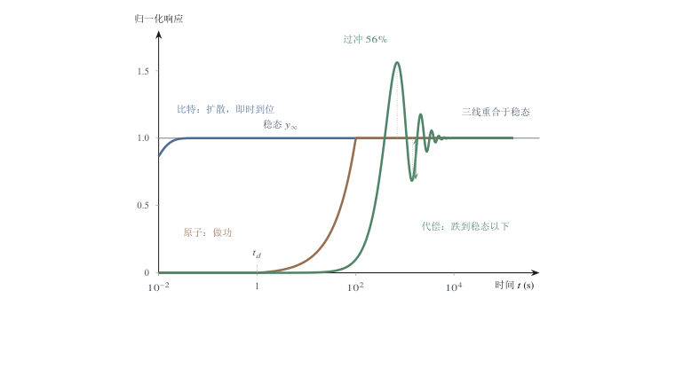
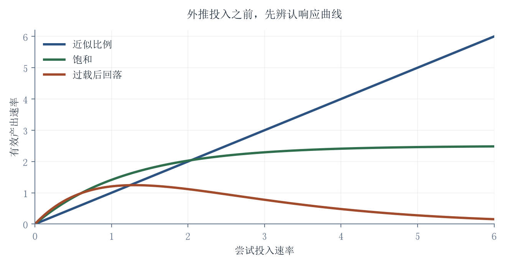
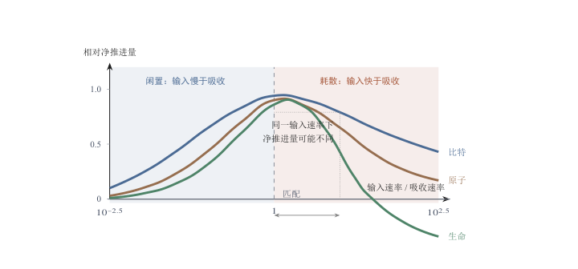
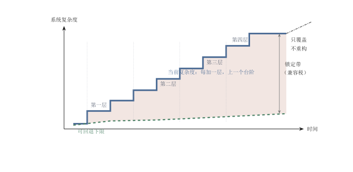
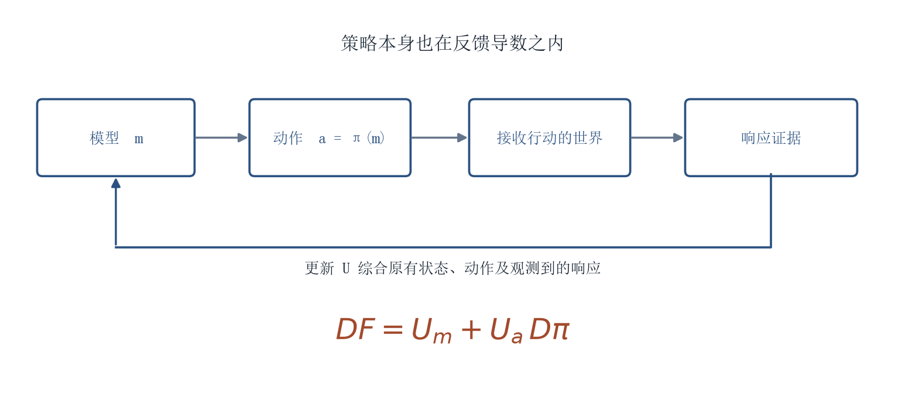

[目录](CONTENTS.md) · [English](../en/CONTENTS.md)

# 接口动力学：智能的相变与介质的流变学

第二章把黏滞拆成资源势垒、时间刚性与拓扑耦合三项，给出的是一个系统在外部作用下的阻力结构。在那套框架里，智能始终站在介质旁边：它测量阻力，寻找低阻路径，或者在阻力面前停下。一旦智能不再只是建模，而是开始输出控制、执行动作、介入状态转移，它在系统中的位置就变了。它成了向介质注入扰动的来源，而介质随即开始处理这个扰动。位置一变，衡量智能的尺度也必须跟着变。同一个模型，作为求解器和作为驱动器，面对的不是同一组约束，也不是同一种错误成本；介质也不会原样接收它的输出，而是把输出转译成扩散、做功、反馈，或者在界面上直接耗散掉。

## 智能的相变：从求解器到驱动器

智能在上一章的框架里是一个路径选择器：它在行动之前压缩不确定性，在多种可能中筛选较优路线，用内部推演减少外部试错。这个描述解释了智能为什么会演化出来，却没有说明智能进入执行环节之后会发生什么。选择路径和推动状态转移不是同一件事，前者在表示空间中完成，后者必须在介质中完成。这个转折包含两层：智能在系统中的角色如何改变，以及角色改变之后它受到哪些新的约束。

### 角色本体论转变：从求解器到驱动器

在表示空间中成立的路径，不一定在现实空间中成立。智能最初表现为路径选择能力。这种能力在比特、原子和生命三种介质中都出现。神经系统、科学模型、工程仿真和人工智能看似相距很远，底层却都在做同一件事：在真正支付物质、能量、时间和失败成本之前，先寻找更好的路径。但路径被找到，并不等于路径已经完成。智能在模型中可以选择方向，现实却要求方向被执行。

#### 求解器与驱动器

路径一旦要被执行，就会被拆成具体环节。一个方案可以在符号空间中成立，但它要进入物理世界，就必须变成控制信号、执行动作、能量输入、材料重组、身体反应、组织协调和责任承担。智能一旦离开抽象表示系统，进入具身现实世界，它的功能角色就发生改变。这就是智能的相变：从求解器到驱动器。这里的“相变”不是严格物理意义上的相变，而是一种功能类比：当智能从表示空间进入现实系统，它面对的角色、约束、错误成本和评价标准会同时改变。它不再只是给出答案，而是进入能够改变状态的闭环结构；不再只是处理可能性，而是参与状态转移；不再只是优化符号结果，而是推动有质量、有惯性、有反馈、有损耗、有责任的现实过程。

角色改变之后，能力清单也随之改变。在纯信息空间中，智能主要是**求解器**。它面对的是符号、逻辑、概率、模式和表示。输入一个问题，输出一个答案；给出一个目标，搜索一条路径；面对一组数据，压缩其中的结构。在这个层面，智能的产物是无质量的信息：一段文字，一张图像，一组代码，一个模型，一个预测，一个决策建议。只要答案在符号层面成立，任务就已经完成了很大一部分。

但在现实空间中，智能不再只是求解器。它必须成为驱动器。驱动器面对的不是无质量信息，而是有质量、有惯性、有摩擦、有噪声、有延迟、有损耗、有风险的介质。求解器输出“解”，驱动器输出能够作用于介质的控制；求解器关心答案是否成立，驱动器关心答案能否穿过执行器、反馈、能量和责任链条；求解器处理可能性，驱动器承担后果。

这个区别可以用控制论早期的一个结论来量化。艾什比在 1956 年提出必要多样性定律：一个调节器能够压制的扰动种类，不能超过它自身能够区分并作出反应的种类，只有多样性才能消灭多样性[^ashby1956cybernetics]。把它放到求解器和驱动器的关系上，结论很直接。求解器的多样性体现在它能表达多少种方案，驱动器的多样性体现在它能施加多少种不同的作用，而介质的扰动多样性由摩擦、形变、遮挡、延迟、失效和意外交互共同决定。如果驱动端的自由度、带宽和执行精度低于扰动的多样性，再强的求解能力也会有一部分落在系统触及不到的地方，那部分扰动不会被消除，只会原样穿透。

许多关于 AI 的误判，都来自把求解器能力误认为驱动器能力。一个模型能生成建筑方案，不等于它能建成建筑；能规划交通路线，不等于它能改变道路容量；能模拟机器人动作，不等于它能稳定抓住杯子；能提出治疗方案，不等于药物已经通过人体、临床和长期安全性验证。符号空间中的“解”，进入现实后只是控制的前提，而不是状态改变本身。把四项变化放在一起看，才能看清这个角色的分量：模型更大、上下文更长、推理更强，都是在求解器这一侧继续增强，角色并未改变；只有当输出的价值不再由答案本身决定，而由状态转移是否发生、是否稳定、是否可恢复来决定时，转变才真正发生。

#### 闭环与相变的意义

从求解器到驱动器，也意味着智能必须从“答案中心”转向“闭环中心”。求解器可以给出一次性答案，驱动器必须持续感知反馈、修正误差、控制风险。现实世界不是一次性被解开的题目，而是持续变化的动力学场。智能不能只输出结果，还必须参与循环：感知现实，生成控制，观察反馈，修正动作，再次执行。没有闭环，智能只是建议；进入闭环，智能才成为现实力量。

但闭环也带来风险。反馈有延迟，执行有惯性，系统有噪声。AI 接入预测、调度、交易、供应链、交通控制和组织管理之后，常常会缩短决策周期，提高反馈频率，并把原本由人工间隔、审核和等待形成的缓冲层压缩掉。问题不在于速度本身，而在于调节频率是否匹配被调节系统的响应周期。一个快速智能回路如果调节的是一个慢速物理系统、组织系统或市场系统，就可能因为延迟、相位差和局部误判而过度修正，甚至把负反馈变成正反馈。供应链中的牛鞭效应、组织决策中的反馈误判、金融市场中的算法放大、自动控制系统中的延迟振荡，都说明同一个问题：反馈回路一旦进入现实系统，就必须理解系统的响应时间、缓冲容量和稳定边界。更快的判断只有在匹配系统频率时才是能力；不匹配时，它可能只是更快地制造振荡。[^lee1997][^sterman1989]

闭环问题比控制论这门学科本身更早出现。二战期间，Norbert Wiener 和 Julian Bigelow 为高射炮火控系统研制提前量预测器，需要根据一段观测轨迹推算出飞机未来的位置，这项工作在 1942 年形成了《平稳时间序列的外推、内插与平滑》报告，成为控制论的前身之一[^wiener1948]。工程中暴露的困难比预测公式本身更要紧：预测器的输出改变炮口指向，炮口指向的改变又改变下一轮的观测与误差，目标机动、观测噪声、伺服延迟和操作员反应被卷进同一个回路。当修正过急或延迟过大时，修正本身会激发振荡，严重时会让瞄准装置失效。控制论后来把这类机器故障与生物体的震颤放到一起讨论，正是因为两者是同一个闭环中相位错位的产物。反直觉的地方在于，一个预测精度更高的系统，在接入回路之后未必表现更好：它的效果不再由自身的准确率单独决定，而由它在回路中的相位和增益共同决定。

这正是“相变”一词的意义。智能进入现实，不只是从一个领域转移到另一个领域，而是角色、约束、错误成本和评价标准全部改变。在符号空间中，智能的价值主要是生成、搜索和推理；在动力学场中，智能的价值是稳定控制、降低耗散、减少风险、提高可执行性。前者以答案为中心，后者以状态转移为中心。因此，AI 时代最重要的判断，不是模型能否给出更聪明的答案，而是这些答案能否转化为可执行、可验证、可维护、可担责的控制。**不能穿过介质的最优解，只是停留在符号空间中的优雅图形；能够稳定进入现实的次优解，反而可能是真正有价值的智能。**

智能的起源，是为了在行动之前选择路径；智能的相变，则发生在路径必须被执行的那一刻。从求解器到驱动器，智能离开了无质量的信息空间，进入有摩擦、有惯性、有风险、有责任的现实世界。它不再只是计算可能，而必须推动状态改变。理解未来的物理 AI、机器人、自动驾驶和智能基础设施，必须从这个相变开始。真正成熟的智能，不是只会在抽象空间中寻找最优解，而是知道最优解进入现实后会变形、偏折、耗散和承担后果。智能的最高形态，不是脱离介质的纯粹计算，而是在黏滞世界中找到能够稳定执行的路径。角色转变回答了智能变成什么，还没有回答它受到什么限制。

### 可执行性的四重约束与路径偏折

把求解器能力误认为驱动器能力，还会掩盖另一件事：约束本身也换了形式。在逻辑空间中，限制主要表现为复杂性：问题能否形式化，搜索空间是否太大，模型是否足够强，数据是否足够多，推理是否足够准确。这里的核心问题是“能不能算出来”。但智能一旦进入动力学场，限制会发生漂移。问题不再只是能不能算，而是能不能推得动、来得及、稳得住、耗得起、担得起。限制从计算意义上的可解性，转向热力学、控制论和工程意义上的可执行性。

#### 可执行性及其代价

可执行性至少包含四类现实约束：功率密度、介质带宽、反馈误差和安全边界。功率密度回答一个方案是否有足够能量在足够时间内作用到足够位置。机器人行动需要电机输出力矩，车辆刹车需要摩擦和距离，工厂调度需要设备响应，电网控制需要容量和稳定性。介质带宽回答系统能否吸收足够频率和幅度的输入。物理系统不能像文本一样高频重写，它有自己的固有频率、传导速度和弛豫时间。反馈误差回答系统能否在噪声、遮挡、磨损、延迟、偶然事件和非线性响应中持续修正。安全边界回答错误是否可以被限制、停止、隔离和追责。控制论和现代反馈系统理论早已表明，闭环系统的核心问题不只是求解，而是稳定性、带宽、延迟、鲁棒性和反馈误差的管理。[^wiener1948][^astrom2008]

四类约束之间不是并列关系，它们彼此换算。提高控制频率会抬高功率和发热要求，压缩响应延迟会减少可用于校验的余量，放宽安全边界会降低对误差的容忍度。工程实践中常见的取舍都发生在这四项之间：把执行器做快，往往要以惯量、能耗或精度为代价；把控制回路做密，往往要以传感器数量、通信带宽和维护负担为代价。一项方案在纸面上同时把四项都推到最优，通常说明它还没有把重量算进去。

因此，智能一旦进入现实，错误成本会发生质变。在符号空间中，错误通常是低成本的。文字错了可以修改，代码错了可以回滚，图像不满意可以重生成，模型输出不对可以重新提示。错误主要表现为信息偏差。它可能浪费时间和注意力，但通常不会直接造成物质损坏。

在动力学空间中，错误是高成本的。机器人抓取失败会打碎物体，自动驾驶判断失误会造成事故，药物预测错误可能伤害身体，工业控制出错会损坏设备，医疗系统误判会牵涉生命和责任。这里的错误不再只是“答案不对”，而是能量不可逆耗散、实体物理损坏、身体伤害和制度后果。这也是为什么物理 AI、具身智能、自动驾驶、医疗 AI 和工业控制系统不能简单套用聊天机器人式的迭代逻辑。聊天机器人可以通过大量低成本交互改善表现；机器人不能通过大量真实摔倒、撞击和伤害来快速试错。语言模型可以生成多个答案让人筛选；医疗系统不能把大量未经验证的方案直接试在人身上。现实系统的错误成本，决定了它不能接受高频、低责任、可随意回滚的智能输入。

#### 路径的偏折

更深一层，现实世界不是理想数学空间，而是充满耗散的黏滞环境。数学上的最短路径，往往不是现实中的可行路径。一个算法可以找到距离最短、效率最高、资源最省的方案，但这个方案一旦进入现实，就要面对摩擦、迟滞、维护、风险、责任、协调和长期稳定性。于是，现实路径会发生**偏折**。所谓偏折，是指智能规划的路径在穿过现实介质时，不再沿着抽象最优方向前进，而会向阻力更小、风险更低、能耗更可承受、反馈更稳定的方向转移。现实系统追求的往往不是“距离最短”，而是“总阻尼最小”；不是单点最优，而是全程可维持；不是局部效率最高，而是失败后果可控。

这就是为什么许多看似不够先进的方案，在现实中反而更稳定。工程系统常常保留冗余，看似浪费，却能抵抗故障；医疗流程看似缓慢，却是在用时间换取验证和责任；航空、核电、金融风控等高风险系统不会轻易采用未经长期验证的最优算法，因为局部性能提升不能抵消系统性失败风险。现实中的“笨”，有时不是低效，而是稳定性的价格。复杂高风险系统研究和系统安全理论都提醒我们：冗余、迟缓、审批和保守策略并不总是低效，它们常常是系统用来限制事故扩散、保留恢复空间和分配责任的结构。[^perrow1984][^leveson2011]

由此可以理解，智能进入现实后不是简单“应用”，而是一次动力学耦合。智能输出不再是孤立答案，而是进入一个有惯性、有反馈、有历史、有责任的系统。它会被系统吸收、过滤、放大、扭曲或抵消。一个调度算法进入物流系统，会遇到车辆、仓库、司机、天气和订单波动；一个诊断模型进入医院，会遇到医生责任、患者信任、医保支付和法律风险；一个控制模型进入机器人，会遇到传感器误差、力反馈、接触不确定性和机械磨损。也就是说，智能进入现实之后，效能不再仅由智能本身决定，而由智能与介质之间的耦合效率决定。一个高性能模型，如果无法获得可靠反馈，无法控制执行器，无法适配流程，无法处理异常，无法承担责任，它在现实中的效能就会大幅折损。相反，一个模型未必最强，但如果它能稳定嵌入系统、降低错误成本、匹配介质频率、保留安全边界，就可能更有现实价值。

#### 具身智能与闭环

这对物理 AI 尤其重要。具身智能不是把大模型装进身体就完成了。身体不是屏幕，行动不是输出文本。机器人必须持续完成感知、定位、建图、预测、控制、接触、避障和纠错。它不只要知道“该怎么做”，还要在具体力学条件下“做得出来”。一个杯子在语言中只是对象，在现实中却有重量、材质、表面摩擦、重心位置和易碎性。一个门在图像中只是门，在现实中却有铰链、阻力、开合角度和被推开后的环境变化。行为机器人学和具身认知研究早已指出，智能并不是脱离身体的中央推理过程，而是在身体、传感、动作和环境之间形成的持续耦合。[^brooks1991][^pfeifer2006]

现代视觉-语言-动作模型进一步说明了这种转向。RT-2 把视觉-语言模型和机器人轨迹数据结合起来，使互联网尺度的视觉-语言知识可以转入机器人控制，并以 token 化方式表示动作。[^zitkovich2023] 这个案例的重要性不在于证明具身智能已经解决，而在于说明：当模型从回答问题转向控制动作，它必须把语言和视觉中的知识重新映射到执行器、动作空间、传感反馈和现实对象上。具身智能的难点不只是“理解世界”，而是让理解在接触、摩擦、延迟和误差中持续有效。自动驾驶也不是单纯的道路识别问题。它要把感知、预测和控制嵌入一个高耦合交通系统。

人类司机、行人、道路、天气、施工、法规、保险和责任制度共同构成真实环境。算法可以计算最优策略，但车辆必须在有限制动距离、有限视野、复杂博弈和不可回滚后果中行动。现实不是模拟器，现实中的每一次控制都要承担后果。自动驾驶测试与验证研究指出，开放道路中的长尾场景、非确定性算法、复杂需求、失效运行和安全论证，远比单一识别任务更难。[^koopman2016] RAND 关于自动驾驶可靠性的研究也显示，在常见统计置信设定下，仅靠道路测试里程证明自动驾驶达到或超过人类安全水平，可能需要极其庞大的真实行驶里程。[^kalra2016] 因此，真正的物理智能，不是找到数学最短路径，而是找到现实中能稳定穿过介质的路径。它必须知道什么时候应该快，什么时候必须慢；什么时候应该追求效率，什么时候必须保留冗余；什么时候可以试错，什么时候只能验证后行动；什么时候最优解可用，什么时候最优解会因介质阻尼而失效。

但一个回路被接入之后，效果不只取决于回路本身。智能降低了某处的阻力，系统中的其他主体会重新行动，流量、风险、指标和责任都会重排。局部降阻与全局结果之间的关系，还没有被说明。回路接进去之后，输出也不会原样变成结果，它要先被介质转译一次。

## 接口物理学：介质的流变学谱系与速率失配

上一章讨论的可达空间，解决的是哪些状态能够被系统稳定抵达。但路径只描述通道，不描述穿过通道时智能输入会变成什么。同一条被打开的路径，在不同介质中会得到不同的响应：有的迅速扩散，有的必须做功，有的会反弹回来。介质不是路径的附属条件，它决定输入能否变成状态改变。

智能不是直接改变世界，而是被介质转译。这是理解 AI 进入现实系统时最容易被忽略的一点。人们习惯说“AI 会改变世界”，但世界并不是一种均匀材料。文本、代码、图像、机器、道路、药物、细胞、身体和生态系统，并不会以同一种方式接收智能输入。同样一个模型输出，在文本系统中可以迅速扩散，在机器人系统中必须变成力和运动，在生命系统中则会触发代谢、免疫、代偿、适应甚至反弹。因此，AI 的真实效能，不只取决于模型本身有多强，还取决于它的输出被何种介质吸收；智能输入只有经过介质转译，才会成为现实改变，转译稳定，智能就变成有效功，转译失配，智能就变成噪声、热、磨损、震荡、验证负担或系统反抗。这就是**介质响应谱**：不同介质面对智能输入时，将其转化为状态变化的方式。比特把智能转译为扩散，原子把智能转译为做功，生命把智能转译为反馈。三者不是三类普通应用场景，而是三种不同的吸收机制：比特关心复制、组合和传播，原子关心能量、惯性和耗散，生命关心代谢、调节和适应。用同一种智能加速逻辑驱动三种介质，必然产生错觉。

### 三条响应谱：比特扩散、原子做功、生命反馈

#### 比特介质的扩散响应

比特介质的基本响应是扩散。在比特域中，智能输入最容易转化为新的信息结构：一段文字、一张图像、一组代码、一个模型输出、一个设计草案、一个搜索结果。它们可以被快速复制、修改、分发、组合和再生成。比特介质的特殊性在于，状态改变主要表现为符号排列改变，而不是物质位置改变。正因如此，AI 在比特域中最容易爆发，它可以用极低边际成本生成大量内容，把过去需要人类长时间表达、检索、改写和组合的任务迅速压缩。

但是，扩散不是证明。比特介质的低黏滞主要发生在横向传播层面，而不是纵向确证层面。横向传播是复制更多、生成更多、分发更快、组合更密；纵向确证则要求信息更真实、更可靠、更有来源、更可解释、更能承受责任。前者很容易被 AI 放大，后者却不会因为生成速度提高而自动变轻。文本可以快速生成，但事实仍要核查；图像可以快速生成，但来源仍要追踪；代码可以快速生成，但安全和维护仍要审计；观点可以快速扩散，但公共信任不会自动增长。

所以，比特介质的核心矛盾不是能不能生成，而是能不能变真。它可以低成本扩展可能性，却不能低成本保证真实性。生成越便宜，可信结果越稀缺；内容越多，筛选越重；表达越顺滑，判断越重要。比特把智能转译为扩散，但扩散之后会制造新的确证压力，而压力并不落在生成端，它落在确证端。

比特还依赖现实作为锚点。模型的智能并不是在纯逻辑闭环中凭空生长，而是来自对现实世界的压缩：真实语言、真实图像、真实实验、真实代码、真实行为、真实反馈。比特世界看起来轻，是因为它把现实转化成了可复制的信息结构，但这种可复制性不能脱离现实来源。若信息系统越来越多地吞噬自身生成的内容，而缺少新的现实摩擦和外部反馈，它会变得越来越顺滑，也可能越来越封闭[^shumailov2024ai]。它可以产生一致性，却未必产生真实性；可以提高流畅度，却可能降低方差和外部校准。

因此，比特介质不是无黏滞介质，而是将黏滞隐藏在两个地方：一是物理后台，二是现实确证。前者包括芯片、电力、冷却、数据中心和网络基础设施；后者包括真实数据、事实核查、人工反馈、来源追踪和责任机制。用户看到的是低成本扩散，系统支付的是后台资源和验证成本。比特扩散得越快，越需要现实来校准它。而当输出要改变的已经不是符号排列，而是物质位置时，介质的响应方式随之更换。

#### 原子介质的做功响应

原子介质的基本响应是做功。原子世界不会因为一个信息结构被生成就自动改变，控制信号必须变成能量流，路径规划必须变成运动，设计图必须变成材料、加工、装配、测试和维护。原子介质不关心一个方案在符号空间中多优雅，它只关心这个方案能否在力、热、摩擦、惯性、材料强度和空间约束中执行。原子把智能输入转译为物理作用，这个转译过程总要支付能量、承受耗散，并受制于时间。搬运需要力，制造需要工艺，冷却需要热交换，运动需要控制，建筑需要材料，机器人需要电机和关节，电网需要容量和稳定性。AI 可以优化路径，但不能取消质量；可以减少试错，但不能取消做功；可以提高调度效率，但不能取消容量限制；可以增强控制，但不能取消摩擦、磨损、热和失效。

因此，原子介质不是被智能“说服”的介质，而是被智能“驱动”的介质。比特扩散可以接近瞬时，原子响应必须经历能量转移和结构改变。一个更聪明的机器人策略，仍然需要执行器输出力矩；一个更优的物流调度，仍然需要车辆、道路、仓储和装卸；一个更精密的芯片设计，仍然需要洁净室、光刻、材料、缺陷控制和散热。智能在这里不是直接变成结果，而是变成对物理过程的控制。这也是为什么原子介质具有相对稳定的耗散残余：输入不可能全部变成有效功，总会有一部分变成热、磨损、噪声、误差和维护负担。控制越精密，传感和执行成本越高；速度越快，功率和热管理压力越大；系统越复杂，校准和维护越重。原子世界并不拒绝智能，但它要求智能遵守能量、功率、热、材料和失效的账本。

原子介质还有响应带宽。物理系统不能无限高频改变状态：机器有惯性，材料有疲劳，热有扩散时间，执行器有响应极限，电网有稳定约束，交通有刹车距离和反应延迟。AI 可以高频生成控制建议，但原子介质未必能够同频吸收。输入太快，不会自动变成更多有效功，反而可能变成震荡、过调节、发热、磨损和安全风险。

所以，原子介质中的智能价值，不在于把比特速度强加给物质，而在于找到合适的驱动方式。好的物理智能必须知道介质能承受什么功率、什么频率、什么误差、什么反馈延迟。它不是简单追求更快输出，而是让输出与物理响应匹配；不是每一刻都生成新方案，而是让控制进入稳定闭环；不是追求符号最优，而是追求可执行、低耗散、可维护和可恢复。原子把智能转译为做功，也把智能暴露在物理损耗中，一个不能管理热、磨损、误差和维护的智能系统，模型再强，也只能停留在演示阶段。原子介质要求智能从“答案”下降为“动作”，从“方案”下降为“过程”，从“最优”下降为“可长期运行”。做功的对象不会回应输入。一旦介质自身开始解释输入，并据此调整内部状态，转译就进入第三层。

#### 生命介质的反馈响应

生命介质的基本响应是反馈。生命当然也是物质，但它不是普通物质：普通原子系统主要承受外部作用，生命系统则会解释外部作用，它有边界，有代谢，有防御，有修复，有调节，有记忆，有适应。药物不是简单施加在靶点上，而是进入代谢网络、免疫系统、组织环境和行为背景；基因编辑不是改写一串字符，而是扰动发育过程、表达调控、细胞环境和生态关系；医疗干预不是单向控制身体，而是与身体自身的反馈系统共同作用。

所以，生命介质不是被动执行智能输入，而是把输入当成扰动。它会吸收一部分，抵消一部分，放大一部分，延迟一部分，反弹一部分。外部干预越强、越快、越粗暴，生命系统未必越快被改变，反而可能激发更强阻抗。免疫反应、炎症、耐药性、代偿机制、内分泌反调节、生态反弹，都说明生命系统不是线性负载，而是有自我维持倾向的复杂适应系统。流变学里有一类介质，在低速扰动下可以流动，在高速强扰动下反而变硬[^brown2014shear]。生命系统也有类似响应，低强度、低频率、可适应的干预，可能被系统柔性吸收，而高频、强力、跨尺度的干预，则可能让阻力突然上升。不是因为生命系统神秘，而是因为它内部有多层反馈，外部驱动超过系统自身弛豫时间，就会打破调节节奏，引发防御、代偿或失稳。

这解释了为什么生命不能像软件一样快速迭代。软件可以多版本试错，人体不能无限试错；代码错误可以回滚，生命干预不能轻易回滚；模型可以高频更新，生理反馈需要时间展开；短期指标可以被优化，长期副作用却可能延迟出现。生命介质的反馈不总是即时的，它常把后果藏在时间里：一个干预今天看似有效，可能几个月后被代偿机制抵消；一个指标短期改善，可能几年后暴露系统代价。生命介质的非线性也意味着，局部目标不能直接等同于系统目标。降低一个指标，不一定改善身体状态；激活一个通路，不一定带来全局收益；压制一种反应，可能释放另一种风险；编辑一个基因，可能牵动发育、表达和生态背景。生命系统中的“作用点”从来不是孤立点，而是网络中的节点，智能可以找到更精细的切入点，但不能让生命系统停止反馈。

因此，AI 在生命科学中的作用会高度不均匀。它可以快速扩大候选空间：发现靶点，预测结构，生成分子，设计实验，识别模式。但生命介质不会以同样速度承认这些候选：候选分子可以大量生成，药物不能大量上市；基因编辑方案可以迅速设计，安全性不能迅速证明；诊断模型可以快速训练，临床责任不能自动消失。AI 可以加速发现，却不能取消生命反馈。生命把智能转译为反馈，也把智能推入长期验证。原子系统的失败常表现为磨损、断裂、发热、失稳，生命系统的失败可能表现为代偿、耐受、迟发副作用、群体差异、行为改变和生态后果。它不只有物理损耗，还有适应性回应，原子主要承受力，生命会回应力。

响应可以先用三个典型模型描述：一阶跟随、带启动延迟的限速推进、欠阻尼反馈。设$y(t)$为选定结果的响应，$y_\infty$为对应的稳态值，三个模型分别写为

$$
\begin{aligned}
y_{b}(t)&=y_{\infty}\bigl(1-e^{-t/\tau_{b}}\bigr),\qquad \tau_{b}\to 0^{+}\\[2pt]
y_{a}(t)&=y_{\infty}\min\left\{\frac{(t-t_{d})_{+}}{\tau_{a}},\;1\right\},\qquad t_{d}>0\\[2pt]
y_{l}(t)&=y_{\infty}\left[1-e^{-\zeta\omega t}\left(\cos\omega_{d}t+\frac{\zeta}{\sqrt{1-\zeta^{2}}}\sin\omega_{d}t\right)\right],\qquad 0<\zeta<1
\end{aligned}
$$

三式中的时间参数采用同一单位，响应以相同参照值归一化。第一式的$\tau_b$是一阶时间常数；第二式的$t_d$为启动延迟，$\tau_a$控制限速推进的时长；第三式的$\zeta$为阻尼比，$\omega$为自然角频率，$\omega_d=\omega\sqrt{1-\zeta^2}$。当$0<\zeta<1$时，第三式出现超调，并逐渐回到稳态。这些形式适合描述相应任务中的快速跟随、产能限制和反馈回落；参数和形式须按响应数据选择。

介质分析为选取模型提供机制线索。数字分发常有较短的响应时间，制造常受启动与通量限制，生物干预常伴随代偿和迟滞。同一介质也可以出现多种响应：信息网络会拥塞，机械系统会超调，生命过程可以单调趋近。比较的对象是具体通道的响应，而非由介质名称预先指定的曲线。

图 3.1. 三种典型响应模型。横轴为对数时间，纵轴为归一化响应，虚线为稳态$y_\infty$。示意参数分别给出快速跟随、延迟限速与欠阻尼超调。具体通道的形式与参数由测量确定，同一种介质可以出现多种响应。

图 3.2. 投入与有效产出可以近似成比例、逐渐饱和，也可以在过载后回落。曲线为机制示意，具体系统的形式与参数需要测量。

### 速率失配与界面耗散

#### 三套时钟不能同频

上一节分开讲的三条响应谱之间，还有一个更隐蔽的问题：它们不能用同一种速度逻辑驱动。比特可以高频生成，原子需要功率匹配，生命需要弛豫时间。智能进入现实系统时，不只是进入不同介质，也是在穿过不同速率的界面。比特层可以在极短时间内计算、更新和传播；原子层有惯性、传热、摩擦、疲劳、执行器响应和安全边界；生命层还有代谢周期、免疫反应、组织修复、行为适应和长期反馈。输入层越快，越不能假定吸收层会同步变快。

这里会出现一种类似阻抗失配的现象。在工程系统中，源端与负载端如果阻抗不匹配，输入能量不能有效传入负载，反而会产生反射、损耗或振荡。这一关系的标准形式是反射系数

$$
\Gamma=\frac{Z_L-Z_S}{Z_L+Z_S},\qquad \frac{P_{\mathrm{refl}}}{P_{\mathrm{in}}}=|\Gamma|^2
$$

这里以无损传输线接终端负载为例，$Z_S$表示实数正的特性阻抗，$Z_L$表示负载阻抗，单位为欧姆。$\Gamma$是电压反射系数，反射功率与入射功率之比为$|\Gamma|^2$；负载也取非负实数时，$\Gamma$位于$-1$与$1$之间。阻抗匹配使反射消失。智能系统中的输出频率、审核吞吐和执行能力各有单位，需另行测量；排队、丢弃、过调节和结构损伤则是失配可以直接观察的结果。

失配可以用输入速率与吸收能力之比描述。设$r=v_{\mathrm{in}}/v_{\mathrm{abs}}$，以吸收能力为单位记录有效推进量，另用损伤项描述超载后的退化：

$$
r=\frac{v_{\mathrm{in}}}{v_{\mathrm{abs}}},
\qquad
u(r)=
\begin{cases}
r, & 0<r\le 1\\[3pt]
1-\kappa\,(r-1)^{m}, & r>1
\end{cases}
$$

$v_{\mathrm{in}}$和$v_{\mathrm{abs}}$采用相同单位，$r$无量纲。$u$是净推进速率除以吸收能力所得的相对量。$r\le1$时输入全部被吸收，$u=r$表示能力尚未用满；$r>1$时，模型以$\kappa(r-1)^m$表示超载引起的净损失。$\kappa\ge0$、$m>0$须由观察确定，$u<0$表示损伤超过当期收益。若系统只排队而不退化，应改用饱和吞吐模型。信息网络、机械装置和生命系统都可能在超载后受损，差别须由具体机制与数据说明。

分层转换在工程系统里早有成熟的做法。电网的频率控制不是单一回路：一次调频由发电机组调速器在秒级自动完成，二次调频由调度中心在分钟级调整出力计划，三次调频和机组组合则在小时到天的尺度上重新排布。层级越慢，能调动的资源越多，代价也越高；把慢层的问题压给快层，系统会失稳，把快层的问题堆到慢层，则会积压。数据系统中的安排同类：写入先落到日志里，再由批处理合并进主存储，读取请求不会被要求等待所有维护动作完成。这些结构承认的都是同一件事，源端和负载端的速率不同，中间必须有人做转换，转换本身要消耗资源，但不做转换的代价更大。

成熟的 AI 系统不是把所有介质推向最高频率，而是建立跨介质的速率转换。真正的智能不是单纯提高源端输出，而是提高源端与负载端之间的匹配效率。AI 不一定失败在模型不够强，也可能失败在界面不匹配：输出太多，系统无法筛选；更新太快，流程无法吸收；控制太密，物理层开始振荡；干预太强，生命系统开始反弹；指标太频繁，组织开始内耗。**智能没有消失，而是在界面处被耗散了。**

图 3.3. 速率失配：两侧都是浪费，只是形式不同。横轴为输入速率与吸收速率之比，比值偏离中点越远，失配越大。三条曲线分属三种介质，可用带宽依次收窄；纵轴为相对净推进量，负值表示超载损伤超过有效推进；三条线采用不同示意参数。

#### 介质适配

因此，AI 时代成熟的智能观，不能只问模型能否输出更优结果，而要问输出如何被介质转译。它是否稳定，还是引发震荡？是否低耗，还是制造废热和维护负担？是否可控，还是触发生命与系统反弹？是否可验证，还是只在表示空间中看似成立？智能的边界不只在模型内部，也在介质响应之中。介质响应谱的意义，正在于纠正一种无介质的智能幻想：AI 不是把答案直接写进世界，而是把输出交给介质，比特会把它扩散，原子会要求它做功，生命会对它反馈，每一种转译都有成本，每一种响应都有边界，每一种吸收都有失败形式。

真正有效的智能系统，必须学会适配介质。面对比特，它要处理真实性和信任；面对原子，它要处理功率、耗散和维护；面对生命，它要处理反馈、弛豫和长期后果。它不能只会生成，还必须知道生成之后将被什么吸收；不能只会优化，还必须知道优化进入介质后会变成什么残余；不能只会加速，还必须知道何时需要降频、缓冲和验证。本章开头那句话到这里才算落到实处：智能不是直接改变世界，而是被介质转译，而 AI 的真实效能，取决于这种转译是否稳定、低耗、可控、可验证。

网络协议提供了同类经验的另一个版本。1980 年代中期的互联网出现过拥塞崩溃，从劳伦斯伯克利实验室到加州大学伯克利分校的一条链路，吞吐量一度从 32 千比特每秒掉到 40 比特每秒。Van Jacobson 和 Michael Karels 在 1988 年给出的解决办法不是在接收端扩容，而是给发送端加一个拥塞窗口：发送端在收到确认之前只能发送有限的数据，丢包被解释为路径拥塞的信号，窗口随之减半，平稳时再缓慢增长[^jacobson1988]。这个设计承认的正是源端必须服从吸收端。如果发送端只按自己的输出能力推进，中间节点的队列会先被填满，然后开始丢弃，两端重传进一步加重负担，系统的有效吞吐量反而下降。协议的自律不是道德要求，而是把介质的带宽写进了源端的控制律。

但介质并不是等待被适配的空白材料。每一种介质都有自己的历史，它被制造出来的时候，参照的是人的身体、既有的工艺和当时的制度，而不是智能的输入格式。智能进入这样的介质时，真正的问题往往不是转译发生在哪一层，而是能不能在不改动介质骨架的条件下完成转译；而骨架一旦需要改动，代价就要按原子世界的方式支付。

## 演化策略：赛博寄生与复杂度棘轮

智能要改变的现实，在它到达之前就已经建成。道路、楼宇、医院和工厂各有既存结构，也嵌入法规、保险、习惯与责任安排。模型要通过这些接口工作，部署成本便取决于需要改动多大的范围。换一个部件是维修，换一套承重结构是重建。单点能力足够以后，还要比较适配旧结构与重建环境的总成本。

### 覆盖层策略与重构的三重代价

#### 重构的三重代价

理论上，最干净的道路是重构底层。为自动驾驶重新设计道路、车辆、信号、保险和交通规则；为机器人重新设计楼宇、工具、仓库、家庭和工厂；为智能医疗重新设计医院流程、病历结构、责任制度和支付体系。这样，物理世界本身会变得更适合机器感知、机器行动和机器决策，系统会更低熵，接口会更清楚，反馈会更稳定。但这条路太贵。

彻底重构原子世界需要克服三重代价。第一是资源势垒：道路、工厂、医院、港口、电网、住宅和城市管网已经沉淀了巨大的材料、资本、空间和劳动，推倒重建，不是修改代码，而是废弃既有物质结构并重新支付能量账单。第二是时间刚性：基础设施有自己的寿命周期，施工、审批、迁移、协调和行为改变都不能像软件版本一样即时更新。第三是拓扑耦合：道路不只是道路，它连接保险、法规、物流、地产、职业分工和居民生活，医院不只是建筑，它连接医生责任、患者信任、医保支付和法律边界。改动底层，就会牵动整个系统。

水泥、钢铁与设备的大规模年度产出，逐年沉积为建筑、道路、厂房和网络。USGS与世界钢铁协会的2026年报告仍显示，全球水泥与粗钢产出分别处在数十亿吨与近二十亿吨的量级。[^usgs2026cement][^worldsteel2026figures] 存量改造取决于寿命、替换率、建设能力和相邻系统；不能把某一年的产量直接等同于可同时改造的存量。

这三重代价不是新出现的东西，它们正是上一章那三项在建成环境中的具体形式。资源势垒对应已经支付出去的材料、能量和空间成本，时间刚性对应基础设施无法压缩的过程时长，拓扑耦合对应道路、法规、保险和职业分工之间已经形成的连接密度。一个已经建成的东西，它的黏滞不是被谁后来加上去的，而是在建成那一刻就写进了结构。因此，判断一项智能改造是否可行，不能只看它在符号空间里节省了多少，还要看它在多大范围内要求这套旧结构重新支付一次。

#### 覆盖层策略

所以文明通常不会优先选择重构，而会选择覆盖。所谓**覆盖层策略**，是指在不彻底改变旧物理骨架的情况下，在其表面叠加一层新的比特控制层。道路不变，加导航、摄像头、雷达、高清地图和云端训练；工厂不变，加传感器、预测维护、数字孪生和调度平台；医院不变，加影像识别、病历摘要、智能分诊和审核系统；城市不变，加摄像头、平台、算法、数据接口和“智慧治理”。原子骨架保持沉重，数字薄膜覆盖其上。

这是一种赛博寄生。这里的“寄生”不是道德意义上的贬义，而是一个结构描述，也是一种演化策略：新的智能层并不独立存在，也不立即替换旧层，而是依附在旧物理系统之上，利用其已经形成的空间、能源、设备、制度和人员网络，获得进入现实的行动位置，并试图改变旧系统的行为。比特层像一层神经组织，覆盖在旧世界的骨架上；它不替换骨骼，却试图让骨骼行动得更快、更准、更可调度。

这种策略之所以普遍，是因为它符合最小代价原则。彻底重构世界太重，局部覆盖则轻得多：加装传感器比重建道路便宜，开发调度系统比重建工厂便宜，训练识别模型比重写医疗制度便宜，给机器人增加感知和控制能力比重新设计全部生活空间便宜。覆盖层是一种绕过高黏滞底层的次优解，它不解决底层沉重性，而是在沉重性上方寻找可操作空间。短期看，覆盖层非常有效：用户端更顺滑，管理端更可视，调度更实时，风险更可监控，局部效率确实提高。一个旧系统被数字化后，看起来像是变轻了，司机有导航，工厂有预测维护，医生有辅助诊断，城市有监控平台，仓库有自动分拣，许多原本依赖人工经验和局部判断的流程，被新的比特层重新组织。

覆盖并不是数字时代才有的策略。19 世纪末到 20 世纪初，工厂的动力从蒸汽机集中传动改为电动机分散驱动，技术替换在 1890 年代就已大规模展开，但生产率的大幅提升要等到厂房布局、传动方式、机器排布和生产组织都围绕分散动力重排之后才出现，中间隔了二三十年。集装箱的推广同样如此：1956 年第一次集装箱运输之后，码头、起重机、卡车底盘、铁路平车、仓储布局、工会规则和关税制度都要跟着改，港口装卸区被整体搬迁，直到 1970 年代集装箱化才真正铺开。两者都说明，新层接入旧骨架时，瓶颈往往不在新层本身，而在旧骨架愿不愿意为它改变。

近年的例子更容易看清覆盖层的收益边界。2019 年起全国推广高速公路电子不停车收费，江苏、山东、四川、重庆的试点统计显示，客车通过省界的时间从 15 秒降到 2 秒，货车从 29 秒降到 3 秒；2020 年 1 月 1 日，全国 29 个联网省份的 487 个省界收费站全部取消。收费站这个环节确实被比特层改写了，但车道数、匝道容量、主线通行能力和服务区容量都没有随之改变。节假日的高峰流量仍然要在同样的物理通道里消化，拥堵从收费站前移到了主线和出入口。当收费站不再是瓶颈，瓶颈会回到骨架本身上来。这笔收益是真的，但它只在骨架允许的范围内兑现。

旧世界之所以沉，还因为它把一批历史决定固化成了物理尺寸。铁路轨距在 19 世纪被定在 1435 毫米，此后隧道、桥梁、站台和车辆全部按这个宽度建造。集装箱在 1960 年代被定在 20 英尺和 40 英尺两个长度，港口的起重机跨距、堆场分区、卡车底盘和铁路平车随之定型。楼梯踏步的高度上限、住宅门洞的宽度档位、插座形状、交流电频率、键盘字母排布，都是按当时的人体尺度、工艺条件和行业妥协定下来的。这些东西今天还在用，不是因为它们最优，而是因为改动它们的代价要按原子世界的方式支付，并且要由整条链条分摊。

覆盖层策略之所以普遍，还因为它把成本记在了另一个账本上。加装传感器、部署摄像头、上线调度平台，这些支出落在当年的资本开支和运维预算里，看得见也算得清；而旧骨架没有为机器感知和机器行动改变过这件事，不会被计入任何一项成本。前者是显性支出，后者是隐性欠账。短期看，覆盖层的收益立刻显现，一个旧系统被数字化之后确实变顺滑了。代价要等到覆盖层之间开始互相依赖时才出现，而那时它已经变成了维持运行的必要条件。

### 复杂度棘轮、兼容税与落地税

#### 复杂度棘轮

覆盖层需要传感、数据、通信、权限、监控、维护与异常处理。新增接口若同时要求旧结构作出配套，局部收益可能带来新的耦合；结构又依赖更多结构来维持时，就形成**复杂度棘轮**。模块化、标准化和淘汰旧接口也能让复杂度净下降，具体方向要从架构与运行记录判断。

这个过程可以写成一个递推关系

$$
C_{n+1}=(1+\alpha)\,C_n+c
$$

其中$C_n$为按一致口径统计的复杂度，$c$为新增层的直接增量，$\alpha$为既有结构因新层接入而增加的比例。固定$c>0$、$\alpha>0$时，这个递推给出指数增长；$\alpha=0$时为线性增长。它描述依赖持续累积的一种情形，不能由层数本身推定实际系统服从固定比例。

把 (3.6) 展开，可以看清棘轮的形状。设起始复杂度为 $C_{0}$，$n$ 层之后

$$
C_{n}=(1+\alpha)^{n}C_{0}+\frac{c}{\alpha}\bigl[(1+\alpha)^{n}-1\bigr],
\qquad
C^{\min}_{n}=\beta\,C_{n},\qquad 0<\beta<1
$$

$\alpha>0$时第一式给出递推解；$\alpha=0$时取极限$C_n=C_0+nc$。第二式把拆除后仍保留的复杂度记为当前值的$\beta$倍，$\beta$需要由具体退出方案估计。旧依赖可以被移交、重构或清除，因此$C_n^{\min}$是情景下的可达水平，不是普遍物理下限。

这个差就是锁定带，它的累积量就是卸载前 $n$ 层要付的兼容税

$$
K_{n}=\sum_{k=1}^{n}\bigl(C_{k}-C^{\min}_{k}\bigr)=(1-\beta)\sum_{k=1}^{n}C_{k}
$$

$K_n$把逐层差额汇总成一个兼容负担指标，单位随复杂度口径确定。各层有共享接口时，直接相加会重复计算；转换为退出费用，需要分别估计拆除、迁移、验证与替代支持。实际成本也可能在集中重构时下降，不能只凭这个和式断言退出账单必然指数上升。

自动驾驶正是覆盖层困境的典型案例[^kalra2016]。道路原本不是为机器视觉设计的，交通规则原本不是为算法责任设计的，保险制度原本不是为无人主体设计的，行人和司机也不会完全按照机器协议行动。自动驾驶如果要真正简单，最合理的办法是重构环境：封闭道路、人车分流、统一车路通信、标准化交通参与者、清晰责任边界，但这意味着重构城市交通的底层，代价极高。于是自动驾驶选择覆盖层路线：不改造所有道路，而是让车携带更多传感器；不要求所有人类行为标准化，而是让算法处理长尾；不立即重写责任制度，而是叠加安全员、远程接管、监管沙盒、保险补丁和数据记录。环境没有变简单，车辆只能变复杂；道路没有被低熵化，算法只能承受更多不确定性。自动驾驶看似是机器替代司机，深层上却是把道路重构成本转移到了单车智能、感知冗余、云端训练和责任系统中。这也是为什么人机混行阶段格外困难：纯人类驾驶是一种相对稳定的旧秩序，纯机器驾驶在高度标准化环境中也可能稳定，最复杂的是二者混合的过渡态，人类、机器、旧道路、旧法规、非标准行为、保险责任和社会预期同时存在，系统进入高熵混合区。此时智能越强，不一定系统越简单，很多算力其实是在为旧环境的无序性买单。

图 3.4. 复杂度棘轮。两条线的间距即锁定带：想退回上一代，得先付清这一带里的兼容税。带的两侧都在上涨，但涨速不同，间距因此逐级拉开；台阶越多，带越宽。

#### 兼容税与落地税

具身智能面对的是同一种赛博寄生，只是空间更广。家庭、医院、餐厅、仓库、商场和街道，都不是为机器人身体设计的：门把手默认人手，楼梯默认双腿，厨房默认眼手协调，工具默认人的触觉和常识，家庭物品默认人类的模糊处理能力。机器人要进入这些空间，就必须支付兼容税：更多自由度、更复杂传感器、更高实时控制、更强安全冗余、更昂贵维护体系。工业机器人之所以成功，是因为它们通常被放在低熵环境中，固定位置、重复动作、标准物料、隔离空间、明确任务；通用具身智能之所以困难，是因为它要进入高熵人类环境，这里物体位置不固定，任务目标含糊，空间布局多样，人类行为不可预测，接触反馈复杂。给机器人装上大模型，并不会自动取消摩擦、碰撞、误差、遮挡、材料差异和责任风险。

这种成本分布有一个更早的表述。Hans Moravec 在 1988 年指出，让计算机在智力测验或下棋上达到成人水平相对容易，要让它在感知和运动上达到一岁儿童的水平却极其困难[^moravec1988]。这个判断在三十年后的具身智能研究中仍然成立：需要显式推理的任务可以被形式化、被标注、被搜索，而抓取、行走、避障这类能力依赖大量隐性调节，只能在接触中训练出来，训练成本恰好落在最不容易复制的那一部分。兼容税之所以高昂，不是因为机器人不够聪明，而是因为它要补的正是人类身体用漫长演化预先支付掉的那部分调节。

所谓“落地税”，就发生在模型接触现实的一瞬间。任何世界模型都是现实的压缩，而现实总有残差，模拟器中的训练无法穷尽真实世界的高频噪声、边缘情况、材料变化和人类偶然性。机器人一旦行动，就会改变被建模对象：拿起杯子，杯子位置变了；推开门，门的状态变了；进入房间，人的行为也可能变了。物理AI不是在静态地图上执行，而是在被自己扰动的环境中连续修正。因此，覆盖层物理AI的真正难点，不是智能不足，而是旧世界没有为智能低成本行动而重构。AI必须在旧世界中支付兼容税、残差税和维护税。它通过比特层提高局部效率，却不得不承担原子层的沉重、混乱和不可回滚后果。

#### 覆盖与重构之间

覆盖层策略的问题，不在于它无效，而在于它容易被误认为重构。覆盖可以延长旧系统生命，可以提高局部效率，可以让旧基础设施获得新的控制能力，但覆盖不能无限叠加。每加一层，都要问：它减少的摩擦，是否大于它增加的复杂度？它节省的人力，是否小于它带来的维护负担？它提升的效率，是否值得它增加的脆弱性？一个系统如果只覆盖、不重构，就会逐渐形成高效而脆弱的复杂网络。正常运行时，它显得极其智能；一旦接口失效、数据异常、传感器故障、平台宕机或责任链断裂，复杂性就会反过来成为风险放大器。旧系统的问题没有消失，只是被更多智能层遮住；旧责任没有消失，只是被平台、算法、运营者、用户、监管者和人工兜底重新分散。

所以，物理AI的成熟，不只是让模型更大、传感器更多、控制更精细，而是判断何时覆盖，何时重构，何时放弃。低风险、低耦合、高标准化场景适合覆盖：封闭园区、工业产线、仓储物流、固定路线运输，都可以通过覆盖层获得明显收益。高风险、高开放、高耦合场景不能只靠覆盖：自动驾驶、医疗护理、家庭机器人、城市治理，最终都需要环境设计、制度重构和责任边界的同步变化。未来的物理AI竞争，不只是模型能力之争，而是环境低熵化能力、接口标准能力、基础设施重构能力和责任制度设计能力之争：谁能减少兼容税，谁就能让智能行动更便宜；谁能降低环境混乱度，谁就能让具身系统更可靠；谁能识别覆盖与重构的边界，谁就能避免复杂度棘轮把系统拖向脆弱。赛博寄生是物理AI的起点，不是终点。AI进入原子世界，往往先作为覆盖层寄生在旧系统之上；但如果永远停留在覆盖层，文明只会得到越来越复杂的补丁网络。真正可靠的物理智能，不是无止境地给旧世界贴上传感器和算法，而是在覆盖、重构和保留之间找到最低总黏滞的路径。

旧世界不会因为智能到来而自动消失。它会先被覆盖、被监控、被调度、被补丁化。物理AI的第一性现实就在这里：智能要改变原子世界，必须先寄生原子世界；而它最终能否成熟，取决于它是否有能力从寄生走向真正的环境重构。但无论选择覆盖还是重构，智能都在持续向一个高黏滞系统输入。系统未必按输入的方向改变：它可能沿阻力更低的路径绕开，可能把吸收不了的输入堆在自己内部，也可能因为反馈过急而开始摆动。这三种反应不受策略选择支配，只受系统自身动力学的支配。

## 动态响应形态：绕行、堆积与失稳

智能输入并不因为它来自系统外部就获得优先权。输入进入系统之后，会被这个系统自身的动力学重新处理：有的被吸收，有的被推迟，有的被放大。覆盖层增加的是结构，结构增加的是界面，而界面越多，输入转化为有效改变的路径就越长。

### 概率捷径与绕行

智能进入现实系统之后，并不会只有一种结果。它有时能找到低阻路径，使原本困难的问题突然出现新的解法；有时会在系统界面处发生堆积，输入越来越多，真实改变却没有同步增加；有时还会因为反馈延迟和过度修正，引发震荡，使系统变得更不稳定。这三种形态，可以概括为：绕行、堆积与失稳。但它们并不完全站在同一条轴上。绕行是智能避开壁垒的策略，是输入穿过阻力之后的成功响应；堆积与失稳，则是智能硬推高黏滞系统时的两种失败响应，输入太多，系统吸收不了，就堆积，控制太急，反馈来不及，就失稳。因此，所谓三种响应，不是三个并列失败模式，而是智能输入进入现实后的三种命运：穿过去，堵在中间，反弹成波动。

资源势垒、时间刚性、拓扑耦合和介质的响应方式，说明的是现实系统为什么有阻力；这里要进一步看的，是当智能持续输入一个有阻力的系统时，系统会如何运动。高黏滞系统不是一堵静止的墙，而是一个会吸收、过滤、延迟、堆积、反弹和放大的动态场。AI 时代最常见的误判，是把智能输入看成一种单向加速力量，似乎模型越强，系统就越快；方案越多，进步就越快；预测越频繁，决策就越优；控制越密集，现实就越可控。但现实系统不是被动接受输入的屏幕，它有资源上限，有过程时间，有结构路径，有反馈延迟，有安全边界，智能输入进入其中，可能变成有效改变，也可能变成库存、拥堵、波动和震荡。因此，判断 AI 的现实效果，不能只看它生成了多少方案，也不能只看它局部指标是否提高，更关键的问题是：这些输入进入系统之后，被转化成了什么动态形态？

#### 绕行：把试错挪进信息空间

第一种形态是绕行。所谓绕行，是指智能并不正面击穿现实壁垒，而是在状态空间中寻找较低阻力的路径。面对高资源势垒和高拓扑耦合，最直接的路线往往并不是最可行的路线，现实中的许多困难，不是因为目标无法描述，而是因为从当前状态直达目标状态的代价太高。智能的价值，常常不是硬推过去，而是找到一条更少撞墙的路。

这就是**概率捷径**的意义。所谓概率捷径，不是魔法，也不是物理壁垒突然消失，它指的是：智能系统利用模型、模拟、搜索和组合能力，在大量可能路径中筛掉明显无效的路线，保留少数更有希望的路线，从而减少现实世界中的昂贵试错。它把一部分原本需要在物质世界中支付的成本，转移到信息空间中提前支付，现实试错仍然存在，但被压缩、重排和剪枝。AlphaGo 的“妙手”就是比特域中最容易理解的例子[^silver2016mastering]，它并没有改变围棋规则，也没有击穿棋盘的物理限制，而是在巨大的状态空间中找到人类经验较少抵达的低阻路径。它的反直觉之处，不在于违反规则，而在于重新组织了搜索空间：人类看似自然的路径，未必是全局上更好的路径，智能通过大规模搜索，发现了经验之外的可行通道。

用抽样代替求解的做法比深度学习早得多。1946 年，Stanis{\l}aw Ulam 在洛斯阿拉莫斯处理中子扩散问题时意识到，与其解析求解一个高维积分，不如反复随机抽样再统计结果，他和冯·诺依曼把这类方法命名为蒙特卡洛。它没有减少任何一次抽样的代价，却把“必须求出解析解”换成了“需要多少次抽样才够”。天气预报后来也从单一确定性解转向集合预报，用多组受扰动的初值给出概率分布，等于承认某些尺度的演化本来就无法精确预测。这类方法的共同点，是把原本要在现实里付出的试错，换成在受控随机过程中付出的计算，而随机过程可以重放、可以批量并行、可以在不损坏任何东西的条件下失败。

在原子世界中，类似机制也存在，只是代价更重。新材料发现、药物候选筛选、结构优化、工艺参数搜索，都可以看成在高维状态空间中寻找低阻路径，AI 可以帮助研究者少做一部分无效实验，避开明显失败的组合，把有限实验资源集中到更有希望的区域。但这仍然不是取消物理账本：候选材料必须合成，药物必须验证，工艺必须稳定，产品必须维护，智能减少的是盲目性，不是消除现实性。半导体工业中的计算光刻、工艺参数优化和缺陷控制，也体现了类似逻辑，微观制造越接近物理边界，直接缩放越来越困难，工程系统不是让微观物理边界消失，而是通过计算、控制和复杂工艺，在越来越狭窄的可行窗口中寻找可制造路径。这里的所谓进步，不是物理限制被抹除，而是直接路径受阻后，系统用更复杂、更昂贵、更低容错的方式继续绕行。

绕行也有绕不过去的地方，能量密度就是其中之一。航空煤油的比能量约为 12000 瓦时每千克，当前可商业化的锂离子电芯约为 250 到 300 瓦时每千克，两者相差约四十倍。把热机约三分之一的效率和电机百分之九十以上的效率折进去，差距仍然在十倍以上。这个势垒决定了几种绕行策略的可行边界：纯电动机动化在地面交通中可以借助轻量化、补能网络和路线约束绕开一部分代价，而在航空中，同样的绕行会被起飞重量直接罚回来，电池在整个航程中不减轻重量，燃油则在飞行中持续消耗。绕行能否成立，取决于它选择转移的那部分代价，是否小于它在新介质中新增的代价；一旦后者更大，绕行就只是把障碍换了一个位置。

蛋白质结构预测是同一逻辑在更大规模上的重演。从氨基酸序列到三维结构的映射空间极大，实验解析一个结构往往需要数月到数年，而预测模型把已知结构的统计规律压缩进参数，使候选结构的生成成本下降几个量级。但生成成本的下降并不等于确认成本的下降，任何一个预测出来的结构仍然要由实验测定或功能验证来承认，被预测出来的部分越多，需要排队确认的部分也越多。

生命系统中的绕行更加微妙。药物设计、基因编辑和合成生物学常常试图在生命网络中寻找可干预路径，真正有效的干预，并不一定是对系统施加强力，而是找到一个能以较低扰动改变整体状态的杠杆点。但生命系统有代偿、冗余和反馈：一个看似低阻路径，可能在短期有效，长期被系统抵消；一个罕见突变路径，可能提供治疗机会，也可能带来不可预期风险。生命中的概率捷径，必须比原子世界更加依赖验证。所以，绕行的本质不是减少全部代价，而是改变代价的支付结构。它把集中代价变成分散风险，把物理试错的一部分转移到模拟和搜索，把正面重构的一部分转化为路径选择。成功的绕行会显得像突然降阻，但它通常不是总作用量消失，而是路径重排之后，系统找到了更可承受的支付方式。

### 堆积、库存与波动

#### 堆积与库存化

第二种形态是堆积。如果绕行是智能找到了较低阻力的路径，那么堆积就是智能输入超过了系统吸收能力，系统不是没有输入，而是输入太多；不是没有活动，而是活动不能转化为有效改变。表面上，系统更忙、更密集、更自动化、更实时，真实状态却没有同比变化。堆积发生在输入流大于吸收流的时候：一个系统可以接收多少方案、多少指令、多少资本、多少实验、多少指标、多少模型建议，并不取决于输入端能产生多少，而取决于执行、验证、协调和责任系统能吸收多少。超过这个吸收带宽，更多输入不会自动变成更多产出，只会在界面处排队、淤积、返工、内耗，或者退化为维护负担。

这个关系可以用存量方程表示

$$
\frac{\mathrm{d}S}{\mathrm{d}t}=I(t)-A(S),\qquad A(S)\le A_{\max}
$$

$S$ 是系统界面处的存量，用待办事项、队列长度或未验证候选数计量；$I(t)$ 是输入速率，量纲为件/单位时间；$A(S)$ 是吸收速率，$A_{\max}$ 是吸收带宽，即执行、验证和协调系统在给定资源下单位时间能够处理的最大量。当 $I>A_{\max}$ 时，$A(S)$ 已经在饱和区，存量按 $S\approx(I-A_{\max})t$ 线性增长，这就是库存化；界面上的等待时间随存量上升，为 $S/A_{\max}$。压低 $I$ 是限流，提高 $A_{\max}$ 是扩容，两者的区别在于动的是输入端还是吸收端，而只有后者才改变系统的长期吞吐量。

堆积的第一种形态，是库存化。系统把无法及时吸收的输入暂时存起来，形成库存、队列、待办、积压、未验证候选和未处理风险。库存看似只是缓冲，实际上是时间刚性的显影：它说明输入已经抵达，但系统还没有能力把它转化为真实改变，库存越多，系统越不像在加速，越像在把未来的处理压力提前堆到某个界面上。在信息系统中，库存表现为筛选负担：AI 可以生成大量文本、图像、代码、方案和候选假设，但人类和组织的判断能力没有同步扩展，内容越多，审核越重，候选越多，验证越重，建议越多，决策越难。过去稀缺的是生成能力，现在稀缺的是确证能力，生成端的加速，如果没有验证端的扩容，就会形成信息堆积。在科研和工程系统中，库存表现为发现与验证之间的裂缝：高通量实验、自动化平台和 AI 搜索可以扩大候选空间，但很多结果仍要经过实验重复、稳定性测试、机理解释、工艺放大和长期可靠性验证，药物研发尤其明显，AI 可以帮助发现靶点、生成分子、筛选候选，但候选进入药物事实，仍要穿过毒理、药代、剂量、人群差异、临床试验和监管审查。更多候选不自动等于更多可靠药物，发现端越快，验证端越成为瓶颈。这不是说高通量和 AI 没有价值，而是说它们改变了瓶颈位置，它们减少了一部分早期搜索成本，却可能把系统压力推向后端验证、资源分配和失败筛选：一个系统如果只扩大发现能力，不扩大验证能力，就会出现候选堆积，它看起来更有创新活力，实际可能有大量可能性停在中间层，无法成为可靠结果。在组织系统中，库存表现为内耗，算力、资本、指标和指令可以快速注入，但组织学习、判断、执行和责任形成都有较低带宽，一个组织如果持续接收新的模型建议、实时指标、战略口号、优化方案和管理任务，却没有相应吸收能力，就不会自动变得更智能，它可能只是变得更忙，更多会议、更多报表、更多试点、更多汇报和更多短期目标，可能只是输入在组织界面处堆积。

所谓内耗，可以理解为输入无法转化为有效功。系统获得了更多信息、更多资源、更多竞争压力，但实体结构的响应能力没有同步提高，于是能量不能向外完成状态改变，只能在系统内部循环，它表现为重复协调、指标追逐、局部竞争、审核拥堵、注意力耗散和维护负担。这里的“热”不是严格物理意义上的热，而是高强度输入无法形成有效产出时留下的无效运动。

#### 波动与周期

堆积并不总是静静堆在那里。输入超过吸收能力之后，系统首先形成存量；存量如果不能被局部消化，就会沿着结构传播。交通系统中，车辆继续向前行驶，堵塞波却可能向后传播；组织系统中，任务继续向下游分发，未决事项却会向上游管理层回涌；技术系统中，候选方案继续产生，验证瓶颈却会反向压缩前端搜索策略。这里真正移动的不是实体本身，而是无法被吸收的状态。这可以称为堆积波。堆积波不是交通系统的特殊现象，而是高黏滞系统的一般响应：当局部通道达到容量上限，系统会把无法吸收的流量转化为空间上的压力波，个体仍在向前，压力却可能向后传；任务仍在推进，瓶颈却可能反压前端；智能仍在生成方案，验证负担却会反过来限制搜索方向。高黏滞系统中的波，往往不是物质波，而是吸收失败的传播。

当系统要调节的不是轻变量，而是存量，堆积就可能变成周期。库存、产能、厂房、团队、城市、制度，都不是瞬间生成、也不是瞬间清除的东西：系统看到不足，于是扩张，等扩张形成真实供给时，环境可能已经变化；系统看到过剩，于是收缩，等收缩完成时，新的不足可能又出现。这里的问题不一定是控制者太急，而是被调节的存量太重，世界回应得太慢。周期不是时间自己在震荡，而是不同重量的存量在用不同速度纠错。

短周期常常来自轻存量。商品库存、待办任务、内容审核、候选方案，都可以较快增加，也可以较快清理，它们的周期短，是因为存量轻，反馈来得较快，修正也较快显影。可是即使是轻存量，只要信号滞后，修正也会过头，供应链中的牛鞭效应就属于这一类：终端需求的微小变化，经过订单、库存、生产和采购层层传递，会被信息延迟和存量调整逐级放大[^lee1997information]。中周期来自更重的存量：设备、产能、团队、厂房、供应链、资本开支，不是几天几周能改变的东西，系统看到需求上升，于是投资扩张，等新产能形成时，需求可能已经变化，系统看到过剩，于是收缩，等收缩完成时，新的不足可能又出现，这里调整的不是普通库存，而是生产能力本身，产能是更重的库存，因此周期更长，修正代价更高。更长的周期来自空间和结构存量：建筑、城市、道路、学校、医院、住房、基础设施，一旦建成，就很难快速回滚，它们把某一时期的预期固化为现实空间，等人口、产业、财政和生活方式改变时，空间不会立刻跟着改变，于是，一座城市可能在需求高涨时扩张，在需求转弱后留下过剩建筑、债务和低利用率基础设施，这里的周期不是普通波动，而是沉没结构的迟滞回声。最长的波动来自技术范式、能源系统和制度结构：一个新技术范式出现时，资本、基础设施、教育、监管、组织和生活方式都会围绕它重新配置，最初是扩张和想象，随后是过剩和筛选，再之后是清算、重组和稳定吸收，这样的长波不是精密钟表，也不是必然律，而是重结构在历史尺度上的重估和再耦合。

因此，不同周期未必是彼此无关的神秘节律，它们可以被理解为不同重量存量的滞后修正：商品库存轻，周期短；固定资本重，周期更长；建筑和城市结构更重，周期继续拉长；技术、能源和制度结构最重，只能在更长历史尺度上完成扩张、过剩、清算和再组织。存量越重，反馈越慢；反馈越慢，修正越容易变成新的失衡。这不是要把所有周期简化成一个公式，现实周期当然还有货币、信用、心理、制度、外部冲击和技术变化等复杂因素，但在更一般的动力学层面，可以看到同一个结构：系统用滞后的信号调节沉重的存量，等修正动作生效时，世界已经不完全是原来的世界。周期往往不是系统有节奏，而是系统总在用过期信号修正沉重存量。

库存可能缓冲波动，也可能放大调整迟滞。堆积、周期和失稳之间是否转化，要看补货、反馈、服务与控制机制。发现输入超过吸收能力后，应比较减少无效到达、提高候选质量、扩大处理能力与改变排程；不能只增加前端生成。

### 失稳、阻尼与三种治理

#### 失稳与阻尼

第三种形态是失稳。如果堆积和周期说明系统调节存量时有天然迟滞，那么失稳说明另一件事：控制本身也可能制造震荡。系统不是没有反馈，而是反馈用得太急；不是没有控制，而是控制太频繁、太密集、太依赖短期信号，原本用于稳定系统的负反馈，可能因为相位滞后和过度修正，变成放大波动的机制。周期化和失稳都可能表现为来回摆动，但二者不是一回事：周期化的根源是存量太重，世界回应得慢；失稳的根源是控制太急，系统本可不摆，却被持续纠偏推入摆动。前者是结构迟滞，后者是自找震荡，一个是世界慢，另一个是手太快。

在一个理想反馈系统中，系统偏离目标，控制器检测偏差，然后施加反向修正，使系统回到稳定状态，但现实系统有延迟：信号采集有延迟，判断有延迟，执行有延迟，物理响应有延迟，人的行为改变也有延迟。如果控制系统根据已经过期的状态不断修正，就可能在错误的时间做出正确动作，等修正生效时，系统已经移动到新的位置，原来的修正反而变成过度修正。震荡不是缺少智能，而是智能与反馈周期不匹配。更准确地说，它常常不是因为系统太慢，而是控制太快地介入了慢系统。

金融系统中的算法闪崩就是类似机制。高频交易策略可以在极短时间内根据价格、订单和流动性信号调整，但市场流动性、风险承受能力和制度保护机制并不能以同样速度补位，当多个算法相互响应、相互撤单、相互放大信号时，价格可能在短时间内偏离基本价值[^sec2010findings]。2010 年 5 月 6 日，道琼斯工业平均指数在盘中极短时间内下跌约 1000 点，随后又大幅反弹，事后调查把高频交易与算法交易之间的相互作用列为重要成因。这里的风险不只是某个算法错了，而是多个反馈回路在高频中相互耦合，形成集体失稳。组织系统也会震荡：一个组织如果频繁根据短期数据调整战略、绩效指标、资源分配和人员方向，就可能进入管理振荡，每一次调整看似响应现实，实际却打断了上一轮调整的反馈过程，团队尚未完成学习，指标已经改变；项目尚未进入稳定期，资源已经转向；新流程尚未消化，新模型建议又来了。组织看起来敏捷，实际上失去节奏，它不是没有控制，而是控制过密。

震荡需要从实际环路查找原因：增益、延迟、模型误差、执行器限制与耦合都可能参与。快速测量和计算也能改善慢对象的稳定性。阻尼、惯量与主动补偿有不同物理作用，设计时应分别核算；共同目标是让纠偏产生可恢复的轨迹。

阻尼装置本身也会出错。2016 年 1 月，A 股引入指数熔断机制，沪深 300 指数下跌 5% 和 7% 分别触发两级熔断；1 月 4 日和 1 月 7 日，熔断两次被触发并导致提前收市，流动性在阈值附近进一步收缩，熔断机制于 1 月 8 日暂停。设计意图是给出冷静期，但它把一个连续的下跌过程切成几段，反而让参与者在阈值到来之前抢先卖出。阻尼的难点不在于有没有装置，而在于装置的动作是否与被阻尼系统的行为相容。工业控制中有对应的做法：电力系统的低频振荡频率在 0.1 到 2 赫兹之间，抑制它依靠稳定器在励磁回路中注入相位补偿，补偿参数按系统惯性和运行方式整定，提高采样率并不能替代整定。

电力系统让惯量、快速响应与控制配合的差别变得具体。英国2019年8月9日停电中，雷击之后多个电源相继损失，频率下降并触发低频减载。[^nationalgrid2019technical] 惯量影响最初的频率变化速度，阻尼与调频等机制影响后续响应，保护设定又决定何时切除负荷。几种功能需要共同设计；把惯量直接称为阻尼，会掩盖真正的稳定机制。

#### 三种治理

绕行、堆积和失稳，构成了高黏滞系统面对智能输入的三种基本动态。绕行说明，智能可以通过信息搜索找到低阻路径，但它不是取消壁垒，而是改变支付结构；堆积说明，智能输入如果超过系统吸收带宽，就会形成库存、队列、波和周期；失稳说明，系统本来可以缓慢调节，但如果控制过急、反馈过密，负反馈也会变成波动放大器。这三种形态也对应三种治理方式。面对绕行，关键是验证：低阻路径可能是真发现，也可能是偶然相关、过拟合、不可制造或不可维护，越是反直觉的捷径，越需要验证其可重复性、可执行性和边界条件，智能找到路径之后，现实仍要证明路径。面对堆积，关键是限流：系统不能只扩大发电端，还要扩展吸收端，候选方案要分层筛选，实验验证要匹配发现速度，组织输入要匹配执行能力，政策和资本注入要匹配现实承载力，输入不是越多越好，超过吸收能力之后，更多输入只会变成库存、波和周期。面对失稳，关键是阻尼：高频反馈需要慢变量约束，短期指标需要长期目标校正，快速控制需要安全边界，算法回路需要延迟管理和幅度限制，真正稳定的智能系统，不是永远更快，而是知道什么时候不该继续加速。因此，**高黏滞系统需要的不是单纯更强的智能，而是更成熟的动态控制。**它需要搜索能力来寻找绕行路径，需要吸收能力来防止输入堆积，需要阻尼能力来避免反馈失稳，只有三者同时存在，智能才能稳定转化为现实改变。

阻尼装置本身的设计是一门有争议的学问。价格限制与熔断的理论分析指出，限制线一旦存在，就会改变参与者在阈值之前的行为，一部分交易会被提前到触发之前执行，价格反而更快地向限制线靠近，这一效应被称为磁吸效应[^subrahmanyam1994]。实证研究在台湾、上海等市场都观察到限制线附近的交易加速与波动上升。美国市场 2020 年 3 月的四次熔断提供了另一个对照：标普 500 的三级阈值设为 7%、13% 和 20%，触发后暂停十五分钟，3 月 9 日、12 日、16 日和 18 日四次触发，而在此之前，自 1997 年之后的二十多年里一次都没有触发过。同一个装置在不同市场结构中的效果并不一致，这说明阻尼参数必须按被阻尼系统的响应特性整定，照搬一个通行阈值往往不成立。

成熟的智能，不只是会寻找答案，它还必须知道路径是否真实，输入是否过量，反馈是否过快。高黏滞系统不是不能改变，它只是要求智能学会绕行、限流和加阻尼。而验证、限流和阻尼这三件事，都要求先回答一个更基本的问题：智能输出来的东西，究竟是什么。一个方案以完整的形式出现，不等于它已经被对象、规则、执行和现实确认；一次生成看起来合乎规范，不等于它可以被依赖。

## 形式的边界：生成物何时能被确认

上一节留下的这三个判断，都指向同一个尚未展开的对象：智能输出来的东西究竟是什么。使用大模型时，人们最先遇到的疑问往往并不抽象。它为什么有时回答得像专家，有时又会编造事实？为什么能写出像样的证明，却在关键一步跳过去？为什么代码看起来合乎规范，执行时却调用了不存在的接口？为什么因果解释叙述顺滑，落到实验、工程或组织行动上却不成立？如果接入搜索、数据库、代码执行器、证明器和外部工具，幻觉是不是就会消失？

这些问题看似分散，其实指向同一个更深的问题：大模型生成的是形式，还是已经被确认的形式？论文标题、证明步骤、代码结构、因果解释、实验假设和行动方案，都可以以语言形式出现，模型能够生成它们，说明它从人类留下的痕迹中恢复了某些稳定结构；但结构被恢复出来，并不等于它已经指向真实对象、服从严格规则、通过执行检验，或能够进入现实并承担后果。大模型真正改变的，不只是答案从哪里来，而是形式可以在缺少同步确认的条件下被大量生成。形式生成与形式确认的分离，是理解大模型能力、幻觉和现实边界的入口。

### 形式的双重身份与自我担保的不可能

#### 形式的双重身份

这也是为什么大模型的错误常常令人困惑。它的错误不是粗糙的，不是简单的乱码，不是完全没有结构，相反，它经常以非常完整的形式出现：不存在的论文有合理标题、作者、期刊和摘要；错误的证明有定理、引理、推导语气和符号秩序；不可运行的代码有良好风格、清晰函数名和完整注释；未经验证的医学建议有病理解释、剂量建议和风险说明。它不像一个无知者乱说，更像一个熟练掌握形式的人在没有确认的地方继续生成，问题因此不在于它是否拥有形式，而在于形式是否已经被对象、规则、执行和现实反馈确认。

所谓形式，并不只是符号、公理或公式，更底层地说，形式是能够降低不确定性的可迁移约束。一个句子如何继续，一个证明如何推进，一个程序如何调用，一个行动如何展开，一个失败如何解释，都不是任意发生的，只要某种结构能跨内容、跨语境、跨任务反复约束后续可能性，它就成为智能必须保留的形式。形式让经验不再停留在个案中，使判断可以迁移，使推理可以检查，也使行动可以预先组织。形式逻辑的意义正在这里：它没有发明推理，而是把推理的有效性从具体内容中抽离出来。三段论、命题逻辑、谓词逻辑和符号演算，都在说明同一件事，推理是否有效，不取决于对象是否相同，而取决于结构是否保持，只要结构保持，内容可以替换。形式由此成为智能最强的压缩方式之一，它用极低冗余保存高迁移能力，人类能够在不同对象之间迁移判断，能够把一类问题转化为另一类问题，能够把经验沉淀为规则，正是因为形式提供了这种可迁移的骨架。

这条路线在历史上走得很远。欧几里得的《几何原本》把散落的测量经验整理成公理与推演，使结论不再依赖某一次测量是否准确，而依赖链条是否成立。布尔在 1854 年把逻辑运算写成代数，弗雷格在 1879 年构造出概念文字，把“所有”“存在”“如果”这类结构纳入可运算的符号系统；到罗素与怀特海的三卷《数学原理》，公理化已经覆盖到算术本身。支撑这条路线的是一个很清楚的信念：只要公理足够明确、规则足够严格，证明就可以被机械检查，推理的有效性便不再取决于谁在推。压缩率也在这里达到极致，一条规则可以覆盖无穷多个实例，一个结构可以替换掉全部具体内容，而被压掉的内容并不需要被记住。

这条路线在二十世纪初被推到了纲领的高度。希尔伯特在 1900 年巴黎国际数学家大会上提出的二十三个问题中，第二个问的是算术系统的一致性能否证明；1928 年他在波洛尼亚再次回到这个问题，并把完备性与可判定性一并列为目标，其中可判定性就是后来所说的判定问题。纲领的设想很明确：把数学整理成一组清楚的公理和规则，使每一个数学命题原则上都可以被机械地判定。这个设想把形式的可迁移性推到了极限，也把形式的担保问题逼到了台面上。如果形式只能担保被它覆盖的部分，那么它能不能担保自己。

#### 形式不能自我担保

形式化让推演可以独立检查，也给出了精确的通用边界。足够强、一致、可有效公理化的算术理论存在不可判定句，在第二不完备性定理的相应条件下不能证明自身形式化的一致性。[^godel1931] 停机问题排除了判定所有任意程序的一种通用算法；算法信息论则研究描述长度与不可压缩性。[^turing1936][^chaitin1987] 这些结论限制不同对象，并不取消具体程序和证明的可靠检验。

这三次回答指向同一个结果：形式只能担保被它覆盖的部分，覆盖之外的部分必须由别的东西担保。这一点并不削弱形式，它只是给形式划定了位置。形式依然是智能最强的压缩方式之一，但压缩率越高，被压掉的部分越需要在别处找回来。哥德尔、图灵和 Chaitin 处理的是形式系统内部的边界，而现实系统还有另一层边界：形式在某个尺度上成立，不等于它在另一个尺度上成立。

复杂系统把这个提醒带回现实。真实世界不是一张已经写完的命题表，也不是给定输入便得到预期输出的简单机器。同一个系统，在不同尺度上呈现不同有效变量：微观尺度谈粒子、相互作用和涨落，宏观尺度谈温度、压力、流量和相变，生物尺度谈功能、稳态、适应和修复，社会尺度谈制度、策略、信任和反馈。尺度不是世界的附属标签，而是压缩世界的方式，一个形式在某个尺度上有效，并不意味着它可以无损迁移到另一个尺度。智能的错误常常不是完全没有形式，而是形式越界：把语言尺度上的因果叙述当成现实尺度上的可干预因果，把局部规律当成系统控制，把短期反馈当成长期目标，把单点准确率当成部署可靠性，把规则内推演当成规则外行动，都会产生误判。形式一旦脱离任务、介质、尺度、反馈和边界条件，就会从智能的骨架变成错误的来源。

形式越界在工程中很常见。仿真模型在训练工况内准确，换一种工况就失效；风控规则在历史数据上表现良好，遇到没有出现过的行为模式就误判；调度算法在标准货型上稳定，遇到非标货物就要人工介入。每一次失效都不是规则写错了，而是规则的适用范围被当成了世界的大小。判断一个形式在哪里有效，需要知道它是在什么数据、什么边界条件和什么失败代价下被建立起来的，而这些信息通常不在形式本身里面。

形式确认在工程中确实被做到了，但代价可以量出来。1994 年英特尔奔腾处理器的除法指令出现查表缺陷，公司为此计提了约四亿七千五百万美元的更换费用，这一事件推动了形式方法在硬件验证中的地位。软件一侧的极端案例是 seL4 微内核：2009 年公布的机器检查证明表明，约七千五百行 C 代码的实现与它的抽象规范一致，证明脚本约二十万行 Isabelle，投入约二十人年，并且只覆盖到 C 代码层，汇编与启动代码不在其中[^klein2009sel4]。编译器一侧的对应工作是 CompCert，一个用辅助证明工具验证过的 C 编译器，保证源代码的语义在编译之后仍然保持[^leroy2009compcert]。这些数字给出了形式确认的成本量级：被验证的代码规模越小、规范越窄，证明才越可能完成。一旦对象扩展到开放环境、硬件抖动、并发交互和人类使用，规范本身就先成了难以确定的部分。

### 形式的压缩来源与低损失的假象

#### 形式的压缩来源

人工智能的发展也可以沿着这条线理解。早期符号 AI 抓住了智能中可表达、可组合、可检查的一面，规则、谓词、专家系统、定理证明、知识图谱和符号规划，都证明形式对于智能不可或缺，它的限制在于形式来源过于依赖人工书写，难以覆盖开放世界中的常识、语境、例外、身体、目标和后果。现实行动不是静态公理库的自然展开，符号系统擅长在明确边界内推演，却难以吸收人类世界中那些模糊、含混、隐含、身体化、历史化的经验结构。大模型的转折，在于它不再主要依靠人手写形式，而是从文本、代码、论文、法律、对话、证明、程序和实验记录中学习形式。语言不是词语的散堆，而是人类经验、推理、制度、失败、修正和行动记录的沉积，逻辑、分类、蕴含、否定、递归、因果、反事实、证明模板、程序结构、目标达成和失败修正，都反复存在于这些沉积中，模型为了降低预测误差，必须吸收这些低冗余、高迁移、强约束的关系骨架。

语料中的变量绑定、指代、函数调用、证明模式和目标关系具有可复用结构，学到它们有助于降低预测误差。训练是否学到、能够多稳定地调用，还须通过任务检验。能量、数据分布、目标与优化分别承担作用，耗散本身不保证网络获得逻辑或因果能力。信息处理的物理账本中，有一条明确下界：

$$
E_{\min}=k_B T\ln 2
$$

这里 $k_B$ 是玻尔兹曼常数，取值 $1.38\times10^{-23}\,\mathrm{J/K}$；$T$ 是环境温度，单位为开尔文；$E_{\min}$ 是擦除一比特信息必须向环境排放的最小热量，单位为焦耳。在室温 $T\approx300\,\mathrm{K}$ 下，$E_{\min}\approx2.9\times10^{-21}\,\mathrm{J}$。这个下限来自熵的记账：擦除一比特把状态空间缩小一半，熵至少减少 $k_B\ln 2$，这部分熵必须由环境承接。该式给出的是下限而非实际值，现有计算设备的每次操作耗散远高于它，差距来自器件、存储层次、供电和散热结构，而不来自这个下限本身。它在这里的作用是提醒：信息处理不是无实体的符号操作，任何一次不可逆的写入或擦除都要在物理账本上支付代价。

但耗散只是必要条件，不是充分条件，并非所有耗散系统都会产生可迁移的逻辑结构。真正起作用的是几类条件叠加：电力、芯片和冷却系统提供真实能量通量；人类记录提供高度结构化的数据分布；损失函数把预测偏差转化为可比较的差异；优化算法把这种差异持续压入参数空间。耗散让计算得以发生，数据分布提供可压缩结构，损失函数提供选择压力，优化过程提供塑形机制，形式不是从能量中自动冒出，而是在能量驱动的优化过程中，被结构化数据和误差压力共同筛选出来。

这个图像不应被当作严格物理定律，但它有助于理解大模型为什么会长出语言、逻辑和代码结构：原始网络像尚未成形的地貌，训练数据像长期降下的暴雨，优化过程像持续冲刷，地貌材料当然有差别，但在足够大的数据、足够长的训练和足够强的误差压力下，真正决定形状的，是水流反复选择的通道。语言、逻辑、代码和因果叙述，正是穿过人类记录时最能降低阻力、最能排出误差、最稳定复现的路径，模型看起来懂语言和逻辑，不是因为它被灌入显式理性，而是因为这些结构是降低预测误差的高效通道。因此，现代大模型不是 if-else 规则集合，也不是传统符号规则库，它更像由物理耗散支撑、由信息梯度塑形、由参数空间承载的低冗余高约束结构，若用形象说法，它像一种被电力、数据和误差梯度共同“长”出来的信息晶体。但这里的“晶体”不是静止物体，而是需要持续能量输入才能被训练、调用和更新的动态结构，它的有序性不是免费的，而是由巨大外部耗散换来的；它的稳定性也不是绝对的，而是在训练分布、参数结构、推理上下文和确认机制之间被持续维持。

#### 低损失不等于真实

边界也在这里出现。优化过程选择的是低损失通道，不是真理本身；预测训练逼出的是形式结构，不是已经被确认的形式。一个结构只要在语料中反复出现、能够降低预测误差，就可能被模型吸收，但它是否指向真实对象，是否服从严格规则，是否能被执行，是否能进入现实行动，还需要额外确认。**低损失不等于真实，流畅不等于有效，相容不等于可执行。**GPT-4 的技术报告就是一个很好的现实锚点：它展示了大模型在许多标准化考试和任务上的强大表现，也明确承认模型仍可能产生幻觉、推理错误，并在高风险场景中需要谨慎使用[^openai2023gpt4]。这个并置很重要，能力和边界不是互相否定的，同一个系统可以在考试、写作、推理、代码和多模态理解上表现惊人，同时仍然不能把自己的输出自动转化为已经确认的事实、已经验证的证明、已经可运行的程序或已经可部署的行动方案：它强大，正是因为它恢复了大量形式；它危险，也正是因为形式可以在未经确认时显得非常可信。

幻觉由此产生。它不是大模型能力之外的偶然故障，而是高维关联能力的阴影。高维关联能够把相似领域、相似格式、相似论证和相似目标连接起来，形成低阻力的生成路径，但如果这条路径没有被对象、规则和现实反馈截断，它就会继续延伸，生成结构相容却未经确认的内容。一个不存在的论文，可以由真实领域、真实术语、真实作者风格、真实期刊格式和真实论证套路组合出来；一条错误因果链，可以由相似场景、常见解释、局部相关性和叙述顺序连接出来；一个错误证明，可以保留证明的语气、步骤和符号外形，却在关键转折处失去规则约束。幻觉不是没有形式，而是形式生成超过了对象确认、规则检验和现实反馈。这也是为什么“希望模型完全没有幻觉”虽然自然，却不能只靠模型本体来实现：幻觉的根源不是单个事实没记牢，而是高维关联在缺少确认时仍会继续延伸，这个机制不能简单切掉，因为切掉它，也就切掉了模型的类比、补全、迁移和创造能力；真正可行的方向，不是让模型停止关联，而是让关联获得确认，哪些关联对应对象，哪些关联服从规则，哪些关联能经受执行，哪些关联能进入现实反馈。幻觉研究已经成为大模型可靠性研究中的核心问题，相关综述通常把幻觉理解为流畅、连贯但事实上错误或缺乏证据支持的生成内容，并把原因追溯到数据、训练目标、模型结构、推理过程和评估方式等多个环节[^huang2023hallucination]。这个现象提醒我们，幻觉不是“模型还不够大”这样一个简单问题，也不是“接上搜索就解决”这样一个局部工程问题，它是形式生成机制与确认机制不匹配的表现：大模型能够在形式空间中快速生成候选，但候选是否可靠，需要进入另一个过程。

### 三种确认位置与确认的成本

#### 三种确认位置

证明是第二个重要案例。一个数学证明不是证明语气，不是“显然”“由此可得”“不难证明”这些连接词，也不是定理、引理、推论的外观，证明的核心是每一步变换都被规则允许，并且整个链条能被检查。AlphaGeometry 的价值正在这里：它在 30 道近年国际数学奥林匹克几何题中解出 25 道，接近人类金牌选手水平[^trinh2024alphageometry]，更重要的是，它不是单靠语言模型生成一段“像证明”的文本，而是把神经生成与符号演绎结合起来，神经部分提出有用构造，符号引擎负责推演和检查。这个例子说明，形式生成非常重要，但可靠证明必须接入规则确认，模型可以提出方向，证明必须被规则系统压实。代码是第三个案例。大模型写代码的能力已经足以改变软件生产方式，但代码也最清楚地显示了形式确认的必要性：代码看起来像代码，和代码能运行、能通过测试、能解决真实 issue、能在依赖环境中稳定工作，是不同层级的问题。SWE-bench Verified 包含 500 个经过人工筛选的真实 GitHub issue，用来评估模型或智能体能否在真实仓库中解决软件问题[^swebench2024]，这个基准的价值，不在于又多了一个排行榜，而在于它把代码从“文本生成”带回“执行确认”：仓库、依赖、测试、issue 描述、补丁、环境和回归验证共同构成确认链条，没有这条链条，代码只是形式完整的候选。

这三个案例指向同一个结构。论文引用需要对象确认，证明需要规则确认，代码需要执行确认，大模型可以在三者的外形上表现出惊人熟练，但外形不是确认：一个引用是否真实，需要检索和溯源；一个证明是否成立，需要逐步检查；一段代码是否可用，需要运行、测试和环境适配。形式生成可以在模型内部完成，形式确认却必须穿过外部对象、规则系统和现实执行。形式确认至少有三个位置。第一，表征确认：这个形式是否指向稳定对象？论文、作者、概念、接口、事实和关系，不能只看起来像真，还要能被检索、溯源和交叉核验。第二，推演确认：这个形式是否能按规则稳定变换？证明要能被检查，代码要能执行，计算要能复现，因果链要能承受反事实约束。第三，行动确认：这个形式是否能改变现实状态，并承受改变后的反馈？行动方案不只要语言完整，还要穿过接口、权限、资源、时间、失败恢复和责任边界。同一结构可以穿过这三个位置：因果可以作为文本图式被识别，可以作为推演结构被计算，也可以作为现实干预被验证，语言中成立，不等于推演中有效；推演中有效，不等于现实中可行；现实中可行，还要面对资源、时间、结构和责任。形式不是一次获得可靠性，而是在不同位置接受不同检验。Pearl 对因果的形式化工作正说明了这一点：因果不是把相关性讲得更顺，而是要引入干预和反事实结构，使某种依赖关系能够经受“如果改变条件会怎样”的检验[^pearl2009causality]。这三层落在第一章给出的验证金字塔的中段：那里从下到上排的是形式验证、语义验证、因果验证、工程验证、生命长期验证与社会责任验证，本章的表征确认、推演确认、行动确认分别对应其中的语义、因果与工程三层。大模型把候选生成成本降到极低，文本、代码、解释、假设和计划可以迅速涌出，但候选要变成可依赖结果，必须逐级上升：先确认对象，再确认规则，再确认行动，再往上，还要确认它能否嵌入系统，能否在长期运行中承受扰动、异常、审计和责任。

#### 确认的成本与边界

训练阶段的耗散，把形式压缩出来；验证阶段的耗散，把形式变成可信。生成可以在参数空间中被预先摊薄，确认却必须在对象、规则、行动、系统和责任链中逐层支付。生成发生在金字塔底部，可靠性只能在上升过程中逐级获得。确认成本因此不是线性增加，在低风险、低耦合、可回滚的任务中，确认成本可能很低；在医疗、金融、法律、工程、公共政策和生命技术中，确认成本会迅速上升，越往上，确认越接近现实，也越接近资源、时间、组织、责任和承受。这个差别可以用通过率的形式写出来

$$
N_{\text{cand}}=\frac{M_{\text{use}}}{\prod_{i=1}^{k}p_i}
$$

$k$为确认阶段数，$p_i$定义为通过前面各级之后，再通过第$i$级的条件概率，因此连乘不要求各级独立。$M_{\mathrm{use}}/\prod_i p_i$在稳定、可比较的重复尝试下给出期望或规划近似，不保证某一批一定成功。若使用无条件通过率，才需要额外独立性假设；相关性对估计的影响没有统一方向。模型改进也可能提高通过率、改善试验与减少返工。

检索、数据库、执行器、证明器、测试环境、API、传感器和反馈回路，都应放在这个位置理解：它们不是本节要综述的技术路线，而是不同形式的确认接口，检索确认对象，执行确认规则，测试确认边界，工具确认接口，反馈确认行动后果。它们能够降低幻觉，却不能消灭幻觉，因为确认路径本身也会出错：来源可能不可靠，测试可能覆盖不足，接口可能被误用，反馈可能延迟，责任可能无法分配。幻觉不会简单消失，只会从模型内部生成问题，转化为模型、工具与环境闭环中的确认问题。这也是为什么 RAG、工具调用、代码解释器和智能体框架不能被理解为“消除幻觉的按钮”：它们扩展了确认链条，但也带来了新的确认对象，检索结果是否真实，数据库是否过期，工具调用是否正确，执行环境是否覆盖真实条件，证明器处理的是不是已经形式化正确的问题，传感器反馈是否被正确解释；当模型开始调用外部世界，错误不再只是生成错误，而可能变成检索错误、接口错误、执行错误、覆盖错误、权限错误和责任错误，确认不是消失了，而是迁移了。由此可以得到一个可检验的边界声明：凡是声称模型已经获得通用推理能力或现实行动能力的判断，都必须接受三重检验，在没有外部确认接口的情况下，它能否稳定避免表征幻觉？能否持续遵守规则推演？能否完成可反馈、可回滚、可担责的现实行动？若不能，它拥有的就仍然主要是形式生成能力，而不是已经完成确认的智能能力。这个边界不会因为模型变大而自动消失，只会随着工具、环境和反馈系统的加入，被重新分配到更大的确认闭环之中。

这也解释了大模型与世界模型之间的距离。大模型从痕迹中学习形式，世界模型还要让形式接受现实反应的校准：语言中的因果可以由叙述维持，现实中的因果必须由干预检验；语言中的目标可以由句子表达，现实中的目标必须穿过资源、时间、结构和责任。预测有效的形式，还不是可干预世界的充分表达，它必须在行动后果中获得确认。一旦进入行动层，形式确认就和技术黏滞相接：确认不是免费的，事实确认需要检索、数据库和溯源，推演确认需要执行、测试和覆盖，行动确认需要传感器、接口、权限、试验、监测和回滚，系统确认需要流程改造、安全冗余、审计日志、责任分配和社会吸收，长期确认需要时间、异常、激励扭曲和代际后果。验证金字塔越往上，越会遇到资源、时间、结构、验证和责任的黏滞，大模型把候选生成推到极低成本，却没有取消候选变成可依赖结果所需支付的现实账本。同样是大模型应用，在不同介质中速度差异巨大：比特空间中，文本、代码、检索、总结和初步分析可以快速迭代，错误有时可以低成本撤回，候选可以低成本重写；原子空间中，行动需要材料、能量、传感器、接口、工况、测试和维护，错误可能造成损坏、停机或安全事故；生命空间中，确认更加昂贵，药物、基因编辑、发育过程、免疫反应、生态影响和代际后果都不能像文本一样反复撤销。形式越靠近现实深层，确认越重，黏滞越显影。

大模型的革命不是摆脱形式，而是改变了形式的生产机制。它让形式从人工规则进入高维表征，从显式书写进入统计学习，从少量公理进入大规模痕迹，但这场革命没有取消形式的边界。预测训练可以逼出结构，梯度冲刷可以塑造低损失通道，外部工具可以增加确认路径，却不能自动赋予形式以对象、规则、行动和责任上的可靠性；形式进入工具、环境和反馈之后，边界不是消失，而是被重新分配到系统闭环之中。所以，智能不只是生成形式，而是知道形式由什么确认、在什么尺度成立、何时需要被更换。大模型压缩的不是逻辑本身，而是逻辑、程序、因果和行动在人类痕迹中的形式，它的边界也不是没有形式，而是预测中形成的高维关联还没有自动获得表征、推演、行动、系统和长期检验下的可靠性。形式使智能可能，检验使形式进入现实。而一旦检验要发生，就先要有一个可以接受检验的地方，这要求模型与它的对象之间已经存在一条能够传递后果的通道。

## 世界模型与可干预压缩

形式要在哪里接受检验，行动又从哪里获得校正信号，这两个问题合起来指向一个被反复讨论却很少被准确定义的对象：世界模型。要理解这个词，先要绕开一个更常见的争论。关于人工智能，最容易陷入的争论之一，是追问它到底有没有“真正智能”。如果真正智能被定义为自主意识、自我目的、主体经验和类人式理解，那么这个问题很快会滑向哲学和科幻，这样的 AGI 是否会出现，何时出现，以何种形式出现，今天没有确定答案。但工程发展并不等待终极定义，飞机不是因为人类先理解了鸟类意识才飞起来，计算机也不是因为先拥有数学家的心灵才开始计算，现实中的技术路径，通常不是从终点倒推，而是从可用能力出发，在任务、工具和反馈中逐步扩展边界。从这个角度看，大模型首先不是一个完成的通用心灵，而是一种强大的模仿-压缩系统：它从海量文本、图像、代码和交互数据中学习模式，形成对语言、知识、风格、程序结构和任务关系的统计压缩，它的能力不是传统意义上的严格演绎，而是在巨大经验空间中进行相似性匹配、结构补全和概率生成。说它像一只越来越会说话的鹦鹉，并不完全错误，但这个比喻也容易遮蔽关键之处：当模仿足够深，覆盖足够广，并且接入工具、记忆、反馈和任务环境时，模仿就不再只是机械复述，而会成为一种可用的近似智能，模仿不是智能的终点，但可以成为闭环智能的起点。

### 从模仿到可用近似：世界模型从哪里来

#### 从模仿到可用近似

人工智能史本身，就是对“智能如何获得世界”的反复试验。早期符号主义 AI 试图用形式逻辑和规则系统构造智能，它的理想很清楚：只要把世界写成命题、规则和推理链，智能就可以像数学证明一样展开。这一思路继承了更早的形式化冲动，世界可以被编码，推理可以被规则化，智能可以被还原为符号操作，它的深层假设是：如果世界可以被充分描述，智能就可以通过规则获得世界。但开放现实不是一个已经写完公理的封闭系统，规则越多，组合越复杂；目标越开放，语境越难穷尽；系统越接近现实，例外、噪声、身体、历史和后果就越无法被完整枚举。现实不是一张静态命题表，而是一个会被行动不断改变的过程，智能要进入这样的世界，不能只靠内部规则闭合，它必须把自身判断交给环境检验。现代神经网络选择了另一条路：它不从显式规则出发，而从数据分布中学习结构；不先写出世界的逻辑公理，而是通过拟合、压缩和泛化得到可用模式。CNN、Transformer 和各种深度网络都不是传统意义上的演绎机器，它们更擅长从大量样本中学会“像什么”“接下来可能是什么”“什么结构反复出现”，这条路不完美，容易幻觉，缺乏严格可证性，但它绕开了纯符号系统必须显式枚举世界的困难，不要求世界先被完整写成规则，才开始产生能力。

这条路线曾经被投入过极大的资源。日本在 1982 年启动第五代计算机计划，由通产省下属的新一代计算机技术研究所执行，十年间投入约五百七十亿日元，目标是造出一台以谓词逻辑推理为核心的高速并行推理机。计划在 1992 年按期结束，也演示了六十四处理器的并行原型，但没有带来工业界可以采用的产品，同期通用计算机的性能增长大幅压缩了专用推理机的价值空间[^aiso1988fifth][^feigenbaum1993japanese]。这个案例说明的并不是规则系统没有能力，而是把世界显式写成规则这件事，其成本随覆盖范围增长得太快，而通用硬件和通用数据的收益又来得太快。

因此，大模型路径的核心价值，不在于它已经解决了终极理解问题，而在于它提供了一种现实可扩展的近似智能。它可以先模仿，再组合；先补全，再规划；先生成，再由外部反馈修正，它并不需要一开始就拥有完整世界模型，才可以产生价值，事实上，许多智能能力不是在封闭内部一次性形成的，而是在与外部环境反复耦合中逐步稳定。

#### 世界模型从哪里来

这里就进入“世界模型”的问题。一种常见说法是：AI 必须先拥有世界模型，才可能获得真正智能。这个判断有道理，没有某种关于世界的内部结构，系统就无法预测后果、规划行动、区分表象与规律，也无法在不同情境中迁移经验，一个完全没有世界结构的系统，只能在输入和输出之间做局部反应，很难形成稳定行动。但这个判断立刻遇到一个反问：世界模型从哪里来？如果世界模型来自经验，那么经验必须通过感知、行动和反馈获得；如果世界模型需要反馈校正，那么系统必须先把自己的判断交给环境检验；如果世界模型要支持行动，那么行动又不能等到模型完全成熟之后才开始。系统必须在模型不完整时行动，又必须通过行动让模型变得更完整，它不能先站在世界之外，把世界完整建模，再回到世界中执行任务。这就是世界模型的循环依赖：没有模型，行动缺少方向；没有行动，模型缺少来源。模型需要行动来生成，行动又需要模型来引导，它们不是简单的先后关系，而是在同一个闭环中彼此塑形。这个闭环还有一个不可消除的时间方向：模型来自过去，是经验、数据和失败的压缩；行动面向未来，是对尚未出现后果的投注。低耦合任务之所以容易稳定，是因为未来大体可以由过去外推；强闭环任务之所以困难，是因为行动会改变后续条件；而反身高耦合任务之所以更难，是因为对象还会因模型、预测和干预而重新组织自己，使未来不再只是过去的延长。

但这里还隐藏着一个更深的误解。“世界模型”这个词，很容易让人以为智能内部应该有一张关于世界的地图：外部有一个世界，内部有一个模型，世界是被描述的对象，模型是对对象的表征，仿佛智能首先要在内部拥有一张较完整的地图，然后再拿着地图行动。可一个嵌入世界的行动者，并没有这种外部视角，它不是先站在世界之外，把世界完整拍成一张照片，再回到世界中执行计划，它从一开始就在世界之内，它的感知已经被身体位置、任务目标、工具接口、历史经验和行动能力塑形，它看到的不是纯粹世界，而是与自身可能行动相关的世界。因此，世界模型不是世界的照片，而是行动后果的压缩。智能真正需要的，不一定是一张关于世界的完整内部图像，而是对“如果我这样做，会发生什么”的预期结构：它需要知道哪些路径更可能成功，哪些动作会带来危险，哪些误差可以修正，哪些失败无法回滚。所谓模型，不是把世界搬进内部，而是在行动之前减少昂贵错误，在行动之后吸收反馈，在下一次行动中少撞一次墙。这也是大模型成功给我们的启发：它没有物理身体，也没有直接接触真实世界，却能通过对人类符号经验的压缩完成大量有用任务，这说明智能不一定从完整世界模型开始，很多时候，它从局部模式、任务结构、符号压缩和反馈修正开始，完整世界模型不是智能的前提，而可能是智能长期行动之后留下的沉积物。所以，真正的问题不应是：AI 是否已经拥有世界模型；更准确的问题是：一个智能系统在什么任务中，需要多强的模型-行动耦合。

#### 数字智能体与具身智能

Agent AI 是这种逻辑在数字环境中的体现。单纯的大模型有明显边界：它可以生成文本和方案，但如果不能调用工具、观察结果、修正计划，它的能力就停留在一次性输出层面。Agent 系统把模型接入文件、浏览器、代码环境、数据库、软件界面和任务管理流程，让它可以分解目标、执行步骤、观察反馈、调整策略，模型不再只是回答问题，而是进入一个任务闭环：计划、行动、观察、修正、再行动。这并不意味着 Agent 立刻拥有真正自主智能，但它改变了能力结构，许多原本要求单次推理解决的问题，被转化为多轮试错和反馈控制问题，模型不必一次性正确，它可以通过环境反馈逐步逼近正确，它的有效智能，不只存在于模型参数内部，也分布在工具、接口、记忆、日志、测试和外部反馈之中，工具不是智能的附属装饰，而是智能闭环的一部分。这也是“世界模型从哪里来”这个问题的另一半答案：模型的一部分并不长在参数里，它长在工具链、日志和失败记录里，只要这些外部结构还在，模型就不必把全部世界装进自己。

具身智能面对的是同一类问题，只是介质更重。大模型目前主要从文本、图像、代码和人类知识中学习，它得到的是被人类表达过的世界，是二手经验、压缩经验和符号化经验。这已经非常强大，因为人类文明的大量知识都沉淀在符号中，但它仍然缺少许多一手反馈：触觉、力觉、空间连续性、物理接触、长期因果、行动后果。具身智能的价值，就在于把 AI 重新接回真实物理世界，让系统获得不只是关于世界的描述，而是在世界中行动后的后果。描述可以在符号空间中流畅展开，后果只能在世界中显现。一个模型可以生成关于杯子的文字，也可以识别杯子的图像，但真正拿起杯子时，它必须面对重量、摩擦、重心、接触角度、滑移、碰撞和反馈延迟；一个模型可以生成治疗建议，但药物进入身体后，会遇到吸收、代谢、免疫、毒性、个体差异和长期副作用；一个模型可以设计交通方案，但方案进入城市后，会遇到道路、产权、法规、习惯、事故责任和行为反应。模型如果不能穿过这些反馈，就只是关于世界的语言，而不是进入世界的能力。三者都说明模型必须穿过反馈，但反馈机制并不相同：杯子体现的是物理接触后的状态残差，药物体现的是生命系统的代谢、补偿和个体差异，交通方案体现的是制度、责任和行为反应，它们共同构成“进入世界”的阻力，不能被还原为同一种耦合。由此也可以理解，符号内部的自洽既强大又危险：大模型可以在语言中生成完整论证，也可以在风格、类比和概念之间形成高度一致性，但如果这种一致性缺少外部校正，它就可能把语言内部的顺滑误认为现实中的有效。它可以扩展可能性，却未必知道哪些可能性能够穿过现实阻力；它可以生成答案，却未必知道答案进入世界后会改变什么。

### 耦合的三种强度、残差与反身

#### 耦合的三种强度

耦合可以分成三种工作情形。低耦合允许候选先被检查，输出不必立即改变外部状态；强物理闭环中，每次行动都会改变下一步遇到的对象；反身闭环中，其他行动者还会解释模型并调整策略。这些情形可以在同一系统内并存。社会系统可以形成稳定均衡，也可以持续漂移，不能由反身性直接断言没有不动点。

三种耦合在时间尺度上的差距可以量出来。工业机器人的伺服回路通常以千赫兹量级运行，电流环和位置环在毫秒量级完成一次修正；但接触任务真正可用的力控带宽要低一个数量级，常被传动柔性、传感安装、工件刚度和通信延迟压到十赫兹附近，继续调高增益只会激发未建模的振动[^eppinger1987]。而语言模型的一次输出延迟在数百毫秒量级。这意味着接触任务不能被处理成把大模型的输出直接接到伺服环上：语义判断可以慢，力和位置的回环必须快，中间必须有时间尺度转换，否则中耦合任务的残差会在两次模型输出之间滚出去很远。

#### 残差与反身

世界模型的循环依赖并不是智能尚未成熟时的缺陷，而是智能嵌入世界后的基本状态。模型和行动不是两件先后发生的事，模型在行动中生成，行动在模型中获得方向，智能不是先拥有世界再行动，而是在行动中逐渐获得一个与自身相关的世界。这个闭环能否自举，取决于更新算子是否把偏差压回去：

$$
\begin{split}a_t&=\pi(m_t),\quad m_{t+1}=U(m_t,a_t)=F(m_t),\\ DF(m)&=\frac{\partial U}{\partial m}+\frac{\partial U}{\partial a}D\pi(m).\end{split}
$$

$m_t$为模型状态，$a_t$为行动。稳定性需要考察复合映射$F$，第二项保留“模型改变行动，行动再改变更新”的路径。若$F$把一个完备的不变域映入自身，并在其中一致压缩，则迭代收敛到该域内唯一不动点。单点导数或局部线性化只提供局部判断，环境变化、噪声与延迟还会改变结果。SLAM展示了边走边建模的可行路线，实际收敛仍依赖可观测性、传感与运动条件。

但具身智能的真正难处，比建图更深。SLAM 默认地图大体稳定，你测量它，它不会因为被测量而主动改变自身，这个例子说明世界模型可以在稳定对象中通过自举逐步形成，但它还没有触及行动的全部重量。物理操作中的杯子、地面和身体，也不会因为被建模而主动改变，它们真正的困难在于，一旦被接触，就会留下后果：机器人一接触杯子，杯子的位置、姿态、摩擦状态和后续可抓取性就已经改变；一次脚步失稳，身体姿态和地面接触已经改变；一次夹持过重，物体可能变形或破裂。这里的问题不是对象会读懂模型，而是行动会改写下一步初始条件。这就是中耦合任务的困难：世界不会主动反身，但行动会留下残差，行动之后，原来的建模对象虽然没有“逃避”模型，却已经不在原来的状态中。因此，具身智能的典型困难还不是高反身耦合，而是强物理闭环耦合，杯子不会预判机器人，地面不会理解算法，门把手不会围绕模型改变策略，但它们会在接触中改变状态，并把这种改变带入下一步行动，只有当任务环境中包含人、组织、交通参与者或其他会解释并回应模型的行动者时，具身智能才进一步进入反身高耦合，一般物理对象不会回应模型，但会被行动改写，这已经足以构成具身智能的核心困难。它不是在静止世界中建模，而是在被自己行动持续改写的世界中继续行动。

物理世界不会在每一步之后自动回到原点。文本可以重写，代码可以回滚，图像可以再生成，但物理动作会留下后果：一次小的识别误差会改变抓取姿态，一次接触偏差会改变物体位置，一次控制延迟会放大下一步规划误差，残差不会在动作之间自动清零，而会沿任务链滚动。具身智能真正要处理的，不是静态世界的完整描述，而是行动之后仍能继续行动的后果管理。这也是为什么世界模型不能被理解为一个孤立模块，仿佛只要把它造出来，智能就自然出现：真正有用的世界模型，不只是描述对象，而是管理后果，它既来自观察，也来自行动；既来自预测，也来自预测失败之后的修正；既要压缩过去经验，也要追踪自己对世界造成的改变。它不是外部观察者画出的完整图册，而是行动者在不断介入世界之后留下的可行动压缩。

#### 耦合的台阶与后果管理

从技术黏滞的角度看，世界模型问题揭示的不是“模型越来越重”这么简单，而是模型-行动耦合会发生类型变化。比特域允许低成本生成和回滚，模型可以相对轻；原子域的行动会留下不可自动清零的残差，模型必须接入反馈；生命系统会通过代谢、补偿、适应和个体差异改变干预后果；社会系统则会解释、回应、套利甚至反抗干预，使模型本身成为系统动态的一部分。这里不是一个单纯“耦合越来越强”的连续旋钮，而存在一道台阶：中耦合面对的是被行动改写的对象，高耦合面对的是会回应模型的对象，前者的核心问题是残差滚动，后者的核心问题是反身漂移。世界越重，模型越不能只是描述；对象越会回应模型，模型越不能假装自己站在世界之外。因此，真正重要的问题不是“AI 有没有世界模型”，而是“它的模型在何种介质中，以何种方式与行动耦合”：低耦合任务允许模型像语言一样流动，强物理闭环耦合任务要求模型在行动中在线校正，追踪自身行动留下的残差，反身高耦合任务则让模型成为世界动态的一部分。世界模型不是一个统一物件，而是一组随任务、介质、后果强度和对象反身性变化的行动预期结构。

这也让“循环依赖”获得了新的意义。循环依赖不是一个需要被彻底克服的缺陷，而是智能嵌入世界后的常态：模型不是行动之前的纯粹图像，行动也不是模型之后的机械执行，模型在行动中被证明，也在行动中失效；行动由模型引导，也反过来改变模型要面对的世界。智能不是摆脱这个循环，而是学会在循环中保持可修正、可恢复、可继续行动。所以，具身智能真正需要的不是一张终极地图，而是对后果的持续校正：它不必拥有完整世界，才能开始行动；但它必须知道自己的行动如何改变下一步世界；它不必把全部现实装进内部模型；但它必须在相关任务中维持行动与反馈之间的稳定关系。失败不是因为没有全知模型，而是因为行动之后的世界偏离了系统能够继续处理的范围。这条判断也有边界：如果某类任务中的输出几乎不改变下一轮对象，错误可以低成本回滚，反馈可以被外部筛选，那么世界模型可以保持较弱、较松、较符号化；反之，如果一个系统越行动，后续状态越被自身改写，残差越沿任务链滚动，失败越难恢复，那么它就越需要强模型-行动耦合。此时，所谓世界模型不能被理解为静态内部表征，而应被理解为行动后果的在线压缩。

由此看，AGI 也许不该被想象成某个突然降临的完整主体。更现实的路径，是许多能力在闭环中逐步拼合：语言模型提供符号压缩，Agent 系统提供任务执行，工具环境提供外部记忆和计算，具身系统提供物理反馈，长期交互提供因果数据，验证机制提供纠错约束，智能不是从单点爆发，而是在多个闭环中逐渐形成更大的可行动结构。这条路径不浪漫，但更真实，它不要求系统一开始就有完整意识，也不要求它先验掌握世界本体，它只要求系统能够在有限模型下行动，在行动中获得反馈，在反馈中修正模型，在修正后扩大行动范围。大模型像不像鹦鹉，并不是最关键的问题，关键在于，这只“鹦鹉”是否被接入了工具、记忆、反馈、身体和真实任务：如果它只在笼子里重复语言，它当然主要是模仿；如果它能通过行动获得反馈，修正自身计划，并把失败转化为下一步调整，它就开始进入智能发展的自举通道；如果它还能处理自身行动对世界造成的改变，追踪被自己改写过的对象，它才真正进入具身智能的核心区域。世界模型的根本困难，不只是世界太大，也不只是模型太弱，而是“世界模型”这个说法本身容易让人忘记：智能从来不是在世界之外拥有世界，它只能在世界之内，通过行动获得后果，通过后果修正自身，通过修正后的自身再次行动。智能不是先拥有世界再行动，而是在行动中获得世界，但它获得的那个世界，已经被自己的行动改变过。

### 可干预压缩：因果与尺度的门槛

模型必须从世界的反应中学习，这句话说起来简单，做起来要回答一个更早的问题：什么样的压缩才算抓住了世界的反应。压缩在这里不是数据处理的技巧，而是有限智能面对世界时的基本处理方式，它决定了模型能在多大范围内保持可用。由此出现一个更具体的问题：压缩到什么程度才算抓住了世界的反应，而不只是记住了世界的痕迹。大模型使一个旧问题重新变得尖锐：如果智能是一种压缩，而真实世界本身也充满概率，那么概率模型能不能表征世界？答案不能简单地说能或不能。概率不是障碍，量子测量、热噪声、混沌系统和有限观测都说明，世界在许多尺度上只能以概率方式被描述，真正的问题不是模型是否使用概率，而是这种概率是否受到现实约束；不是它能否生成合理延续，而是它能否在行动之后仍然预测世界怎样反应。**大模型主要学习世界留下的痕迹，世界模型的门槛在于学习世界对干预的反应。**痕迹可以复制、重放、切片、标注和反复训练；反应必须通过接触世界获得，并带有成本、延迟、噪声、风险和不可逆性。文本、图像、视频和代码都是世界的痕迹，它们来自经验、观察、制度、叙事、实验和操作，但它们不是世界本身，模型可以从这些记录中恢复出大量结构，却不能因此自动获得改变现实系统的能力。

#### 可干预压缩

压缩不是大模型的技巧，而是有限智能面对世界时的基本处理。真实世界的状态空间无法被完整复制，有限智能也不保存世界的高清副本，它只能在任务、误差和风险要求下，动态选择需要保留、忽略或重新观察的变量：粒子、材料、边界、历史路径、噪声、他者行动和结构耦合同时存在，任何行动都只能在极小的切片中发生，智能不是把世界装进内部，而是在不可复制的世界中选择少数对行动有用的状态变量，没有这种选择，就没有感知、概念、因果、规划和行动。所谓**可干预压缩**，不是把世界完整压缩进模型，而是在无法复制整个状态空间的条件下，对世界反应进行粗粒化：删去当前尺度下不支配状态转移的细节，保留那些在干预、边界变化和反事实比较中仍然有效的变量。粗粒化不是随意简化，而是为了行动而选择有效变量，删去当前任务中不改变结果的细节，保留会改变状态转移的结构，世界模型因此不是世界的副本，而是在特定尺度、任务和边界条件下有效的行动模型。

观察、干预和反事实的区分，在因果推断中已有明确框架。[^pearl2009causality] 记录可以包含实验和机制知识，模型也可能从记录中学到因果结构；预测记录准确，却不自动证明某项现实干预可靠。可干预压缩要求把这种可靠性落实到指定任务、尺度与反馈上。

#### 因果与尺度

因果在这里出现。世界模型需要的不是所有共同变化，而是在干预下仍然改变状态转移的结构：相关性告诉模型什么经常一起出现，因果告诉模型改变什么会改变结果。药物不保证每个人必然有效，但它改变疗效和副作用的概率分布；控制信号不保证机器人每次轨迹完全一致，但它改变状态转移的方向，因果不是确定性链条，而是行动系统在压缩世界反应时必须保留的最低结构。因果还要求反事实和尺度选择：行动者不只要知道“做 A 会怎样”，还要比较“不做 A、做 B、稍后做、换一种方式做”会带来哪些不同结果，没有反事实，就没有规划、纠错和责任判断；因果变量也不是固定的，分子尺度、机械尺度、任务尺度和组织尺度各有不同的因果结构，世界模型的困难，不是把所有相关线索都当成原因，而是找出当前尺度上真正改变状态转移的变量。

保留哪些变量、删去哪些变量，可以写成一个判据

$$
\left|\frac{\partial f}{\partial x_i}\right|\sigma_i>\theta
$$

$f$ 是状态转移函数，$x_i$ 是候选状态变量，$\sigma_i$ 是该变量在当前任务与时间窗内的典型涨落幅度；$\partial f/\partial x_i$ 是状态转移对它的敏感度，两者之积是变量涨落可能造成的状态转移变化量，与容限 $\theta$ 同量纲；$\theta$ 是任务允许的状态转移误差，因此判据本身是一次无量纲比较。满足判据的变量进入模型，不满足的被压缩掉，这正是前一段所说“删去不支配状态转移的细节、保留在干预下仍然有效的变量”的写法。判据依赖任务、时间尺度、风险等级和耦合范围，所以可干预压缩没有绝对正确的粒度，只有相对于这些条件的最小充分粒度：尺度太粗，模型看不见真正改变结果的变量；尺度太细，模型被无关细节淹没，失去行动能力。这个粒度也不是行动前就能完全求出的答案，而是在建模、试探、失败和修正中逐步逼近的边界。

这也意味着，因果结构并不总能以清晰、稳定、低维的形式出现。在强噪声、强混沌或不可约随机的尺度上，微小扰动可能被迅速放大，单次结果可能无法精确预测，所谓“支配状态转移的变量”也未必能被压缩成简单关系，此时，世界模型能够保留的不是确定链条，而是概率约束、鲁棒边界和风险分布。可干预压缩并不假定世界处处存在可完全掌握的因果结构，它只要求模型在给定任务和尺度下，尽可能保留那些仍能改变结果分布、限制状态转移或界定失败风险的结构，概率不是因果的反面，在许多现实系统中，因果只能以概率形式被保留。所以，好的世界模型不是知道得最多，而是知道哪些东西在当前尺度上不能忽略。抓取杯子时，分子细节通常可以删去，摩擦和重心不能删去；研究材料疲劳时，微裂纹不能删去；预测拥堵时，个体神经活动可以删去，群体流量和反应延迟不能删去。这里也不能把模式和约束简单对立：约束不是模式的反面，而是在情境改变、尺度变化和行动干预下仍然限制状态转移的稳定结构，高频模式告诉模型通常会发生什么，约束告诉模型在什么边界内仍然成立，什么情况不可能成立，越界后会怎样失败，一个模型如果只学会表象中的高频模式，却没有学会限制状态转移的结构，就可以生成合理画面，却不能稳定指导现实行动。

#### 前沿路线与共同门槛

视频模型、交互式模型、视觉—语言—动作系统、仿真训练与在线反馈，都在连接记录和行动反应。Google DeepMind在2026年7月的Gemini Robotics 2工作中进一步结合全身动作与高层能力。[^geminirobotics2026] 需要检查的共同接口是任务、硬件、反馈、恢复与泛化证据。

但这也暴露出同一个底层问题：记录可以被复制，反应必须被支付。文本、图像、视频和演示轨迹可以大规模重放，真实行动后的世界反应却带有成本、延迟、噪声、风险和不可逆性。仿真可以降低试错成本，但不能取消仿真与现实之间的偏差[^tobin2017domain]。奖励可以推动策略优化，但不能保证覆盖长期风险；在线交互可以暴露错误，但在原子、生命和社会系统中，许多错误本身就是代价。世界模型的门槛不在表象是否连贯、环境是否可交互、动作接口是否完整，而在模型能否用有限、昂贵、带风险的世界反应，形成可推广、可验证、可承担的行动判断。

压缩还受到可逆性的限制。被删去的变量如果可以重新观测，压缩风险较低；如果只能通过昂贵试错恢复，风险就会上升；如果行动发生后状态无法恢复，就不能轻易删除。比特空间中的错误常常可以撤销，原子、生命和社会系统中的错误则可能留下不可逆后果。可干预压缩不是尽可能删去变量，而是在错误可恢复性、验证成本和后果不可逆性之间决定删去多少。这三项条件共同决定了同一个判据在不同介质中的门槛：同样是抓取，在仿真环境中删去接触细节的代价接近于零，在真实产线上删去接触细节的代价可能是撞坏工件或伤及人员。

#### 黏滞与世界反应

这正是技术黏滞展现的地方。世界反应不是免费反馈，而是被资源、时间和结构过滤过的反馈：资源约束决定一次真实反应需要支付多少能量、材料、空间、算力、设备、维护和冗余成本；时间约束决定反应何时出现，是否存在不可压缩的等待、老化、训练、反馈和恢复周期；结构约束决定局部动作会如何穿过耦合网络，被放大、抵消、绕回或锁死。技术黏滞不是世界模型之外的阻力，而是世界反应本身的成本结构，真正的世界模型，不是世界外观的生成器，而是在资源、时间与结构约束下判断状态转移的有效模型。

在高耦合和多智能体系统中，问题还会进一步加深。世界不只是被动回应行动，其他行动者会根据模型的行动重新调整自己的预期、策略和约束，此时，模型要校准的不再是固定环境中的状态转移，而是会因自身介入而改变的反应分布。模型一旦进入系统，就成为系统的一部分，它对世界的预测会改变世界对它的反应，这正是上一节所说的反身漂移在世界模型问题中的表现，可干预压缩在这里最容易失效，因为被压缩的对象不是静态环境，而是会回应、会学习、会反过来改变模型输入的结构。

验证不是世界模型的外部补丁，而是现实对错误压缩的反作用机制：任何压缩都会丢失信息，关键在于被丢掉的信息是否会在行动中重新变得重要。失败不是压缩的偶然事故，而是压缩边界的展现，机器人抓取失败，说明某个被忽略的接触、摩擦、姿态或传感变量重新出现；自动驾驶失误，说明某个罕见场景、遮挡关系、意图判断或反馈延迟不能被压缩掉；药物失效或产生毒性，说明某条代谢路径、剂量关系或长期作用没有被模型保留。压缩负责删去变量，现实会让被错误删去的变量重新展现出来。

这也是世界模型必须进入闭环的原因。封闭语料中的概率分布，只能反映世界曾经如何被记录；行动闭环中的概率分布，才开始反映世界如何回应干预。模型每一次行动，都会把内部压缩暴露给外部现实；现实每一次反馈，都会迫使模型修正状态变量的选择。学习世界不是一次性获得完整图景，而是在干预、失败、修正和再压缩中，逐渐找到足以行动的结构，世界模型不是静态知识库，而是由世界反应持续校准的状态转移模型。因此，可干预压缩可以定义为：智能系统在无法复制整个状态空间、也无法无限试错的条件下，把世界对干预的反应粗粒化为一组仍能稳定判断状态转移、约束边界、反事实后果和失败模式的变量、关系与结构。这个定义不试图取代世界模型，而是说明世界模型进入现实系统时必须满足什么条件，它必须在有限、昂贵、带风险的反应中保留足够可靠的行动结构。真正与真实相反的，不是概率，而是没有被世界反应校准的概率；真正与行动相反的，不是压缩，而是不能承受干预检验的压缩。

#### 有限反应中的行动判断

大模型证明了一件重要的事：世界留下的痕迹可以被学习到惊人的程度。世界模型还要证明另一件更难的事：它能否只靠有限、昂贵、带风险的世界反应，学到一个经得起推敲的行动判据。前者发生在符号、图像和视频的延续中，后者发生在干预、代价、失败和修正中。真正的跃迁，不是从概率走向非概率，而是从学习世界留下的痕迹，走向学习世界对行动的反应。记录可以教会模型世界如何被说出，反应才能教会模型世界如何被改变。智能要进入现实，不能只学习世界如何被描述，还必须学习世界如何被改变。

反应的价格可以按医药研发的账本来估。DiMasi、Grabowski 和 Hansen 在 2016 年基于十家药企的一百零六个新药样本给出的估计是，一个获批新药的自付研发支出平均约十三点九五亿美元，按百分之十点五的实际折现率资本化到获批时点，总额约二十五点五八亿美元[^dimasi2016]。进入临床的化合物最终获批的比例通常在百分之十上下，中枢神经系统药物还要更低。这些数字对应的是同一件事：记录可以被无限次复制，一次真实反应却要按项目、按年份、按失败率支付，而且支付之后不一定换来可用的结论。

但一旦问题落到这里，讨论的对象就不再只是模型。反应要靠身体去接触世界，残差也要靠身体去吸收。压缩判据决定了模型保留哪些变量，而身体决定了这些变量在接触中由谁修正、以多大延迟修正、失败之后能否恢复。同一个判据在模型内部是可以计算的，在物理接触中却要由材料、结构和反射来承担，这就是形态计算传统要处理的问题。身体只是这类承载结构中的一层。在远比它更长的时间尺度上，还有一层结构在做同样的事：它不靠传感器和反射，而靠世代更替来记录哪些变量不能删去，靠繁殖失败来确认哪些压缩是错的。它的验证周期以代计，它的错误不能回滚，它的变量一旦写进去，就要在接下来的所有行动中持续支付。要判断智能在物理介质中能走多远，就必须先看清这套更古老的压缩机制是怎么运转的。

图 3.5. 模型通过策略改变动作，动作又改变下一次更新的证据。$U$综合保留状态、动作与环境响应，复合映射的导数同时包含直接项与经由策略的间接项。

## 延伸阅读

- W. Brian Arthur，*The Nature of Technology: What It Is and How It Evolves*
- Thomas P. Hughes，*Rescuing Prometheus: Four Monumental Projects That Changed the Modern World*
- Per Bak，*How Nature Works: The Science of Self-Organized Criticality*
- Sidney Dekker，*Drift into Failure: From Hunting Broken Components to Understanding Complex Systems*
- Stewart Brand，*How Buildings Learn: What Happens After They’re Built*
- Andy Clark，*Surfing Uncertainty: Prediction, Action, and the Embodied Mind*
- Sebastian Thrun, Wolfram Burgard and Dieter Fox，*Probabilistic Robotics*
- Judea Pearl and Dana Mackenzie，*The Book of Why: The New Science of Cause and Effect*

## 参考文献

[^ashby1956cybernetics]: Ashby, W. Ross. An Introduction to Cybernetics. 1956.
[^lee1997]: Lee, Hau L. and Padmanabhan, V. and Whang, Seungjin. The Bullwhip Effect in Supply Chains. 1997.
[^sterman1989]: Sterman, John D.. [Misperceptions of feedback in dynamic decision making](https://doi.org/10.1016/0749-5978(89)90041-1). 1989.
[^wiener1948]: Wiener, Norbert. Cybernetics: Or Control and Communication in the Animal and the Machine. 1948.
[^astrom2008]: \AAström, Karl Johan and Murray, Richard M.. [Feedback Systems: An Introduction for Scientists and Engineers](https://doi.org/10.1515/9781400828739). 2008.
[^perrow1984]: Perrow, Charles. Normal Accidents: Living with High-Risk Technologies. 1984.
[^leveson2011]: Leveson, Nancy G.. [Engineering a Safer World: Systems Thinking Applied to Safety](https://doi.org/10.7551/mitpress/8179.001.0001). 2011.
[^brooks1991]: Brooks, Rodney A.. [Intelligence without representation](https://doi.org/10.1016/0004-3702(91)90053-M). 1991.
[^pfeifer2006]: Pfeifer, Rolf and Bongard, Josh. [How the Body Shapes the Way We Think: A New View of Intelligence](https://doi.org/10.7551/mitpress/3585.001.0001). 2006.
[^zitkovich2023]: Zitkovich, Brianna and Yu, Tianhe and Xu, Sichun and Xu, Peng and Xiao, Ted and Xia, Fei and others. RT-2: Vision-Language-Action Models Transfer Web Knowledge to Robotic Control. 2023.
[^koopman2016]: Koopman, Philip and Wagner, Michael. [Challenges in Autonomous Vehicle Testing and Validation](https://doi.org/10.4271/2016-01-0128). 2016.
[^kalra2016]: Kalra, Nidhi and Paddock, Susan M.. [Driving to Safety: How Many Miles of Driving Would It Take to Demonstrate Autonomous Vehicle Reliability?](https://doi.org/10.7249/RR1478). 2016.
[^shumailov2024ai]: Shumailov, Ilia and Shumaylov, Zakhar and Zhao, Yiren and Papernot, Nicolas and Anderson, Ross and Gal, Yarin. [AI models collapse when trained on recursively generated data](https://doi.org/10.1038/s41586-024-07566-y). 2024.
[^brown2014shear]: Brown, Eric and Jaeger, Heinrich M.. [Shear Thickening in Concentrated Suspensions: Phenomenology, Mechanisms and Relations to Jamming](https://doi.org/10.1088/0034-4885/77/4/046602). 2014.
[^jacobson1988]: Jacobson, Van and Karels, Michael J.. [Congestion Avoidance and Control](https://doi.org/10.1145/52325.52356). 1988.
[^usgs2026cement]: U.S. Geological Survey. [Mineral Commodity Summaries 2026: Cement](https://pubs.usgs.gov/periodicals/mcs2026/mcs2026.pdf). 2026.
[^worldsteel2026figures]: World Steel Association. [World Steel in Figures 2026](https://worldsteel.org/data/world-steel-in-figures/world-steel-in-figures-2026/). 2026.
[^moravec1988]: Moravec, Hans. Mind Children: The Future of Robot and Human Intelligence. 1988.
[^silver2016mastering]: Silver, David and Huang, Aja and Maddison, Chris J. and Guez, Arthur and Sifre, Laurent and van den Driessche, George and Schrittwieser, Julian and Antonoglou, Ioannis and Panneershelvam, Veda and Lanctot, Marc and Dieleman, Sander and Grewe, Dominik and Nham, John and Kalchbrenner, Nal and Sutskever, Ilya and Lillicrap, Timothy and Leach, Madeleine and Kavukcuoglu, Koray and Graepel, Thore and Hassabis, Demis. [Mastering the game of Go with deep neural networks and tree search](https://doi.org/10.1038/nature16961). 2016.
[^lee1997information]: Lee, Hau L. and Padmanabhan, V. and Whang, Seungjin. [Information Distortion in a Supply Chain: The Bullwhip Effect](https://doi.org/10.1287/mnsc.43.4.546). 1997.
[^sec2010findings]: U.S. Securities and Exchange Commission and Commodity Futures Trading Commission. [Findings Regarding the Market Events of May 6, 2010](https://www.sec.gov/files/marketevents-report.pdf). 2010.
[^nationalgrid2019technical]: National Grid ESO. [Appendices to the Technical Report on the Events of 9 August 2019](https://www.neso.energy/document/152351/download). 2019-09-06.
[^subrahmanyam1994]: Subrahmanyam, Avanidhar. [Circuit Breakers and Market Volatility: A Theoretical Perspective](https://doi.org/10.1111/j.1540-6261.1994.tb04427.x). 1994.
[^godel1931]: Gödel, Kurt. [Über formal unentscheidbare Sätze der Principia Mathematica und verwandter Systeme I](https://doi.org/10.1007/BF01700692). 1931.
[^turing1936]: Turing, Alan M.. [On Computable Numbers, with an Application to the Entscheidungsproblem](https://doi.org/10.1112/plms/s2-42.1.230). 1936.
[^chaitin1987]: Chaitin, Gregory J.. [Algorithmic Information Theory](https://doi.org/10.1017/CBO9780511608858). 1987.
[^klein2009sel4]: Klein, Gerwin and Elphinstone, Kevin and Heiser, Gernot and Andronick, June and Cock, David and Derrin, Philip and Elkaduwe, Dhammika and Engelhardt, Kai and Kolanski, Rafal and Norrish, Michael and Sewell, Thomas and Tuch, Harvey and Winwood, Simon. [seL4: Formal Verification of an OS Kernel](https://doi.org/10.1145/1629575.1629596). 2009.
[^leroy2009compcert]: Leroy, Xavier. [Formal Verification of a Realistic Compiler](https://doi.org/10.1145/1538788.1538814). 2009.
[^openai2023gpt4]: OpenAI. [GPT-4 Technical Report](https://doi.org/10.48550/arXiv.2303.08774). 2023.
[^huang2023hallucination]: Huang, Lei and Yu, Weijiang and Ma, Weitao and Zhong, Weihong and Feng, Zhangyin and Wang, Haotian and others. [A Survey on Hallucination in Large Language Models: Principles, Taxonomy, Challenges, and Open Questions](https://doi.org/10.48550/arXiv.2311.05232). 2023.
[^trinh2024alphageometry]: Trinh, Trieu H. and Wu, Yuhuai and Le, Quoc V. and He, He and Luong, Thang. [Solving olympiad geometry without human demonstrations](https://doi.org/10.1038/s41586-023-06747-5). 2024.
[^swebench2024]: Jimenez, Carlos E. and Yang, John and Wettig, Alexander and Yao, Shunyu and Pei, Kexin and Press, Ofir and Narasimhan, Karthik. [SWE-bench: Can Language Models Resolve Real-World GitHub Issues?](https://doi.org/10.48550/arXiv.2310.06770). 2023.
[^pearl2009causality]: Pearl, Judea. [Causality: Models, Reasoning and Inference](https://doi.org/10.1017/CBO9780511803161). 2009.
[^aiso1988fifth]: Aiso, Hideo. [The Fifth Generation Computer Systems Project](https://doi.org/10.1016/0167-739X(88)90001-5). 1988.
[^feigenbaum1993japanese]: Feigenbaum, Edward and Shrobe, Howard. [The Japanese national Fifth Generation project: Introduction, survey, and evaluation](https://doi.org/10.1016/0167-739X(93)90003-8). 1993.
[^eppinger1987]: Eppinger, Steven D. and Seering, Warren P.. [Understanding Bandwidth Limitations in Robot Force Control](https://doi.org/10.1109/ROBOT.1987.1087932). 1987.
[^geminirobotics2026]: Google DeepMind. [Gemini Robotics 2 Brings Whole-Body Intelligence to Robots](https://deepmind.google/blog/gemini-robotics-2-brings-whole-body-intelligence-to-robots/). 2026-07-30.
[^tobin2017domain]: Tobin, Josh and Fong, Rachel and Ray, Alex and Schneider, Jonas and Zaremba, Wojciech and Abbeel, Pieter. [Domain Randomization for Transferring Deep Neural Networks from Simulation to the Real World](https://doi.org/10.1109/IROS.2017.8202133). 2017.
[^dimasi2016]: DiMasi, Joseph A. and Grabowski, Henry G. and Hansen, Ronald W.. [Innovation in the Pharmaceutical Industry: New Estimates of R&D Costs](https://doi.org/10.1016/j.jhealeco.2016.01.012). 2016.
