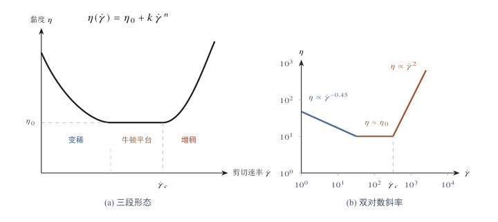
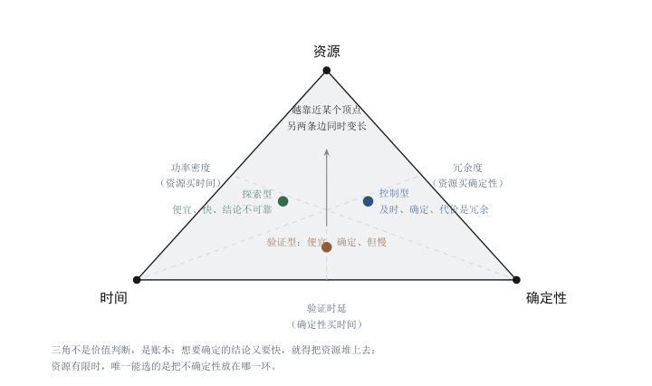
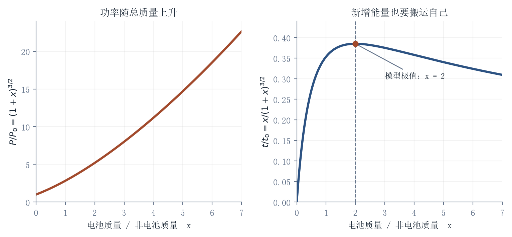

[目录](CONTENTS.md) · [English](../en/CONTENTS.md)

# 生命、身体与位移：智能的模态分化

第三章的收束指向一套更古老的压缩机制：它不靠传感器和反射，而靠世代更替记录哪些变量不能删去，靠繁殖失败来确认哪些压缩是错的。这套机制运行的介质，与位移系统有着根本不同的响应方式。对一段道路施加作用，返回的是摩擦、惯性和排队；对一个生命系统施加作用，返回的是代谢、修复、免疫、代偿和记忆。差别不只是反应快慢。位移系统的参数可以在设计阶段被标定，生命系统的响应会在干预之后继续演化，把设计阶段看不见的后果推迟到时间深处。一旦承认介质会解释作用，“智能应当收敛成什么形态”就不再是一个可以由单轴想象回答的问题。

## 生命不是软件：基因代码的物理意义

### 代码隐喻的失效与超具身的信息结构

介质有响应，这一点在生命系统上表现得最彻底：作用进入之后，会被系统本身重新解释。改变一个系统之前，需要先知道它是什么。位移系统可以按照质量、能量和拓扑来拆解，因为它的部件是外在地连接起来的：发动机、道路、空域、规章，各自可以被单独描述和替换。生命系统不是这样组织的。它的部件在物质上相互嵌入，它的结构由环境在漫长时间里选择并压缩出来。对这样的对象，最方便的描述方式往往也是最容易出错的方式。

#### 代码隐喻与物理执行

把基因比作代码，是一个有用但危险的隐喻。它有用，是因为 DNA 的确具有信息性。碱基序列可以复制，可以突变，可以被读取，可以影响蛋白质合成，也可以在代际之间传递。没有这种信息结构，生命无法保持连续性，演化也无从积累。但它危险，是因为人们很容易进一步误以为：既然基因像代码，那么生命就像软件；既然软件可以编辑、调试、重构，那么生命也可以被同样方式重写。

这个推论忽略了生命系统最根本的事实：基因不是脱离硬件运行的程序。基因的意义不是只由 ATCG 的符号排列决定，而是由它在细胞物理化学环境中的执行方式决定。DNA 序列必须进入细胞核、染色质结构、转录调控、RNA 加工、蛋白质翻译、折叠、修饰、运输、降解、代谢状态、细胞类型、发育阶段和外部环境共同构成的系统，才会表现出功能。**基因不是写在身体里的软件，而是身体本身的一部分。**它的意义不是被读取出来的，而是在细胞环境中被物理执行出来的。

软件代码的意义通常由形式规则决定。一个函数在给定编程语言、编译器和运行环境中，有相对明确的输入输出关系。即使现实软件工程也充满依赖、兼容、接口和遗留问题，代码意义至少可以在较大程度上通过符号结构和执行规则分析。但基因不同。基因没有独立于细胞环境的纯粹意义。一段序列在不同细胞中可能被沉默、激活、剪接、修饰或放大；同一蛋白在不同代谢状态、不同组织环境、不同发育阶段中可能产生不同后果。它不是单独运行的指令，而是嵌入网络中的物理触发条件。

因此，基因型到表现型不是线性翻译，而是多层反应网络。DNA 序列只是起点之一。它要经过染色质开放程度、转录因子结合、RNA 剪接、翻译效率、蛋白折叠、蛋白互作、细胞信号、代谢通量、力学环境和组织结构的连续过滤。所谓“一个基因导致一个性状”的说法，只在极少数简单场景中近似成立[^manolio2009finding]。多数生命现象不是单基因指令的输出，而是网络状态的结果。基因提供可能性，细胞环境决定其实现方式，整个身体和外部环境则进一步改变其后果。

这也是为什么基因的物理实现不能被跳过。一个碱基突变不是抽象字符替换，而可能改变分子形状、结合能、折叠路径、反应速率、稳定性、空间构型和调控关系。结合能的变化不是修辞，它可以被写成一个具体的量：

$$
\Delta\Delta G=RT\ln\frac{K_{\text{d}}^{\text{mut}}}{K_{\text{d}}^{\text{wt}}}
$$

$\Delta\Delta G$采用“突变体减去野生型”的结合自由能约定，$K_{\mathrm d}$是对应解离常数。比值无量纲。突变体的$K_{\mathrm d}$增大十倍时，结合变弱，自由能差为正；在310开尔文下约为$5.9\,\mathrm{kJ/mol}$。它说明一个局部序列变化可能显著改变亲和力，功能后果还要经过浓度、动力学、定位与网络状态。

生命中的“语义”不是词典意义，而是热力学和动力学意义。一个序列的功能，最终体现在它如何改变物质流、能量流、信号流和结构稳定性。基因不是命令一台机器执行动作，而是改变一个复杂物理化学系统中的局部边界条件。这使生命系统不同于普通符号系统。语言可以容忍大量歧义，因为解释者可以补足上下文；软件可以在严格环境中运行，因为规则被人设计为离散、明确、可追踪；生命则在连续、嘈杂、热扰动、强耦合的环境中运行。温度、pH 值、离子浓度、蛋白质构象、分子拥挤、膜结构、机械压力和随机涨落[^ellis2001macromolecular]，都可能影响同一个基因结构的实际后果。生命不是在干净的逻辑空间中执行代码，而是在温暖、潮湿、拥挤、噪声充满的物质环境中维持秩序。

#### 超具身的信息结构

如果基因的意义由执行环境决定，那么执行环境本身就不是背景，而是被写进了序列里。更进一步说，生命具有一种**超具身**特性。普通具身智能是一个模型获得身体，然后通过传感器和执行器进入环境；生命则不是先有一个抽象模型，再把它装进身体。生命的信息结构本身，就是身体与环境长期交互后的沉积物。基因并不只是记录“如何制造一个身体”，它还压缩了数十亿年环境选择留下的痕迹：哪些分子结构能够稳定存在，哪些代谢路径能够持续供能，哪些感知与行动方式能够提高存活概率，哪些发育程序能够在特定温度、营养、重力、微生物、捕食者和繁殖压力下保持可行。基因不是脱离环境的蓝图，而是环境长期刻进生命内部的历史。

因此，基因信息不是普通意义上的符号信息，而是经过自然选择筛选过的交互信息。它包含的不是完整世界模型，而是生命在特定物理世界中反复试错后留下的可生存结构。眼睛不是单纯由“造眼代码”生成的器官，而是光、介质、神经、运动、捕食和逃避共同塑形的结果；肺不是单纯由序列指定的部件，而是大气成分、代谢需求、体型结构和循环系统共同约束出来的结果；免疫系统也不是孤立程序，而是与病原体、共生菌、组织损伤和环境暴露长期博弈后的动态遗产。生命的“代码”从一开始就不是纯代码，而是环境压力、身体结构和历史选择共同压缩成的物质记忆。

这使基因编辑不同于软件修改。修改软件时，代码的运行环境大多由人设计并保持相对稳定；修改基因时，编辑的是一个已经把环境历史内化进自身结构的系统。一个序列片段之所以保留，可能不是因为它在当前单一指标下最优，而是因为它在漫长演化中与其他结构形成了隐性协同。它可能参与发育时序、代谢缓冲、免疫调节、组织稳定或压力响应。我们看到的是一段序列，实际触碰的是生命与环境长期耦合后的压缩层。这个压缩层越古老、越深，越不可能被简单还原为清晰的工程功能表。

### 演化堆叠、通路式调控与四层纠缠

#### 演化堆叠与拓扑刚性

正因为生命具有这种超具身特性，生命系统也不是从零设计出来的。它是演化堆叠出来的。工程设计理想上可以从目标出发，选择干净结构，去除冗余，重构底层。生命不是这样来的。生命系统是长期演化中的历史沉积。一个结构只要在某个环境中足够可用，就可能被保留；一个原本用于某种功能的机制，可能被复用到另一种功能；一个局部补丁，可能在后来的演化中变成不可删除的基础接口；一个偶然形成的路径，可能因后来无数结构依赖它而变得不可替换。生命不是最优设计，而是可生存设计的累积。

这种演化堆叠导致生命系统中充满功能性遗留物。它们未必简洁，未必优雅，未必符合工程师的重构欲望，却可能被深深嵌入系统。一个看似冗余的通路，可能在压力环境下提供备用路径；一个看似低效的机制，可能承担调节、缓冲或发育时期的隐性功能；一个看似无关的片段，可能影响染色质结构、表达时序或远端调控。生命系统中的“废料”经常不是完全无用的垃圾，而是历史性结构的一部分。它可能没有单一清晰功能，却参与了系统的整体稳定。这就是生命拓扑刚性的来源之一。

生命不是由独立模块简单拼装而成，而是由长期依赖关系缠绕而成。一个局部修改可能牵动远端后果；一个短期有益的编辑可能改变长期发育；一个单点增强可能破坏代谢平衡；一个靶点抑制可能被旁路通路补偿；一个局部修复可能改变系统整体压力分布。生命系统的困难不只是“我们还不知道全部机制”，而是机制本身具有多层耦合、历史依赖和状态条件性。这种刚性不来自某个尚未解决的难点，而来自已知结构之间的依赖密度。但刚性不等于封闭，生命之所以可以被医学和生物技术改变，正是因为生命系统仍然存在通路。

#### 通路式调控与四层纠缠

激素可以改变全身状态，神经递质可以改变行为倾向，受体可以放大或抑制信号，酶可以控制代谢通量，免疫检查点可以改变免疫反应，转录因子可以改变细胞命运，递送系统可以把干预送入特定组织。生命不是不可进入的黑箱，而是一个有入口、有杠杆、有脆弱点、有控制面的复杂网络。关键在于，这种操控不是软件式重写，而是通路式调控。药物不是直接改写身体的总体程序，而是通过受体、酶、离子通道、信号通路、免疫节点、代谢节点改变系统状态；基因编辑也不是任意重构生命，而是在特定细胞、特定时机、特定递送条件下改变局部结构。有效干预常常不是“全面重写”，而是找到一个足够关键、足够可达、足够低副作用的调控点，使系统从一个状态迁移到另一个状态。

通路的物理形式并不统一。小分子药物依赖受体口袋的形状匹配，抗体依赖表位的识别精度，基因编辑依赖递送载体在组织中的分布，细胞治疗依赖细胞进入体内之后的归巢与存活。通路的物质形式决定了干预的精度上限，也决定了同一套分子在不同个体身上能不能到达同一个位置。所谓“靶点”，因此不是分子上的一个位置，而是一条需要在体内走完的路径。

通路的容量与选择性是可以被量化的。腺相关病毒载体是目前基因治疗中使用最广的递送工具之一，其装载上限约为 4.7 千碱基，超过这一长度的编码序列无法被完整包装，而它在静脉给药后主要富集于肝脏，组织特异性因此成为载体工程最主要的改造目标。脂质纳米颗粒的载量更灵活，也可以重复给药，但它携带的编辑工具在体内只短暂表达，适合一次性完成编辑的场景，不适合需要长期补充基因产物的场景。递送方式决定了干预能到达哪些细胞、能持续多久、可以被重复多少次，这些限制并不来自编辑工具本身的精度[^naso2017adeno]。通路的物理形式因此划定的是干预效果的上限，而不只是实现细节。

因此，生命技术的真正难题不是“能不能操控”，而是“如何找到可承受的操控路径”。一个好的靶点必须同时满足多重条件：它在病理网络中足够关键，能被药物或编辑工具到达，改变后能产生稳定收益，副作用可以承受，长期反馈不会反噬，个体差异不会使风险失控。这个条件组非常严格。生命可被调控，但它要求干预者同时理解通路、网络、环境、时间和后果。

从技术黏滞的角度看，生命介质的高黏滞来自四层纠缠。第一层是物理化学纠缠。基因功能必须通过分子折叠、反应速率、结合能和空间构型实现。符号变化必须经过物质执行。第二层是网络纠缠。基因不是孤立指令，而是调控网络、代谢网络、信号网络和发育网络中的节点。局部变化会被系统放大、抵消或转移。

第三层是历史纠缠。生命系统不是重新设计出来的机器，而是演化堆叠出来的遗产。许多结构之所以存在，不是因为它们最优，而是因为它们在过去的约束下被保留，并被后来的结构继续依赖。第四层是通路约束。生命虽然可以被调控，但调控必须通过可达通路进入系统：递送路径、靶点特异性、剂量窗口、时序窗口、组织分布和反馈边界，都会决定干预能否真正生效。这四层纠缠共同说明：基因不是软件，生命不是干净的代码库，身体不是可随意替换的硬件平台。基因、身体、环境和历史在原子尺度上相互嵌入。所谓生命代码，只有在生命物质中才具有完整意义。

这并不否定基因技术的力量。相反，正因为基因技术可以触及生命系统的底层结构，它才具有很强的改变能力。但能力越大，越不能把生命简化为可编辑文本。真正成熟的生命技术，不是把身体当作低级硬件，而是承认基因意义的物理性、网络性、历史性和通路性。它不只是问“能不能编辑”，还要问“通过什么通路编辑、在哪个状态下编辑、会牵动哪些网络、长期由谁承担后果”。

基因不是软件。基因是被生命系统执行的物理结构，也是环境历史压缩后的物质记忆。生命可以被操控，但不能被任意重写。操控生命的关键，不是幻想改代码，而是在超具身的演化系统中寻找可承受的调控路径。

四层纠缠说明，干预必须落在通路上。但通路的存在只回答了问题的一半。一旦通路被使用，干预就进入了系统自身的运行过程：它会被代谢、被补偿、被修复、被免疫识别，也会在时间中展开出短期看不见的后果。一条在设计阶段可承受的调控路径，在系统作出回应之后是否仍然可承受，需要另一套分析。

## 生命的剪切增稠：生物干预为什么越快越硬

### 响应系统与通路控制面

可承受的调控路径在设计阶段成立，并不意味着它在被使用之后仍然成立。生命系统不是被动接受改变的材料，它对改变本身有回应。这个区别改变了干预问题的形式：外部作用的强度增加，不一定带来效果的增加。

#### 响应系统

生命系统不是普通负载。对一块金属施力，它会变形、断裂或恢复；对一段代码修改，它会编译、报错或运行；但对一个生命系统干预，它会解释这种干预。它会代谢、免疫、修复、补偿、适应、记忆、反弹。生命不是被动承受外部作用的材料，而是具有自我维持倾向的动态系统。外部输入进入生命之后，不只是改变状态，也会触发系统对改变本身的回应。这就是生物干预的第一性困难：干预对象不是静态对象，而是响应系统。

但这并不意味着生命不可干预。医学、药物、疫苗、外科手术、激素治疗、免疫治疗、基因疗法和再生医学，都已经证明生命可以被深刻改变。生命系统有通路，有靶点，有窗口，有杠杆。关键不是“生命能不能被操控”，而是“操控以什么方式进入系统，是否被系统吸收，是否引发可承受的后果”。

许多技术想象默认，只要我们能找到足够精确的靶点，生命就可以像机器一样被调节。一个通路过强，就抑制它；一个蛋白缺失，就补上它；一个基因异常，就修复它；一个代谢指标不佳，就调回去。这个想法在某些场景中有效，但它低估了生命系统的网络性。生命系统并不总是接受单点改变。它可能绕开被抑制的通路，放大备用机制，改变受体敏感性，调节上游输入，转移代谢压力，或在长期内形成耐受和反弹。

因此，生命干预经常表现出非线性阻力。低强度、低频率、顺应系统节律的干预，可能被系统吸收；高强度、高频率、粗暴越过反馈周期的干预，可能让阻力急剧上升。这种非线性在流变学中有一个对应物。**剪切增稠**指颗粒悬浮液在剪切速率超过临界值之后黏度骤升的现象：低速剪切时，颗粒被流体隔开，悬浮液可以流动；剪切速率提高后，颗粒来不及彼此错开而被挤成密集排列，流体无法继续充当颗粒之间的润滑层，表观黏度在很窄的速率区间内上升若干数量级[^brown2014shear]。在一定范围内，这一行为可以用幂律描述：

$$
\eta(\dot\gamma)=\eta_b+k\dot\gamma^{\,n}
$$

这里$\eta$与$\eta_b$的单位为帕斯卡秒，$\dot\gamma$为每秒，$n$无量纲，因此$k$的单位为$\mathrm{Pa\,s^{n+1}}$。这个式子描述给定区间内的增稠分支；低速变稀、突变堵塞与完整流变曲线还需要其他机制和形式。

在这个表达式中，$k>0$、$n>0$使黏度随速率上升。平台项与幂律项相等的位置可以作为模型内的交叉尺度：

$$
\dot\gamma_c=\left(\frac{\eta_b}{k}\right)^{1/n}
$$

右式单位为每秒。这是由两项相等定义的交叉点，不自动等于实测增稠起点。用于生命干预时，还要分别定义强度、频率、持续时间与“阻力”的测量口径，确认是哪一种代偿、饱和或损伤机制产生了相似曲线。

对某一种具体干预，可以检验：增加强度或加快节奏以后，收益是否递减，补偿或副作用是否上升。剂量、频率和速度不是同一个变量；有些干预需要足够强或足够及时才有效。剪切增稠在这里提出一种响应假设，实际关系由对应机制和测量决定。

#### 通路与控制面

既然阻力来自系统内部的反馈结构，干预落在哪个位置就成了决定性的变量。药物干预是最直接的例子。一个药物进入身体，不是只遇到一个靶点，而是进入吸收、分布、代谢、排泄、免疫、组织屏障、受体调节和个体差异构成的系统。短期指标改善，不等于长期系统改善；单点抑制有效，不等于整体风险下降；剂量增加不一定带来线性收益，可能带来毒性、副作用、耐受、反调节和系统性压力。生命系统不是一条直线，而是一张会变形的网。

不过，药物之所以能起作用，正是因为这张网并非均质。某些节点具有更强控制力。受体、酶、离子通道、转录因子、免疫检查点、激素轴、代谢瓶颈，都可能成为调控通路。医学进步的很大一部分，不是粗暴压制生命，而是在复杂网络中寻找可以被进入、可以被放大、可以被安全调节的关键节点。好的靶点不是单纯“重要”，而是同时可达、可调、可验证、可承受。

这使生命干预具有一种特殊形式：它不是直接控制整体，而是通过局部通道改变系统状态。一个有效药物并不需要理解身体的所有细节，正如一个舵不需要推动整艘船的每一块钢板。关键在于找到能改变方向的控制面。但生命系统的控制面并不稳定。它会随年龄、疾病阶段、遗传背景、组织环境、免疫状态和长期用药而变化。今天有效的通路，明天可能被代偿；一个人有效的靶点，在另一个人身上可能副作用更大。

基因编辑同样如此。编辑工具可以越来越精确，但生命对编辑的响应仍然复杂。一个局部序列被改变之后，它的后果要经过表达、折叠、调控、细胞环境、发育状态和长期反馈。编辑不是结束，而是开始。生命系统会把编辑结果放入自身运行网络中重新解释。短期看似正确的修改，可能在不同组织、不同年龄、不同遗传背景或不同环境压力下显露新的后果。

所以，基因编辑的难点不只是切得准，还包括送得到、改得对、表达稳、反馈可控、长期安全。递送系统、组织特异性、编辑效率、脱靶效应、免疫反应、细胞选择压力和发育时序，都是干预通路的一部分。生命技术越深入底层，越不能只把问题看成“编辑精度”，而要看作“通路设计”。

免疫系统更能说明这种剪切增稠。免疫不是简单防御机制，而是一个高度敏感的识别和调节系统。过弱会失守，过强会自伤；过慢会被感染压倒，过快可能引发炎症风暴[^fajgenbaum2020cytokinestorm]。外部干预如果没有匹配免疫系统的时序和强度，就可能从治疗变成扰动。生命系统最难的地方，不是它不反应，而是它反应太多、太复杂、太依赖时机。

这也是为什么生物技术不能直接复制软件迭代逻辑。软件可以高频发布、回滚、灰度测试、快速修补；生命干预不能随意在人身上高频试错。软件错误多数停留在信息系统内部，生命错误会进入身体、组织、代谢和长期风险。一次错误干预可能改变不可逆发育过程，可能留下长期损伤，可能通过免疫记忆、细胞状态或生态关系延迟显现。生命系统不允许无限次低成本回滚。

### 黏滞来源、鲁棒性代价与在线维护的极限

#### 黏滞来源与鲁棒性代价

从技术黏滞的角度看，生命的剪切增稠来自三个来源。第一是时间刚性。生命反馈需要时间。药效需要时间展开，副作用需要时间观察，免疫反应需要时间发展，组织修复需要时间完成，发育和衰老更是在长周期中显现。外部干预如果只看短期响应，就容易把尚未返回的长期反馈误认为不存在。生命常把代价藏在时间里。

第二是结构耦合。生命系统的通路不是孤立管道，而是互相连接、互相补偿、互相限制的网络。单点改变可能通过网络传导到远端，局部收益可能伴随全局代价。系统越复杂，越不能把一个指标的改善直接等同于生命状态的改善。

第三是维护压力。生命是远离平衡态的耗散结构，必须持续输入能量、修复损伤、排除废物、维持边界和调节内部状态。生命不能像机器一样停机维护。心脏、免疫、神经、代谢、内分泌、细胞修复都必须在运行中完成。所有修复都发生在系统仍然承载功能的时候。这使干预强度和精度都受到限制：太弱没有效果，太强扰乱运行；太快越过反馈，太慢错过窗口。

这也可以帮助理解新药研发效率困境。现代生物技术、自动化实验和 AI 可以显著扩大候选空间。靶点可以更快发现，分子可以更快生成，结构可以更快预测，实验可以更快筛选。但发现端加速之后，瓶颈并不会自动消失，而是转向生命系统本身的验证、代偿和长期安全性。候选越多，验证越重；靶点越精确，系统反馈越需要理解；早期发现越快，后期临床失败的代价越高。所谓 Eroom 现象[^scannell2012diagnosing]，不能被简单归结为某一个因素，但它提醒我们：生物发现工具的进步，并不自动穿透生命系统的高黏滞验证层。

药物研发中的时间和费用随疾病、试验设计、失败分摊与资本口径变化。2016年的一项公司样本研究提供过较高的资本化成本估计，它不是每款新药的固定价格。[^dimasi2016] 更新的观察点是rentosertib：企业在2026年9月宣布三期项目首位患者给药。[^insilico2026phase3] 到达这个阶段构成进展，三期结果仍须通过后续观察建立。

发现端与验证端之间的落差可以用在制品数量来称量，

$$
L=\lambda W
$$

$L$为稳定流程内的平均在制品数，$\lambda$为同一边界的平均通过率，$W$为平均停留时间。这是Little关系，退出、撤回和早期失败都要按一致口径计入。提高到达率、扩容、改善选择和改变停留时间，会共同影响库存与产出。若到达率持续超过服务能力，队列不断增长，就不能直接用稳态平均式解释全过程。

三个来源之外，生命还有一项与它们方向相反的性质。生命的鲁棒性是双刃剑。它让身体能够抵抗扰动、修复损伤、维持稳定，也让外部干预难以线性生效。一个脆弱系统容易被改变，也容易崩溃；一个鲁棒系统能够存活，也更会抵抗改变。生命之所以难治，正因为生命仍在努力维持自己。疾病不是一个独立敌人，而常常是身体网络在特定历史、遗传、环境和行为条件下形成的状态。治疗不是删除错误，而是推动整个系统从一个稳定状态迁移到另一个稳定状态。

但这种迁移不是盲目的。系统医学、网络药理学、精准医疗和合成生物学的价值，就在于它们试图识别状态迁移的通路。它们不是把生命当作不可知的神秘整体，而是承认生命有结构、有节点、有控制面，只是这些控制面嵌在反馈网络和时间过程之中。真正有效的生物干预，往往不是最大力度的干预，而是最适合系统状态的干预：在正确靶点、正确剂量、正确时序、正确人群和正确验证框架中，推动系统越过某个病理稳定态。

这使“越快越好”的技术直觉在生命领域经常失效。干预速度过快，可能越过系统弛豫时间；指标调整过猛，可能触发反调节；局部控制越强，越可能把压力转移到别处；候选生成越多，越可能堆积在验证瓶颈前。生命系统不是拒绝技术，而是要求技术进入它的节律。好的生物技术不是把生命当作慢软件，而是理解生命的反馈、冗余、代偿、时序和不可逆性。到这里，剪切增稠还只是一个横截面上的判断，它在时间维度上的极限形态还没有被处理。

图 4.1. 剪切增稠：低速率省力，高速率反噬。(a) 三段形态；(b) 双对数坐标下的三段斜率为 $-0.45$、$0$、$+2$，两轴同尺度，因此视觉斜率等于数值斜率。对生命系统的干预速率越高，系统的补偿性反应越强，有效黏滞不降反升。

#### 在线维护的极限与干预节律

衰老可以看作在线维护的极限。生命体从出生开始就在持续修复自身：DNA 损伤修复、蛋白质质量控制、细胞更新、免疫清除、代谢调节、组织再生。但修复并不完美。损伤会积累，错误会残留，冗余会消耗，调节网络会变钝，系统会逐渐失去弹性。衰老不是单一部件损坏，而是长期运行系统中维护压力、信息噪声、结构损伤和反馈失调的共同结果[^lopezotin2013hallmarks]。

死亡则显示了个体在线维护的边界。对个体而言，死亡是终止；但从种群和演化角度看，代际更替提供了一种更新机制。它让生命不必无限修补同一个个体，而是通过繁殖、变异、选择和重组，让系统在更高层级上继续搜索。这个说法不是为死亡赋予浪漫意义，也不是说死亡对个体是好事，而是指出：生命无法无限在线维护，种群层面的更新部分承担了个体层面无法解决的累积损伤和结构僵化。

这也解释了生命介质为什么具有特殊黏滞。它既有比特属性，因为基因可复制、可传递、可编辑；又有原子属性，因为基因必须在物理化学环境中执行；还有生命属性，因为执行结果会进入反馈、代偿、修复和演化。它不是轻介质，而是比特、原子与生命的重叠区。AI 可以加速其中的信息搜索，却不能取消其中的物理执行、时间展开和系统响应。

成熟的生命技术，不能只追求更强编辑、更快筛选、更大模型。它还必须学会寻找通路、匹配时序、控制剂量、分层验证、缓冲风险和尊重反馈。某些场景适合强干预，某些场景只能温和调节；某些目标可以快速验证，某些后果必须长期观察；某些残差可以交给模型吸收，某些残差必须交给临床、制度和伦理边界承担。

生命不是软件，也不是普通机器。它是会维护自身、解释干预、抵抗扰动、延迟反馈的耗散结构。生物干预的难点，不在于生命不可改变。生命当然可以被改变。难点在于：真正有效的改变必须找到通路、穿过反馈、尊重节律，并承受长期验证。**推得越快，系统未必越顺，反而可能越硬。**这就是生命的剪切增稠。

剪切增稠把代价重新推回承受者一侧。无论干预设计得多么精确，扰动、代偿、不可逆后果和长期验证都必须落在某个仍然在运行的系统上。承受有边界，也有时限：能吸收的扰动、能推迟的反馈、能承担的不可逆改变都是有限的。什么可以被承受、由谁承受、承受多久，构成的问题比干预技术本身更基础。

## 形态计算之后：身体封装与演化摊销

### 物理智能的残差问题与身体封装的三层结构

承受总要落在某个具体结构上。生命把大量残差修正压进了演化、发育和环境的共适配，机器没有这套结构，它在物理世界中的每一次行动，都要靠显式工程结构来吸收偏差。第三章留下的压缩判据决定了模型保留哪些变量，但这些变量在物理接触中由谁修正、以多大延迟修正、失败之后能否恢复，并不是模型内部可以回答的问题。

物理智能最容易被误解的一点，是把身体看成智能的外设。在这种理解里，真正的智能位于大脑、模型或控制系统之中，身体只是执行命令的机械端口，系统先理解世界，再规划动作，最后由身体把计划落实到现实；按照这种图式，只要模型足够强、传感器足够多、控制足够精细，机器就应当能够像人一样进入现实世界。但物理智能的真实困难，不在于生成一个动作，而在于在开放现实中连续行动，而连续行动要先承认一件模型不愿承认的事：现实会持续产生模型没有预写的偏差。

#### 物理智能的残差问题

现实不是等待执行的静态对象，而是一个不断产生残差的开放系统。模型可以给出动作，现实会给出偏差。地面可能比预期更滑，物体可能比视觉判断更重，杯壁可能有水，门把手可能松动，人的身体可能突然失衡，光线可能变化，传感器可能被遮挡，执行器可能存在延迟。每一个偏差单独看都很小，但物理任务不是一次问答，而是一条任务链：一次小的识别误差会改变抓取姿态，一次小的接触偏差会改变物体位置，一次定位漂移会进入下一轮规划，一次反馈延迟会放大控制误差，残差不会在动作之间自动清零，而会沿着任务链传播。

这里所说的**残差**，不是一个单一误差项，而是开放物理行动中未被当前模型、身体、控制器或运行体系完全吸收的偏差总称，它至少包括四类：模型残差，即世界模型或策略模型压缩后遗漏的状态变量；感知残差，即传感器噪声、遮挡、漂移和多模态不同步造成的状态估计偏差；接触残差，即摩擦、滑移、变形、冲击和力传递中的不可完全预测部分；运行残差，即异常处理、维护、验证、接管和责任追溯中的系统性负担。要紧的不是这些残差是否存在，它们在开放行动中总是存在，而是在连续任务链中它们是否会被及时吸收，还是沿接口传播并越过可恢复边界。因此，具身智能真正要解决的，不是能不能做某个动作，而是能不能在连续任务中把残差压在可恢复范围内。

抓杯子只是最小例子。现实中的机器人面对的是清洁房间、护理老人、整理桌面、搬运货物、工地协作、农田采摘、医院送药，每个任务都由许多动作串联而成，每个动作又改变下一个动作的初始条件，系统真正要证明的，不是它能不能成功一次，而是它能不能在长时间、多扰动、高责任的任务链中保持可恢复性。这里的困难有明确的门槛形状：超过某个残差阈值，能力不是平滑下降，而可能突然表现为停机、误抓、碰撞、失衡或请求人工接管。于是问题就落到承载残差的结构上，而人类身体的特殊之处，不是拥有完整世界模型，而是把大量残差修正压进了身体、经验和环境共适配之中。

#### 身体封装的三层结构

拿起一个杯子时，人不会先计算杯子的精确几何、摩擦系数、重心位置、表面湿度、接触角度和力分布，人只是看一眼，伸手，触碰。手指立刻感到滑不滑，肌肉立刻感到重不重，关节立刻修正姿态，杯子一有微小滑移，指腹和肌肉就自动调整夹持力度。很多误差还没有进入意识，就已经被身体吸收，这就是**身体封装**。**身体不是智能的外设，而是残差管理系统。**它把开放现实中的大量偏差压缩在低延迟、连续反馈、自修正的闭环里。

身体封装不是说身体“很重要”这么简单，而是说身体本身是一套残差吸收结构。皮肤、肌肉、肌腱、关节、骨骼、前庭系统、本体感觉、痛觉和反射，并不是大脑之外的附属装置，而是感知、执行、缓冲、约束和修正的连续系统：手指柔软，会自动适配物体表面；肌肉有弹性，会吸收冲击；关节有限位，会限制危险动作；痛觉会标记过载；经验会提示哪些细节可以忽略，哪些细节意味着危险。身体不是把所有信息传给大脑再等待计算，而是在接触中直接处理一部分现实。

身体之所以能够封装残差，并不是因为它绕开了物理规律，而是因为它把一部分物理规律变成了行动结构。摆腿时的重力势能与动能转换、肌肉与肌腱中的弹性储能、指腹接触时的局部形变、关节限位对危险姿态的排除，都不是中央控制器事后补偿出来的结果，而是身体形态预先把某些误差限制在可承接的动力学通道中；成熟身体不是每一刻都用主动控制对抗重力、惯性、摩擦和接触，而是在许多场景中让这些物理关系先完成一部分约束、筛选和修正。由此看，形态计算的深层意义不只是“身体参与计算”，而是身体把一部分原本需要感知、估计和控制的残差，转化为材料、几何和被动动力学中的低成本约束[^paul2006]，被动动力行走机器人正是这条思路的直接证据：在恰当形态和动力学条件下，稳定运动并不必然依赖高强度中央控制，身体结构本身可以承担一部分运动组织[^mcgeer1990][^full1999][^collins2005]。

封装至少发生在三层。第一层是材料封装，皮肤、肌肉、肌腱和关节以物理方式吸收误差，柔软的指腹扩大接触面积，肌肉弹性缓冲冲击，步态中的身体弹性帮助稳定行走，这里的“计算”不是符号计算，而是材料和形态直接参与控制，形态计算研究之所以重要，正在于它把身体形状、材料顺应性、被动动力学和环境耦合纳入控制问题，一部分本来需要中央控制器处理的复杂性，可以由身体结构本身分担[^paul2006]。第二层是反馈封装，人通过视觉、触觉、本体感觉、前庭系统和肌肉张力，在行动中连续采样现实：地面是否湿滑，脚底一压就知道；物体是否松动，手指一碰就知道；对方身体是否失衡，手臂一接触就会调整，世界不需要被完整预装，而可以在行动中被局部询问，阻抗控制在机器人操作中成为基础概念，正是因为接触任务不能被还原为纯位置跟踪，操作者、执行器、物体和环境构成同一个动力学耦合系统，控制的对象不是孤立轨迹，而是交互关系[^hogan1985]。第三层是经验封装，人见过无数杯子、门把手、楼梯、湿地面、刀具、热锅、疲惫的人体和拥挤的空间，这些经验不是完整模型，而是大量可行动的有损压缩，人知道哪些细节通常可以忽略，哪些细节必须立即处理，身体让模型可以不完整，经验让行动可以不从零开始[^gibson1979]。

这一路径与 Moravec 悖论、具身认知和形态计算传统相通[^moravec1988][^pfeifer2007][^varela1991][^gibsonpick2000][^pfeiferbongard2006][^hauser2011]。Moravec 悖论提示，对机器来说，抽象推理未必最难，反而是人类幼儿即可完成的感知-运动能力极难工程化；具身认知指出，智能不只存在于头脑中，而是在身体、环境和行动之间形成；形态计算进一步强调，身体材料与形态可以参与控制。本节要推进的是其中一层更具体的判断：身体封装的不是抽象计算量，而是残差的低延迟吸收能力。不过，这个判断很容易被读成身体天然优于机器，而原文自身也留下了修正条款：人类并不是只把复杂性内化，机器也不是只能把复杂性外化，人类把一部分残差交给环境，门把手、楼梯、桌椅、道路和工具，都是围绕人体尺度形成的外部封装，机器也可以把一部分残差压回身体，柔性夹爪、弹性关节、机械限位和顺应性材料，都是机器的内部封装。真正的差异不在于人内化、机器外化，而在于时间分母与基质可供性这两条更底层的轴，这一点留到本节最后一个小节处理；眼下要先回答的是另一个问题：既然机器也有办法修正残差，为什么它仍然显得沉重？

### 机器复杂度展现与接口债务

#### 机器复杂度展现与接口债务

机器并不是没有办法修正残差，而且路径很多。它可以通过传感器展现残差，摄像头、深度相机、激光雷达、触觉、力矩、IMU、本体感觉，都可以让机器知道自己偏了多少、滑了没有、撞了没有、姿态漂了没有；可以通过控制算法修正残差，闭环控制、阻抗控制、模型预测控制、实时重规划，可以把小误差不断拉回轨道；可以通过身体结构吸收残差，柔性夹爪、欠驱动手、弹性关节、顺应性材料、机械限位、被动稳定结构，都可以让身体自己消化一部分误差[^mason1985][^birglen2008]；可以通过更强模型预测残差，视觉-语言-动作模型、世界模型、模仿学习和策略模型，可以从较少输入中推断更多状态，提前避开危险动作[^shao2025][^li2025]；可以通过环境改造减少残差，标准货架、二维码、专用夹具、固定路线、封闭园区、轨道系统、V2X、结构化仓库，都是让环境替机器降低开放性；还可以通过任务收缩和运行体系限制残差，扫地、仓储搬运、巡检、手术辅助、焊接、采摘、配送各自收缩任务边界，远程接管、安全员、异常工单、日志审计、维护人员和保险责任，则把残差转入更大的运行结构。真正的问题不在于办法够不够多，而在于人类把大量残差修正沉入身体、经验和环境，机器往往必须把残差修正展现为工程系统。

这就是**机器复杂度展现**。所谓复杂度展现，不是简单地“机器需要更多传感器”，也不是“机器硬件不如人”，它指的是：在人类身体中被连续、局部、低延迟处理的现实复杂性，在机器那里必须被拆成可测量、可同步、可控制、可验证、可维护、可追责的工程结构。人用手指感知滑移，机器可能需要触觉传感器、滑移检测算法、控制反馈和安全策略；人用肌肉缓冲碰撞，机器可能需要柔顺材料、力控策略和机械保护；人通过经验理解“轻一点”“别弄坏”“扶稳一点”，机器必须把这些模糊约束转化为动作规则、风险边界和责任记录。身体里原本连在一起的东西，被机器拆成了模块，模块一多，接口就出现，接口一多，残差传播路径就增加。

这可以称为**接口债务**：当隐含在身体闭环中的残差修正被拆成多个工程模块后，系统必须持续承担同步、标定、延迟补偿、故障传播、维护和验证的结构性负担。在人类身体中，感知、执行、缓冲、修正和安全边界不是五个独立系统，手指触到杯壁的瞬间，触觉、肌肉张力、关节角度、皮肤形变和经验判断已经在同一个身体闭环中完成局部修正，变量没有被完全命名，误差没有被完全展开，控制也没有被拆成彼此独立的模块；机器不同，滑移要被检测，触觉要被标定，视觉要和力觉同步，控制器要补偿延迟，执行器要承接误差，安全系统要判断边界，日志系统要记录行为，验证系统要证明可靠，责任系统要追溯后果。每拆出一个变量，就多一个接口，每多一个接口，就多一个同步问题、故障模式和维护点。若把模块间的耦合近似为两两都可能相关，接口数量的增长可以写成

$$
N_{\text{if}}=\frac{n(n-1)}{2}
$$

其中 $n$ 是被显式拆分的模块数，$N_{\text{if}}$ 是系统需要维护的成对接口数，两者都是无量纲计数，系数 $1/2$ 来自成对通道无序，一条通道不重复计数。在每一对模块之间至少需要一条同步、标定或误差传递通道的假设下，这个式子给出的是接口数量的上限而非实计数：$n$ 从五增到十，上限从十增到四十五，增长快于模块数本身。真实系统的依赖通常不是全连接，很多成对通道并不活跃，实际接口数低于该上限，但方向不变，模块拆得越细，需要同步、标定和验证的关系增长得越快。展现因此不是把复杂性看清楚这么简单，而是把隐含复杂性转化为显式耦合结构。

接口债务也不是普通的集成成本。普通集成成本强调模块多了会麻烦，接口债务强调残差会沿接口传播：感知偏差会进入控制，控制偏差会进入执行，执行偏差会改变环境，环境变化又反过来污染下一次感知；模块越多，残差传播路径越多，任务链越长，残差越容易从局部误差变成系统偏移，机器的沉重不来自某一个部件，而来自这些显式结构之间不断累积的耦合债务。这里面还藏着一层更隐蔽的时间债务：机器系统中的视觉、触觉、力矩、本体感觉、规划器和执行器通常具有不同的采样率、延迟和相位，每个模块都在处理某个时间片上的世界，但这些时间片并不天然重合，控制器拿到的“当前状态”，往往已经是多路异步信号经过时间戳、滤波、外推和融合之后生成的工程对象。只要任务进入高速接触或连续操作，残差就不只是从一个模块传到另一个模块，还会从一个时间相位错位到另一个时间相位，系统修正的可能不是此刻的误差，而是刚刚过去的误差，下一次动作又会把这个滞后的修正写入新的物理状态；于是接口越多，系统不仅越难集成，也越难维持一个稳定、共同、可行动的“现在”。身体的接缝不需要被逐一命名，机器的接缝必须被逐一维护。

反过来看，“展现”也不等于“堆料”。成熟工程不一定是把所有东西做得更通用、更复杂，一个柔性夹爪可能比高精度机械手加复杂触觉阵列更适合抓软物体，一个固定工装可能比通用识别模型更可靠，一个机械限位可能比复杂软件安全策略更稳定，一个封闭园区可能比开放道路更容易自动驾驶，真正的问题不是传感器够不够多，而是残差由谁修正、在哪里修正、以什么物理和工程代价修正。软体机器人和欠驱动结构正是在这个方向上展开，它们不是简单模仿生物外形，而是试图让材料顺应性、接触几何和被动形变参与控制，使机器人不必把每一次接触都转化为高精度测量和中央计算；Rus 和 Tolley 的综述指出，柔性材料使机器人能够走出刚性机器人的设计、制造和控制路线，但软体结构也带来建模、感知、驱动和控制的新困难[^rus2015]。这说明身体可以吸收残差，但身体本身也会引入新的显式复杂性，它不是免费解法，而是另一种复杂性分配方式。既然复杂性总要被分配，把其中一部分交给更强的模型，就成了下一条看似最直接的出路。

### 预测不能取消承受：任务链与断崖式失效

#### 预测不能取消承受

模型可以减少误差、避免危险接触，也能让现有硬件完成更多任务。物理闭环还需要足够的力、速度、感知与恢复能力：滑移发生以后，要有接触与控制结构接住；部件损坏以后，要有修复或替代路径。预测、执行和恢复的能力，应分别检查。

这并不是否认大脑的价值。更强的视觉模型、世界模型、动作模型和策略学习，确实可以让已有传感器和执行器做得更多，很多任务并不需要人类级身体，也不需要全套触觉皮肤和灵巧手，只要任务边界清楚、环境相对稳定、后果可控，一个好模型配合现有硬件就能形成可用闭环。但更强大脑只能推远能力边界，不能取消能力边界：它不能让执行器凭空获得力量，不能让材料凭空获得柔顺性，不能让传感器永不漂移，不能让开放世界的长尾风险无需验证。大脑越强，某些复杂性会从传感器和硬件转移到模型，但只要行动进入原子世界，残差仍然必须在某个位置被吸收，而在开放任务链中，残差通常只能被吸收、转移、隔离或延迟暴露，很难被简单消除。残差不会免费消失，只会换一个位置重新出现。

端到端模型、仿真、遥操作与新型传感都可能减少或消除具体故障，也可能把部分负担转移给数据、支持与维护。残差没有固定守恒量。评价时应当记录错误是否真正减少、出现位置怎样改变，以及长任务中的恢复成本。可检验的机制是残差何时传播并放大，而不是预先断言它只能转移。

#### 任务链与断崖式失效

经验机制的第一条推论是，实验室里的短链条成功不能直接等同于开放世界中的长期可靠。一个机器人在标准桌面上抓取成功，不等于它能整理陌生家庭；仓储机器人能在标准货架间运行，不等于它能在医院走廊中处理人流、隐私、急救优先级和临时封路；自动驾驶能在规则道路上行驶，不等于它能稳定处理施工、逆光、雨雪、非标准手势和责任争议。现实任务会拉长链条、增加扰动、提高责任后果，并让微小误差在接口之间循环，因此残差机制并不意味着机器最终不能实现可靠具身智能，它反对的只是另一种理解：把开放世界具身智能看成可以无代价、无限平滑外推的能力曲线。

以“家庭整理桌面”为例，任务看似简单，实际却是一条高残差任务链。机器人首先要识别桌面物体，杯子、纸巾、药盒、钥匙、充电线、眼镜、半杯水、易碎摆件；视觉模型可能把透明杯壁、反光桌面和遮挡边界处理得足够好，但仍会留下状态残差，杯子是否装水、杯底是否潮湿、眼镜是否压在纸下、药盒是否空盒。下一步抓取会把状态残差转化为接触残差，夹爪角度略偏，杯身轻微旋转，纸张被带起，充电线缠住另一件物体；再下一步，接触残差会改变环境状态，杯子位置变了，纸堆塌了，原先可见的钥匙被遮挡，桌面布局不再等于上一轮规划的输入。此时系统面对的不是一个孤立错误，而是误差写入环境之后形成的新任务状态，若机器人缺少低延迟触觉、柔顺抓取、局部恢复和任务级回滚能力，一个小小的滑移就可能从“夹得不稳”升级为“物体掉落”，再升级为“液体洒出”“任务中断”“人工接管”。这也正是具身智能能力边界的准确位置：不是模型能否生成一个看似正确的动作，而是系统能否在一定任务长度、扰动强度和责任后果下，把残差压在可恢复范围内。

边界处的突然暴露，还与物理接触本身的多尺度结构有关。人的指腹、皮肤、肌肉、关节和本体感觉并不是在单一尺度上工作，微小纹理、局部滑移、接触面积变化、整体姿态调整和肌肉张力修正，常常在连续介质中同时发生，许多微小偏差在还没有变成显式错误之前，已经被低层材料和感觉-运动闭环吸收；机器系统则常常把这些尺度拆开，微观接触由材料承受，局部滑移由触觉或力传感器检测，整体姿态由视觉或状态估计算法修正，任务偏移再交给规划器处理。若某一尺度上的残差没有被及时吸收，它就可能跃迁到更高尺度：微小滑移变成抓取姿态改变，姿态改变变成物体状态改变，物体状态改变又污染下一轮感知与规划。所谓断崖式失效，很多时候并不是误差线性增大，而是残差跨过了某个尺度间隙，从局部扰动变成系统事件。断崖式失效是身体封装不足、尺度封装不足和接口债务过重的外在症状。

这个机制可以被证伪，而且证伪的方式很具体。如果未来大量开放世界机器人在家庭、医院、工地、农田和公共道路中，能够长期呈现平滑降级：错误可自我恢复，残差不沿任务链积累，人工接管率随扰动强度缓慢上升而不是突然跳升，维护和验证成本不随任务长度显著增加，那么本节关于“残差沿任务链传播并在边界处放大”的判断就应被降级，那将说明更强模型、身体结构、环境设计和运行体系已经把残差压回了可连续吸收的范围。现实中也已经出现了一些重要的技术信号，Bongard、Zykov 和 Lipson 展示了机器人通过连续自建模在损伤后恢复运动的可能性[^bongard2006]，Cully 等人进一步展示了机器人可以通过智能试错在很短时间内找到损伤后的补偿行为[^cully2015]；这些工作并不推翻残差机制，反而说明可靠具身智能必须拥有残差恢复结构。换言之，真正成熟的具身智能不是永不出错，而是能够在接近边界时优雅降级，它依赖的不是把误差消灭，而是把误差重新纳入可处理范围的能力。而这种能力在人类身上之所以显得毫不费力，原因不在当下这一刻，而在时间。

#### 演化摊销与残差管理

人类行动的轻巧不是免费的，它的代价已经被极长时间尺度摊销。数亿年的生物演化塑造了皮肤、肌肉、骨骼、关节、神经反射和运动控制，无数个体的失败、损伤、死亡和繁衍，把不适合现实的身体结构淘汰掉；个体发育又通过婴儿期、童年和日常生活中的无数次摔倒、碰撞、抓握、试探和修正，把身体与现实重新校准；社会环境则围绕人的尺度设计了门把手、楼梯、桌椅、工具、厨房、道路、医院和工厂。人进入现实，并不是进入中性空间，而是进入一个与人类身体共同演化、共同设计、共同驯化过的生态位，这就是**演化摊销**。

演化摊销不是说人类身体没有代价，而是说这部分代价被分布在极长的时间尺度、海量个体试错、个体发育和社会环境改造之中，一个成人轻松拿起杯子，背后不是当下瞬间的简单计算，而是演化史、发育史、生活史和环境史共同沉淀出的身体封装，发育系统理论和生态心理学都强调，行动能力不是单纯从内部程序展开，而是在身体、环境和历史过程的耦合中形成[^thelen1994][^clark1997]。到了这里，前面提到的那两条轴可以展开了。时间分母决定复杂性能否被长期摊销，人类身体和人类环境用演化、发育和文明设计摊销了极长时间，机器则试图在短工程周期内重建这些封装；基质可供性决定什么样的残差容易被吸收，皮肤、肌肉、肌腱、神经、痛觉和自修复组织，本身适合柔顺接触、连续反馈、损伤感知和局部修复，金属、电机、齿轮、硅片、线缆和刚性结构则更擅长精确、重复和高功率输出，却不天然具备生命材料的低功耗柔顺、自愈和连续感知。人用时间和生命基质隐藏复杂性，机器常常用工程系统展现复杂性。

这里所说的分摊可以被写成一个记账关系，

$$
\bar{c}=\frac{C}{N}
$$

式中，$C$ 是形成一项能力所沉淀的总代价，包含演化试错、个体发育校准和社会环境改造的累计投入，必须先折算到同一口径（能量、时间或个体数）；$N$ 是这项能力在其使用史中被调用的总次数，由个体一生的行动次数与种群世代数的乘积给出，是一个无量纲计数；$\bar{c}$ 因此是单次调用分摊到的代价，单位随 $C$ 所选的口径而定。这个式子的含义在于，人类行动的轻巧不来自分子小，而来自分母大：$C$ 很大，$N$ 更大，因此 $\bar{c}$ 可以小到不进入当下的决策。机器要在短工程周期内重建同样的封装，$N$ 远小于演化与发育给出的分母，同样的 $C$ 摊下来就重得多。适用条件是一次性沉没与持续调用，只有当 $C$ 已经沉没且该项能力仍被反复调用时，摊销才成立；若环境改变使这项能力失效，原有的 $N$ 不再累积，摊销随之中断，$C$ 转为沉没成本。这个式子是记账方式，不给出 $C$ 与 $N$ 的实测值，也不表示生命身体在每一项能力上都更便宜。

但这并不意味着生命身体在所有维度上优越。机器在高精度重复、高载荷、高速加工、高温环境、强辐射场景和标准化制造中，常常远超生物身体，问题不在于生命材料天然“更高级”，而在于开放世界的柔顺接触、连续反馈、损伤感知、局部恢复和长时程行动，恰好是生命基质长期适配过的能力组合，机器可以在许多单项能力上超过身体，却仍然需要为这种组合能力重新设计封装结构。人类身体的轻巧还来自长期校准出的自状态先验：正常情况下，人不需要在每个动作前重新证明自己的手还在何处、关节是否存在、肌肉是否响应、身体是否仍保持基本一致性，身体通过本体感觉、前庭系统、运动经验和内稳态机制，提供了一个持续更新但并不每次归零的自我状态置信区间；机器则必须把这种自状态可信度工程化为传感器标定、冗余测量、状态估计、异常检测和安全断言，它不是没有“自我状态”，而是这种状态必须持续被测量、同步、校验和记录，身体中的默认信任，在机器中表现为一整套验证结构。

这两条轴合起来，把物理智能重新接回技术黏滞的主轴。比特层可以快速生成模型、策略和仿真，原子层却必须承受接触、摩擦、惯性、材料和安全后果，生命层已经用极长时间生成了一种适合现实的身体；AI 试图从比特层直接进入原子层，并复制生命层长期摊销出的身体能力，就会遭遇速率上的根本不匹配，模型更新快，身体改造慢，环境共适配更慢。物理 AI 的困难，深层上不是机器还不够聪明，而是快工程试图承接慢演化的历史积累，这一条也解释了为什么现实中的工程出路总是分成几种，而不能收束成一种。第一条是改造环境，减少残差来源，封闭园区、仓储、工厂、港口、专用道路、标准化接口，本质上都在把现实变得更可感知、更可预测、更少接触歧义，不是让机器理解整个开放世界，而是让世界局部结构化。第二条是改造身体，增强残差吸收，柔顺材料、触觉皮肤、灵巧手、弹性关节、欠驱动结构、低延迟本体反馈，都在尝试让机器拥有更好的物理承接层，人形机器人的吸引力之一，在于大量既有环境、工具和交互接口已经围绕人类身体尺度形成，但它也迫使机器承担双足平衡、全身协调、灵巧操作、安全接触和长期身体经验的高复杂度。第三条是增强模型，推远能力边界，更好的大脑可以用较少输入推断更多状态，可以提前预测错误，可以让现有硬件做更多事，但这不是逃逸，而是转移，复杂性从身体、传感器或环境转移到模型、数据、训练、仿真和验证中。第四条是收缩任务，并用运行体系兜底，很多现实可用的机器人系统，不是因为它们拥有通用身体，而是因为任务边界被精确限定，异常由人类或运行系统处理，机器处理被稳定化的常态，人类或运行体系处理超出边界的残差，这不是失败，但说明自主性并没有免费获得，只是被系统重新分配。

由此看，物理 AI 的成熟，不是单纯模型能力增长，也不是单纯传感器堆叠，而是建立足够可靠的**残差管理体系**，这个体系可以由身体、模型、传感器、控制器、环境设计、任务边界和运行体系共同组成，不同方案不是简单优劣，而是残差在不同位置被吸收，复杂性在不同位置展现。更进一步说，成熟的物理智能未必追求与开放现实发生无限高维接触，恰恰相反，它往往需要主动限制接触维度，划定可承接的物理边界，结构化环境、标准化工具、受限任务、柔顺身体、安全控制、远程接管和运行审计，都是在为机器划出一个可行动的容错区域；在这个区域内，残差可以存在，延迟可以存在，误差可以存在，但它们不会轻易穿透身体、模型、控制和运行体系的多重吸收结构。真正可靠的物理智能，不是让机器毫无边界地理解整个世界，而是让机器与世界共同形成一个可恢复、可验证、可维护的行动生态位。

形态计算之后，真正的问题不是身体是否参与计算，而是身体如何把残差跨时间尺度地封装起来，以及机器如何在缺少这种历史摊销与生命基质时重新承担残差。人不是因为拥有完整世界模型才行动，而是因为身体允许模型不完整；机器不是不能学习人的行动，也不是必须无限堆叠传感器，而是必须为缺失的身体封装寻找残差修正机制。物理智能的第一性难题就在这里：真正稀缺的不是抽象推理本身，而是一个经过漫长时间摊销、并且由合适基质承载的残差吸收结构。能不能进入开放世界，取决于系统是否拥有与它的介质相匹配的残差吸收结构。但这个结论并没有把问题说完，因为它把太多不同性质的工作都装进了“残差吸收”这一个说法里：展开可能性的工作可以在符号空间里低成本重试，封装风险的工作必须把自由度压进安全边界，显影错误的工作则要以证据链和长期观测为前提，三者需要的资源结构、时间尺度与确定性水平并不相同。如果残差的吸收位置决定了系统的重量，那么落在不同位置上的残差，是否本来就要求智能分化成不同的模态？

## 智能的模态分化：资源、时间与确定性的约束三角

### 约束三角的三条边与张力

残差落在哪个位置，决定了吸收它所需要的资源结构、时间尺度与确定性水平，而这三种要求并不总是同向的。智能不会只沿着一条直线进化。一种常见想象是：智能越强，就越通用、越快速、越可靠、越低成本，最后收敛成某种统一的全能系统，它能实时理解世界，瞬间生成方案，稳定控制现实，准确预测后果，并以极低资源消耗完成所有任务。这个想象把智能看成一种单轴能力：能力越大，一切维度同步改善。但真实世界中的智能不是在真空中增长，而是在约束中运行，任何智能系统都必须处理资源、时间和确定性之间的张力，它需要资源来计算、感知、存储、冷却和执行，需要时间来接收信息、推理、验证、反馈和修正，还需要确定性来保证结果可靠、行为稳定、风险可控、责任可追踪；三者可以被技术不断改善，却很难同时无代价推向极值。**单轴想象的关键错误，是以为约束会随能力一起消失。**

#### 约束三角的三条边

这不是一个数学意义上的绝对不可能定理，而是一个物理和系统工程意义上的约束判断。更好的算法、更高效的芯片、更强能源、更优传感器、更成熟的控制架构，当然都能移动边界。但移动边界不等于取消边界。技术可以把约束三角推大，却不能让速度、确定性和低成本同时无限提高而不产生新的代价。

三条边各自有明确的物理含义。所谓资源，是智能运行的物理账本：计算需要能量，模型需要存储，传感需要设备，推理需要时间片，执行需要功率，控制需要通信和反馈，高可靠系统还需要冗余、备份、审计和维护。即便一个智能系统看起来像纯信息结构，它也必须运行在芯片、电力、网络、冷却和制造体系上。智能越要覆盖更大系统、更高频反馈、更高后果任务，它越难保持轻盈。

数据中心把智能的物理底座显示出来。IEA在2026年4月与10月的报告分别检查效率、需求与供电条件：单位任务效率可以改善，同时总电力需求仍受使用增长推动。[^iea2026questions][^iea2026powering] 比较时要区分全部数据中心、AI相关设施和单项任务，不能把早期预测当成2026年的实际结果。

把总量分解成需求与单位能耗两项，两个方向的证据就可以放进同一个式子，

$$
E=De,\qquad \frac{1}{E}\frac{dE}{dt}=\frac{1}{D}\frac{dD}{dt}+\frac{1}{e}\frac{de}{dt}
$$

$E$ 是给定周期内的总用电量，单位为太瓦时；$D$ 是同一周期内被满足的算力需求，单位为折算后的算力单位；$e$ 是单位算力的能耗，单位为太瓦时每算力单位。左侧是第一式的量分解，右侧由两边取对数后求导得到，三项都是无量纲的年增长率。这个式子的含义是：“效率在改进”与“这一条边仍在移动”可以同时为真，只要需求增长率大于单位能耗下降的幅度，总用电量的增长率就仍然为正。把它用在正文的两组数据上，八年之间算力需求增至 6.5 倍而用电量仅增至 1.06 倍，单位算力能耗因此降至原来的约六分之一，平均每年下降约两成，两项才能同时成立。适用条件是分解本身可加：当算力需求与能耗的统计口径不一致（例如训练、推理与冷却分别计量），或需求发生结构性替换时，$e$ 的含义随口径变化，恒等式仍然成立，但两侧不再能被独立解释。这个式子说明的是账本结构，不是对能耗趋势的预测。

所谓时间，是智能与世界交换信息的过程。智能不能在信息尚未到达之前知道所有后果，也不能在过程尚未展开之前完成真实验证。快速响应往往意味着在不完整信息下行动，长期验证往往意味着放慢速度，复杂反馈往往意味着必须等待系统返回结果。越追求即时决策，越容易依赖局部视野；越追求全局鲁棒，越需要更多观察、校验和反馈周期。

验证时间由不同部分组成：证明、仿真、试验准备、真实暴露、随访与审定。更好的工具可以加速其中一些部分；老化、长期反应与足量观察则有各自条件。项目需要逐项说明哪些等待在产生证据，哪些等待只是流程拥堵。

所谓确定性，是系统对错误、风险和后果的控制能力。低风险文本生成可以容忍模糊、噪声和再生成，高风险控制系统不能这样。自动驾驶、核电站、电网、金融清算、手术机器人、航空控制、药物审批，都不能只看平均表现，而必须关心长尾、边界、责任、可解释、可审计和可恢复。确定性不是一句“模型更聪明”就能获得，它必须通过限制、冗余、验证和制度结构来购买。

FDA在2026年9月的官方介绍中称，已有超过1600项AI医疗器械获得美国市场授权。[^fda2026aidevices] 清单定期更新，并明确说明识别方式与覆盖限制。[^fda2026ailist] 每项授权对应具体产品与用途；数量表明一批受限定功能已经进入应用，不等于一种通用医疗资格。

图 4.2. 约束三角。资源、时间与确定性是三笔刚性支出，任意一类智能最多能同时靠近其中两个顶点，第三条边必然被牺牲。三类智能各自的位置因此不是偏好选择，而是被三条边夹出来的结果：靠近一个顶点，就要放弃另外两个方向。

#### 约束三角的张力

于是，一个智能系统越想快，就越可能牺牲验证深度；越想稳，就越需要牺牲速度和自由度；越想低成本，就越必须限制任务范围、责任范围和运行频率。这不是说快、稳、省不能同时进步，而是说三者之间存在结构性张力，每一次技术进步都能局部降低张力，但不会把张力彻底抹平，这就是智能的**约束三角**。这种张力在资源分配上是可以记账的

$$
B_{\mathrm{E}}+B_{\mathrm{C}}+B_{\mathrm{V}}=B
$$

式中 $B$ 是系统在给定周期内可支配的总投入，$B_{\mathrm{E}}$、$B_{\mathrm{C}}$、$B_{\mathrm{V}}$ 分别是探索、控制、验证三类工作在同一账本上的占用；四项必须先折算到可加的数量口径（能量、算力、人力、周期时间），因此它是一条记账恒等式，而不是最优解公式。它给出的约束很直接：只要 $B$ 不变，任何一项的增加都要从其余两项中扣除，这正是“越快、越稳、越省三者不能同时无代价改善”的写法。它的成立条件是可折算性，当某些投入无法折算进同一账本，例如制度合法性、人的责任承担和长期信任，恒等式只覆盖可折算的部分，账本之外的代价仍然存在。

在这个三角中，全能智能不是默认的稳定形态。它当然可以作为极限想象存在，但一旦进入真实系统，它就必须付费：为了快，要支付信息不完备的风险；为了稳，要支付验证和冗余成本；为了省，要放弃某些能力边界；越接近“全能”，系统越要同时承担高资源消耗、高反馈复杂度、高验证负担和高责任压力，全能不是免费上升，而是多维压力的集中。因此，真实世界中的智能更可能发生模态分化。所谓**模态分化**，不只是智能被分配到不同任务，而是不同智能承担不同的系统功能：探索型智能展开可能性，控制型智能封装风险，验证型智能显影错误；前者扩张候选空间，中者收束行动边界，后者暴露隐藏代价。三者不是同一种智能的强弱差异，而是现实系统中三种不同的工作。

### 探索型、控制型、验证型三类智能与生态接口

#### 探索型智能的功能

第一类是探索型智能，它的核心功能是展开可能性。探索型智能生成文本、图像、代码、假设、方案、分子结构、设计草案和策略候选。它的价值不在于每一次输出都确定为真，而在于低成本产生大量候选，让系统看到原本没有想到的路径。它适合低后果、低执行成本、可回滚、可筛选的比特域，也适合科学发现和工程设计的早期搜索阶段。

探索型智能必须保持流动性。它需要发散、联想、类比、偶然和试探，不能被过度锁死在确定性要求中，否则会失去生成新可能性的能力。幻觉、噪声和不稳定输出，在高风险场景中是严重缺陷，但在探索场景中，它们也部分来自低约束生成系统的结构特征。探索不是验证，候选不是事实，想象不是现实。探索型智能的合理位置，是把可能性推出来，而不是替现实确认它们。

从系统角度看，探索型智能的功能不是稳定行动，而是扩张候选空间。它把原本隐含的组合、路径、表达和设计显露出来，让可能性从少变多，让候选从稀缺变丰富。它降低的是搜索黏滞，但也制造新的下游压力：候选越多，筛选越重；表达越便宜，可信表达越稀缺；方案越容易生成，现实验证越昂贵。所以探索型智能不能直接成为高风险系统的终点，它可以提出方案，但不能单独批准方案，可以生成候选，但不能直接承担高后果执行，可以扩大搜索空间，但不能替代验证系统。把探索型智能直接接入高风险现实，就会把低确定性的生成噪声转化为现实风险。探索型智能的主场是可能性，不是责任终点。

#### 控制型智能的功能

第二类是控制型智能，它的核心功能是封装风险。控制型智能不是为了生成更多可能性，而是为了让系统在噪声、扰动、延迟和故障中保持可控，自动驾驶、机器人控制、工业产线、电网调度、航空航天、核设施、金融基础设施、医疗设备，都需要这类智能。它的首要品质不是多，而是稳，不是新奇，而是可靠，不是表达能力，而是边界管理。

控制型智能必须牺牲一部分自由。它不能随意发散，不能临场编造，不能把未验证策略直接作用于高后果系统。它需要限定运行域、冗余传感、安全阈值、异常处理、日志记录、人工接管、合规审计和责任链条。它的强大不在于“什么都敢做”，而在于清楚知道什么不能做、何时降级、何时停止、何时交还控制权。从系统角度看，控制型智能不是扩大选择，而是收束行动，它要把开放世界中的风险压进可控边界，把无限情境压进有限运行域，把不可预期扰动压进冗余和安全策略。控制不是让系统变得无风险，而是让风险被隔离、缓冲、记录、降级和追责，一个成熟控制系统的价值，常常不在它表现得多聪明，而在它把多少风险封装进安全结构中。

这种封装要付出资源代价。为了可靠，它需要更多传感器；为了安全，它需要冗余；为了低延迟，它需要边缘计算和高可靠通信；为了责任，它需要记录和审计；为了长尾，它需要大量测试和验证。控制越进入原子世界和高风险系统，越无法保持生成式智能在比特域中的轻盈。它要把自由度压缩进安全边界，把智能变成稳定的闭环。控制型智能和探索型智能不是同一种东西的简单强弱差异，前者追求状态空间收束，后者追求候选空间扩张。把二者混为一谈，是 AI 时代最危险的误解之一：前者需要约束，后者需要流动；前者必须防止错误造成后果，后者容许错误被筛掉；前者面对不可随意回滚的现实，后者可以低成本重试。

#### 验证型智能的功能

第三类是验证型智能，它的核心功能是显影错误。验证型智能不以生成更多答案为目标，而以暴露答案无法承受现实的部分为目标，科学推理、数学证明、形式验证、事实核查、药物证据评估、工程可靠性审查、法律合规、风险审计和长期系统评估，都需要验证型智能。它的价值不在于更快说“可以”，而在于更可靠地说“还不能”。

验证型智能必须慢下来，不是因为它低效，而是因为验证需要证据链。它需要检查来源、寻找反例、评估边界条件、测试可重复性、比较替代解释、观察长期后果。许多真实问题不能通过一次推理完成确认：药物必须经历实验和临床反馈，工程系统必须经历压力测试和故障统计，社会政策必须经历行为适应和制度后果。验证不是生成的附属品，而是现实转化的关口。从系统角度看，验证型智能的功能不是展开可能性，也不是稳定控制，而是显影错误，它把被模型忽略的边界条件显露出来，把方案中的隐含假设显露出来，把短期成功背后的长期后果显露出来，把平均表现遮蔽的长尾风险显露出来。验证型智能的任务，是让隐藏错误重新可见。

这就是验证与生成的根本差异。生成系统倾向于把世界压缩成可输出结构；验证系统则要把输出重新放回世界，让世界显影它的不足。一个生成模型可以在几秒钟内给出治疗建议，但验证系统必须问，适用于哪类患者，有什么禁忌，证据等级如何，长期副作用是什么，谁承担风险；一个模型可以生成工程方案，但验证系统必须问，极端载荷下会怎样，材料疲劳如何，维护周期如何，失败后果如何。验证型智能也有自己的资源代价，高质量验证需要数据、实验、审计、长期观测、专家判断和制度接口，它往往不像生成那样显眼，因为它的成果是减少错误、延迟冒险、阻止失败、保留边界。一个好的验证系统不一定产生耀眼输出，但它防止系统把廉价可能性误认为可靠现实。

#### 智能生态的接口

三类模态到这里可以合起来看。它们都重要，但不能互相替代：一个只会展开的系统会产生大量候选，却缺乏责任；一个只会封装的系统会稳定，却缺乏开放性；一个只会显影的系统会谨慎，却可能失去行动速度。成熟智能生态不在于取消分工，而在于建立分工之间的接口。

未来不太可能只是“一个模型接管一切”。更可能出现的是多层智能系统：生成模型提出候选，仿真系统筛选路径，控制系统执行有限动作，验证系统评估安全，审计系统记录责任，人类和制度系统定义目标边界，不同模态之间互相制约、互相补足。智能越进入现实，越需要这种分工，而不是越需要一个无边界的全能单体。这种模态分化也会改变我们对“通用智能”的理解。通用能力在低黏滞比特域中非常有价值，因为任务可以快速切换，错误可以低成本回滚，输出可以被后续筛选；但进入高黏滞现实后，通用性必须被运行域、责任边界、验证标准和控制接口重新限制。越高后果的系统，越不能只依靠开放通用性，越需要把通用能力压进专门结构，使其成为可审计、可维护、可停止的工程部件。

这不是对通用智能的否定，而是对其落地形态的修正。通用智能可能成为强大的上层搜索和协调能力，但它不应被误认为可以直接替代所有底层控制和验证结构。它可以帮助提出新的路径，却不能取消物理执行的约束；可以帮助理解复杂系统，却不能取消长期反馈；可以帮助生成判断，却不能替社会承担责任。

从这个角度看，AI 时代的关键竞争不只是模型能力，而是智能生态架构。谁能更好地组织探索、控制和验证，谁就更能把智能转化为现实能力。单一模型的能力很重要，但系统接口更重要：候选如何进入验证，验证如何约束执行，执行如何反馈模型，错误如何被记录，责任如何被追踪，风险如何被隔离，目标如何被人类和制度重新定义。约束三角还提醒我们，不要把“慢”简单视为失败，某些智能必须快，某些智能必须稳，某些智能必须慢；探索慢了会错失机会，控制慢了会造成事故，验证快了则可能放过风险。真正成熟的系统不是让所有部分同频加速，而是让不同智能模态以合适速度工作，快的部分负责扩展可能，稳的部分负责守住现实，慢的部分负责确认证据和边界。

这也是文明层面的启示。未来社会不应只奖励生成速度，也不应只追求自动化覆盖率。它还必须投资验证系统、审计制度、长期实验、责任链条和人类判断。否则，探索型智能会制造候选洪水，控制型智能会被过早推入高风险现实，验证型智能会被当作拖慢创新的障碍，结果不是更智能的文明，而是更快进入堆积、失稳和信任危机的文明。

智能的模态分化不是悲观结论，而是成熟结论。它说明智能并不会因为受约束而失去价值，恰恰相反，约束让智能找到稳定形态：探索型智能让我们看到更多可能，控制型智能让可能性进入现实而不失控，验证型智能让现实改变获得可信边界，它们共同构成智能生态，而不是彼此取代。技术可以移动约束边界，但它不能让速度、确定性和低成本同时无代价达到极值。真实世界中稳定存在的，不太可能是单一全能智能，而是多种智能模态构成的生态系统。智能演化的终点不是上帝视角，而是展开可能性、封装风险、显影错误之间的分工、接口和协同。

## 人类的位置：能效锚点与异质性阻尼

智能的模态分化把任务拆成探索、控制与验证，也使人的位置需要按任务重新核算。这里考察三个方面：完成同一任务的系统能耗，多个回路共同作用时的稳定性，以及结果进入行动的准入条件。前两项需要工程比较，第三项还涉及风险分配和社会授权。人的能力、机器的能力与制度安排共同决定具体分工。

### 湿件的模拟计算优势：能量账本上的位置

把人放进模态分化里，先要换一个比较口径。按能力条目逐个打分的方式每一轮都会变，因为机器的成本曲线还在下降；相对稳定的口径是能量账本：完成同一件工作，两边各要支付多少功率、多少散热、多少自重搬运。这个口径不新，但在讨论智能时经常被跳过，因为智能看起来像是纯信息活动，纯信息活动不消耗功率。第2章已经把这个印象处理掉了，兰道尔原理给出的下界虽然小到可以忽略，信息处理仍然需要一个物理基座，而这个基座要供电、要冷却、要维护、要更新。[^landauer1961] 一旦把基座算进来，能量账本上的对比就不再是“人脑对芯片”，而是“整套生物系统对整套机器系统”。

能耗比较必须采用相同的系统边界。人脑持续功率约在20瓦量级，人体整体代谢则随活动强度变化。[^smil2015power] 机器需要计入感知、计算、执行与辅助设施，人也需要计入维持身体和完成任务的代谢支出。把两侧都按互不重叠的功能项目核算，可以写成

$$
E_s=E_{s,\text{感知与计算}}+E_{s,\text{执行}}+E_{s,\text{辅助}},\qquad s\in\{\text{人},\text{机器}\}
$$

各项单位均为焦耳，核算相同任务、质量标准和完成时间。执行项包括对外做功与移动自身，辅助项包括维持运行所需的其他支出，各项不得重复。人体各功能共享组织与代谢通路，难以逐项测量时，可以使用相同边界内的总能耗；机器也应采用相应总量。比较结果由测量给出，分项多少本身不构成能效优势。

身体结构会改变完成任务所需的控制。抓取时，肌腱、皮肤和关节的顺应性可以吸收一部分接触误差，神经控制与被动力学共同完成动作。机器也可以利用柔性结构、顺应控制和形态计算，将部分修正交给身体。两类系统的成本取决于具体实现：哪些偏差由结构吸收，哪些需要传感、计算和主动执行，哪些会转成维护与安全冗余。

配送、护理、维修、装卸和巡检包含大量非标准现场。门牌、楼梯、障碍、天气和他人行为都在变化，任务还可能需要沟通与临机处置。机器进入这些环境，要计算感知冗余、远程接管与现场支持；人的工作同样包含培训、疲劳、受伤和组织支持。[^moravec1988][^pfeiferbongard2006] 能耗只是比较的一项，可靠性、服务质量和维护成本也会改变可行的分工。

标准货架、固定航线和受控产线，能够减少感知与动作中的不确定性，使自动化更容易形成稳定收益。开放环境则需要更多在线修正。人的身体已经积累了演化与学习形成的适应能力，机器的结构与训练也在改变。哪一侧占优，需要在相同任务和质量要求下比较，不能从环境名称直接读出。

### 系统的异质性阻尼

第二个问题是共同响应。多个参与者若在同一信号下同时行动，局部修正可能叠成一次集体冲击。不同的响应节奏可以分散这种冲击，也可能增加协调困难。判断异质性是否有利，需要考察信号、连接结构与反馈方向。

先看一个简化情形：若若干线性通道接受同一频率的输入，其输出可以用复数振幅相加。设第$i$个通道的幅值增益为$g_i$、相位为$\varphi_i$，合成幅值为

$$
G_{\text{总}}=\Bigl|\sum_{i=1}^{N} g_i\,e^{\mathrm{i}\varphi_i}\Bigr|
$$

$g_i$与$G_{\text{总}}$无量纲，$\varphi_i$以弧度计。同相时，合成幅值达到各项幅值之和；相位分散时，部分响应可能抵消。这个关系描述特定频率上的输出叠加。闭环是否稳定，还取决于完整的环路传递函数与反馈连接，合成幅值越过1本身不能判定自激振荡。

退避、随机抖动、分批执行和独立复核，可以减少同一信号引发的同步行动。人的参与有时带来不同信息与判断路径，疲劳和延迟也可能增加失误。需要保留的是可以被验证的分散与纠错功能，具体由人工、软件或制度提供，要按结果比较。

异质性与协调需要共同设计。执行节奏过于一致可能放大冲击，信息脱节则可能使行动相互抵消。自动化中的人工监督也需要可获得的信息、足够的反应时间与持续训练。[^bainbridge1983ironies][^parasuraman1997humans] 人是否处在有用的反馈位置，由这些条件决定。

### 意义作为停机条件

第三个问题是何时结束搜索、允许结果进入行动。算法可以预设时间预算、误差阈值或收敛条件，自动决定停止；社会还需要确定怎样的结果足以被依赖。搜索的终止与行动的准入在这里分开。

优化目标可以有界，也可以无界；多目标问题可能形成一组互不支配的候选，仍可通过明确规则停止计算。部署需要的是一组经过说明的容许条件。设$\mathcal A$为满足结果质量与风险要求的状态集合，搜索首次进入该集合的时刻记为

$$
t^{\ast}=\inf\bigl\{t\ge0:\ \mathbf{x}_t\in\mathcal{A}\bigr\},\qquad \inf\varnothing=+\infty
$$

$\mathbf x_t$为搜索状态，$t^*$以时间计。搜索始终未进入$\mathcal A$时，首次到达时刻为无穷，实际程序还可以按预算终止并报告失败。$\mathcal A$既可由规则自动检查，也可包含需要进一步试验或授权的要求。这个表达式记录准入条件与到达过程，条件的内容须另行确定。

人的判断主要进入条件的制定、修订与争议处理。哪些错误可接受，哪些风险需要继续验证，谁可以要求暂停，涉及承受者、部署者和公共制度。模型可以参与拟定和检验这些条件，采用什么标准则需要相应授权。指标进入奖惩以后还会改变行为，因此准入标准也需要申诉、复核与修订机制。[^goodhart1975problems][^campbell1979assessing]

授权与专业能力须同时考察。承担风险的一方应当能够了解标准、表达异议并获得救济；负责审核的一方则需要证据和能力。人工判断可能失误，自动检查也可能遗漏，制度需要让错误可发现、决定可追溯、责任可落实。第6章将在价值排序和公共裁决中继续处理这组关系。

这三个方面分别给出能耗、稳定性和准入的考察方法。能耗优势要由同任务比较确定，稳定作用要由反馈结构检验，决定资格要由权利与授权安排确立。人的位置随技术和制度共同变化。以这些条件评价具体分工，比逐项宣布某种能力属于谁，更接近现实系统的运行方式。

分工回答的是“谁来承担”，人类的位置回答的是“人站在哪一项上”，两者都没有回答“在什么地方承担得起”。这三种模态最终都要落到具体的物理系统上，而现实系统并不按智能的分工方式划分自己：一条道路、一张电网、一套时刻表，同时承担着资源账本、时间刚性和结构耦合，它们不会因为智能分工合理而自动变轻，也不会因为某一环节被局部优化而整体降低黏滞。把一个环节做得更聪明很容易，让一整套位移系统变得更轻很难，而这类系统恰好最擅长把单点优化的收益自己吞掉。

## 位移的物理账本（一）：地面交通的代价

### 动力平台、位移系统与赛道误判

机制可以在单个环节里被辨认，却只有在完整系统中才能被定价。资源、时间与拓扑三类约束，在单项技术里往往表现为孤立参数；一旦进入真实运行的系统，它们立刻互相置换，把代价从一处搬到另一处。局部指标的改善与系统总负担的下降，是两件不同的事，而后者只能在整个系统上称量。要看清这个区别，需要一个足够沉重、足够长期、也足够耦合的对象。

地面交通系统是技术黏滞的绝佳标本。它同时包含三类约束：道路、桥梁、停车场、车辆、电网、充电网络、维修体系、保险制度、交通法规、驾驶习惯、城市空间和家庭生活，全都被锁在同一个系统里。交通从来不是单车技术问题，而是一个高度物质化、长期沉积、高度耦合的状态转移问题。换一辆车容易，改变位移系统很难；替换动力平台容易，重构城市空间很难。

#### 动力平台与位移系统

过去几年，“新能源电车”常被包装成未来交通的核心答案。这套叙事的问题不在于电动车没有技术价值，而在于它把局部电动化、智能座舱、产业政策、资本故事、消费升级和民族工业情绪混成了一种神话。车企说智能，政策说绿色，资本说增长，媒体说弯道超车，消费者说科技感。可这些词叠在一起，并不会自动降低交通系统的总黏滞。

承认车辆端的技术优势，并不改变这笔账。电机效率高、响应快、结构相对简洁，电控系统也更容易接入数字平台。这些都是真实优势。但交通系统的瓶颈从来不只是电机效率。电机再轻巧，电池仍然笨重；电控再精细，车辆仍然占地；加速再漂亮，道路仍然拥堵；座舱再智能，大多数私家车仍然长期闲置。把电动车说成交通革命，本质上是把车辆内部的局部优化，夸大成整个交通系统的跃迁。

电动车首先是动力平台替换，不是交通系统重构。它把发动机、油箱、变速箱和加油体系，替换成电池、电机、电控、热管理和充电体系。内燃机的复杂性下降了，电池系统的复杂性上升了；尾气从车尾消失了，能源、矿产、制造、回收和电网压力转移到了系统后台。一个环节变轻，另一个环节可能变重；一个机械结构变简单，基础设施和资源系统可能变复杂。如果只看车辆端宣传图像，而不看电池、矿产、电网、道路、停车、保险、折旧和利用率，就仍然是单点技术幻觉。

转型路径要比较完整生命周期。沿用既有结构可以节省近期投资，也可能延长燃料、维护与排放支出；新建基础设施有成本，也可能降低长期总成本。力学上的最小作用量原理不替这项比较作决定。应当核算的是同等服务下的能源、材料、费用、排放、空间与风险。

充电、配电、热管理和电池回收构成新的支出，燃油开采、炼制、运输、加油与发动机维护也有原来的支出。IEA的2026年生命周期比较仍给出电动车的排放收益，同时列明制造与供电条件。[^iea2026evlifecycle] 电动化可以形成净改进，拥堵、停车与城市可达性则仍需另作改造。

这正是技术黏滞论要强调的判断：**降低某一局部黏滞，不等于降低系统总黏滞。**电动车可能降低了车辆运行中的部分能量转换损耗，也可能降低某些维护成本，但它没有自动解决交通系统中更深的时间刚性和拓扑耦合。道路仍然拥堵，车辆仍然闲置，停车仍然占地，城市仍然围绕汽车扩张，家庭仍然被迫购车，通勤仍然吞噬时间，事故责任仍然存在。车变了，位移系统未必变了。要把这个判断变成可用的工具，需要先确认被优化的对象究竟是什么：如果对象是车，动力平台替换已经足够；如果对象是位移，结论就会不同。

#### 总位移与有效位移

交通的第一性对象不是车，而是位移。人、货物和服务必须在空间中重新分布。人要抵达工作、教育、医疗、社交和家庭场景；货物要穿过生产、仓储、干线运输、末端配送和消费节点；服务要在正确时间抵达正确地点。车只是位移载体之一。步行、自行车、公交、地铁、铁路、货车、船运、自动驾驶运营车和末端配送系统，都是不同尺度下的位移工具。交通系统真正要优化的，不是每辆车有多先进，而是必要位移如何以更低物理代价、更高可靠性和更强韧性完成。

承载效率不由车辆的动力形式决定，它受密度与速度的关系约束。一条道路断面在单位时间内通过的车辆数由下式给出：

$$
q=\rho v
$$

其中 $q$ 是流量，量纲为辆每小时；$\rho$ 是车辆密度，量纲为辆每千米；$v$ 是该断面的平均速度，量纲为千米每小时。这个关系本身只是量的定义，它的实质内容在于 $v$ 随 $\rho$ 上升而下降：车流越密，车头间距越小，速度越低。二者相乘的结果是 $q$ 在某一临界密度处取到最大值，超过该密度后流量反而下降，路网进入拥堵分支[^helbing2001traffic]。动力平台替换可以改变单车的能耗、排放与噪声，却不会移动这条曲线，因为曲线的位置由车头间距、驾驶人反应时间和道路几何决定。

更准确地说，交通系统的第一性问题，是在多重约束下完成有效位移的最小作用量优化。人和货物必须从 A 点到 B 点，但真正需要最小化的不是单次行驶时间，也不是单车能耗，而是整个系统为完成这次位移所支付的总作用量。这里的“总作用量”不是狭义物理公式，而是对交通系统全部代价的概括：车辆制造与折旧、能源消耗、道路和停车占地、驾驶注意力、拥堵外部性、事故风险、维护成本、等待时间、换乘摩擦、排放、噪声和系统韧性损耗。所谓好交通，不是让某一种车辆在某一项指标上达到极值，而是在资源、时间、空间、风险和自由度之间找到更低总代价的位移路径。

因此，需要区分“总位移”和“有效位移”。并不是所有移动都代表进步。过长通勤、职住分离、空驶车辆、重复配送、低效换乘、被迫跨区就医、长期寻找停车位，都是系统结构低效造成的位移。一个交通系统如果只是让这些无效移动变得更电动、更安静、更智能，它并没有真正变好。更好的交通，不只是提高移动速度，而是减少无效移动，提高必要位移的承载效率。

从这个角度看，私家车模式是一个典型的局部最优。私家车当然有价值。它提供自由、弹性、隐私和可达性。对低密度地区、公共交通不足地区、家庭接送、老人小孩照护和复杂日程来说，私家车不是简单奢侈品，而是现实生活的基础接口。很多人依赖汽车，不是因为他们被广告洗脑，而是因为居住、工作、商业、学校、医院和服务网络已经围绕汽车组织起来。没有车，生活就会变得困难。

但私家车也是高黏滞结构。它利用率极低，大部分时间停放；它占用道路和停车空间；它要求个人承担驾驶、维护、保险、补能和事故风险；它把人的注意力锁进驾驶任务；它推动城市空间向低密度、长距离、车依赖方向扩展。更重要的是，一旦社会围绕私家车建成，离开它就很难。道路、郊区、商场、停车位、贷款、保险、家庭时间表和生活习惯共同形成结构记忆。私家车模式不是最优系统，但它是一个稳定的局部最优。局部最优之所以稳定，是因为围绕它形成的依赖关系彼此加固。依赖关系不改变，替换动力平台就不会改变系统结构。

#### 赛道误判

这也是为什么单纯“油车换电车”改变不了交通底层结构。它保留了私家车模式的大部分拓扑：个人占有、低利用率、停车占地、道路拥堵、家庭补能、分散维护、事故责任和城市扩张。区别只是动力平台换了。系统仍然让一两个人坐在一两吨机器里，占用道路、停车和能源网络，完成许多本可以用更轻、更集约、更少位移的方式完成的任务。电动车解决了部分动力问题，却没有解决“为什么要移动这么多车”的问题。

这里需要把两组关系分清楚。电动车和燃油车，是动力平台之争；私家车和自动驾驶运营车，才是位移组织方式之争。电动化当然重要，它很可能是自动驾驶运营车的基础条件，因为运营车队需要更低维护成本、更容易控制的动力系统和更适合集中补能的能源接口。真正的问题不是电动车对不对，而是电动化被锁进了旧的私家车范式。把电动私家车保有量本身当作未来交通目标，就是把工具误认为终点。

更糟的是，许多新能源车叙事并不反思这个问题，反而把它包装得更高级。更大的屏幕、更强的算力、更重的电池、更复杂的座舱、更夸张的加速、更密集的传感器，被讲成“智能化”和“进化”。但如果这些东西只是让一辆低利用率私家车变得更重、更贵、更难维护、更依赖后台系统，它们未必是在降低黏滞，也可能是在用科技感遮蔽新的黏滞。车越来越像移动电子消费品，交通系统却仍然像旧时代一样沉重。

“弯道超车”这个叙事最危险的地方，是它可能误判了赛道。它默认未来交通仍然以大规模私人购车为中心，只是把油车换成电车，把发动机换成电池和电机，把机械座舱换成智能座舱。于是政策、补贴、路权、牌照、产业投资和舆论资源都围绕新能源私家车展开，仿佛只要在这一代私人车辆平台上取得优势，就等于占据了未来交通的制高点。

可是，更接近未来交通主形态的，可能不是每个家庭拥有一辆更先进的电动车，而是自动驾驶运营车大规模覆盖日常出行：无人出租车、无人通勤车、自动驾驶接驳车、自动配送车，以及在固定区域和固定线路内运行的运营车辆。它们一旦成熟，会直接吃掉大量今天由私家车承担的场景：上下班通勤、老人小孩接送、短途办事、城市内移动、机场车站接驳、夜间出行和末端配送。到那时，竞争的核心不再是谁卖出更多私人电动车，而是谁能用更少车辆、更高利用率、更低等待时间、更稳定安全边界，完成更多日常位移。从这个角度看，强行推动新能源私家车的政策叙事有一种反讽：它以未来的名义强化旧范式。它打击燃油车，却未必打击私家车依赖；它鼓励电动化，却未必鼓励位移效率；它扶持车辆制造，却未必重构城市交通；它制造“先进产业”的兴奋感，却可能继续加固低利用率、高占地、高折旧、高资源消耗的私人车辆结构。

如果未来交通的核心转向自动驾驶运营车，那么今天许多被称为“弯道超车”的政策，可能只是把旧赛道铺得更宽，最后却发现真正的赛道已经转向了运营化、高利用率车辆网络和有效位移成本竞争。所谓把车道超没了，正是这个意思。一个产业以为自己在弯道超车，结果未来的竞争对象不再是另一辆私人车，而是自动驾驶运营车对私家车场景的系统性吞并。私家车仍会存在，但它不再天然占据交通中心；车企仍会重要，但单车销售不再必然是最大价值入口；电池、电机、车身和座舱仍有技术含量，但决定交通未来的可能是运营能力、车辆利用率、安全边界、维护体系、责任链条和单位有效位移成本。真正的超车，不是把旧车道上的私人车造得更快，而是让大量日常位移不再需要那条旧车道。如果运营车是竞争的下一个入口，那么它的技术形态就决定了黏滞会被搬到哪里。

运营化之所以可能改变总黏滞，是因为它同时作用于三项来源，而三项来源的响应方向并不相同。车辆以运营方式集中使用，压低的是资源势垒：同样数量的位移由更少的车辆完成，制造、折旧、停车占地和补能设施的绝对需求随之下降。车辆可以集中维护、连续运行、动态调度，压低的是拓扑耦合：位移不再必须由每个家庭自备一台机器去对接道路网络，车辆与空间的绑定关系松动。但运营化同时抬高时间刚性：一支在开放道路上连续运行的无人车队，需要更长的验证周期、更完整的责任链条和更保守的安全边界。三项来源不会同时下降，只会重新分布。判断自动驾驶的技术形态，不能只问它是否更智能，还要问它把黏滞搬到了哪一维。

### 运营化、游艇化与多层系统的韧性

#### 复杂度棘轮

自动驾驶不能被神话化。它不是智能直接降临交通系统，而是典型的覆盖层策略：在旧道路、旧车辆、旧法规、旧保险、旧行为习惯和旧城市空间上，叠加传感器、地图、模型、算力、远程接管、日志、审计和责任机制。它试图让一个为人类身体和人类判断建成的世界，变得可机器读取、可机器预测、可机器执行。它不是消除黏滞，而是把黏滞转移到车辆复杂度、场景标定、长尾验证、基础设施接口和责任链条上。

这就是复杂度棘轮。为了让机器在旧世界中行动，系统必须不断增加新层：摄像头、雷达、激光雷达、高精地图、车路协同、云端训练、仿真平台、远程运营、数据闭环、安全员、法规试点、保险安排、事故调查。每一层都降低了某些操作摩擦，却增加了系统耦合和维护负担。单车看起来更聪明，交通系统却不一定更简单。智能覆盖层越厚，后台越重。

自动驾驶最难的场景，是人机混行的开放道路。纯人类驾驶是一种旧秩序。它不完美，但人类司机、行人、骑行者、交警、保险、道路习惯和责任规则已经共同形成某种可运行的生态。高度标准化的纯机器系统也可能稳定，例如封闭园区、港口、矿区、固定路线和专用道路。最困难的是过渡态：人类司机、机器车辆、行人、非标准道路、临时施工、天气变化、地方习惯和责任争议混在一起。这里不是单车驾驶问题，而是一个高耦合混合系统问题。

L5 自动驾驶的困难也不能只归结为模型不够强。开放道路包含大量残差：模糊手势、临时障碍、非规则行为、路面磨损、施工改道、动物、小孩、老人、骑行者、事故现场、地方性默契和不可预测的社会互动。人类身体和经验可以在很多非标准情境中低成本处理残差，机器则必须把这些残差显式工程化：传感、识别、预测、决策、验证、记录、追责。这正是身体封装与复杂度显影的差异：人把大量现实细节压在身体、经验和默契之中，机器则必须把这些隐含处理拆成可感知、可计算、可验证、可追责的工程结构。

所以，自动驾驶真正容易落地的地方，往往不是最开放、最混乱、最“像人”的道路，而是运行域更清晰的场景：固定区域、固定线路、封闭园区、港口、矿区、仓储、机场接驳、低速配送、专用车道、V2X 协同环境。它们不是让机器完全像人一样适应旧世界，而是把世界局部低熵化，让机器不必重建完整的人类身体和社会经验。很多自动化真正落地，不是因为机器突然拥有通用智能，而是因为环境被改造成了机器可承受的形态。落地条件的分析同时给出另一条结构线索：可以被改造的既可以是环境，也可以是车辆的组织方式，而后者的影响范围更大。

#### 运营化与游艇化

运营车队可能通过提高利用率、集中维护和调度减少部分私有资产需求，也会产生空驶、清洁、支持、平台与集中失效风险。是否降低总黏滞，要比较完整服务：等待时间、覆盖、费用、车辆公里、道路占用与可靠性。无人驾驶扩大了运营选择，并不自动把每一项系统指标推向更优。

这会改变私家车的社会角色。私家车不会消失，但它会从大众基础设施退回到消费品、兴趣品、身份品和特殊场景资产。今天多数人拥有汽车，是因为生活结构迫使他们拥有汽车；未来如果自动驾驶运营车覆盖多数日常场景，日常位移不再依赖私人占有车辆，那么私家车就会逐渐游艇化。它仍然有人喜欢，仍然有人收藏，仍然有人为自由感、速度感、审美和身份支付高价，但它不再是多数人完成日常生活的必要基础设施。

“游艇化”是一种有条件的结构判断：如果运营服务足以覆盖多数日常需求，私人占有车辆可能更多承担兴趣、审美与特殊用途。覆盖、价格、隐私、残障服务、儿童出行、低密度地区与应急韧性，决定条件能否成立。要观察的是家庭是否实际减少车辆，以及总行驶量与服务质量怎样变化。

#### 多层系统与韧性

未来交通必须是多层系统，而不是单一工具统治。短距离适合步行、自行车和轻型交通；高密度走廊适合公交、地铁和轨道；低密度弹性出行适合自动驾驶运营车；大宗货运适合铁路、船运和干线物流；末端配送需要小型化、自动化和人类残差处理。真正高效的交通，不是一种工具覆盖所有场景，而是不同位移需求匹配不同物理载体。

交通还必须保留韧性。极致效率不等于好系统。天气、事故、能源波动、设备故障、人口变化、突发事件和技术迭代，都会扰动位移网络。一个交通系统如果为了效率消灭所有冗余，正常状态下可能漂亮，一旦扰动出现就会迅速失稳。韧性来自多样性、替代路径和局部冗余。轨道交通高效但不够灵活，汽车灵活但利用率低，自行车轻便但受距离和天气限制，自动驾驶运营车可持续运行但依赖传感器、算法和基础设施。它们各有边界，也正因为彼此不同，才可能互相补足。

这就是交通系统中的黏滞管理。不是消灭移动，而是减少无效移动；不是追求单车最优，而是降低单位有效位移的总代价；不是用电动车替代油车就宣布未来到来，而是重新组织车辆、道路、能源、空间、运营、责任和韧性；不是把所有交通工具合并成一种终极机器，而是让不同工具在不同尺度上承担合适任务。交通的未来，不是车辆形态的单次升级，而是大量日常位移从私人车辆占有，转向自动驾驶运营车承接。电动化很重要，但它只是底座；自动驾驶很重要，但它的真正形态不应是更昂贵的无人私家车。真正的结构变化，是私家车基础设施地位的下降。

到那时，车仍然会存在。但许多私家车会像游艇一样存在：不再是日常生活的基础设施，而是少数人愿意为占有、审美、自由感和身份支付的高黏滞消费品。私家车地位的下降，仍然是一次发生在同一张网络上的重新分配。无论车辆归谁所有、由谁运营，位移都要经过道路、桥梁、隧道、路口和产权边界构成的二维拓扑。当某一段位移的地面路径本身过重时，降低车辆成本并不能缩短它。位移系统内部还能挤出多少效率，与能不能绕开这张网络，是两个不同的问题。

## 位移的物理账本（二）：低空与第三维度

### 二维锁定、空域秩序成本与举升的物理账本

位移的代价可以分成两部分。一部分随距离增长，可以通过更好的动力和更高的效率逐步压缩；另一部分由路径的拓扑决定，不随效率改进而改变。当一段位移的地面路径被已经建成的结构固定住时，车辆层面的任何优化都不会缩短它。

#### 二维锁定与第三维度

低空经济的核心不是“飞行器”，而是“第三维度”。地面交通被二维网络锁住。道路、桥梁、隧道、红绿灯、路口、停车场、产权边界、城市密度和地形结构，共同决定了人和货物如何移动。很多时候，A 点到 B 点的直线距离并不远，但现实路径会被河流、山体、拥堵、建筑、道路等级、换乘节点和行政边界拉长。地面交通的黏滞，不只来自距离，而来自路径被拓扑锁定。

低空经济真正有价值的地方，就在于它试图打开第三维度。它不是在地面上再造一条路，而是在某些地面拓扑过重的场景中，绕开道路网络的限制。跨江、跨山、海岛、灾害现场、山区补给、电力巡检、农林植保、消防侦察、医疗急送，这些场景的共同点不是“飞起来很酷”，而是地面路径太重。低空路径如果能够用更短时间、更少连续基础设施、更少地面耦合完成有效位移，它就有真实价值。

因此，**低空经济的第一性问题不是能不能飞，而是值不值得飞。**一架飞行器从地面升空，并不自动意味着效率提高。飞行会引入新的成本：飞行器制造、能耗、维护、安全冗余、起降点、噪声、气象、通信、监管、保险和事故责任。如果地面路径已经足够低成本，低空方案只是把一个简单任务变成高成本表演。只有当地面位移的总作用量足够高，低空路径才可能成为更优解。所谓总作用量，不是狭义物理公式，而是一次位移背后的全部代价：时间、能量、设备、基础设施、维护、风险、等待、监管、噪声、责任和系统韧性。低空经济能否成立，取决于它是否真正降低单位有效位移的总代价。

这里必须先澄清一个常见误解：低空经济不等于电动 eVTOL，也不等于无人机。燃油小型飞机、直升机、通用航空固定翼、农林作业飞机、医疗救援直升机、低空观光飞行器，都属于广义低空经济。电动化是低空经济的重要方向，但不是低空经济的全部。把低空经济窄化成“电动飞行汽车”，会遮蔽它真正的产业结构：它首先是低空位移、低空作业和低空服务的体系，而不是某一种动力形式的胜利。把它还原为一个位移系统之后，它的结构优势才可以被准确描述。

#### 空域秩序成本

低空的优势，是减少对连续道路基础设施的依赖。地面交通要铺路、架桥、挖隧道、修停车场，还要处理路口、拥堵、产权和城市空间。低空路径中间不需要铺设实体道路，不需要为每一米路径浇筑基础设施。这是它相对于地面交通的结构优势：它用空间自由度，换取路径压缩。但这不是免费自由。低空只是少修了道路，不是少付了代价。它把黏滞从道路重资产，转移到空域治理、安全验证、起降接口、通信导航、气象感知、噪声管理、责任追踪和高频运营之中。少量无人机飞起来不难，难的是让大量飞行器在城市和产业空间中长期、安全、低成本、可监管、可追责地运行。

这就是低空经济的基本悖论：它打开了第三维度，也制造了第三维度的秩序成本。地面交通的秩序由道路显性规定。车道、红绿灯、路口、限速、标线、护栏和停车位，构成了可见的交通语法。低空交通没有这些天然边界。空中路径看似自由，但一旦飞行器密集运行，就必须重新定义航线、高度、间隔、避障、应急降落、禁飞区、噪声边界、通信协议、身份识别和事故责任。没有这套秩序，低空不是自由空间，而是高风险空间。

所以，低空经济真正的基础设施，不只是起降点和飞行器，而是低空操作系统。它包括空域划分、航线审批、实时监控、动态避障、气象数据、通信链路、飞行日志、身份识别、维护标准、保险机制、事故处理和责任归属。飞行器是可见部分，空域秩序才是底层结构。

空域秩序可以逐层设计，飞行本身的物理约束不能。从 RTG 角度看，低空经济并不低黏滞。它的资源势垒首先来自飞行本身。飞行器比地面车辆更怕重量。地面车辆重一点，主要是能耗和磨损增加；飞行器重一点，直接压缩载荷、航程和安全边界。机体材料、动力冗余、通信设备、感知系统、维护体系，都进入物理账本。低空经济看起来绕开了道路重资产，但没有绕开质量、能量和安全冗余。

#### 举升的物理账本

资源势垒中最难绕过的一项落在储能上。当前电动低空飞行器最硬的瓶颈，就是电池。对地面车辆来说，电池笨重主要表现为车重增加、能耗上升、成本变高；但对飞行器来说，重量不是线性负担，而是直接决定能不能飞、飞多远、载多少、留多少安全冗余。汽车可以用更大的电池换更长续航，代价是更重、更贵；低空飞行器却不能简单这样做，因为更大的电池本身也要被举起来。电池增加航程的同时也增加自重，新增能量的一部分会被用来搬运电池自己。这使电动低空飞行器很容易陷入一个物理悖论：想飞得更远，就要带更多电池；带更多电池，又会压缩载荷和航程收益。

这个悖论可以从悬停所需的功率上看清楚。按动量理论，旋翼把空气向下加速以获得升力，所需机械功率为

$$
P_{\text{悬停}}=\sqrt{\frac{(mg)^3}{2\rho A}}
$$

前式是理想桨盘动量理论给出的诱导功率，$m$为总质量，$\rho$为空气密度，$A$为模型下的有效桨盘面积。固定$A$和$\rho$时，质量翻倍，理想诱导功率增至约2.83倍。实际电功率还要计入型阻、非理想流动、传动效率与辅助设备；多旋翼的相互作用也要另计。

把储能与功率相除，续航与质量的关系可以直接写出，

$$
t_{\text{悬停}}\approx\frac{\epsilon e_bm_b\sqrt{2\rho A}}{g^{3/2}(m_0+m_b)^{3/2}}
$$

$m_0$为固定的非电池质量，$m_b$为电池质量，$e_b$为可用比能量，$\epsilon$为综合效率。固定桨盘面积与效率，增加电池在早期会延长悬停时间；继续增加时，自重的功率支出逐渐占优。这个简化模型的极值在$m_b=2m_0$，不是实际设计推荐值。只有在储能与总质量成正比的另一组假设下，才得到$m^{-1/2}$的尺度关系；“新增质量都是电池”本身不足以推出它。巡航还须另建任务模型。

地面滚动与旋翼悬停具有不同能量结构。悬停高度不变，机体的重力势能并未持续增加；功率主要用于向空气传递动量，并支付非理想流动、阻力与设备损耗。固定翼巡航又有自己的升阻与任务条件。比较电动车与飞行器，应采用完整飞行剖面、包级储能、载荷和备用能量。

燃油小型飞机和直升机在低空经济中不会马上被电动化完全替代。航空煤油的质量能量密度约为 43 兆焦每千克，比当前锂离子电池高出数十倍[^viswanathan2022challenges]，这一优势在航程、载荷、应急、偏远地区和高强度作业中尤其明显。燃油飞行器的问题不在于它不能飞，而在于噪声、排放、维护、成本、安全、飞行员依赖和运行门槛。电动飞行器的问题则相反：它在控制、维护、噪声和平台化上有优势，但受制于电池自重、续航、载荷和安全冗余。二者不是简单先进与落后的关系，而是在不同约束下的不同解。

低空经济的动力路线，很可能不是单一替代，而是场景分化。短途、低载荷、固定航线、城市周边、低噪声敏感场景，适合电动化；长航程、高载荷、偏远地区、应急救援、专业作业，燃油或混合动力仍可能长期存在。真正的问题不是“电动还是燃油”，而是不同位移任务需要什么样的能量密度、功率密度、维护体系和安全冗余。能量与载荷的账算完之后，剩下的两项约束不来自飞行器本身，而来自系统必须被社会接受的方式。

图 4.3. 固定桨盘面积、空气密度与效率的理想悬停模型。$x=m_b/m_0$；$P_0$为非电池质量对应的诱导功率，$t_0=\epsilon e_bm_0/P_0$。归一化续航在$x=2$达到极值。实际设计还要计入结构、功率限制与任务剖面。

### 验证时间、场景匹配与治理层的产业价值

#### 验证时间与空域耦合

低空经济的时间刚性来自验证。它不能靠几次试飞证明成熟。飞行是高后果系统，需要飞行小时、适航认证、维护规程、事故统计、公众接受和监管信任。越接近载人、城市密集区和高频运营，验证越慢，责任越重。飞行器可以很快发布概念机，低空位移系统却不能很快获得社会信任。

飞行能力、设计符合性、单机状态和运营许可是不同层次。Joby在2026年3月宣布首架用于TIA的FAA符合性飞机开始飞行测试；9月另行公布的J208自主飞行巡展，则使用改装的Cessna Caravan与受监督运行。[^joby2026conforming][^joby2026j208] 两项进展属于不同平台，不能合并为“自主电动空中出租车已完成全部商业准入”。FAA与EASA的框架也分别处理设计和运行要求。[^faa2026aam][^easa2026vtol]

它的拓扑耦合来自空域。低空不是空白空间，而是城市、机场、军航、民航、公安、消防、建筑、通信、气象、隐私、噪声和公众安全共同交织的空间。飞行器越多，系统越不是“单机飞行”，而是“空域网络”。空中一旦高密度运行，风险就不再来自单个飞行器，而来自整个空域系统的协调能力。因此，低空经济不是轻资产经济，而是轻道路、重治理的位移系统。它省掉了一部分地面连续基础设施，却增加了大量空域规则、通信接口、验证体系和责任结构。它不是无摩擦未来，而是另一种黏滞分布。这也决定了它的落地顺序。

低空经济最先成熟的，不会是大众空中通勤，而是高价值、强约束、可验证的任务。电力巡检、管线巡查、农林植保、消防侦察、灾害勘察、医疗物资急送、海岛补给、山地物流、港口园区、矿区、景区、固定线路接驳，这些场景更接近低空经济的真实入口。它们运行域相对清晰，地面替代路径很重，责任边界较容易定义，运营数据可以逐步积累。反过来，大众空中通勤是最难的场景。它要求低噪声、高安全、低价格、高准点、高密度、低等待、高冗余、公众信任和监管协同同时成立。这不是造出几架 eVTOL 就能解决的问题。城市空中出租车可以出现，但它更可能先是高价、固定航线、少数场景的服务，而不是像公交、地铁、网约车那样覆盖日常生活。落地顺序由约束决定，不由愿望决定。

#### 场景匹配

落地顺序确定之后，筛选标准也就清楚了。低空经济真正要避免的，不是“飞不起来”，而是场景错配。如果它用于地面拓扑过重的地方，就是有效旁路；如果用于普通地面出行，就是高成本炫技。它如果服务应急、巡检、农业、山区、海岛、消防、医疗和固定走廊，就可能降低总作用量；如果只是为了让城市中产从一个商圈飞到另一个商圈，可能只是把道路拥堵换成空域监管、噪声投诉、高保险成本和低利用率设备。因此，判断低空经济，不应先问“市场有多大”，而应先问“哪些位移值得飞”。不是所有位移都值得三维化。低空路径的价值，取决于地面路径有多重、时间价值有多高、任务风险有多大、运行域有多清晰、责任链有多完整。一个成熟产业不会把所有需求都往天上搬，而是筛选那些地面黏滞足够高、低空替代足够有优势的场景。

这也意味着，低空经济很难成为“空中私家车”。私人飞行器的利用率、安全责任、维护成本、起降接口、空域审批和事故风险，都比私家车更难社会化。真正可能成熟的形态，仍然是运营化：固定任务、固定航线、固定空域、固定维护、固定责任链。低空飞行器不是被个人占有才产生价值，而是在高频、可控、可维护的任务网络中产生价值。这一点和自动驾驶运营车相似。自动驾驶运营车的关键，不是让每个人拥有一辆无人私家车，而是用高利用率运营车辆覆盖大量日常位移；低空经济的关键，也不是让每个人拥有一架低空飞行器，而是让飞行器在高价值场景中形成稳定运营网络。

二者的差别在于：自动驾驶运营车更可能覆盖大众日常出行，低空经济更适合补足地面位移过重的特殊场景。前者重构日常交通，后者打开高黏滞场景的旁路。场景分工确定之后，产业价值沉淀的位置也就确定了。

#### 治理层的产业价值

低空经济的产业价值，不会只沉淀在机体制造上。飞行器当然重要，但更重要的是空域管理系统、通信导航、起降接口、维修体系、飞行数据平台、气象服务、保险定价、适航认证、运营组织、应急处置和城市治理接口。卖飞行器只是第一层，运营低空秩序才是更深层。如果每个地方各建一套低空平台，各搞一套标准，各自招商造景，低空经济就会从第三维度的打开，变成新的碎片化工程。真正成熟的低空产业，需要统一规则、互认标准、跨区域航线、事故责任、数据接口和监管平台。否则，飞行器能飞，产业却不能规模化运行。

市场预测反映需求预期，项目收入来自实际可服务的任务。起降接口、许可、噪声约束、天气可用率与周转时间，会把总需求筛成能够经营的线路。治理层的产业价值就在这里：把一段理论可飞的路径，组织成可验证、可维护并能持续兑现的服务。

低空经济最好的状态，是成为位移系统的补充层，而不是新的万能叙事。它不应被赋予替代地面交通的使命，也不该被贬低为纯粹概念泡沫。它有真实价值，但价值来自场景匹配。它的第一原则很简单：当地面路径太重，低空路径才有意义；当飞行的治理成本低于地面绕行成本，低空经济才成立。所以，低空经济的判断标准不是飞行器能飞多远、飞多快，而是三个问题：第一，这个任务的地面位移是否足够高黏滞；第二，低空路径是否能降低单位有效位移的总代价；第三，这个低空系统是否可验证、可监管、可追责、可持续运营。答不上这三个问题，所谓低空经济就只是飞行器展示、地方口号和资本故事。答得上，它才是新的位移层。

把这条第一原则写成不等式，

$$
A_{\text{低空}}+A_{\text{治理}}<A_{\text{地面绕行}}
$$

式中 $A_{\text{地面绕行}}$ 是完成同一次位移走地面路径所支付的总作用量；$A_{\text{低空}}$ 是低空路径自身的作用量，包含飞行器制造与折旧、能耗、维护、安全冗余和起降点；$A_{\text{治理}}$ 是第三维度的秩序成本，包含空域划分、航线审批、实时监控、通信导航、气象感知、适航验证、保险与责任结构。三项必须先折算到同一口径，并分摊到同一次有效位移上（时间、能量、风险、占地、责任），单位随口径而定，因此这是一个判定条件，而不是可以直接相加的实测量。它的含义是：低空路径的价值不由它省下了多少道路决定，而由它省下的地面代价是否大于它自己带来的总代价决定。适用边界在折算：哪些成本能进入同一个账本取决于任务本身，同一组飞行器在电力巡检或医疗急送上可能满足这个不等式，在城市商圈之间的日常通勤上可能不满足，这正是“场景匹配”的准确含义；制度合法性、公共接受与长期信任难以折算时，不等式只覆盖可折算的部分。

低空经济的本质，不是把交通搬到天上。它是在地面拓扑过重的地方打开第三维度，又在第三维度中重新支付能量、载荷、安全、监管、责任和运营代价。它的价值不在于天空看起来无限，而在于少数场景中，天空确实比地面更低黏滞。它的边界也在这里：低空不是无摩擦未来，而是一种高治理成本下的位移旁路。

## 流态管理：让不同的时钟一起工作

工厂、医院和交通网络都可能在局部指标改善时，让接口变得更难管理。每个环节都更快，并不保证整条链更稳。接下来的问题是：怎样让响应速度不同的过程持续协作？

### 一个系统里的多只时钟

符号可以迅速复制，变压器的交付需要更长时间，某些临床后果则要长期观察。速度差属于具体过程。神经信号很快，数字系统的训练与验证也可能很慢。比特、原子与生命各自包含快过程和慢过程。

对确定的过程$i$，可以比较它的特征弛豫时间与外部驱动周期：

$$
De_i=\frac{\tau_i}{T_{\text{驱动}}}.
$$

$\tau_i$与$T_{\text{驱动}}$采用相同时间单位，$De_i$无量纲。这一德博拉数来自材料研究；用于组织或生物干预时，要把“弛豫”落实为可以观察的恢复过程。

接收端恢复得比驱动快，相邻变化就可能分别被吸收；驱动快于恢复，尚未完成的响应就会重叠，历史开始进入当前状态。这个比值描述时间关系，稳定性还取决于增益、延迟、反馈方向、储备和执行能力。

仓库可以每隔几秒改变路线指令，人员训练与布局调整却要更久。电网可以迅速处理电气扰动，增建容量仍需多年。药物可以很快作用于靶点，长期效果与风险还在形成。项目真正需要识别的是这些时钟及其连接方式。

表 4.1 — 快过程、慢接收端与可能积累的负担

| 项目层 | 相对快的动作 | 较慢的接收过程 | 可能积累的负担 |
| --- | --- | --- | --- |
| 数字 | 生成设计、提交改动 | 集成、审查与验证 | 未验证变更、版本债务 |
| 工业 | 修改订单与调度 | 建造设备、形成产能 | 积压订单、长期承诺 |
| 生命 | 启动干预 | 适应、恢复与长期观察 | 未解决暴露、风险与随访需求 |

单一时钟往往不是好设计。局部快回路处理扰动，上层慢回路调整目标，更长周期检验容量与方向。分层、缓冲与明确接口，让不同速率能够共存。

### 保住可以恢复的运行区间

长期运行的系统需要一个区间：服务能够继续，扰动能够吸收，偏离之后仍有路径回来。流态的比喻由此获得用途：观察有序通过、波动放大与关键连接失效。实际判据要落在队列长度、恢复时间、共同失效、储备与关键服务连续性上。

局部改善可能把工作点推向边界。交期缩短，留给纠错的时间减少；库存下降，缓冲变薄；政策改动太密，证据尚未形成就进入下一轮。这些措施也能改进原本低效的过程。区别在于它们改变了怎样的完整回路。

第一条路径是配速。接收端确实需要时间，就拉长对应决策周期；测量与纠偏可以加快，就提高回路响应能力。快慢的价值取决于行动能否被接住。

第二条路径是分流。库存、储备、分阶段上线、模块边界与局部自治，都能隔开一部分速率差。缓冲容量应按扰动期间“流入超过流出”的累计量估计。可以补充的储备，与只把冲击推迟一次的等待，具有不同动力学。

第三条路径是维护稳定性所依赖的功能。验证产生证据，审计暴露问题，维护保存能力，责任安排连接行动与救济。它们的价值来自实际结果。能以更少步骤完成同一功能，就是进步；留下更长流程却没有留下功能，仍然只是成本。

把可靠性、缓冲和恢复纳入目标，优化也会选择这些投入。制度问题出现在支付与收益分离的地方：维护预算记在一个部门，避免的中断却惠及整个网络；设备寿命跨过数任管理者，今天的成绩可能在别人任内结账。

**必须有人跨过慢周期持有这笔账。**记录、预算和责任需要足够连续，才能把当前收益与后来的支出接在一起。生态影响可能超过许可周期，技能形成可能超过产品周期，公共设施可能超过任期。系统的时间跨度，应进入决策权的安排。

本章横跨三种介质，采用的是同一套核算纪律：身体怎样吸收接触误差，机器怎样减少或转移残差，车辆怎样改变能量流，运营网络怎样使用资产，飞行怎样缩短路径又建立空域秩序。成本可以净下降。完整边界让我们看见下降发生在哪里，剩余的时间、风险和费用由谁承担。

当符号行动变便宜，这套纪律面对另一种困难。方案、凭证、图像与身份，可以生成得比核实它们更快。对象、证据与承责者一旦错开，行动就可能取得效果，却找不到与效果相称的反馈。下一章从这里开始。

## 延伸阅读

- Rolf Pfeifer and Josh Bongard，*How the Body Shapes the Way We Think: A New View of Intelligence*，MIT Press，2006
- Daniela Rus and Michael T. Tolley，“Design, Fabrication and Control of Soft Robots”，*Nature*，2015
- Richard C. Lewontin，*The Triple Helix: Gene, Organism, and Environment*，Harvard University Press，2000
- Evelyn Fox Keller，*The Century of the Gene*，Harvard University Press，2000
- Herbert A. Simon，*The Sciences of the Artificial*，MIT Press，1969
- Nancy G. Leveson，*Engineering a Safer World: Systems Thinking Applied to Safety*，MIT Press，2011
- Vaclav Smil，*Energy and Civilization: A History*，MIT Press，2017
- Jarrett Walker，*Human Transit: How Clearer Thinking about Public Transit Can Enrich Our Communities and Our Lives*，Island Press，2012

## 参考文献

[^manolio2009finding]: Manolio, Teri A. and Collins, Francis S. and Cox, Nancy J. and Goldstein, David B. and Hindorff, Lucia A. and Hunter, David J. and McCarthy, Mark I. and Ramos, Erin M. and Cardon, Lon R. and Chakravarti, Aravinda and Cho, Judy H. and Guttmacher, Alan E. and Kong, Augustine and Kruglyak, Leonid and Mardis, Elaine and Rotimi, Charles N. and Slatkin, Montgomery and Valle, David and Whittemore, Alice S. and Boehnke, Michael and Clark, Andrew G. and Eichler, Evan E. and Gibson, Greg and Haines, Jonathan L. and Mackay, Trudy F. C. and McCarroll, Steven A. and Visscher, Peter M.. [Finding the missing heritability of complex diseases](https://doi.org/10.1038/nature08494). 2009.
[^ellis2001macromolecular]: Ellis, R.John. [Macromolecular crowding: obvious but underappreciated](https://doi.org/10.1016/S0968-0004(01)01938-7). 2001.
[^naso2017adeno]: Naso, Michael F. and Tomkowicz, Brian and Perry, William L. and Strohl, William R.. [Adeno-Associated Virus (AAV) as a Vector for Gene Therapy](https://doi.org/10.1007/s40259-017-0234-5). 2017.
[^brown2014shear]: Brown, Eric and Jaeger, Heinrich M.. [Shear Thickening in Concentrated Suspensions: Phenomenology, Mechanisms and Relations to Jamming](https://doi.org/10.1088/0034-4885/77/4/046602). 2014.
[^fajgenbaum2020cytokinestorm]: Fajgenbaum, David C. and June, Carl H.. [Cytokine Storm](https://doi.org/10.1056/NEJMra2026131). 2020.
[^scannell2012diagnosing]: Scannell, Jack W. and Blanckley, Alex and Boldon, Helen and Warrington, Brian. [Diagnosing the Decline in Pharmaceutical R&D Efficiency](https://doi.org/10.1038/nrd3681). 2012.
[^dimasi2016]: DiMasi, Joseph A. and Grabowski, Henry G. and Hansen, Ronald W.. [Innovation in the Pharmaceutical Industry: New Estimates of R&D Costs](https://doi.org/10.1016/j.jhealeco.2016.01.012). 2016.
[^insilico2026phase3]: Insilico Medicine. [Insilico Medicine Doses First Patient in GENESIS-IPF-3](https://insilico.com/news/isn1009261-insilico-medicine-doses-first-patient-genesis-ipf-3). 2026-09-10.
[^lopezotin2013hallmarks]: López-Otín, Carlos and Blasco, Maria A. and Partridge, Linda and Serrano, Manuel and Kroemer, Guido. [The Hallmarks of Aging](https://doi.org/10.1016/j.cell.2013.05.039). 2013.
[^paul2006]: Paul, Chandana. [Morphological computation: A basis for the analysis of morphology and control requirements](https://doi.org/10.1016/j.robot.2006.03.003). 2006.
[^mcgeer1990]: McGeer, Tad. [Passive Dynamic Walking](https://doi.org/10.1177/027836499000900206). 1990.
[^full1999]: Full, Robert J. and Koditschek, Daniel E.. [Templates and anchors: neuromechanical hypotheses of legged locomotion on land](https://doi.org/10.1242/jeb.202.23.3325). 1999.
[^collins2005]: Collins, Steve and Ruina, Andy and Tedrake, Russ and Wisse, Martijn. [Efficient Bipedal Robots Based on Passive-Dynamic Walkers](https://doi.org/10.1126/science.1107799). 2005.
[^hogan1985]: Hogan, Neville. [Impedance Control: An Approach to Manipulation: Part I---Theory](https://doi.org/10.1115/1.3140702). 1985.
[^gibson1979]: Gibson, James J.. The Ecological Approach to Visual Perception. 1979.
[^moravec1988]: Moravec, Hans. Mind Children: The Future of Robot and Human Intelligence. 1988.
[^pfeifer2007]: Pfeifer, Rolf and Lungarella, Max and Iida, Fumiya. [Self-Organization, Embodiment, and Biologically Inspired Robotics](https://doi.org/10.1126/science.1145803). 2007.
[^varela1991]: Varela, Francisco J. and Thompson, Evan and Rosch, Eleanor. [The Embodied Mind: Cognitive Science and Human Experience](https://doi.org/10.7551/mitpress/6730.001.0001). 1991.
[^gibsonpick2000]: Gibson, Eleanor J. and Pick, Anne D.. [An Ecological Approach to Perceptual Learning and Development](https://doi.org/10.1093/oso/9780195118254.001.0001). 2000.
[^pfeiferbongard2006]: Pfeifer, Rolf and Bongard, Josh. [How the Body Shapes the Way We Think: A New View of Intelligence](https://doi.org/10.7551/mitpress/3585.001.0001). 2006.
[^hauser2011]: Hauser, Helmut and Ijspeert, Auke J. and Füchslin, Rudolf M. and Pfeifer, Rolf and Maass, Wolfgang. [Towards a theoretical foundation for morphological computation with compliant bodies](https://doi.org/10.1007/s00422-012-0471-0). 2011.
[^mason1985]: Mason, Matthew T. and Salisbury, J. Kenneth. Robot Hands and the Mechanics of Manipulation. 1985.
[^birglen2008]: Birglen, Lionel and Laliberté, Thierry and Gosselin, Clément M.. [Underactuated Robotic Hands](https://doi.org/10.1007/978-3-540-77459-4). 2008.
[^shao2025]: Shao, Rui and Li, Wei and Zhang, Lingsen and Zhang, Renshan and Liu, Zhiyang and Chen, Ran and Nie, Liqiang. [Large VLM-based Vision-Language-Action Models for Robotic Manipulation: A Survey](https://doi.org/10.48550/arXiv.2508.13073). 2025.
[^li2025]: Li, Xinqing and He, Xin and Zhang, Le and Wu, Min and Li, Xiaoli and Liu, Yun. [A Comprehensive Survey on World Models for Embodied AI](https://doi.org/10.48550/arXiv.2510.16732). 2025.
[^rus2015]: Rus, Daniela and Tolley, Michael T.. [Design, fabrication and control of soft robots](https://doi.org/10.1038/nature14543). 2015.
[^bongard2006]: Bongard, Josh and Zykov, Victor and Lipson, Hod. [Resilient Machines Through Continuous Self-Modeling](https://doi.org/10.1126/science.1133687). 2006.
[^cully2015]: Cully, Antoine and Clune, Jeff and Tarapore, Danesh and Mouret, Jean-Baptiste. [Robots that can adapt like animals](https://doi.org/10.1038/nature14422). 2015.
[^thelen1994]: Thelen, Esther and Smith, Linda B.. [A Dynamic Systems Approach to the Development of Cognition and Action](https://doi.org/10.7551/mitpress/2524.001.0001). 1994.
[^clark1997]: Clark, Andy. Being There: Putting Brain, Body, and World Together Again. 1997.
[^iea2026questions]: International Energy Agency. [Key Questions on Energy and AI](https://www.iea.org/reports/key-questions-on-energy-and-ai/executive-summary). 2026-04-16.
[^iea2026powering]: International Energy Agency. [Powering Artificial Intelligence: Strategies for Integrating Data Centres into Electricity Systems](https://www.iea.org/reports/powering-artificial-intelligence/executive-summary). 2026-10-14.
[^fda2026aidevices]: U.S. Food and Drug Administration. [Artificial Intelligence-Enabled Medical Devices](https://www.fda.gov/medical-devices/digital-health-center-excellence/artificial-intelligence-enabled-medical-devices). 2026.
[^fda2026ailist]: U.S. Food and Drug Administration. [List of Artificial Intelligence-Enabled Medical Devices](https://www.fda.gov/medical-devices/artificial-intelligence-enabled-medical-devices/list-artificial-intelligence-enabled-medical-devices). 2026.
[^landauer1961]: Landauer, Rolf. [Irreversibility and Heat Generation in the Computing Process](https://doi.org/10.1147/rd.53.0183). 1961.
[^smil2015power]: Smil, Vaclav. [Power Density: A Key to Understanding Energy Sources and Uses](https://doi.org/10.7551/mitpress/10046.001.0001). 2015.
[^bainbridge1983ironies]: Bainbridge, Lisanne. [Ironies of automation](https://doi.org/10.1016/0005-1098(83)90046-8). 1983.
[^parasuraman1997humans]: Parasuraman, Raja and Riley, Victor. [Humans and Automation: Use, Misuse, Disuse, Abuse](https://doi.org/10.1518/001872097778543886). 1997.
[^goodhart1975problems]: Goodhart, Charles A. E.. Problems of Monetary Management: The U.K. Experience. 1975.
[^campbell1979assessing]: Campbell, Donald T.. [Assessing the impact of planned social change](https://doi.org/10.1016/0149-7189(79)90048-X). 1979.
[^iea2026evlifecycle]: International Energy Agency. [Global EV Outlook 2026: Do Electric Cars Reduce Emissions Overall?](https://iea.blob.core.windows.net/assets/26adc87c-daee-4de2-954e-f3f0fa9adfee/Doelectriccarsreduceemissionsoverall.pdf). 2026-05-20.
[^helbing2001traffic]: Helbing, Dirk. [Traffic and Related Self-Driven Many-Particle Systems](https://doi.org/10.1103/RevModPhys.73.1067). 2001.
[^viswanathan2022challenges]: Viswanathan, Venkatasubramanian and Epstein, Alan H. and Chiang, Yet-Ming and Takeuchi, Esther and Bradley, Marty and Langford, John and Winter, Michael. [The Challenges and Opportunities of Battery-Powered Flight](https://doi.org/10.1038/s41586-021-04139-1). 2022.
[^joby2026conforming]: Joby Aviation. [Joby's First FAA-Conforming Aircraft Takes Flight](https://www.jobyaviation.com/news/joby-s-first-faa-conforming-aircraft-takes-flight). 2026-03-11.
[^joby2026j208]: Joby Aviation. [Joby Autonomous Aircraft Begins Cross-Country Tour](https://www.jobyaviation.com/news/joby-autonomous-aircraft-begins-cross-country-tour). 2026-09-10.
[^faa2026aam]: Federal Aviation Administration. [Advanced Air Mobility: Air Taxis](https://www.faa.gov/air-taxis). 2026.
[^easa2026vtol]: European Union Aviation Safety Agency. [Vertical Take-Off and Landing: VTOL](https://www.easa.europa.eu/en/domains/rotorcraft-vtol/VTOL). 2026.
