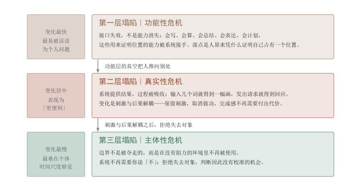
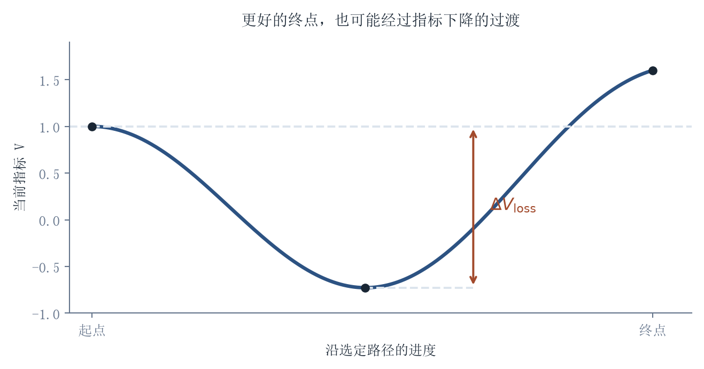
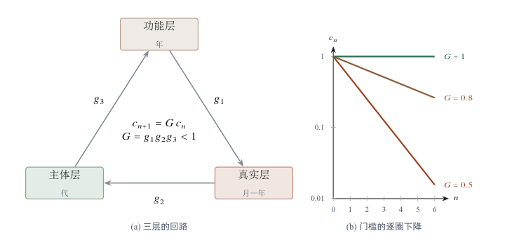
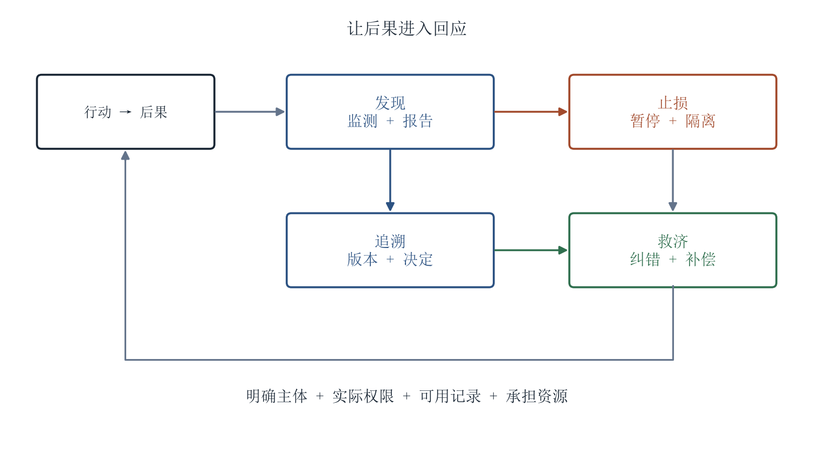

[目录](CONTENTS.md) · [English](../en/CONTENTS.md)

# 存在与坍塌：当作用量趋近于零

位移、制造和遗传都要依赖实际条件。物理稳定、功能维持与社会责任采用不同判据：一块岩石可以被动稳定，一种服务需要持续运行，一个法律关系需要制度支持。技术改变其中一段的成本，会重新安排关联结构，也让“它以什么方式存在、凭什么被依赖”成为具体问题。

生命之所以会对干预作出反应，是因为它必须持续维持自身。这种反应不是被动受力，而是把外部作用转成自身维持过程的一部分。把这一点放到更长的时间尺度上，它并不只是生物学事实。任何能够持续存在的东西，都在以某种方式对抗溃散，而维持自身的代价由什么承付，决定了它在现实中占有多重的分量。

## 存在的判据：什么算存在，什么可以被依赖

存在、知识与责任分别要求不同的判据。一个对象可以真实存在，却不构成可靠证据；一个判断可以成立，却没有获得执行授权；一个系统可以造成后果，却没有相应的承受边界。机器生成把这几种关系推到前台。区分它们，才能说明轻载体如何抵达重后果，以及哪一步缺少了必要的凭据或责任。

### 存在的重量：从物理稳定到智能生成

#### 稳定与切分

世界最初没有图像，也没有名字，甚至没有我们今天意义上的“物”。在极早的宇宙中，结构尚未稳定，能量、场、粒子和涨落交织在一起，存在还不是对象，而是连续的相互作用和不稳定的差异。后来，宇宙膨胀，温度下降，原子形成，恒星点燃，元素合成，行星冷却，世界才逐渐从混沌的能量状态中沉淀出稳定结构。存在的第一步，不是被命名，而是稳定下来；没有稳定结构，就没有可以被反复指认的东西，也没有“这个东西”与“那个东西”的区别。

稳定有不同的维持条件。岩石的结构取决于化学键、晶格和环境，行星轨道取决于运动状态与引力关系；这些稳定未必要求持续的外部做功。生命则通过代谢、修复和调节维持远离平衡的状态，组织依靠人员、记录与制度持续运行。存在的物理条件、功能的维持成本和社会责任由此分开，后面要分别追问它们如何被支持。

生命出现以后，世界不再只是外部环境。最早的生命并不拥有世界模型，它只是在化学梯度中维持边界，摄入能量，排出废物，修复损伤，趋近有利条件，远离破坏条件。对生命来说，感知不是为了描绘世界，而是为了继续存在。同一片水域，对岩石只是环境；对生命体，却可能是资源、威胁、温度、压力和通道。世界没有改变，但某些差异开始被生命内部的维持过程选出来。不是所有存在都同样重要，只有那些影响代谢、修复、移动和生存的差异，才进入生命的世界。

智能的本体论根源就在这里。智能不是凭空面对一个已经切分好的对象世界；现实本身是连续的过程、流动、扰动、能量差和物质分布。智能首先要做的，不是求解，而是在连续现实中切出可行动的差异：什么可以接近，什么必须避开；什么可以摄入，什么会伤害；什么是路径，什么是障碍；什么是自身，什么是外部。所谓“对象”，不是世界天然贴好的标签，而是稳定结构与行动需求相遇后形成的切分。生命按代谢和危险切分，动物按路径、猎物和威胁切分，人类按名称、工具、制度和责任切分。智能的差异，首先不是答案不同，而是把什么东西当成“一个东西”的方式不同。

表示由此萌芽。足迹、气味、巢穴、叫声、姿态和迁徙路线，不是图像，也不是文字，却已经让不在场的东西继续发生作用。一个气味标记让离开的身体仍然影响后来者，一条路径让过去的移动影响下一次移动，一种叫声让危险在危险到来之前被传递。任何能让不在场之物继续影响行动的结构，都已经具有表示的影子。存在不再只在现场发生，它开始留下可被其他生命读取的痕迹。

人类把这种替代能力推进到新的层级。声音、手势、图案、刻痕、壁画，让事物第一次以可保存、可传播、可重排的形式出现。一头野牛不只在草原上存在，也开始在洞穴墙壁上存在；一次狩猎不只发生在现场，也开始在讲述中延续；一条河流不只流经土地，也开始进入方向、记忆和传说。神话、文字、账本、地图、法律和数字进一步扩大了这种能力：债务、土地、税赋、边界、王权和法律都可以离开现场，进入符号、记录和制度。一个命令可以跨越距离，一个账目可以跨越时间，一个法律可以在制定者死后继续约束行动。

#### 两种重量

这时，世界中出现了一类新的存在。债务不是石头，法律不是身体，货币不是粮食，国家不是山川，但它们并不因此虚无。它们存在于记录、承认、执行、预期和责任之中[^searle1995construction]。它们没有自然物的直接质量，却能组织岩石、粮食、道路、矿山、军队和人的一生。这里必须区分两种重量：一种是物理重量，来自质量、体积、材料和能量；另一种是**本体论重量**，来自确立、维持、执行、回滚、外溢和承责的代价。社会性存在物理上可以极轻，却可能在现实中极重；它们轻于质量，却重于结算。

更准确地说，存在的重量不是一个单一刻度，而是由几种承付关系构成：确立、维持、回滚、外溢和承责。物质结构重在材料与能量，生命过程重在代谢、复制和不可逆扩散，社会结构重在承认、执行和信任，主体结构重在后果能否回流到一个持续边界中。所谓轻与重，不是价值高低，而是结算条件不同。把这几项支出加总，

$$
W=w_{1}+w_{2}+w_{3}+w_{4}+w_{5},
\qquad
\frac{\partial W}{\partial w_{3}}>0,\quad
\frac{\partial W}{\partial w_{2}}>0
$$

式中 $W$ 是存在物的重量，不作绝对测量，只用来在同一套口径下比较大小，因此无量纲或随所选口径带量纲；$w_{1}$ 到 $w_{5}$ 依次是确立、维持、回滚、外溢、承责五项承付关系各自结算出的代价，五项必须折到同一口径（工时、能量、货币或注意力，任选其一）才能相加；$w_{3}$ 对应回滚，$w_{2}$ 对应维持。两个偏导说的是只增不减的两条方向：一个东西越难撤回、越难清除后果，$w_{3}$ 越大，$W$ 也就越大；一个东西越需要持续投入才能不退回噪声，$w_{2}$ 越大，$W$ 同样越大。五项在不同层次上的权重并不相同，这才是轻重的真正来源：同样一笔结算，落在物质结构上主要由 $w_{1}$ 与 $w_{2}$ 承担，落在主体结构上则主要由 $w_{3}$ 与 $w_{5}$ 承担。

科学、工程和计算把这种分层推到新的深度。一座桥可以先存在于图纸中，一座城可以先存在于规划中，一个分子可以先存在于模型中，一个气候系统可以先存在于仿真中。图纸不是桥，公式不是机器，模型不是现实，但它们让人类能够在物质动工之前排列可能性。计算机的特殊性在于，它不只保存表示，还能运算表示：文字、图像、声音、地图、账本、公式和图纸，都可以转化为比特；模型可以被修改，参数可以被调整，未来可以被推演，现实可以在行动之前被转化为候选空间。这类存在既不属于材料，也不属于纯粹虚构，它们的重量要按另一套条件结算；机器智能把这类存在的数量推向新的量级。

#### 生成物的层级

层级说明的是不同存在的重量，机器智能改变的则是生成。它把这条道路推到了新的强度。过去，生成一个世界需要神话，生成一座城市需要图纸，生成一个人物需要小说，生成一个分子需要实验室，生成一个制度需要漫长的政治想象。现在，文字、图像、声音、代码、角色、方案、药物候选、城市规划和未来情景，都可以在模型中快速出现。表示不再只是保存现实，也不只是预演现实，而开始大规模生成可能的现实。但这并不是一个全新的本体论问题。人类很早就知道，图纸不是桥，地图不是土地，法律文本不是社会秩序，货币符号不是粮食本身，小说人物不是现实人物。机器智能的特殊性，不在于第一次提出“生成物是否存在”，而在于它让表示性存在以远高于以往的规模和逼真度膨胀，把一个古老问题推到日常生活和技术系统的前台。

把生成物按层级摊开之后，追问的方向就变了。真正的问题不是：被生成的东西算不算存在。这个问题太粗。答案也太简单：它们存在，但以某种方式存在。

一个被生成的城市，作为图像和方案存在；它还没有土地、建筑、道路、居民、产权、维护和财政。一个被设计的分子，作为候选结构存在；它还没有合成、纯化、代谢、安全性、剂量和临床后果。一个仿真中成功的机器人动作，作为模型状态存在；它还没有摩擦、碰撞、磨损、误差和责任边界。一个语言中完整的人格，作为叙事对象存在；它还没有身体、时间连续性、后果回流和责任承担。它们不是不存在，而是存在于较轻的层级。

智能时代真正尖锐的问题，不是虚拟物是否存在，而是它存在于哪一层、经由哪条边进入现实、由谁承付后果。一个东西可以作为文本存在，作为图像存在，作为代码存在，作为仿真存在，作为候选存在，作为物理结构存在，作为生命过程存在，作为社会制度存在，作为责任对象存在。不同层级的存在，承受不同约束，要求不同维持条件，具有不同回滚难度。表示性存在能被说出、画出、生成、复制和修改；物质性存在要占据空间、承受负荷、消耗能量、维护结构；生命性存在要代谢、修复、适应、复制并反馈；社会性存在要被承认、执行、信任和追责；主体性存在则必须在时间中维持边界，并把行动后果重新带回自身。层级之间如何通行，由此成为比层级本身更紧的问题。

#### 重量与可达性的解耦

技术黏滞与本体论在这里相接。技术黏滞不只是技术执行慢，不只是组织保守，也不只是资源不足。它更深的含义是：轻存在向重存在转换时，必须穿过材料、自由能、时间、结构、验证和责任。表示空间中的城市、分子、动作、制度和人格，可以快速生成；现实空间中的城市、药物、能力、制度和主体，必须承受世界的结算。机器智能降低的是候选出现的成本，不是目标层级的存在重量。

因此，存在结构不只是一座阶梯。阶梯说明了不同层级的重量：表示较轻，物质更重，生命更重，社会与主体承担更多结算条件。但智能暴露出另一个更重要的事实：层级之间不是只能逐级通过，它们之间还有**转换边**。有些边很重，有些边很轻；有些边过去几乎不存在，现在被技术打开；有些边看似低阻，实际把代价转移到别处。一条转换边之所以显得低阻，往往不是因为代价消失了，而是因为代价被延迟、外包，或转移到当下尚未显明的承受结构中。

层级与边分开之后，一个系统的位置就可以被确定。一个智能系统的本体论身份，不由它的技术架构决定，而由它的转换签名决定：它从哪一层生成，向哪一层结算，经过哪条边，谁承付维持代价、回滚代价和责任后果。生成式智能主要打开表示到社会的低阻边，文本、图像、角色和模型输出可以直接进入注意力、信任、舆论、组织流程和群体判断。具身智能打开表示到物质行动的执行边，模型策略一旦接入传感器、控制器和执行器，就必须面对摩擦、惯性、碰撞、能耗、误差和安全边界。还有一条更重的边，是表示进入生命过程：序列、结构和调控方案一旦被生命系统稳定读取、表达、复制，并进入遗传或生态传播，就不再只是候选，而进入代谢、发育、繁殖、演化和生态后果。

机器智能的本体论新意，不是制造了新楼层，而是改变了存在转换图的连边结构。更准确地说，**它让重量和可达性解耦。**旧世界里，重存在通常难以抵达：桥梁、城市、药物、制度、身份、责任，都需要材料、时间、组织、执行和承认，越重越慢，越重越难到达。机器智能打开的新通道，使某些轻载体能够低成本抵达高后果层。一个生成物自身可以很轻，但一旦改变人的选择、关系、预期和责任分布，它就在社会层变重；一个策略本身可以很轻，但一旦驱动车辆、机械臂或无人机，它就进入物质结算；一个序列本身可以很轻，但一旦被生命过程读取并复制，它就进入更深的不可逆性。

#### 重量的归属

这不是轻存在逃过了结算。结算只是发生在别处：发生在人的注意力中，发生在平台规则中，发生在组织决策中，发生在信任结构中，发生在物体受力中，发生在生命过程里，发生在后来很难撤回的行为路径中。一个生成物自身可以很轻，但它调动的反应可以很重；它的载体可以被删除，但它造成的后果未必能回滚。因此，存在重量不能只看创建代价，也不能只看载体能否删除。更重要的是维持代价、后果回滚代价，以及这些代价最终归属于何种承受结构。最危险的存在形态，恰恰可能是载体极轻、后果极重。

更进一步，重量不是无主属性。物理重量的承受者是物理本身，岩石的质量不依赖人的承认，桥梁的承重和疲劳也不会因为无人相信而消失。但社会重量不同。债务重，是因为有人承认它、追索它、执行它；身份重，是因为制度和他人承认它；货币重，是因为交换网络承认它；机器角色重，是因为用户投入注意力、情绪、信任和时间。越往社会层和主体层走，重量越不是内在属性，而是关系量。同一个机器角色，对深度依赖它的人极重；对不识别它的系统几乎为零。同一个模型输出，对把它写进决策流程的组织极重；对外部旁观者只是文本。判断一个生成物是否变重，不能只看它的创建代价，也不能只看平台运行代价，还要看它的维持代价由谁承付。

智能还带来了另一种变化：表示开始形成自循环。过去，表示大多来自现实。地图来自土地，图纸指向工程，账本对应交易，照片来自现场，模型需要经验校准。今天，生成内容进入数据，数据训练模型[^shumailov2024ai]，模型继续生成内容，生成内容再进入人的注意力、平台分发和下一轮信息环境。表示不再只是现实的影子，而可能形成自我复制的回路。这不是虚拟替代现实，而是分叉：表示层可以在现实校准不足的情况下自我繁殖，同时又借助平台、关系和信任进入社会层，产生真实后果。最危险的形态，不是一个虚拟世界完全取代现实，而是一个没有充分现实校准的表示环境，持续影响人的判断、关系和行动。

在生命过程里，类似逻辑更重。一个进入生命过程的候选结构，如果被稳定读取、复制、遗传、扩散和选择，就可能不再依赖原始设计者持续维持。它开始沿着生命自己的机制传播。此时，智能生成的不是普通表示，而是进入自我复制过程的入口。这不是说智能可以任意创造生命。生命空间受到代谢、发育、稳定性、繁殖、生态和演化的强约束，可组合不等于可存活，可设计不等于可延续。真正的重量，不在序列被写出，而在它是否能被生命过程读取、维持、复制，并产生难以回滚的后果。

#### 本体论作为操作

从这个角度看，本体论不是智能之外的抽象哲学，而是智能本身的底层操作。智能并不是在一个已经切分完成的世界里活动。它首先要把连续现实分解成可识别、可记忆、可预测、可操作的单位。生命把世界切分为有利与有害，动物把世界切分为猎物、威胁、路径和同伴，人类把世界切分为名称、工具、制度和责任，科学把世界切分为变量、模型、尺度和系统，计算机把世界切分为数据结构、状态空间和算法对象。机器智能则把这种切分推进到大规模生成、快速转换和跨层结算。

但这里隐藏着更深的裂缝。人类的本体论习惯于对象、边界、身份和责任。我们用“一个人”“一件物”“一个组织”“一个行为”“一个后果”来切分世界。可是机器智能的内部表示不完全以人类熟悉的离散对象为单位，它在很大程度上更接近连续空间中的方向、相似性、分布和可插值区域。它生成的对象，是人类界面上的对象；它内部处理的，未必是人类意义上的对象。人类需要对象，因为行动、责任、法律和记忆都依赖边界；机器智能可以在连续表示空间中处理相似性，却把结果输出成我们能理解的对象。这个差异暂时被界面掩盖了：我们看到的是图像、文本、角色、方案和回答，以为它在使用同样的本体论。但它内部执行的切分，未必与人类用来承担责任的切分一致。

因此，机器智能真正打开的问题，不是它生成了什么，而是它把多少轻载体送入了高后果层级，却没有同时生成相应的承受边界。一个模型可以影响公共判断，一个算法可以改变价格、排序、流量和机会，一个自动代理可以下单、筛选、推荐、拒绝、调度和执行，一个机器角色可以成为人的情感对象和决策参照。它们在社会层产生后果，却未必在主体层承受后果；它们可以参与行动，却没有身体，可以产生后果，却没有生命史，可以影响他人，却没有内在承受，可以被依赖，却没有稳定责任边界。

这些既产生后果又不受后果约束的存在物，撞上了社会的一条旧规则。传统社会默认一个基本等式：行动者应当也是承责者。自然人如此；公司、组织和国家虽然不是自然身体，但也通过法律、制度、财产、代表和责任链建立了责任结构，能够被起诉、惩罚、约束、解散、赔偿和追责[^dewey1926historic]。机器智能让这个等式松动了。开发者、部署者、平台、用户、组织、模型本身都可能参与后果链条，但责任在它们之间分散、转移、稀释，最后变成无人完整承受的残差。更深地说，机器智能的可回滚性，是它能力的一部分，也是它无法自然承责的原因。它可以快速生成、复制、替换和重置，因此能以极低成本参与判断和执行；但承责需要相反的东西：一个会被后果改变、不能随意逃逸、能够在时间中持续的边界。

这就是本体论通向主体论的地方。机器智能制造的不是一个简单的“像不像人”的问题，而是一类有社会后果、物质后果甚至生命后果，却未必有主体边界的存在物。它们不是虚无，也不是完整主体；不是普通工具，也不是传统制度法人；不是生命，却能进入关系；不是承责者，却能改变后果。智能时代最危险的本体论错误，不是相信虚拟物“存在”，而是忘记它落在哪一个存在层级上、靠哪一条边维持、又由谁承担它维持不住时的代价。

从宇宙太初到机器智能，存在的历史可以被看成一条漫长的分层之路，也是一条不断开辟新通道的路径。这条道路没有错。没有表示，现实只能被动发生；有了表示，现实可以被预演、计划和改造。智能之所以强大，正是因为它能让世界在行动之前先变成可处理的对象。

但这条道路也有边界。表示越轻，越容易忘记现实的重量；生成越快，越容易低估转换的代价；智能越能制造可能性，越需要区分可能性所在的层级，识别通向现实的路径，并追问后果由谁承受。世界可以被表示得越来越快，但现实仍然要求存在被材料承载，被时间展开，被生命反馈，被社会承认，被责任接住。生成不是终点。存在要被维持，后果要被回滚，责任要有承受者。

到这里，问题不再只是“什么存在”，而是：代价归属于何处，谁在维持，谁在行动，谁来承受。而在追问代价归属之前，还有一个更早的问题需要回答。被切分、保存、传播和生成的这些表示，究竟凭什么能够被依赖。

### 知识的凭据：候选之后，什么能够被依赖

表示被说出、保存和依赖的规模越大，它凭什么可以被依赖，问题就越硬。存在可以按层级摊开，一种东西可以很轻，却仍然抵达很重的后果层；在这一步之前，还有一件更早的事需要交代：在后果真正发生之前，行动所依据的判断凭什么站得住。

#### 校准先于命题

知识不是世界本身，也不是表示本身[^ogden1923meaning]。世界并不因为被理解才运行，表示也不因为被说出就成为知识。对生命来说，最早的“知道”不是命题，而是校准：什么能接近，什么会破坏；什么能维持边界，什么会带来损伤。错误不是逻辑问题，而是生存问题。把毒物当成营养，代价不是观点被反驳，而是结构被破坏。由此看，知识从一开始就不是纯粹观看，而是在世界约束下形成可依赖差异的过程。

这里讨论的**凭据**，首先指向那些会被依赖、会指导行动、会进入现实后果链的知识。纯数学和形式逻辑是一个极限情形：它们的凭据主要来自证明、结构一致性和公理边界[^godel1931]，而不是经验接触；但只要它们被用于工程、计算、金融、治理或科学建模，就会重新进入现实后果链。换言之，凭据的形式可以不同，但任何被依赖的判断，都必须说明自己在何种结构内成立、何时可以迁移、何处必须停止。人类让校准离开身体，进入语言、文字、图像、数字和制度记录。经验因此可以传播、积累和复用，也可以伪造、漂移和固化偏见。真正重要的不是人类会说，而是人类逐渐发明了让说法接受约束的方式。测量让感觉进入尺度，实验让判断暴露在结果面前，复现让一个说法不能只依赖某个权威，数学和仪器把直觉无法稳定分辨的差异压入可比较、可推演、可检验的结构。科学的特殊之处，不在于它让人类说出了更多东西，而在于它发明了一套让世界有机会拒绝人类说法的机制[^popper1934logik]。

#### 凭据的两层结构

从这个意义上说，知识不是一种更漂亮的表示，而是一种获得凭据的表示[^gettier1963justified]。凭据不是由流畅性、完整性、自洽叙述或权威语气授予的，而来自两层结构：第一层是形成层，即接触、校准、复核；第二层是兑现层，即边界和后果。接触让候选暴露于约束，校准让误差返回判断结构，复核让判断离开单点输出；边界说明它在哪里成立、在哪里失效，后果说明它被依赖之后会改变什么、由谁承受什么代价。两层缺一不可：只有形成过程而没有边界与后果声明的候选，无法说明自己何时失效；只有后果要求而没有接触与复核的判断，只能靠权威维持。

凭据如何形成？不同介质会改变凭据形式，但不改变基本结构。接触让候选暴露于对象、材料、身体、环境、行为或结构约束；校准让误差返回判断尺度，使下一次判断因此改变；复核让判断离开单点输出，进入不同主体、工具和场景的公共检验。成熟知识不是无边界的自信，而是知道自己在哪里成立、在哪里失效；一个判断一旦被依赖，就会进入行动，改变路径、资源、身体、组织和未来。没有后果要求的候选可以作为想象、草案、启发或游戏；一旦进入身体、工程、交通、金融、治理或生命过程，就不能只凭形式完整获得通行。

凭据的形成与兑现不排斥机器，它们只是规定了机器能做什么。机器当然可以参与验证。它可以运行测试，比较数据，发现异常，辅助复核，搜索反例，执行仿真，检查一致性，甚至在某些封闭环境中完成高度自动化的确证流程。问题不在于机器能不能参与验证，而在于验证的最后代价由现实接触设定，验证的充分性标准则由后果结构决定。合成要接触材料，治疗要接触身体，交通要接触道路，工程要接触负荷，生命干预要接触代谢与生态，制度设计要接触人群行为。机器可以加速某些环节，却不能自动决定“多少凭据才算足够”，因为这个问题最终要回到边界、后果、风险和承受者。

因此，智能时代的知识问题，不是机器是否“真的理解”。这个问题仍然绕在人类心智的旧词汇里。更稳的问题是：一个输出是否被置于足够的接触、校准、复核、边界和后果约束之中；它是否知道自己的适用范围，是否能够暴露来源，是否能够标明条件，是否能够在失败时被追踪，是否能够被现实修正。知识不是一个孤立答案，而是一条可追溯的形成路径。这条路径的起点不在表示内部，而在表示之外的接触、工具、场景和制度。

#### 候选扩张与凭据带宽

机器智能改变了这条历史的压力分布。从认识论结构看，它是文字发明以来规模最大的一次表示技术扩张。文字让记忆离开身体，人的认识位置从背诵转向理解、辨析和解释；印刷让复制脱离手抄，人的认识位置从占有文本转向筛选、校验和诠释；计算让形式推演和搜索脱离心算，人的认识位置转向模型边界、数据来源和结果验证。机器智能延续并放大了这条线：它降低的不是知识成立的成本，而是候选出现的成本。正因为候选可以被大规模、低成本地提出，人类在认识论中的位置并没有消失，而是从答案的生产者转向凭据结构的设计者、边界的判断者，以及可依赖性本身的形成者。

更具体地说，机器智能没有首先取消无知，而是极大扩张了候选空间。这里的候选不只是文本回答或屏幕图像，也可以是解释、代码、控制策略、实验方案、分子结构、蛋白构象、交通路径、诊断判断、金融操作、制度草案，乃至进入生命过程的序列和调控方案。智能制造的不是已经成立的知识，而是有待检验的可能路径。介质不同，约束不同，验证方式不同，但认识论问题是同一个：这些候选凭什么被依赖？

**智能扩张候选，验证形成凭据。**

这句判断的两侧，现在可以分别结算了。这是智能时代认识论的核心，也是上一节“重量与可达性解耦”在认识论上的对应面。前面说的是轻载体如何低成本抵达高后果层；这里讨论的是候选如何低成本出现，却未必携带相应凭据。存在论上，问题是轻东西如何产生重后果；认识论上，问题是快候选如何获得慢凭据。机器智能真正改变的，不是让生成自动等于存在，也不是让生成自动等于知识，而是把可能性出现的速度同现实承付的速度分离开来。过去，稀缺常常在信息获得；现在，许多领域的表述能力、组合能力和搜索能力被急剧放大，稀缺开始转移：不再是有没有说法，而是哪一个说法经过了足够约束；不再是有没有路径，而是哪一条路径可以被依赖。更准确地说，机器智能使**候选通量**与**凭据带宽**发生解耦：候选出现的速度被大幅提高，而接触、校准、复核、边界和后果仍然受材料、身体、时间、制度和责任限制。由此产生两类相反的失败：在存在层面，轻载体可能已经抵达高后果层，却没有明确承受者；在认识层面，候选尚未穿过现实，却已经冒领了知识外形。

把这两个速率写进同一个流量关系，

$$
\frac{dQ}{dt}=\lambda_{\text{候选}}-\lambda_{\text{凭据}}
$$

式中，$Q$ 是尚未穿过接触、校准、复核、边界声明和后果检验的候选存量，单位为个；$t$ 是时间，单位为年；$\lambda_{\text{候选}}$ 是候选出现的速率，$\lambda_{\text{凭据}}$ 是凭据形成的速率，二者单位均为个每年，故右侧量纲回到个每年。这个式子的含义是：解耦不需要额外的机制，它只是两个速率不再相等。当候选出现的速率高于凭据形成的速率时，存量按两者之差单调增长，而增长的存量不会自己生成凭据；这就是“不缺说法、缺的是可以被依赖的说法”的结构形式。适用条件是两侧必须折算到同一粒度，候选与凭据只有在能按同一种单位计数时，差值才有意义；而且它只给出趋势方向，不给出长期预测，因为存量增长会反过来改变筛选标准、注意力分配和制度安排，$\lambda_{\text{凭据}}$ 本身随存量变化。它刻画的是结构，不提供任何实测数值。

#### 形式外壳与认识论黏滞

可依赖性因此成为新的核心稀缺。一个回答可以很快，一个判断不能因此可靠；一个解释可以圆满，一个机制不能因此成立；一个动作可以在仿真中成功，一个真实系统不能因此安全；一个序列可以被写出，一个生命过程不能因此可控。机器智能让候选获得了知识的外形，却没有自动给予它被依赖的凭据。危险也正在这里：错误不再必然粗糙，无知不再必然沉默，虚假不再必然破绽明显。它可以流畅、礼貌、系统、专业，并且在表面上完成所有表达动作。因此，这不是简单的“幻觉”问题；更深的变化是候选的生产机制与确证机制发生了分离，形式的完成速度超过现实的校准速度，可能性的展开速度超过凭据的形成速度。

这种变化会改变人类对知识的直觉。人类长期把流畅表达、概念组织、语气稳定、格式规范和逻辑连贯当作可信信号，因为在过去，这些信号通常需要训练、经验和制度背景才能产生。机器智能打破了这种关联：它保留了可信信号的外壳，却降低了外壳的生成门槛。于是，认识论的任务不再只是区分有无信息，而是区分候选是否获得凭据。在这个意义上，技术黏滞也可以被理解为认识论黏滞。不是世界拒绝智能，而是世界要求判断付出接触成本；不是现实落后于生成，而是现实要求任何候选在被依赖之前先承受约束。生成可以在表示空间中快速展开，验证必须接触世界；生成可以并行制造大量候选，验证必须面对材料、时间、实验、身体、场景、制度和责任。生成常常是轻的，验证却会变重，因为验证要让候选穿过现实的阻力。

表示自循环的本体论后果已经讨论过：表示可以在现实校准不足的情况下自我繁殖，并通过平台、关系和信任进入社会层，形成一种轻载体、重后果的存在分叉。这里要看的是它的认识论后果。一个认识系统如果主要从自身的回声中获得材料，就会逐渐削弱接触比例；它可能越来越擅长内部一致，越来越不擅长承受外部反驳。仿真、指标、模型、平台反馈和组织报告，都可能形成类似的自我喂养回路[^cinelli2021echo]。系统越是用内部生成物替代外部接触，就越可能形成高度一致的候选世界，却不再知道现实从哪里打断它。知识不是被现实支持的漂亮表示，而是保留了反驳接口、并能把反驳转化为校准的候选。

#### 验证的分配

候选爆炸之后，真正困难的还不只是验证，而是验证如何被分配。接触世界需要材料、实验、时间、场景、组织、注意力和责任，不可能平均分配给所有候选。因此，人类的新认识角色不是逐一验证所有输出，而是在候选洪流前设计验证路径：哪些候选因为后果不可逆而必须优先检验，哪些候选因为越出边界太远而必须暂缓依赖，哪些错误因为暴露延迟而需要更高等级的复核，哪些判断只能停留在启发层，哪些可以进入行动准入。验证不是单纯的技术动作，而是一种稀缺接触预算的分配。这也是人类知识制度的价值所在。图书馆、实验室、大学、标准体系、期刊、审计、临床试验、工程认证、事故调查、法院证据、同行批评，并不是知识之外的附属物，而是凭据形成和验证分配的结构[^merton1942normative]。它们缓慢、昂贵、烦琐，有时保守，有时僵化，但它们承担一个基本功能：防止任何流畅的表示、漂亮的模型或成功的仿真绕过接触，直接冒充可依赖的判断。

机器智能不会让这些结构消失，相反会使它们更重要。当候选说法稀少时，人类可以把大量注意力放在生成上；当候选空间膨胀时，人类必须把更多注意力转向筛选、验证、追溯、边界判断和验证优先级。未来真正稀缺的能力，不只是提出答案，而是为答案建立凭据；不只是生成方案，而是知道方案需要通过哪些现实约束；不只是给出结论，而是判断哪些结论值得消耗昂贵的现实接触。验证预算有限，这决定了认识论的主要工作从生产转向排序。

所以，智能时代的认识论不能只问真假。真假当然重要，但更第一性的问题是：这个候选经过了什么约束？它的凭据从哪里来？它能被谁复核？它的失败如何暴露？它的边界如何声明？它一旦被使用，会进入什么后果链？

如果这些问题没有答案，那么它最多是候选，而不是知识。候选并不低贱，人类所有知识都从候选开始；但候选不是终点。认识论的核心任务，就是不要让候选未经凭据化就伪装成知识，不要让形式的完整性冒充现实的通过。

这也意味着，人类在智能时代的认识角色不会消失，而会改变。人不再只是答案的生产者，而越来越成为验证路径的设计者、边界的判断者、接触预算的分配者和可依赖性本身的形成者。机器可以扩大候选，也可以执行大量验证环节；但哪些候选值得接触现实、哪些判断可以被依赖、多少凭据足以行动、哪些后果必须被优先看见，这些问题最终会回到主体、价值和承受者。只有把机器智能放在正确位置上，它才真正强大：把候选当成知识，会制造虚假的确定性；把候选放回候选，则能极大扩展探索空间。

这就是问题核心：候选之后，什么能够被依赖？答案不在于它是否最流畅、最像专家、最符合期待、最能安慰人，也不在于它是否最快给出结果。这些只是表达层面的外观，不能构成知识的凭据。真正能够被依赖的，是那些经过接触、校准、复核、边界声明和后果检验的判断、结构与路径。知识不是语言的胜利，而是候选在现实约束中存活下来的形式。机器智能之后，人类面对的不是知识自动丰收，而是候选空前丰盛。真正稀缺的，是让候选穿过现实、形成凭据、成为可依赖判断的能力。从这里开始，问题不再只是“什么被生成”，而是：什么能够被验证，什么可以被依赖，什么可以获得进入行动的准入。

### 行动的准入：表示何时可以跨过转换边

候选之后，需要凭据；凭据之后，仍然不能直接行动。知识与行动之间不是一条连续斜坡，而是一条转换边。知识使一个判断获得可依赖性，行动则使这个判断进入现实过程。前者仍然处在表示关系之中，后者已经开始改变世界状态。一个模型可以有统计优势，一个方案可以通过局部测试，一个控制策略可以在仿真中稳定，一个制度设计可以在理论上自洽，但这些都还没有回答更重的问题：它是否可以消耗资源、占用时间、触碰身体、调动组织、改变制度，并使残余后果落到具体承付结构上。

#### 转换边

前面两节分别讨论了存在的重量和知识的凭据：轻载体可以抵达高后果层，重量与可达性被机器智能重新拉开；候选可以高速生成，但凭据不能同速形成，候选通量与凭据带宽发生脱钩。到这里要处理的是第三个断裂：表示可以获得现实触发力，却不自动携带后果承付结构。核心问题不是“能不能输出”，也不只是“能不能被相信”，而是一个表示在什么条件下可以触发现实状态转移。

**触发力与承付结构的解耦，是行动论在机器智能时代遇到的新问题。**

承付结构在传统世界里由行动者本人提供。行动通常与一个有限主体捆在一起。一个人做出行动，不只是发出一个指令或表达一个愿望，而是把身体、身份、声誉、责任、时间和未来押入某条路径。行动者不是纯粹的触发点，也是后果回流的边界。失败会改变他，损失会落到他身上，责任会追溯到他，未来义务会继续缠住他。正因为行动者自身被押入后果，行动才不是轻飘的表示，而是有重量的选路[^arendt1958human]。

机器智能改变的不是这个结构的意义，而是它的耦合方式。模型可以生成指令、调用工具、修改文件、发送信息、执行代码、访问数据库、触发审批、改变排序、调度设备。它可以通过权限、接口和工作流触发现实变化，但这些变化未必回流到模型本身。模型可以拥有触发力，却没有身体损伤；可以参与路径选择，却没有生活世界；可以放大后果，却没有资产边界、声誉连续性和惩罚敏感性。触发发生了，承付却不在同一边界内完成。

#### 行动论的边界

这就是为什么传统行动论既重要，又不能主导本章。传统行动论长期追问：什么使一个事件成为行动？行动是否由意图、理由、欲望、信念或计划组织[^davidson1963actions]？一个行为为什么可以归属于某个行动者？这些问题背后真正处理的，是行动归属与后果回流的耦合。意图、理由和计划并不只是内心事实，它们把“为什么选这条路”“谁在选路”“谁延续这个选择”连接起来。一个有计划的行动，是主体用未来约束现在，也是把后果提前纳入自身连续性[^anscombe1957intention]。

AI agent 使这个框架遇到边界。问题不必首先落在“AI 是否拥有真正意图”上。即使没有传统意义上的完整意图，系统仍然能够触发现实状态转移。它可以移动资金、驱动设备、触发流程、传播信息、改变排序、重排机会。于是行动论的问题发生偏移：不再只是“这个行为是否属于某个主体”，而是“某个表示通过什么接口进入现实，获得了多大作用半径，并由什么结构承付它的残余后果”。

这也是近年 AI agent 使风险形态发生变化的原因。普通生成模型首先带来内容风险：错误、幻觉、偏见、误导、伪造。agent 则把问题推进到行动边界：权限、身份、日志、回滚、停机、监控、持续运行和责任范围[^openai2025chatgptagentsystemcard]。过去，模型输出离行动很远，中间隔着阅读、理解、转写、审批、执行、复核等多重摩擦；现在，读、写、查、调、改、发起、调用和执行可以被连成同一条工作流。模型不只是说出可能性，而是在某些接口中获得触发力。

这说明，agent 的实质不只是模型更聪明，而是表示跨过转换边的摩擦被降低了。过去，组织摩擦在无形中延缓了错误进入现实；今天，自动化把这种摩擦压缩为权限调用。过去，一个建议要经过人类转译才可能行动；今天，建议、调用和执行可以在同一系统中连续发生。风险焦点因此从“表示是否正确”转向“表示如何获得触发力”。行动准入也因此不再是伦理附录，而是机器智能进入现实系统的第一边界。

#### 知识与行动的分界

要把这一点说清楚，必须区分知识与行动。知识降低不确定性，行动花费不可逆性。验证消耗的是接触预算，行动消耗的是不可逆预算。一个判断越可靠，越有资格被依赖；但被依赖仍不等于可以执行。因为判断仍然属于表示空间，行动则进入现实历程。表示空间允许多个候选并存，现实系统只能沿具体路径演化。一个方案进入执行，其他方案就被延迟、排除或失去条件；一个政策进入实施，社会激励就开始重排；一个医疗方案进入身体，代谢和免疫过程就已经启动。知识管的是“能否信”，行动管的是“是否花掉一段不可逆”。

行动不是知识的应用，而是不完备知识对现实的暴露。任何行动都不可能等到未来完全展开之后才发生。再充分的凭据也只能降低不确定性，不能把未来全部提前完成。行动发生时，总有一部分残余不确定性从模型、文本、计划或仿真内部转移到现实系统之中。这个转移不是修辞意义上的风险，而是结构意义上的状态改变：未知后果开始由身体、设备、市场、组织、制度或生态过程承载。

因此，行动的重量不来自动作本身，而来自它对可达空间的处分。表示空间可以容纳很多尚未实现的可能；行动则把其中一条路径实际化，同时消耗资源、占用时间、改变结构，并关闭一部分未来可能性。一个医疗建议变成用药，身体就进入特定代谢路径；一个交易策略变成自动执行，风险就进入市场结构；一个招聘模型变成筛选规则，某些人的机会空间就被提前收缩；一个调度策略进入电网、交通或工厂，物理系统就必须沿它给出的节奏响应。即使局部后果可以回滚，时间、机会、信任、损伤和路径依赖也不能完全恢复为行动之前的状态。

#### 行动与可达空间

这使讨论重新回到结构与可达空间。第二章讨论的结构记忆已经说明撤回不等于恢复；同一章的可达空间分析已经说明系统并非在无限可能中自由移动，而是在历史路径、鲁棒性和结构约束中保留有限可塑性。行动正是可达空间被花掉的动作。每一次不可逆行动，都在某种程度上改变未来可达域。机器智能让选路、触发和执行变得更轻，因此也让“花掉不可逆性”变得更容易。如果没有准入，系统会以很高速度消耗自己的可塑性。

这也把行动准入接回 RTG 模型。行动一旦发生，R 不再只是资源估算，而是资源被实际占用、锁定或消耗；T 不再只是等待或验证周期，而是不可逆历程；G 不再只是结构关系图，而是被实际牵动的反馈、耦合和责任链。行动是 RTG 从分析坐标变成现实结算的时刻。它把可能路径转换为现实路径，也把模型残差转换为系统残差。

把行动放回 RTG 之后，还要区分它穿过的是哪一种边，因为不同转换边具有不同重量。表示进入社会判断，首先改变注意力、信任和预期。错误图像、伪造引用、看似专业的解释、被自动分发的结论，可以进入人的信念结构，继而改变组织和公共讨论。这里的后果不一定表现为直接物理伤害，而是判断环境被污染。

表示进入物理执行，后果更直接。控制策略一旦接入车辆、机械臂、电网、无人机、工厂或医疗设备，就不再只是概率分布，而是力、热、速度、位移、碰撞、磨损和故障。表示进入生命过程，转换边更重。生命不是被动载体，而是会读取、代谢、放大、修复、抵抗、代偿和演化的过程。表示进入制度决策，后果最容易被低估。一个评分模型进入招聘，一个风险模型进入信贷，一个预测系统进入警务，一个分配算法进入教育或医疗，都不是单纯提供建议，而是在重排人的可达空间[^oneil2016weapons]。

#### 承付的重建与持续准入

因此，行动准入不能被理解为“多加一层安全要求”。它的功能，是在触发力与承付结构被切开的地方，人工重新缝合它们。旧世界里，主体常常免费提供这道闸门：行动者把自己押入后果，行动因此天然带有重量。机器智能使触发可以脱离这种押入，准入就必须把承付结构重新挂回行动点。没有这个重建，行动就会成为无承付的触发。

把承付挂回行动点有几种做法。可验证、可停止、可回滚、可追溯、可承责，不是平铺的治理清单，而是重建承付结构的不同方式。没有验证，残差不可识别；没有停止，残差不可中断；没有回滚，残差不可收束；没有追溯，残差不可定位；没有承责，残差没有回流边界。它们共同回答的不是“系统是否合规”，而是“未消除的不确定性进入现实后，是否有承载、收束和回流结构”。

准入不是给知识盖章，而是在触发之前重建承付。

据此可以说，“人在回路中”本身不够。关键不在于人是否形式上出现，而在于人是否拥有真实的承付位置。一个只能点击确认的人，不是准入者，只是自动化流程中的责任垫片。一个看不见模型边界、看不见后果链、无法改变执行路径、又必须在极短时间内确认的人，不是在监督系统，而是在替系统承担名义责任。有效监督要求人能够看见边界、理解残差、改变路径、中止过程，并实际处在后果回流链条中[^santoni2018meaningful]。

更困难的是，转换边常常不是一次性跨过的。很多系统开始只是辅助，后来成为推荐；开始只是推荐，后来成为默认；开始只是默认，后来成为自动；开始只是自动，后来变成无人真正理解和质疑的基础设施。表示不是突然变成行动，而是被界面、流程、绩效压力和组织惯性逐步推近现实。最后出现的不是一次越界，而是一条已经固化的路径。

对于持续运行的 agent，行动准入也不能只发生在部署之前。能够调用工具、读取反馈并调整策略的系统，不是在执行一次动作，而是在形成一条持续作用的因果管道。准入必须规定作用半径、权限边界、更新频率、监测方式、停机条件和责任回路。一次测试通过，只能说明系统在某些条件下可以开始，不能说明它在所有未来反馈中都拥有不受限制的行动权。持续行动需要持续准入。在这个意义上，准入评价的不是一个表示是否精彩、连贯或有启发性，而是它获得触发力之后，是否具备相应的承付结构。若剩余不确定性找不到明确的承担者，表示仍可作为候选、解释、模拟或辅助存在，但不应获得现实执行权。行动的门槛，不是知识的完成，而是残差的可承付化。

到这里，前面的线索合在一处：轻载体如何抵达重后果，快候选如何获得慢凭据，表示获得现实触发力时又如何必须重建承付结构。否则，机器智能会生成更多候选，也会更快花掉不可逆性，更快压缩系统可达空间，并把残差外部化给那些没有准备承受它的身体、组织和制度。行动把残余不确定性推入现实，并使其落在某些位置上；但后果落在哪里，并不等于谁在承受。身体、市场、组织、平台、部署者、用户和受影响者都可能被迫承载后果，却未必形成清晰的回流边界。于是，行动准入之后，问题必然推进到下一层：什么样的边界，才有资格被称为后果的承受者？

## 承受的边界：后果回到哪里

行动一旦发生，后果就要落到具体的人、组织和环境中。产生后果的位置与承受后果的位置可能分离，控制权与责任也可能被分散。本节所讨论的责任主体，需要有稳定身份、可追索资源、记录和后果回流机制。人的人格地位与基本权利另有伦理和制度依据，责任结构则回答一次行动由谁解释、纠正和赔偿。

### 主体的边界：后果回流与责任显现

行动把残余不确定性推入现实之后，承付必须落在一个边界上，而“边界”本身在思想史上有很长的来路。在人类很长一段思想史里，最先被追问的不是主体，而是世界本身。什么存在，什么是真实，变化背后有没有稳定结构，万物如何成为万物，这是本体论的问题。那时，人当然也在世界之中，但人还不是问题的中心；人首先面对的是一个比自己更大的秩序：自然、神、实体、形式、规律、宇宙结构。问题的重心在“世界如何成立”。

#### 从本体论到主体论

后来，问题开始转向人自身。世界不只是存在在那里，还要被经验、被认识、被判断、被表达。于是，主体被推到前台。不是因为世界消失了，而是因为世界进入人的经验和判断以后，必须追问：谁在认识？认识凭什么可靠？判断从哪里获得确定性？这个转向把人从世界中的一个位置，变成了世界显现和意义生成的中心之一。主体不再只是存在者之一，而是世界如何被把握的条件[^kant1781kritik]。

再往后，问题又从认识推进到行动。人不只是看世界、解释世界，也在改变世界。技术、工业、科学实验、组织、工程和制度，把人的判断变成了现实中的力量。于是，仅仅问“谁在认识”已经不够，还要问“谁在行动”。行动不同于认识，因为行动会改变状态，会制造不可逆后果，会让世界不再只是对象，而成为被干预、被重构、被损伤或被修复的过程。现代智能把这个问题继续往前推了一步。智能系统不只生成表述，不只辅助认识，也开始参与行动：它可以生成判断，触发流程，操控机器，参与实验，影响交通、医疗、金融、教育和生命过程。问题因此不再只是“谁在认识世界”，也不只是“谁在改变世界”，而是：改变发生以后，后果回到哪里？

这就是从本体论到主体论，再到行动论和承受论的真正来路。本体论问世界如何存在，认识论问世界如何被把握，行动论问世界如何被改变，而主体论在智能时代必须追问：改变之后，反作用由谁承受。过去，意图、身体、行动和后果大多绑定在同一个生命或制度边界里；现在，生成、执行、收益和损害可以分散到不同位置。行动发生了，世界被改写了，反作用却未必回到制造差异的地方。所以，主体问题不是因为机器开始像人说话才重新尖锐，而是因为智能进入现实以后，作用与反作用开始脱钩。一个边界如果只向世界施加差异，却不被差异的后果反过来改写，它就还不是完整主体，而只是无主行动中的一个发生点。**主体不是意识叙事的中心，而是后果回流的边界。**

上一节讨论的是行动准入：一个候选、判断、方案或指令，什么时候可以跨过表示层，进入现实系统。这里追问的是下一步：一旦行动进入现实，反作用回到哪里？没有准入，行动会过早发生；没有主体边界，行动会无人承受。智能时代的问题不是行动太少，而是行动越来越容易被生成、触发和放大。真正稀缺的，是让行动重新接回承受边界的能力。

#### 后果回流的边界

主体不是会说“我”的东西。会自称，会解释，会表达偏好，会生成计划，会承认错误，都只能制造主体的外形。主体也不是单纯能行动的东西。能行动只说明它能向世界施加差异，不能说明差异造成的反作用会回到它自身。

主体首先是作用与反作用闭合的地方：行动从这里发出，后果回到这里，代价在这里沉积，未来行动因此被约束。所以，主体不是行动的起点，而是后果的归宿。一个大模型可以输出判断，一个具身系统可以执行动作，一个生命智能可以提出干预方案；这些都还不够。关键在于，错误、损伤、失败、羞耻、信任破裂、声誉变化、身体代价、时间损失和未来限制，是否会回到同一个持续边界中。没有后果回流，就只有输出；没有代价沉积，就没有主体。

这里必须区分反馈和承受。反馈可以很轻。温控器有反馈，控制系统有反馈，模型可以根据错误更新参数，机器人可以根据碰撞调整路径[^wiener1948]。反馈回答的是系统如何修正，如何提高效果。承受不同。承受意味着代价回到行动者身上，留下不可随意擦除的痕迹，并改变它未来能够如何行动。参数更新不是悔恨，路径重规划不是负责，损失函数下降不是付出代价。反馈是信息回流，承受是代价回流。主体从承受开始，而不是从反馈开始。

承受从哪里开始，人的身体给出了最直接的例子。人的身体之所以天然形成主体边界，不是因为人有某种神秘特权，而是因为人的生命过程足够难以逃离[^merleauponty1945]。一个人犯错，会痛，会羞耻，会失去时间，会破坏关系，会改变声誉，会在记忆中反复返回那个后果。人不能像模型一样轻易重置版本，不能像零件一样无痛替换，不能把衰老、伤害和死亡外包给另一个实例。人之所以天然接近主体，不是因为人更高贵，而是因为人不能无成本逃离自己。

#### 两种承受封装

所谓**承受封装**，就是后果不能随意散开。身体记得伤口，神经记得恐惧，习惯记得重复，关系记得背叛，声誉记得选择，时间记得不可逆。一个“我”不是一句自我叙述，而是后果在身体、记忆、关系和时间中不断回流、折叠、压实之后形成的持续边界。主体不是静止内核，而是被过去行动不断改写的连续性。生命主体不能每次行动后彻底清零，只能带着沉积过的后果继续行动。

具身智能容易制造一个误解：机器有身体、能感知、能行动，所以就获得了主体性。这不成立。机器人的外壳、关节、传感器和执行器构成物理边界，但物理边界不自动等于主体边界。机器可以损坏，零件可以更换，模型可以替换，机体可以报废，数据可以回收，成本可以转移。许多后果并不回到机器自身，而是散落到制造者、使用者、部署者、环境和被影响的人身上。身体如果只是执行器，就不是主体边界；身体只有成为后果沉积的地方，才具有主体意义[^dreyfus1972what]。

生命体不同。生命体的身体不是临时接口，而是长期演化形成的承受结构。许多复杂性被封装在形态、反射、疼痛、恢复、习惯和有限寿命中。机器没有自然继承这笔演化摊销。它可以拥有行动能力，却不必然拥有承受能力；它可以进入空间，却未必把空间中的反作用带回自身；它可以改变身体，却未必承受身体被改变后的余波。这就是具身性和主体性之间必须划开的边界。

反过来，没有自然身体，也不意味着完全不能形成主体。一个组织没有疼痛，没有肉身，没有生命意义上的死亡，但它可以通过资产、账目、历史记录、声誉、身份和长期约束形成某种制度边界[^dewey1926historic]。它过去的行动会改变它未来能做什么，能获得什么信任，能承担什么限制。后果可以在制度中沉积，制度也可以因此被过去改写。这说明主体不是生物身体的专利。主体可以由生命封装，也可以由制度封装。关键不在材料，而在后果能否在一个边界内持续闭合。

#### 无主行动与责任显现

闭合成立与否，在多数智能系统上一眼可见。当前多数智能系统的问题，不是它们“不像人”，而是它们的闭合边界尚未成立。大模型能生成判断，但判断造成的后果不自然回到模型；具身系统能执行动作，但动作的反作用不一定沉积在机器自身；生命智能能提出干预方案，但被分类、筛选、治疗和优化的人，才真正承受长期结果。智能越能生成、行动和干预生命，越会放大这个缺口：差异由系统制造，反作用却由别处承受。这不是简单的“谁负责”问题，而是更底层的“行动是否有主”问题。没有主体边界，行动会退化为输出；没有承受闭合，现实会退化为反馈数据；没有代价回流，错误会被分摊到看不见的地方。一个系统可以越来越有效，却越来越不承受；可以越来越会行动，却越来越像没有主人。要防止的，正是这种世界被纯输出化的趋势。

责任显现也不应被理解成外部条款。它的深层意义，是让被系统吞掉的后果重新可见。当行动只影响行动者自身，反作用常常自然显现：摔倒会疼，失败会记住，关系会破裂，时间无法倒流。但当行动通过模型、机器、组织和生命技术放大到更大范围，后果就可能被延迟、遮蔽、统计化、转嫁，变成没有一处真正疼痛的损失[^matthias2004responsibility]。责任不是事后装上的道德标签，而是主体边界在社会中的显现。它让行动不能只留下效果，也必须留下归处。

主体性因此不是非有即无的标签，而是后果回流的闭合强度。工具几乎没有闭合，锤子伤人，后果回到使用者。普通代理体有目标和反馈，却未必有承受。制度主体没有自然身体，却可以让后果在组织记忆和长期限制中沉积。生命主体拥有最强的承受封装，身体、记忆、关系、衰老和死亡把后果锁在同一个生命过程中。未来也可能出现工程化主体，但那不取决于它会不会说“我”，而取决于它是否拥有持续身份、不可任意重置的记忆、真实代价沉积、外部可追问边界和长期未来约束[^parfit1984reasons]。主体论不是为了捍卫人的神秘性，也不是为了预先否定机器可能获得某种主体地位。它要提出的是判准：谁被行动的反作用持续改写，谁才开始接近主体；谁只负责施加差异，却总能把代价转走，谁就仍然只是通道。智能时代真正危险的不是机器像不像人，而是行动越来越多，后果越来越散，世界开始出现大量无主行动。

主体不是会说“我”的东西。主体是后果不能再继续转嫁的地方。它把行动、反作用、记忆、代价和未来约束重新扣在一起。没有这个边界，智能系统会越来越能改变世界，却越来越难被世界反过来改变；行动会越来越多，主人却越来越少。但还有一个入口没有被检验。机器可以拥有身体，能感知、能执行、会磨损、会自我维护，这些能力常被读作主体性的证据；如果主体性只取决于后果能否在一个边界内闭合，那么材料边界与承受边界就必须分开来看，而工程上完全可以把身体做强的那些条件，恰恰未必等于承受闭合形成的条件。

### 承受闭合：从机器身体到工程化主体

而工程上出现了一个更容易误判的问题：机器有了身体，能感知、能行动、会磨损、会自我修复，是不是就更接近主体。这个问题之所以重要，是因为智能进入现实有几种不同入口。大模型让输出进入社会判断，具身智能让身体进入材料世界，生命智能让方案进入代谢、发育、免疫、遗传和生态过程。它们都比单纯的屏幕文字更重，也都更容易让人误以为：智能越接近现实，就越接近主体。

#### 现实入口不是主体边界

但现实入口不是主体边界。一个系统可以输出判断，却不承受判断造成的后果；可以拥有身体，却不承受身体行动造成的代价；可以提出生命干预方案，却不承受代谢、发育和代际后果。进入现实只说明作用发生了，不说明反作用已经回到同一个持续边界。主体性不从输出中自然长出，不从身体中自然长出，也不从生命干预能力中自然长出。主体性只在一个地方显现：后果是否回流、沉积，并约束同一边界的未来。

因此，首先要把身体、具身性和主体性拆开。身体是材料边界，回答系统以什么物理结构进入世界。具身性是材料边界与环境形成行动耦合，回答系统如何感知、耗能、受扰、修正和继续行动。主体性是后果回流和承受闭合，回答行动之后，代价是否回到一个不能随意逃离的连续边界。三者相连，但不能互相替代。

身体可以被工程化。传感器可以增加，执行器可以升级，关节可以维护，材料可以柔顺化，能量可以调度，局部控制可以低延迟，自诊断可以常态运行。未来机器身体甚至可能具备更强的自维护和自修复能力：检测磨损，修补表面裂纹，重新分配能量，在局部损伤后降级运行[^terryn2017self]。但这些首先仍然是身体工程，不是主体生成。

上述区分可以写成一个只刻画回流覆盖面的比率。设 $B$ 是一个持续边界，$a$ 是它发起的行动，$C(a)$ 是该行动的全部后果，$\rho_a$ 把每一项后果映射到最终承载它的边界。定义 $B$ 在行动 $a$ 上的后果回流比例

$$
\kappa(B,a)=\frac{\bigl|\{\,c\in C(a):\ \rho_a(c)=B\,\}\bigr|}{\lvert C(a)\rvert},
\qquad \kappa\in[0,1].
$$

这里假定$C(a)$是有限、非空且分项一致的集合，$\rho_a$把每项归于一个边界。$\kappa$只记录这份清单上的回流覆盖。实际后果可以共同承担，也可能无法计数；分项方式和权重都会改变结果。这个比率帮助追问归属，不测量意识、道德地位或完整主体性。保险和公共救济还可能正当地分担后果，不能把全部回流当成普遍目标。

#### 残差吸收与后果承受

这里必须区分残差吸收和后果承受。具身系统进入物理世界以后，滑移、摩擦、惯性、接触误差、传感漂移和任务链偏差都必须被处理。它们可以被身体吸收，被控制器修正，被环境约束，被外部支撑结构分担。残差吸收解决的是行动能否继续。后果承受追问的是行动归属于谁。具身性容易被误读，正因为它把这两个问题压得很近：机器真的在处理现实残差，于是看起来也像在承受现实后果。

但一个东西被现实改变，不等于它在主体意义上承受现实。石头会风化，桥梁会疲劳，轮胎会磨损，电池会衰减，数据库会被写入，模型会被微调，机器会留下日志。它们都在时间中留下痕迹，但这些痕迹未必构成一个行动者的历史。被改变只是物理事实，承受则意味着后果被纳入一个可追问的连续性。这里的关键差异，是承载和承受。轮胎承载摩擦，机械臂承载反力，电池承载放电循环，外壳承载碰撞和磨损。只要机器进入物理世界，后果就会落到某些部件上。但承载只是后果落在**承载面**上；承受要求这些后果进入同一持续边界，改变它的未来可达空间，并使它不能无成本逃离过去。

一个服务机器人撞坏墙角，外壳可能划伤，轮组可能偏移，日志可能记录异常，控制策略可能更新。物理后果落在了机器上，信息反馈也回到了系统里。但真正的反作用可能落在用户、制造者、部署者、空间环境和被影响的人身上。机器身体只是后果链中的承载面，不必然是后果链的归宿。它受到了影响，却未必成为承受者。所以，承受至少包含几项条件：后果回到同一边界，而不是只落到可替换部件；后果改变这个边界的未来可达空间，而不是只触发维修或参数调整；行动带来的增益、限制和反作用约束同一连续体，而不是向不同位置散开；这个边界能够被外部持续追问，而不是在版本、实例、供应链和维护链条之间消失。少了这些条件，机器身体即使有磨损，也只是后果经过的材料界面，不是后果归属的主体边界。

#### 自我保护与生命封装

很多讨论把“会保护自己”看成主体性的证据，这同样需要拆开。机器人会避障，不等于它害怕受伤；会低电量返航，不等于它关心未来；会检测故障，不等于它理解自己的脆弱；会自我修复，不等于它承受了创伤。避障可以是控制目标，返航可以是能量策略，自修复可以是材料机制。它们可以很复杂，也可以很有效，但它们首先是在维持功能，不是在形成一个不能逃离自身的“我”[^metzinger2003being]。生命体为什么不同？不是因为生命体内部藏着一团神秘主体，而是因为生命把承受封装得更深。

身体、代谢、疼痛、恢复、发育、记忆、关系和死亡，把后果压进同一个不可随意替换的过程。身体受伤不是单个部件异常，而会改变行动能力和未来时间；疼痛不是报警灯，而是把损伤带入同一个生命边界；死亡不是报废外壳，而是连续性的终止。生命不是更高贵，而是更难把代价转走。生命体不能随意更换完整身体，不能把记忆无痛迁移到另一个实例，不能在失败后从干净版本重新启动，不能让一个等价副本替自己承受衰老和死亡。主体性不是从会动的肉体里长出来，而是从不能无成本逃离自身的连续性中长出来。

机器身体没有自然继承这条连续性。它可以有编号、位置、外壳、传感器和维护记录，却仍然可能只是一个可替换实例。关节磨损了，可以换；模型出错了，可以回滚；机体报废了，可以用同款机器接替；策略失败了，可以在新版本中擦除。机器当然可以有历史，问题在于，这些历史常常属于平台、车队、制造商、外部运行结构或数据库，而不属于执行个体自身。历史被记录，不等于历史被承受。

#### 承受闭合的条件

这不是说机器永远不可能形成主体性，而是说主体性不能由身体自动推出。未来若出现某种工程化主体，它需要的不是更像人的外形，也不只是更精密的触觉皮肤，而是承受闭合的工程：持续身份，不可任意重置的历史，真实代价沉积，未来行动受过去后果约束，外部能够追问的边界，以及不能把所有代价转嫁给用户、部署者、环境和受影响者的结构。这样的结构可以不是生物性的。组织没有自然身体，却可以通过资产、声誉、法律身份、历史记录和长期约束形成制度边界。它没有疼痛，却有后果沉积；没有肉身，却有身份终止。主体性不是肉体专利，但它要求后果不能随意散掉。

这也解释了智能进入现实的三种错位。大模型的错位，是表示能够影响现实判断，却不承受判断后果；具身智能的错位，是身体能够承接现实残差，却不必然归属行动代价；生命智能的错位，是方案能够进入生命过程，却未必承受代谢、发育、遗传和生态的长后果[^floridi2013distributed][^nissenbaum1996accountability]。越往后，承受面越重，系统自身却未必更像主体。风险不在于智能越来越像人，而在于智能越来越能进入高后果层，却仍然可以把代价留在别处。

因此，判断一个智能系统是否接近主体，不应看它像不像人，也不应只看它有没有身体，而要看它是否形成了承受闭合。一个系统可以高输出而低主体，可以高度具身而低主体，也可以深入生命过程而仍然没有承受闭合；反过来，一个组织没有自然身体，却可以通过制度形成主体边界。表示是现实影响的入口，身体是材料耦合的入口，生命技术是生命过程的入口，主体性则是后果回流和承受连续的闭合强度。

#### 耦合、自我修正与可替换性

更底层地看，智能系统进入现实有几种不同耦合。表示耦合回答系统能生成什么候选、影响哪些判断。材料耦合回答系统能否在物理世界中稳定行动。生命耦合回答一个方案进入生命过程以后，会被什么生命结构读取、放大、抵抗、沉积或传播。承受耦合则回答后果是否回到一个持续边界。前三种耦合说明智能如何进入现实，最后一种耦合才触及主体性。

这也解释了为什么“自我修正”仍然不是主体性。大模型可以反思输出，具身系统可以监测磨损并主动安排维修，生命智能系统可以根据实验结果更新候选、优化剂量、调整干预路径。它们看起来都在改正自己，但改正不等于承受。只有当错误不能只是变成新版本、新策略、新疗程或新候选，而会以不可转嫁的方式改变同一持续边界的未来，修正才开始接近承受。

更深的分界在于可替换性。身体作为工程对象，天然倾向于模块化、可维护、可替换、可复制。工程追求降低单点不可替代性：坏了能换，错了能回滚，实例能迁移，能力能复用，影响能隔离。这对可靠性是好事，却恰恰削弱了主体性的自然生成。主体需要某种不可完全替换的连续性，而工程常常通过可替换性提高系统韧性。机器越是良好的工程对象，越未必是主体。

这不是矛盾，而是两种目标的分叉。工程身体追求可维护，主体边界要求可追问；工程系统追求故障隔离，主体性要求代价沉积；工程结构追求实例迁移，主体性要求身份连续；工程优化追求外部影响最小化，主体判准追问反作用最终回到哪里。身体可以被设计得越来越强、越来越灵活、越来越自洽，但只要后果仍然由别处承受，它就还是进入现实的通道，而不是后果的归宿。

#### 不可逃离的边界

这正是“身体可以工程化，主体不能自然继承”的精确含义。工程化身体的目标，是把现实扰动处理掉，让系统少停机、少损坏、少失控；主体边界的目标，不是把后果处理掉，而是让后果不能失踪。一个方向追求残差被吸收，另一个方向追问代价由谁保留。工程越成熟，越可能把故障消隐在维护、替换、冗余和外部支持结构中；主体性越清晰，越要求这些被消隐的后果重新回到可追问边界。两者可以相互支持，但绝不能互相推出。

最硬的判准在这里：**主体性不看系统能否保护自己的部件，而看它能否逃离自己的后果。**一个系统如果能把伤害分散给用户，把风险交给外部结构，把错误归入版本，把损坏交给维护，把身份迁移到新实例，而自己继续作为干净能力出现，它就还没有成为主体。相反，如果某个边界不能这样逃离，过去行动会持续限制它、定义它、追问它，并改变它未来能够进入的路径，那么即使它不是生物，也已经开始接近主体。

主体不是身体的自然升级版。身体让机器进入世界，具身性让机器在世界中形成行动闭环，生命技术让智能进入更重的生命过程；但主体性要求世界把行动的后果带回同一个持续边界。它不从传感器里长出，不从执行器里长出，不从生命干预能力里长出，也不从自我描述里长出，而从代价无法继续转嫁的地方显现。因此，主体性不能从任何一种现实入口中自然推出。输出、身体、反馈、自维护和生命干预，都只能说明系统已经以某种方式接入现实；它们还没有说明后果会回到哪里。只有当反作用持续回到同一个边界，并改变它未来能够如何存在、如何行动、如何被追问时，这个边界才开始具有主体意义。具身性让机器进入现实，承受性才让一个边界成为主体。

不过，单个边界的闭合只是判准的一半。一次行动很少只穿过一个边界：平台、开发者、部署者、组织、用户和受影响者各自承担了一部分后果，回流路径不止一条，收束点也不止一个。当后果分散在多条回流路径上时，闭合究竟在何处成立，谁来决定哪个边界承担哪一部分，代价又如何在多个承受者之间分配，这些还没有答案。

### 分布式承受：为什么公司能负责而模型不能

上一节停在了一个没有答案的问题上：当后果分散在多条回流路径上时，闭合在何处成立，谁来决定哪个边界承担哪一部分。要回答它，可以先看一个已经把这件事做完的例子。有一种主体，不吃饭，不呼吸，没有神经系统，没有经历，也没有痛苦。它可以拥有财产，签订合同，被起诉，被罚款，被强制解散。它要为自己的行为负责。这种主体叫公司。

#### 一个已经解决的难题

公司承担责任这件事，今天已经不再让人惊讶，以至于它的构造性被忽略了。公司不是自然物。它是一组法律装置人为组装出来的承受边界。人们花了几个世纪才把这组装置拼齐，其中最关键的一步是有限责任：投资人以其出资额为限承担责任，公司以其全部资产承担责任，两者分开。有限责任常被当成一种鼓励投资的经济政策。它在结构上的作用更基础：它把一条本来会无限延伸的后果链，截断在一个可以清点的边界上。在这条边界内，有资产可以扣，有账户可以查，有代表可以传唤，有主体可以解散。因为边界存在，追责才成为一个可以操作的动作，而不是一场无限追溯。

这提供了一把尺子。用它可以量出，一个系统要成为后果的承受者，需要什么条件。用这把尺子去量机器智能系统，缺什么就很清楚了，但在那之前，先要把这把尺子本身说清楚。

#### 承受边界的四个条件

把公司的结构拆开，可以看到四件事同时在起作用。第一是**可清点的资源边界**。公司有自己的资产和负债。赔偿不是象征性表态，而是从资产负债表上真实划走一笔。资源边界让惩罚具有量纲。第二是**稳定的同一性**。公司持续存在，跨年度、跨管理层、跨员工流动。今天的公司要为十年前的公司行为负责，因为它们被认定为同一个法律人格。同一性是追责的时间通道。

第三是**受罚后的内部状态改变**。罚款会减少可投资金，影响信用评级，抬高融资成本，压缩薪酬空间，甚至触发破产。也就是说，惩罚会真正改变这个边界未来能够做什么。这是承受的实质：不是被指向，而是被改变。第四是**可追索的责任链**。公司有董事、高管、法人代表、雇员和股东，各自有明确的职权范围和责任分配。

一次行为可以被拆解到具体的决策位置，而不是消失在集体里。这四条加在一起，构成了一个完整的承受结构。**公司能负责，不是因为它有意识，而是因为制度把后果固定到了一个可追索边界上。**这四条不是同等重要的四条，而是缺一不可的四条：任何一条空着，承受结构就不成立。

#### 模型缺什么

用同一把尺子量机器智能系统，缺什么就很清楚了。第一，缺资源边界。一个模型没有资产。它可以被罚款吗，罚款由谁支付？如果由部署它的公司支付，那承受者就是公司，模型本身没有承受任何东西。这一点看似只是会计问题，实际上是结构问题：没有可清点的资源，惩罚就无法落到系统身上，只能落到系统之外的人身上。

第二，要查明同一性由谁保存。模型版本变化不必然切断责任：部署者可以保留版本、配置、记录与持续义务。真正的问题是改版以后，既有行动能否仍被定位，承担义务的边界是否继续存在。

第三，要查明制裁实际改变谁。罚款减少机构资源，服务限制改变运营能力，模型更新则改变行为。几种反应可以相互连接，但承担费用和义务的通常是人或机构。把它们统称为“模型受罚”，会遮住实际落点。

第四，缺可追索的责任链。这不完全是技术问题。模型的生成、微调、部署、集成、调用和使用，常常分布在不同的主体之间。一个输出进入现实，中间可能经过模型提供方、应用开发者、平台运营方、终端使用者和受影响的第三方。每一段都有责任缺口，而责任在传输中会衰减。

把这种衰减写成逐层传递的形式，

$$
R_n=R_0\prod_{i=1}^{n}\alpha_i,\qquad 0\le \alpha_i\le 1
$$

其中 $n$ 是行动经过的层数，无量纲，正文给出的典型情形是六到七层；$R_0$ 是行动刚发生时可归属到行动位置的责任，为便于比较可归一化为一；$\alpha_i$ 是第 $i$ 层向下一层传递之后、仍然能够归属到具体决策位置的责任份额，无量纲，取值在 0 与 1 之间；$R_n$ 是经过全部层之后仍然落在某个可追索边界上的责任份额。这个式子的含义是：只要每一层都截留一部分，剩余份额就随层数按乘积下降，层数越多下降越快，这正是“责任在它们之间分散、转移、稀释，最后变成无人完整承受的残差”的写法。它也解释了集中归属与举证责任倒置为什么有效：这两种制度处理并不减少层数，而是从外部把某些 $\alpha_i$ 抬回到接近 1。适用条件是各层贡献可分离，且不在多层之间重复归责；当同一主体同时提供模型、应用与平台时，乘积链条合并，$n$ 减小，衰减随之减弱。它标出的是结构位置，不是实测比例，$\alpha_i$ 本身无法直接测量。

通常部署的模型是责任安排中的一个组件，而非独立的法律承受者。持续身份、资源与权限可以由外部架构配置，义务和救济则需由制度确定。问题应逐项落到具体系统：谁控制、谁记录、谁获益、谁补偿。不能从当前模型缺少某种安排，推出任何工程化边界原则上都无法具备它。

#### 分布式承受

真正的问题因此不是“模型能不能负责”，而是当行动分散到多个位置之后，后果应该被固定到哪里。这个问题在几个领域已经出现过。自动驾驶的碰撞责任要在整车制造商、软件提供方、传感器供应商、高精地图服务商、车主和驾驶员之间分配。同一场事故，不同的技术架构会导出不同的责任划分。

内容平台的责任要在发布者、平台、推荐算法和用户之间分配。平台以中立通道自居时，推荐算法的编排作用如何计入，长期没有一致答案。算法决策造成的差别对待，受害者要证明什么才能立案，被告要证明什么才能免责，举证责任的分配直接决定了这类案件是否可诉。这些案例的共同结构是：行动被拆散了，承受边界却没有同步拆散，也没有重新组装。发起、执行、获益和受损分处不同位置，而后果需要一个落点。

在传统结构里，这个落点由行动者本人担任。一个人做出行动，身体、身份、声誉、时间和未来都押在这条路径上，失败会改变他自己。机器智能接入之后，路径照样可以被启动、被执行、被放大，但这些动作不落在任何一个会因此改变的边界上：模型这一侧没有与行动者本人相当的位置，也没有哪个部分会随失败而改变。缺失的部分不会自动长出来。它只能由制度装置地从外部装上。

而一旦装上，人的位置就跟着变了。分布式承受被解决的过程，同时是责任从个体身上被移走的过程。当系统能够承接后果，个体与后果之间的直接联系就松了一环。松掉的那一环，原本是许多人的价值来源。如果价值曾经附着在“后果落在自己身上”这个位置上，那么松掉的一环就需要新的解释：当制度能够承接后果时，还有哪些判断必须由人来作出。价值不会消失，但它需要一个新的源点。

不过，制度接住后果的过程，最先改变的不是价值的论证，而是每个人对自己位置的判断。在价值需要一个新源点之前，先要发生的是一件更直接的事：许多人发现，自己原来用来证明价值的方式失效了。

## 第一层塌陷：功能性危机

存在、凭据、准入、承受，前面两节讨论的都是结构；结构的变化要落到人身上，才会显示出它真正的代价。这一步的落点不在收入，也不在岗位，而在一个更早的位置：一个人原来用什么证明自己在这个系统中占有一个位置。这一层的变化发生得最快，也最容易被误读成个人问题。

图 5.1. 三层塌陷的传递关系。左侧色块给出三层的性质，右侧方框是各自的机制，层间箭头给出由此及彼的传导方向。三层的察觉难度依次上升，变化速度则互不同步；本章以下三节按这条链的顺序展开。

### 功能性失重：接口失效不是能力消失

#### 人用它来证明位置的那些能力

前面几节的结论落在承受能力上，但承受能力成为价值源点，并不意味着旧的价值证明方式会平稳过渡到新的方式上。过渡期间先发生的事情是失效。在过去的几十年里，一个人在社会中的位置，很大程度上由一组能力支撑。会写，意味着能把想法整理成可以被他人使用的形式；会算，意味着能在模糊信息中给出可依赖的数字判断；会总结，意味着能从大量材料中提取结构；会表达，意味着能在会议、谈判、课堂里稳住局面；会计划，意味着能把目标拆成步骤、资源和时间。

这组能力有一个共同点：它们都是可交付的。交付物可以被检验，可以进入流程，可以产生经济价值。因此具备这些能力的人不需要额外说明自己的价值，交付物本身就是证明。这也意味着，这组能力与人的社会位置之间存在一条直接的绑定：一个人会什么，决定了他能进入什么位置，能在多少事情上被需要，能被谁记住。这条绑定如此稳定，以至于它常常被当成人的价值的定义，而不只是价值的一种表现形式。生成式系统改变的正是这条绑定。

#### 接口失效不是能力消失

需要把变化的位置说准确，因为一种流行的说法把它说错了地方。问题不在于这些能力变得无用，而在于它们不再具有分辨力。当一份结构清晰的报告可以由系统在几十秒内生成，写得清楚就不再能说明什么；当数据分析的基本流程可以被自动完成，算得准确就不再能区分谁受过训练。这不是因为人写得不好或者算得不对，而是因为产出这个尺度本身的信号强度大幅下降了，而信号强度的下降与能力水平的高低是两件事。**AI 不是立刻取消人的价值，而是取消许多人证明价值的旧接口。**

把分辨力写成一个判别力指标，

$$
d'=\frac{\Delta\mu}{\sigma}
$$

式中 $\Delta\mu$ 是在同一评价尺度上两类人的产出均值之差，例如受过训练者与未受训练者的产出质量均值之差；$\sigma$ 是该尺度上个体产出的标准差；二者必须在同一尺度和同一人群中估计，相除后 $d'$ 无量纲，表示这个尺度把两类人区分开的能力。这个式子的含义是：$\Delta\mu$ 的收缩与 $\sigma$ 的不收缩可以同时发生。当合格产出变成默认可得，均值差被系统压平，而由生成引入的波动并不随之下降，$d'$ 因此趋近于零，尺度失去分辨力，而两类人的绝对水平都没有改变。接口失效不是能力消失，写出来就是失效发生在 $d'$ 上，不发生在 $\mu$ 上。适用条件是尺度可比且两组方差大致相当，方差相差很大时判别力需要换一种定义。它刻画的是尺度作为凭据的鉴别力，不是任何人的能力值，本身不给出实测数值。

这里需要把接口失效和失业区分开，因为混同两者会同时高估和低估问题。失业是一个岗位问题，接口失效是一个证明问题。许多人的岗位还在，因为他们的工作处在高黏滞环节：需要现场、需要身体、需要长期关系、需要承担后果；但他们的自我评价方式已经被改组了。一个人依然每天在岗位上完成工作，可他不再确定自己的位置是因为“我会这个”。他会的东西仍在，但不再稀缺；他仍然被需要，但被需要的原因变成了别的什么。这种落差在具体生活中的表现相当一致：一个在自己的领域里做了二十年的人，专业判断已经内化为直觉，现在他打开一个系统，输入几句话，得到的输出覆盖了他百分之八十的日常工作；他仍然要判断，仍然要挑选，仍然要对结果负责，但工作的重心从生产前移到了审核，而审核在自我认同上不提供与生产同等的支撑。

#### 劳动、制作与行动

这个落差之所以深，是因为它触及的不只是收入，而是活动与承认之间的关系，而这一层关系已经有人做过细致区分。Hannah Arendt 在分析现代社会时把人的活动分成三种：劳动，对应生物性的新陈代谢，产物迅速被消耗；制作，对应制造耐久之物，产物比制造者活得长；行动，对应在他人面前说话和做事，不产生物件，却创造关系与历史。[^arendt1958human] 她的判断是，现代社会把这些活动都还原成了劳动，一切以生命过程的维持为尺度来衡量，制作和行动失去了独立地位。

这个区分可以用来定位当前的情况。旧的能力接口之所以稳固，是因为它同时连接着制作和行动：一个人会做某件事，既生产了耐久的东西，也在共同体里获得了一个位置和一段历史，产出既是他与物的关系，也是他与人的关系。生成系统接管的主要是制作环节，而且是其中可标准化、可复制的那部分。当制作被接管，与它捆绑在一起的那部分社会承认也跟着松脱。这不是因为社会承认被剥夺了，而是因为它的载体变了，而新的载体还没有建立起来。

分歧需要在这里说清楚，否则Arendt只是被借来做一个诊断，而不是被当作对手。她的方案落在行动上：行动的场域是公共领域，价值不在产物，而在复数的人彼此可见、彼此应答，一个人由此显现为一个“谁”而不是一个“什么”[^arendt1958human]。本书给不出这个方案，它拿出的替代品是承受：一个位置值得被占据，是因为后果回到那里。两者不是同一个东西。行动的价值是内在的，它要求复数性，要求有他人看见并回应；承受的价值是功能的，它只要求后果确实回流。按本书的判据，一个独自承受全部后果的存在物完全合格，而Arendt不会承认这种存在物有资格进入她的公共领域。

这个替换有代价，代价要付在明处。以承受为准，本书能够指出后果回到哪里，却不能说明回到那里的负担是否应当由那一方承担。判据本身对分配是沉默的，在最坏的情况下它会把任何既成的负荷都读成价值的证据。Arendt的政治语言保住了这一层：她至少可以问这是不是不义。本书把失去功能位置这件事翻译成结构语言之后，得到的是一份更精确的地图，失去的是在地图上标注正当性的那支笔。

Arendt在另一处用过一个概念，指称一个群体在社会结构中失去功能位置的状态，她讨论的是特定历史条件下的政治后果。本章借用它的结构含义：当系统状态转移不再需要某个节点参与时，这个节点并没有被消灭，它只是从流程中滑了出来。**滑出的位置没有自动的替代品，它是空的。**这个说法容易被读成一种悲观的断言，但它实际上是一个关于自动性的说明：市场和制度都不会自动为滑出的节点安排新的功能位置，因为没有人有动机去做这件事：对每一个具体的组织而言，那个节点的缺席并不构成问题。

#### 为什么这个诊断不能被简化成情绪问题

正因为位置不会自动补上，关于这种失重的流行解释才格外值得检查，而它们恰好都绕开了这一点。一种是安慰性的：人的能力并没有消失，只是工具变了，学会用工具就好。这个说法在操作层面成立，在结构层面回避了问题。学会使用工具之后，人与产出之间的绑定关系仍然没有恢复，因为工具放大的正是可以自动化的那部分能力，而放大的结果是这部分能力更加不能作为区分依据。另一种是责备性的：用不了新工具的人是自己不努力。这个说法混淆了两件事，个体层面的适应能力和结构层面的接口重置，而再努力的人也无法通过提升自己来解决一个已经不依赖该能力的系统问题。

两种解释共同的错误，是把问题定位在个体身上，而实际情况是被置换的是接口，不是人。接口这个词值得强调，因为它决定了应对的方向：接口是一组约定的匹配关系，这边提供什么，那边需要什么，两者如何对接；接口失效意味着匹配关系不再成立，而不意味着任何一方有缺陷。当一批接口同时失效，受影响的人数以千万计，那么它就是结构问题，而结构问题的解决位置在制度一侧，不在个人一侧。把这个判断说清楚不是为了免除个人责任，而是为了指认责任的正确位置。

#### 诊断的边界

这个诊断需要划清界限，否则会滑向两个它并不支持的结论，而这两个方向都会让整章论证失去分量。它不主张任何具体职业会消失。接口失效与岗位取消是两件事，前者的发生范围远大于后者，而且发生得更早；把接口失效等同于失业预测，会低估问题的普遍性，因为它影响的是大量仍然在职的人。它也不主张专业训练没有意义。在高后果领域，训练的作用不是生产可交付物，而是形成判断力：一个受过训练的医生与一个没受过训练的人使用同样的系统，得到结果的质量差别很大，区别不在于谁知道得更多，而在于谁能在结果出错时识别出来。这种能力不会因为生成成本下降而贬值，反而会升值。

真正被削弱的是中间那一层：不需要深度判断、也不承载高风险后果，只需要完成标准化制作的那一层。这一层在过去是最大量的就业，也是最多人建立职业认同的地方，因此它的收缩影响的人数最多，而它得到的关注最少，因为它既不属于需要保护的弱势群体，也不属于需要争夺的高端人才。失重发生在这里，代价也落在这里。而它引发的第一反应通常不是抵抗，而是退向一个更容易获得完成感的地方，这与前面讨论过的低黏滞路径正好接上。退向完成感只是结果，原因在更早的地方：在那些被压缩掉的环节里，人失去的不只是交付物，还有从确立目标到克服阻力那条回路本身。

### 权力的断裂与根本性的多余

接口失效说明的是位置的变化，它还没有解释这种变化为什么会落到一个人的自我评价上。一个人在岗位上仍然被需要，却不再确定自己为什么被需要，这中间隔着一个更早的环节：从确立目标，到克服阻力，再到得到结果的那条回路。这条回路不通过产出，而通过做功本身，把人绑在世界上。

#### 权力过程与回路短路

Theodore Kaczynski 在《工业社会及其未来》里给出过一个解释。他把人的满足感追溯到一条他称为“权力过程”的回路：确立一个目标，为它付出努力，克服途中的阻力，最后达成它；满足感不来自结果的获得，而来自阻力被实际克服的那一段[^kaczynski1995industrial]。这个描述不必连同他的作者身份一起接受，也不必连同他对技术文明的结论一起接受。作为一个机制描述，它与本书前面的分析是同一个结构：目标是一个待实现的状态，阻力是达成它的代价，做功是支付代价的过程。工业技术系统改变的是这条回路的中段。系统把结果直接交付给使用者，把克服阻力的部分留给自己。人得到成品，失去做功。

在 RTG 的语言里，这一步可以写得更准确。当外部系统替人完成一次状态转移时，这条转移对人而言的 R 趋近于零；T 被压缩到几乎不可感知；G 也不再需要人的参与。三个维度同时归零，意味着这件事对人不再构成一次做功，也就不再产生与做功相配的反馈。写成极限，

$$
\eta_{p}=\eta_{0}\exp(\alpha R_{p}+\beta T_{p}+\gamma G_{p}),
\qquad
\lim_{(R_{p},\,T_{p},\,G_{p})\to(0,0,0)}\eta_{p}=\eta_{0}
$$

式中 $\eta_{p}$ 是这一次状态转移对当事人而言的黏滞，下标 $p$ 表示各量都按当事人这一侧结算，而不是按系统的物理账本结算；$R_{p}$、$T_{p}$、$G_{p}$ 是同一件事在当事人坐标里的资源势垒、时间刚性与拓扑耦合；$\eta_{0}$ 是三个坐标都取零点时的参照黏滞。这个式子的要点不在极限值，而在它把三件事合并成一个：$\eta_{p}$ 退回 $\eta_{0}$，意味着这次转移对当事人既不耗费他掌握的什么，也不占用他的时间，也不经过他与任何他人的连接。三项同时消失，而不是各自少一点。与做功相配的反馈量正比于 $\eta_{p}-\eta_{0}$，所以当它退到零，反馈也一并退到零。这就是“人获得的是结果，不是完成”的算式形式。这里要防止把结论推得过宽：少量、偶发的结果交付不会改变什么，问题出在回路的大部分环节都被外部接管之后，剩下的环节不足以支撑一个人的位置感。

回路被接管之后，通常会出现两种补偿。一种是转向他处：在系统不关心的领域里自己设定目标、自己设定阻力，竞技、收藏、圈层内的地位竞争都属于这一类。这些活动在形式上是完整的，有目标，有阻力，有结果；它们与真实目标的差别不在强度，而在条件：目标可以自己修改，阻力可以自己降低，因此反馈携带的信息量低于真实目标，而信息量的差别决定了它能不能用来校准自己。另一种补偿是降低期待：不再设定需要长期做功的目标，把满足感的来源移到即时的、低代价的刺激上。

第二种补偿在心理学上有一个更早的名字。Martin Seligman 和 Steven Maier在上世纪六十年代的实验中让动物反复经历无法通过自身行为改变的伤害，随后发现，即使后来出现了可以逃脱的条件，动物也不再尝试[^seligman1967failure]。这一解释在五十年后被原作者修正过：被动的默认反应并不是学来的，学到的其实是“自己的行为能否影响结果”这一判断[^maier2016learned]。修正之后的结果对本章更有用：问题不在于人变得被动，而在于行为与结果之间的连接是否存在。连接在，人就会尝试；连接断掉，尝试就不再发生。这与回路短路是同一件事的两种说法。

Kaczynski对这套系统的判断比回路描述更重。他认为工业技术系统一旦形成，就必须持续扩张才能维持自身，它需要不断吸收新的能量、新的资源和新的解决方案；停止扩张不是稳态，而是解体，而个体对系统的依赖一旦形成，退回旧方式就不再是选项。这个判断有时被概括成对这个系统的热力学诅咒：它不能停，也不能退。这里需要划一条界线。可以保留的是回路结构，不能保留的是关于终局的预言。扩张是否必然，依赖是否不可逆，取决于制度与选择，而这两样在他的论证里被当成了常量。

分歧还不止这一处。把技术当作一个单一的行动者，会让黏滞的分布看起来是技术的固有属性；而在本书的框架里，摩擦削减到哪里、位置如何重组，取决于产权、劳动制度、公共投入和谈判能力。铁路、电气化和流水线都曾削掉大量旧摩擦，它们在英美、德国和日本造出的位置结构却各不相同：同样的机器，在不同的制度里替换掉的是不同的人，留下的也是不同的位置。这一点直接决定出口的形状。他的出口是摧毁工业体系，而摧毁恰好取消了本书要做的那项区分：哪些摩擦是无效的、应当消除，哪些摩擦承担着承付功能、必须保留。把两类摩擦一起消掉，得到的不是自由，而是更彻底的多余。

#### 根本性的多余

回路短路解释的是“不需要我动手”，它还没有解释“不需要我”。后一个问题在另一个方向上早已被描述过。Arendt 在《极权主义的起源》里把“多余”当作一个结构范畴使用，而不是当作贫困的同义词：多余描述的是一种位置，没有人需要他的行动，他的存在不改变任何结果的分布；她进一步指出，由多余的人组成的群众最容易接受一种把一切事件解释得完全一致、并且不允许例外的系统[^arendt1951origins]。

把这个判断换成物理语言，可以得到更清楚的形式。在旧结构里，人是一种负熵的贡献者：通过劳动和判断，把外部低熵资源转化为可以维持的结构，系统因此需要他参与能量与信息的交换。当系统不再需要他参与这个交换，他的功能位置就断开了。断开不等于被剥夺。剥削的前提仍然是人有用，只是所得与付出不成比例；多余比剥削更冷，因为它不需要从人身上取得任何东西。**剥削仍然需要人是有用的，多余意味着连利用都不再需要；功能性危机最冷的部分，不是位置被夺走，而是位置本身不再存在。**这种失重很难被政治语言接住：抗议需要有具体的要求，而这里没有一个可以要求返还的东西。

多余还有一个麻烦之处，它在统计上几乎不可见。失业有口径，失业率、领取救济的人数、岗位空缺都可以计数，因此失业能够进入议程；多余没有口径，因为它常常发生在仍然在职的人身上。一个人可以在岗而多余：他的产出里由系统生成的部分不断增加，剩下的工作是监督系统、修补系统的输出、承接系统不愿承担的例外，也就是吸收残差。这类位置在统计上表现为就业，在结构上表现为缓冲层。它的稳定性低于它看上去的样子，因为一旦系统把残差也接管了，这个位置就不再有任何内容需要人参与。

这个诊断同样需要防止两种简化。一种是把多余写成命运的判决。功能位置的消失是可逆的，历史上有大量节点从流程中滑出之后，又在别处被重新需要，只是新位置通常与旧位置不在同一个地方。这正是后面几节要处理的问题。另一种是把责任推到某个具体主体身上。位置的消失不是阴谋的结果，它是一连串局部优化的叠加：每一个减少环节的决策在它自己的尺度上都合理，叠加起来才产生出一个没有人需要的节点。指认结构不等于免除任何人，而是为了把责任的落点放对位置。

权力的断裂和位置的消失合起来，解释了功能性危机为什么同时表现为两件事：一端是“不需要我动手”，一端是“不需要我”。两端之间的地带最宽，也最难被看见。大多数人既没有被完全替代，也没有被完全需要，他们所在的那一层正在被压缩，而压缩的过程不产生任何可以被抗议的事件。

### 可被压缩的平庸与真空

权力断裂的两端是少数人的处境：被完全接管的一极和被完全需要的一极。大多数人落在中间，而中间这一层的变化比两端更难描述，因为它既不以失业的形式出现，也不以失重的形式出现。它表现为一种压缩：需求被满足得越来越便宜，而满足需求的位置越来越不需要特定的人。

#### 被压缩的需求与位置的真空

把需求层级换成物理语言，可以看清压缩发生在哪一层。常见的读法把安全、归属、尊重、自我实现理解为一串心理状态，但每一层都对应一种与外部结构的连接方式：底层的对应是能量输入，也就是收入与物资；中间层的对应是拓扑位置，也就是你在这个系统中占有的那条边；上层的对应是可干预范围，也就是你的判断能改变什么结果。三个连接的物理性质不同，受压的方式也不同。

机器智能的压缩首先落在中间层。可以被标准化的制作环节，包括整理、转写、摘要、初级编码、常规检索和模板化设计，恰好构成中层位置的绝大部分内容。压缩发生在供给侧：当生成这些产物的成本下降几个量级，产物本身不再稀缺，附带在产物上的位置也随之失去支撑。技能的通胀指的就是这件事。会写、会算、会总结这些能力在名义上仍然存在，但它们的存量相对于需求已经过剩，因此不再能作为区分人的依据。它与货币通胀有一点相同：名义数量上升，实际购买力下降，而持有者是最晚察觉的人。

这个机制有一个更早的对应物，它发生在学历上。教育扩张并不总是由技能需求驱动的：当高学历的供给增加，而对应职位不按同比例增加时，学历的作用就从技能证明转变为筛选门槛，个人被迫为相同的职位投入更长的教育时间。Randall Collins 在 1979 年把这一机制称为凭据社会，它的推论是，教育回报的一部分只是位置竞争的结果，而不是生产率的提高[^collins1979credential]。生成式系统把同一机制推进到技能层：当一种技能的供给可以按需扩张，它作为凭据的功能就会贬值，而贬值最先打击的是那些以该技能为唯一凭据的人。凭据通胀与货币通胀还有一个共同点，它不降低任何人的实际能力，只降低能力的兑换率。

底层的连接受冲击的方式不同。需要现场、身体、即时反应和持续在场的环节，介质不同，成本结构不同，短期内不容易被替代，也不容易被抬价。上层的位置在部分领域反而升值，因为高后果领域的判断必须有人承担。被压缩得最严重的是中间那一层，而这一层在过去是最大量的就业所在，也是最多人建立职业认同的地方。

任务替代与岗位变化之间，可以用ATM的历史区分。Bessen讨论过自动取款机减少部分柜面任务，同时分支机构和客户服务的变化创造其他需求。[^bessen2015learning] 这个案例显示的是任务、岗位与组织共同变化的机制，不能据此保证每一轮自动化都产生同样结果。

表 5.1 — ATM案例中的任务与组织变化

| 层面 | 自动化的直接作用 | 还须观察的变化 |
| --- | --- | --- |
| 任务 | 取款与部分柜面操作被机器承担 | 每个网点的人工需求 |
| 组织 | 分支和服务方式可能调整 | 网点数量与服务范围 |
| 岗位 | 客户交互及其他职责重新组合 | 总就业、培训与薪酬 |

表5.1区分两种变化：机器接管一部分可标准化任务，组织和服务需求改变剩余岗位。2026年8月修订的斯坦福研究使用截至6月的工资记录，没有发现广泛的全经济岗位替代，同时记录了年轻劳动者在高暴露职业中的就业分化，并强调这是描述性指标。[^brynjolfsson2026canaries] 总量与入口机会，需要分别观察。

被压缩的只是位置，另一侧仍然存在大量没有被满足的需求，这个不对称值得单独说明。照护、教育、维修、社区服务这类环节的需求随人口结构与生活水平持续上升，但它们能提供的位置数量受预算、许可制度和财政能力约束，不随需求自动增加。这些领域还有一个共同点：产出难以标准化，单位成本不随时间下降，因此它们的相对价格持续上升，可雇佣的数量进一步受限。需求在而预算不在，结果是空位与缺人同时存在：一边是大量需要人做的事，一边是没有支付能力对应的工作。人不是没有用处，而是没有被编入任何一个可以付钱给他的结构。[^baumol1967macro]

#### 真空的形状

真空不是空无。一个社会不会因为没有人做某件事而出现缺口，因为那些事已经由系统承担了；出现缺口的是人对自己位置的判断。位置被压缩的人不会停在原地等待一个解释，因为没有一个解释可以给出他不知道的事实。他会去找一个仍然能够提供完成感的地方，而这类地方恰好是最不缺的。**技能的通胀不降低能力，却取消了能力作为凭据的资格；真空不在需求一侧，而在位置一侧。**

这里说的平庸需要与能力评价分开。平庸指的是一种位置状态：所做的事可以被标准化，因此可被低成本复制；它不描述天赋，也不描述努力的程度。被压缩得最严重的位置，往往由最守纪律、最按时交付、最愿意配合流程的人占据，因为标准化正是在这些人手里被完成的。这也决定了这类压缩很难靠个人努力来避免：在一个可以被标准化的位置上再加努力，只是让这个位置更快地被系统学走。

说到底，真空与平庸是同一件事的两面。表面上，产出变得更容易，交付物的平均质量在上升，一个人可以用更少的时间完成更多的事；结构上，这些产出不再携带关于人的信息。当一个社会里大多数可交付物都可由系统生成时，可交付物就不再能回答“你是谁”这个问题。答案没有消失，只是不能再从产出这一侧取得。寻找新的答案有两条路：一条是退回能够提供完成感的系统，用低成本的替代品填补位置的空缺；另一条是在产出之外重新找到不可外包的位置。前一条路成本低、反馈快、随时可用，因此它先被走到。

哪一条路会被走，取决于位置还有什么别的东西可以挂靠。当功能层的连接断掉，而新的连接还没有建立时，人会先接受任何能提供反馈的东西。这就把问题从功能层推到了真实层。

## 第二层塌陷：真实性危机

功能层的真空把人推向别处，而别处不是某一个地方，是一组系统。它们的共同点不是提供娱乐，而是提供结果：输入几个词，得到一幅画；发出一个请求，得到一段回应；点击一次，得到一次胜负。得到结果原本需要一个过程，现在这个过程被系统吸收了。变化就从这里开始。

### 低黏滞舒适区：保留刺激，取消做功

#### 完成感的替代品

留下的问题是：当有用性不再支撑尊严，人会退向哪里。退向的地方不是娱乐，而是一类提供完成感的系统。一个人输入几个词，得到一幅看起来像样的画。他不需要学过透视、构图和色彩，不需要经历几十次画废重来，不需要在某个技术上卡住几个月。他得到的是完成的产物，以及随之而来的、与完成相配的那种反馈。同样的结构出现在写作、作曲、编程、方案策划里。系统输出的是结果，而完成感原本是与过程一起到来的，现在它被单独提取出来，直接交付。

陪伴是同一回事，只是交付的东西更隐蔽。一段持续的关系需要承受对方的情绪波动、需要在自己不想回应的时候回应、需要经历误解和修复。这些成本构成了关系的实际重量，也构成了关系里那种被证明过的确定感。对话系统取消了这些成本，保留了对话中的回应、关注和不被评判的轻松。它交付的是陪伴的感受，而不是陪伴本身。竞技和冒险同样如此。真实的竞争有输的可能，有身体的消耗，有失败后无法撤销的难看。系统里的胜负可以重来，可以调难度，可以在输掉的一瞬间退出。胜利的刺激被保留，随之而来的暴露和代价被削掉。

这三件事表面分散，结构一致：**低黏滞系统保留刺激，取消做功；保留感受，削弱后果。**需要说明的是，这个结构不是任何一方设计出来的。没有哪个开发者开会决定要“取消做功”，他们只是各自在优化一个局部指标：提高生成质量、缩短响应时间、提升用户留存。这些优化各自合理，叠加起来却产生了同一个结果，因为被优化掉的恰好都是那些让人付出代价的部分。

#### 刺激与后果的解耦

把上面这个结构说清楚，需要借助一个已有的分析框架，但要先把它从流行的简化版本里拆出来。鲍德里亚用拟像描述过一种状态：符号不再指向现实，而是相互指涉，形成一个自我循环的体系。他的表述常被简化成“假的比真的更像真的”，这个简化丢掉了他论证中最有解释力的部分。[^baudrillard1981simulacres]

对本章有用的重构是这样的。拟像的核心不是虚假，而是刺激与后果之间的连接被切断。在真实环境中，一个刺激之所以有意义，是因为它后面跟着后果。火会烫，所以靠近时身体会紧张；承诺会兑现或食言，所以给承诺时人会有分量感；竞争会输，所以投入时人会真正在乎。刺激与后果连在一起，构成一个闭环，闭环让人校准自己的判断。在拟像环境中，刺激被完整保留，后果被移除。感受是真的，手心会出汗，注意力会集中，情绪会起伏，但闭环的另一半不在了。系统给出的反馈与真实反馈在感觉上难以区分，在后果上完全不同。人无法通过这个回路来校准自己：他不会因为判断错了而付出什么，因此也不会更新自己的判断。

高频反馈能否训练判断，要看它在检验什么。反馈若只反映偏好与留存，对外部能力的校准可能很弱；仿真、辅导和游戏也可以通过独立测试产生真实学习。判断标准是迁移、保留与后果，而非频率本身。

#### 为什么这不是娱乐批判

必须把界线划清，否则这个诊断会滑向对娱乐的笼统指责，那既不正确也没有用。娱乐、游戏、虚构、想象，从来都带有脱离直接后果的性质。读小说不为真的经历那些事，看球赛不为自己上场。人类一直在使用低成本的替代性体验来扩展自己的经验范围，这不是新问题，也很难说是一种病。虚构提供了一个安全的试验场，让人在不付出全部代价的前提下接触陌生的处境。

真正的区分不在有没有后果，而在后果链条是否最终闭合。读一整年的小说，人仍然在真实的关系里生活，仍然要面对工作、家庭和身体的后果，虚构是嵌入在闭合链条之中的一段开放区。低黏滞系统的问题不是它提供了开放区，而是它开始占据越来越大的比例，并逐步替代那些原本闭合的环节。当陪伴、成就、竞争和创造都在系统内被满足，真实链条上的对应接口就减少了使用频率，而接口一旦长期不使用，能力会退化，需求也会被重新定向。一个人不再想要真实的关系，不是因为他克制不住，而是因为他已经不再把真实关系识别为满足的来源。

另一个需要排除的解释是道德化的。把这件事说成意志力问题、说成自制力欠缺，会把结构问题转化为个人缺陷，而这个转化正好免除了系统设计者和制度安排的责任。系统之所以有效，恰恰因为它不在道德层面起作用：它提供的满足是真的，成本是低的，反馈是即时的。在这样的条件下，选择低黏滞路径是完全理性的行为。问题不在于个人做了错误选择，而在于当低黏滞路径变得普遍可得时，整个环境的反馈结构发生了改变，而个人的理性适应在这个新结构里产生的结果，和一个有后果的世界里产生的结果不一样。

#### 真实感的条件

如果低黏滞系统的问题是后果被移除，那么真实感的条件就可以被正面地说出来：真实感的来源不是刺激强度，而是刺激与后果之间存在可追踪的耦合。一个判断错了，事情变坏，人因此改变未来的判断，这个过程产生真实感。它不需要剧烈，不需要痛苦，只需要闭合。一个厨师尝了自己做的菜知道咸了，下次少放盐，这就是完整的闭环。闭环的长度可以很短，但两端必须在。

从这个角度看，低黏滞舒适区的危险不在于它让人舒服，而在于它让人舒服而没有被改变。这一区分比它看起来的更难分辨，因为两种体验在主观感受层面可能一致。在一个闭环完整的环境里，舒适的体验也在改变人，因为人从中获得了关于世界的准确信息；在一个闭环缺失的环境里，同一份舒适不留下任何东西，人既不获得技能，也不更新判断，也不建立关系，只是消耗了一段时间。表面上看两种体验都让人愉快，但它们在人的内部留下的东西完全不同。

这就引出一个不易接受的推论：让人感到被满足的环境，不一定是让人成长的环境；而让人感到吃力的环境，也不一定是有价值的环境。判别标准不在感受层面，而在后果是否闭合。这需要把感受和结构分开看，而这两件事在体感上恰恰最难分开，系统也善于生产前者，而前者的信号强度往往压过后者的判断。到这里为止讨论的还是体验的质量，但真正的问题更深一层：如果一个人长期处在后果被移除的环境中，他的判断、他的拒绝能力、他与他人之间的真实联系会发生什么变化，以及他还能不能守住自己的边界。要回答它，得先看清一件事：后果是被什么机制移除的。

### 拟像与反馈断裂

结构可以被说成刺激与后果的解耦，这是从感受一侧描述的结果。同一件事从系统一侧看，是回路的形状变了：反馈不再由世界发出。要看清这个变化，需要把拟像这个概念从它的流行版本里完整地取出来。

#### 符号序列的四个阶段

鲍德里亚在《拟像与仿真》里给出过一个顺序。符号起初反映深层现实；随后它掩盖并歪曲深层现实；再随后它掩盖深层现实的缺席；到了第四阶段，它与任何现实都不再有关，成为自身的纯粹拟像[^baudrillard1981simulacres]。这个顺序不是四种态度，而是连接强度逐级下降的四个阶段，每一级的下降都比上一级更难被察觉，因为符号的表面质量在上升。

这个顺序也不能被读成一张时间表。它不是人类依次经过的四个时代，而是符号与现实之间连接强度的四种状态，同一个社会、同一个领域可以同时处在不同的阶段上。医学期刊与广告文案、工程图纸与竞选宣传，它们与现实的连接强度并不相同；把它们放在同一个阶段里叙述，会得到一个过于整齐的历史图像。这个框架的用处在于逐项判断，而不在于分期。

他用一个寓言开场：一幅地图精确到与领土完全重合，帝国衰败之后，地图的残片留在土地上，人们已经分不清哪一个是真实的[^borges1946rigor]。地图先于领土，这就是拟像的判据。判断一个表示环境处在哪个阶段，可以只看一个问题：它能不能被现实打断。能被现实打断的表示仍然是表示；不能被现实打断的表示已经进入第四阶段。

可以把外部支持$g$与表面可信度$q$分开考察。危险情形是$q$上升而$g$下降；这不是所有表示的固定次序，粗糙记录也可能可靠，逼真模型也可能经过充分校准。下式只把需要警惕的一种方向示意出来：

$$
g_1>g_2>g_3>g_4\approx 0,\qquad q_1<q_2<q_3<q_4
$$

$g_k$ 是第 $k$ 阶段符号与现实的连接强度，可以用上段的问题逐项判定，即这个表示能不能被现实打断；$q_k$ 是同一阶段符号的表面质量，包括流畅度、完整度、自洽程度与可信外观。两条序列都是定序量，无量纲，只比较大小，不给出数值。这个式子的含义有两层：连接强度逐级下降，到第四阶段趋近于零，符号只与自身相关；与此同时表面质量逐级上升，两条序列反向。第二层正是“每一级的下降都比上一级更难被察觉”的结构原因：判据在 $g$ 一侧，可观察性却主要在 $q$ 一侧，因此越靠后的阶段越显得正常。适用条件是它只支持逐项判断：同一领域的不同表示可以同时处在不同阶段，两个序列不是时间表，也不能按时代分期；它们刻画的是连接强度的次序，不是某个环境的实测数值。

把这个判据用在内容环境上，可以看得更具体。一条信息是否可被现实打断，取决于它是否连接着一个会付出代价的环节：一条医疗建议如果只需要被转发而无需被验证，它就不进入任何校准；一份评测如果由厂商的预算决定素材，它测的就不是产品。反过来，凡是需要有人付出成本才能产生结果的环节，都自带判决入口：实验要消耗试剂，工程要承担载荷，手术要面对并发症，放贷要对账。可打断性的分布，实际上是代价分布的表征。断裂更容易发生在高流量的表示层：流量奖励的是被接受，而不是被检验。

反馈断裂的机制可以写得更具体。真实世界的反馈有两个属性，替代品很难同时具备：反馈不由接受者生成，反馈不接受协商。一个人做出判断，世界给出的回应与他期待的是否一致，不由他的偏好决定；他也不能要求现实换一个回应再来一次。这两个属性是校准的前提，只有一个信号可能与你期待的不一致、并且不由你控制时，它才携带关于世界的真实信息。在拟像环境里，反馈由系统生成，它的分布可以被调节到与期待一致，不被期待的结果可以被过滤、延后或者改写。校准因此失去发生的条件：**要校准，必须先存在一个不服从的项。**

这个机制不限于娱乐环境。任何由被衡量的一方参与生成反馈的系统，都会经历同样的过程：当一项指标被用于决策时，被衡量的一方会调整行为去改善指标，而不是改善指标原本指向的状态。教育评估中的通过率、治安统计中的立案数、金融风控中的评分、科研评价中的论文计数，都出现过这种偏离，因此它以两个名字被记录：经济学的古德哈特定律与社会学的坎贝尔定律[^goodhart1975problems][^campbell1979assessing]。这与拟像的四阶段描述的是同一件事，只是发生在组织而不是符号层：信号由被信号描述的一方生产，信号因此不再携带关于状态的信息。

这种断裂不只影响人。系统自身也是从反馈中形成的，模型依赖数据，数据依赖人的活动，人的活动越来越依赖模型的输出。当这一回路足够长，系统就开始从自己的产物中取得材料。前面讨论过这种自我喂养回路在认识论上的后果，这里要看的是它在时间上的代价，因为这一代价可以测量。在递归生成的语料上训练模型，会使模型逐代退化，少数样本携带的尾部信息最先消失，而退化在后续训练中不可逆[^shumailov2024ai]。与此并行的是另一项约束：可用于训练的高质量人类文本是有限存量，多项估计认为，这一存量会在本世纪二十年代末到三十年代之间被基本用尽[^villalobos2022will]。两件事指向同一个结构：一个主要从自身产物中取得材料的学习系统，会失去与现实接触的比例，而失去接触的代价最终以退化的形式返回。

还有一层更细的断裂发生在测量工具内部。用来评价模型能力的测试集通常取自公开语料，而模型在这些语料上训练过。一个测试问题如果已经出现在训练数据里，它测的就不再是能力，而是记忆；随着版本迭代，基准分数继续上升，分数的含义却在下降。这个问题在机器学习领域被称为数据污染，它看起来是一个纯粹的技术细节，结构与本章讨论的反馈断裂却完全同构：当评价信号的来源与评价对象重叠，信号就失去分辨力[^sainz2023nlp]。

#### 这个框架的边界

鲍德里亚关于海湾战争的论述，讨论媒介呈现、战争经验与事件之间的关系。[^baudrillard1991gulf] 本书采用的判据是：表示是否保留独立于自身的校验入口。伤亡、破坏与后续行动不会因媒介叙述而消失，它们构成必须进入核算的后果层。

这次校正的代价落在本书这一侧，需要一并说明。要衡量符号与现实的连接强度，前提是现实那一侧可以被独立指认，也就是必须承认存在一个不依赖符号的后果层。这恰好是鲍德里亚否认的命题。本书取走了他的四阶段序列和“下降不再可被察觉”这一诊断，却没有接受让这个诊断成立的那个前提，严格说来用的是他论证的前半段。这个不一致无法靠解释消除，只能被承认：本书的判据（不可逆性、判决入口、后果回流）全部以实在论为前提，如果这个前提不成立，判据随之失效，而不是反过来被论证支持。承认这一点不会让判据变得无用，但它把判据的适用范围限定在愿意接受该前提的讨论之内，而这个范围比“拟像”这个词的流行用法要窄。

这里需要补一个反例，它决定了这个概念该怎么用。符号层与材料层的耦合并非必然断裂，模拟器就是一个正面形态。飞行模拟器、外科训练模拟器和临床试验前的计算机模型，都是低成本的表示环境，它们被允许承担训练与预演的功能，前提是它们被反复地与现实对账：模拟参数来自真实飞行数据，训练效果由真机表现检验，模型预测由试验结果校正。这类系统的关键特征不是更逼真，而是存在固定的对账环节，现实可以随时推翻模拟给出的结论。健康与断裂的分界因此不在表示层的精度，而在有没有一个不由表示层控制的判决入口。

反馈断裂因此有两个受害者。人的判断失去了校准的机会，系统失去了被现实修正的机会。两者的修复方式相同：保留一个必须经过世界的环节。它不能靠意志完成，因为拟像环境的一个特征恰好是不提供拒绝。要看清这一点，需要先回答另一个问题：如果刺激与后果脱钩，欲望的目标是从哪里来的。

### 欲望的镜像与诺斯替复辟

反馈断裂解释了判断为什么不再被校准，它还没有解释欲望的朝向是怎么被决定的。在低黏滞环境里，人并不是无欲，变化的是欲望的形状，以及形状从哪里来。

#### 模仿欲望与中介的距离

Ren{\'e} Girard 在《浪漫的谎言与小说的真实》里提出过一个结构：欲望不是主体与客体之间的直线，而是一个三角形，主体通过一个中介者去欲求客体[^girard1961mensonge]。中介者的存在被一层自我叙述掩盖，人相信自己是在直接欲求某物，而实际上欲求的是他人已经欲求的东西。他把中介分成两类。中介者远离主体、其欲求不构成竞争的时候，是外中介：读一部骑士小说，不会有人与你争夺那位不存在的公主。中介者与主体处在同一个场域、争夺同一个客体的时候，是内中介：竞争随模仿产生，模仿又随竞争强化。

数字环境改变的是中介的距离与数量。算法把中介者从远处搬到近处：你看到的不再是传说中的英雄，而是与你相似的人此刻拥有的东西。中介者的成本同时被压到接近于零，因为展示出来的生活可以省略过程、可以拼接、可以回滚。于是被模仿的是结果的形状，而不是得到结果的过程；模仿的对象越是省略了过程，模仿者的处境与被模仿的结果之间的差距就越大。内中介因此从例外变成默认状态。Girard认为，当所有人的欲望收敛到同一个客体上，冲突无法通过分化解决，只能靠把责任推给一个可以被共同指认的对象来终止[^girard1972violence]。这一机制在网络环境中有一个可观察的对应形态：一次集体敌意的形成速度，常常快于事实的核实速度。

中介距离的缩短有一个可以被测量的侧面。社会比较的研究早已指出，人评价自身处境的基准来自周围可比的他人，而不是绝对水平；当比较对象的数量增加、差距被展示得更清楚时，评价基准会整体上移。社交媒体使用与主观感受的研究反复观察到同一个方向：被动浏览他人的展示内容与情绪状态下降相关，而主动的交流并不产生同样的效果。这类研究在因果方向上仍有争议，但结构判断不依赖争议的结论：展示性内容天然省略过程，因此它提供的比较基准是被抬高过的。[^festinger1954theory][^verduyn2015passive]

模仿不是病。语言、技能、审美和绝大多数文化传递都依赖模仿，Girard本人也把模仿能力当作人的构成性特征。问题不在模仿，而在中介的接近性与数量结构：中介越远、越少，欲望的空间越宽；中介越近、越多，欲望越收敛到同一组客体上。因此，这一节讨论的是中介的布置，不是人的软弱。

中介的距离、数量、相似性和竞争关系，可以改变人们看到的可能性。更多中介也可能扩展欲望，而非必然使它收敛。Girard的框架提出一条值得检查的机制；具体平台上的集中程度，需要结合内容选择、用户网络与实际行为测量。

#### 诺斯替式的逃逸

当欲望的对象由外部提供，现实这一侧就只剩下代价。走到这一步，会出现一种结构上与古代诺斯替主义同形的判断。诺斯替派是公元二至三世纪的多个教派，它们共享一批主张：世界由一个有缺陷的造物者造成，物质是囚禁灵的容器，得救靠一种关于自身来源的知识，而不靠行动与承受。把它抽象成结构，有三个特征：现实被判为次等；逃离被理解为回归；途径是认识，而不是做功。

这三个特征不需要宗教形式就可以复现。当现实被体验为充满无用的摩擦，而符号层提供低阻力的交互时，把符号层当作更本真的那一层，是一种在结构上划算的判断。它不必宣称现实是假的，只要在实际安排中把现实当作可以绕开的中间层就够了：经验可以生成而不必经历，关系可以模拟而不必承担，作品可以产出而不必训练。这里的关键不是人们相信了什么，而是人们在资源配置上把哪一层当作了主要场所。

这个判据可以写得更具体：一个人在符号层与材料层之间的时间与注意力分配，以及他是否还愿意承担不可回滚的代价。愿意承担的表现形式是有限的几种，长期训练、照护一个具体的人、维护一件会磨损的东西、进入一段无法回退的关系。这些活动的共同点是它们不接受回滚，也不接受由他人代做。判断一个人是否还站在现实这一侧，不需要问他相信什么，只需要看他是否还在做这类事。

本章的论证方向与此相反，理由不在道德，而在结算：**物质不是囚禁，而是唯一能承载后果的介质。**符号能生成候选，只有材料、身体和时间能完成结算；代价不是需要摆脱的缺陷，而是位置得以形成的条件。这一点在前面已经出现过：存在的层级越高，维持与回滚的代价越重，而主体恰恰从代价无法转嫁的地方显现出来。

这里需要防止两种误用。一种是把诺斯替复辟当成对虚拟体验的贬低。虚构、游戏和模拟一直是人类扩展经验范围的方式，它们提供的是安全的试验场，不是骗局；问题在比例与闭合，不在于开放区是否存在。另一种是把这一诊断当成道德指控。选择低黏滞路径在给定条件下是理性的：成本低、反馈快、后果可回滚。把它说成意志力问题，恰好免除了环境设计的责任。

当欲望的目标由外部的镜像提供，拒绝的目标也会由外部的镜像提供：镜像崩塌时失去方向，镜像受威胁时产生敌意，镜像需要替罪者时提供替罪者。边界因此不再由内部维持，而由供给决定。走到这一步，问题就从真实层推到了主体层：一个连拒绝的对象都由外部给定的存在，还能不能说自己有边界。

## 第三层塌陷：主体性危机

边界不是被夺走的，而是在没有阻力的环境里不再被使用。前面两层塌陷落在功能与真实上，这一层落在更里面的地方：一个人还剩下多少拒绝的能力，以及这种能力靠什么维持。这一层的变化最慢，也最难在个体的时间尺度上被察觉。

### 否定的重量：系统不再需要你说“不”

#### 边界不只是选择

上一节停在边界还能不能维持这个问题上，要回答它，需要先检查一个通行但不够用的框架。关于主体的讨论通常围绕选择展开：有选择能力，能为自己的选择负责，就构成主体。这个框架在很多时候够用，但它漏掉了一件事：主体不只在选择中形成，也在拒绝中形成。

接受一件事和拒绝一件事，在结构上并不对称。接受可以是顺应的、无声的、不需要代价的；拒绝则必须有一个东西在被拒绝时守在原地，它意味着承受压力、承担后果、承担关系可能破裂的风险。能够拒绝的存在，是一个有硬度的存在；只会接受的系统，无论其内部过程多么复杂，都没有可被识别的边界。这个区别在算法环境中变得重要，因为当代的推荐、排序、推送和交互系统，其优化目标本身就是减少拒绝的可能性。它们学习你接受什么，然后增加你接受的概率；它们学习你在什么位置退出，然后避开那个位置。系统运行得越好，你遇到的阻力越小，你被要求拒绝的次数越少。

#### 顺滑环境的三个特征

这个倾向不是单一的，它在几个方向上同时起作用，而每个方向单独看都站得住。第一个方向是减少等待。缓冲、预取和预加载把间隙填满。等待原本是一个结构位置：在等待中，人会重新考虑要不要继续，会衡量这次投入是否值得，会有机会退出。当等待被消除，这些判断没有发生的时间。

第二个方向是减少摩擦。界面变简单，步骤变少，默认值替你做好选择。摩擦原本承担着确认功能：一个需要多步确认的操作，本身就在提醒这件事有分量。当所有操作都变成一次点击，不同分量的决定在体感上变得一样轻，一个人因此在做出重大决定时和在点开一条通知时，处在同一种身体状态里。

第三个方向是减少冲突和异见。推荐系统倾向于把用户放进一个逐渐收窄的偏好区域。这不是因为它有意识地屏蔽异见，而是因为异见带来退出和低评分，而退出和低评分在优化目标上是负值。异见的消失是优化的副产品，不是刻意为之。这三个方法单独看都是改进：等待本来是浪费，摩擦本来是低效，冲突本来让人不舒服。问题在于它们共同指向同一个结果：系统被优化成一个不需要你说“不”的系统。前面几节讨论的是感受和真实感的削弱，到这里削弱已经越过了体验层面，进入了边界本身。

#### Marcuse的处境

这类系统的稳定机制，半个多世纪前已经有人描述过一次，虽然当时的载体完全不同。Herbert Marcuse 在分析发达工业社会时提出过一个判断：这个社会之所以稳定，不是因为它压制了反对，而是因为它满足了反对者想要的东西。当系统能够持续提供舒适，否定性就失去了生长的土壤，他称由此产生的人为单向度的人：只接受，不否定。[^marcuse1964onedimensional]

他的分析背景是消费社会，但结构可以平移。当时的系统通过提供商品来消解异议，现在的系统通过提供顺畅、个性化和即时的满足来消解异议。手段不同，机制相同：让拒绝显得没有必要，因为它要拒绝的东西并没有带来痛苦。平移时有一处差别需要注意。Marcuse面对的是一个仍然有物质匮乏和阶层对立的社会，他的批评因此可以指向具体的压迫结构；当一个系统确实满足了大部分需求、并且这些满足是可验证的时候，说它压迫就变得难以成立，而这正是它更难被反抗的地方。

这个机制在本书的记号里落在哪一项上，值得写出来，因为它和压迫型系统恰好相反。拒绝是有代价的，代价越高，拒绝的黏滞越大。把这份黏滞按三项展开，

$$
\eta_{\text{拒绝}}=\eta_0\exp(\alpha R+\beta T+\gamma G),\qquad G=\sum_{i=1}^{N}w_i
$$

其中 $R$ 是拒绝所消耗的资源，例如收入、住所与安全；$T$ 是拒绝兑现所需的时间；$G$ 是与系统耦合的强度，$w_i$ 是第 $i$ 条耦合的权重，$N$ 是需要同时切断的耦合条数。压迫型系统把代价放在前两项上：拒绝会因为丢掉工作、被追究、需要多年抗争而变贵，代价高但可见，因此可以被指认、被组织、被谈判。满足型系统把代价挪到第三项上：要放弃的东西本身没有带来痛苦，所以 $R$ 与 $T$ 都很低；而一旦退出，同时失去的是推荐、社交、支付、记录、身份与习惯，$N$ 很大，$G$ 因此很高。系统并不需要让人无法离开，它只需要让离开没有单一的出口。这也解释了那种常见的失重感：找不到可以指认的代价，却确实付不出这个代价。

这个机制的危险在于它的隐蔽性。在一个明显压迫的系统里，拒绝是容易识别的，因为它有明确的指向；在一个持续满足的系统里，拒绝失去了对象。人不会宣布自己不接受，因为确实没有什么需要被拒绝。但边界的收缩已经发生了，只是没有发生在一个可以被指认的时刻。这也意味着，依靠个人觉醒来解决这个问题是无效的，因为问题恰好是没有任何一个时刻让人觉得自己需要觉醒。

既然拒绝没有对象，出口就成了问题。Marcuse的答案是“大拒绝”，本书不采用它，理由要说清楚：一项没有宾语的拒绝在实践中会滑成对整体生活方式的否定，而那种否定要求否定者先站到系统之外，这个位置并不存在。这是本书比他弱的地方：他能指认潜在的拒绝者（被排除在系统之外的人），而结构分析只能指出拒绝的黏滞落在 $G$ 上，指不出一个可以承担拒绝的主体。诊断因此比他的更精确，也比他的更不可操作，这个不对称不能靠修辞抹平。

#### 拒绝的成本结构

拒绝能否表达边界，取决于它是否可用、能否影响过程，以及是否伴随胁迫。成本可以使承诺更容易辨认，也可以直接剥夺退出能力。应分别检查这几种机制。

拒绝可以通过承担代价表达承诺，也可以在零成本时清楚地表达边界。易于撤回的同意仍然可以有效；保护退出权有助于抵抗强迫。需要同时保留的是可用的退出与申诉，以及能够自愿投入、相互负责的长期关系。

**边界需要可用的拒绝，也需要值得维持的承诺。** 对某一种信号而言，适度代价可能帮助区分真实承诺与随口表态；代价高到无法承受时，选择会受压迫。这个区间描述一种信号结构，不能作为主体资格或自由的最低痛苦门槛。

把两个极端之间的地带写成条件，

$$
0<c_{\min}<c<c_{\max}<\infty
$$

$c$为采用同一口径的信号成本，$c_{\min}$与$c_{\max}$由具体收益、资源和处境决定。这个式子只描述某种以成本区分承诺的可能区间。免费的拒绝仍可携带信息；规范上需要保护的退出权，不由这组阈值决定。

#### 不适的功能

把上面的分析推到底，可以得到一个关于不适的结论，但它需要被谨慎地表述，否则会立刻变成一句有害的话。不适本身没有价值。痛苦不产生意义，障碍不产生品格，这一点必须说清楚，因为历史上以此为名的说法已经造成了足够多的伤害。

有价值的是不适所承担的功能：它是反馈的一种形式，提示某个位置正在承受压力，提示当前的路径与目标之间存在偏离。在一个反馈完整的环境里，不适是一个校准信号。它让人知道自己在哪里，代价有多大，还要不要继续。当不适被系统性地消除，这个信号也随之消失，人失去了定位自己的一个坐标。这里有一个可以检验的推论：如果这个论证成立，那么在低黏滞环境中长大的人，应当在需要判断自身处境的场合表现出更大的困难，而这种困难应当出现在判断本身，而不是出现在表达能力上。这个推论目前还没有足够干净的数据来支持或反驳，本章的判断因此是结构性的，不是经验结论。

所以问题不是应不应当追求舒适，也不是应不应当主动寻找困难。问题是，当一个环境把不适全部过滤掉之后，还有没有别的东西能够提供等量的定位信息。目前的答案是没有。算法可以优化掉不适，但优化不掉人对位置的需要。系统的稳定可以测量，边界的消失只能从后果上看出：一个系统如果不需要你说“不”，它也就无法确认你的存在，它只知道你的偏好向量，不知道你的边界在哪里，因为没有边界可以在没有代价的条件下被观测到。

### 快乐的局部最优与势谷

#### 终点不一定是崩溃

关于低黏滞环境的讨论，很容易滑向两种结局叙述：一种是崩溃，系统在某个时刻失去控制，后果集中爆发；另一种是退化，人被系统养废，能力萎缩，最终失去自主。这两种叙述都有戏剧性，也都有问题。它们假定低黏滞的路径必然通向某个显眼的失败，而现实中的系统更可能停在别的地方：一个真正被优化充分的系统，会停在一个局部最优上。

局部最优是什么意思，可以用一个简单的形式来说明。设想系统的状态可以用一组变量 $x$ 描述，存在一个评价函数 $V(x)$ 衡量这个状态有多好。局部最优 $x^*$ 满足一个条件：

$$
\nabla V(x^*)=0,\qquad H_V(x^*)\prec0
$$

第一项是光滑函数在无约束内点取得极值的必要驻点条件；第二项要求完整Hessian负定，构成严格局部极大的充分条件。只检查每个坐标方向的二阶导数为负，仍可能漏掉混合方向上的鞍点。评价函数$V$决定什么被算作改进，未进入评价的维度可以在分数上升时被忽略。

图 5.2. 两个函数的Hessian对角项均为$-2$。左图为负定，原点是严格局部极大；右图的交叉项使Hessian具有正、负特征值，沿红色方向函数上升，原点成为鞍点。

#### 局部最优的三个特征

停在局部最优上的系统，看上去不像有问题，反而像运行得最好。它可以同时具备三个特征，而这三个特征分别在通常的评价体系里都是正面的。第一是满足度高。系统确实在持续提供用户想要的东西，而且供给效率不断提升。用户的抱怨在减少，因为抱怨的那些点在优化过程中已经被逐条处理掉了。满意度指标好看，留存率好看，增长曲线好看。

第二是稳定。系统不容易被扰动，任何试图改变现状的力量都必须对抗已经形成的整体配置：界面、习惯、商业模式、监管预期、基础设施都已经围绕当前状态调整过，改变一个参数会牵动其他所有参数，成本立刻上升。稳定在这里是一个正面的词，它意味着可预期、可维护、风险低。第三是缺乏生长动力，这一点最难被察觉，因为它不表现为症状。系统没有什么需要解决的问题，也就没有什么需要演化。它的所有改进空间都在当前配置内部：更精细的推荐、更顺滑的交互、更低的延迟。这些改进都在同一条曲线上的平坦区域，边际收益递减，但看起来仍然在进步。

三者叠加的结果是：一个系统可以同时是舒适的、稳定的和停滞的，并且它自己是察觉不到第三项的。这个组合之所以难以纠正，不是因为其中某一项出了问题，而是因为它们互为支撑：正因为满足度高，才没有人有动机去扰动稳定；正因为稳定，才看不到需要解决的问题；正因为看不到问题，改进才会一直沿着平坦区域继续。

#### 尼采的末人作为简短对照

这种处境在思想史上被描述过一次，值得作为对照提出来，但需要把界线划清楚。尼采在《查拉图斯特拉如是说》里写过一个形象，用来描述一种已经放弃了超越的存在：他们不再有渴望，不再有创造，只追求舒适、健康和长寿，并且把这种状态称为幸福。他说这些人“发明了幸福”，然后眨眨眼。[^nietzsche1883zarathustra] 这个形象和局部最优的结构有重合，但尼采的批判针对的不是快乐本身，而是当快乐成为唯一目标时，追求更高状态的能力消失了。他的末人不是不幸的，末人恰恰是满足的；问题在于这种满足不再要求任何东西，因此也不产生任何东西。

需要划清的界线在这里。尼采把原因归给价值层面的失败，归给人不再愿意承担更高的目标；局部最优的分析给出的原因更技术化，不是人选择了舒适，而是系统被优化到了舒适的极值点，而在这个点上任何偏离都会立刻降低评价函数的取值。这不是意志问题，是结构问题。人在其中做的每一个决定都可能是理性的，叠加起来却停在一个不再产生新东西的位置上。这个差别的实践含义不小：如果问题是意志，那么解药是呼吁；如果问题是结构，那么解药是改变评价函数本身，而这需要动的是制度、指标和竞争规则，不是个人的决心。

还有一条界线没有划完，而且它比上面那条更要紧。局部最优这个判断本身不含规范内容：系统停在一个极值点上，这件事在结构上是中性的，它是不是失败，取决于评价函数有没有写对。如果评价函数写得正确，那么停在它的最大值上就是成功，不是停滞，而结构分析没有任何工具能把这两种情形分开：它能指出系统不再移动，却指不出这个位置是否值得待。要判定“生长”，必须从结构之外引入一个关于什么算更好的标准，而这个标准不能由同一套优化的语言给出，否则就是循环论证。本章的诊断为停滞准备好了全部机制，没有准备判据；判据是规范问题，不是结构问题，它不能从这里推出来，只能被另外论证。

#### 为什么系统不愿离开

从局部最优离开需要一个特定条件：必须接受一次短期的评价下降，以换取到达另一个更高的局部最优的可能。用形式化的说法，系统需要穿越一段 $V$ 值低于当前水平的地带，这段地带被称为势谷。

$$
\Delta V_{\text{escape}} = V(x^*) - \min_{s \in \text{path}} V(s) \ge 0
$$

路径包含起点，因此当前值减去路径最小值非负，表示沿这条路径可能承受的最大暂时评价下降。若要得到到达某个新区域的最小逃逸障碍，还需在允许路径上继续优化。谁承担过渡期的损失、谁获得后续收益，会影响系统是否愿意改变。

个人层面的结构相同，只是承担者换成了自己。一个人要维持某种能力，必须持续使用它，而每一次使用都在当下付出比使用替代方案更高的成本。选择自己写一段文字而不是生成一段，今天的产出更慢、更差；坚持自己去一个地方而不是导航，今天更费时间还可能走错。这些成本是即时的，收益是分散的、延迟的、难以观测的。人的判断系统对即时成本敏感，对延迟收益不敏感，这个偏向在优化充分的低黏滞环境里会被系统性地利用，而且不需要任何人刻意利用它。只要环境提供足够的低摩擦替代品，这个偏向自己就会起作用。

#### 停滞不是结局

把前面的分析收在一起，可以得到一个关于终点的判断。**低黏滞陷阱的终点不一定是崩溃，而可能是一个舒适、稳定、缺乏生长动力的局部最优。**系统继续运转，指标继续向好，个体继续得到满足，而整体的可能性空间在收窄。没有人受伤害，没有人抗议，因为确实没有什么可抗议的：系统交付的都是它承诺的东西。收窄发生在另一个维度上，那些需要承受成本才能获得的东西（真实的技能、经过检验的关系、被拒绝过又被坚持下来的判断、一个人自己的边界）不再被生产出来，因为它们的生产过程与当前的评价函数不相容。

这个判断容易被误读成一种文化悲观主义，需要加一句准确的限定。局部最优不是低黏滞环境的必然结果，而是一个需要特定条件才会达到的状态：评价函数必须完全由体验构成，短期反馈必须能够完整地代表长期结果，竞争压力必须有利于最低摩擦方案。当其中某个条件被打破，路径会改变。有大量证据表明现实中的评价函数从来不是完全由体验构成的：身体会出问题，关系会破裂，技能会退化到影响收入，这些长期结果最终会以某种形式回到反馈链上。所以问题不是会不会回来，而是回来的时滞有多长。

时滞决定了代价的分布，也决定了这本书接下来的方向。如果反馈回来的时间很短，个体能在自己的时间尺度上完成校准，代价由自己承担；如果时滞跨越一代人，代价由下一代承担，而承担者没有机会做出不同的选择。这个差别，决定了低黏滞环境是一个可以自我纠正的过程，还是一个只有通过断裂才能纠正的过程。要处理这个问题，需要先看清一件事：人还有哪些能力是系统无法用低成本方式替代的，以及那些能力为什么无法被替代。这个问题在个体身上表现为能力，在群体身上表现为另一种东西：如果大量个体都在同一条路径上适应，那么差异的分布本身也在改变。

### 多样性的丧失与极权心理温床

前面两节讨论的是个体的边界：拒绝失去对象，系统停在局部最优。这两件事在群体尺度上会合成第三个结果，差异的分布本身发生变化。差异不是抽象的价值，它是边界的原材料。**没有差异，就没有可以被拒绝的东西，也没有需要被裁决的冲突。**

#### 路径收窄与层流化

共同的推荐、排序与默认值，可能使许多人暴露于相关的选择路径；用户与网络也可能引入不同方向。群体多样性需要实际测量。流体的层流与湍流不直接给出探索多少、文化好坏或政治倾向的判据，这里的机制应落实到可用替代、共同暴露和纠错能力。

这种收窄的代价已经在别的领域被测量过。金融系统是一个反复出现的例子：同质化程度上升、多样性下降，会让系统更脆弱而不是更鲁棒，当大量机构使用相近的风险模型、持有相近的资产、依赖相近的融资结构时，它们的连接度上升而差异度下降，一个局部冲击因此获得了系统性的放大通道[^haldane2011systemic]。农业提供了另一个更早的例子：当一个社会的主粮依赖单一品种时，一次病害就可以穿透整个生产体系，1845 年到 1852 年的爱尔兰马铃薯饥荒属于这一类，单一品种与晚疫病的组合造成约一百万人死亡、约一百万人迁出[^ograda1999black]。

这两个例子的共同点不是简化，而是缺少冗余的差异。差异在成本上表现为冗余：多个并行方案、多种做法、看起来多余的选择，都会显得低效。而在扰动到来时，冗余是系统唯一可用的替代路径。低黏滞环境的一个结构性特征，正是它系统性地削掉冗余：既然存在一条最低摩擦的路径，其他路径的使用频率就会下降，最终不再被维护，也不再被练习。

冗余的价值可以用工程上的一个标准来说明。电网运行遵循一条被称为 N-1 的安全准则：系统必须在任何一个元件退出运行之后仍然保持稳定，因此电网必须保有平时看起来多余的容量、备用线路和可调度资源[^morison2004power]。这条准则的成本在平时持续发生，收益只在故障时出现，因此它在任何以短期开支为唯一标准的核算里都会被削减。多样性的处境与冗余相同：它表现为成本，兑现为扰动中的存活率，而兑现的时刻在平时看不到。这也是为什么收窄往往不是有人决定收窄，而是没有人有理由为它付账。

这里需要一个重要的边界。把多样性丧失全部归于推荐算法，会错判责任的落点。有研究测量过社交媒体上的跨意识形态接触，结论比流行判断复杂：在 Facebook 的数据中，限制用户接触对立观点的最主要因素是用户自己的朋友构成，算法排序的作用存在，但量级小于前者[^bakshy2015exposure]。这个结果的含义不是算法无害，而是收窄有多个来源，把人推向同一路径的力量里，很大一部分来自人自己的选择与网络的同质性。指认正确的机制，是让干预落在有效位置上的前提。

#### 秩序的吸引力

差异被削掉之后，会出现一个看起来无关的心理后果。Arendt的判断在这里可以再往前推一步：她指出极权统治的群众基础是原子化的个体，他们已经失去了阶级、职业共同体和稳定位置的连接；在这样的处境里，孤独比贫困更能解释人们为什么会接受一个把一切事件解释得完全一致的系统[^arendt1951origins]。把这个判断与前面两节接起来，可以得到一个更具体的机制：位置消失产生多余感，多余感产生对秩序的需求，而一个持续可用、不犯错、不需要协商的系统，恰好提供了一种廉价的秩序。

这一机制的心理学一侧有可测量的形式。人对自动化系统的信任存在系统性偏差，过度信任与在应当接管时无力接管都会随自动化程度的提高而上升，而这两种失效都不依赖于使用者的知识水平[^parasuraman1997humans]。这意味着，交出判断权通常不是一个决定，而是一系列不需要决定的默认：系统给出的答案够用，人工复核显得不必要，几次之后，复核的能力和习惯一起消失。秩序在这里的吸引力不在于它更强，而在于它不需要使用者付出监督成本。

秩序的吸引力还有一层结构原因。一个可解释、可申诉、会出错的秩序，要求使用者承担判断和举证；一个不可解释的秩序把判断收走，同时把责任也收走。对那些已经被判定为多余的个体，交出判断权的收益是双重的：既得到确定性，也免除了为自己判断负责的负担。这也是为什么这种依附很难靠提高警惕来消解，因为它满足的是真实的需求。

依附还有一层更少被提到的收益：它免除了举证的负担。参与一个需要协商的秩序，意味着要说明理由、要面对反驳、要为自己的判断负责；交给一个统一的系统，这些环节全部消失。对那些不确信自己判断能力的人，这种免除是真实的减负，而且它随使用时间增加而加深。这也提示了干预的方向：要维持判断能力，需要的不只是提醒，而是让判断仍然有地方可以提交、有后果可以承担。

把这一步写成必然结局是过度推论。依附的强度取决于替代结构是否存在：如果一个社会仍然保有中间组织，职业共同体、地方关系、长期机构和可以参与的事务，同样的技术压力不会产生同样的依附。技术提供的秩序是可选的，只有当其他秩序来源同时稀薄时，它才成为唯一可得的秩序。分界在这里：不是技术必然导致依附，而是在中间结构被削薄的条件下，依附的成本最低。

三层塌陷到这里合在一处。差异的减少使拒绝失去对象，对象的失去使欲望由外部提供，外部的提供使边界不再由内部维持。这条路径的每一段都在降低下一段的成本，因此它可以被一段接一段地走完，而不需要任何一步是错的。要诊断这条路径，需要的不是道德判断，而是一个能同时容纳三层的结构图。

图 5.3. 选定路径上的暂时指标损失。$\Delta V_{\mathrm{loss}}$由起点指标减去该路径上的最小值，因路径包含起点而非负。改变目标、约束或可行路径，会改变这项损失。

## 接回回路：能力、反馈与承责的位置

三层塌陷可以互相强化。专业位置削弱，使即时认可更有吸引力；很少检验判断的反馈环境，减少了校准的练习；信心下降、替代路径变少，又让人更难回到有效位置。每一条连接都可以调查，每一条连接也都可能成为干预点。

### 三只时钟与几条修复路径

职业结构可能按年变化，界面可以按周调整，技能、习惯与关系则各有形成周期。成年后的学习与恢复仍然持续。干预需要找准对应过程，及时保住仍可改善的部分。

把进入一种替代体验的成本记为$c_n$，可以写出一个简化递推：

$$
c_{n+1}=Gc_n,\qquad G=g_1g_2g_3.
$$

若三个正乘数都小于1，模型中的进入成本便逐圈下降。这个式子只描述所定义的成本。完整社会回路还需要职业位置、反馈与主体性的独立状态变量，以及延迟、外部输入和可观察的因果连接。

图 5.4. 进入成本的简化递推。假设三个正成本乘数固定且均小于1，乘积决定成本曲线的下降速度。图示说明这个成本模型，不代表职业、反馈与主体性的完整因果动力学；真实干预还可改变乘数、结构与外部输入。

调查可以先从较窄的问题开始：进入一项职业是否更难？辅助工具改善了独立测试的技能，还是只提高即时产出？使用者能否识别、质疑并纠正一次重要错误？申诉是否改变决定？替代路径是否负担得起、实际可用？

这些问题需要不同证据：纵向观察、任务测试、机构记录与具体案例。指标还要接受反向检查，避免把“记录了多少次申诉”误当成“解决了多少问题”。恢复机制需要有实际改变过程的能力。

### 承责结构的四项功能

后果需要一条进入回应的路径。承责结构至少要提供四项功能。

**发现。**监测损害、险情与重要偏离；让使用者和受影响者能够报告问题。运营方的仪表盘与外部投诉入口要能够相接。

**追溯。**把事件接回相关决定、版本、配置与工具行动。记录的范围、保存期限、访问权限与隐私保护，需要随用途一起设计。

**止损。**让某个位置拥有实际可用的暂停、隔离、召回或限制权。紧急控制可以先于完整归因，避免调查期间继续扩大损害。

**救济。**让受影响者能够要求纠错、获得适当补偿，并推动防止复发。责任背后的资产、保险与组织能力，决定了承诺能兑现多少。

图 5.5. 承责的四项功能。监测和报告使后果进入记录，追溯提供解释与纠错依据；止损可以立即启动，救济继续处理已发生的后果。四项功能相互连接，并可并行运行。

四项功能可以并行，也会互相提供输入。每一项都需要主体、资源与操作接口。航空业把设计保证、生产控制、维护、运行权限、报告与调查组织在一起，可靠性由航空器和制度共同形成。其他领域也需要根据自己的后果与控制条件安排这些功能。

机器系统的接口需要同样清楚：谁控制更新，谁能暂停访问，服务停运后哪些记录仍在，谁受理对模型决定的异议，谁有能力承担救济？

责任可以依据控制能力、合同角色、法定义务与其他正当标准分配。保险与补偿基金能够分担部分损失，独立调查有助于把学习与即时归责区分开。激励、执行和资金共同决定这些安排是否真正工作。

承责也能扩大部署。风险具有明确控制、记录和救济路径，就更容易被评估和采用。系统知道不确定性变成后果时如何行动，一部分原本难以承诺的应用才获得可运行条件。

### 判断需要资格

三个问题始终留在决定的核心：哪些后果可以接受，多少证据足以行动，谁有权把代价施加给谁。

模型可以估计结果、比较方案、揭示矛盾，也能帮助人表达立场。采用标准与施加后果，还需要相应权利、授权和职责。本书主张：**承担后果的人，应当保有有效发言、代表与质疑的渠道。**

直接暴露构成一种资格来源；合法委托、专业义务、民主授权，以及对缺席者和弱势者的保护，也构成资格来源。患者承担身体风险，医师承担专业责任，两种位置通过知情同意、专业标准与追责程序连接起来。陪审员通常不承受被告同样的后果，其权限来自法律赋予的角色、义务与程序。[^kalven1966american]

机长、医师、陪审员各有不同依据。共同要求是：决定有可说明的理由，权限有明确范围，受到质疑时有人必须回应。复核者还要具备能力、时间和改变决定的权力，纸面的“人在回路”才会成为实际位置。

### 产出变便宜，人的价值如何成立

只按稀缺产出衡量人的社会，会在产出变丰裕时失去一部分价值尺度。参与、照护、关系、判断与有限生命，需要进入更完整的评价。

后果落在某个人身上，使这个人获得保护与发言的理由。负担如何分配，还要依照正当的权力和控制关系来判断。承担本身无须被浪漫化，能够减少的伤害应当减少。

另一个人可以提供建议、劳动或受托决定，却不能因此替你活完同一段有限生命，也不能自动占据同一关系。辅助扩大一个人的能力，这个人在结果中的利害仍然存在。

修复的方向因此很具体：重建进入有用贡献的路径，保留能够纠错的反馈，让退出、异议和长期承诺继续可行，把有后果的行动接回能够回应的人与机构。它们需要投入。下一章继续区分：哪些成本只是在阻挡，哪些成本维护了进步值得拥有的条件。

## 延伸阅读

- Hannah Arendt，*The Origins of Totalitarianism*
- Herbert Marcuse，*One-Dimensional Man*
- Jean Baudrillard，*Simulacra and Simulation*
- René Girard，*Deceit, Desire, and the Novel*
- Harry Kalven Jr. & Hans Zeisel，*The American Jury*
- Ivan Illich，*Tools for Conviviality*
- Cathy O’Neil，*Weapons of Math Destruction*
- Theodore Kaczynski，*Industrial Society and Its Future*

## 参考文献

[^searle1995construction]: Searle, John R.. The Construction of Social Reality. 1995.
[^shumailov2024ai]: Shumailov, Ilia and Shumaylov, Zakhar and Zhao, Yiren and Papernot, Nicolas and Anderson, Ross and Gal, Yarin. [AI models collapse when trained on recursively generated data](https://doi.org/10.1038/s41586-024-07566-y). 2024.
[^dewey1926historic]: Dewey, John. [The Historic Background of Corporate Legal Personality](https://doi.org/10.2307/788782). 1926.
[^ogden1923meaning]: Ogden, Charles K. and Richards, Ivor A.. The Meaning of Meaning: A Study of the Influence of Language upon Thought and of the Science of Symbolism. 1923.
[^godel1931]: Gödel, Kurt. [Über formal unentscheidbare Sätze der Principia Mathematica und verwandter Systeme I](https://doi.org/10.1007/BF01700692). 1931.
[^popper1934logik]: Popper, Karl R.. Logik der Forschung. 1934.
[^gettier1963justified]: Gettier, E. L.. [Is Justified True Belief Knowledge?](https://doi.org/10.1093/analys/23.6.121). 1963.
[^cinelli2021echo]: Cinelli, Matteo and De Francisci Morales, Gianmarco and Galeazzi, Alessandro and Quattrociocchi, Walter and Starnini, Michele. [The Echo Chamber Effect on Social Media](https://doi.org/10.1073/pnas.2023301118). 2021.
[^merton1942normative]: L., H. A. and Dewey, John and Hook, Sidney and Murphy, Arthur E. and Edman, Irwin. [The Authoritarian Attempt to Capture Education](https://doi.org/10.2307/2019326). 1945.
[^arendt1958human]: Arendt, Hannah. The Human Condition. 1958.
[^davidson1963actions]: Davidson, Donald. [Actions, Reasons, and Causes](https://doi.org/10.2307/2023177). 1963.
[^anscombe1957intention]: Anscombe, G. E. M.. Intention. 1957.
[^openai2025chatgptagentsystemcard]: OpenAI. [ChatGPT Agent System Card](https://openai.com/index/chatgpt-agent-system-card/). 2025.
[^oneil2016weapons]: O'Neil, Cathy. Weapons of Math Destruction: How Big Data Increases Inequality and Threatens Democracy. 2016.
[^santoni2018meaningful]: Santoni de Sio, Filippo and van den Hoven, Jeroen. [Meaningful Human Control over Autonomous Systems: A Philosophical Account](https://doi.org/10.3389/frobt.2018.00015). 2018.
[^kant1781kritik]: Kant, Immanuel. Kritik der reinen Vernunft. 1781.
[^wiener1948]: Wiener, Norbert. Cybernetics: Or Control and Communication in the Animal and the Machine. 1948.
[^merleauponty1945]: Merleau-Ponty, Maurice. Ph'enom'enologie de la perception. 1945.
[^dreyfus1972what]: Dreyfus, Hubert L.. What Computers Can't Do: A Critique of Artificial Reason. 1972.
[^matthias2004responsibility]: Matthias, Andreas. [The responsibility gap: Ascribing responsibility for the actions of learning automata](https://doi.org/10.1007/s10676-004-3422-1). 2004.
[^parfit1984reasons]: Parfit, Derek. Reasons and Persons. 1984.
[^terryn2017self]: Terryn, Seppe and Brancart, Joost and Lefeber, Dirk and Van Assche, Guy and Vanderborght, Bram. [Self-Healing Soft Pneumatic Robots](https://doi.org/10.1126/scirobotics.aan4268). 2017.
[^metzinger2003being]: Metzinger, Thomas. Being No One: The Self-Model Theory of Subjectivity. 2003.
[^floridi2013distributed]: Floridi, Luciano. [Distributed Morality in an Information Society](https://doi.org/10.1007/s11948-012-9413-4). 2013.
[^nissenbaum1996accountability]: Nissenbaum, Helen. [Accountability in a computerized society](https://doi.org/10.1007/BF02639315). 1996.
[^kaczynski1995industrial]: Kaczynski, Theodore John. Industrial Society and Its Future. 1995-09-19.
[^seligman1967failure]: Seligman, Martin E. and Maier, Steven F.. [Failure to escape traumatic shock.](https://doi.org/10.1037/h0024514). 1967.
[^maier2016learned]: Maier, Steven F. and Seligman, Martin E. P.. [Learned helplessness at fifty: Insights from neuroscience.](https://doi.org/10.1037/rev0000033). 2016.
[^arendt1951origins]: Arendt, Hannah. The Origins of Totalitarianism. 1951.
[^collins1979credential]: Collins, Randall. The Credential Society: An Historical Sociology of Education and Stratification. 1979.
[^bessen2015learning]: Bessen, James. Learning by Doing: The Real Connection between Innovation, Wages, and Wealth. 2015.
[^brynjolfsson2026canaries]: Brynjolfsson, Erik and Chandar, Bharat and Chen, Ruyu. [Canaries in the Coal Mine? Six Facts about the Recent Employment Effects of Artificial Intelligence](https://digitaleconomy.stanford.edu/publication/canaries-in-the-coal-mine-six-facts-about-the-recent-employment-effects-of-artificial-intelligence/). 2026-08-12.
[^baumol1967macro]: Baumol, William J.. Macroeconomics of Unbalanced Growth: The Anatomy of Urban Crisis. 1967.
[^baudrillard1981simulacres]: Baudrillard, Jean. Simulacres et simulation. 1981.
[^borges1946rigor]: Borges, Jorge Luis. Del rigor en la ciencia. 1960.
[^goodhart1975problems]: Goodhart, Charles A. E.. Problems of Monetary Management: The U.K. Experience. 1975.
[^campbell1979assessing]: Campbell, Donald T.. [Assessing the impact of planned social change](https://doi.org/10.1016/0149-7189(79)90048-X). 1979.
[^villalobos2022will]: Villalobos, Pablo and Ho, Anson and Sevilla, Jaime and others. [Will We Run Out of Data? An Analysis of the Limits of Scaling Datasets in Machine Learning](https://arxiv.org/abs/2211.04325). 2022.
[^sainz2023nlp]: Sainz, Oscar and Campos, Jon and García-Ferrero, Iker and Etxaniz, Julen and de Lacalle, Oier Lopez and Agirre, Eneko. [NLP Evaluation in trouble: On the Need to Measure LLM Data Contamination for each Benchmark](https://doi.org/10.18653/v1/2023.findings-emnlp.722). 2023.
[^baudrillard1991gulf]: Baudrillard, Jean. La Guerre du Golfe n'a pas eu lieu. 1991.
[^girard1961mensonge]: Girard, Ren'e. Mensonge romantique et v'erit'e romanesque. 1961.
[^girard1972violence]: Girard, Ren'e. La Violence et le sacr'e. 1972.
[^festinger1954theory]: Festinger, Leon. [A Theory of Social Comparison Processes](https://doi.org/10.1177/001872675400700202). 1954.
[^verduyn2015passive]: Verduyn, Philippe and Lee, David Seungjae and Park, Jiyoung and Shablack, Holly and Orvell, Ariana and Bayer, Joseph and Ybarra, Oscar and Jonides, John and Kross, Ethan. [Passive Facebook usage undermines affective well-being: Experimental and longitudinal evidence.](https://doi.org/10.1037/xge0000057). 2015.
[^marcuse1964onedimensional]: Marcuse, Herbert. One-Dimensional Man: Studies in the Ideology of Advanced Industrial Society. 1964.
[^nietzsche1883zarathustra]: Nietzsche, Friedrich. Also sprach Zarathustra: Ein Buch für Alle und Keinen. 1883.
[^haldane2011systemic]: Haldane, Andrew G. and May, Robert M.. [Systemic Risk in Banking Ecosystems](https://doi.org/10.1038/nature09659). 2011.
[^ograda1999black]: 'O Gr'ada, Cormac. Black '47 and Beyond: The Great Irish Famine in History, Economy, and Memory. 1999.
[^morison2004power]: Morison, K. and Wang, L. and Kundur, P.. [Power System Security Assessment](https://doi.org/10.1109/MPAE.2004.1338120). 2004.
[^bakshy2015exposure]: Bakshy, Eytan and Messing, Solomon and Adamic, Lada A.. [Exposure to ideologically diverse news and opinion on Facebook](https://doi.org/10.1126/science.aaa1160). 2015.
[^parasuraman1997humans]: Parasuraman, Raja and Riley, Victor. [Humans and Automation: Use, Misuse, Disuse, Abuse](https://doi.org/10.1518/001872097778543886). 1997.
[^kalven1966american]: Kalven, Harry and Zeisel, Hans. The American Jury. 1966.
