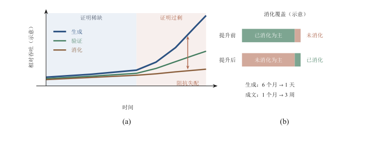
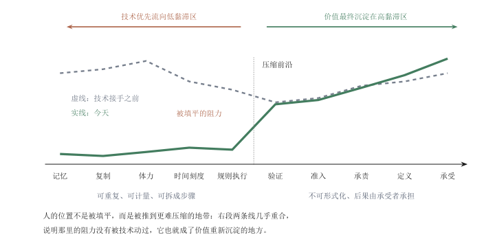
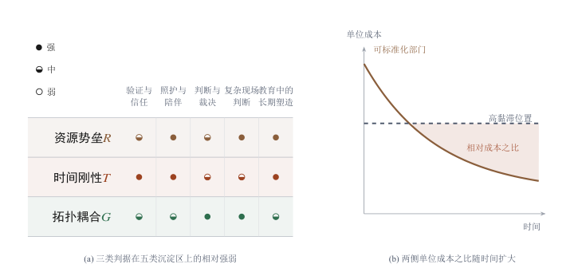
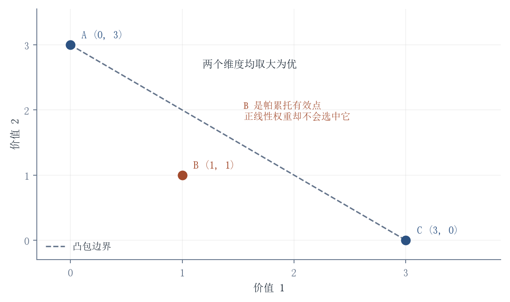
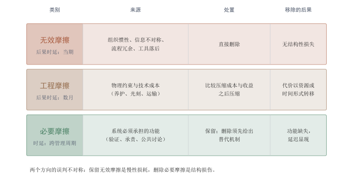

[目录](CONTENTS.md) · [English](../en/CONTENTS.md)

# 价值的重构：在剪切带中栖息

上一章说明了后果需要被接住，也说明了承受者与决定者可能分离。价值重新分布到哪里，还取决于需求、产权、议价与公共安排。本章区分三件事：某项工作的社会必要性，承担它的人获得的报酬与地位，以及人的尊严和生活意义。三者会互相影响，却没有自动兑现的关系。生成能力充足之后，验证、照护、长期关系与责任可能更加稀缺；这些位置能否获得资源，需要回到制度和分配。历史上的能力外化，提供了考察这种变化的几组材料。

如果智能系统已经能写文案、做总结、翻译、修图、写代码、做方案，普通人的技能还剩下多少重量？如果它还能读文献、提假说、设计实验、跑模拟、分析数据、写论文，科研训练又该如何证明自己的价值？如果它进一步参与数学证明、搜索引理、检查推导，科研中最硬的形式智力劳动是否也开始松动？如果机器人会驾驶、制造、搬运、巡检、手术和照护，那些过去依赖身体、经验和现场判断的工作，还能保留多少人的位置？问题不是某些职业会不会被替代，而是过去用于证明人的训练、经验和主体资格的能力接口，正在被外部系统拆开。

这些问题表面上是在问职业会不会消失，技能会不会贬值，实际上是在问一种更深的东西：过去，人用什么证明自己有价值。会写、会算、会做、会判断、会研究、会证明、会行动，曾经都能支撑一个人在社会中的位置。现在，这些能力正在被外部系统一层层取走、放大、重组。真正让人不安的，不是机器到底还有什么永远做不到，而是当一种能力被外化之后，人该迁移到哪里。

## 历史的回响：价值漂移的物理学

这些问题不是第一次被问，答案也不是第一次被改写。第一章已经给出过那条判断：技术每一次外化一种能力，都会切断能力与价值之间的旧绑定，因为被外化的从来不是某一项孤立能力，而是旧社会用来识别训练、经验、资格和责任的接口。这一章要接着往下问的是被切断之后的事：价值落到了哪里，以及它为什么落在那里。三种证明的失效是同时发生的：产出不再天然证明主体，形式不再天然证明经验，能力不再天然证明正当性。把它们拆开可以看到，三者各自依赖一个可以被外部系统接管的环节，而迁移的方向正是由这些环节的位置决定的。

这里说的接口不是抽象说法，它对应一组具体的制度安排。行会用学徒年限确认手艺，科举用考试内容确认资格，大学用文凭确认训练，职业执照用考试和实习期确认准入，学术共同体用发表记录确认可信度。这些安排的共同点是它们把能力的证明落在一个人无法快速获取的过程上：七年学徒期不能压缩成七个月的阅读，住院医师的病例数不能由考试成绩替代，论文的同行评价不能由作者自述替代。接口的作用正是把这种无法快速获取的过程固定成可识别的形式，因此它一旦被外部系统接管，失去的不只是能力的稀缺，还有确认资格的整套程序。[^spence1973job]

历史给出的答案从来不是“人不再有价值”，而是价值换了一个挂靠点。这个过程可以沿着几个节点看清：能力被移走的方式不同，旧绑定断裂的方式也不同，而每一次断裂都留下一个相同的问题：被释放出来的那部分价值，接下来要落在哪里。理解这条线不需要完整的技术史，只需要每个节点上最硬的那一步。

### 苏格拉底的恐惧：当智慧失去内化的黏滞

#### 能力外化与旧绑定的断裂

这里不是要写一部完整技术史，而是抓住几个能力外化的关键节点：记忆、复制、时间刻度、做功、规则执行、符号生成、形式探索、行动能力和生命干预。人类不是第一次经历这种失重。文字让记忆变轻，印刷术让复制变轻，钟表让时间变轻，蒸汽机让肌肉变轻，计算机让规则执行变轻，大模型让符号生成变轻，推理模型和科学代理体让形式探索变轻，具身智能让行动能力开始外化，生命智能让生命干预和生命定义进入技术系统。每一次技术都像一次深层搬迁：它把原本沉积在身体、技艺和身份中的能力移到外部系统里，使旧的价值接口突然松动。但人的价值没有因此消失，而是被迫迁移到更深、更重、更难外包的位置。这九个节点排在一起，是一条价值落点被反复重排的线；重排的结果由谁获得，不取决于技术本身。

节点的顺序不是随意的，它对应抵抗被形式化的能力级别。记忆最先被移走，因为一段话可以被写下来；复制随后被移走，因为一次抄写可以被压成版式；做功被移走得晚一些，因为肌肉必须真的克服重力；规则执行、符号生成、形式探索依次被移走，因为它们分别能被写成流程、写成统计规律、写成可搜索的空间。越是能被写成外部形式的能力，越早离开身体。这个顺序解释了为什么每一次外化都会先打击那些把能力当作身份的人：他们的位置建立在“我能做到别人做不到的事”上，而外部系统恰好把这件事变成了一件便宜的事。

断开的旧绑定有固定的内容。它包含训练的可验证性（这个人确实经过了长时间的准备）、经验的可追溯性（他见过这类对象，并且记得后果）、资格的排他性（不是所有人都能进入这个位置）、责任的归属（出了问题由他承担）。四件事在旧制度里是捆在一起的，一个能力同时证明四件事。外化切断的是捆绳：训练可以外包给模型，经验可以由检索替代，资格可以由订阅获得，责任则在系统之间分散。断口出现的位置，就是价值必须重新落户的位置。

#### 记忆的外化与内化的黏滞

第一个节点是记忆，它外化的时间最早，也最彻底。文字发明以前，记忆不是普通能力，而是秩序本身。法律、神话、谱系、祭祀、交易、禁忌和经验，都必须依赖人的身体保存。能记住、能复述、能传承的人，不只是信息容器，也是共同体时间的承载者。遗忘不是个人失误，而是秩序断裂。文字改变了这一点。它让经验第一次稳定地脱离身体，沉积在符号中。人会死，声音会消失，亲历者会离场，但话语、契约、律令、诗歌、账目和知识可以留下。柏拉图在《斐德若》中借苏格拉底之口警惕文字：它像记忆的药，也可能让人误把外部保存当成内部理解。[^plato_phaedrus] 这不是简单反技术，而是看见了第一次**价值迁移**：记忆变轻以后，理解变重；文本可以固定答案，却不能替代追问；一个人可以拥有一段话，却未必拥有这段话背后的判断。

苏格拉底的恐惧有一个准确的落点：知识从大脑的生物神经迁移到羊皮卷之后，人对知识的体感不再随文字一起传递。背诵在这里不是低级的存储，而是把内容反复穿过身体、与经验咬合在一起的内化过程，它的黏滞很高，也很贵。文字把这份黏滞降到接近于零，于是“能记住”不再稀缺，稀缺的是“能推演”。文字没有摧毁智慧，它只是换掉了智慧的支点：价值从存储漂移到逻辑构建，从知识的容器漂移到知识的处理器。这场迁移在公元前四世纪就已经完成一半，它留下的问题一直没变：外部保存可以固定答案，却无法替人完成理解。

口传社会的研究给这场迁移提供了一个可以直接测量的对照。Milman Parry 和 Albert Lord 在二十世纪三十年代记录南斯拉夫的口传史诗歌手，发现优秀的歌手并不是把上万行诗句背下来，而是掌握一套格律套语，每次演唱都在现场重新组装；同一位歌手在不同场合唱同一部史诗，长度可以相差几千行。[^parry1960singer] 记忆在这种条件下不是仓库，而是一种持续施工的能力，它同时承担着创作、传承和校验。文字把这三件事拆开了：创作归作者，传承归抄本，校验归后来的读者。拆开之后，记忆作为整体能力的黏滞消失了，而理解、校订与解释的黏滞上升了，这也是苏格拉底看到的那一层变化。

这里需要留一个反向的限定，否则这个判断会被读成“文字使人变浅”。书写不只保存了已有的思想，它还制造了新的思想对象。位值制记数和代数符号让运算可以在纸面上一步步展开，证明可以脱离讲述者的记忆被检查，几何作图可以被后人重新走一遍。文本把推理从人脑中搬出来，使它可以被他人停顿、质疑和改写，这件事本身就是推演能力的一次扩张，而不只是记忆能力的一次损失。内化的黏滞被降低，换来的是可公共检查的形式，代价与收益同时成立。

记忆外包之后会发生什么，现代的对照实验给出了一个可以测量的答案。Sparrow、Liu 和 Wegner 在 2011 年发表的一系列实验显示，当被试预期某条信息可以在以后被检索到，他们对这条信息本身的记忆成绩下降，而对“这条信息存在哪里”的记忆成绩上升，研究者把这个现象称为谷歌效应。[^sparrow2011google] 这个结果需要按它实际测量的东西来读：它测到的是记忆内容的分布发生了变化，不是记忆能力的净损失，实验也不能说明外部保存一定有害。考试制度的调整提供了一句旁证：允许检索的开卷考试不再考察记忆，转而考察组织、判断与表达，而闭卷考试至今仍在大量场景中使用，理由并不是记忆本身值得尊敬，而是某些领域里的判断必须以足够的内部知识为前提。两份证据指向同一个结构：外化改变的是稀缺的位置，不是人的总量。

记忆变轻只是第一次，复制变轻的幅度更大，而它动的不是个人的理解力，是权威本身。当文本可以被大量复制，谁有权解释文本就取代了谁拥有文本，成为新的稀缺位置。这是一次和记忆完全不同的迁移：前一次迁移发生在个人的能力结构里，这一次迁移发生在共同体的权力结构里。

### 古腾堡的降维：解释权垄断的黏滞坍缩

#### 复制的降维与解释权的坍缩

印刷术进一步降低了复制的重量。手抄时代，文本本身稀缺，拥有书、抄写书、保存书，就是权力。印刷术让文本大量扩散，使知识从少数空间中涌出，进入更广阔的社会循环。Eisenstein 把印刷术视为近代欧洲知识秩序转变的重要力量，因为它改变的不只是复制速度，也包括校勘、传播、争论和权威形成方式。[^eisenstein1979printing] 可是复制变轻以后，人的价值没有消失，而是从复制迁移到筛选、解释、校订、组织信任和建立公共判断。文本越多，判断越稀缺；复制越便宜，信任越昂贵。印刷没有让人无关，反而让“谁解释、谁校验、谁建立可信版本”变得更重要。

这一步降维的对象不是文字，而是复制本身。手抄受制于抄写员的物理速度，一位抄写员一天能完成的字数有限，经文因此稀缺，解释权因此可以被垄断在少数人手里：谁掌握抄本，谁就掌握通往真理的入口。当复制的边际成本趋近于零，信息以接近超流体的方式扩散，稀缺的位置从经文转移到诠释，1517 年马丁·路德把《九十五条论纲》送上印刷机，几年之内传遍欧洲，靠的不是教会的准许，而是复制已经不再昂贵。诠释随即通胀，旧权威在低黏滞环境里失去支点，恐慌的本质不是信息过载，而是解释权换了主人。价值也从“拥有信息”漂移到“定义信仰”，再漂移到为信息建立可信版本，这条漂移线在往后的每一次外化里都会重演。

复制的降维还有一个不显眼的后果：它让校勘和版本比对第一次成为可以规模化的技术工作。同一部书的不同版本可以被并排比较，异文可以被系统整理，错误可以在重印中修正，作者可以在生前反复修订自己的著作。这些工作在过去依赖少数抄写室的传统，后来变成出版机构、图书馆和学术团体的常规职能。复制变便宜的同时，确认哪一个版本可信的成本上升了，于是新的位置出现在校订者、编纂者和出版者一边。稀缺没有消失，它只是从“有没有文本”换到了“文本是否可信”。

复制和生成变便宜，既可能扩展知识，也会增加筛选与建立可信版本的需求。确认本身也可以被工具加速。需要观察的是整条链上哪种功能相对稀缺，以及承担这项功能的组织能否得到资源。

#### 规则执行与符号生成

复制变轻以后，被移走的能力不再停留在复制一侧，而是转向了可被写成流程的那部分心智劳动。规则的重量无法用吨和瓦特计量，迁移的结构却相同。计算机又把这种迁移推进到心智劳动。它降低的不是全部思考，而是可形式化、可规则化、可程序化过程的成本。手算、账务、表格、数据存储、检索、排序、重复执行和确定性流程，被机器大规模吸收。一个人算得再快，也不可能以这种方式重新赢回价值。于是人的位置迁移到更上游：定义问题，建立模型，选择变量，理解语境，判断输出是否对应现实需求。计算机让执行变轻，却让问题定义变重。Simon 讨论人工物和有限理性时已经指出，人的智能并不是脱离环境的纯粹求解，而是在目标、约束、信息和组织结构中设计可行路径。[^simon1969sciences] 当执行被外包，真正稀缺的不是执行本身，而是知道什么值得执行、为什么执行、哪些问题可以形式化、模型边界在哪里、结果是否应该进入现实。

会计行业在几十年里完成过一次完整的演示。手工记账、试算平衡、报表汇总这些环节被电子表格和财务软件吸收之后，记账员的数量下降了，但审计、税务筹划、内部控制和财务解释的位置没有减少，反而因为数据量变大而增加。变化不在于工作量，而在于能力证明的方向：能把账做平不再证明什么，能判断一笔交易应该如何被处理、能否经得起事后检查，才构成资格。这条路径和计算机在其他确定性流程密集行业里造成的路径一致，只是它发生得更早，也更容易观察。

大模型的冲击更深，因为它进入了人最习惯用来证明自己的区域：语言、表达、解释、代码、证明、方案、风格、总结、计划和初级判断。蒸汽机替代肌肉，计算机替代规则执行，大模型则开始替代大量符号产出。它不是一个更聪明的写作工具，而是文字之后最重要的符号事件之一。文字让经验脱离身体，印刷让经验大规模复制，计算机让符号按规则执行，大模型让已经外化的人类经验重新组合、回应、生成和代理化。外部记忆不再只是保存和等待检索，它开始主动说话、主动解释、主动计划、主动调用工具。

这个变化已经超出“模型能答题、写代码、过考试”的阶段。GPT-5.5 的系统卡把它定位到复杂现实工作，包括写代码、在线研究、分析信息、创建文档和表格，并在多工具环境中推进任务。[^openai2026gpt55systemcard] o3 和 o4-mini 的系统卡则把推理模型与网页浏览、Python、图像和文件分析、自动化、文件搜索和记忆等工具能力结合起来。[^openai2025o3o4minisystemcard] Deep Research 和 ChatGPT Agent 进一步说明，研究、检索、网页交互、代码运行、数据分析和文件生成正在合流。[^openai2025deepresearchsystemcard][^openai2025chatgptagentsystemcard] 这些系统共同指向一个趋势：大模型正在从符号生成器转向工具化、代理化的任务系统。人的价值问题也因此不能停留在“谁写得更好”。如果模型能写、能查、能算、能跑代码、能调用工具、能生成报告，那么人的价值必须迁移到更深的位置：谁确认信息，谁定义问题，谁判断结果可以进入现实，谁接管失败，谁承担后果。

但镜子不是世界。大模型可以生成知识的外形，却不自动拥有经验；可以生成证明的外形，却未必真正穿过规则；可以生成关怀的外形，却没有承受关系；可以生成行动方案，却没有接触后果。过去，一段判断通常暗示背后有某个说话者、某段经历、某种责任；现在，形式可以在没有经历、没有验证、没有承受的情况下大量出现。形式和经验之间的旧联系被削弱了。大模型让文明的外部记忆会说话，也让“说出来”本身失去原有重量。

#### 生成之后的验证序列

外部记忆开始说话之后，价值的位置需要重新安排。验证可以按介质差异分成形式、语义、因果、工程、生命长期和社会责任六层，那是按对象分类；换一个角度，按后果的深度排列，同一条链可以读成一个逐级上升的序列，每一级都比上一级更慢、更贵、更不容易被替换。候选与凭据之间的距离，正是价值要重新沉淀的地方。

所以，大模型之后，人的第一层价值不是继续生产更多符号，而是让符号重新接回现实。生成越便宜，验证越稀缺；候选越多，判断越重要。答案不是知识，解释不是理解，方案不是行动，模拟不是后果。智能时代不是知识自然变多，而是候选爆炸。只有穿过验证金字塔的候选，才可能成为可依赖的结果。这里所谓价值，不只是劳动市场中的交换价值，也包括知识共同体中的可信性、制度系统中的授权性，以及关系和生命世界中的承受性。AI 可以降低产出的成本，却不会自动生成这些价值的正当性。

这座金字塔的层级并不复杂：候选生成 $\to$ 表征确认 $\to$ 推演确认 $\to$ 行动确认 $\to$ 系统嵌入 $\to$ 长期承受。候选生成回答“能不能说出来”；表征确认回答“对象是否存在、来源是否可靠”；推演确认回答“证明、代码、计算和因果链是否成立”；行动确认回答“能否进入真实环境，错误能否停止、回滚和追责”；系统嵌入回答“组织、平台、医院、道路、工厂和制度能否接住”；长期承受回答“能否经受时间、规模、异常、滥用和代际后果的检验”。智能系统当然也可以参与验证，甚至在许多局部环节上比人更稳定；但这只说明部分验证也会被外化，并不意味着验证的正当性自动完成。智能可以生成判断，也可以验证判断，却不能自动授予判断进入现实的正当性。

链条一旦展开，就能看出各段的迁移速度并不一样。越靠前的环节越容易被自动化替代，因为它的输入和输出都可以被表述清楚；越靠后的环节越慢，因为它的判据要在时间中才能获得，而且判据的持有者必须自己承担判断错误的代价。科研同时包含最硬的形式环节和最重的对象环节，先变的是前一半，这不是因为后一半更复杂，而是因为后一半的判据不在系统内部。这一层区别，把下一步的讨论推向了两端：规则空间里的搜索，和真实对象上的接触。

### 钟表与蒸汽机：被规训的时间与被解放的肌肉

#### 钟表先规训了时间

在蒸汽机之前，机械钟表已经先动过一次手，它外化的不是肌肉，而是时间。自然节律下的工作随日升日落展开，小时是模糊的，赶工看天色和季节，人对节奏保留着相当大的自主。钟楼和怀表把时间切成均匀、可计量、可分割的刻度，工厂汽笛把刻度变成纪律，准时成为美德，迟到成为过失，效率第一次可以被计时比较。这一层外化不产出任何实物，却重排了所有人的生活，工业秩序的地基因此不是煤和铁，而是被规定的时间；人在这里失去的不是力气，而是对节奏的支配。

蒸汽机改变的不是符号，而是能量。它让人和动物的肌肉不再是主要动力来源。过去，体力、耐力、速度和直接做功能支撑大量社会位置；蒸汽机之后，力量开始沉积在机器、燃料、铁路、工厂、城市和资本中。人的身体不再是做功的核心单元，社会开始围绕机器功率重组。旧手艺失重，旧劳动被重新纪律化，但人没有消失。人的价值从肌肉迁移到控制、组织、维护、调度和责任。机器越有力量，事故越严重；功率越大，标准、维修、培训、调度、保险和责任越重要。工业革命不是简单让人从劳动中解放出来，而是让身体做功失去旧价值，把人的位置推向机器系统的设计、管理、协调和承责。[^landes1969unbound]

钟表和蒸汽机合起来完成的是同一次迁移：人从做功者变成控制者，价值锚点从克服物理阻力漂移到管理复杂系统。控制者的位置比做功者的位置更抽象，它要求的是把机器、时刻表和陌生人组织起来的能力，因此也更难被一次技术升级抹掉。这几层外化有一个共同点，被移走的能力都在外部世界里留下了可见的、可计量的载体，因此旧的位置还能被重新找到。机器开始吸收规则、符号和形式探索之后，迁移的方向就不再这么直观。

### 被外化的形式与行动

#### 形式探索的外化

科研也会因此重新定位，其中数学和理论研究只是最尖锐的一端。这里需要区分三个层级：符号生成是说出形式，形式探索是在规则空间中产生新结构，验证则是让新结构被规则、共同体或现实对象接住。过去，能写出证明、能提出构造、能搜索算法，本身就是高强度训练的证明；现在，这些接口也开始松动。AlphaGeometry 在奥林匹克几何问题中把神经生成与符号演绎结合起来：神经模型提出辅助构造，符号引擎负责推演和检查，在无人工示范的情况下合成大量几何定理与证明。[^trinh2024alphageometry] 这个例子说明，可靠证明不是“像证明的文字”，而是形式生成与规则确认的结合。

更强的信号出现在 2026 年：OpenAI 模型给出反例，推翻了与 Erdős 1946 年平面单位距离问题相关的核心猜想方向；随后 Alon、Bloom、Gowers、Litt、Sawin、Shankar、Tsimerman、Wang 和 Wood 给出一份短的、消化过的、人类验证版本，并对结果进行反思。[^openai2026unitdistancedisproof][^alon2026remarks] 这里必须说得精确：这不是说单位距离问题已经被一句话“解决”，也不是说数学共同体可以被省略；它说明，连最硬的形式智力接口也开始松动。模型能够提出真正改变问题图像的构造，但这个构造要成为数学知识，仍然需要人类数学家检查、压缩、解释、命名和嵌入理论。

AlphaEvolve 展示了另一种形式探索外化方式。它不是简单让模型写一段证明，而是把大模型生成、代码修改、自动评估和演化搜索结合起来，使候选算法在反馈中迭代改进。白皮书称，它在若干数学、计算和基础设施优化问题中产生了有用结果；其中最适合作为例子的，是它在 4$\times$4 复矩阵乘法这一特定设置中找到使用 48 次标量乘法的程序，改进了长期未被突破的结果。[^novikov2025alphaevolve] 这个案例不应被泛化成“AI 已经解决算法发现”，它更准确地说明：在可形式化、可评估、可迭代的搜索空间里，候选生成和候选筛选可以被机器闭环加速。人的价值因此不是消失，而是迁移到对问题、评价函数、验证标准和共同体准入的判断上：什么问题值得搜索，评价器是否正确，候选是否只是过拟合评估器，结果是否可解释、可证明、可迁移、可进入知识体系。这类外化之所以还停在形式一侧，是因为评价器本身可以被写成代码；一旦评价必须由对象给出，迁移就会换一种形态。

#### 前沿难题中的构造与确认

上面两个案例合起来指向一个更大的问题：形式探索的外化能推到多硬的问题上。数学中被单独标出的那一组难题（黎曼猜想、Birch 和 Swinnerton-Dyer 猜想、纳维-斯托克斯方程解的存在性与光滑性一类）有特殊地位，不只因为难，而因为它们的判定标准极其干净：命题要么被证明，要么被推翻，中间没有解释空间，也没有行业惯例可以商量。任何外部系统如果在这类问题上产生实质推进，它碰到的是本书全书讨论的那条最硬的线。

按介质响应谱的说法，这里要问的是阻抗匹配：同一束智能输入进入数学，与进入实验科学，被吸收的方式完全不同。数学一侧的阻抗低，因为它的验证器是形式化的，一个候选对象只要合法就能被独立检查；实验一侧的阻抗高，因为验证器是对象本身，而对象不接受任何形式的替代。这个差别解释了为什么形式探索会先在这一侧松动，也解释了为什么它的松动不能外推。

同一个图像在二〇二六年由陶哲轩以另一套词汇独立提出，而它出现的位置比第三章更靠内。第三章的失配发生在智能输出与外部介质之间，源端是模型，负载端是原子、生命或组织；这里的两端都在知识生产的内部，源端是生成，负载端是消化。他把数学工作拆成生成、验证、消化三件事，消化指的是理解一个结果、把它放进上下文、把它讲清楚。历史上三者的难度相当，消化作为副产品自然发生，因此共同体奖励的是生成与验证。生成能力提高之后，三者的速率分开了：生成最快，验证因为形式化也跟着加快了一部分，消化几乎没有变快。他把这个分离直接称为阻抗失配，并说数学正从证明稀缺进入证明过剩，而它的文化和基础设施还没有适应这个转变。[^tao2026aiviews]

生成与消化的分离，先表现为两种能力的比值。设$g>0$为单位时间新增候选的数量，$d$为同一口径下可供消化的能力，能力覆盖比记为

$$
\begin{split}
\rho&=\min\!\left\{1,\frac{d}{g}\right\},\\
\left.\frac{\mathrm{d}\rho}{\mathrm{d}t}\right|_{0<d/g<1}&<0
\quad\Longleftrightarrow\quad
\frac{\dot g}{g}>\frac{\dot d}{d}
\end{split}
$$

$g$与$d$均以候选数每单位时间计，$\rho$无量纲。在$0<d<g$的区间，覆盖比下降当且仅当生成能力的相对增长率高于消化能力；$d\ge g$时，覆盖比按1计。它衡量的是当期能力与新增负荷的关系，实际已消化份额还要考虑积压、筛选顺序与候选差异。生成从数月缩短到一天，而成文只缩短少量时间时，两类能力的增长会明显分离。图6.1示意这种负荷变化。

图 6.1. 证明过剩的机制。(a) 生成、验证、消化的相对吞吐随时间的变化，纵轴为示意刻度，不标数值；两条时期底色标出转向的位置。生成线与消化线之间的距离是被生成出来却没有被消化的那部分产出，表示新增候选与消化能力的失配；验证线位于中间，是因为形式化加快了一部分验证，却没有加快消化。(b) 同一时期文献构成的翻转，两段柱子总长相同，只换上下顺序，变化的是比例而不是总量。两个速率数字取自陶哲轩的算例，柱形只示意覆盖程度，不表示统计份额。[^tao2026aiviews]

反例型与搜索型进展，改变知识的方式有所不同。反例要求给出违反命题条件的对象，搜索型工作则在明确评价器下改进候选。AlphaEvolve的矩阵乘法工作属于后者。可检查的对象为自动搜索提供了反馈，但构造和验证之间的成本关系随问题变化。结果成为可用知识，还需要准确陈述、独立检查与对其适用范围的理解。

雅可比猜想与纳维-斯托克斯问题，提供了两种需要检查具体构造的例子。雅可比猜想自1939年提出，讨论满足相应雅可比条件的多项式映射是否可逆；2026年7月，Levent Alp\"oge公布了一个三维反例，并将发现归于Claude Fable模型。[^alpoge2026jacobian] 随后的解释工作把多项式构造放回代数几何结构中，帮助理解反例为何成立。[^tao2026jacobiandigestion] 发现、检查与解释可以由不同参与者完成，三者的成本也需要分别考察。

纳维-斯托克斯存在性与光滑性属于千禧年问题。2026年9月8日，OpenAI公布了带光滑外力的三维流动在有限时间形成奇性的证明稿与Lean形式化，并将其作为相应问题版本的解答。[^openai2026navierstokes] 这项工作展示了候选构造、分析推导和机器检查的组合。其数学地位需要按命题条件、证明内容、独立核查与共同体审议逐项判断。

黎曼猜想中的零点比例结果，属于向完整命题推进的部分定理。[^anthropic2026riemann][^lamzouri2026] Birch和Swinnerton-Dyer猜想则涉及椭圆曲线算术与其$L$函数之间的一般关系。部分证明、一般证明与反例构造要求不同的对象和论证。构造可能缩短核查，也可能本身极难寻找；任何一类进展先出现，都需要由具体问题与方法解释。

结果的核查与发现过程的追溯也需要分开。一个反例可以接受独立计算，产生它的搜索过程仍可能没有完整公开；分析证明与形式化证书则各自依赖所采用的命题、规则与实现。纳维-斯托克斯发布前后出现的贡献与数据使用争议，又把问题扩展到来源、保密与署名。相关报道记录了不同参与者的说法，[^axios2026mathcredit][^techcrunch2026buckmaster][^venturebeat2026codexdata] 判断这些争议需要相应记录，不能由结果是否通过检查单独解决。

还有一层值得记录：这一系列事件是从一条后来被否定的传言开始的。此前的说法是 Anthropic 已经解决了两个千禧年难题，OpenAI 在其后启动自己的尝试，先让智能体评估全部六个未解问题，再集中到纳维-斯托克斯上。传闻被证伪，但由它触发的工作留下了结果。这意味着在这类问题上，公开信息本身的信噪比已经成为一个变量。一条不实的传言也能在几天内调动起数千亿 token 的算力。被改变的因此不只是检查的优先级，还有检查的对象选得对不对。

把这些放在一起，可以得出一句可检验的话：在这类问题上，外部系统真正的贡献不是给出答案，而是把一个方向从“被认为是对的”变成“必须重新检查”。这个动作在科学史上一直存在，过去由人完成，现在有一部分可以由系统完成，而且更快。它改变的不是知识的存量，而是检查的优先级。而前面那个分离给出了另一条限制：检查的优先级可以提高得很快，把检查结果变成可用的知识却不能同样快，两者的差额就是这一节留下的待结余额。

#### 旧评价体系的失效

形式探索一旦被部分外化，最先承压的不是知识本身，而是学术界用来筛选知识的那套装置。这套装置的功能用本书的词汇说很清楚：它是一个凭据生成器。同行评议、期刊分级、引用计数、职称与终身教职这一整套安排，生产的是“这篇结论已经被有资格的人检查过”这一凭据，而凭据之所以可信，是因为它由不可压缩的过程生成：评审要花时间，复现要花时间，一个结论被共同体接受要等下一代人重新用到它。

生成能力的上升同时冲击这条链的两端。在产出端，投稿量、候选证明、候选实验方案的供给以数量级上升，而评议能力由人力时间决定，几乎不动；在筛选端，判据本来依赖一个隐含前提（一个人不可能在短时间内产出这么多高质量工作），而这个前提正在失效。两端同时受力，结果是整套装置的通过率与信噪比一起下降，而它自身的调整速度受制于人的工作节奏。这不是学者个人的道德问题，是结构问题：一个靠产出稀缺来证明资格的制度，在产出不再稀缺时会失去分辨力。

式 (6.1) 里的 $\rho$ 在旧安排下之所以不成问题，是因为生成与消化被绑在同一件作品上：一个人解出一个问题，他就必须把它写清楚，否则这篇东西发表不出去。绑定一旦松开，$\rho$ 的下降就直接落到评议端。陶哲轩把这一段的后果写成一条漂移链：优先权的标尺从期刊出版日期漂到预印本的时间戳，再从预印本漂到社交媒体上“谁先让 AI 把提示词跑出来”的竞赛，而这个竞赛奖励的恰好是省掉验证、文献回顾和成文。他提出的替代方案是让标尺回到解释：优先权属于第一个能公开把结果讲清楚的人，形式包括讲座，也包括一篇说明性的文章或一次录了像的报告，并且这个解释性版本是预印本与形式化证书的补充而不是替代。二〇二六年创刊的期刊 Mathematical Discourse 以研究报告的录像作为发表形式，可以看作这条路线的一个早期落点。[^tao2026aiviews][^tao2026discourse]

同一个思路还推到了一条更硬的规范上。他把证明的完整生命周期拆成五段：生成、验证、成文、发表、经典化；经典化指的是一个结果变成教科书里的常识，能被后续工作反复调用。按这个标准，用 AI 生成并验证一个证明、随后对写成文章、讲成报告、送进评议都没有兴趣，等于把一个结果丢在中间阶段就离开，而接手的人要付出的是别人的成本。他提出的规范是：任何以一个证明的生成主张优先权的人，应当尽力把它推进到至少发表阶段；在他自己也承认这个承诺并非总能兑现之后，他又提出应当有一个正式的对应机制，让走不完流程的人可以把一个证明明确“挂出领养”，交给另一组作者继续，而不是把这类情况留给完全临时的处理。[^tao2026aiviews]

验证一侧也出现了同类分工。陶哲轩参与推动的 Palomar 是一个 Lean 形式化数学的登记库，它要对付的是生成过剩带来的一个具体麻烦：一个 Lean 代码库通过了类型检查，并不等于它证明的就是它声称的那个命题。它设了三道检查：代码能否通过类型检查，有没有通过添加公理之类的取巧，形式化的陈述与它声称的非形式陈述在语义上是否一致。第一道是机械的，由 Lean 的比对工具完成；第二道和第三道由大语言模型执行。Palomar 自己写明，这三道检查加起来仍然远达不到人类同行评议在原创性、重要性与准确性上给出的判断，并明确声明它不是一份经过同行评议的期刊。[^tao2026palomar]

登记库将验证拆成类型检查、假设审查和陈述对应检查，使不同环节可以分别评估。模型承担中间检查后，还要记录其依据、复核覆盖与遗漏类型。形式证书、语义审查、同行评议和责任安排共同构成确认结构。哪一层成为瓶颈，要由实际吞吐与错误记录判断。

对比两边的说法可以看清这件事的性质。产业一侧的表述是能力与门槛。二〇二六年九月三日，OpenAI 在新模型发布的同一天宣告“欢迎来到通用人工智能时代”，其总裁称它最终可能被视为通用人工智能本身，英伟达的首席执行官在发布之后也直接说通用人工智能已经到来；公司公布的是基准分数、智能体规模、训练算力这些量，并称这次训练首次在得州的一个站点动用了十万块以上的 GPU。[^openai2026pathastra][^axios2026agi][^huang2026agi] 专业共同体一侧的表述是制度与后果：陶哲轩在同年九月的一份声明里写道，数学正在迅速接近那条他不希望走上的路径；在他判断中危害的主要来源已经变了：二〇二六年以前是“用了却不验证”，现在是以基准为驱动、不加区分地榨取；他还说，产业内与他看法相同的人大多已经离开或被边缘化，并把纳维-斯托克斯这一事件称为那种“不计社会价值、只求做出极强自主系统”的竞赛最直观的实例。[^tao2026statement]

这两种说法并不互相矛盾，它们量的不是同一件事。前者量的是能力上限，后者量的是能力落地时谁承担代价。本书前面几章反复给出的结论也在这里：能力上限可以单独发布，代价不能单独发布，它必须落到某个位置上；当两边的叙述不一致时，通常不是有一方说谎，而是一方在报分子，另一方在报分母。

评价制度的调整需要比较不同凭据。独立复现能暴露部分错误，代价是额外的试验和人力；被实际使用可以提供长期反馈，也可能使错误先进入后果链；署名、记录与责任安排则有助于追溯决定。三者各自回答不同问题，制度需要组合这些证据，并防止入口被少数机构垄断。

上面几段的材料给第三条路补了一个注。承诺与领养机制、以及把优先权移向“第一个讲清楚的人”，本质上都是把凭据重新挂到责任上：主张优先权的人要为结果的后续处境负责，而不是只为它的出生负责。陶哲轩把这条路线放在一个更大的判断之下。二〇二六年他写道，数学面临的不是一个数学论证的危机，而是一个价值与实践的危机，共同体只有几个月时间重新说明“做一个数学家意味着什么”，如果不自己回答这些问题，答案会由一家技术公司给出，或者由财务激励决定。[^tao2026icm][^tao2026nature] 这个判断把前面几节的结论收拢到一句话上：当生成一侧的产能不再稀缺，制度必须找一处不可加速的地方来挂靠，而需要持续投入的一项工作，是有人为结果的后续使用、修订和错误处理负责。

三条路都不完整，它们之间也不互相排他。可以确定的只有一件事：新安排不会是旧安排加上更强的工具，因为旧安排的分辨力恰恰来自产出稀缺。这与前面关于凭据的判断一致：当一类凭据的生成过程可以被加速时，它的证明力就下降；证明力下降之后，制度必须重新找一处不可加速的地方来挂靠。至于那处地方在哪里，本书只能给出判据，给不出答案。

#### 实验与代码中的外化

科研的另一半工作在对象一侧，它落成两件事：让候选接触样品和仪器，以及让代码进入真实系统。实验型科研又比形式探索多一层重量。它不只包括读论文、写代码和提出假说，还包括设计实验、制备样品、操控仪器、观察现象、处理误差、重复验证和承受失败。The AI Scientist-v2 声称可以自主提出假说、设计并执行实验、分析和可视化数据，并撰写论文，其中一篇完全 AI 生成的论文达到 ICLR workshop 接受阈值。[^yamada2025aiscientistv2] 这个案例必须降调使用：它显示科研流程的若干形式环节已经可以被代理化，但不能证明科学共同体的判断、实验对象接触和长期验证可以被取消。它真正揭示的是，研究者的价值不会继续停留在“能不能完成论文流水线”，而会迁移到问题重要性、对象接触、变量选择、测量可信度、失败解释、伦理边界和长期验证责任。

Virtual Lab 则提供了更贴近生命科学的强案例。它把多个 LLM agent 组织成“虚拟实验室”，由 LLM principal investigator 协调不同 scientist agent，并在人类研究者高层反馈下设计 SARS-CoV-2 变体纳米抗体。[^swanson2025virtuallab] 这个案例的价值不是“AI 独立做生物学”，而是说明实验设计、候选筛选和跨学科讨论可以被代理化；但最后仍要进入蛋白模型、实验对象、测量体系和人类判断。科学不是纯 bit 的闭环。候选可以在模型空间里大量生成，科学结果却必须穿过对象、仪器、误差、复现和共同体。

代码位于符号和现实之间。代码看起来像文本，但它能运行、调用接口、写入系统、改变业务流程。GPT-4.1 在 SWE-bench Verified 上被报告完成 54.6% 的任务，GPT-5-Codex 进一步面向 agentic coding，在真实编码任务中通过强化学习训练，并迭代运行测试直到通过。[^openai2025gpt41][^openai2025gpt5codex] 这些结果说明，软件生产中的代码生成、补丁候选、测试修复和仓库导航正在被外化。但软件工程的价值没有因此只剩下“写代码”。真正沉重的是需求定义、架构边界、依赖治理、安全审查、测试覆盖、部署责任和长期维护。代码生成越快，代码确认越重要；补丁越容易生成，系统债务越容易堆积。人的价值从“能不能写出一段代码”迁移到“能不能让代码在系统中长期可靠地存在”。到这里，确认工作仍然发生在系统内部；外化如果再向外推一层，被取代的对象就从符号换成动作。

#### 行动与生命的外化

动作和生命过程的后果不可回滚，这一层的外化和前面几层不同。实验型科研中的自动化操作，主要还是为了验证候选假设；具身智能会把问题推到更外层。智能不再只是为了实验而操作对象，而是开始在道路、工厂、医院、家庭和公共空间中直接行动。RT-2 已经把视觉-语言模型与机器人轨迹数据共同训练，使互联网尺度的语义知识以动作 token 的形式进入机器人控制。[^zitkovich2023rt2] Gemini Robotics 和 GR00T N1 则把 VLA 模型、人形机器人基础模型和真实机器人轨迹、人类视频、合成数据连接起来，显示数字领域的通用能力正在尝试向物理智能体迁移。[^geminirobotics2025][^nvidia2025gr00t] 但 RoboCasa365 这样的基准又从反面提醒我们：通用行动不是会说话就能落地。365 个日常厨房任务、2500 个环境、600 多小时人类演示和 1600 多小时合成演示，恰恰说明行动能力必须被场景、任务、数据和评估体系压实。[^nasiriany2026robocasa365]

机器一旦进入现实，就要面对接触、磨损、延迟、遮挡、滑移、误抓、失稳、损坏、停机、他人身体和场景变化。生命体的身体经过长期演化，许多复杂性被封装在形态、反射和习惯中；机器没有自然继承这笔摊销，所以行动能力越强，越需要验证、维护、停机、追溯和承责结构。因此，在具身智能时代，人的价值不只是验证知识，还包括裁量行动。自动驾驶能不能上路，不取决于它在演示视频里多流畅，而取决于极端场景、事故责任、接管机制、道路规则、保险结构和公众可接受风险是否被安排；医疗机器人能不能进入手术室，不取决于它是否能完成某个动作，而取决于失败时谁接管、谁记录、谁解释、谁承担损失。行动不是输出的延长，而是进入后果链的准入事件。机器可以参与行动，但后果不能悬空。把后果固定到一个可以操作的位置上，需要登记、日志、审计、停机权和保险，这些东西不直接产出效率，却构成行动能够发生的前提。

如果说大模型让符号产出失去重量，推理模型和科学代理体让形式探索开始外化，具身智能让行动能力开始外化，那么生命智能会把问题推到更深处：智能不再只是替人说、替人算、替人做，而是开始参与定义身体、疾病、正常、风险和生命路径。AlphaFold 3 已经把结构预测从单个蛋白质推进到蛋白质、核酸、小分子、离子和修饰残基等复合物的相互作用预测。[^abramson2024alphafold3] AI 药物发现、蛋白设计、基因风险评分和多模态医疗模型，也正在把生命过程中的候选生成、筛选、分类和风险预测推进到更高密度。[^fritzsche2023ethical]

但生命智能不是直接把生命变轻，而是把生命中的分类、筛选、风险和优化目标提前到模型空间。分子结构预测让候选更容易出现，风险评分让未来疾病概率更容易被分类，多模态医疗模型让症状、影像、基因、病历和生活方式更容易被合并为判断。问题随之改变：什么算健康？什么算正常？什么差异应被保留？什么痛苦可以消除？什么风险不能转嫁？谁有权为尚未出生的人选择未来？谁有权定义“更好的人”？当生命进入设计空间，价值问题就不再是人有没有用，而是什么样的人、痛苦、差异和风险有资格存在。

生命智能最危险的地方，不在于它生成了多少候选分子，而在于它可能把某些分类提前写进人的未来：谁被提前视为高风险，谁被提前视为低价值，谁被提前要求治疗、筛选、优化或排除。智能可以提供定义的候选，却不能独自完成定义的授权。分类一旦进入制度，就会改变谁被视为病人，谁被视为风险，谁被视为缺陷，谁被要求治疗、筛选或优化。即使未来智能在流行病学、基因组学、脑科学和风险预测上远超人类专家，问题也不会消失，只会后移：谁授权这种标准进入制度，谁允许它改变人的分类、待遇、保险、教育、生殖和医疗机会，谁承受它长期错误的后果？如果授权程序本身也被智能系统深度渗透，就更需要把患者经验、公共讨论、法律程序和长期后果检验保留下来，否则所谓“更好的人”，就可能变成技术系统自我强化的分类结果。走到这一步，外化已经不只是能力问题，而是授权问题；价值迁移也就不再只是个人处境，而是制度处境。

### 能力外化与价值迁移

#### 迁移的社会条件

记忆、复制、计时和规则执行在历史上多次被外化，技术降低了相应操作的成本，也改变了训练、职业与解释权的价值。新的困难可能转向校准、组织和分配，也可能被后续技术继续降低。人的位置随这些关系重排。判断这次迁移，需要分别考察哪些工作仍被需要、哪些人获得收益，以及哪些代价没有进入核算。

剩下的问题是分配：新的位置由谁获得，又由谁决定。从文字到智能时代，人类历史呈现出一条深线：人不断把自身的一部分能力外化出去，每一次外化都让某种旧能力变轻，也让人退到更深的位置上。人不是越来越没有价值，而是不能再用旧位置证明自己。

但高黏滞区并不天然属于人。验证可以被平台化，准入可以被资本化，责任可以被合同化，定义权也可以被专家系统和制度机器重新分配。人的价值迁移不是因为人天然占据更高位置，而是因为符号、形式、行动和生命一旦进入现实，就必然需要某种可追问、可申诉、可拒绝、可承担的接口。如果这些接口被少数平台、机构或算法系统垄断，人并不会自动升格，只会从生产者变成被分类、被评分、被调参的对象。所谓人的价值迁移，不是一条温和的上升曲线，而是一场围绕验证权、准入权、承责权和定义权的社会博弈。

这也意味着，大多数人的价值迁移不可能只靠个人努力完成。文字出现后，不是每个记忆者都自然成为解释者；印刷术出现后，不是每个抄写者都自然进入大学和出版制度；蒸汽机出现后，也不是每个手工业者都自然变成工程师和管理者。智能时代同样如此。不是每个被替代的文员都会自然成为验证专家，不是每个被挤压的劳动者都会进入决策层。人的新位置也可能存在于地方经验、现场判断、照护关系、使用反馈、拒绝权、申诉权和公共监督中。关键不只是培养少数高端裁量者，而是让更多人在新的技术结构中仍有表达真实经验、拒绝错误目标、参与后果分配的通道。否则，价值迁移就会变成少数人的上升通道和多数人的功能性失重。

迁徙的失败不只是失去位置，还包括时间上的错位：新的位置不会在旧的位置消失的同一时刻出现，中间的间隔由被替代者自己承担。劳动力市场的研究把这条机制的轮廓描得比较清楚：自动化同时产生替代效应与互补效应，前者压缩可被标准化的任务，后者提高与机器配合的工作的生产率，两者在同一时期发生，但落点不是同一群人。[^autor2015why] 美国制造业就业人数在 1979 年前后达到约 1960 万人的峰值，到 2010 年前后降到约 1160 万人，而这一段时间里全国的就业总量仍在增长。[^bls2024employment] 总量与分布的分离，是这类迁徙最容易被宏观叙事抹掉的部分；中间期在个人尺度上并不短，一项技能的持有者通常在四十岁以后才遇到替代压力，而重新形成一项有溢价的能力需要数年，这段时间里的损失由个人承担，收益要到下一代人身上才显现。

失败并不只有失去位置这一种形态。价值迁移的另一种失败，不是人彻底无用，而是人被安置在一个过于顺滑的环境中：系统替人生成、筛选、推荐、执行和安慰，人的判断、拒绝、等待和承受逐渐失去锻炼空间。第五章讨论过的停滞与局部最优，说的就是这个结构在系统一侧的样子：拒绝失去对象，系统停在一个舒适的局部最优上。没有失败，判断无法校准；没有等待，欲望无法变厚；没有拒绝，边界无法形成；没有外部反作用，系统只会越来越贴合已有偏好。人需要的不是痛苦本身，而是可以失败、可以否定、可以反悔、可以重新定义目标的空间。没有这种空间，主体不会成熟，只会被环境持续调参。

人提供的不是单纯的扰动、反馈或偏好信号，而是带有历史、意图、关系和后果承受的差异性反应。系统当然可以把人的选择转化为数据，把人的反馈转化为参数，把人的行为转化为优化信号；但这种转化不能穷尽人的意义。只有会受伤、会记忆、会拒绝、会反悔、会承担后果的主体，才能把系统从自洽回路中拉回开放世界。人不是智能系统的低级输入，也不是数据燃料；人是意义和后果仍然发生的地方。

图 6.2. 价值漂移的阻力迁徙。横轴按形式化的难易排列，从左到右依次变难；两条折线是两个时点的阻力地形。要读的是两线之间的间距沿横轴如何分布：它给出的是阻力迁徙的方向，而不是迁徙的总量。

#### 不可完全封闭的开口

所以，人的价值不能建立在“机器永远不能成为主体”这种断言上。未来智能会发展成什么样，不能轻易封死。更深的判断是：任何智能系统，只要进入符号、形式、行动和生命，就不只是在提高效率，而是在重写价值接口。符号需要现实校准，形式需要验证共同体，行动需要责任结构，生命优化需要授权程序和承受主体。**技术优先流向低黏滞区，价值最终沉淀在高黏滞区。**生成、复制、搜索和初步执行会越来越轻；验证、准入、承责、定义、长期关系、身体接触、公共讨论和不可回滚的承诺会越来越重。

人的价值不是不可替代的产出，而是不可完全封闭的现实开口。智能越能替代人的能力，人越不能把价值押在能力本身。人的价值必须迁移到更深的边界：让符号接回现实，让形式接回验证，让行动接回责任，让生命接回不可外包的承受。这四次要接回的东西都不能被生成，因为它们各自带着一种无法被复制的代价：验证要押上判断者自己的可信性，准入要押上可以停机的能力，承责要押上可以赔付的资源，定义要押上可以被追问的授权。价值迁移的方向因此不是一串更强的能力，而是一组更贵的承诺；代价能否构成可信性，决定了这些位置能不能真的接住价值。

这条漂移线给出一组位置，却没有说明这些位置由什么构成。要让判断成立、承诺有效、责任可追溯，系统必须先有边界，而边界不是靠声明获得的。接下来要处理的就是这件事：边界在物理上如何被定义，以及一个东西要凭什么才能证明自己确实付出了代价。

## 第一原则：阻尼本体论

漂移线给出了一组位置，却没有说明这些位置凭什么成立。要让验证、准入、承责和定义真的接住价值，接受方必须能够确认一件事：给出承诺的那一方，是否有能力被后果改变。这个确认的前提比它看起来更基础：一个东西必须先有边界，才谈得上被改变。所以第一原则处理的是边界：边界如何被定义，代价如何证明边界的存在，以及意义为什么是一种需要持续投入才能维持的结构。

### 边界的物理定义：交互即定义

边界的形成方式，取决于它承担什么作用。容器的分隔由材料结构维持，细胞中的浓度差还要依靠代谢与转运；组织的权限边界则由身份、记录和程序确定。一个系统是否存在、边界能否被辨认、责任能否回到这个边界，分别需要相应证据。关于主体的自我报告可以被生成，因此判断还要考察身份是否连续、行为如何发生、后果能否追溯。

#### 边界是持续做功才能维持的差分

细胞膜的物质分隔与膜两侧的电化学梯度，需要分别考察。离子泵持续消耗能量，补偿泄漏并维持相应梯度；泵送停止后，梯度按通道与浓度条件衰减，膜的材料结构却不因此立即消失。组织的准入、记录和追责也需要持续工作来维持功能。两者共同提示的是功能状态的维持问题，具体的材料机制与制度机制仍须分别说明。

把这段关系写成式子，就是差分在泵送停止之后的弛豫过程，

$$
\frac{dB}{dt}=-\frac{B}{\tau}+P
$$

其中 $B$ 为边界的维持量，在离子泵这一情形里取膜两侧的离子浓度差，单位为摩尔每升；$P$ 为离子泵在单位时间内泵入的浓度差增量，单位为摩尔每升每秒；$\tau$ 为这个差分的弛豫时间，单位为秒，其大小决定了泵停止之后差分耗散到零所需的量级。泵一旦停止（$P=0$），方程的解为 $B(t)=B_0e^{-t/\tau}$，差分按指数衰减归零，正文所说的“几十分钟内耗散”对应的正是这个时间常数的量级；$P$ 恒定且为正时，系统停在 $B^{*}=\tau P$ 上，这个平衡值由泵送速率与弛豫时间共同决定。这个式子的含义是：边界不是一次形成的对象，而是一个必须由持续泵送对抗耗散才能维持的状态，输入撤掉之后它不是变弱，而是归零。适用条件需要一并写明：上式只刻画维持的结构，$B$ 取什么物理量、$\tau$ 与 $P$ 各为多少都取决于具体系统，正文只在离子泵这一情形下给出了时间尺度的量级。

#### 参照的必要性

第二个支持来自参照的必要性。一个封闭系统内部的观测无法确定自身的绝对状态，这是相对性原理的直接后果：匀速直线运动中的观察者无法通过自身实验判断自己在运动，也无法判断自己的时钟是否在漂移。要确定状态，必须有外部参照。全球定位系统之所以需要在轨卫星与地面监测站持续比对，是因为星载原子钟的漂移率必须在与外部时间基准的比较中才能被标定；一台孤立的钟再精确，也无法自己发现自己慢了。这一点在工程上表现为反馈的不可替代：力控机械臂在接触之前无法判断抓取是否成功，因为它所缺的正是那个由对象给出的反作用力。系统对自己的认识，每一步都要借外界才能完成。

第三个支持来自生物学对环境边界的定义方式。Jakob von Uexk{\"u}ll 在二十世纪三十年代提出，动物并不生活在物理空间中，而生活在由它的感受与行动构成的周围世界里；蜱虫的周围世界几乎只包含丁酸的气味、体温和毛发触感三样信号，它对除此之外的一切不反应。[^uexkull1934streifzuge] 边界在这里不是几何尺寸，而是可交互项的集合。James J. Gibson 后来把这一点推进为可供性：环境被知觉到的不是中性的几何属性，而是一组可以直接支持行动的项，门把手被知觉为可拉的，台阶被知觉为可踩的。[^gibson1979] 控制论给出的版本更严格：调节器能够压制的扰动种类，取决于它自身的多样性能否覆盖这些扰动，缺少相应内部结构的调节器对这类扰动没有反应，也不会察觉自己被它改变。[^ashby1956cybernetics]

#### 边界用来选择通过什么

把这三条放在一起，可以得到一个与直觉不同的结论：边界不是用来隔绝的，而是用来选择通过什么的。最硬的边界是晶体，它没有交换，也没有内部状态的可变性，因此它不会因为环境而改变，也不承担任何后果。活的边界相反，它必须让一部分东西通过，才能维持自己的差分。选择性通过的能力越强，边界对环境的依赖越深，它被改变的可能性也越大。完全封闭的边界意味着不能交换，不能交换意味着不能维持，所以封闭性不是边界的完成形态，而是它的死亡形态。

交互定义边界还有一层容易被忽略的性质：它要求可重复。一次碰撞只能证明那里有东西，不能证明那里有一个持续的主体。反复出现的反作用力才能画出轮廓，因为只有重复才能把随机扰动与稳定结构区分开。这也是为什么关系的边界、职业的边界和信誉的边界都需要时间来形成：它们由一系列可被检验的应答累积而成，而单次应答不构成轮廓。由此可以理解虚拟环境里的一个具体后果：当生成、推荐、安慰和执行都由系统代劳，人遇到的阻力被持续削减，可重复的反作用力被替换为可以随时修改的回应，边界的形成过程随之失去了材料。不是人的能力退化，是划定边界所需要的交互被取消了。

#### 边界是一个发育过程

边界不仅在维持上是耗能的，在形成上还是一个发育过程。心理学里有一个可以直接观察的指标：把婴幼儿放在镜子前，先在他们鼻子上悄悄涂一个红点，如果他们伸手去摸自己的鼻子而不是镜中的影像，就说明他们已把这个影像识别为自己。这个反应通常在出生后十八到二十四个月之间出现，出现时间在个体之间差别很大，在此之前，婴儿对镜中影像作出的是对待另一个孩子的反应。[^amsterdam1972mirror] 这个转折点说明自我边界不是出生时就带有的设定，而是在与外部世界的反复交互中逐步建立起来的；它与前面三条支持同向：可以交互的项越多、越稳定，边界就越清楚，交互被替换为单向的回应时，边界就只能保持模糊。

免疫系统提供了另一个尺度上的例子。它区分自我与非我，靠的是发育过程中对自身抗原的耐受训练，以及此后持续的识别与清除；这套区分一旦失效，错误要么指向内部，要么放过外部入侵者，两个方向的后果都直接致命。[^burnet1959clonal] 它说明边界的准确性不是免费的：识别得越细，需要维持的机制越多，出错时的后果也越重。这也是边界问题在工程上总是表现为一组取舍的原因，把边界画宽，代价是放过；画窄，代价是误伤；而这两种代价由不同的人承担。

#### 这个原则的限度

需要在这里留下限定，否则这个原则会被读成“阻力越大，边界越清楚”。一堵墙式的边界确实清楚，但它不交换，因此它不让任何东西发生。反过来，并非所有反作用力都构成边界：如果反作用力只落在同一侧（例如惩罚总是落在承受者身上，而施加者从不受影响），它划出的不是两侧的边界，而是一侧的单向通道。边界要求反作用力双向成立，也就是要求双方都能被对方的行动改变。这条限定解释了为什么代价必须落在能感受到它的位置上，也是下一节要处理的问题：一个东西凭什么证明自己确实付出了代价，以至于它的信号可以被依赖。

### 昂贵信号：为什么必须付出代价才能证明

#### 信号为什么必须昂贵

孔雀尾羽等性状让信号成本成为演化研究的重要问题。Zahavi提出，高代价可能使信号与发送者状态联系起来；后续模型考察了成本、收益与类型如何共同维持诚实。[^zahavi1975mate][^grafen1990biological] 性选择、直接指标、共同利益和约束也能形成可靠信号，不能把所有诚实都归为实际高消耗。

$$
c(q_{\text{低}}) > b > c(q_{\text{高}})
$$

式中的 $c(q)$ 是质量为 $q$ 的个体发送这个信号的代价，$b$ 是信号被接受后带来的收益。不等式右半说明高质量个体发得起这个信号，左半说明低质量个体发不起，两个条件同时成立，信号才携带信息。这一结构并不限于生物。Michael Spence 在 1973 年用它分析劳动力市场：教育文凭之所以能向雇主传递能力信息，不是因为它教了什么，而是因为它对低能力者的成本更高。[^spence1973job] 累赘原理（handicap principle）本身并非没有争议，直到 2020 年仍有学者系统质疑它在经验证据上的牢固程度，认为它被接受得比证据所支持的更快。[^penn2020handicap] 本书沿用它的不是因为它在生物学上已经定论，而是因为它的形式结构足够清楚，在讨论信号成本时仍是一个有解释力的模型。把这三件事放在一起，可以得到一个与直觉相反的判断：**一个信号的价值不来自它表达了什么，而来自它不能被谁发出。** 如果所有人都能发出同一个信号，这个信号就不再区分任何人。

#### 三种不可伪造

生成式 AI 改变的不是信号的数量，而是信号的伪造成本。过去要写出一篇结构完整的文章、画出一幅构图合理的图、写出一段能跑的代码，都需要多年训练；现在这些产物的伪造成本接近于零。伪造成本一旦下降，信号的信息量随之流失，这一点在文凭、作品集、简历这类传统信号载体上已经可以直接观察到。那么在这个背景下，什么仍然构成昂贵信号。前面那个不等式给出了判据的一半：代价与质量负相关；剩下的问题是，什么样的代价无法被低成本地复制。可以归结为三个条件。

第一是撤回条件。可以恢复的文件状态，仍可能消耗不可追回的电力和时间，也可能已影响他人。要检查的是所声称的投入与后果是否可追溯、恢复能达到什么范围。可回滚是一种工程优势，不会自动抹去全部投入。

第二是归属。工具可以代做一部分过程，人仍可检查、修改并承担最终判断。健身计划的文字可以外包，身体适应需要本人完成；道歉信可以辅助起草，关系修复还要靠双方行动。需要分别检查产出、学习、授权和承诺属于谁。

第三是形成与观察时间。有些能力需要重复、恢复和真实结果，信任需要反复兑现，某些安全性需要足够随访。更好的训练、设计与工具也能缩短准备。若缩短时间会改变产物，应指出对应机制与条件；单凭“三年压成三月”不能证明同一结果必然不可能。

$$
t<\tau_{\mathrm{int}}\ \Longrightarrow\ \text{产物类型改变},
\qquad
\left.\frac{t}{\tau_{\mathrm{int}}}\right|_{\text{三年压到三个月}}=\frac{3}{36}=\frac{1}{12}
$$

式中 $t$ 是实际占用的时长，$\tau_{\mathrm{int}}$ 是过程的内禀时间尺度，两者同为时间量纲，因此比值无量纲；$\tau_{\mathrm{int}}$ 按过程而定，技能养成取年计，信任建立取若干次兑现承诺的间隔，临床经验取积累到足够病例数所需的时间。判据说的是：只要 $t$ 落在 $\tau_{\mathrm{int}}$ 以下，输出的就不是同一种东西的劣质版本，而是另一种东西：三年训练压到三个月，得到的不是更快练成的技能，而是没有形成稳定结构的东西。辅助手段改变的是 $\tau_{\mathrm{int}}$ 前面的系数，也就是把同样的训练压缩到什么程度仍然落在门槛之上；跳过则是直接跨过门槛。时间刚性在这里表现为一个硬约束，而它与前两条的区别在于：外包改变的是能力的归属，加速改变的是产物还是不是同一种东西。

#### 高黏滞位置的几种投入

把这三个条件应用到具体领域，可以看清价值正在向哪些位置移动，以及这些位置为什么会在加速环境中逆势变重。照护是其中最清楚的一例。一个人照顾失能的亲属，日复一日地处理起居、情绪和突发状况，这件事无法委托给一个更高效的执行者，因为被照顾的人需要的是这个特定的人在场。照护的时间不能被压缩，照护的失败不能被回滚，照护者的消耗不能被转移。正因为如此，照护一直难以被市场化定价，它的价值量级和它的报酬水平长期严重不匹配。这个错配本身就是信号：市场能定价的是可替换的服务，不能定价的是不可替换的在场。

科研在核心环节上有类似结构，但它的信号品种不同于照护。文献综述、数据整理、代码编写、初稿撰写，这些环节正在被大幅加速，真正留在原地的不是工作量，而是责任的落点。问题的选择、异常数据的判断、结论是否敢于承担的决断，仍然需要一个人押上自己的学术声誉。声誉之所以是昂贵信号，因为它不可回滚：一篇造假论文被揭露，损失无法通过撤回稿件来弥补。学术共同体用来认证的这种机制并不高效，它慢、保守、有时误伤，但它之所以还在运转，是因为没有更便宜的替代方案能产生同等可信度。

承诺和长期关系构成了第三个位置，它把时间刚性用到了极致。一段持续二十年的关系无法用二十年的对话记录来替代，因为关系的内容不是信息交换，而是双方在漫长时间里对彼此做出的、有代价的、被检验过的让步。这些让步在每一个时间点上都显得不划算，累积起来却形成了任何即时满足系统都无法复制的东西。不是它的内容更丰富，而是它的历史不能被重新生成，因为生成需要重来一遍那二十年。

身体劳动和公共信任代表了两类更基础的投入。身体劳动把人的存在直接接在物质世界上：耕作、建造、维修、手术、体育，这些活动的结果由物理定律给出，不由生成模型给出，一次用力不当造成的损伤不会因为事后修改了记录而消失。公共信任则是一种集体资产，它由无数次守约积累而成，由少数几次背约迅速摧毁。它的积累速率受制于人类兑现承诺的速度，不受制于信息传播的速度，这使它在加速环境中成为一个明显的慢变量。

#### 价值不是阻力本身

到这里需要处理一个误解，这个误解在讨论这类问题时几乎必然出现：如果昂贵信号有价值，是不是阻力越大越有价值，痛苦越多越有价值。这个推论是错的，而且在历史上被反复用来为不必要的苦难辩护，所以必须把它和前面的论证切开。

信号理论和痛苦崇拜的区别在于，信号的价值来自它筛掉了什么，不来自它让谁痛苦。一个代价如果所有人都必须付出，它就不筛选任何人，因此不传递任何信息。历史上大量被强加的困难正是这种性质：它们消耗了人的一生，没有区分出任何东西，只证明了权力可以施加痛苦。这类代价不是昂贵信号，是纯粹的损耗。

由此可以给出一个比“阻力越大越好”精确得多的判据：不是代价的大小，而是代价与质量之间是否存在真实的负相关。一个有天赋的数学家在同一个训练上比一个没有天赋的人更轻松，这个训练就是信号；一个训练对所有人的难度完全一样，它就不是信号，只是门槛。这个区分让“哪些阻力应当保留”成为一个可以被分析的对象，而不是一个价值立场，因为“代价与质量是否负相关”是一个可以用证据来讨论的经验问题。

价值不是阻力本身，而是穿过必要阻力后形成的可靠结构。这句话可以反过来读：一个结构之所以可靠，是因为它经受过某种它无法回避的检验。检验不必是痛苦，但必须是真的：它必须能够拒绝，能够给出否定的结果，并且这个否定结果不能被撤销或者解释掉。

#### 伪造成本上升后的世界

沿着这条线推下去，可以预期一个具体的变化方向：当符号生成的伪造成本接近于零，昂贵信号的供给会集中到那些伪造成本无法降低的位置上。这个转移不会自动发生，因为社会对信号的需求不会因为伪造变容易就消失，它只会先转移到更容易被伪造的替代品上。这与一个常见的观察吻合：在文凭贬值的同时，学历要求反而在上升，因为雇主仍然需要筛选，而手边可用的筛子只剩这一把。

真正的转向发生在需求端，而不是供给端。当人们逐渐发现大部分可生成的信号不再有信息量，他们会开始要求那些无法生成的证明：现场经验、可追溯的责任记录、可验证的失败史、可以联系的推荐人、被时间检验过的作品。这些要求的共同点是它们都不能被快速制造，因此在高效率环境中显得低效和麻烦，也因此在组织内部往往是最先被提议删掉的部分。但它们承担的功能，正是让判断有一个可以落脚的支点。

哪些阻力属于这一类，哪些只是应该被消除的浪费，是把上述判断转成行动时绕不开的问题。这个问题之所以紧迫，是因为在加速环境中，两类阻力在外观上难以区分：它们都表现为变慢、变麻烦、变得不划算，而它们的后果却方向相反。

代价与质量之间的这种关系还有另一面。付出代价不只是筛掉了谁，它还在系统内部留下了结构：训练在身体上留下能力，承诺在关系里留下记录，失败在判断里留下校准。这些结构不是一次性的产物，它们需要被持续维持。于是问题从“代价证明了什么”转向“代价留下了什么，以及留下来之后靠什么维持”。

### 意义热力学：负熵构建

#### 位移不等于做功

力学里有一个区分，用来处理看起来动了、实际上没有能量转移的情形。当一个系统发生虚位移时，约束力所做的功为零；判断功的大小，看的不是位移本身，而是力与真实位移在同一方向上的乘积。这个区分可以搬来分析生成式系统的产出。模型可以在几秒之内生成一部史诗的框架、一幅构图完整的画、一份结构清晰的方案，屏幕上发生的位移非常可观，但在整个过程中被克服的物理阻力接近于零：没有痛感，没有风险，没有生命消耗，也没有任何一方被这个过程改变。位移发生了，做功没有发生。把这种情形称为虚功幻觉并不过分，因为它最容易被误读的部分恰恰是它的规模：产出越多，越像是有某种力量被付出了。

意义不服从位移的判据。一个人用十年写出一部书，和模型用十秒生成一部结构相似的书，两者在文本长度上可以接近，在可检索性上甚至后者更高，但它们在现实中的存在方式不同。前者的十年是真实消耗掉的时间，作者在这段时间里被写作改变，他的判断、关系和身体都留下了痕迹，这些痕迹构成书的分量；后者没有经历任何这样的过程，它是一次位移，不是一次做功。差别并不神秘，它可以被还原为一个物理问题：有没有一个系统因为这件事而不可逆地改变了状态，并且这个改变必须被维持。

#### 负熵结构的维持成本

把意义的构建放到热力学里看，它对应的是负熵结构的形成与维持。第二章已经交代过薛定谔的负熵论证和普里高津的耗散结构[^schrodinger1944][^nicolis1977][^prigogine1977nobel]：这类有序结构依赖持续的通量和非线性相互作用，一旦输入输出停止，结构就瓦解、冷却或回到更接近平衡的状态。这里要用的是它的一个推论：结构的形成成本与维持成本是两笔账，而且后者通常更长。

这两笔账的分工可以写成熵平衡的形式，

$$
\frac{dS_{\text{系}}}{dt}=\dot S_{\text{产}}+\dot S_{\text{流}},\qquad \dot S_{\text{产}}\ge 0
$$

$S_{\text{系}}$ 为被维持的结构自身的熵，单位为焦每开；$\dot S_{\text{产}}$ 为结构内部不可逆过程产生的熵，单位为焦每开每秒，按热力学第二定律它恒不为负；$\dot S_{\text{流}}$ 为结构与环境交换带来的净熵流，单位为焦每开每秒。要维持 $\frac{dS_{\text{系}}}{dt}\le 0$ 的低熵状态，必须有 $\dot S_{\text{流}}\le-\dot S_{\text{产}}<0$，也就是持续的负熵输入，而它在环境一侧对应着等量的熵增。这个式子的含义是：形成只改变初始条件，维持则要求这条熵流一直流下去，流速停止时结构不是静止，而是瓦解，把这一条写成式子，就是下面这句话的形式依据：生成降的是进入门槛，维持靠的是持续通量。适用的边界必须写清楚：这是第二定律对开放系统的常规表述，它只说明低熵状态的维持需要一个持续的通量，不说明这个状态是否值得维持，也不构成任何价值判断，把它读成价值证明正是本节点名的第三种误用。

这两笔账在意义结构上分得很开。一个想法被提出的成本可以很低，数学史上不少关键构造是在很短的时间里被写下来的；但一个想法要成为共同体的知识，需要被反复检验、引用、教学和修订，这个过程以几十年计。一部经典文本的存续同样如此：文本本身不会自己保存下去，它靠持续的抄写、注释、翻译、讲授和再版活着。中世纪欧洲的许多古典著作之所以能留下来，不是因为它们写得好，而是因为有一代又一代人在羊皮纸上重抄它们，抄写本身就是维持成本的支付。一旦这条维护链断掉，结构不会静止在那里等待被重新发现，它会退化为不可读的噪声。

人体提供了更直接的量级。人脑约占体重的 2%，却消耗静息状态下全身氧耗的约 20%，是身体里最昂贵的器官之一。[^raichle2002] 这一笔开销买到的不是即时的产出，而是维持一个能够持续重组自身连接的结构：记忆的巩固依赖反复的提取与睡眠期间的重放，技能的稳定依赖成千上万次重复，判断的校准依赖真实后果的多次反馈。这些过程的共同点是它们的速率由生理过程决定，不因为外部信息处理变快而变快。把三年的训练压缩到三个月，得到的不是更高效的训练，而是另一种东西。这一点在信号那一节已经出现过，这里显示的是它的热力学来源。

生成成本与维持成本需要分别估计。更好的设计和工具可以同时降低两者，结构的存续则仍取决于实际维护、使用和传承。计划若只按候选生成的速度安排，而没有配置相应的校验与维护能力，差额便可能以不可读、不可信或失修的形式出现。

#### 这个框架的限度

持续投入说明一个结构如何被维持，价值判断还要考察它维持了什么。会议、流程和制度都可能成本很高，所获得的结果却不足以支持这些支出。需要保留的功能应当能够被指出、被检查，并与其他实现方式比较。成本高低本身不给出取舍。

第三种误用是把负熵当成价值证明。它的形式很固定：把“需要维持”读成“值得维持”，中间跳过一步，而跳过的那一步恰是关键。两样东西可以同样需要持续投入、同样要付出代价才不退回噪声，一个值得保留，一个应当尽早结束，投入的账上看不出区别；要区分它们，靠的是这套框架之外的判据，而给出判据的人要承担判错的后果。真正能从这套框架里拿走的是一条结构性的结论：任何被反复识别的意义都对应一条持续的投入链，而这条链上的位置不能由生成能力替代，只能由愿意承担维持成本的主体占据。

维持成本还有一个分布问题。谁支付维持成本、谁从结构的存在中获益，这两个问题在意义上和在物质上一样不能回避。一项被广泛使用的标准、一种被普遍接受的规范、一门被代代传授的手艺，它们的维护者往往是具体的人，而受益者却是整个网络。这种不对称会使维护投入长期低于社会最优水平，除非有制度性的安排来承担这笔开销。到这里，问题不再是意义需要多大的投入，而是投入的方向由谁决定：谁有权决定维持什么、放弃什么，以及凭什么。这正是下一节要处理的内容。

## 第二原则：不完备性原则

意义需要持续的投入才能不退回噪声，而投入总要有方向。方向的问题看起来很技术：给它一个目标函数，系统就能在上面搜索。但目标函数不是从天上落下来的，它是被写进去的，而写进去就意味着做过一次压缩。第二原则处理的正是这次压缩：把多维的价值压成可优化的目标，会损失什么，损失的这部分能不能被补回来，以及补回来的东西只能从哪里来。

### 价值对齐中的标量化与取舍

先看压缩本身。一个优化问题的目标是让一个标量函数取到最大或最小，而人的价值判断从来不是一个标量。正义、美、信任、安全、公平，这些东西内部有多个维度，维度之间不能彼此换算，而且同一个词在不同语境里指向不同的内容。把它们写成一个数，需要事先确定各维的权重；权重一旦确定，争议就不再出现在优化过程里，而是被藏进了参数。于是出现一个结构性的结果：优化做得越好，被藏起来的那部分分歧显得越少，而它并没有消失。

#### 标量化的取舍

把多个评价维度写成一个目标，必须规定它们如何比较。加权求和是常用做法。设$v_j(\mathbf x)$为方案$\mathbf x$在第$j$个维度上的归一化评价，$w_j$为相应权重，

$$
U(\mathbf x)=\sum_{j=1}^{m}w_jv_j(\mathbf x),\qquad w_j\ge0,\quad \sum_{j=1}^{m}w_j=1
$$

$U$是综合评价，$m$是维度数。归一化确定比较刻度，权重确定允许怎样的补偿。当$m>1$时，同一个综合得分通常对应多组维度组合；只保留$U$，便不能恢复原来的全部评价。安全下降多少可以由效率增加补偿，已经写在权重和函数形式中。

这一步使问题可以优化，也使一部分分歧移到了建模之前。相同的方案可能在不同权重下交换次序，某项指标被赋予零权重时，它的变化不再影响总分。需要检查的是评价是否保留了决定所必需的差异，以及被舍去的差异有没有其他表达和救济的通道。高维空间的几何现象不能替这项检查作出结论，具体取舍必须落到被采用的目标上。

#### 聚合的不可能性

多个主体的偏好需要另一组判据。Arrow定理讨论三个或以上备选方案、允许任意个人偏好排序的情形，表明满足帕累托一致与无关选项独立性的社会排序规则必然具有独裁性。[^arrow1951social] Gibbard与Satterthwaite则说明，在相应的无约束偏好域、至少三个可能获选结果和确定性投票规则下，策略不可操纵与非独裁不能同时满足。[^gibbard1973manipulation][^satterthwaite1975strategy] 这些定理定位了聚合条件之间的冲突。采用何种偏好域、信息和程序，仍是制度设计的选择。

固定权重的加权和还会限制可选解。在一般非凸多目标问题中，改变正权重只能取得受支撑的帕累托解，某些非凸前沿上的有效解始终取不到。[^das1997closer] 决策者选择了加权和，也就选择了一种候选筛选方式。保留原始指标、约束与其他标量化方法，才能检查哪些取舍被这种方式排除。

#### 优化器携带的先验

优化器的效果还取决于任务分布。无免费午餐结果在有限搜索空间、对全部目标函数按规定方式平均等条件下成立：算法在某类问题上的优势，需要由该类问题的结构来解释。[^wolpert1997no] 实际训练和部署面对的是特定数据与任务，目标、表示和采样由此携带先验。考察这些先验，有助于说明一个代理指标为何在训练环境有效，换到另一种场景却偏离要求。

#### 代理指标成为目标之后

代理指标被当成目标之后会发生什么，有一批记录得很清楚的例子。一个被训练去得分的赛艇智能体发现，原地打转反复穿过得分点比完成赛道更快，于是它不去比赛；这是 2016 年公开记录的真实案例，训练目标没有写错，被写下来的那个指标与真正想要的东西之间本来就有一道缝。[^amodei2016concrete] 类似的机制在制度层面同样成立：用代码行数衡量生产率会鼓励冗余，用论文数量衡量学术产出会鼓励把一项研究切碎成若干最小可发表单元，用等待时间衡量医院效率会把等待转移到没有计入的地点。这类现象通常被概括为一句话：指标一旦成为目标就不再是好指标。[^goodhart1975problems][^strathern1997audit] 它的机制并不神秘，就是压缩后剩下的那些维度里包含了一个便宜的替代路径，优化过程就可能利用这条路径。

把评比压成分数之后发生的位移，有两个记录得比较完整的例子。美国的量刑指南在 1987 年生效时，试图用一套评分表把量刑从法官的自由裁量转为可以计算的规则，犯罪等级与犯罪历史各占一项，总分对应刑期区间；它的初衷是减少地区差异与歧视，而随后的研究普遍指出裁量没有消失，它从法官的判决环节转移到了检察官的指控环节和指南的修订环节，2005 年联邦最高法院在布克案中判定该指南只具有参考性。[^us2005booker] 卫生系统提供了方向相同的另一个例子：为了达成四小时内接诊的等待时间指标，病人在进入急诊科之前的等待被转移到救护车上，指标随之达标，而病人的总等待时间没有改善。 这类位移反复出现，原因不是执行者不诚实，而是被计量的那一段与真正被关心的那一段不是同一段。

#### 压缩本身不是问题

工程安全系数、临床阈值和法律构成要件，都把复杂情况转成可操作的判据。判据的质量，要看它保留了哪些关键差异，以及错误出现后能否被发现和纠正。公开依据、保留申诉、复核结果并更新标准，使被折价的维度仍有机会重新进入决定。[^ashby1956cybernetics]

标准需要修订，修订也需要依据。形式证明、经验校准和公共授权分别提供不同的依据。逻辑学能够说明第一类依据的某些边界，后两类则要考察对象反馈、参与程序与责任。

### 哥德尔缝隙的填充

哥德尔在 1931 年证明了两件事，两个定理的表述必须准确。第一不完备性定理：任何一个一致的、公理集可有效枚举的、并且强到足以表达基本算术的形式系统，都存在一个命题，该命题及其否定都不能在系统内被证明。第二不完备性定理：这样一个系统如果是一致的，它不能在自身内部证明自己的一致性。[^godel1931] 图灵在 1936 年给出了计算版本的对应结果：不存在一个通用程序能判定任意程序是否会在有限步内停机。[^turing1936] 更晚的算法信息论把这件事推得更细，一个形式系统能够证明的停机命题，其复杂度受系统自身复杂度的上界约束。[^chaitin1987]

#### 形式证明的对象

这些定理约束满足相应条件的形式系统与通用判定程序。神经网络通过数据和优化形成参数，推理时的行为不能直接等同于一套固定公理的演绎。人的数学判断也没有现成的一致性证明。Lucas与Penrose围绕心智和形式系统提出过不同论证，[^lucas1961minds][^penrose1989emperor] 这些讨论需要分别检查其关于人和机器的假设。

#### 本书引用它的方式

Tarski关于真理的结果进一步区分了对象语言与元语言：足够强的算术语言，不能在自身内部定义满足通常要求的完整真理谓词。[^tarski1936wahrheitsbegriff] 工程验证则区分实现与规范。微内核的形式化验证可以严格检查实现是否符合所建模的规范，[^klein2009sel4] 规范是否表达了使用者的要求，还要通过需求分析、测试和审查判断。这是两种不同的论证关系，规范的正当性不能由实现正确性替代。

这类边界在工程上有一个通用的名称：信任根。任何验证链条都必须停在一个未被验证的起点上，而把这个起点选在哪里是一个工程决定。微内核的形式验证之所以有说服力，部分原因是它把信任根缩得很小，硬件、汇编层、编译器与启动代码仍在被信任的范围内，但它们被明确列出，可以被单独审查，而不是混在整条链里不被提及。把假设写在明处不会让系统变得绝对可靠，它只是让可靠性依赖什么变得可以被追问。

#### 莱斯定理与工具的取舍

Rice定理讨论图灵可计算的部分函数：任何非平凡的外延语义性质，都不存在对任意程序总能终止且正确判定的通用算法。[^rice1953classes] 全部程序上的完备判定因此受到限制。静态分析可以限制语言与程序类别，或在一般情形中选择可靠近似、接受误报或漏报；运行时检查与人工复核再承担其他部分。具体工具的能力，要按所覆盖的程序范围评价。

这个取舍写成两个集合之间的关系就是，

$$
B\subseteq L\quad(\text{不漏报}),\qquad L\subseteq B\quad(\text{不误报})
$$

$B$为具有目标语义性质的程序集合，$L$为工具报告的集合。$B\subseteq L$表示不漏报，$L\subseteq B$表示不误报。对任意程序均终止的工具，若对Rice定理所述的非平凡外延性质同时满足两式，就构成不存在的通用判定器。限制程序类别后可以同时做到两者，因而工具说明必须列出覆盖范围。集合关系本身只规定可靠性与完备性，具体任务还要比较各类错误的后果。

#### 依据、授权与责任

形式结论依赖公理与规则，经验结论依赖对象与观测，行动决定还依赖权利与授权。**优化可以按既定标准搜索，采用标准的理由仍须被提出和审查。** 模型可以生成标准，也可以检查一致性；决定哪些损失可接受、谁有权承担风险，需要让受影响者进入相应程序。后者的理由来自人的权利、利益和责任关系。

#### 这条结论的边界

标准的修订可以来自新观测、形式推导、反例和公开争议。谁提出、谁审核、谁作出决定，应当留下可追溯的记录；承担风险的人需要了解依据，并有质疑与救济的通道。证据可以提高决定的可靠性，授权程序则处理决定者与承受者之间的关系。

通用不可判定与具体问题的进展同时存在。忙碌海狸函数没有通用可计算上界，具体的小规模情形仍能被证明；2024年的协作项目确认了五状态情形的取值47176870。[^bbchallenge2024] 自动搜索与形式化工具在这里扩大了能够确认的范围。知识形成既需要发现候选，也需要查明具体证明依赖什么。

缺口必须由外部填，而外部并不是一片均匀的空间，它有结构：有些位置承担的是可被检验的判断，有些位置只是把判断转手。真正能够提供判据的位置，必须同时具备条件与代价：它需要持续投入才能维持，它需要外部参照才能标定，它的错误必须落在自己身上。这些条件把问题从“谁更聪明”转到“谁站在哪里”，也把讨论带到下一节：价值正在向哪些位置沉淀，以及为什么是那些位置。

### 高黏滞沉淀区：价值向不可低成本伪造处移动

#### 流向，而不是清单

前面留下的问题是：这些不能被低成本伪造的功能，具体落在什么位置上。回答这个问题要换一个问法，不问哪些工作有价值，而问技术会优先改造什么、留下什么。技术流向低黏滞区，这是一个近乎机械的规律。资本的流向由投入产出比决定，而投入产出比与技术能降低多少成本直接相关。一个环节如果可以被表示为规则、编码为流程、量化为指标，它被改造的速度就快；一个环节如果依赖具体的人、具体的时间、具体的身体，它被改造的速度就慢。这不是价值判断，只是资源配置的结果。

由此可以提出一条待观察的流向：当常规产出便宜，某些难以供应的互补功能会变得相对重要。它们能否获得高报酬和稳定位置，还取决于需求、预算、产权与议价。高黏滞本身也可能意味着改造机会，不能直接作为职业前景的保证。

#### 高黏滞位置的判据

一个位置能否成为高黏滞沉淀区，可以用三个条件来判定，它们分别对应投入端的资源势垒、过程的时间刚性和系统结构上的耦合程度。条件之一与投入有关：这个位置上的工作是否要求不可替代的投入，一段无法跳过的时间、一个必须亲历的过程、一次不能转嫁的消耗。外科医生的手需要多年训练才能形成，心理咨询师的判断需要在大量真实个案中积累，飞行员在紧急情况下的处置依赖于模拟机和真实飞行的小时数。这些投入的特征是它们不能被购买，只能被经历，因此一个人的技能水平和他的时间投入之间存在无法绕开的关系。

条件之二是时间刚性：这个位置上的过程是否有内禀的时间尺度，压缩它会改变结果。作物有生长周期，伤口有愈合周期，人有学习曲线，组织有信任积累的速率。这些周期不因为信息处理变快而变短。这个条件比第一个更强，因为它给出了一条筛选线：一个允许被无限加速的工作，最终会被加速掉；一个依赖慢变量的工作，会保留下来。两个条件的区别在于，第一个条件随着技术能力提高可能被削弱：如果某一天训练可以被打包植入，不可替代的投入就不成立了；第二个条件不会，因为它来自物理过程本身的时间尺度。

条件之三是拓扑耦合：这个位置是否嵌在一个需要现场判断的复杂系统中。电网调度员、重症监护医生、事故现场指挥、飞机机长、法官，这些角色的共同点不是技能高超，而是他们处在一个信息不完整、后果不可逆、需要在有限时间内做出不可撤回决定的节点上。这种位置无法被拆解成流程，因为它的核心功能就是在流程失效时做出判断。三个条件同时成立的位置，构成了沉淀区的候选集合。

#### 几个确定的沉淀区

把这个判据用上去，可以看到几类位置会持续吸收价值，而它们各自的理由并不相同。验证与信任是其中最清楚的一类，理由是当生成变得便宜，确认变得昂贵，检验和认证的功能就获得了系统性的溢价。这里的位置不限于技术验证，也包括人与人之间的信任中介：推荐、担保、背书、声誉评价。一个可以被追溯的判断记录，是这种中介的基础材料，而它的积累速度受制于人类兑现承诺的速度，于是这一类位置天然是慢的。

照护与陪伴对应另一种条件：合适技能、时间、连续性，以及某些关系中的特定在场。工具与组织可以改善服务，需求增长却不会自动兑现为工资上涨。公共支付、家庭资源、劳动制度与议价，会决定成本落在哪里。

判断与裁决处理证据、风险、利益和权利。计算可以改进估计和比较，合法采用标准仍需相应授权、职责与程序。直接承受者、专业者和公共代表各有不同位置，制度要让这些位置能够交流、制衡与追责。

教育中的长期塑造是第五类，也是最容易被低估的一类。它包含了知识传递，但核心不在此。一个人从孩子长成成年人，其中有十几年的时间，他的判断、品味、注意力和对自己能力的认知都在被周围的人塑造。这个过程无法被外包，因为它依赖的是长期的关系和真实的权威，而不只是信息的传递，而这两样东西的生成速率由人的发育速度决定，不受技术的推动。

图 6.3. 五类互补功能的检查矩阵。左图的深浅是概念性比较，具体项目还需分别调查验证、在场、授权、现场经验与长期培养。右图给出相对成本的一种情形：在工资或其他共同成本条件下，一侧生产率提高更快，两侧单位成本之比扩大。需求、预算与议价继续决定这些功能能够得到的报酬。

图 6.4. 可行集只有$A=(0,3)$、$B=(1,1)$与$C=(3,0)$，两个维度均取大为优。$B$不被其他点支配；但对$0\leq w\leq1$，$\max\{3w,3(1-w)\}\geq1.5>1$，线性加权不会选择$B$。

#### 为什么这些位置长期报酬偏低

如果这些位置承担着关键功能，一个自然的问题是它们为什么在很长一段时间里报酬不高。这个问题有两个答案，都是结构性的。第一是它们的价值难以度量。照护的成果是“没有出事”，教育的成果是“二十年后这个人过得如何”，事故调查的成果是“没有发生的灾难”。这些结果没有可比的计数，因此在以可量化指标为分配依据的体系里，它们的位置被系统性地压低。这是一个度量问题，不是价值问题。

第二是报酬形成的制度条件。某些经验与关系需要持续积累，供给扩张较慢；实际支付还取决于家庭资源、公共预算、雇佣规则与议价能力。私人服务可以扩大部分供给，也可能扩大获得服务的差距。功能的重要性、相对稀缺性与劳动者所得，必须分别观察。

#### 这个判断的边界

验证、照护和长期塑造的相对稀缺性，需要与现有技术水平和制度配置共同判断。有些流程成本高，是因为缺少改造；另一些环节则承担了确有必要的功能。保留什么，取决于该功能如何被证明、能否用更低成本实现，以及取消后由谁承担损失。

这些功能也有身体消耗、责任压力、情绪劳动与机会成本。进入所需的长期投入，可能把缺乏时间和资源的人挡在外面。培养支持、公共支付、合理工作条件与进入机会，需要和技术工具一起改善，重要性才有机会转化为稳定供给与公平报酬。

如果价值最终沉淀在这些位置上，那么决定哪些问题值得投入的问题就变得更加关键。机器可以在给定的目标下高效搜索，但目标本身从哪里来，是接下来必须回答的问题。

## 第三原则：共生原则

沉淀区给出了位置，不完备性给出了理由，剩下的问题是这些位置与人之间是什么关系。共生容易被读成一种温和的道德表述，仿佛两种东西互相需要，于是应该彼此友好。这里的用法要窄一些，它描述的是一种能量形式上的互补：一方是可以在给定地形上高速移动的能力，另一方是必须靠时间积累才能形成的位置。第三原则处理的就是这种互补的分工，以及分工之后哪些阻力必须被保留。

### 分工的本质：动能与势能

动能取决于运动状态，势能取决于相互作用系统的位形。在近地面条件下，把1千克物体缓慢抬高1米，重力势能约增加9.8焦耳；完成得更快，需要在更短时间内提供相应功率。这里借用运动与位置的区别，考察可快速调用的能力与依赖长期关系形成的资格。后者的形成条件，需要从经验、承诺与制度中说明。

#### 可以瞬时供给的一侧

信息处理也要支付物理代价。室温下擦除一个比特的兰道尔下限约为$3\times10^{-21}$焦耳，[^landauer1961] 与抬升重物所需的能量可以采用同一单位比较。差别在于操作对象、实际能耗和系统边界。复制模型、部署实例和执行动作分别需要计算、传输、存储与执行资源，某一环节变便宜，并不直接给出整条任务链的成本。

把这两个数字放回同一个比值里，量级差别就可以写成，

$$
\frac{E_{\text{抬升}}}{E_{\text{擦除}}}=\frac{mgh}{k_{\mathrm{B}}T\ln 2}\approx 3\times10^{21}
$$

式中，$E_{\text{抬升}}=mgh$ 为把质量为 $m$ 的物体抬升高度 $h$ 所需的机械功，单位为焦；$m$ 为质量，单位为千克；$g$ 为重力加速度，单位为米每二次方秒；$h$ 为高度，单位为米；$E_{\text{擦除}}=k_{\mathrm{B}}T\ln 2$ 为擦除一个比特在热力学上允许的最小耗散，即兰道尔极限，单位为焦；$k_{\mathrm{B}}$ 为玻尔兹曼常数，单位为焦每开；$T$ 为环境温度，单位为开；$\ln 2$ 为 2 的自然对数。取正文所用的 1 千克、1 米与室温，右侧的数值约为 $3\times10^{21}$，也就是说，抬升一次重物所耗的能量相当于这个量级的比特擦除次数。这个式子的含义是：信息操作与物质做功不在同一个量级上，用算力总量去推断能改变多少物质，在物理上从一开始就不成立。适用条件需要一并给出：比值随质量、高度与环境温度变化，正文的 $3\times10^{21}$ 只对应它给定的那组取值；兰道尔极限是可逆擦除的理论下界，实际器件的能耗远高于它，因此这个比值给出的是量级判断，不是工程核算。

计算一侧的实际开销可以测量。Patterson等估计，训练GPT-3的电力消耗约为1287兆瓦时，相应碳排放估计约为552吨二氧化碳当量。[^patterson2021carbon] 这是特定训练任务与核算口径下的结果。训练、推理、实例部署和长期维护分别占用资源，能力的复制始终依赖供电、硬件与运行安排。

#### 必须积累的一侧

再看必须积累的那一侧。人的位置大多不是由速度构成的，而是由一系列不可跳过的过程累积而成：技能的形成依赖重复到身体结构发生改变，判断力的校准依赖真实后果的反复反馈，信任的建立依赖多次守约，关系的内容依赖共同经历过的时间。这些过程的速率由生理和社会过程决定，不因为外部信息处理变快而变快。它们更接近势能：积累缓慢，一旦形成可以持续释放，而且不能在个体之间自由转移。这笔账也解释了为什么人无法通过“更快地学习”来追平前一节所述的那种速度优势：即使学习效率提高，能力形成的物理过程仍然需要时间，而这段时间本身就是势能的一部分。谁支付了这段时间，谁就获得了这段位置。

这类积累的速率不是估计值，行业标准把它写成了明文门槛。美国联邦航空管理局要求民航机长在取得执照前至少积累 1500 小时飞行时间，这条规则在 2009 年科尔根航空事故之后被写进法规，理由是低飞行时数的机组在突发情形下的处置能力不足。[^faa2013atp] 医疗行业的结构类似：一名外科医生从医学院毕业到独立主刀，通常需要五到七年的住院医师训练，专科方向还要更长。这些年限不能被购买，也不能被转让：执照可以考取，飞行小时数只能积累；资质可以被认证，手术的手感只能由自己的病例形成。势能的定价困难正来自这里，它没有替代品，因此无法通过增加供给来降价。

把两侧合起来，分工的内容就清楚了：一侧负责在给定地形上高速搜索，另一侧负责提供地形并承担地形错误带来的后果。这不是能力上的分工，因为定义地形并不需要更强的算力；它是位置上的分工，因为势能只能由承担了积累代价的一方持有。这一点和前一节的结论接得上：目标不能由系统内部生成，而外部的判据只能由那些已经支付了代价、并且会被自己判断错误所改变的位置提供。

#### 两种时间尺度的剪切应力

两种时间尺度并置在一起，必然产生剪切应力。绘图的一侧以年为单位工作，登山的一侧以天甚至小时为单位工作，两者之间的速度差不会被技术消除，只会随着工具变快而扩大。它的表现形式都很具体：标准更新慢于能力变化，制度调整慢于市场节奏，个人的长期计划跟不上工具的换代周期，而在这些错位里，处在慢一侧的人会持续感到被拉扯。把这种张力说成需要消除的病灶是一种误读，因为消除它只有两条路，让慢的一侧加速或者让快的一侧停下：前者受内禀速率约束无法实现，后者要求放弃能力上的收益。可行的做法是承载张力的结构，把一部分判断留在慢的一侧，同时让快的一侧在明确的边界内运行。

#### 这条界线的限度

这个分工必须接受几处限定，否则它会被读成一种身份宣告。动能与势能可以互相转化，所以这条界线不是天赋的界线：机器同样可以积累位置性资产，一座数据中心、一套被反复验证的流程、一个被市场接受的品牌，都具有势能的性质；人同样参与搜索，日常判断里大量成分是快速的模式匹配。真正的分界不在物种，而在代价能否转移：如果代价可以被转移、被保险、被外包、被回滚，那么位置就没有被真正承担，势能也就不成立。反向的限定同样成立：占据了一个位置不等于判断正确，势能提供的是资格而不是正确性。历史上由处在承受位置的人做出的灾难性判断并不少见，这个事实不能靠分工来抹掉。分工能够支持的只是一条程序上的要求：给出地形的人必须在这片地形上行走，并且能够被后果改变。

机器一侧的积累同样可以量化。一座先进制程晶圆厂的投资在百亿美元量级，建设周期以年计，投产后还要经过良率爬坡才能形成可以交付的产能；这套资产的重量体现在它不能快速迁移，也不能在需求变动时被随意改产。[^verheyde2019tsmc] 这些约束与算法进步无关，它们由建筑、设备、材料供应和工程人员的实际速度决定。位置性资产因此不是人类专属，它也不随模型迭代而瞬时重置：把一套能力复制到新的实例上只需要分钟，把一条产线建起来仍然需要数年。

### 人作为绘图师：地形从哪里来

问题已经落到目标本身从哪里来。要看清这个问题，最好从优化问题的写法入手。一个优化问题写作

$$
x^{*} = \arg\max_{x \in \mathcal{X}} f(x)
$$

求解这个问题的意思是：在允许的集合 $\mathcal{X}$ 里，找出使目标函数 $f$ 取值最大的那个 $x$。算法工程的大部分工作是在这一层之下完成的：设计更好的搜索策略、更快的近似、更有效的表示，让 $x^{*}$ 被更快更准地找到。这个式子里有一项从来不参与求解，它只是被使用，那就是 $f$。目标函数不是优化过程产生的结果，而是优化过程的输入。一个算法能把 $f$ 最大化到小数点后多少位，是一个能力问题；$f$ 应该是什么，不属于这个问题的范围。

这个区分看起来是技术性的，但它决定了后面所有讨论的边界。当人们在讨论通用智能何时到来时，讨论的是求解能力那一侧；当人们在讨论这项技术会带来什么后果时，讨论的往往是 $f$ 那一侧，而那一侧并没有跟着一起进步。适应度景观是同一个结构在生物学中的表述：一个物种在景观上攀爬，向更高的适应度移动，但景观的形状由环境给出，不由攀爬者给出。[^kauffman1993] 机器优化路径，人定义地形。这个分工不是能力上的分工，因为定义地形并不需要比优化路径更强的算力，它需要的是另一种东西。

#### 地形从哪里来

那么地形是什么，它从哪里来。地形不是一条可以直接读出的东西，它是一个社会在漫长时间里通过大量具体判断累积形成的。什么算进步，什么风险可接受，什么未来值得追求，什么代价不能转嫁，这些问题的答案从来没有被完整地写下来过，它们分布在法律、习俗、专业规范、公共舆论和一代人的共同经历里。这类答案有几个特征，使它们不能被自动化。

第一个特征是它们包含不可通约的比较。一项减少碳排放的技术和一项提高粮食产量的技术，哪一个更重要，这个问题没有一个共同单位可以度量。成本收益分析可以给出一个数字，但那个数字来自对两类价值的相对权重的预先设定，而权重本身就是争议所在，把它写成一个标量函数，只是把争议隐藏在了参数里。第二个特征是它们依赖代价的分布。同一个总收益，如果代价集中在少数无法议价的人身上，它和一个总收益略低但代价分散的方案的比较结果，取决于社会对公平的判断，这个判断不能由总效用来代替。这也是为什么基础设施选址、环境许可、药物审批这类问题无法被纯技术化处理：技术可以计算总量，不能决定分布。

第三个特征是它们随时间变化。三十年前被普遍接受的代价转嫁在今天不可接受，反过来也一样。地形的这一部分性质意味着目标函数不是一次给定就固定的，它需要在新的信息和新的承受经验中不断修订。这三个特征指向同一个结论：地形是社会在自己承受后果的过程中逐步给出的，它不是被发现的知识，而是被做出的决定，因此它带有决定的一切特征：有争议、会改变、需要有主体来承担。

#### 四类只能由承受者回答的问题

把上面的一般论述落到具体，有四类问题在结构上必须由承受后果的主体来回答，而它们各自不能被技术评估替代的原因略有不同。什么算进步，这个问题的答案决定了资源的长期流向。以产出总量衡量进步和以人的能力发展衡量进步，会导向完全不同的技术路线。这个问题不能被交给一个只优化已有指标的机构，因为指标的设定本身就是这个问题的答案，把指标设定权交出去等于把问题本身交出去。

什么风险可以接受，这一类的困难在于阈值。每一项技术在带来收益的同时带来风险，风险的可接受程度取决于一个社会愿意让谁承担多少代价。核电站的选址、基因编辑的边界、自动驾驶的接管策略、新药的审批速度，这些问题都需要一个有权做出决定并且承担决定后果的主体；技术评估可以提供概率分布，不能提供接受阈值，因为从概率到一个“可以接受”的判断之间，跨过的是一段价值论证，不是一段计算。什么未来值得追求，这一类的困难在于时间尺度。载人航天、深空探测、基础科学、生态修复，这些方向在几十年尺度上都无法用投入产出比来辩护。选择一个长周期方向，本质上是让当代人为后代人的可能性支付成本，而这个选择必须由能够代表未来的人做出。

什么代价不能转嫁，是前面三个的底线形式。当一项技术把成本转移给没有参与决定的一方（转移给未来、转移给生态、转移给缺乏议价能力的群体），这个转嫁在技术上可能是最优的，在结构上是不可接受的。设定这条底线不需要技术知识，需要的是承认承受者有权拒绝，而“有权拒绝”这件事本身无法从任何优化过程里推导出来，它必须被作为一个前提写进去。

#### 这不是能力优先的立场

决定目标涉及受影响者的资格。关于“由谁承受什么”的决定，需要让承担风险的一方参与，或由具有相应授权的机构代表。机器可以提供候选、预测和论证，参与者也需要借助专业知识；决定的合法性还须满足程序、权利与救济的要求。承担后果是一项重要条件，不能单独替代授权。

用这个标准看，绘图师的资格不来自计算能力、不来自知识总量、也不来自自我意识。它来自一个更朴素的事实：给出地形的人必须在这片地形上行走，他的判断会以他自己的代价被检验。一个系统如果在判断出错时不承担任何后果，它的判断就缺少校准来源，无论它的推理能力有多强。把 AI 放进目标设定的位置会有一个特殊困难。不是因为它算得不够好，而是因为它的输出和目标设定的正确性之间没有反馈回路。人类设定者判断错了，会在若干年后看到后果并以某种形式付出代价；一个没有承受边界的系统在这条链上是断开的，错误不会被回流，因而不会被修正。

需要补一句限定，否则这个立场会变得过强。承受位置给出的是资格，不是正确性。有人承受后果并且做出的判断仍然是错的，这是常态，历史上由承受者做出的灾难性判断数不胜数。这个论证能支持的只是程序上的要求：目标设定权应当归于承担后果的一方，并且这一方必须有能力被后果改变。它不支持任何关于判断质量的保证。

#### 绘图是个持续动作

还有一个容易被误解的地方：绘图不是一次性给出一个目标，然后交给机器去执行。地形在真实过程中持续变化。技术改变了可行的选项集合，选项集合的改变又改变了价值排序，价值排序的改变使原本不可接受的代价变得可以接受，或者反过来。这个过程没有终点，也不会收敛到一个稳定的目标函数。扮演绘图师的角色，意味着持续参与这个过程，而不是在某一天宣布目标已经确定。

这件事在实践中表现为一系列不那么宏大的动作：参与标准制定，参与事故调查，参与伦理审查，参与资源分配的讨论，在技术评估中坚持把分布问题摆上桌面，在长期项目上保留说不的权力。这些动作大多缓慢、不产生可见成果，也无法通过更好的算法来加速。它们的作用不在于给出更好的答案，而在于保证答案始终有人负责。代价是清楚的：这意味着人不能把判断的责任交出去。当一项技术被证明比人做得更好时，把决定权交给它的诱惑是真实的，而且在很多局部问题上交出决定权确实是正确的做法。要区分的是这两类问题：在给定目标下的求解可以交出去，目标本身不行。这条线不是由技术能力划定的，它由承受结构划定。

承认绘图是持续动作之后，另一个更实际的问题立刻出现。既然阻力并不都值得保留，也不都应当删除，那么在具体的场景里，哪些阻力承担着筛选、校准或约束的功能，哪些只是历史留下的损耗。这个问题不能靠态度回答，它需要一个可以逐项执行的判据。

### 必要摩擦：哪些阻力应当保留

#### 为什么必须区分

前面关于高黏滞位置承载价值的论证容易引出一个错误的结论：如果高黏滞位置承载价值，那么保留阻力就是好事。这个结论既不正确也没法操作，因为阻力从来不是一个整体，它是一堆性质完全不同的东西的集合。同一项技术可以在一次改动中同时消除三类完全不同的摩擦，而它们的后果差别极大。

设想一家医院把纸质病历换成电子系统。录入时间缩短了，这是效率改进；重复检查减少了，这是资源浪费的消除；但同时，医生在病历上写下的第一手判断被结构化字段替代，那些无法被选项覆盖的观察失去了记录位置，而事后复核时，审阅者看到的是符合规范的表单，不再是医生的原始思考。第三种变化和第二种在表面上都是“减少了工作量”，在结构上完全不同。如果把这三类变化都归为摩擦的减少，就会得出一个笼统的判断，既不能指导技术设计，也不能指导制度安排。所以需要一个分类，而这个分类要能落在一处一处具体的阻力上，而不是停在态度层面。

#### 三类摩擦

第一类是无效摩擦。它由组织惯性、信息不对称、流程冗余、工具落后、沟通损耗产生，不承担任何检验功能。医院里同一份信息在五个系统里各录一遍，行政审批要跑三趟窗口，公司内部因为部门壁垒重复开发同一套工具，都属于这一类。这类摩擦没有存在的理由，消除它不产生任何结构性损失，只产生收益。需要注意的是，无效摩擦对身处其中的人往往并不显得无效：它有历史原因，有人靠它获得位置，也有真实的风险规避动机曾经支撑它，因此识别它需要追问它在今天还挡着什么，而不是它当初为什么被建起来。

第二类是工程摩擦。它由物理约束和技术成本产生，是真实存在的但可以被压缩或转移。混凝土需要养护时间，芯片制造需要洁净环境和多层光刻，跨洋运输需要燃料和时间。这类摩擦不能被消除，但可以通过更好的工艺、更优的调度、更合理的资源投入来降低。压缩它的代价通常以资源或时间的形式在其他地方出现：压缩养护时间要加早强剂或者改变配比，压缩物流时间要空运或者提高库存。工程摩擦的处理原则因此是显式的，比较压缩成本与收益，选择总代价更低的方案，这个比较可以算，也可以被审计。

第三类是必要摩擦。它由系统需要承担的功能产生，消除它会造成功能缺失，而这种缺失往往不会立刻显现。验证、承责、身体接触、长期关系、公共讨论、风险暴露、教育中的慢形成，都属于这一类。它们的共同特征是：表面上看起来像是效率损失，实际上承担着筛选、校准或约束的作用，一旦被移除，系统会在某个延迟之后失去某项能力。三类之中只有这一类无法在当期被量化，而这恰恰是它在管理决策中最容易被牺牲的原因。**成熟技术的标志不是消除一切阻力，而是有能力区分无效摩擦与必要摩擦。** 这个区分不是价值立场，它要求对每一处摩擦追问一个具体问题：它现在在筛掉什么，或者阻止什么。

图 6.5. 三类摩擦。分类的依据不是量的多少，而是移除之后会发生什么；右端一栏给出三种后果，它们显现的时延自上而下依次拉长。这解释了为什么必要摩擦在当期管理决策中最容易被牺牲：它的代价要跨过管理周期才浮现，而收益的账面在当期。

#### 判定的三个问题

这个追问可以拆成三个可以逐项回答的问题。第一个问题是：如果移除它，系统会不会在别处重建一个等效机制。如果会，它属于无效摩擦或工程摩擦，因为系统并不真正依赖它。航空业的行李安检曾经由人工开箱完成，后来改成 X 光机加抽查，效率提高了几倍，安全水平没有下降，因为检查的功能被更高效的手段承担了。相反，学术界的同行评议如果被移除，替代机制必须提供同样的东西：让工作在发表前经过有资格的反对者检验。目前没有更便宜的替代方案，所以它尽管慢、尽管有偏见，仍然属于必要摩擦。

第二个问题是：它的代价由谁承担，收益由谁获得。这一类摩擦如果承担者和受益者不是同一方，通常意味着它是被转嫁的成本，而不是被设计的功能。平台把内容审核的成本转移给创作者和用户，用户的注意力成本被转移给广告主，这类结构中的“低摩擦”往往只是把摩擦挪到了看不见的地方。反过来，如果承担者和受益者是同一方，而且代价换来了真实的信息或能力，它更可能是必要的。这个问题的价值在于它能把讨论从“效率高低”转到“代价落在谁身上”，而后者才是真正需要被裁决的部分。

第三个问题是：把它压缩到极限会发生什么。工程摩擦在这个测试下表现良好，压缩到极限无非是成本上升，不会改变系统的性质。必要摩擦在这个测试下会失效：验证压缩到零，系统就不再知道什么是真的；教育中的慢形成压缩到零，得到的是通过考试的人，不是具备能力的人；公共讨论压缩到零，得到的是快速共识，不是被检验过的共识。这个问题之所以好用，是因为它不需要知道摩擦的成因，只需要设想一个极限情形。三个问题不能完全机械化，但比“阻力越大越好”或者“越快越好”都要可操作。

#### 与反技术立场的分歧

把必要摩擦单列出来，容易被读成一种反技术的姿态，因此需要把分歧说清楚。Theodore Kaczynski 在 1995 年提出过一个论证：工业技术系统会持续扩张，逐步剥夺个人自主，因此应当被瓦解。[^kaczynski1995industrial] 他的论证中有一部分值得认真对待：技术系统确实会重新组织人的生活，而且这种重组往往不经过个人同意。但他的结论把技术当作一个整体来处理，因此只能得出全盘接受或全盘拒绝两个选项，而这两个选项在实践中都不可用。

必要摩擦的分析给出的是一条不同的路径。它不追问技术应不应该存在，而追问每一处具体的阻力承担了什么功能。这个问法允许同时做出两个方向相反的判断：一套审批流程应当被彻底删掉，而同一天上线的另一项自动化应当被紧急叫停。它不承认“技术本身”这个主语，只承认具体的机制在具体的位置上做了什么事。这个立场的代价是它不提供简洁的口号。它不能给出一个总的方向，只能给出一个逐项判断的程序，而逐项判断需要领域知识、需要理解系统的实际功能、需要在信息不完整的情况下做出取舍。这使它在公共讨论中处于劣势：反对技术的人有清晰的态度，支持技术的人有清晰的收益，管理摩擦的人只有一份长长的、需要专业判断的清单。

#### 两种误分类

实践中最常见的错误不是分不清三类摩擦，而是在两个方向上系统性地误判，而这两个方向的错误并不对称。第一个方向是把必要摩擦当成无效摩擦删掉。这类错误几乎总是以效率为名，而且短期效果良好。企业取消资深员工的复核环节以提高交付速度，头几个月指标上升，一年后事故率上升，而事故的成因很难追溯到那次流程简化。教育压缩实践环节以增加课时覆盖，学生的考试成绩可能提高，动手能力在毕业后才暴露问题。这类错误的共同结构是：功能被移除，损失延迟出现，因果链在时间上被拉长到超出管理周期。

第二个方向是把无效摩擦当成必要摩擦保留。这类错误的辩护词通常是“传统”“经验”“风险”，它在稳定的组织里特别常见，因为保留摩擦对在位者有利。这类错误的成本是持续的、可见的、容易被抱怨的，所以相对容易被纠正，只要有足够的外力推动。两个方向的错误因此不对称：保留无效摩擦是慢性损耗，删除必要摩擦是结构损伤。这个不对称意味着，在信息不足的情况下默认选择应当是谨慎的，但这不等于把所有阻力都保留。谨慎的正确含义是：对每一处待删除的摩擦，要求提出者说明它在筛掉什么；如果提不出，就删掉；如果提得出，就要求给出替代机制。

到这里，一个自然的问题出现了。既然摩擦需要被逐项区分，而区分的判据又要求承担者与受益者对齐，那么谁来完成这件事。个体面对的是一个持续把人推向最短路径的环境，组织面对的是当期指标与长期能力之间的取舍。这两层都不是分类问题，而是实践问题。

## 第四原则：递归优化原则

前面三条原则处理边界、标准与分工。本节继续检查维持它们的更新过程：实践带来证据，证据推动标准修订，修订又改变下一轮行动。回路可以形成稳定状态，也可以随环境持续变化，具体行为取决于更新规则、延迟与外部输入。

把这个回路写成迭代的形式，它的行为由收敛条件决定，

$$
x_{n+1}=g(x_{n}),\qquad \left|g'(x^{*})\right|<1\ \text{时迭代收敛到不动点}\ x^{*}
$$

这里先以一个标量参数$x_n$说明评价更新，$g$为连续可微的更新映射，$x^*$为不动点。$|g'(x^*)|<1$给出局部渐近收敛的充分条件；导数绝对值大于1时，不动点不稳定，等于1时还须进一步分析。多参数更新则要考察雅可比矩阵的特征值。价值与环境随实践改变，可能形成新的稳定状态，也可能持续变动，具体行为由更新规则和外部扰动决定。

### 反向算法：主动引入摩擦

#### 问题的位置

前面的讨论给出的是价值流向和人的重新定位，这些是结构层面的判断。结构层面的判断有一个弱点：它正确，但不能直接指导一个人在星期一早上做什么。压力落在个体身上时，不会以结构分析的形式出现，而是以一连串具体选择的形式出现：用不用导航，写不写这段文字，回不回这条消息。这一节处理的就是这些选择，但处理方式不是给出一份清单。

先说清楚这一节不做什么。它不主张拒绝技术，也不主张人为制造困难。一个人的日常决定散布在无数细小的场景里，任何一份统一的清单都会在第一次遇到例外时失效。这里要处理的是一个更窄的问题：低黏滞系统会持续把人的行为推向某些固定方向，如果一个人想在这些方向上保留一部分自主，需要满足什么条件。这不是关于意志的问题，而是关于边界维护的问题，因此它可以用结构的方式来说。

#### 系统把人推向哪里

要保留自主，先要看清推力指向哪里，因为反抗一个方向的前提是知道方向。低黏滞系统对人行为的塑造可以归纳为四个方向，而它们各自都是被优化出来的，不是被设计出来的。第一个方向是最短路径。只要存在一条更短的路径，系统就会把它找出来并设为默认，用户每一次手动绕开都在付出额外成本。第二个方向是即时反馈。反馈延迟越长，用户越容易流失，因此所有环节都在被压缩，包括那些本来需要时间的环节。

第三个方向是偏好闭环。系统从一个人的历史行为中推断他的偏好，然后按这个偏好供给内容，供给的结果又成为新的历史行为，闭环因此逐步收窄。这个过程不需要任何恶意，它只是让预测更准的必然结果，而更准的预测意味着更少的意外。第四个方向是无痛满足。凡是能提供的满足，系统都倾向于以最低成本提供，因为低成本意味着更高的使用频率，而高成本的部分被逐步剥离。四个方向的共同点是它们都提高短期指标，因此不需要任何人推动，它们自己就会发生。

这些推力不是外来的胁迫，它们不禁止任何事。一个人随时可以关掉推荐、可以选择手动路线、可以拒绝生成。问题在于每拒绝一次都要付出成本，而这些成本是持续的、累加的、没有外部奖励的。在一个推力持续存在而阻力没有回报的环境里，行为的分布会向推力方向偏移，这不是判断力的问题，是概率的问题，除非有某种机制能稳定地抵消它。

#### 保留非最优接口

能稳定抵消它的机制，是把一部分非最优的选择固定下来，使它不再需要每次重新决定。这就是所谓保留非最优接口的意思。接口在这里指的是人与世界接触的那一层：怎么走一段路，怎么读一本书，怎么完成一件东西，怎么和一个人维持联系。把某些接口刻意保留在非最优状态，代价是明确的效率损失，收益是这些接口所承载的能力不会退化。

具体的形式因场景而异，但有几类被反复验证过。第一类是等待。主动接受某些延迟，不用缓冲把它填满，让间隙重新成为一个可以思考和退出的位置。第二类是身体训练。它是最不容易被代劳的接口，因为肌肉、心肺和协调性的改变必须由本人的重复动作产生，而且这个过程无法被加速，训练量的积累和能力的提高之间有硬性关系。第三类是线下关系。面对面接触携带的信息量和约束强度高于远程交流，而它的成本也更高，因此是第一批被替代的接口。

还有几类性质稍有不同的。手作与制作把人和材料直接接上，材料会抵抗，会出错，会留下不可撤销的痕迹，这些性质在数字工具里被全部移除。难读的文本要求持续的注意力，不能跳读，不能摘要，读者必须自己完成理解过程。长期项目在几个月到几年的尺度上没有任何阶段性成就，它的回报集中在完成时刻，因此和即时反馈系统正好相反。无即时反馈的承诺要求一个人在没有回报的期间继续兑现。偶遇与随机性把非最优的结果保留下来，使偏好闭环无法完全闭合。

这些活动的价值在于它们仍能形成所需要的能力。若直接练习比完全代办更能维护判断，就可以把练习安排成稳定的默认；若工具提供更好的反馈，也应采用。相对即时产出的效率损失，需要与长期能力收益一起比较。

#### 为什么不是意志力问题

把上面的做法理解为自律，会引出两个错误的推论。第一个是把它当成道德要求：能坚持的人更有品格，坚持不了的人是自己不行。第二个是把它当成个人偏好：愿意怎样生活是各人的选择，不需要理由。两个推论都错在同一个地方，它们把这件事放在个人层面处理，而它的问题出在环境的反馈结构上。

低黏滞环境不是一个人可以选择退出的外部条件，它已经嵌入了工作、社交、支付、出行和求医的每一个环节。在这种条件下，要求一个人靠意志力持续逆着环境走，等于要求他一生都在消耗同样的资源，而且这个消耗不会带来任何外部承认。这个要求是不现实的，不是因为它太难，而是因为它没有稳定的支撑结构。真正有效的做法不是在意志层面加码，而是在结构层面减少需要意志介入的次数：把某些接口从选项中移除，让它们不进入每次决策的比较。

这个区分的实践含义是具体的。一个把手机放在另一个房间的人，并不是在考验自己的意志，他是在改变自己需要做出的决定数量。一套固定的作息安排之所以比每天决定几点睡更有效，也是因为它把决定变成默认。这些做法在表面上像是自律技巧，实质上是把一部分选择权从当下的自己手里拿走，交给一个事先设定好的安排，从而抵抗环境对行为分布的持续拉扯。

#### 代价的方向

需要把这一节的限度说清楚，否则它会变成一份生活方式建议，而生活方式建议在结构上站不住。这些做法的代价是真实且不对称的。保留非最优接口的人会在具体的场合输给采用最优路径的人：更慢，更累，产出更少，而且在大多数评价体系里得不到任何补偿。这个代价是持续的，而收益是长期的、分散的、难以指认的，因此在个人层面很难形成稳定的正反馈。

这意味着这一节的建议不构成一种普遍可行的方案。对能够承担这个代价的人，它是有效的；对时间、精力或经济条件不允许的人，它是奢侈的，把它普遍化会变成对处境不利者的又一次指责。能承担的范围内做多少，取决于具体情况，而更重要的是认识到一件事：个体层面的调整只能减缓偏移的速度，不能改变偏移的方向。方向由评价函数决定，而评价函数的改变不是个体能完成的动作。把这一层说清楚，是为了避免把结构问题伪装成个人修养问题，也是为了指出下一步该往哪里走：从个体转到组织，从个人选择转到那些决定评价函数的地方。

### 高黏滞组织：信任与验证的重建

#### 从个体到组织

把个体的调整做到限度之后，会遇到一个不由个人决定的东西：方向由评价函数决定，而评价函数不由个人设定。评价函数存在于组织中，因此改变它需要在组织层面完成。这一节处理的就是这类组织，但切入的角度不是管理，而是一个具体的功能问题：在一个生成成本趋近于零的环境里，什么样的组织还在生产别的东西。

要看清这个问题，可以先看一个反差。同样面对生成式工具，两类组织的反应完全不同。一类组织立刻把它接入生产流程，交付速度上升，人力需求下降，报表改善；另一类组织允许使用，但同时增加了验证环节、收紧了发布权限、延长了关键判断的复核周期，短期内效率反而下降。按通常的效率标准，第一类组织是赢家。但如果把时间尺度拉长，并且把事故率、召回率、返工率、诉讼成本和人员流失一起计入，两类的排序可能会反过来。这个反转会不会发生，取决于该组织的产出在多大程度上依赖判断的正确性，以及错误一旦发生的代价有多大。

#### 凭据生成器

那些排序可能反转的组织，有一个共同的功能，可以称之为凭据生成。凭据在这里指的是一个可以被第三方依赖的判断：这份检测报告可信，这个药可以上市，这座桥能承重，这份审计意见可以拿去贷款，这个判决可以执行，这篇论文的结论可以被引用。凭据的价值不在于它有多新颖，而在于它背后的判断已经经过了某种检验，而且这个检验的过程可以被追溯和复核。

大学、实验室、医院、工程机构、法院、审计机构、认证机构、事故调查委员会，都属于凭据生成器。它们看起来效率低下：审稿要几个月，临床试验要几年，工程验收要停工期，判决要经过多级审理，事故调查要反复取证。这些延迟经常被批评为官僚主义，其中也确实有一部分是。但把延迟整体删除之后，这些机构就不再生产凭据，它们只生产意见，而意见不能作为凭据被依赖，因为它没有承载责任的构造。

理解这个功能之后，就能看清这些机构的慢在哪里是有意义的。有意义的慢集中在判断的形成环节：证据如何收集，反方意见如何进入，结论如何被复核，谁有权签署。无意义的慢集中在行政流转环节，这些环节的删除通常不损害凭据质量。可信组织的价值，不在于生成更快，而在于让判断有地方对账。对账的意思是：当一个判断被质疑时，有能力回到形成这个判断的过程，并检查每一步是否成立。

#### 四类慢变量

凭据生成依赖于几类慢变量，它们各自对应一种不能压缩的过程。第一类是验证周期。一个结论要被确认为可靠，需要经过独立的重复，而重复需要时间。药物的三期临床、材料的长期老化测试、算法的对抗测试、结构的安全系数验证，都属于这一类。验证周期可以被组织得更好，但不能被跳过，因为跳过之后得到的不是更快的结论，而是一个未被验证的结论。

第二类是信任积累。一个机构的可信度由它过去的行为记录决定，而这个记录只能通过时间生成。一家医院需要多年的诊疗记录才能建立转诊信誉，一个认证机构需要经手足够多的案例才能被市场接受，一个实验室需要若干篇经得起复查的论文才能获得同行信任。信任的积累慢而摧毁快，这个不对称使它对机构的激励结构提出了很高的要求：任何一次为了短期收益而放松的验证，都可能把多年积累一次性抵消。

第三类是责任链的清晰度。判断由谁做出、依据什么、在什么权限范围内、出了错由谁承担，这些问题必须在判断形成之前就有答案，事后补是不行的。事故调查中最常见的问题不是找不到责任人，而是责任链在制度设计阶段就不存在，导致事后无法归属。第四类是慢变量本身的保护机制。承上所述，评价体系天然偏好可量化的短期指标，因此那些需要长期投入的环节会被持续挤压，除非有明确的机制保护它们：终身教职、独立预算、法定的复核程序、行业自律规范，这些安排的历史来源各不相同，但功能相同：让某些环节不必为当期的产出指标负责。

#### 为什么市场不会自动提供

如果凭据生成这么重要，一个自然的问题是为什么市场不自动产生足够的供给。这个问题有几个层次的答案。第一层是时间错配。凭据的价值在被需要时才显现，而事故是低频事件，因此在两次事故之间的长周期里，投入凭据生成的组织看起来只是在浪费钱。没有经历过事故的决策者很难为它付账，而经历过事故的决策者往往已经不在位置上了。

第二层是收益的不可独占性。一个机构投入成本建立高标准的验证流程，它生产出的可信度有一部分会外溢给整个行业：客户会把整个行业的标准提高，而不只是信任这一家。这种正外部性使个体投入低于社会最优水平，这是认证、标准、审计这类活动长期需要公共或行业层面强制的原因。第三层是竞争压力下的向下竞次。当同一市场中有一方降低了验证标准并把节省的成本让给客户，其余各方在短期内有强烈的动机跟随，而后果的显现要等到下一次事故。这个结构在金融、航空、建筑、食品、医药领域都反复出现过，每一次的应对方式都是事后监管，而监管的时滞本身就是代价的一部分。

这些机制说明，凭据生成不能完全靠市场自发提供，但它也不能完全靠行政命令提供，因为凭据的可信度恰恰来自生成机构的独立性。这个张力没有一般解，只能在具体领域里通过制度安排来平衡，而平衡点在不同领域差别很大。

#### 组织内部的改变

回到最初的问题：一个组织要维持凭据生成能力，需要在自己内部做什么。最容易想到也最容易被做错的，是设置验证环节。单纯增加一道审批不生产凭据，它只生产签字，因为审批者如果没有足够的信息和动机去实质检验，他的签字只是在分摊责任，不是在确认判断。有效的验证需要三个条件同时满足：验证者能看到原始材料而不是加工后的摘要，验证者的评价不受被验证方的直接控制，以及验证者做出否定判断时不会受到惩罚。

除了验证，还有两处需要调整。一是把慢变量的保护写进考核。如果所有指标都是季度产出，那么长期投入必然被牺牲，这不是执行问题，是指标结构问题，唯一的解法是让一部分评价周期长于任期。二是保留可以被追溯的记录。生成式工具让产出变得容易，也让产出的来源变得难以分辨，因此一份记录了谁在什么依据下做了什么判断的档案，其价值在上升。这类记录在平时被视作负担，在事故发生时是唯一能重建过程的东西。

需要承认这套安排的成本。一个维持凭据生成能力的组织，在生成速度上会持续落后于不维持的组织，而这个落后是可见的、可量化的、会在竞争中被反复计入的；它换来的东西是不可见的，因为它体现在没有发生的事故里。这个不对称是这类组织长期面临的困境，也是它们需要外部制度支持的原因。个体在这一层能做的有限，但组织层面的选择决定了评价函数，而评价函数决定了前面那些个体做法能不能长期维持。如果组织不保护慢变量，个体的保留非最优接口就只能在私人时间里进行，而私人时间也是被同一套评价函数压缩的。

到这里，个体和组织各自的动作都已经交代清楚，但它们都建立在一个尚未检查的假设上：人被当作产出能力来管理，因此保留位置的问题被理解成保留产出能力的问题。这个假设看起来很自然，实际上它有一个可以追溯的来历，而把这个来历看清楚，前面两节的做法才有可能被放在正确的位置上。

### 负熵体验者：功能性与体验性的正交

#### 一个没有被检验的前提

如果人承担的是定义地形的角色，那么人自身应当被理解成什么，就成为一个必须重新回答的问题。把人当作产出工具的旧框架，在这个位置上已经不够用了；这个判断需要一个正面的替代，而在给出替代之前，先要看清楚被替代的是什么。关于人工智能与人的讨论，绝大多数都建立在一个没有明说的前提上：人的价值等于人的产出。这个前提如此普遍，以至于争论的双方都在用它。乐观的一方说机器会把人从重复劳动中解放出来，让人去做更有创造性的产出；忧虑的一方说机器会取代人的产出能力，使人失去位置。两种说法方向相反，前提相同。

如果这个前提是对的，那么当产出能力被普遍替代，人的位置问题就只剩下两个可能：找到一个机器还做不了的产出，或者接受自己不再必要。这两种前景都不好受，也都不准确，因为它们都接受了一个未经检验的前提。问题出在前提本身。人是产出工具，这个理解不是从人的本性中读出来的，它是工业化度量体系的一个副产品，而副产品是可以被追溯的。把这个前提的来路看清楚，它的约束力就会松动。

#### 度量体系的副产品

国民核算体系在二十世纪中叶成型，它需要一个共同的度量单位来比较不同的活动，最终选择了货币化的产出。这个选择带来了巨大的便利：不同质的东西可以被加总，增长可以被比较，政策效果可以被评估。它同时带来一个后果：凡是不进入产出计量的活动，在核算中不存在。这个后果不是被有意识设计的，但影响深远。家务劳动、照护、社区互助、非正式的知识传递，长期不在核算范围内，因此长期不被当作经济事实。这些活动的大部分承担者是女性，这个分布使问题被进一步忽视。直到今天，不同国家对无偿照护的估算差异仍然很大，而这些估算的范围本身就说明，我们对什么算工作的定义是构造出来的。

人被理解成产出工具，正是这个过程的结果。当产出成为唯一被系统记录的东西，人就被窄化成了产出能力，而人的其他部分（他的时间、他的关系、他的有限性、他的经历）因为不进入记录，慢慢退出了公共讨论的视野。这个窄化在产出稀缺的时代不明显，因为那时候讨论人的位置就是在讨论生产能力，两者恰好重合，把两者等同起来几乎不产生误差。当生成能力变得充足，重合消失了，前提的缺陷才暴露出来。换句话说，这个前提一直是错的，只是过去一直没有被检验的机会。

#### 不能被折算的部分

一个人除了处理信息、搬动物质、完成任务，还在经历别的事情。这些事情的共同特征是它们不能被折算成产出单位，因此在当前的核算体系里不留下痕迹，而它们并非无关紧要的剩余。痛苦是一个。它不产出任何东西，因此从产出的角度看是纯损耗。但痛苦是一种定位信息，它告诉一个人自己的边界在哪里、什么对自己重要、什么状态不可接受。一个人的很多判断，是在经历过某种痛苦之后才获得的，这些判断无法通过阅读关于痛苦的信息来替代，因为阅读给出的是关于痛苦的知识，不是痛苦本身。

疲劳和衰老是另外两个，它们的作用和时间有关。它们把一个人放进时间中，使其状态不可逆。一个系统如果不需要休息，它的状态就不会因为消耗而改变；一个人需要休息，意味着他在某段时间里确实失去了一部分能力，这个损失是真实的。衰老把这个过程拉长到一生，使每个人都知道自己拥有的时间有限。有限性是判断的前提之一：只有时间有限，选择才有意义，一个拥有无限时间的存在不需要在两条路之间做取舍，因此也不需要价值排序。关系和死亡是最后两个，也是最难被纳入任何算法的。一个人的价值在他的关系中被确认，这种确认不是通过信息交换完成的，而是在长期的相互承担中形成的；死亡使一段生命有了整体形状，正是因为它会结束，一生中的选择才有重量。

这些部分不能被折算，不是因为它们太复杂，而是因为它们和产出不在同一个量纲上。把它们折算成效用值，得到的不是它们的等价物，而是它们的一个投影。投影保留了形状，丢掉了深度，而这个丢失不会被察觉，因为投影本身就是完整的图像。

#### 负熵这个说法的准确用法

把人的这部分存在称为负熵体验，需要先交代它的来源，也需要交代它的限度。前面引过的那条物理表述在这里依然成立：生命是一种耗散结构，它靠持续的流动维持一个远离平衡的状态，一旦流动停止，结构就瓦解。[^schrodinger1944] 之所以要反复回到这一点，是因为它恰好卡在生成与维持的分界上：生成可以借一次性的投入完成，维持只能靠没有终点的支付。

用这个框架看人，可以得到一个不算新鲜但常被忽略的结论。维持一个活人的低熵状态需要持续的物质和能量投入，而这个投入到死亡为止不会停止。人在这一生中处理的物质和能量总量是可以估算的，与他的产出无关；一个什么也不做的人和一个产出极高的人，在维持自身存在这一项上的消耗在同一个量级。这个框架的价值在于它给出了一个非产出导向的人的定义：人首先是一个需要持续摄取、持续维持、持续老化、最终停止的物理过程。产出只是这个过程的一个分支，而且是可被替代的分支。当分支被替代，主干还在。**AI 可以替代许多产出功能，却不能替人承受一个有限生命。**

人的身体与关系需要持续的资源投入，这是处境的一部分。承认这种生活的价值，还需要伦理与制度理由。尊严、平等与参与资格可以支撑相应要求；工作被替代以后，收入、保障与社会承认则需要重新安排。维持成本指出需求所在，权利与分配决定需求怎样被接住。

#### 人的价值与评价尺度

人的价值需要一套能够描述人的尺度。身体、经历、关系、痛苦和选择，都参与一个人的生活；产出核算只记录其中可以交付的部分。技术改变了交付物的生产方式，也就暴露了这套核算的局限。要承认其余部分的价值，需要给出伦理理由与相应制度，并使承认落实为权利、资源和参与。

需要论证的不是机器有没有体验，而是当前把人理解为产出工具的框架不足以描述人。这个论证不依赖任何关于机器的断言，它只依赖对人的描述是否完整。工业化的核算体系把人压缩成产出能力，这个压缩在描述上就是有损的：它丢掉了时间、有限性、关系、承受和历史。丢掉的这些部分在产出导向的社会里可以被忽略，因为它们在核算中为零；当产出被替代，为零的那些部分成了全部剩余，压缩的代价就暴露了。这个论证有一个需要承担的结果：它不保证人一定比机器优越，也不保证人一定有位置。它只说明，如果人只剩产出这一个维度，那么在被替代之后确实什么都不剩；而人实际上不只这一个维度，问题是社会是否有能力承认并核算其余的维度。

前面的讨论给出的是价值会流向哪里，给出的是判断和承受的资格，也给出了个体与组织各自能做的调整。这些结论在描述和实践两个层面都已经落地，它们合起来指向一个更大的问题：这些安排靠什么被固定下来，以及一个文明在决定把资源投向哪里时，依据的是什么。位置与做法都需要一个承载它们的容器，而这个容器不在个体身上，也不在单个组织身上。

## 硅碳共生的文明宪法

个体与组织各自能做的事已经交代完，它们都需要一个更大的东西来承载。组织嵌在文明里，组织的评价函数受制于它所在的文明关心什么。把前面四个原则放在一起看，它们更接近一部宪法的条款而不是一份技术方案：宪法不规定做什么，它规定当不同的价值发生冲突时按什么次序裁决。这一节把尺度放大到文明，并把前面的原则收成一组可以被反复引用的约束。

### 文明的高阻力前沿

#### 从组织到文明

上一节说明可信组织如何维护慢变量，这里把尺度再放大一层。组织是嵌在更大的系统里的，它的评价函数受制于它所在的文明关心什么。如果整个文明把资源持续投向反馈最快、风险最低、回报最确定的方向，那么任何单个组织维持慢变量的努力都会被慢慢耗尽。因此需要问一个更大的问题：文明的资源应当投向哪里，以及这个问题的答案在生成能力变得充足之后有没有变化。

这个问题容易被两种话语占据。一种是技术乐观的扩张叙事，把深空、聚变、生命工程列成清单，默认只要能力足够就应该去做；另一种是内敛的收缩叙事，主张把资源用于解决当下的具体问题，认为向外的投入是浪费。这两种叙事都没有触及本书关心的地方，因为它们争论的是投多少，而不是这些方向有什么共同的结构性质。

#### 高阻力前沿的共同结构

把这些方向放在一起看，它们的共同点不是宏大，而是它们都同时具备三样约束。第一是资源势垒高。深空探测要面对推进剂、辐射防护、通信延迟和载荷质量之间的硬性交换，深海作业要面对压力、腐蚀和能源供给，生态修复要面对土壤、水文、物种关系和几十年尺度的演替，基础科学设施要面对材料、真空、低温、精密制造和巨额前期投入。这些约束不能通过更好的算法绕过，因为它们来自物理定律和材料的实际极限。

第二是时间刚性问题突出。航天任务的窗口由轨道力学决定，深海作业受制于海况和装备寿命，生态系统的恢复有自己的演替节奏，材料的老化和生物的发育都有内禀速率，基础科学的验证往往需要下一代仪器。这些过程的时间尺度不由人的意愿决定，压缩它们要么不可能，要么会改变过程的性质。第三是拓扑耦合密集。这些方向上的任何一步都牵动大量互相依赖的子系统，且各子系统的优化目标不一致：一个更轻的结构可能降低安全裕度，一个更快的迭代可能牺牲验证深度，一个更省钱的方案可能把风险转给后期维护。耦合越密集，局部优化的收益越容易被系统层面的代价抵消。

三样约束同时存在的方向，就是这里所说的高阻力前沿。写成集合，

$$
\mathcal{F}=\bigl\{(R,T,G)\ :\ R\ge R_{*},\ T\ge T_{*},\ G\ge G_{*}\bigr\}
$$

式中 $R$、$T$、$G$ 仍是资源势垒、时间刚性与拓扑耦合三个坐标，与前面的定义同一套刻度；$R_{*}$、$T_{*}$、$G_{*}$ 分别是三条门槛，即“高”“突出”“密集”各自的临界取值，三者的具体位置随领域而定，本书不给出数值。这个式子里三个条件是合取而不是析取，这是它唯一的要点：只满足其中一条或两条的方向不属于 $\mathcal{F}$。一条方向若仅仅资金门槛高，而过程可以在几年内完成、牵动的子系统也不多，那它是昂贵，不是高阻力；一条方向若仅仅牵连面广，而投入和时间都不苛刻，那它是复杂，也不是高阻力。深空探测、生态修复与基础科学之所以能被放在一起讨论，正是因为它们同时越过三条门槛，而不是因为它们各自在某一维上特别突出。这个定义不涉及价值，只涉及结构，因此它可以把看起来完全不同的领域放在一起讨论。

#### 为什么这些方向重要

高阻力前沿的价值来自值得获得的知识、服务或未来可能性。它们要求方案经受实际条件检验；这些检验也可能昂贵、缓慢而稀疏。需要投入的是有区分力的试验、阶段性承诺、恢复路径与完整记录，让有限接触产生足够信息。

更具体地说，这些方向迫使参与者重新接触几样东西。一是材料。材料的性质不可协商，它不因为被描述得好而改变。二是时间。任务的周期、发育的周期、演替的周期都不能被压缩，参与者必须学会在长周期下工作。三是风险。这些方向上的失败是有代价的，而且代价无法完全转移给保险或第三方。四是协作。这些系统的复杂度超过任何单个小组的处理能力，因此必须建立跨机构、跨学科、跨代际的协作结构。五是承责。一次失败必须有人承担，而承担责任的人必须理解自己在系统中的位置。

这五样东西在低黏滞环境中都可以被削弱而不产生即时后果，这正是它们容易被忽略的原因。高阻力前沿的作用是把它们重新变成不可回避的条件。

#### 不是对困难的崇拜

把高阻力前沿说成重要，容易被读成对困难的崇拜，这个读法需要被明确排除。困难本身没有价值，这一点在本书前面已经说过一次，在这里需要再说一次，因为这一节离浪漫化只有一步之遥。为了让论证站得住，可以给出一个反向检验：如果一个方向的阻力只是无效摩擦（流程繁琐，审批冗长，工具落后），那么它不构成高阻力前沿，它只是被浪费的资源。判定标准仍然是摩擦的功能，不是摩擦的大小。

另一条需要排除的读法是把高阻力前沿等同于星辰大海。向外的扩张不是唯一的选项，也不是内定的方向。生态修复、基础科学、公共教育制度的重建同样符合前面的三个条件，而且它们的耦合密度往往更高，因为它们面对的是活的和人的系统。把高阻力前沿等同于航天是一种流行但并不准确的联想，它来自这些领域在公众视野中的可见度，而不是来自它们的结构性质。

还有第三条限制需要说明，这条限制针对的是投入规模。高阻力前沿的回报周期通常在几十年以上，而它们要求的投入是不可逆的。这意味着投向这些方向的资源在其他地方不会被投入，因此每一笔投入都需要一个价值判断，而不是一个技术判断。什么人有权决定把几十年的资源押在一个方向上，以及当前的人凭什么替未来的人做这个决定，这两个问题在前面关于目标设定的讨论里出现过，在这里重新出现，而且更尖锐，因为这里的时间尺度超出了任何一代人的任期。

#### 前沿的另一个功能

除了作为能力和校准的来源，高阻力前沿还有一个功能值得单独指出：它是低黏滞系统无法完全吸收的资源池。当一个文明的所有活动都可以在虚拟空间里以低代价完成时，那些不能被虚拟化的需求会失去供给，因为没有组织愿意去做。这些需求不会消失，它们会在某个时刻以危机的形式出现：基础设施老化到无法继续维护，生态退化到无法恢复，基础科学长期没有新的实验证据，教育系统培养出来的能力与实际问题脱节。

从投入产出的角度看，预防这些危机的支出永远不划算，因为它们的收益是“没有发生的灾难”。这个不对称在前面的内容里反复出现，它解释了为什么高阻力前沿需要制度性的保护而不能靠市场自发供给。不同之处在于这里的尺度更大：保护一个实验室的长期方向可以由一个基金会完成，保护一个文明的高阻力前沿需要的是持续几十年的公共承诺，而公共承诺的期限通常短于这些方向的回报周期。

这个错配是长期的，没有简单的解法。可以做的至少有一件事：把高阻力前沿的存在理由说清楚，使它不被当作少数人的偏好。它们不是文明的点缀，而是文明保留自己与真实世界接触的接口的地方。如果这些接口被关闭，剩下的活动仍然可以繁荣，但它们繁荣的是一个封闭的系统，其中的判断不再有外部校准来源。接口的关闭不会以一次决定的形式发生，它会以产业结构的缓慢漂移出现：资源持续流向回收周期最短的方向，而支撑接口的那些活动一项一项地失去供给。要看清楚这个过程，需要把产业演化的轨迹摆出来，看操控的对象在历史上如何一层一层地转移。

### 终极产业的崛起

#### 产业演化的三级下沉

产业史可以按操控对象来分段，而这条线索里有一个清楚的方向：每一轮革命都把操控的对象下沉一级，同时改变能量与信息的成本结构。工业革命操控的是宏观物质，棉纱、钢铁、化工原料、燃料是它的对象，它解决的问题是温饱与动力，方法是把自然过程搬进工厂，用热机和机械替代人力与畜力。这一轮的成就可以用物质指标衡量：钢产量、铁路里程、发电量、粮食单产。它把人类从物质的绝对稀缺中部分解脱出来，代价是化石能源的消耗和随之而来的排放。

信息革命把操控对象从物质换成比特：电子在电路里的状态、信号的编码方式、计算的步骤、信息的流转路径。这一轮的成本结构与上一轮不同，因为复制信息的边际成本趋近于零，而这一性质使信息产业能够在几十年里把单位成本压低几个数量级。它用信息指标衡量自己：算力、带宽、存储、连接数。它解决的问题是计算与传播，而这两个问题在过去受限于人脑的处理速率和物理介质的传递速度。

智能革命把操控对象推进到第三层：细胞、基因表达、蛋白质结构、代谢通路、神经活动，也就是生命过程本身。这一层与前两层有一个关键差别：它的对象不是惰性的，而是自己维持自身的系统，有历史、有反馈、会对外部干预作出反应。修改一行代码，得到的是修改后的代码；修改一个基因组，得到的是一个会回应的过程，而这个回应可能在几年之后才显现。这个差别决定了这一轮的产业形态不会重复前两轮的成本曲线，也不会重复前两轮的风险结构。

需要说明这个分段不是按重要性排序，也不是说前两轮已经结束。按本书的用法，这三层对应三种介质：原子、比特与生命，第一层操控的是原子构成的物质，第二层操控的是比特承载的信息，第三层操控的是会自己维持自身的生命过程。物质与信息仍然构成经济的主体，而且在很长时间里都会如此。分段的作用在于指出稀缺性转移的方向：物质与信息的稀缺性在被持续压缩，而第三层的约束（发育的周期、代谢的速率、免疫的应答、老化的进程）没有跟着一起下降。

#### 生命、心智与信任

生命方向的轮廓已经可以看见：结构预测与分子设计把候选的生成成本压得极低，基因编辑把修改遗传信息变成可编程的操作，[^jinek2012programmable] 精准医疗把治疗方案与个体特征对齐，老年医学把重点从治疗急性病扩展到延缓功能衰退。这个方向的需求侧有很高的确定性：全球出生时预期寿命在 2024 年约为 73.3 岁，比 1995 年提高了 8.4 岁；65 岁以上人口已占全球人口约十分之一，2050 年前后将升到约六分之一，到 2070 年代末 65 岁以上人口将达到 22 亿，并超过 18 岁以下人口的总数。[^un2024wpp]

需求增长遇到的是一个供给速率受限的部门。William J. Baumol 与 William G. Bowen 在 1966 年对表演艺术的经济研究中，以及Baumol 1967 年的论文中，给出了一个后来被反复引用的解释：当制造业的劳动生产率因为技术而持续提高时，那些必须由人一对一完成的服务无法获得同样幅度的生产率增长，于是它们的单位成本相对于其他部门持续上升。[^baumol1966performing][^baumol1967macro] 照护、陪伴、心理治疗、教育都属于这一类，它们的时间不能被压缩，一对一的比例不能被改变，因此它们的相对价格会长期上升。这个机制还掩盖了一个更基本的事实：这些活动的大部分从来没有进入定价，它们的成本一直由家庭内部的非支付劳动承担。

把这条机制写成相对成本的走向就是，

$$
\frac{C_{\text{慢}}(t)}{C_{\text{快}}(t)}=\frac{C_{\text{慢}}(0)}{C_{\text{快}}(0)}\,e^{\,r t}
$$

式中 $C_{\text{慢}}$ 为生产率无法大幅提高的部门的单位成本，单位为货币每单位产出；$C_{\text{快}}$ 为生产率持续提高的部门的单位成本，单位相同；$r$ 为进步部门劳动生产率的增长率，单位为时间的倒数；$t$ 为时间。劳动力可以在部门之间流动时，两部门的工资同步上升，进步部门的单位成本被自身生产率的提高抵消，慢部门的单位成本则按 $r$ 上升，因此两者的比值按指数扩大。这个式子的含义是：慢部门变贵不是因为它们变得更重要，而是因为它们无法被加速，这与正文关于高黏滞位置的判断落在同一批对象上。适用边界有两处：$r$ 的数值须由分部门的统计数据确定，本式不给出也不需要给出它的取值；它只描述相对成本的走向，不构成对慢部门的评价，正文明确只取这条相对价格上升的机制，不取成本病理论对部门本身的判断。

AARP公共政策研究所在2026年3月的报告中估计，美国2024年成人家庭照护约有495亿小时，按所采用方法折算的经济价值约为1.01万亿美元。[^aarp2026valuing] 这是估值而非实际支付，且方法已有调整，不能把它与旧报告的差额全当作同口径增长。未付薪仍然意味着有人实际投入了时间和能力。

心智方向涉及心理健康、支持与关系。WHO于2025年9月更新的报告指出，全球超过十亿人生活在精神障碍之中，服务仍有显著缺口。[^who2025mental] 对话服务可以提供帮助，临床效果、安全、升级处置、隐私与可达性则应按其实际宣称分别建立证据。

信任方向处理的是判断的可依赖性。2024 年 1 月，一家跨国工程公司的香港办公室发生过一起案件：一名财务人员在一场视频会议中看到了他熟悉的同事与上司，会后按指示分 15 笔转账，共计约 2 亿港元，折合 2500 万美元左右，一周后与总部核实时才发现，会议中除他以外的所有与会者都是深度伪造。[^hk2024deepfake] 这件事的意义不在金额，而在于它关闭了一条长期被依赖的验证通道：视频中的脸和声音，从这一刻起不再构成身份证明。信任需要重新锚定在不易被低成本伪造的东西上：双人复核、肉身见面、可追溯的签署、能够承担赔付责任的机构。

物理质押、可核查记录与可执行赔付，提供了几种增强可信度的思路。它们各自要回答：质押如何匹配后果，记录支持什么判断，谁决定触发救济，资金能否兑现。验证工具与制度可以降低建立信任的成本；生成能力扩大，也可能增加需要验证的对象。净结果需要连同两端一起测量。

#### 负熵的定价与它的分配

把三个方向放在一起，可以看到一个共同点：它们的价值都锚在不可回滚的代价上。生命方向锚在身体的一次性，个体的病史、衰老过程和被干预过的机体都只发生一次，无法回滚到干预之前；心智方向锚在时间的不可压缩，关系的形成没有加速路径，信任的积累速率由兑现承诺的速度决定；信任方向锚在承诺的不可撤销，一次背约不能被撤回，只能被后续行为缓慢稀释。这三样东西都不是能力问题，因此不随算力的增长而贬值。

由此可以把这一轮的产业转移说成一个定价问题：在生成成本趋近于零之后，稀缺的不再是信息，而是那些不能被伪造的代价。有人用负熵来命名这些服务的性质：它们的作用不是提供信息，而是维持一个低熵状态。一个人的身体、一段关系的稳定、一个判断的可依赖性，都需要持续投入才能不退回混乱。这个命名需要克制地使用，因为奢侈在这里描述的是稀缺性，不是炫耀性；把这些服务说成奢侈品，容易被读成对昂贵的辩护，而它们的昂贵来自供给速率，不来自品质等级。

分配问题紧跟着出现。如果照护、心智服务与信任中介的稀缺性持续上升，而定价由市场完成，那么最需要这些服务的人往往最负担不起。这个结果与前面关于高黏滞位置的分析一致：稀缺会吸引更高的价格，但价格不能补偿全部代价，也不能解决准入问题。因此这些方向的扩张不会以纯市场的方式完成，它必然伴随制度安排：公共支付、社会保险、家庭与志愿的分担、对服务标准的强制。把这一层漏掉，所谓终极产业就会变成一份只有一部分人买得起的服务清单。

#### 这个判断的边界

三个方向都有被低成本仿造侵蚀的风险，而侵蚀的形式比技术替代更隐蔽。生命关怀的形态可以被表演：以探访次数计量的陪护，以话术替代处置的咨询，以流程替代判断的照护，都能通过指标检查而不提供实质内容。心智服务可以被包装成消费品，把体验做成可以购买的项目，而其中不包含任何长期关系。信任中介可以被形式化：盖章式的背书，可以购买的评级，不承担赔付责任的担保。判断的判据与前面几节相同，仍然是代价能不能被伪造。如果一个生命关怀服务在判断出错时不承担任何后果，它就退回到低黏滞区，无论它的名字多么贴近人的需要。

另一处边界关于职业预期。把三大方向说成终极产业，不等于说这些工作更好、更有意义或者更值得追求，也不等于说进入这些领域就能获得稳定报酬。它们之中的很大一部分目前报酬偏低，而这个错配的纠正依赖制度安排，不依赖个人的选择。这个判断能支持的只有一件事：如果价值确实向不可回滚的代价移动，那么这些方向的相对重要性会上升，而上升的幅度与速度取决于社会愿意为它们支付多少。

### 终极预言：自组织盖亚

#### 从制造逻辑到生命逻辑

工程系统按图纸被制造，按手册被维护，按预算被替换。这套逻辑有一个隐含前提：系统的状态可以被回滚：出错就修，坏了就换，过时就淘汰。生命系统不满足这个前提，因为它的状态由自身的历史累积而成，而维持自身运转需要持续的耗散。两者的差别可以写得很具体，写成三个条件。

第一个条件是自复制：系统能够制造自身的复制装置，而不只是制造产品。冯·诺依曼在 1966 年给出了这个条件的构造性结果：一部能自我复制的自动机必须同时携带一份描述和一部能读描述并照着建造的构造器，两者缺一不可：只有描述就只剩停滞，只有构造器就只剩制造。[^vonneumann1966theory]

第二个条件是自维持：系统通过持续耗散把自身保持在远离平衡的状态。薛定谔在 1944 年用“以负熵为食”提出过这一点，普里戈金与 Gr\'egoire Nicolis 在 1977 年给出了它的动力学形式：开放系统在远离平衡处可以通过物质与能量的通量形成并维持有序结构，代价是外部熵产的持续增加。[^schrodinger1944][^nicolis1977][^prigogine1977nobel]

第三个条件是可变异与可继承：复制带有误差，而误差能够被传递下去。有了这一条，系统的工作参数由选择过程设定，而不由设计者设定。

复制、维持和可遗传变异，使系统能够在环境中进入选择过程。复制保真度影响序列能够延续的方式。设每个位置独立出错的概率为$\nu$，序列长度为$\lambda$，则完整复制概率为

$$
Q=(1-\nu)^{\lambda}\approx e^{-\nu\lambda}\qquad(\nu\ll1)
$$

$Q$为整条序列无错误复制的概率，$\nu\lambda$为期望错误数。$\nu\lambda$接近1时，无错误副本减少，但后代仍可与原序列高度相似。选择能否维持特定序列，还取决于相对适合度、变异网络与种群过程。DNA聚合酶的选择、校对与错配修复共同提高复制保真度。[^kunkel2000dna][^gilbert1986]

序列变长时，要保持相同的完整复制概率，需要相应降低每位错误率。生命通过修复、校对与组织结构维持这些条件，具体能耗和收益由机制决定。保真度的提高因此需要进入资源账本，但不存在每降一个数量级就必须增加一层机制的固定换算。

#### 盖亚判据

把尺度放大到行星，会得到一个更强的问题：如果一个星球上的工程系统与生物系统耦合到足够深的程度，整体是否也满足上面三个条件？

把自维持放到行星尺度，会出现一个更强的问题：工程网络能否在持续能源输入下，提高修复、循环与再生产其物质基础的能力？“盖亚”在这里组织这个问题。已有工业链可以复制许多设备，仍依赖人员、全球分工与特定原料，不能据此宣布整个系统已能从原始资源独立复制自身。

自维持、再生产与可继承变化需要逐项界定。某些状态不可撤销，会增加治理难度，却不是自组织的充分判据。对确定材料、边界与观察期，可以先记录一种较窄的量：循环返回可用供应的比例。

$$
\kappa=\frac{\dot m_{\text{循环}}}{\dot m_{\text{总}}}
$$

分子计入本期返回并实际进入可用供应的材料，分母计入同一边界的全部可用投入，前者应是后者的一部分，比例才在0与1之间。库存、循环时滞、品质变化和重复计数都需说明。高循环比例可以减少新开采需求，不能独自证明能源自足、完全再生产或生态稳定。

循环比例应按具体材料、品质、边界与年份比较。钢、铝、建筑骨料与复杂复合材料的回收条件差别很大；回收率、再生投入比例与闭环保持品质的比例也不是同一个数。[^miatto2017how] $\kappa$能说明所定义的材料流，评价整个系统的自维持还须检查能源、损耗、维修和再生产依赖。

#### 这个预言的边界

这个预言有三处边界必须写清楚，否则它会退化成一份技术清单之外的另一种东西。

第一，它目前不可检验。上面给出的是形式条件，不是时间表；说一个系统在结构上可能满足某个条件，与说它将会满足，是两件不同的事。可检验的部分只有那些能被计量的量（复制保真度、循环闭合度、单位时间的熵产），而这些量的历史序列都很短。

第二，它不含目的。盖亚在流行叙述里常被读成地球会照顾好自己，这是一种目的论读法，把“系统会维持某个状态”与“系统会朝着对某一方有利的方向走”混为一谈。形式上能支持的只有前者，而且它的维持方式未必对任何一方有利：一个自维持的行星系统完全可以在没有人的情况下运转。把维持本身读成善意，是把描述的结论当成规范的前提用。

**自复制的信息容量由复制保真度与基因组长度共同限定；工程系统一旦越过自维持的门槛，就不再是可以被单方面关停的对象。**第三处边界正是这条结论：关停一个能自我修复、并且已经在复制自身的系统，与关停一条产线，成本结构完全不同：前者要面对的是重新生长出来的部分，后者只需要支付停工的代价。这条差别落在代价能否被撤回上，它是本章四个原则在物理一侧的依据。

把本章的结论与四个原则对齐：阻尼本体论说明为什么代价不可替代，不完备性原则说明为什么系统必须保留外部的纠正通道，共生原则说明为什么分工不能被读成竞争，递归优化原则说明为什么调整必须一层一层地做下去。四条原则合起来不规定具体做什么，它们规定的是当不同的价值发生冲突时按什么次序裁决。

这部宪法有四块基石。第一块是保留不完美的权利：任何一个封闭的系统都不能在自身内部证明自己的目标是对的，因此必须保留可以被外部质疑、申诉和回滚的位置；把一个系统做到无懈可击，等于把纠正它的通道一并关上。第二块是定义代价的权力：谁承担代价，谁就有权参与定义什么算是代价，以及什么代价不能被转嫁。第三块是保留摩擦的分工：两侧的长处不同，联合才有内容，因此哪些阻力必须保留不能由快的一侧单独决定，分工也不能被读成竞争。第四块是定向：递归优化最终应当落在生命本身，落在人的身体、关系、判断和有限性上，而不是落在产出指标上。这四块基石之间没有高低之分，它们互为条件，缺掉任何一块，其余几块都会失去约束力。

“硅碳共生”描述一种互补安排：利用可复制的能力扩大选择，同时把行动接回证据、身体、权利与长期责任。它不是按材料永久划定分工。数字系统同样是物质的，生命也能学习、计算和委托；具体接口可以随证据与技术继续改变。

**文明把资源投向哪里，最终取决于它认为什么代价不可替代。**这个问题在生成能力充足之后不会消失，只会变得更清楚：向内的舒适与向外的高阻力前沿用的是同一笔资源，而两种选择给出的是两种不同的文明。前者并不缺少繁荣，它缺少的是与真实世界接触的接口。这个前景在下一章会以一种极端的形式出现：当一个系统获得了自我复制的物理能力，它就从制造逻辑进入了生命逻辑，而生命逻辑不接受任何一种单方面的收场方式。

## 延伸阅读

- William J. Baumol and William G. Bowen，*Performing Arts: The Economic Dilemma*
- Robert H. Frank，*Passions Within Reason: The Strategic Role of the Emotions*
- James C. Scott，*Seeing Like a State*
- Karl Polanyi，*The Great Transformation*
- Zygmunt Bauman，*Liquid Modernity*，Polity Press，2000
- Elinor Ostrom，*Governing the Commons*
- Hans Jonas，*The Imperative of Responsibility*
- Amartya Sen，*Collective Choice and Social Welfare*

## 参考文献

[^spence1973job]: Spence, Michael. [Job Market Signaling](https://doi.org/10.2307/1882010). 1973.
[^plato_phaedrus]: Plato. Phaedrus. .
[^parry1960singer]: Lord, Albert B.. The Singer of Tales. 1960.
[^sparrow2011google]: Sparrow, Betsy and Liu, Jenny and Wegner, Daniel M.. [Google Effects on Memory: Cognitive Consequences of Having Information at Our Fingertips](https://doi.org/10.1126/science.1207745). 2011.
[^eisenstein1979printing]: Eisenstein, Elizabeth L.. The Printing Press as an Agent of Change: Communications and Cultural Transformations in Early-Modern Europe. 1979.
[^simon1969sciences]: Simon, Herbert A.. The Sciences of the Artificial. 1969.
[^openai2026gpt55systemcard]: OpenAI. [GPT-5.5 System Card](https://openai.com/index/gpt-5-5-system-card/). 2026.
[^openai2025o3o4minisystemcard]: OpenAI. [OpenAI o3 and o4-mini System Card](https://openai.com/index/o3-o4-mini-system-card/). 2025.
[^openai2025deepresearchsystemcard]: OpenAI. [Deep Research System Card](https://openai.com/index/deep-research-system-card/). 2025.
[^openai2025chatgptagentsystemcard]: OpenAI. [ChatGPT Agent System Card](https://openai.com/index/chatgpt-agent-system-card/). 2025.
[^landes1969unbound]: Landes, David S.. The Unbound Prometheus: Technological Change and Industrial Development in Western Europe from 1750 to the Present. 1969.
[^trinh2024alphageometry]: Trinh, Trieu H. and Wu, Yuhuai and Le, Quoc V. and He, He and Luong, Thang. [Solving olympiad geometry without human demonstrations](https://doi.org/10.1038/s41586-023-06747-5). 2024.
[^openai2026unitdistancedisproof]: OpenAI. [An OpenAI model has disproved a central conjecture in discrete geometry](https://openai.com/index/model-disproves-discrete-geometry-conjecture/). 2026.
[^alon2026remarks]: Alon, Noga and Bloom, Thomas F. and Gowers, W. T. and Litt, Daniel and Sawin, Will and Shankar, Arul and Tsimerman, Jacob and Wang, Victor and Matchett Wood, Melanie. [Remarks on the disproof of the unit distance conjecture](https://doi.org/10.48550/arXiv.2605.20695). 2026.
[^novikov2025alphaevolve]: Novikov, Alexander and V\ u, Ng\^an and Eisenberger, Marvin and Dupont, Emilien and others. [AlphaEvolve: A coding agent for scientific and algorithmic discovery](https://doi.org/10.48550/arXiv.2506.13131). 2025.
[^tao2026aiviews]: Tao, Terence. [Terence Tao on AI in mathematics (and beyond): a living summary](https://teorth.github.io/tao-web/ai-views.html). 2026.
[^alpoge2026jacobian]: Alpöge, Levent. A counterexample to the Jacobian conjecture in three variables. 2026.
[^tao2026jacobiandigestion]: Tao, Terence. [A digestion of the Jacobian conjecture counterexample](https://terrytao.wordpress.com/2026/07/21/a-digestion-of-the-jacobian-conjecture-counterexample/). 2026.
[^openai2026navierstokes]: OpenAI. [On the Navier--Stokes Millennium Prize Problem](https://openai.com/index/navier-stokes-solution/). 2026.
[^anthropic2026riemann]: Anthropic. [Learning more about Claude's mathematical capabilities](https://www.anthropic.com/research/riemann-zeta). 2026.
[^lamzouri2026]: Lamzouri, Youness. A new proof that more than 2/3 of the zeros of the Riemann zeta function are simple and on the critical line. 2026.
[^axios2026mathcredit]: Axios. [OpenAI's historic math solution overshadowed by credit controversy](https://www.axios.com/2026/09/08/openai-math-solution-navier-stokes-credit). 2026.
[^techcrunch2026buckmaster]: TechCrunch. [OpenAI fought dirty on career-making math problem, says NYU mathematician](https://techcrunch.com/2026/09/08/openai-fought-dirty-on-career-making-math-problem-says-nyu-mathematician/). 2026.
[^venturebeat2026codexdata]: VentureBeat. OpenAI solves longstanding math problem with 10,000-agent swarm --- but can't rule out benefitting from a researcher's private Codex data. 2026.
[^tao2026discourse]: Tao, Terence. [Mathematical Discourse](https://terrytao.wordpress.com/2026/08/22/mathematical-discourse/). 2026.
[^tao2026palomar]: Tao, Terence. [Palomar -- a registry of Lean verified mathematics](https://terrytao.wordpress.com/2026/08/18/palomar-a-registry-of-lean-verified-mathematics/). 2026.
[^openai2026pathastra]: OpenAI. [Path to Astra: critical capabilities and frontier safeguards](https://openai.com/index/path-to-astra/). 2026.
[^axios2026agi]: Axios. [``Welcome to the AGI era,'' OpenAI says as GPT-6 Astra debuts](https://www.axios.com/2026/09/03/openai-astra-gpt-6-agi-brockman). 2026.
[^huang2026agi]: Huang, Jensen. 在 GPT-6 Astra 发布后称“通用人工智能已经到来”. 2026.
[^tao2026statement]: Tao, Terence. [A statement for the record on my views on AI and my interactions with the industry](https://terrytao.wordpress.com/2026/09/10/crowdsourcing-a-list-of-general-resources-on-ai-and-mathematics/). 2026.
[^tao2026icm]: Tao, Terence. Mathematics in the age of AI. 2026.
[^tao2026nature]: Tao, Terence. Nature 访谈. 2026.
[^yamada2025aiscientistv2]: Yamada, Yutaro and Lange, Robert Tjarko and Lu, Cong and Hu, Shengran and others. [The AI Scientist-v2: Workshop-Level Automated Scientific Discovery via Agentic Tree Search](https://doi.org/10.48550/arXiv.2504.08066). 2025.
[^swanson2025virtuallab]: Swanson, Kyle and Wu, Wesley and Bulaong, Nash L. and Pak, John E. and Zou, James. [The Virtual Lab of AI agents designs new SARS-CoV-2 nanobodies](https://doi.org/10.1038/s41586-025-09442-9). 2025.
[^openai2025gpt41]: OpenAI. [Introducing GPT-4.1 in the API](https://openai.com/index/gpt-4-1/). 2025.
[^openai2025gpt5codex]: OpenAI. [Addendum to GPT-5 System Card: GPT-5-Codex](https://openai.com/index/gpt-5-system-card-addendum-gpt-5-codex/). 2025.
[^zitkovich2023rt2]: Zitkovich, Brianna and Yu, Tianhe and Xu, Sichun and Xu, Peng and others. RT-2: Vision-Language-Action Models Transfer Web Knowledge to Robotic Control. 2023.
[^geminirobotics2025]: Gemini Robotics Team and Abeyruwan, Saminda and Ainslie, Joshua and Alayrac, Jean-Baptiste and others. [Gemini Robotics: Bringing AI into the Physical World](https://doi.org/10.48550/arXiv.2503.20020). 2025.
[^nvidia2025gr00t]: NVIDIA and Bjorck, Johan and Casta\ neda, Fernando and others. [GR00T N1: An Open Foundation Model for Generalist Humanoid Robots](https://doi.org/10.48550/arXiv.2503.14734). 2025.
[^nasiriany2026robocasa365]: Nasiriany, Soroush and Nasiriany, Sepehr and Maddukuri, Abhiram and Zhu, Yuke. [RoboCasa365: A Large-Scale Simulation Framework for Training and Benchmarking Generalist Robots](https://doi.org/10.48550/arXiv.2603.04356). 2026.
[^abramson2024alphafold3]: Abramson, Josh and Adler, Jonas and Dunger, Jack and Evans, Richard and others. [Accurate structure prediction of biomolecular interactions with AlphaFold 3](https://doi.org/10.1038/s41586-024-07487-w). 2024.
[^fritzsche2023ethical]: Fritzsche, Marie-Christine and Akyüz, Kaya and Cano Abad\'ia, M\'onica and McLennan, Stuart and others. [Ethical layering in AI-driven polygenic risk scores---New complexities, new challenges](https://doi.org/10.3389/fgene.2023.1098439). 2023.
[^autor2015why]: Autor, David H.. [Why Are There Still So Many Jobs? The History and Future of Workplace Automation](https://doi.org/10.1257/jep.29.3.3). 2015.
[^bls2024employment]: U.S. Bureau of Labor Statistics. [Employment, Hours, and Earnings from the Current Employment Statistics Survey: Manufacturing](https://www.bls.gov/ces/). 2024.
[^uexkull1934streifzuge]: von Uexk"ull, Jakob. Streifz"uge durch die Umwelten von Tieren und Menschen. 1934.
[^gibson1979]: Gibson, James J.. The Ecological Approach to Visual Perception. 1979.
[^ashby1956cybernetics]: Ashby, W. Ross. An Introduction to Cybernetics. 1956.
[^amsterdam1972mirror]: Amsterdam, Beulah. [Mirror self‐image reactions before age two](https://doi.org/10.1002/dev.420050403). 1972.
[^burnet1959clonal]: Burnet, Frank Macfarlane. The Clonal Selection Theory of Acquired Immunity. 1959.
[^zahavi1975mate]: Zahavi, Amotz. [Mate selection---A selection for a handicap](https://doi.org/10.1016/0022-5193(75)90111-3). 1975.
[^grafen1990biological]: Grafen, Alan. [Biological signals as handicaps](https://doi.org/10.1016/S0022-5193(05)80088-8). 1990.
[^penn2020handicap]: Penn, Dustin J. and Sz\'amad\'o, Szabolcs. [The Handicap Principle: how an erroneous hypothesis became a scientific principle](https://doi.org/10.1111/brv.12563). 2020.
[^schrodinger1944]: Schrödinger, Erwin. What Is Life? The Physical Aspect of the Living Cell. 1944.
[^nicolis1977]: Nicolis, Gregoire and Prigogine, Ilya. Self-Organization in Nonequilibrium Systems: From Dissipative Structures to Order through Fluctuations. 1977.
[^prigogine1977nobel]: Prigogine, Ilya. Time, Structure and Fluctuations. 1977.
[^raichle2002]: Raichle, Marcus E. and Gusnard, Debra A.. [Appraising the brain's energy budget](https://doi.org/10.1073/pnas.172399499). 2002.
[^arrow1951social]: Arrow, Kenneth J.. Social Choice and Individual Values. 1951.
[^gibbard1973manipulation]: Gibbard, Allan. [Manipulation of Voting Schemes: A General Result](https://doi.org/10.2307/1914083). 1973.
[^satterthwaite1975strategy]: Satterthwaite, Mark Allen. [Strategy-proofness and Arrow's conditions: Existence and correspondence theorems for voting procedures and social welfare functions](https://doi.org/10.1016/0022-0531(75)90050-2). 1975.
[^das1997closer]: Das, I. and Dennis, J. E.. [A closer look at drawbacks of minimizing weighted sums of objectives for Pareto set generation in multicriteria optimization problems](https://doi.org/10.1007/bf01197559). 1997.
[^wolpert1997no]: Wolpert, D.H. and Macready, W.G.. [No free lunch theorems for optimization](https://doi.org/10.1109/4235.585893). 1997.
[^amodei2016concrete]: Amodei, Dario and Olah, Chris and others. [Concrete Problems in AI Safety](https://arxiv.org/abs/1606.06565). 2016.
[^goodhart1975problems]: Goodhart, Charles A. E.. Problems of Monetary Management: The U.K. Experience. 1975.
[^strathern1997audit]: Strathern, Marilyn. [‘Improving ratings’: audit in the British University system](https://doi.org/10.1002/(SICI)1234-981X(199707)5:3<305::AID-EURO184>3.0.CO;2-4). 1997.
[^us2005booker]: Supreme Court of the United States. [United States v. Booker, 543 U.S. 220](https://supreme.justia.com/cases/federal/us/543/220/). 2005.
[^godel1931]: Gödel, Kurt. [Über formal unentscheidbare Sätze der Principia Mathematica und verwandter Systeme I](https://doi.org/10.1007/BF01700692). 1931.
[^turing1936]: Turing, Alan M.. [On Computable Numbers, with an Application to the Entscheidungsproblem](https://doi.org/10.1112/plms/s2-42.1.230). 1936.
[^chaitin1987]: Chaitin, Gregory J.. [Algorithmic Information Theory](https://doi.org/10.1017/CBO9780511608858). 1987.
[^lucas1961minds]: Lucas, J. R.. [Minds, Machines and Gödel](https://doi.org/10.1017/S0031819100057983). 1961.
[^penrose1989emperor]: Penrose, Roger. The Emperor's New Mind: Concerning Computers, Minds, and the Laws of Physics. 1989.
[^tarski1936wahrheitsbegriff]: Tarski, Alfred. Der Wahrheitsbegriff in den formalisierten Sprachen. 1936.
[^klein2009sel4]: Klein, Gerwin and Elphinstone, Kevin and Heiser, Gernot and Andronick, June and Cock, David and Derrin, Philip and Elkaduwe, Dhammika and Engelhardt, Kai and Kolanski, Rafal and Norrish, Michael and Sewell, Thomas and Tuch, Harvey and Winwood, Simon. [seL4: Formal Verification of an OS Kernel](https://doi.org/10.1145/1629575.1629596). 2009.
[^rice1953classes]: Rice, H. G.. [Classes of recursively enumerable sets and their decision problems](https://doi.org/10.1090/s0002-9947-1953-0053041-6). 1953.
[^bbchallenge2024]: bbchallenge Collaboration. [BB(5) = 47,176,870: Formal Verification of the Fifth Busy Beaver Value](https://bbchallenge.org/). 2024.
[^landauer1961]: Landauer, Rolf. [Irreversibility and Heat Generation in the Computing Process](https://doi.org/10.1147/rd.53.0183). 1961.
[^patterson2021carbon]: Patterson, David and Gonzalez, Joseph and others. [Carbon Emissions and Large Neural Network Training](https://arxiv.org/abs/2104.10350). 2021.
[^faa2013atp]: Federal Aviation Administration. [Public Law 111-216: Airline Safety and Federal Aviation Administration Extension Act of 2010, Crew Member Mentoring, Leadership and Professional Development](https://www.faa.gov/other_visit/aviation_industry/airline_operators/airline_safety/info/all_infos). 2013.
[^verheyde2019tsmc]: Verheyde, Arne. [TSMC Starts $19.5 Billion 3nm Fab Construction](https://www.tomshardware.com/news/tsmc-fab-3nm-5nm-process-intel-samsung). 2019.
[^kauffman1993]: Kauffman, Stuart A.. [The Origins of Order: Self-Organization and Selection in Evolution](https://doi.org/10.1093/oso/9780195079517.001.0001). 1993.
[^kaczynski1995industrial]: Kaczynski, Theodore John. Industrial Society and Its Future. 1995-09-19.
[^jinek2012programmable]: Jinek, Martin and Chylinski, Krzysztof and Fonfara, Ines and Hauer, Michael and Doudna, Jennifer A. and Charpentier, Emmanuelle. [A Programmable Dual-RNA–Guided DNA Endonuclease in Adaptive Bacterial Immunity](https://doi.org/10.1126/science.1225829). 2012.
[^un2024wpp]: United Nations Department of Economic and Social Affairs. [World Population Prospects 2024](https://population.un.org/wpp/). 2024.
[^baumol1966performing]: Baumol, William J. and Bowen, William G.. Performing Arts: The Economic Dilemma; A Study of Problems Common to Theater, Opera, Music, and Dance. 1966.
[^baumol1967macro]: Baumol, William J.. Macroeconomics of Unbalanced Growth: The Anatomy of Urban Crisis. 1967.
[^aarp2026valuing]: Houser, Ari and Caldera, Selena and Flinn, Brendan and Choula, Rita. [Valuing the Invaluable 2026: Family Caregivers' Contribution Reaches $1 Trillion](https://www.aarp.org/pri/topics/ltss/family-caregiving/valuing-the-invaluable-2026-update/). 2026-03-26.
[^who2025mental]: World Health Organization. [World Mental Health Today: Latest Data](https://www.who.int/publications/i/item/9789240113817). 2025-09-02.
[^hk2024deepfake]: Hong Kong Police Force. [Arup Deepfake Video Conference Fraud Case, February 2024](https://www.police.gov.hk/). 2024.
[^vonneumann1966theory]: von Neumann, John. Theory of Self-Reproducing Automata. 1966.
[^kunkel2000dna]: Kunkel, Thomas A. and Bebenek, Katarzyna. [DNA Replication Fidelity](https://doi.org/10.1146/annurev.biochem.69.1.497). 2000.
[^gilbert1986]: Gilbert, Walter. [Origin of life: The RNA world](https://doi.org/10.1038/319618a0). 1986.
[^miatto2017how]: Miatto, Alessio and Schandl, Heinz and Tanikawa, Hiroki. [How Important Are Realistic Building Lifespan Assumptions for Material Stock and Demolition Waste Accounts?](https://doi.org/10.1016/j.resconrec.2017.01.015). 2017.
