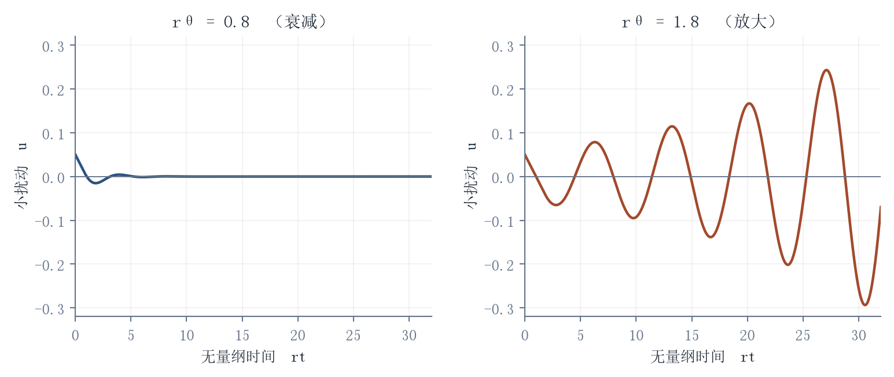

[目录](CONTENTS.md) · [English](../en/CONTENTS.md)

# 结语：在必然性中寻找自由

第六章把价值重构落到四条原则上，并指出文明仍然需要高阻力前沿：深空探测、深海作业、生态修复、基础科学与教育制度的重建。这些前沿的共同点是迫使智能重新接触材料、时间、风险与承责。这个判断建立在一个前提上：扩张的速率由制造能力决定，因此每一次提速都要在三组约束之间重新分配代价。自复制取消的正是这个前提。一个能够构造自身的系统，不再需要外部为它准备下一代，扩张速率由它自己的复制周期决定。如果这次取消是彻底的，前面所有的机制都要重写；如果不是，那么这一章的任务是把框架受到的这次冲击检查清楚，再回答全书开头提出的那个问题。

## 演化的辩证

把自复制当作压力测试，是因为它同时触碰了三组约束的来源。在通常的技术情形里，资源、时间和结构是外部的：有没有足够的资本，有没有足够的产能，有没有人愿意建这条产线。这些约束由制造者的处境给出，因此可以通过增加投入来放松。在一个能复制自身的系统里，同样的三类约束由系统所在的环境和它自身的物理过程给出，增加投入既买不到环境容量，也买不到更短的复制周期。制造者与复制系统的边界改变以后，需要重新核算资源、时间与结构的承担位置。它们是否还成立，要看三组变量在复制逻辑下各自变成了什么，而这次检查同时还要回答一个更尖锐的问题：如果连制造都可以被系统自己接管，那么“存在”这件事还剩下什么不可取消的判据。

### 自复制的热力学降维：指数增长的死锁

#### 从制造逻辑到复制逻辑

第六章末尾已经把自复制的三个条件列过（自复制、自维持、可变异与可继承），并给出复制保真度对信息长度的限制和行星尺度自组织的判据。那一节处理的是自复制作为一个物理事实意味着什么，这一节处理的是另一件事：如果这个事实成立，本书用来描述约束的那三个变量各自会变成什么。两者不重复，前者说明门槛在哪里，后者说明越过门槛之后约束以什么形式继续存在。

比较制造与复制，须先规定产能。固定产线在单位时间增加近似固定数量；能够持续构造新生产单元的系统，在输入充足、复制周期稳定时，可以近似指数增长。普通工业也能扩建产能，复制也要制造和维护自身，两者不是“线性成本”与“只付原料”的绝对对立。

自复制把一部分扩产分散到已有单元。新单元仍需原料、能源、空间、运输、校对和废物处理，增长速度同时受这些条件约束。微生物、树木与设想中的工程复制体各有不同周期，不能预先判定复制总比制造快。

两种逻辑的产出写成时间的函数，差别只有一处，

$$
N_{\text{制造}}(t)=1+\frac{t}{\tau_{\text{产线}}},
\qquad
N_{\text{复制}}(t)=2^{\,t/\tau_{\text{复制}}}
$$

$N$为相对于初始数量的累计产出倍数，两个时间参数分别表示固定产线新增一个单位的周期与复制系统的倍增周期。固定产能给出线性累计产出，资源充足且倍增周期稳定时，自复制给出指数增长。两者在$t=0$相等，之后是否先由产线领先，取决于初始斜率；若出现新的交点，应由完整方程求取。产线也可以被扩建，复制也受供给与环境限制，因此比较必须说明两边允许怎样的产能变化。

复制依赖持续的物质与能量输入。系统一面构造自身，一面排出废物和废热，扩张随之改变环境中的可用资源。资源稀缺仍然存在，表现为获取通量、空间、耗散与环境容量的限制。复制方式改变了供给的组织方式，也改变了约束显现的位置。

复制逻辑在原子世界里并不常见，这一点值得单独说明，因为它决定了后面讨论的适用范围。要在物质世界实现复制，需要同时具备三样东西：一份关于自身的描述、一套能读取描述并执行构造的通用机制，以及持续的物质与能量输入。生物细胞三样都有，因此生命是原子世界里最成熟的复制系统。人工系统目前只具备其中的一部分：设计可以由软件复制，制造却仍然依赖专用产线，而专用产线只能生产它被设计来生产的东西。这就是为什么在物质领域观察到的扩张大多仍是制造逻辑下的扩张，而复制逻辑一旦真正出现，其后果会与工程经验给出的直觉明显不同。中间形态已经存在：可打印的零件、可培养的组织、能自我修复的材料，它们各自具备了三样东西中的一两样，也各自在缺少的那一样上受限。

两种逻辑在成本结构上的差别还有一个常被忽略的后果。制造逻辑下，固定成本与可变成本都随规模增长，因此扩张的成本压力分散在每一条产线上，是可以逐步谈判的。复制逻辑下，固定成本集中在第一代，之后的可变成本只包含原料与能源，扩张的阻力因此集中到两处：一处是初代的设计与验证投入，另一处是环境的供给能力。前一处是一次性的，后一处是持续累积的，而当累积的那一处开始生效时，系统已经找不到可以谈判的对手，因为约束不在任何一个人手里。

#### 三组约束的重写

把 RTG 框架放到自复制系统上，三组约束各自换了形式，但都没有消失。

资源势垒从制造势垒变成摄取势垒。在制造逻辑下，要推动一次状态转移，需要先积累足够的资源并把它集中到产线上，这是一个需要规划和资本的过程。在复制逻辑下，资源不必被集中，它可以被就地摄取，只要环境中的浓度足够，系统就能持续复制。势垒因此从“能不能凑齐”变成“环境中还剩多少”，这是一个完全不同的问题：它不由工程能力决定，由生态容量决定。当摄取速率超过环境的再生速率，系统会耗竭它自己的资源基础，扩张在达到容量上限后转为崩溃，这条曲线在生态学和发酵工程里都被反复观察到。

时间刚性从生产周期变成复制周期。制造一个复杂产品需要经过若干道工序，每一道都有自己的时间常数，总周期是这些常数之和。复制一个系统只需要一个周期，即从摄取到完成自身复制的时间。这个时间通常比制造周期短得多，而且它不能被进一步压缩，因为它由内部的物理和化学过程决定。缩短复制周期的努力会遇到分子层面的极限，这与前面讨论过的时间刚性是同一类约束，只是尺度不同。拓扑耦合则从供应链变成扩散网络。在制造逻辑下，一个产品的落地需要配套的供应、物流、安装和维护网络，这些网络由人建立，因此受制于组织能力和投资意愿。在复制逻辑下，网络由扩散产生：复制品自身成为扩散的载体，节点之间的关系由物理接触或传播路径决定。这让扩散的速度极快，但也让控制变得极难，因为网络中不存在一个可以选择停止的中央节点。

#### 为什么这仍然是黏滞，而不是黏滞的消失

到这里可以回答本章开头提出的那一问：自复制的出现，有没有把约束整个取消。答案是自复制没有消除黏滞，它把黏滞从外部转到了内部，从制造环节转到了生态环节。在制造逻辑下，一个系统受到的约束来自它的制造者：有没有足够的资本，有没有足够的产能，有没有人愿意建这条产线。这些约束是外部的，因此可以通过增加投入来放松。在复制逻辑下，约束来自系统所在的环境和它自身的物理过程：环境能提供多少原料，复制周期有多长，扩散网络的拓扑允许它走多快，以及它的产物积累到一定程度后会如何改变环境。

**自复制不是消灭黏滞，而是把制造黏滞转化为生态黏滞。** 这个转化有两个重要的推论。第一，治理的对象变了。对制造逻辑下的技术，管制可以作用于生产环节：限制产能、审查产品、控制销售。对复制逻辑下的系统，这些手段大部分失效，因为复制不经过被管制的环节，它发生在系统与环境之间。有效的治理手段因此转向扩散控制：限制初始投放入量、提高复制所需的特殊条件、设置生物或化学上的自毁机制、建立早期监测网络。这些手段的共同点是它们不试图阻止复制本身，而是改变复制的边界条件。

第二，要比较识别、扩散和处置的时间。如果可靠判断需要很多个倍增周期，延迟就可能让暴露显著扩大。能否控制还取决于隔离、检测、依赖条件与干预力度，进入指数阶段并不意味着所有措施必然来不及。

把这句话写成条件，

$$
\frac{\tau_{\text{验证}}}{\tau_{\text{扩散}}}
\begin{cases}
\ll 1, & \text{验证能跟上扩散，风险可在早期判定},\\[2pt]
\gg 1, & \text{验证追不上扩散，风险只能在事后确认}
\end{cases}
$$

式中 $\tau_{\text{验证}}$ 为完成一次对系统后果的可靠判定所需的时间，单位是时间，它由毒性试验、临床观察、生态监测这一类的周期决定；$\tau_{\text{扩散}}$ 为系统数量翻一倍所需的时间，单位相同，对自复制系统就是复制周期。两者的比值是一个无量纲数，与前面各章用过的德博拉数是同一个量（被观测过程的特征时间与观测本身的特征时间之比），只是这里被观测的是扩散，观测者是需要给出判定的一方。这个比值说明为什么治理手段必须换：制造逻辑下的比值远小于 1，验证可以在投产之前完成，因此管制的抓手在生产环节；复制逻辑下这个比值反过来，等到验证给出结论，能被验证的对象已经扩散到了无法收回的规模，于是唯一的抓手只剩扩散的早期。适用边界是：这个判据假定 $\tau_{\text{扩散}}$ 在扩散过程中大致不变，而真实系统的复制周期会随环境资源浓度下降而延长，比值因此会随时间移动，判据要按阶段分别使用。

自复制仍然面对环境供给、周期、废物与反馈。资源限制可以使增长稳定，也可以与延迟共同产生振荡或过冲。需要用实际动力学区分，不能先把“没有均衡”写进结论。下面的延迟逻辑斯蒂模型正好显示稳定区间与失稳边界可以同时存在。

“没有可以停住的平台”这句话有一个精确的来源，值得写出来，因为它决定了这个结论成立的条件。带延迟的复制过程写成方程是

$$
\frac{dN}{dt}=rN\left(1-\frac{N(t-\theta)}{K}\right)
$$

$N$为复制单元数量，$r$为增长率，$K$为给定环境容量，$\theta$为反馈延迟。对式中的延迟逻辑斯蒂模型，正平衡点$N=K$的线性扰动满足$\dot u(t)=-r\,u(t-\theta)$。在$r>0$、参数固定时，$r\theta<\pi/2$给出局部渐近稳定，首个稳定性边界为$r\theta=\pi/2$；越过边界可能出现振荡，不能单由此判定资源耗尽或种群崩溃。真实系统的环境容量还可能改变，需要另设资源与损伤变量。制造与复制系统都可能存在反馈延迟，具体区别要由各自结构说明。

### 拟像的边界：以不可逆性定义存在

三组约束换了位置，但都还在。这个结果的意义不止于自复制本身，它给出了一条判定线：一个系统无论处理的是比特还是原子，只要它的扩张必须从环境中摄取物质和能量、必须把废热排出去、必须在既有结构中传导，它就没有离开物理世界。这条线画出来之后，就可以拿它去检查两个方向上的极端情形，一个是复制，另一个是表示。冯·诺依曼给出的形式化有一个副产品：一个系统的描述可以被复制而不被理解，这意味着描述能够脱离它所描述的东西独立流通。这一步之后，拟像不再只是一个关于图像的判断，它成为一种可以被工程化的机制，而机制有它的边界。

#### 压力测试的位置

自复制的物理能力一旦被某个系统获得，它就从制造逻辑进入了生命逻辑。这件事之所以要单独处理，是因为它是整套框架的压力测试。前面各章讨论的都是同一种情形：智能穿过现实，遇到资源、时间和结构的阻力，这些阻力限制了它沉降的速度。自复制改变的不是这些阻力的大小，而是它们的来源。如果这个改变使阻力消失，那么本书的全部论证都需要重写；如果阻力只是换了形式，那么框架可以保留，但需要扩展。

冯·诺依曼在二十世纪四十年代提出的自复制自动机，是这个问题最早的形式化版本。他问的是：一台机器能否在构造能力有限的情况下构造出包括自身在内的任何机器。答案是能，条件是它携带一份关于自身的描述，并且有一套通用的构造机制去读取这份描述。[^vonneumann1966theory] 这个构造后来被称为通用构造器，它的关键性质在于描述与构造被分离开来：描述可以被复制而不被理解，构造可以由通用机制执行而不依赖于内容。

这里需要说明本书从这个形式化里取走了什么、没有取走什么。取走的是分离本身：描述与构造可以分开，因此复制不必伴随理解，工程意义上的自复制是可能的。没有取走的是“自复制首先是一个逻辑问题”这个隐含定位。在冯·诺依曼的框架里，困难在于构造出一套能读取自身描述并执行它的通用机制，机制一旦存在，剩下的交给逻辑；而在本书的处理里，通用机制存在之后真正起作用的是另一组约束：复制一份描述在逻辑上很便宜，在物理上要消耗材料、占用时间、产生废热，并且必须沿着已有结构扩散。逻辑上可行的自复制与物理上会失控的自复制不是同一件事，两者的距离正是本章要用资源、时间与拓扑三组变量去写的部分。这个分歧也解释了为什么后文不引用通用构造器的完备性来论证自复制系统的危险性：完备性说明它能做成，不说明它做起来便宜或多快。

描述与构造的分离，使复制不必先伴随理解。实际复制仍依赖构造器、能量、材料与环境，扩张速率由整个系统共同决定。描述可以独立传播，也可能通过别处的构造过程产生后果；需要继续追踪的是这条转换边和责任落点。

#### 框架的边界

把自复制说成生态黏滞，有一个好处和一个风险。好处是它给出了一个统一的处理方式：不必为每一类自复制系统发明新的分析框架，只需把资源、时间、拓扑三组变量按生态过程重新定义。风险是它容易滑向一种宿命论，好像只要进入复制逻辑，结果就一定不可收拾。事实不是这样，生态过程有自己的调节机制：资源耗尽会终止扩张，捕食者会限制种群，突变会降低复制的保真度，空间结构会切断扩散路径。问题在于这些机制的响应时间通常在数年到数十年量级，而人类社会做出集体决定的时间尺度与之相当甚至更长，两者的竞争结果不确定。

给出一个诚实的结论：这里不能判断自复制系统会不会成为现实中的主要问题，这个判断取决于技术发展的具体路径和治理能力，而这两者都在变化。能够确定的是另一件事：如果它成为现实，它不会以“更快的制造”的形式出现，而会以“一种新的生态过程”的形式出现。把它放在全书的最后来处理，正是因为它是对前面所有机制的一次合并检验：资源约束仍然存在，只是变成了环境容量；时间约束仍然存在，只是变成了复制周期；拓扑约束仍然存在，只是变成了扩散网络。三组约束都在，只是换了位置。理解了这三组约束在正常技术条件下的作用方式，也就有了理解它们在极端条件下如何重组的工具。

剩下的问题是标准问题，不是机制问题：在知道了约束的形式之后，一个社会要如何决定哪些阻力值得保留、哪些必须消除、哪些代价不能转嫁。这个问题不依赖自复制是否发生，它由第六章的四条原则处理；自复制改变的只是这些决定的紧迫程度，因为留给判断的时间被扩散周期压缩了。

#### 以不可逆性定义存在

从框架的边界往里看，还有一个更基础的遗留问题：如果一个系统的描述可以完整地脱离它而流通，那么用什么来判定这个东西存在。日常语言给出的答案是真实与虚构的区分，而这个区分在使用中很快失效，因为一段可以被无限复制的表示并不因此变成假的，它只是没有重量。可以提供的判据是物理的：一个过程是否建立了一种不能在实践中被撤销的改变。发生过的意思是留下了一项无法被就地取消的痕迹；没有发生过的意思是它可以被重放、被覆盖、被回滚，而它的历史不构成对后续过程的约束。

可逆与不可逆描述后果的一个方面，不能代替存在与虚构的全部区分。生成文本可以被重写，也可以已影响决定；临床干预可能留下难以回收的身体后果。两者都真实发生，比较时要说明在什么边界、时间尺度上，哪些状态能够恢复，哪些影响仍然持续。

这里会出现一个合理的反驳：存储在任何介质上的字节也留下物理痕迹，也需要能耗和维护，那么可逆与不可逆的区分是不是也站不住。回答这个问题需要把判据限定在过程的时间尺度上。判据不是“有没有留下物理痕迹”，而是“这部分痕迹是否进入了所讨论的过程的约束条件”。一次生成所消耗的电力，相对于它要替代的那个决策而言是一个小数，可以在实践上视为可逆；一次浇筑或一次给药留下的改变，无法用追加的资源抵消，只能被后续的不可逆过程覆盖。所以判据是相对于观测尺度成立的，同一个系统在短尺度上表现为可逆，在长尺度上表现为不可逆。前面引进过的德博拉数正是描述这件事的量，它的含义与用法在附录里给出。

拟像的边界与框架的边界因此是同一条线。自复制系统之所以难治理，是因为它的扩散在治理所关心的尺度上是不可逆的：一旦进入指数阶段，干预来不及。生成式系统之所以容易被高估，是因为它的绝大部分操作在决策所关心的尺度上是可逆的：重来一次的成本很低，因此失败不留下后果。两种误判的方向相反，来源相同。判据给出之后，剩下一个更极端的场景需要处理，它把“用表示替代承受”这个动作推到极限，也因此把这条判据推到最容易失效的地方。

### 缸中之脑的物理死穴：基质的不可逃逸性

#### 被当作认识论问题的工程问题

缸中之脑在提出时是一个认识论问题：把一个人的大脑取出，放进维持生命的容器里，由一台计算机向它输送全部感官信号，这个人能否知道自己不在真实世界中。七十年来，围绕它的讨论几乎都落在“能否知道”这一侧：既然经验内容相同，主体就没有办法分辨。本书关心的是另一侧的问题，这个装置要运转起来需要什么。把问题从“能否知道”换成“需要什么”，答案立刻变得具体：需要一台泵，把营养液按足够的流量推过脑组织的微血管；需要一套供氧和供糖回路，在浓度差被耗尽之前把新的输送进来；需要一个温控系统，把代谢产生的热排出去；需要一张电极阵列，把信号写进神经组织；需要一套废液处理装置，把代谢产物带走；还需要电源，以及随时可以介入的维护人员。这张清单上的每一项都是物质的，没有一项能由软件替代。

灌注、器官保存与临床支持技术提供了部分相关机制的证据。它们的目标和时限不同，不能据此说一个保持完整意识和个人连续性的离体人脑已经得到工程实现。这里采用的是供给、排废、温度和长期稳定性这些可以分别检查的条件。

这个转换还有一个附带的好处：它把讨论从立场之争拉回可检验的层面。关于意识能否上传的争论通常在两个无法对话的立场之间打转，一方说经验不可还原为物质过程，另一方说物质过程之外没有别的东西。换成工程问题之后，双方都可以对同一张清单表态，而清单上的每一项都有公开的指标与失败记录，不需要先解决意识的本体地位。

#### 供养一具大脑的物理账本

人脑约 1.4 千克，占体重的 2%，消耗的氧和葡萄糖却占全身静息消耗的 20% 左右，换算成功率约 20 瓦。脑血流约每分钟 750 毫升，接近心输出量的六分之一。这组数字给出了装置的几个硬性下限。流量必须足以在可接受的浓度差下把氧和葡萄糖送进去，并把二氧化碳和代谢产物带出来；浓度差不能靠不断提高流量来加大，因为压力过高会损伤组织；温度必须保持在很窄的区间内，偏离几度就出现功能紊乱。脑组织对缺血的耐受也极短：血流中断数秒，神经元失去放电所需的条件，意识随之消失；中断数分钟，损伤不可逆。这说明维持一具大脑不是保持一个静态的对象，而是维持一个持续进行的过程，被保存的东西不是一份状态，是一条通量。

“流量必须足以……又不能过高”这两句话合起来，给供血流量夹出了一个窗口，

$$
\dot{Q}\ \ge\ \frac{\dot{m}}{\Delta C_{\max}},
\qquad
\dot{Q}\ \le\ \frac{\Delta p_{\max}}{R_{\text{血管}}}
$$

$\dot Q$为体积流量；$\dot m$和$\Delta C_{\max}$须针对同一种物质，分别采用单位时间的消耗量与可用浓度差，氧与葡萄糖不能直接相加。右侧采用线性水力阻力近似。实际脑循环还包含自调节、扩散与组织状态，这组式子只示意供给和压力条件，不能作为临床参数。

热是这份账目里最容易被忽略的一项。那 20 瓦必须有一个去处，而排热需要一个温度更低的环境。这个过程不能通过更聪明的算法来优化：计算能力的提升不改变热力学第二定律，也不改变“废热必须有冷库接收”这一条。装置的内部无论设计得多精巧，它的边界之外总要有泵、有电源、有散热面、有维护者。把意识上传到机器里，如果取字面意思，就是把这些设备一样不少地重建一遍；重建之后，装置所在的那个房间仍然在物理世界里，仍然需要有人照看，而照看它的人有下班时间。

这份支持还要满足连续性与故障处置要求。备用泵、供电、监测与切换，为短暂中断留下恢复余地。更好的设计可以降低它们的成本，长期维持的任务仍然需要在系统中完成。深空生命保障与这里具有相似的核算问题：工作过程及其支持条件，应放进同一边界。

器官保存、灌注与临床支持展示了部分维持机制。[^cameron2015organ] 保存时限与结果随器官、温度、灌注方法和用途变化。持续工作的脑组织还要获得代谢供给并排出热和产物，完整意识与个人连续性的维持则另需证据。这里能够明确追踪的，是供给、排废、温度与长期稳定性。

#### 写入通道的带宽与寿命

向这具大脑写入一个世界，需要一条写入通道。通道的容量受限于电极的数量、信号的质量和组织的耐受度。长期植入的电极会被胶质组织包裹，信号随时间的衰减是被反复记录到的现象[^polikov2005response]。这意味着写入通道不但是窄的，而且是会坏的，需要维护和更换。即使不去计算具体的比特数，也可以确定一件定性的事情：写入的保真度与通道的物理能力绑定，通道之外的细节只能被压缩，而压缩意味着丢失。一个完美的虚拟世界因此不是一个软件开发问题，它受制于同一组约束：有多少通道，能承受多大功率，能维持多久。

这三件事写成一个式子，就是这条通道的容量，

$$
C_{\text{通道}}(t)=n\,B\,\log_{2}\!\left(1+\frac{S}{N(t)}\right),
\qquad
\frac{dN}{dt}>0
$$

$C_{\text{通道}}$为所假设独立高斯噪声通道的容量，单位为比特每秒；$n$为独立通道数，$B$为每通道带宽，$S/N(t)$为信噪比。在高信噪比区间，信噪比翻倍使对数项约增加1；$S/N=1$时该项为1，$S/N=100$时约为6.66，增加约5.66。实际脑机接口还受通道相关性、组织响应和有效编码约束。长期植入可能改变噪声和记录质量，变化趋势应由测量确定。

与通道并列的是被写入那一侧的性质。生命系统有自己的时间常数，而这些常数不接受外来的压缩。伤口愈合按天计，神经发育有关键期，体温必须维持在 37 摄氏度附近的窄带内，偏离几度就是功能紊乱而不是性能下降。一个人可以在软件里瞬间回到上一个版本，却不能瞬间加速一段记忆的形成，也不能把一次手术后的恢复期折叠掉。这些时间常数不是当前技术的局限，它们是活体组织的运行条件，而装置里的组织仍然是活体组织。于是出现一个反直觉的结论：越是想要一个不受物理限制的心智，越需要一套严格的物理条件去维持承载它的那部分身体，而身体的时间常数比任何外部设备的都更难协商。

#### 替换论证的边界

另一种设想是逐步用功能等价的人工部件替代神经组织。能否操作、何谓功能等价、是否保留个人连续性与意识，需要不同证据，目前仍是假设。即使某种替代可行，它改变的也是基质种类；新系统仍有供电、散热、通信与维护条件。

这个区分就是**基质的不可逃逸性**：不是某一种材料不可替代，而是必须有某种材料，并且这种材料的性质会进入结果。一具需要 20 瓦、需要在几度的温区内运行、需要每分钟数百毫升通量的系统，与一具可以在常温下静置数年的系统，能做的事情不一样，出错的方式也不一样，而这两种性质不是可以随意互换的参数。替换论证还有一个它会自己撞上的边界：验证功能等价需要能够读出系统的行为，而读出需要接触。一个既不能被读也不能被写的系统，与不存在没有实践上的区别。把这一点说清楚之后，替换论证从“基质不必要”被改写成了“基质可选，但选择本身有代价”。

连接组研究正在扩大可检查的神经网络。2026年10月的一项预印本把果蝇脑与神经索连接图构造成脉冲网络，并接入模拟身体检验感觉运动行为。[^minnick2026sensorimotor] 这把线路、动力学与反馈放到一起研究，仍与完整人脑状态读取、逐个替换或心智转移有不同证据边界。

值得补一句的是，这个结论并不站在生物一侧。它不主张碳基优越，也不主张机器永远做不到。它主张的是一件更朴素的事：无论用什么材料，被维持的东西必须有一处物理的挂靠点，而这个挂靠点会把它自己的性质写进结果。承认这一点之后，讨论就可以从“能不能”转向“代价是多少、由谁支付”，而后者是可以被回答的。

#### 秩序的代价置换

把替换论证放回装置，内外两侧的性质差别会显示出来。装置内部的过程可以被回滚：信号可以重放，状态可以重置，一段经验可以重写。装置外部的供养过程不可以：泵会磨损，管路会污染，维护者会离开。内部经验与外部维持都属于装置的运行，后者规定了前者能够持续的条件。缸中之脑试图用表示替代承受，而它撞上的正是承受这一侧。装置里的经验无论多么完整，它的存续始终挂在装置外的几台设备和几个人的值班表上，而这几台设备一旦停下来，装置里的经验没有过渡地终止。

这一层关系在日常状态下不容易被看见，因为分工把它拆散了。一个人以远程方式完成的工作，其轻盈是以机房的电力、冷却和维护为条件的；他在屏幕前省下的通勤时间，对应着另一些人在机房、在变电站、在配送路上付出的时间。这些条件不进入他的工作界面，因此不在他的注意力范围内，但它们在他的界面之外是真实的、有承担者的责任。所谓无摩擦的生活并不是没有磨损，而是磨损被移到了看不见的地方，由另一些人承担。把这一层写清楚，不是为了要求谁去内疚，而是因为它决定了系统在什么时候会突然出问题：被移走的那部分代价并没有消失，它只是在等待一个结算的时点。

本章上半部分的三个问题到这里落在同一个位置上。指数扩张、拟像、缸中之脑，三者在不同的方向上试图保持表示的自由而绕开物理约束，又各自在不同的地方撞上了它所不能取消的那一组。这不是坏消息。约束被定位得越准确，可选择的空间就越清楚，而选择需要一套换过的评价尺度。

图 7.1. 延迟逻辑斯蒂模型在正平衡点附近的线性化：$\dot u=-ru(t-\theta)$。以常值小扰动历史作数值示意，$r\theta=0.8$时扰动衰减，$r\theta=1.8$时振荡放大；第一条局部稳定边界为$\pi/2$。曲线展示线性局部行为。

## 认知重塑与行动指南

全书从一个落差开始：方案以推理速度出现，现实通过多只时钟改变。把这条转换链看清，才能知道下一次提速究竟改善了什么。

### 走出图灵陷阱：能力、价值与资格分别判断

行为测试可以检验指定接口上的能力。它的结果属于测试条件，不能替代对持续运行、权利与责任的全部判断。一个系统能写出答案，能稳定提供服务，能代表他人作决定，是三种不同要求。

人的价值也不等于某项产出的稀缺程度。能力扩展人的选择，报酬受需求、产权与议价影响，尊严则不能随一种交付物的市场价格一起折算。生成变便宜以后，社会仍然可以把新增能力用于健康、教育、照护、关系、探索与公共参与。

这里的“负熵体验者”强调两件事：人依赖实际条件维持生命，也在有限生命中体验、选择和建立关系。热力学说明维持的物理条件，伦理与制度说明怎样的生命值得被保护，二者各自提供理由。

价值重新落在哪里，需要观察新的接口。候选生成可能让位于审查；自动检查成熟以后，规范与任务定义又可能成为重点；部署扩大以后，维护、救济与分配可能更加紧迫。接口会移动，职业清单也会过时。

每个位置都要重新问：它建立了什么可依赖结果，凭据在哪里，换一种安排能否更好地完成同一功能，谁能进入这套安排。社会必要性不会自动兑现为工作机会和高报酬，培训、支付与权力配置必须同时处理。

### 价值流向：跟踪稀缺的形成方式

稀缺有不同来源。验证需要与任务相称的证据；照护需要时间、技能、可达性，有时也需要特定的人；现场判断需要信息、能力与实际处置权；长期教育需要让学生形成能力的路径。工具可以改善每一项，承担这些功能的结构也要随之更新。

评价不能只看名称。审计可能变成盖章，经验要求可能变成排斥，所谓陪伴也可能只剩服务话术。需要检查的是结果与形成路径：出了错能否发现，依据能否复核，承诺是否兑现，受影响者能否提出异议。

高价同样不是必要性的证明。市场稀缺可能来自真实供给约束，也可能来自垄断和人为门槛；重要工作则可能因为预算不足而长期低薪。价值流向的分析，要与分配分析并排进行。

这条规则可以反复重算：每次成本下降以后，辨认旧凭据失去了什么区分力，新凭据需要通过什么过程形成，以及谁掌握形成过程。技术可以创造实际使用价值，也可以重排价值证明的位置；具体收益由完整结果判断。

### 降阻之前的三问

**被降掉的是什么？**先固定任务、质量、基准、时间与系统边界。起草变快是一项收益，获得可靠决定变快是另一项，需要分别取证。

**其他环节怎样变化？**检查复核、返工、能源、设备、支持、风险与恢复。成本可能转移，也可能净下降，还可能出现新的支出。不能预先假定每次降阻都必须在别处原样偿还。

**谁获得收益，谁承担余账？**把用户、劳动者、运营者、受影响第三方与未来义务列入比较。总成本下降，也可能伴随不均等的收益和负担。

对软件团队，三问把生成连接到审查、回归风险与维护。对临床服务，它把模型表现连接到具体用途、医师义务、患者权利与随访。对运营车队，它把车辆效率连接到空驶、覆盖、设施与事故处置。答案应当具体到能够改变方案。

审查过载，就比较候选筛选和处理能力；故障无法收束，就缩小作用范围或重做恢复；责任没有落点，就先建立可追问与可补偿的安排。表格只记录这些决定，实质检查仍须有人有能力、有时间并有权执行。

### 保留能生产能力的接口

个体可以保留一部分直接练习，使自己仍能理解、检查与修订所依赖的结果。学习语言时先写再改，维护代码时实际阅读和测试，学习判断时接触结果并解释失败。好的工具可以让练习更有效。

保留多少由任务决定。某些能力需要持续暴露，某些偶尔练习即可维持；有些旧步骤已经不再产生学习，应当删除。目的在能力，而不在展示手工、吃力或不用工具的身份。

个人条件也不同。时间、残障、照护、收入与疲劳改变可选安排，辅助工具往往正是在高障碍处扩大自主。组织不能一面只考核即时产出，一面要求劳动者在私人时间无偿保存所有长期能力。

组织需要维护的是复核与重建过程的能力：相称的记录、胜任的审查、独立质疑，以及真正能执行的中断和纠正权。这些功能需要角色、预算与权限，不能用一句“谨慎使用”替代。

### 让承担者保有有效位置

受影响者需要知情、参与、代表与救济。有些决定可由本人同意，有些需要专业职责、公共程序或对脆弱群体的保护。决策权要与能力和控制相称，承担损失的人则需要实际可用的质疑和补偿路径。

下一代工具会改变许多具体答案。这套方法仍可继续使用：辨认介质，分开约束，追踪行动，检查反馈，核对整本账。能力越强，越需要知道它通过什么路径成为现实。

## 负熵远征

下一代机器可以让答案更容易获得。文明仍要决定维持什么、发现什么，以及准备让谁承担什么代价。

“负熵”首先提醒一项物理事实：生命与工程系统可以使用资源、输出熵流，维持局部组织。它在这里也承载一层人的愿望：把新增能力用于值得持续的世界。物理账本说明维持的条件，不能替我们选择值得维持的状态。

### 形成与维持

复制给出了一个小而明确的例子。若$\varepsilon_0$为初始每位错误率，校对与修复的条件性残余因子分别为$f_{\text{校对}}$和$f_{\text{修复}}$，在可以采用乘法组合的模型中，

$$
\varepsilon_{\text{总}}=\varepsilon_0f_{\text{校对}}f_{\text{修复}},
\qquad
\mathbb E[M]=\varepsilon_{\text{总}}L .
$$

$M$为长度$L$上的错误数。期望错误数不等于至少发生一次错误的概率；保真度还依赖位置、上下文、相关性与修复机制。[^kunkel2000dna]

关键问题是：什么过程让结构在反复调用中保持可用。生物校对、程序测试、档案与机构复核采用不同机制，各自要核算成本和效果。

麦克斯韦妖把信息与物理边界之间的关系推得很深。信息可以引导操作，但循环的完整账本包括测量、存储与复位。兰道尔界限约束相应条件下的信息擦除，Bennett则梳理了计算、可逆性与妖的热力学。[^landauer1961][^bennett1982thermodynamics] 把存储与热库放在图外，一次聪明操作就可能显得免费。

同样的遗漏也会发生在AI接口。候选便宜，可能因为准备已被摊销、候选可以撤回，或确认发生在别处。这些都是真实技术优势。最终价值要看它们使怎样的完整过程成为可能。

### 丰裕扩大选择

文明可以用智能改善健康、基础设施、教育、发现与生态，也可以用它加剧注意力竞争，或把某个狭窄目标优化得极其充分。去向由产权、激励、公共安排、组织与个人项目共同塑造。

舒适在这幅图里有正当位置。减轻疼痛、重复劳动、排斥与无用等待，都是进步。生活还需要关系、好奇、自主投入，以及判断能够得到回应的地方。

高阻力前沿提供一部分这样的相遇。一次艰难实验，一套被持续维护的公共服务，一片逐步恢复的生态，一个人的成长，一段关系，一门学到足以判断工具的手艺，也提供同样的入口。规模不同，要求相通：结果要通过行动和后果建立。

### 在约束中扩大自由

自由需要可用的可能性，对相关边界的理解，以及足以作选择的权力和支持。好的工程降低资源障碍、改善过程、隔离依赖、提高测量并建立恢复路径；好的制度处理新增收益和剩余代价怎样分配。

智能的规模让这项工作更加紧迫。候选便宜以后，选择的质量更重要；行动加快以后，反馈的匹配更重要；作用范围扩大以后，授权和责任更重要。

负熵远征，就是把新增可能变成值得持续的世界。它需要强大的搜索，需要能够行动的身体与机器，需要足以打断说法的证据，也需要愿意承担长期账本的人和机构。

智能寻找路径。文明由它建成的路径、持续看见的后果，以及这些路径使之成为可能的生活塑造。

## 延伸阅读

- 薛定谔《生命是什么》（Cambridge University Press, 1944）
- 冯·诺依曼《自复制自动机理论》（Burks 编，University of Illinois Press, 1966）
- Nicholas Negroponte《数字化生存》（Alfred A. Knopf, 1995）
- William F. Ogburn《社会变迁》（B. W. Huebsch, 1922）
- William J. Baumol and William G. Bowen《表演艺术：经济的困境》（Twentieth Century Fund, 1966）
- 兰道尔《不可逆性与计算过程中的热产生》（IBM Journal of Research and Development, 1961）
- Markus Reiner《德博拉数》（Physics Today, 1964）
- 香农《通信的数学理论》（Bell System Technical Journal, 1948）

## 参考文献

[^vonneumann1966theory]: von Neumann, John. Theory of Self-Reproducing Automata. 1966.
[^cameron2015organ]: Cameron, Andrew M. and Cornejo, Jose F. Barandiaran. [Organ preservation review](https://doi.org/10.1097/MOT.0000000000000175). 2015.
[^polikov2005response]: Polikov, Vadim S. and Tresco, Patrick A. and Reichert, William M.. [Response of brain tissue to chronically implanted neural electrodes](https://doi.org/10.1016/j.jneumeth.2005.08.015). 2005.
[^minnick2026sensorimotor]: Minnick, John R. and Gonzalez-Ferrer, Jesus and Geng, Jinghui and Eshraghian, Jason K. and Mostajo-Radji, Mohammed A. and Haussler, David and Teodorescu, Mircea. [Sensorimotor Behaviour from an Untrained Brain-and-Nerve-Cord Connectome](https://arxiv.org/abs/2610.33881). 2026-10-24.
[^kunkel2000dna]: Kunkel, Thomas A. and Bebenek, Katarzyna. [DNA Replication Fidelity](https://doi.org/10.1146/annurev.biochem.69.1.497). 2000.
[^landauer1961]: Landauer, Rolf. [Irreversibility and Heat Generation in the Computing Process](https://doi.org/10.1147/rd.53.0183). 1961.
[^bennett1982thermodynamics]: Bennett, Charles H.. [The Thermodynamics of Computation: A Review](https://doi.org/10.1007/BF02084158). 1982.
